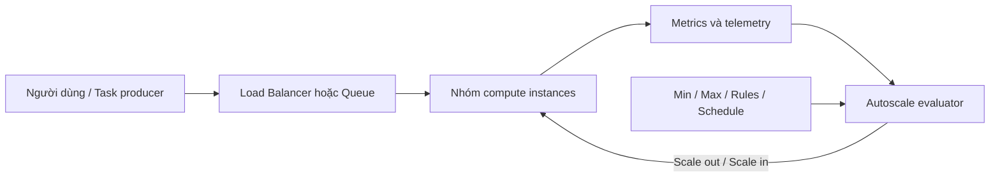
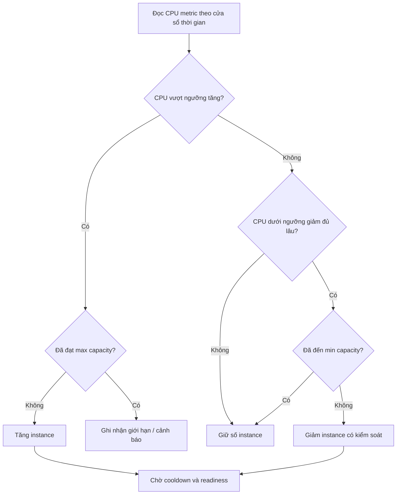
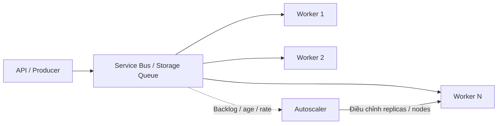
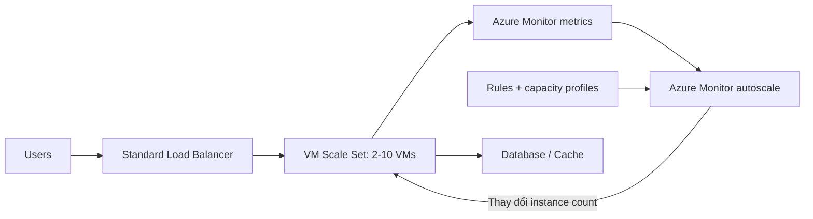
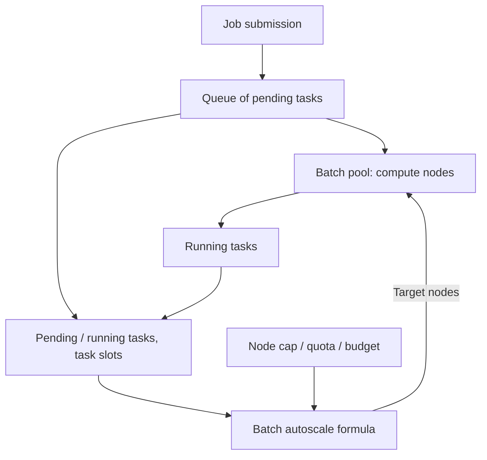

# Autoscale theo metric, lịch và nhu cầu tải

Một ứng dụng đặt trên Microsoft Azure không nhận lưu lượng đều đặn suốt ngày. Buổi sáng có thể chỉ vài trăm người dùng, giờ cao điểm hàng nghìn người đồng thời, còn ban đêm gần như không có truy cập. Hệ thống xử lý đơn hàng theo lô cũng có thể có hàng chục nghìn message chờ xử lý sau một đợt nhập dữ liệu. Giữ số lượng máy chủ đủ cho giờ cao điểm suốt 24 giờ làm tăng chi phí; giữ quá ít máy lại khiến độ trễ tăng, hàng đợi ùn tắc và yêu cầu của khách hàng thất bại.

**Autoscale** là cơ chế tự động điều chỉnh năng lực tính toán theo những tín hiệu hoặc chính sách đã định: chỉ số hiệu năng (**metric-based**), lịch hoạt động (**scheduled**) và nhu cầu công việc thực tế (**demand-driven**). Trên Azure, cách cấu hình autoscale phụ thuộc vào dịch vụ đích: **Azure Monitor autoscale** có thể điều chỉnh số instance của những tài nguyên được hỗ trợ như Virtual Machine Scale Sets (VMSS); còn Azure Functions, Azure Container Apps, Azure Kubernetes Service (AKS), App Service và Azure Batch có những cơ chế co giãn riêng hoặc bổ sung.

Bài học thuộc chương **Compute co giãn và xử lý theo lô** của mô-đun Microsoft Azure. Nội dung hướng dẫn cách lựa chọn tín hiệu, tính ngưỡng, kết hợp nhiều chế độ autoscale, thiết lập giới hạn chi phí, kiểm thử và quan sát hệ thống khi tăng hoặc giảm năng lực tính toán.

## Mục tiêu học tập

Sau bài học, bạn có thể:

1. Phân biệt **scale-out/scale-in** và **scale-up/scale-down**, cũng như autoscale phản ứng và mở rộng chủ động.
2. Thiết kế autoscale theo CPU, bộ nhớ hoặc metric ứng dụng, có **ngưỡng, cửa sổ quan sát, cooldown và min/max capacity**.
3. Kết hợp lịch cố định với metric để chuẩn bị trước giờ cao điểm và giảm tài nguyên ngoài giờ.
4. Chọn tín hiệu theo nhu cầu tải như request rate, hàng đợi, số task chờ hoặc độ đồng thời thay vì chỉ dựa vào CPU.
5. Tạo và đọc cấu hình **Azure Monitor autoscale** cho một VM Scale Set bằng Azure CLI.
6. So sánh các cơ chế autoscale phù hợp với VMSS, App Service, Azure Functions, Container Apps, AKS và Azure Batch.
7. Đánh giá rủi ro scale-in, thời gian khởi động, quota, tính sẵn sàng, bảo mật, giám sát và chi phí.

## 1. Autoscale giải quyết bài toán gì?

Giả sử một API thanh toán chạy trên VM Scale Set. Một VM xử lý ổn định khoảng 200 request/giây theo kết quả load test, trong khi lưu lượng thay đổi từ 200 đến 1.200 request/giây. Nếu luôn chạy tám VM, chi phí lúc vắng khách có thể cao hơn nhu cầu. Nếu chỉ chạy hai VM, hệ thống không đủ khả năng đáp ứng đợt truy cập lớn.

Một chính sách autoscale có thể bắt đầu với hai instance, tăng dần khi tín hiệu tải vượt ngưỡng và giảm khi lưu lượng duy trì ở mức thấp. Tuy nhiên, đây **không phải** phép đảm bảo luôn đủ máy: việc tạo instance mất thời gian, quota có thể bị giới hạn, downstream database có thể trở thành nút thắt và sức chứa mỗi VM chỉ là ước lượng từ phép thử.



Ở mô hình này, **autoscale controller** thay đổi số lượng tài nguyên, nhưng **load balancer, hàng đợi, ứng dụng và các thành phần dữ liệu** phải được thiết kế để tận dụng sự thay đổi đó. VM mới có thể được tạo thành công nhưng chưa phục vụ được traffic nếu ứng dụng chưa sẵn sàng hoặc health probe chưa đạt.

### 1.1. Scale out/in so với scale up/down

| Chiến lược | Thay đổi | Ví dụ | Điểm cần lưu ý |
|---|---|---|---|
| **Scale out** | Tăng số instance. | VMSS từ 2 lên 4 VM. | Dịch vụ phải hỗ trợ nhiều instance và phân phối tải. |
| **Scale in** | Giảm số instance. | VMSS từ 6 xuống 3 VM. | Cần drain kết nối, xử lý task dở và bảo vệ dữ liệu. |
| **Scale up** | Tăng cấu hình của một instance. | VM từ 2 vCPU lên 4 vCPU. | Có thể cần restart, thay đổi SKU hoặc thời gian gián đoạn. |
| **Scale down** | Giảm cấu hình của một instance. | Chọn VM size nhỏ hơn. | Dễ chạm giới hạn CPU/RAM/IOPS trong giờ cao điểm. |

Các quy tắc Azure Monitor autoscale cho VMSS chủ yếu điều chỉnh **instance count**, tức horizontal scaling. Không nên dùng từ “autoscale” để khẳng định mọi dịch vụ đều tự đổi VM SKU hoặc database tier; nhiều dịch vụ có cơ chế scale riêng và giới hạn khác nhau.

### 1.2. Autoscale phản ứng và chủ động

**Reactive scaling** chờ tín hiệu tải vượt ngưỡng rồi tăng tài nguyên. Nó phù hợp khi nhu cầu biến động và dữ liệu metric đủ nhanh. Nhược điểm là có độ trễ từ lúc tải tăng đến lúc instance mới sẵn sàng.

**Proactive/scheduled scaling** tăng số lượng instance **trước** một mốc tải được dự đoán từ lịch làm việc hoặc sự kiện đã biết. Nó giảm nguy cơ quá tải trong thời gian VM/container khởi động, nhưng có thể lãng phí nếu lịch tải không diễn ra như dự kiến.

**Demand-driven scaling** dùng tín hiệu gần nhu cầu công việc như số message chờ, số request đồng thời hoặc số task chưa xử lý. Nhiều hệ thống xử lý bất đồng bộ dùng cách này hiệu quả hơn chỉ số CPU.

## 2. Ba cơ chế autoscale cần phân biệt

| Cơ chế | Tín hiệu kích hoạt | Ưu điểm | Rủi ro |
|---|---|---|---|
| **Theo metric** | CPU > 70% trong 10 phút; latency tăng; throughput vượt ngưỡng. | Phản ứng theo trạng thái thực tế. | Dữ liệu trễ, chọn sai metric, tăng máy khi bottleneck ở database. |
| **Theo lịch** | 07:30 sáng ngày làm việc, tuần xử lý báo cáo, mùa khuyến mại. | Chuẩn bị trước khi tải xảy ra. | Không đáp ứng bất thường nếu chỉ dùng lịch. |
| **Theo nhu cầu tải** | Queue length, backlog age, pending tasks, active requests, concurrency. | Gần với lượng công việc cần xử lý. | Cần xử lý poison message, duplicate, task dài và thời gian khởi động. |

Ba cách không loại trừ nhau. Một hệ thống web có thể sử dụng **lịch** để tăng mức nền trước giờ mở bán và **metric CPU** để scale out thêm khi tải thực tế cao. Một hệ thống xử lý batch có thể dùng **queue backlog** để tính số worker cần chạy, kết hợp ngưỡng tối đa để giữ ngân sách.

## 3. Autoscale theo metric: hiểu tín hiệu trước khi đặt ngưỡng

**Metric** là số đo có đơn vị, thời điểm và cách tổng hợp. Không phải metric nào cũng phù hợp để quyết định số instance.

### 3.1. Những metric thường được cân nhắc

| Metric | Workload thích hợp | Cần cẩn thận |
|---|---|---|
| **Percentage CPU** | Web/API hoặc xử lý tính toán bị giới hạn CPU. | CPU thấp không có nghĩa API khỏe; có thể đang đợi database hoặc I/O. |
| **Memory utilization** | Workload bị giới hạn RAM, cache hoặc xử lý in-memory. | Metric bộ nhớ không có sẵn ở mọi tài nguyên; có thể cần guest telemetry hoặc custom metrics. |
| **Request count / request rate** | HTTP API có tải biến thiên. | Một request có thể rất nhẹ hoặc rất nặng; cần liên hệ với concurrency/latency. |
| **Response latency / p95/p99** | Dịch vụ có SLO về thời gian phản hồi. | Latency tăng do downstream bottleneck có thể không giảm khi tăng compute. |
| **Queue length** | Worker xử lý bất đồng bộ. | Tổng số task chưa phản ánh kích thước/thời gian xử lý từng task. |
| **Oldest message age** | Hệ thống cần kiểm soát thời gian chờ. | Cần biết retention, poison messages và cách metric được đo. |
| **Custom business metric** | Số đơn đang xử lý, số phiên đồng thời, công việc mỗi partition. | Cần đo đạc nhất quán, tránh tự phát hành metric nhiễu hoặc bị thao túng. |

Ví dụ một API có CPU 25% nhưng p95 latency 3 giây do SQL query chậm. Tăng từ 3 VM lên 12 VM có thể làm tăng số kết nối đến database và khiến hệ thống **tệ hơn**. Trước khi gắn metric vào autoscale, phải xác định điểm nghẽn thật bằng load test và telemetry của toàn bộ đường request.

### 3.2. Các tham số của một scale rule

Một rule đầy đủ cần trả lời:

1. **Metric nào?** Ví dụ `Percentage CPU` trên VM Scale Set.
2. **Tính theo phép tổng hợp nào?** Average, maximum, sum hoặc phép đo được dịch vụ hỗ trợ.
3. **Cửa sổ quan sát bao lâu?** Ví dụ trung bình 10 phút gần nhất.
4. **So với ngưỡng nào?** Ví dụ trên 70% thì tăng.
5. **Hành động gì?** Tăng thêm 1 instance, giảm 1 instance hoặc một mức được hỗ trợ.
6. **Cooldown bao lâu?** Ví dụ 10 phút sau hành động để tránh dao động liên tục.
7. **Ràng buộc min/max?** Không thấp hơn 2 hoặc vượt 10 instance.

**Ví dụ chính sách ban đầu, chưa phải giá trị tối ưu cho production:**

| Tham số | Scale out | Scale in |
|---|---|---|
| Metric | CPU trung bình | CPU trung bình |
| Điều kiện | `> 70%` trong 10 phút | `< 30%` trong 15 phút |
| Thay đổi instance | `+1` | `-1` |
| Cooldown | 10 phút | 15 phút |
| Giới hạn chung | Min 2, max 10 | Min 2, max 10 |

**Vì sao ngưỡng tăng và giảm khác nhau?** Nếu tăng khi CPU > 60% và giảm ngay khi CPU < 60%, hệ thống có thể liên tục thêm/bớt VM quanh mức 60%. Việc tách ngưỡng (70% và 30%), kết hợp cửa sổ và cooldown, tạo **hysteresis** để giảm hiện tượng *flapping*.



Sơ đồ mô tả ý tưởng điều khiển; thời điểm đánh giá, cách gộp nhiều rules và hành vi scale-in thực tế do Azure Monitor autoscale thực hiện theo cấu hình và tài nguyên. Không nên viết một vòng lặp tự tăng/giảm VM song song với autoscale mà không kiểm soát xung đột.

### 3.3. Cửa sổ đo và độ trễ metric

Nếu CPU vượt 70% trong 20 giây rồi trở lại bình thường, chính sách “trung bình 10 phút” có thể không kích hoạt. Điều này có thể tốt với spike rất ngắn nhưng không phù hợp nếu chỉ 30 giây quá tải đã gây lỗi thanh toán. Ngược lại, dùng metric tức thời dễ khuếch đại nhiễu.

Để chọn cửa sổ, cần xem:

- Mức tải tăng nhanh ra sao, và độ trễ cho phép của ứng dụng.
- Thời gian Azure thu thập/công bố metric, granularity và khả năng metric bị thiếu.
- Thời gian khởi động instance và thời gian đi qua health/readiness checks.
- Tốc độ hàng đợi tích lũy khi thiếu năng lực và khả năng backlog tự giải tỏa.

Chọn rule dựa trên **đo đạc** và SLO, không sao chép một ngưỡng CPU từ bài hướng dẫn sang mọi workload.

## 4. Autoscale theo lịch: chuẩn bị trước tải có thể dự đoán

Giả sử cổng đăng ký nội bộ đông người từ 08:00 đến 18:00 các ngày làm việc; ngoài giờ lượng truy cập thấp. Thay vì chờ CPU tăng lúc 08:00 mới tạo VM, hệ thống có thể tăng **minimum/default capacity** trước giờ cao điểm một khoảng tương ứng với thời gian khởi động và warm-up.

| Khung thời gian ví dụ | Mức nền gợi ý | Rule metric vẫn có thể áp dụng? |
|---|---|---|
| Thứ 2–6, 07:30–18:30 | Min 4, max 12 | Có, để phản ứng khi tải bất thường. |
| Ngoài giờ cao điểm | Min 2, max 6 | Có, giữ mức an toàn và hạn chế chi phí. |
| Sự kiện đặc biệt đã biết | Min 8, max 20 trong khoảng được phê duyệt | Có, nhưng phải kiểm tra quota và downstream. |

Với **Azure Monitor autoscale**, có thể sử dụng **profiles** để định nghĩa capacity và rules, sau đó chọn **recurring schedule** hoặc **fixed-date schedule** theo khả năng dịch vụ và giao diện cấu hình. Một profile áp dụng theo lịch có thể thay đổi mức min/max/default so với profile còn lại. Sắp xếp lịch và profile mặc định rõ ràng để tránh ngoài giờ hệ thống giữ mãi mức capacity cao.

### 4.1. Recurring schedule và fixed-date schedule

- **Recurring schedule:** lặp theo ngày/tuần, ví dụ thứ 2–6 lúc 07:30. Phù hợp giờ làm việc hoặc đợt batch hằng đêm.
- **Fixed-date schedule:** một giai đoạn có ngày bắt đầu/kết thúc, ví dụ chiến dịch khuyến mại hoặc kỳ thi trực tuyến. Phù hợp đợt cao điểm đã lên kế hoạch.
- **Default profile:** cần được xác định để tài nguyên quay về hành vi bình thường khi không có schedule đặc biệt áp dụng.

**Múi giờ quan trọng:** khi nhập giờ trong cấu hình autoscale, hãy xác định tên timezone mà dịch vụ yêu cầu và tác động daylight saving của những khu vực có DST. Với hệ thống vận hành ở Việt Nam (UTC+7), cần kiểm tra dữ liệu cấu hình phản ánh đúng múi giờ mong muốn. Không suy đoán rằng 07:30 trong máy tính cá nhân luôn tương đương 07:30 trong resource configuration.

### 4.2. Lịch không thay thế metric

Một sự kiện bất thường có thể diễn ra ngoài giờ dự kiến. Nếu chỉ giữ lịch mà bỏ dynamic rules, ứng dụng có thể thiếu năng lực trong một đợt truy cập tăng đột ngột. Thiết kế tốt thường đặt **mức nền theo lịch** và để **quy tắc metric** điều chỉnh thêm trong khung min/max của profile đang có hiệu lực.

Ngược lại, nếu tạo nhiều lịch trùng nhau với các mức capacity mâu thuẫn, rất khó biết profile nào đang hoạt động. Cần lập bảng ưu tiên, tài liệu owner và kiểm thử tại thời điểm chuyển giao profile.

## 5. Autoscale theo nhu cầu tải: hàng đợi, tác vụ và concurrency

Đối với hệ thống xử lý bất đồng bộ, CPU không phải lúc nào cũng phản ánh số công việc chưa giải quyết. Một worker có thể chờ I/O nhưng vẫn còn hàng nghìn message trong queue; hoặc CPU cao do một task rất nặng trong khi backlog gần như bằng 0. Khi đó nên xem xét metric **độ dài hàng đợi**, **tuổi message lâu nhất**, **pending tasks**, **số request đang xử lý** hoặc các tín hiệu kinh doanh phù hợp.



Các worker cần xử lý message theo cách có thể retry, không tạo tác dụng phụ trùng lặp, và chỉ xóa/ack message khi đã hoàn thành công việc thành công theo semantics của queue. Khi scale-in, không được bỏ dở tác vụ và mất dữ liệu.

### 5.1. Ví dụ tính capacity từ queue backlog

Giả sử hệ thống có:

- **1.800 message** đang chờ.
- Thời gian xử lý trung bình **2 giây/message**.
- Mỗi worker instance xử lý tối đa **4 message đồng thời** một cách ổn định.
- Mục tiêu xóa backlog hiện tại trong **5 phút = 300 giây**.

Ước lượng số worker tối thiểu khi **không có message mới đến**:

\[
N_{\text{workers}}\;\approx\;\left\lceil\frac{B\times t}{T\times c}\right\rceil
\]

Trong đó `B` là số message, `t` là giây xử lý trung bình/message, `T` là thời gian mục tiêu, `c` là concurrency của một worker.

\[
N_{\text{workers}}\;\approx\;\left\lceil\frac{1{,}800\times 2}{300\times 4}\right\rceil=3
\]

**Ba worker chỉ là ước tính lý tưởng.** Trong thực tế, cần tính thêm tốc độ message mới đến, độ chênh thời gian xử lý, thời gian provision, lỗi/retry, concurrency thực tế và giới hạn của downstream. Nếu nhà sản xuất message đưa vào queue nhanh hơn năng lực tiêu thụ, backlog sẽ tiếp tục tăng dù vừa scale out.

Một phương pháp khác là đo **arrival rate** (message/giây) và **service rate** (message/giây/worker):

\[
N_{\text{duy-trì}}\gtrsim\left\lceil\frac{\lambda}{\mu}\right\rceil
\]

Với `λ` là tốc độ message đến, `μ` là tốc độ xử lý hữu hiệu của một worker. Sau đó cộng dung lượng bổ sung để giải tỏa backlog cũ trong thời gian yêu cầu. Cần quan sát số lượng retry/dead-letter để tránh tăng worker vô hạn khi một poison message không thể xử lý.

### 5.2. Những giới hạn khiến queue-based scaling thất bại

| Vấn đề | Hệ quả | Cách thiết kế |
|---|---|---|
| Message có thời gian xử lý rất khác nhau. | Queue length không đại diện chính xác lượng công việc. | Theo dõi thời gian xử lý và oldest-message age, phân luồng loại task. |
| Message bị retry liên tục hoặc poison. | Backlog luôn cao, autoscale liên tục chạm max. | Dead-letter, retry budget, cảnh báo và xử lý lỗi gốc. |
| Database/API downstream có giới hạn. | Thêm worker làm downstream quá tải hơn. | Rate limit, concurrency cap và kiểm tra dependency. |
| Worker bị scale-in khi đang xử lý. | Tác vụ dở, có thể trùng lặp hoặc mất kết quả nếu code sai. | Graceful shutdown, visibility lock/renew, idempotency. |
| Provisioning mất vài phút. | Hàng đợi tăng nhanh trong khi chờ instance mới. | Min warm instances hoặc lịch scale-out trước đợt batch. |
| Max capacity quá thấp hoặc quota thiếu. | Không đạt SLO xử lý task. | Capacity planning, quota review và cảnh báo saturation. |

## 6. Các dịch vụ Azure có cơ chế autoscale khác nhau

Không có một lệnh autoscale chung cho mọi dịch vụ Azure. Chọn cơ chế đúng với tài nguyên mà bạn thực sự vận hành.

| Dịch vụ | Cơ chế scale thường dùng | Tín hiệu và điều kiện cần kiểm tra |
|---|---|---|
| **Virtual Machine Scale Sets (VMSS)** | **Azure Monitor autoscale** điều chỉnh instance count; VMSS cũng có thể tích hợp các tính năng scaling khác tùy cấu hình. | CPU, các metrics được hỗ trợ, min/max và readiness của instance. |
| **Azure App Service** | Scale out theo khả năng của App Service plan và các tùy chọn **Azure Monitor autoscale** hoặc **automatic scaling** riêng, tùy tier/tính năng. | CPU, memory/request load theo mode được hỗ trợ; giới hạn plan, warm-up. |
| **Azure Functions** | Cơ chế event-driven scaling theo hosting plan (Consumption, Flex Consumption, Premium hoặc các loại plan hỗ trợ). | Số sự kiện, trigger concurrency, số instance tối đa, cold start. |
| **Azure Container Apps** | Scale rules dựa trên **KEDA**, kể cả HTTP và nhiều nguồn sự kiện khác theo khả năng. | Min/max replicas, queue/event scaler, cooldown và revision. |
| **AKS** | **Horizontal Pod Autoscaler (HPA)**, **Cluster Autoscaler**, **KEDA** cho sự kiện; các cơ chế bổ trợ khác. | Pod CPU/memory/custom metrics, số node khả dụng, request/limit, scheduling. |
| **Azure Batch** | Autoscale công suất **pool compute nodes** bằng công thức theo nhiệm vụ/metric Batch hoặc cơ chế riêng được cấu hình. | Pending/running tasks, task slots, allocation time, job deadlines. |

Ví dụ, với **AKS**, HPA tăng số **pod replicas** nhưng không mặc nhiên thêm node nếu cluster không còn tài nguyên để schedule pod. **Cluster Autoscaler** mới là thành phần xem xét tăng/giảm số node phù hợp với các pod đang chờ, theo khả năng cấu hình. Với **Container Apps**, scale theo event có thể về 0 replica trong các cấu hình hỗ trợ, nhưng thời gian cold start và các giới hạn về loại workload cần được tính.

Với **Azure Functions**, scale behavior chịu ảnh hưởng của hosting plan, trigger, concurrency settings và giới hạn của runtime; không nên lấy một CPU threshold dùng cho VMSS để cấu hình y hệt cho Functions. Với **App Service**, phân biệt rõ chế độ automatic scaling của App Service với rules/profiles của Azure Monitor autoscale, vì cách cấu hình và tính năng có thể khác nhau.

## 7. Kiến trúc VM Scale Set kết hợp Load Balancer và Azure Monitor

Một mô hình phổ biến cho web/API tự quản trên VMSS:



Các điều kiện để mô hình hoạt động:

- VMSS đã có VM image/configuration, networking, identity, bootstrapping và health/readiness phù hợp.
- Load Balancer hoặc thành phần nhận traffic chỉ gửi request tới instance thực sự sẵn sàng.
- Instance mới tự cấu hình được bằng cloud-init, extension hoặc pipeline tương đương; không cần người vận hành SSH vào cài thủ công.
- Session hoặc trạng thái công việc quan trọng không chỉ nằm trên một VM sắp bị loại; cân nhắc lưu trạng thái ngoài VM.
- Database/cache/queue có đủ capacity để nhận tải sau khi VMSS scale out.
- Min/max capacity, quota vCPU, SKU và zone có đủ nguồn lực hoặc có phương án xử lý khi không cấp phát được instance mới.

**Autoscale và health probe giải quyết hai phần khác nhau.** Autoscale quyết định **cần bao nhiêu instance**; health/readiness quyết định **instance nào có thể nhận traffic**. Nếu autoscale thêm máy nhưng ứng dụng mất 8 phút để sẵn sàng, chính sách chỉ nhìn CPU trong 1 phút có thể phản ứng quá muộn hoặc chồng nhiều đợt scale không cần thiết.

## 8. Thực hành Azure CLI: autoscale VMSS theo CPU

Ví dụ dưới đây sử dụng một **VM Scale Set đã tồn tại** để tập trung vào cấu hình scaling, không tạo VMSS mới. Các lệnh thay đổi số instance mục tiêu khi điều kiện xảy ra; chỉ thực hiện trong môi trường thử nghiệm đã được phép thay đổi capacity và phát sinh chi phí.

### 8.1. Điều kiện chuẩn bị

- Một subscription đã đăng nhập Azure CLI và resource group chứa VMSS.
- VMSS có quyền quản lý được cấp cho danh tính thao tác, dùng một SKU/tier hỗ trợ tính năng autoscale tương ứng.
- Azure Monitor có metric `Percentage CPU` phù hợp với VMSS đang kiểm tra.
- Hệ thống có sẵn image, health checks, load balancing và khả năng thêm/bớt instance an toàn.
- Đã đối chiếu quota compute, capacity tối đa, kế hoạch ngân sách và ảnh hưởng khi scale-in.

Các tùy chọn của Azure CLI có thể thay đổi theo phiên bản/extension; kiểm tra `az monitor autoscale -h` và tài liệu lệnh hiện hành trong môi trường nếu gặp khác biệt. Ví dụ dùng cú pháp Bash, thay placeholder bằng giá trị thực.

### Bước 1. Xác định tài nguyên đích

```bash
az login
az account list --output table
az account set --subscription "<subscription-id>"

RG="rg-compute-lab"
VMSS="vmss-api-lab"
AUTOSCALE="autoscale-api-lab"

VMSS_ID="$(az vmss show \
  --resource-group "$RG" \
  --name "$VMSS" \
  --query id --output tsv)"

az vmss show \
  --resource-group "$RG" \
  --name "$VMSS" \
  --query "{name:name,location:location,sku:sku.name,capacity:sku.capacity,id:id}" \
  --output json
```

Xác nhận `VMSS_ID` là tài nguyên muốn thay đổi và capacity hiện tại phù hợp với kế hoạch. **Không** dán ID của VMSS production vào một bài lab rồi chạy ngay: autoscale có thể xóa/bổ sung instance của workload đang hoạt động.

### Bước 2. Tạo autoscale setting với mức tối thiểu/tối đa

```bash
az monitor autoscale create \
  --resource-group "$RG" \
  --name "$AUTOSCALE" \
  --resource "$VMSS_ID" \
  --min-count 2 \
  --max-count 10 \
  --count 2
```

`min-count` và `max-count` là guardrail capacity. `count` xác định capacity mặc định trong profile được tạo; không nên nhầm nó với cam kết **ngay lập tức** scale VMSS về chính xác 2 instance bất kể cấu hình và lịch đánh giá. Sau bước này, thêm rules và kiểm tra cấu hình. Nếu dùng ứng dụng quan trọng cần khả dụng cao, min = 2 chỉ là ví dụ; hãy chọn mức nền dựa trên yêu cầu zone và SLO.

### Bước 3. Thêm rule tăng instance khi CPU cao

```bash
az monitor autoscale rule create \
  --resource-group "$RG" \
  --autoscale-name "$AUTOSCALE" \
  --condition "Percentage CPU > 70 avg 10m" \
  --scale out 1 \
  --cooldown 10
```

Ý nghĩa: nếu điều kiện CPU trung bình trong khoảng quan sát đáp ứng rule, autoscale có thể tăng **một instance** trong phạm vi min/max, đồng thời tuân thủ cooldown và quy tắc đánh giá của dịch vụ. `avg 10m` là cấu trúc điều kiện theo cú pháp Azure CLI autoscale, không phải cú pháp truy vấn Prometheus.

### Bước 4. Thêm rule giảm instance khi CPU duy trì thấp

```bash
az monitor autoscale rule create \
  --resource-group "$RG" \
  --autoscale-name "$AUTOSCALE" \
  --condition "Percentage CPU < 30 avg 15m" \
  --scale in 1 \
  --cooldown 15
```

Rule giảm sử dụng ngưỡng thấp hơn và cửa sổ dài hơn để hạn chế scale-in quá sớm. Với workload giữ phiên dài, công việc đang xử lý hoặc cần drain, **hãy kiểm tra chính sách loại instance và khả năng graceful shutdown** trước khi bật scale-in tự động trên production. Thêm rule CPU thấp không có nghĩa Azure sẽ dừng một VM đang chạy job một cách an toàn ở cấp ứng dụng.

### Bước 5. Đọc lại cấu hình autoscale và VMSS

```bash
az monitor autoscale show \
  --resource-group "$RG" \
  --name "$AUTOSCALE" \
  --query "{name:name,enabled:enabled,target:targetResourceUri,profiles:profiles[].{name:name,capacity:capacity,rules:rules}}" \
  --output json

az vmss show \
  --resource-group "$RG" \
  --name "$VMSS" \
  --query "{name:name,capacity:sku.capacity}" \
  --output json
```

Kiểm tra target resource, capacity và rules đã được lưu. **Chỉ đọc được cấu hình không chứng minh scaling đã hoạt động**; cần theo dõi metric, autoscale run history, Activity Log và số instance thực tế khi có tải phù hợp.

### Bước 6. Thử tải có kiểm soát

Trong bài lab, tạo lưu lượng thử qua kịch bản load test đã được tổ chức cho phép, không gửi lượng request lớn đến production hoặc hệ thống bên thứ ba. Quan sát:

1. CPU metric có tăng đúng resource/dimension mà rule đang theo dõi không?
2. Azure Monitor autoscale có ghi sự kiện đánh giá/scale action tương ứng không?
3. Instance count có tăng trong giới hạn max và có lỗi allocation/quota không?
4. Instance mới có hoàn tất provisioning, bootstrap và health/readiness không?
5. Latency và error rate của ứng dụng có giảm sau khi instance bắt đầu phục vụ không?
6. Khi hạ tải, hệ thống có scale-in an toàn và trở về mức nền hay không?

Ghi lại kết quả để tinh chỉnh threshold/cooldown. Không kết luận chính sách đúng chỉ vì nhìn thấy CPU giảm: có thể đó là do test đã kết thúc, không phải do autoscale.

### Bước 7. Kết thúc bài lab

Nếu autoscale setting này chỉ thuộc bài lab và đã được xác nhận không ảnh hưởng workload khác, quản trị viên có thể xóa cấu hình thử nghiệm theo quy trình riêng. Không tự ý xóa VMSS hoặc resource group vì chúng có thể đang chứa tài nguyên dùng chung. Xác nhận lại **instance count, số VM còn chạy và chi phí** sau khi kết thúc.

## 9. Cấu hình lịch trong Azure Portal

Để minh họa kết hợp lịch và metric mà không phụ thuộc vào cú pháp deployment template, có thể cấu hình **recurring profiles** của Azure Monitor autoscale trong Azure Portal trên tài nguyên hỗ trợ:

1. Mở VM Scale Set đã chọn, tìm mục **Scaling** hoặc mục autoscale tương ứng và chuyển tới cấu hình dựa trên Azure Monitor nếu được hỗ trợ.
2. Tạo hoặc kiểm tra autoscale setting có profile mặc định với min = 2, max = 6, default = 2.
3. Tạo một profile lịch cho ngày làm việc bắt đầu **07:30** theo timezone đã xác nhận, ví dụ min = 4, max = 12, default = 4.
4. Định nghĩa các rules trong profile cần dùng hoặc kiểm tra chúng được áp dụng đúng khi profile có hiệu lực.
5. Cấu hình đường trở về profile ngoài giờ/default và xử lý ngày nghỉ; kiểm tra hành vi tại điểm chuyển profile.
6. Giám sát instance count và autoscale history trong ít nhất một chu kỳ lịch trước khi đưa vào sản xuất.

Nếu Portal hoặc loại tài nguyên có giao diện khác, hãy dựa vào cách cấu hình autoscale của dịch vụ tương ứng; không kết luận mọi Azure resource đều có cùng trang Autoscale. Với chiến dịch ngày cố định, có thể cân nhắc fixed-date profile và thời gian kết thúc rõ ràng.

**Không nên lập lịch scale-in ngay lúc hệ thống đang xử lý giao dịch cuối ngày.** Nếu API cần hoàn tất request dài hoặc worker đang ghi kết quả, phải có thời gian drain và retry hợp lệ, hoặc đặt một lịch sau khi batch đã kết thúc.

## 10. Azure Batch: autoscale theo số task cần xử lý

**Azure Batch** chạy các công việc xử lý theo lô trên các compute nodes thuộc **pool**. Khác với một API web, Batch thường quan tâm đến số **pending tasks**, số **running tasks**, số task slots mỗi node và thời hạn phải hoàn thành job. Với Azure Batch, autoscale pool có thể sử dụng **công thức autoscale của Batch** theo các biến/số liệu được dịch vụ cung cấp.

### 10.1. Mô hình Batch autoscale



Một nguyên tắc đơn giản là tăng nodes khi pending tasks tăng và giảm khi không còn task chờ. Nhưng một task có thể mất 2 giây hoặc 2 giờ, nên công thức còn phải xem task slots, tốc độ xử lý và thời gian cấp phát node.

**Pseudocode ý tưởng (không phải công thức Batch có thể dán trực tiếp):**

```text
pending = numberOfPendingTasks()
running = numberOfRunningTasks()
slotsPerNode = configuredTaskSlotsPerNode

requiredNodes = ceil((pending + running) / slotsPerNode)
targetNodes = clamp(requiredNodes, minNodes, maxNodes)

if thereAreRunningTasks and scaleInIsRequested:
    applyAppropriateNodeDeallocationPolicy()
```

Trong triển khai thật, **ngôn ngữ công thức Azure Batch** có biến, hàm, khoảng lấy mẫu và quy tắc riêng; phải chuyển pseudocode sang cú pháp được Batch hỗ trợ và kiểm tra công thức trước khi bật autoscale. Cần chọn chính sách **node deallocation** để xử lý các task đang chạy khi giảm nodes. Một số kịch bản có thể giữ nodes trong thời gian chờ cấp phát/khởi động task; việc **scale về 0** chỉ thích hợp khi job và hạ tầng cho phép.

### 10.2. Tối ưu theo thời hạn job

Giả sử 20.000 task phải hoàn thành trước 06:00. Nếu mỗi node xử lý trung bình 100 task/giờ và chỉ còn 2 giờ, một ước tính lý tưởng là 100 nodes, chưa tính failure, job overhead và quota. Nếu Azure Batch pool chỉ có quota tối đa 40 nodes, autoscale **không thể tự phá giới hạn quota**. Bạn cần xin quota phù hợp, tối ưu parallelism, thay đổi deadline hoặc phân phối workload theo kiến trúc được phê duyệt.

Với các job dùng spot/low-priority nodes khi dịch vụ hỗ trợ, cần tính rủi ro bị thu hồi và khả năng retry của task. Không dùng một con số target nodes từ công thức làm cam kết rằng tất cả nodes chắc chắn được cấp phát và tất cả task chắc chắn hoàn thành đúng hạn.

## 11. Chọn min/max capacity theo SLO và ngân sách

Một chính sách autoscale tốt có thể bắt đầu từ ba mức:

- **Min capacity:** đủ để xử lý traffic nền, giữ tính sẵn sàng và hạn chế cold start.
- **Max capacity:** giới hạn chi phí và bảo vệ downstream/quota; không phải chỉ đặt giá trị rất lớn cho yên tâm.
- **Default capacity:** mức chuẩn khi profile hoặc metric không kích hoạt hành động scale; phải phù hợp với tải bình thường.

### 11.1. Tính capacity từ tải đo được

Giả sử load test cho thấy mỗi VM phục vụ ổn định **120 request/giây** khi còn giữ CPU và p95 latency trong SLO. Dự báo tải đỉnh **600 request/giây**, hệ số dự phòng **20%**:

\[
N_{\text{peak}}=\left\lceil\frac{600\times1.2}{120}\right\rceil=6
\]

**Sáu VM là giá trị lập kế hoạch sơ bộ**, cần kiểm tra hiệu năng ở nhiều mức tải, phân phối kết nối, giới hạn bandwidth/IOPS của VM, database và cache. Nếu VM cần 4 phút để sẵn sàng, ngưỡng scale-out phải được thiết kế để kích hoạt **trước khi** hệ thống chạm giới hạn chịu tải, hoặc dùng scheduled warm capacity cho đợt tải đã biết.

### 11.2. Min = 0 có phù hợp không?

Một số nền tảng event-driven/serverless hỗ trợ scale về 0, giúp tiết kiệm khi không có công việc. Nhưng **VM Scale Sets, App Service plans và các loại hosting khác không có cùng khả năng hoặc ngữ nghĩa**. Với dịch vụ cần kết nối liên tục, xử lý nền hoặc p99 latency chặt chẽ, min = 0 có thể gây cold start hoặc không được hỗ trợ.

Đừng viết một tiêu chí “min = 0 cho mọi môi trường test” khi nền tảng không cho phép hoặc ứng dụng cần hoàn tất công việc nền. Hãy đọc chính sách scale-to-zero và billing của đúng dịch vụ.

### 11.3. Chi phí không chỉ là giá mỗi VM

```text
Chi phí co giãn gần đúng
  = thời gian chạy của compute instances / replicas
  + disk / network / load balancing / public IP
  + lưu lượng dữ liệu và các dịch vụ downstream
  + log, metric, alert và những dịch vụ liên quan
  + chi phí khởi động, dữ liệu tạm và vận hành
```

Scale-in giảm chi phí compute khi workload thật sự giảm, nhưng không nhất thiết giảm phí storage hoặc toàn bộ hạ tầng khác. Ví dụ, disk, IP hoặc log retention có thể vẫn được tính phí theo chính sách riêng. Dùng **Azure Pricing Calculator** để dự toán và **Azure Cost Management** để theo dõi thực tế; đặt cảnh báo ngân sách, tags và owner cho cấu hình autoscale.

## 12. Chống flapping, scale storm và scale-in không an toàn

### 12.1. Flapping và scale storm

**Flapping** là hiện tượng số instance tăng/giảm liên tục quanh một ngưỡng. **Scale storm** là việc nhiều hành động scale diễn ra quá nhanh, khiến hạ tầng liên tục provisioning nhưng chưa cải thiện tải.

Biện pháp:

1. Dùng **ngưỡng scale-out và scale-in khác nhau**.
2. Scale-in theo cửa sổ lâu hơn nếu workload biến động mạnh.
3. Chọn cooldown phù hợp với thời gian tạo instance và thời gian hệ thống ổn định.
4. Không cùng lúc vận hành nhiều automation/controller thay đổi instance count mà không có chính sách quyền sở hữu rõ ràng.
5. Đặt max capacity và cảnh báo nếu chạm max lâu, thay vì cho rằng tăng VM vô hạn là cách chữa mọi lỗi.

Khi có nhiều rules trong một Azure Monitor autoscale profile, cách đánh giá các điều kiện scale-out và scale-in có thể không đơn giản là “rule nào đúng thì chạy ngay”. Cần kiểm tra ngữ nghĩa kết hợp rules của Azure Monitor, đặc biệt khi CPU thấp nhưng request rate cao, để tránh scale-in trái với nhu cầu.

### 12.2. Scale-in cần drain công việc

Nguy cơ khi giảm instance:

- VM bị loại đang phục vụ một request dài hoặc WebSocket/session state.
- Worker đang giữ message lock nhưng chưa ghi kết quả.
- Batch node còn task đang chạy.
- Local disk chỉ chứa dữ liệu chưa được flush sang storage bền vững.

Ứng dụng cần xử lý **termination signal**, dừng nhận công việc mới, chờ các request/task đang chạy hoàn tất trong thời gian giới hạn, checkpoint nếu phù hợp và hỗ trợ retry/idempotency. Thời gian giữ instance và cơ chế drain phụ thuộc nền tảng (VMSS, AKS, Container Apps, Batch); không phải mọi autoscaler tự thực thi logic nghiệp vụ này.

### 12.3. Scaling tăng không sửa được điểm nghẽn downstream

Nếu database chỉ chấp nhận 200 connection mà 20 VM đồng thời mở mỗi VM 30 connection, scaling có thể gây bão connection. Cần tính **connection pools**, caching, rate limiting, backpressure và capacity của database/queue. Một metric autoscale có thể tốt ở tầng compute nhưng gây hiệu ứng xấu ở tầng dữ liệu nếu thiếu giới hạn tổng thể.

## 13. HA, Availability Zones và quota khi autoscale

**Autoscale không phải High Availability (HA)**. HA cần thiết kế tránh điểm lỗi đơn; autoscale quyết định số instance theo tải. Với VMSS:

- Phân bố instances theo **Availability Zones** khi VMSS/region/SKU hỗ trợ và yêu cầu kiến trúc.
- Cấu hình health probes và khả năng phục hồi ứng dụng để loại instance lỗi khỏi luồng xử lý.
- Kiểm tra quotas về vCPU/SKU, capacity của region/zone và khả năng cấp phát khi peak.
- Giữ **min capacity đủ để chịu được lỗi một instance hoặc một zone** theo mục tiêu availability; không dùng min = 1 khi workload yêu cầu chịu lỗi VM.
- Xem xét autoscale behavior khi region hoặc zone bị thiếu capacity. Cần có phương án thay thế nếu scaling bị từ chối.

Ví dụ min = 3 nhưng cả ba VM nằm trên cùng miền lỗi có thể không đạt yêu cầu chịu sự cố zone. Ngược lại, đặt một VM tại ba zone chưa đủ nếu ứng dụng phụ thuộc một SQL instance không có HA hoặc một hệ thống secrets không khả dụng.

Đối với scale trên nhiều region, cần dịch vụ phân phối global traffic, cơ chế data replication và failover riêng. Azure Monitor autoscale trên một VMSS trong một region **không tự mở rộng sang region khác** khi region đó gặp sự cố.

## 14. Quan sát autoscale và thiết kế cảnh báo

Đánh giá autoscale chỉ qua số lượng VM là chưa đủ. Cần đồng thời quan sát **tải → quyết định scale → provision → readiness → SLO ứng dụng → chi phí**.

| Tín hiệu theo dõi | Câu hỏi cần trả lời | Cảnh báo gợi ý |
|---|---|---|
| Autoscale action / run history | Rule nào làm tăng/giảm và vào thời điểm nào? | Hành động scale thất bại hoặc thay đổi bất thường. |
| Instance count hiện tại và mong muốn | Hệ thống có đạt target capacity? | Desired > actual kéo dài, provisioning lỗi. |
| CPU/memory và saturation | Có còn bottleneck ở compute không? | CPU/queue pressure cao dù đã chạm max. |
| Request latency, error rate | SLO có cải thiện sau khi scale không? | p95/p99 hoặc 5xx vượt ngưỡng. |
| Backlog và oldest-message age | Công việc có thực sự được giải tỏa không? | Backlog age tăng liên tục, retry/dead-letter. |
| Startup, readiness, health | Instance mới có đủ nhanh để nhận traffic? | Thời gian warm-up bất thường hoặc backend unhealthy. |
| Allocation/quota và chi phí | Có bị từ chối scale do quota; chi phí tăng vượt dự kiến? | Quota saturation, ngân sách/cost anomalies. |

**Azure Activity Log** có thể giúp điều tra các thay đổi ở management plane. Với Azure Monitor autoscale, cần xem các sự kiện scaling tương ứng, metric charts và cấu hình diagnostic/alert mà dịch vụ cung cấp. Activity Log không phải toàn bộ telemetry application hay từng request HTTP.

Trong kiểm thử, lưu lại các mốc thời gian:

```text
10:00:00  Lưu lượng bắt đầu tăng
10:02:00  CPU/request/queue vượt ngưỡng
10:12:00  Cửa sổ metric thỏa rule và có hành động scale
10:15:00  Instance mới hoàn tất provisioning
10:17:00  Instance healthy và bắt đầu nhận traffic
10:19:00  p95 latency trở lại trong SLO
```

Các thời điểm chỉ là **ví dụ minh họa**, không phải SLA thời gian Azure Monitor autoscale. Việc đo thời gian thực tế cho phép bạn quyết định nên scale theo lịch sớm hơn, chọn tín hiệu dẫn trước hay giảm thời gian bootstrap.

## 15. Quy trình thiết kế autoscale cho production

Một quy trình từng bước giúp tránh cấu hình theo cảm tính:

### Bước 1. Xác định loại compute và cơ chế scale được hỗ trợ

Phân biệt VMSS, App Service, Functions, Container Apps, AKS và Batch. Xác định đối tượng scale là VM count, replicas, pods, nodes hay pool nodes. Đọc đúng tài liệu và giới hạn SKU/hosting plan thay vì áp một ví dụ VMSS cho tất cả.

### Bước 2. Đặt SLO và ngân sách

Ví dụ `p95 latency < 500 ms`, `5xx rate < 0.5%`, hoặc `95% messages xử lý trong 2 phút`. Đặt ngân sách và mức chi phí tối đa chấp nhận được, bao gồm các tài nguyên phụ thuộc.

### Bước 3. Load test để xác định năng lực một instance

Đo requests/giây, CPU, memory, latency, IOPS và giới hạn database ở các mức concurrency khác nhau. Với batch, đo task/giây hoặc thời gian task và số task slots thực tế.

### Bước 4. Chọn metric chủ đạo và tín hiệu bảo vệ

CPU thích hợp với workload CPU-bound; backlog phù hợp với worker; concurrency có thể phù hợp với HTTP/event-driven. Có thể kết hợp tín hiệu dẫn trước và theo dõi downstream. Đặt ngưỡng theo dữ liệu thực, không chỉ theo con số tròn.

### Bước 5. Đặt min/max/default và lịch

Min đáp ứng HA và cold-start target; max đáp ứng quota, downstream và ngân sách. Nếu có giờ tải rõ, thêm scheduled profile hoặc cơ chế lên lịch mà nền tảng hỗ trợ.

### Bước 6. Thiết kế scale-in an toàn

Đảm bảo drain, retry, idempotency, state externalization và checkpoint. Với long-running batch jobs, hiểu chính sách xử lý task khi node bị loại.

### Bước 7. Kiểm thử bất thường và giám sát liên tục

Kiểm tra spike đột ngột, traffic thấp dài, downstream lỗi, một zone lỗi, quota hết, metric thiếu, poison queue, instance không healthy và những lần đổi lịch. Ghi nhận kết quả để điều chỉnh configuration và threshold.

## 16. Sai lầm thường gặp và cách khắc phục

| Sai lầm | Vì sao nguy hiểm? | Cách xử lý |
|---|---|---|
| Chỉ dựa vào CPU cho mọi workload. | CPU thấp vẫn có thể backlog lớn hoặc database bị nghẽn. | Chọn metric theo nhu cầu tải và SLO. |
| Scale out ngay khi CPU tăng trong vài giây. | Nhiễu gây flapping và thêm VM không cần thiết. | Cửa sổ quan sát, cooldown, hysteresis. |
| Dùng cùng một ngưỡng tăng/giảm. | Số instance dao động liên tục. | Tách scale-out/scale-in threshold và thời gian. |
| Không xét thời gian khởi động VM. | VM mới xuất hiện sau khi đã quá tải. | Scheduled warm-up, tín hiệu dẫn trước, cải thiện bootstrap. |
| Cấp max capacity cực cao để “an toàn”. | Chi phí và áp lực downstream không kiểm soát. | Max dựa trên capacity test, quota và ngân sách. |
| Giảm worker khi task đang chạy. | Mất việc, retry trùng hoặc sai dữ liệu. | Graceful shutdown, idempotency, deallocation policy. |
| Scale compute nhưng bỏ qua database. | Nút thắt downstream tăng, latency không cải thiện. | Capacity plan toàn hệ thống, connection pooling và backpressure. |
| Chỉ cấu hình lịch, không xử lý spike bất thường. | Ngoài giờ cao điểm dự kiến hệ thống vẫn có thể quá tải. | Kết hợp metric/demand rules. |
| Cho rằng AKS HPA tự cấp đủ node. | Pod tăng nhưng Pending do không đủ node. | Phối hợp HPA/KEDA với Cluster Autoscaler khi cần. |
| Nhìn Azure VMSS capacity mà không xem health. | Instance mới chưa sẵn sàng vẫn bị tính là đã tăng số lượng. | Health checks, readiness, SLO và scale activity. |
| Cho rằng autoscale luôn thành công. | Quota hoặc regional capacity có thể ngăn cấp thêm tài nguyên. | Alert, quota planning, phương án giảm tải và DR. |

## 17. Bài tập tình huống: web API và xử lý đơn hàng theo lô

Một nền tảng bán hàng trên Azure có hai nhóm workload:

**Nhóm A — Web API:** triển khai trên VM Scale Set, traffic tăng mạnh từ 11:30 đến 13:00 và 18:00 đến 21:00. VM mới cần khoảng ba phút để sẵn sàng. Công ty muốn p95 latency dưới 400 ms, vẫn chịu được một VM lỗi.

**Nhóm B — Worker xử lý đơn hàng:** message nằm trong queue; mỗi task mất từ 1 đến 20 giây, có giờ số lượng task tăng gấp năm lần. Worker phải hoàn tất message trước khi bị dừng, có thể retry và không được tạo đơn hàng trùng lặp.

### Thiết kế đề xuất

1. Với **nhóm A**, giữ min capacity đủ HA, cấu hình CPU hoặc metric ứng dụng để scale out theo tải, scale-in thận trọng và thêm **scheduled warm-up** trước 11:30 và 18:00 khoảng thời gian phù hợp với thực tế khởi động.
2. Với **nhóm B**, ưu tiên autoscale theo backlog/oldest-message age qua cơ chế phù hợp với nền tảng worker (chẳng hạn Container Apps/KEDA hoặc cơ chế sự kiện khác được hỗ trợ). Giới hạn concurrency mỗi worker dựa trên capacity của database.
3. Cho cả hai, thiết kế **max capacity** theo quota, giá compute và năng lực downstream; thêm cảnh báo khi chạm max nhưng SLO vẫn xấu.
4. Sử dụng **managed identity**, RBAC, network restrictions và logging bảo mật; không mở public management endpoints khi thêm VM.
5. Triển khai **graceful shutdown** cho worker, retry có giới hạn và idempotency key trong nghiệp vụ đơn hàng.
6. Theo dõi request latency, error rate, queue age, autoscale events, VM/pod readiness và chi phí; load test cả lúc peak và lúc giảm tải.

### Câu hỏi tự kiểm tra

1. Vì sao lịch scale-out trước 11:30 hữu ích ngay cả khi đã có rule CPU > 70%?
2. Tại sao CPU thấp ở worker không đủ để kết luận queue đã được xử lý xong?
3. Scale-in cần bảo vệ những trạng thái nào khi worker đang xử lý task?
4. Nếu HPA tăng pod nhưng AKS không còn node, hệ thống cần kiểm tra thành phần nào?
5. Vì sao đạt max instance không đồng nghĩa autoscale đã đáp ứng SLO?
6. Khi doanh nghiệp có ngân sách cố định nhưng tải không giới hạn, có nên tăng max capacity vô hạn không?

**Gợi ý trả lời:** Scheduled scaling chuẩn bị capacity trong thời gian khởi động; CPU không phản ánh trực tiếp backlog; phải bảo vệ task inflight và dữ liệu qua shutdown/retry; AKS cần node capacity/Cluster Autoscaler; bottleneck downstream/quota/health có thể vẫn làm SLO xấu; mọi thiết kế phải giới hạn công suất và có chiến lược backpressure, ưu tiên công việc hoặc thông báo giảm chất lượng phục vụ khi vượt khả năng.

## 18. Checklist trước khi bật autoscale trên production

- [ ] Đã xác định đúng dịch vụ, đối tượng scale và phương thức autoscale hỗ trợ.
- [ ] Đã đo năng lực mỗi instance và đặt SLO cho latency, error rate hoặc backlog age.
- [ ] Metric được chọn phản ánh tải thực, có nguồn dữ liệu, aggregation và thời gian cập nhật rõ ràng.
- [ ] Scale-out và scale-in có threshold, cửa sổ và cooldown để giảm flapping.
- [ ] Min/default/max capacity dựa trên HA, quota, downstream và ngân sách.
- [ ] Nếu có tải định kỳ, lịch/profiles có timezone, giờ tăng trước peak và thời điểm trở về bình thường rõ ràng.
- [ ] Với queue/batch, đã tính throughput, pending/running tasks, concurrency và chiến lược xử lý poison messages.
- [ ] Instance mới khởi động tự động, healthy/readiness trước khi nhận traffic.
- [ ] Scale-in không làm mất dữ liệu: graceful drain, retries, checkpoint và idempotency.
- [ ] Đã kiểm thử quota, lỗi cấp phát, zone failure và khi autoscale chạm max.
- [ ] Có cảnh báo cho autoscale failures, latency, queue backlog, unhealthy instances và cost anomalies.
- [ ] Azure RBAC/managed identity cho automation và hệ thống vận hành có scope tối thiểu.
- [ ] Đã có phương án rollback cấu hình rule/profile và kế hoạch vận hành khi scaling không khả dụng.

## Kết luận

**Autoscale trên Azure** là cách điều chỉnh năng lực compute theo **metric**, **lịch** và **nhu cầu tải**, giúp cân bằng trải nghiệm người dùng với chi phí vận hành. **Metric-based scaling** phản ứng với trạng thái hệ thống; **scheduled scaling** chuẩn bị trước tải có thể dự đoán; **demand-driven scaling** phù hợp với queue, sự kiện và batch jobs. Cấu hình tốt cần các **ngưỡng tăng/giảm khác nhau, cửa sổ đo, cooldown, min/max capacity, readiness và scale-in an toàn**, đồng thời hiểu cơ chế riêng của VMSS, App Service, Functions, Container Apps, AKS và Azure Batch. Cuối cùng, autoscale chỉ thực sự hiệu quả khi được đo bằng **SLO ứng dụng, backlog, khả năng phục hồi và tổng chi phí**, không chỉ bằng số lượng VM đã được tạo hoặc xóa.
