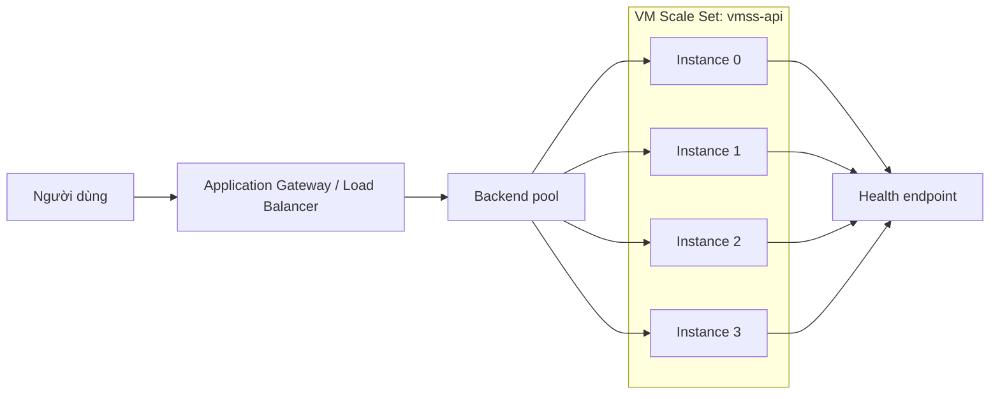
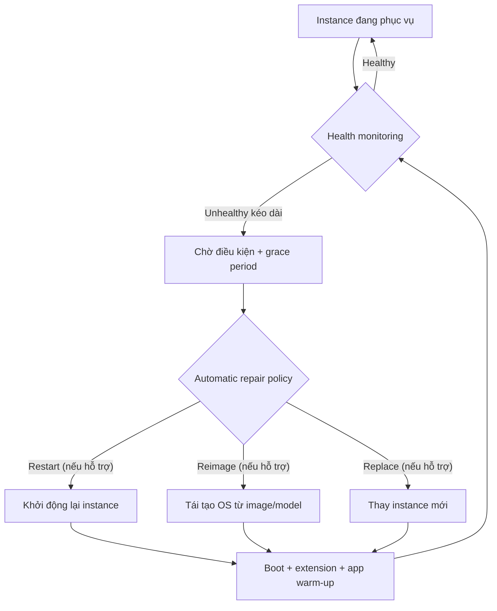
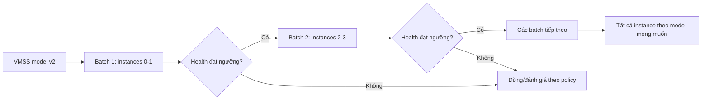
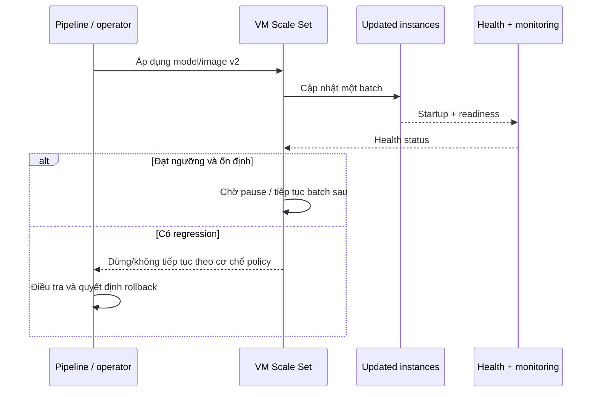
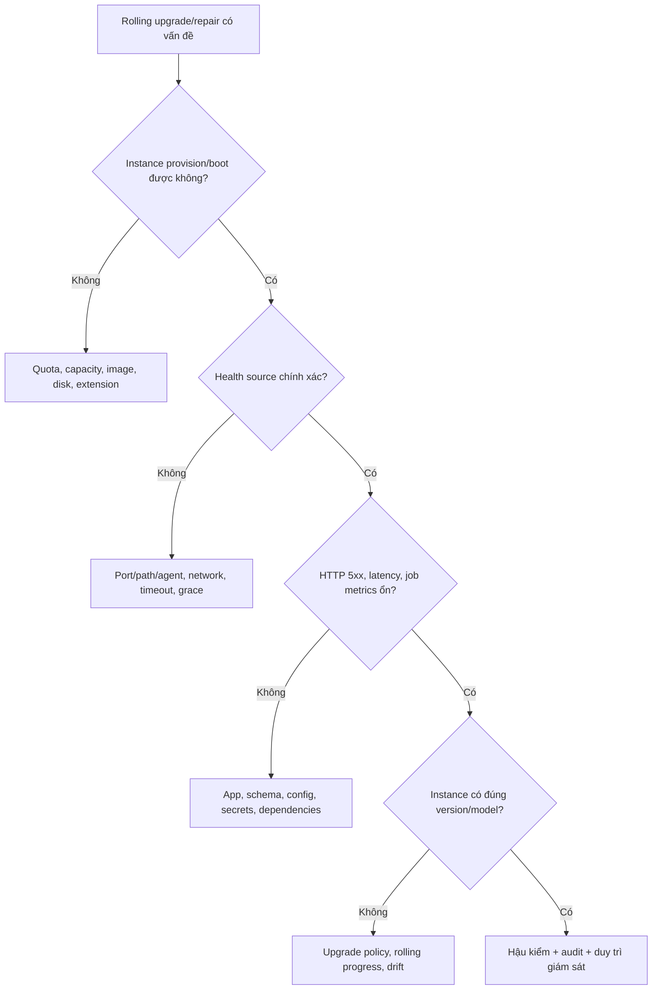

# Health check, thay thế instance và nâng cấp theo đợt

Một API chạy trên **Azure Virtual Machine Scale Sets (VMSS)** có thể phục vụ tốt khi đủ máy ảo, nhưng nếu một instance còn ở trạng thái `Running` mà tiến trình ứng dụng đã treo, bộ cân bằng tải vẫn có nguy cơ gửi yêu cầu tới một backend không phục vụ được. Khi cập nhật phiên bản ứng dụng hoặc OS image cho cả nhóm máy, nâng cấp đồng loạt lại có thể làm dịch vụ mất khả dụng. Vì vậy, vận hành compute co giãn cần ba khả năng phối hợp: **kiểm tra sức khỏe (health check)**, **tự phục hồi hoặc thay thế instance không khỏe**, và **nâng cấp theo từng đợt có kiểm soát (rolling upgrade)**.

Bài học thuộc chương **Compute co giãn và xử lý theo lô** của module `CLOUD_PROVIDERS_AZURE`. Trong quá trình tìm hiểu Azure từ subscription, resource group và Microsoft Entra ID tới mạng, compute, lưu trữ, dữ liệu, bảo mật, giám sát và kiểm soát chi phí, ba cơ chế này giúp triển khai workload trên VMSS mà không phải phụ thuộc vào việc quản trị thủ công từng máy.

## Mục tiêu học tập

Sau bài này, bạn có thể:

- Phân biệt tình trạng **máy ảo**, **ứng dụng**, **đủ điều kiện nhận traffic** và **trạng thái của một tác vụ xử lý theo lô**.
- Lựa chọn tín hiệu sức khỏe phù hợp: **Load Balancer health probe** hoặc **Application Health Extension** trong các kịch bản VMSS hỗ trợ.
- Giải thích cơ chế **automatic instance repairs**, khoảng chờ `gracePeriod` và những hệ quả của thao tác restart, reimage hoặc replace.
- Phân biệt **autoscale**, **rolling upgrade**, **automatic OS image upgrade** và **guest OS patching**.
- Thiết kế rolling upgrade với kích thước batch, ngưỡng unhealthy, thời gian nghỉ giữa các batch và tiêu chí dừng/tiếp tục.
- Kiểm tra cấu hình và trạng thái triển khai bằng Azure Portal/Azure CLI, thu thập log và xử lý lỗi.
- Tạo runbook an toàn cho triển khai web/API hoặc worker xử lý theo lô, bao gồm rollback, giám sát, chi phí và khôi phục.

## 1. Vì sao VM `Running` chưa chắc là instance khỏe?

Một instance trong VMSS có nhiều lớp trạng thái:

| Lớp | Ví dụ tín hiệu | Điều tín hiệu chứng minh | Điều **không** chứng minh |
|---|---|---|---|
| **Compute/VM** | Azure báo VM đang `Running` | Máy đã được cấp phát và cấp nguồn theo trạng thái nền tảng | HTTP API đang trả lời hoặc nghiệp vụ hoạt động |
| **Guest OS** | Linux `systemd`, Windows Service Control Manager | Tiến trình/dịch vụ OS có trạng thái nhất định | Toàn bộ API và dependency đều sẵn sàng |
| **Network** | TCP tới cổng `8080` kết nối được | Đường mạng và listener cơ bản có thể hoạt động | Request HTTP thực hiện đúng nghiệp vụ |
| **Application health** | `GET /health/ready` trả mã hợp lệ | App đạt tiêu chí readiness mà bạn định nghĩa | Không có lỗi phát sinh ở các giao dịch khác |
| **Load balancer probe** | Backend `Healthy` theo probe | Backend qua điều kiện mà probe đang kiểm tra | Tất cả request đều thành công, không có lỗi phía client |
| **Job/task** | Job hoàn thành và có checkpoint | Đơn vị công việc đã đạt trạng thái xử lý được xác nhận | Mọi việc đã được commit nếu thiếu cơ chế giao dịch/idempotency |

Ví dụ VM đã boot xong, agent hoạt động và cổng TCP mở, nhưng ứng dụng vẫn cần hai phút để nạp cấu hình và kết nối database. Nếu scale set chuyển instance đó vào phục vụ ngay, một phần request sẽ lỗi. **Readiness** phải phản ánh thời điểm instance thực sự có thể nhận công việc, không chỉ thời điểm VM báo đã chạy.

### Ba loại health check hữu ích

- **Startup check:** ứng dụng đã khởi động đủ để bắt đầu đánh giá sức khỏe chưa? Hữu ích với JVM/.NET, cache warm-up hoặc dịch vụ cần chạy migration.
- **Liveness check:** process có đang bị treo hoặc rơi vào trạng thái không thể phục hồi không? Một lỗi liveness kéo dài có thể dẫn tới restart.
- **Readiness check:** instance có nên nhận **traffic hoặc job mới** lúc này không? Khi shutdown, bị quá tải hoặc chưa sẵn sàng, readiness nên thay đổi trước khi phá hủy process.

Đây là **mô hình thiết kế ứng dụng**. Azure VMSS/Load Balancer không tự tạo ba endpoint hoặc hiểu đúng ý nghĩa của chúng. Bạn phải cấu hình health signal tương thích với tính năng Azure đang dùng và với ứng dụng.

## 2. Bối cảnh VM Scale Sets: các instance cùng một mô hình

**Azure Virtual Machine Scale Sets** cho phép triển khai và quản lý nhiều máy ảo theo một cấu hình mong muốn, kết hợp khả năng scale, cập nhật và giám sát. Một thiết kế phổ biến cho API là:



Trong ví dụ, các VM nên là những instance **thay thế được**:

- Cài cùng một ứng dụng theo phiên bản đã phê duyệt.
- Cấu hình lấy từ image, extension hoặc bootstrap có khả năng tái chạy.
- Có identity và quyền truy cập backend tương ứng; không hardcode secrets.
- Không lưu session hoặc dữ liệu quan trọng **chỉ** trên OS/temporary disk của một VM.
- Có health endpoint và log riêng để phát hiện lỗi trước khi đưa vào pool.

### Flexible và Uniform orchestration

VMSS có những chế độ orchestration như **Uniform** và **Flexible**. Chế độ triển khai ảnh hưởng đến cách quản lý instance, networking, upgrade policy, health reporting và các tính năng hỗ trợ. **Không nên dùng một lệnh/config dành cho Uniform rồi mặc định áp dụng cho Flexible.**

Trước khi bật automatic repairs hoặc rolling upgrades, phải xác nhận:

1. Scale set đang dùng orchestration mode nào.
2. Chế độ này có hỗ trợ cơ chế health/repair/upgrade dự định dùng không.
3. Image, vùng, API version, VM size và loại backend có đáp ứng yêu cầu không.
4. Cơ chế scale-in, update instance và quản lý VM có tương thích với kiến trúc dữ liệu hay không.

Trong bài này, các ví dụ **rolling upgrade policy và automatic repairs** được trình bày theo mô hình VMSS có hỗ trợ các khả năng tương ứng; kiểm tra compatibility theo tài liệu phiên bản Azure/CLI tại môi trường triển khai trước khi áp dụng.

## 3. Tín hiệu sức khỏe số 1: Load Balancer health probe

**Load Balancer health probe** định kỳ kiểm tra backend theo giao thức và cổng được cấu hình. Với Azure Load Balancer, probe có thể dùng TCP hoặc HTTP/HTTPS theo các khả năng được hỗ trợ. Khi instance không đạt ngưỡng sức khỏe, Load Balancer có thể loại nó khỏi việc chọn cho các luồng **mới** theo cơ chế của dịch vụ.

Ví dụ một load-balancing rule nhận TCP/443, nhưng ứng dụng có health endpoint tại cổng `8080`:

```text
Client HTTPS/TCP 443
      |
      v
Azure Load Balancer frontend
      |              \
      |               \----> Health probe: HTTP :8080/health/ready
      v
Backend VMSS instances
```

Health probe là **một phép đo từ nền tảng**, không phải kết quả kiểm tra giao dịch nghiệp vụ thực của người dùng.

### Khi nào probe phù hợp?

- Chia tải TCP/UDP hoặc ứng dụng web nằm sau Azure Load Balancer.
- Muốn backend unhealthy ngừng nhận traffic mới.
- Cần một tín hiệu instance health cho tính năng VMSS hỗ trợ dựa trên LB probe.

### Những lỗi cấu hình thường gặp

- **Sai cổng hoặc path:** ứng dụng phục vụ HTTP trên `8080` nhưng probe gọi `80`.
- **Endpoint trả mã không phù hợp:** `/health` yêu cầu đăng nhập hoặc redirect sang trang SSO; probe bị đánh dấu thất bại dù app đang chạy.
- **Sai binding:** dịch vụ chỉ lắng nghe `127.0.0.1`, không lắng nghe trên private IP/interface mà probe cần truy cập.
- **NSG/OS firewall:** lưu lượng probe không đến được cổng đích; cần kiểm tra NSG và nguồn probe theo quy tắc Azure Load Balancer, không mở toàn Internet bừa bãi.
- **Lỗi dependency tạm thời:** health endpoint phụ thuộc vào dịch vụ chung đang chập chờn, khiến tất cả instance bị đánh dấu unhealthy cùng lúc.

**Health probe phải đủ nhẹ, ổn định và có ý nghĩa.** Endpoint readiness không nên thực hiện truy vấn database rất nặng hoặc gọi hàng loạt dịch vụ ngoài ở mỗi lần probe. Nếu tất cả instance cùng truy vấn một dependency đang yếu, probe có thể làm vấn đề nghiêm trọng hơn.

## 4. Tín hiệu sức khỏe số 2: Application Health Extension

**Application Health Extension** là VM extension dùng để báo cáo tình trạng sức khỏe ứng dụng trên từng instance trong các kịch bản VMSS được hỗ trợ. Thay vì chỉ xem cổng mạng, nó kiểm tra một endpoint hay điều kiện sức khỏe phù hợp từ bối cảnh instance theo cấu hình extension.

Các nền tảng hỗ trợ có thể có extension tương ứng với Linux/Windows. Khả năng probe và loại health state được hỗ trợ phụ thuộc phiên bản extension, cấu hình và orchestration mode. Trước khi triển khai, cần xác minh publisher/type/version và các thuộc tính hợp lệ.

### Mẫu cấu hình tư duy

Ví dụ một ứng dụng HTTP lắng nghe `8080`:

```json
{
  "protocol": "http",
  "port": 8080,
  "requestPath": "/health/ready",
  "intervalInSeconds": 10,
  "numberOfProbes": 3
}
```

**Đây là cấu hình minh họa các ý tưởng**, không phải payload ARM/CLI có thể dùng nguyên vẹn. Tên trường, vị trí cấu hình, giao thức hỗ trợ và phiên bản extension phải lấy theo schema chính thức của bản extension dùng trong môi trường.

Một số thiết kế dùng trạng thái **Healthy**, **Unhealthy**, **Initializing** hoặc **Unknown** theo khả năng của chế độ báo cáo. Không nên tự giả định mọi lựa chọn health extension đều hỗ trợ đầy đủ các trạng thái nâng cao hoặc cùng thuật toán đánh giá.

### Lợi ích

- Đưa tình trạng ứng dụng đến hệ thống VMSS theo cơ chế được hỗ trợ.
- Giúp các tính năng repair/upgrade đánh giá instance theo **sức khỏe ứng dụng**, không chỉ trạng thái VM.
- Tách việc đo health khỏi cơ chế routing ở lớp frontend trong một số kiến trúc.

### Giới hạn

- Nếu VM agent/extension lỗi, health reporting có thể bị sai hoặc rơi vào trạng thái unknown.
- Tín hiệu chỉ tốt khi endpoint readiness đúng và cấu hình probe phù hợp.
- Một instance đang healthy về application extension chưa chắc truy cập được từ người dùng do NSG, route, DNS, TLS hoặc WAF.
- Cần quản lý version, OS support, bootstrap và quyền cài extension theo chính sách.

### Chọn loại tín hiệu nào?

| Điều kiện | Điểm khởi đầu | Lý do |
|---|---|---|
| VMSS nằm sau Azure Load Balancer và mô hình hỗ trợ LB probe làm nguồn health | **LB health probe** | Có sẵn tín hiệu routing và kiểm tra khả năng nhận traffic |
| Cần báo cáo readiness/liveness từ bên trong VM, không chỉ kết quả probe từ LB | **Application Health Extension** | Tập trung vào sức khỏe ứng dụng ở mức instance |
| Nhiều frontend, có App Gateway/Front Door nhưng cần VMSS repairs | Kiểm tra **cơ chế VMSS health monitoring được hỗ trợ** | Không mặc định health probe của gateway/edge thay thế Application Health Extension |
| Worker không nhận HTTP traffic | Application Health Extension hoặc cơ chế giám sát phù hợp theo hỗ trợ | Tình trạng worker có thể không thể hiện qua cổng TCP phục vụ web |

Khi cấu hình automatic repairs, Azure yêu cầu nguồn thông tin sức khỏe tương thích. **Không mặc định rằng cùng một policy sửa chữa luôn kết hợp được mọi loại probe hay hoạt động như nhau trên Uniform/Flexible.** Hãy xác nhận một health source có hiệu lực trước khi bật hành vi tự động phá hủy/thay instance.

## 5. Xây endpoint `/health/ready` đúng cách

Giả sử ứng dụng web `inventory-api` chạy trên Linux và có ba endpoint:

| Endpoint | Mục đích | Ví dụ kết quả |
|---|---|---|
| `GET /health/startup` | Đã khởi tạo xong cấu hình/DI/cache chưa? | HTTP `200` khi khởi tạo thành công |
| `GET /health/live` | Tiến trình có ở trạng thái hoạt động cơ bản không? | HTTP `200`, không phụ thuộc nhiều external services |
| `GET /health/ready` | Có nhận request mới an toàn không? | HTTP `200` khi sẵn sàng; `503` nếu đang drain |

Một phản hồi đơn giản:

```http
GET /health/ready HTTP/1.1
Host: 10.40.1.5:8080

HTTP/1.1 200 OK
Content-Type: application/json

{"status":"ready","version":"v2.1"}
```

Khi instance đang triển khai bản mới hoặc chuẩn bị shutdown:

```http
GET /health/ready HTTP/1.1
Host: 10.40.1.5:8080

HTTP/1.1 503 Service Unavailable
Content-Type: application/json

{"status":"draining"}
```

Đây là thiết kế **endpoint ứng dụng**; Azure không tự tạo nội dung JSON này. Probe thường dựa trên HTTP status/điều kiện mà tính năng hỗ trợ, không nhất thiết đọc các trường JSON.

### Nguyên tắc quan trọng

1. Endpoint health **không yêu cầu đăng nhập tương tác**, cookie/session hay token người dùng thông thường. Giới hạn truy cập mạng và không trả thông tin nhạy cảm.
2. Phản hồi nhanh, có timeout rõ ràng và không thực hiện các phép kiểm tra nặng.
3. Phân biệt failure **cục bộ** (process deadlock, disk đầy, config lỗi) và failure **chia sẻ** (database của cả cụm bị ngắt). Đừng tự sửa tất cả instance vì một dependency chung.
4. Trả readiness false khi instance không sẵn sàng nhận request mới; nhưng phải có chiến lược khôi phục hoặc kiểm tra lại để tránh tự loại toàn bộ pool do lỗi tạm thời.
5. Lúc triển khai, nên có **warm-up period** cho image/extension/app startup. Nếu quá ngắn, cơ chế repair có thể thay instance liên tục trước khi ứng dụng kịp sẵn sàng.
6. Theo dõi `version` hoặc build ID qua endpoint khác hoặc metadata để biết bản nào đang chạy; không dùng một kết quả health duy nhất làm bằng chứng code đã nâng cấp.

### Readiness khác với health của một công việc batch

Một worker đọc job từ queue có thể **không xử lý job nào** khi queue rỗng nhưng vẫn khỏe. Ngược lại, một worker có process sống nhưng checkpoint không được lưu, queue visibility timeout liên tục hết hạn hoặc job thất bại có thể là **unhealthy** theo nghiệp vụ.

Với worker, cần phân biệt:

- **Worker readiness:** sẵn sàng nhận job mới?
- **Job progress:** đã commit checkpoint nào và có xử lý idempotent không?
- **Capacity:** số job đang chạy, queue depth, retry/backlog.

Azure VMSS instance repair **không tự thay thế logic retry, checkpoint và quản lý task của Azure Batch hoặc ứng dụng queue**.

## 6. Automatic instance repairs: phát hiện và phục hồi

**Automatic instance repairs** là khả năng của VMSS hỗ trợ phát hiện instance bị đánh giá **Unhealthy** theo nguồn health đã cấu hình và thực hiện hành động sửa chữa theo policy. Tùy cấu hình và mức hỗ trợ, hành động có thể gồm **Replace**, **Reimage** hoặc **Restart**.



Đây là mô hình vòng đời tổng quát, **không mô tả chính xác mọi thứ tự nội bộ hoặc thuật toán health của Azure**. Không phải mọi repair action đều khả dụng với mọi VMSS mode, SKU hoặc loại image.

### So sánh hành động sửa chữa

| Hành động | Mục đích | Điều phải chuẩn bị |
|---|---|---|
| **Restart** | Khởi động lại instance/VM theo cơ chế được hỗ trợ | App tự khởi động, dữ liệu đang xử lý có retry/checkpoint |
| **Reimage** | Tái tạo hệ điều hành từ image/model | Mọi tùy chỉnh OS phải tái lập được; dữ liệu trên OS/temporary disk có thể mất |
| **Replace** | Loại instance lỗi và tạo instance thay thế theo mô hình scale set | Tài nguyên/identity/network/app bootstrap phải có thể tạo lại; không lưu state trên một VM |

**Replace không có nghĩa “giữ nguyên máy cũ rồi sửa phần mềm bên trong”.** Ứng dụng phải thiết kế theo tư duy cattle, not pets: instance cũ có thể biến mất, instance mới phải tự cấu hình và phục vụ được. Nếu dữ liệu chỉ nằm trên local disk của một instance, chính sách replace có thể gây **mất dữ liệu**.

### Grace period là gì?

`gracePeriod` là khoảng thời gian bảo vệ/cân nhắc được policy hỗ trợ dùng trước khi instance vừa được tạo hoặc cập nhật phải chịu repair, giúp ứng dụng có thời gian khởi động và phục hồi. Cần phân biệt grace period với:

- Thời gian probe lặp lại.
- Số lần probe thất bại trước khi đánh dấu unhealthy.
- Thời gian drain connection.
- Thời gian pause giữa các rolling batches.

Ví dụ app mất 4 phút để tải cache, 2 phút chạy migration và 1 phút kết nối backend: cấu hình repair quá nhạy có thể lặp **create → unhealthy → replace → create**. Cần đo thời gian khởi tạo thực tế và đặt grace/warm-up phù hợp với điều kiện của tính năng.

### Repair có bảo đảm self-healing không?

Không. Nếu image mới có lỗi cấu hình khiến **mọi VM khởi động đều unhealthy**, repair có thể tạo vòng lặp và tăng chi phí. Nếu root cause là database bị ngắt, tạo thêm VM mới không chữa được dependency. Vì thế, automatic repairs phải đi kèm:

- Health signal phân biệt lỗi instance và lỗi hệ thống chia sẻ.
- Thử nghiệm image/app bootstrap trước khi bật sửa chữa tự động.
- Alert theo **tỷ lệ unhealthy**, số lần repair liên tiếp, lỗi image/extension.
- Runbook vô hiệu hóa/điều chỉnh policy qua quy trình phê duyệt khi phát hiện repair loop.

## 7. Nâng cấp theo đợt (rolling upgrade) là gì?

**Rolling upgrade** cập nhật các instance thành **nhiều batch nhỏ**, thay vì cập nhật toàn bộ cùng lúc. Sau mỗi batch, hệ thống kiểm tra sức khỏe và điều kiện policy trước khi tiếp tục những instance còn lại.

Giả sử có **10 instance**, muốn cập nhật tối đa **20%** ở mỗi đợt. Về tư duy, có thể tổ chức thành những nhóm khoảng **2 instance/batch**, để phần còn lại tiếp tục nhận traffic trong khi một nhóm cập nhật.



**Số batch thực tế và cách làm tròn do VMSS tính theo cấu hình, quy mô, tình trạng instance và giới hạn sản phẩm**. Không nên dựa vào phép chia đơn giản để cam kết chính xác bao nhiêu máy sẽ dừng đồng thời.

### Các chế độ upgrade policy thường gặp

| Chế độ | Ý nghĩa khái quát | Điểm cần lưu ý |
|---|---|---|
| **Manual** | Model thay đổi nhưng instance chưa nhất thiết được cập nhật tự động; người vận hành điều phối áp dụng | Kiểm soát thời điểm, phải theo dõi lệch model và cập nhật từng nhóm |
| **Automatic** | Thay đổi model được áp dụng tự động theo cơ chế tính năng | Không đồng nghĩa luôn có health-gated batch như Rolling |
| **Rolling** | Áp dụng theo đợt với policy về batch và sức khỏe khi chế độ hỗ trợ | Cần health source hợp lệ, capacity và giám sát |

Không nhầm **upgrade policy mode** với **autoscale policy** hoặc **automatic OS image upgrades**. Những cơ chế này có liên hệ nhưng giải quyết những câu hỏi khác nhau.

### Autoscale khác Rolling upgrade

**Autoscale:** “Nên có bao nhiêu instance?” Ví dụ CPU cao kéo dài làm tăng desired capacity từ 5 lên 8.

**Rolling upgrade:** “Cập nhật những instance đang có theo trình tự nào?” Ví dụ cập nhật image v1 sang v2, đảm bảo một tỷ lệ instance tiếp tục phục vụ.

Trong khi rollout, autoscale có thể khiến số instance thay đổi. Vì vậy cần quy hoạch **min/max capacity, scale-in cooldown, ngân sách instance unhealthy và headroom** để rollout không gây gián đoạn do thiếu capacity.

## 8. Những tham số quan trọng của Rolling upgrade policy

Trong các cấu hình hỗ trợ, rolling upgrade policy thường có các tham số sau:

| Tham số | Ý nghĩa | Điều cần cân nhắc |
|---|---|---|
| `maxBatchInstancePercent` | Tỷ lệ phần trăm instance tối đa trong một batch | Batch lớn cập nhật nhanh nhưng giảm năng lực phục vụ tạm thời |
| `maxUnhealthyInstancePercent` | Ngưỡng tổng thể instance không khỏe được chấp nhận khi nâng cấp | Nếu fleet đã có nhiều instance unhealthy, rollout có thể dừng trước khi bắt đầu |
| `maxUnhealthyUpgradedInstancePercent` | Ngưỡng unhealthy của các instance đã được cập nhật | Giúp phát hiện bản mới gây lỗi sau upgrade |
| `pauseTimeBetweenBatches` | Khoảng nghỉ giữa hai batch theo định dạng thời lượng | Cho app warm-up, caches và metrics ổn định |
| Health probe/extension | Tín hiệu mà VMSS dùng đánh giá tình trạng | Sai probe có thể làm rollout dừng hoặc tiếp tục sai |

Các thuộc tính bổ sung như ưu tiên instance chưa khỏe, max surge, rollback behavior hoặc hỗ trợ theo orchestration mode có thể thay đổi theo API/phiên bản. **Không áp dụng thuộc tính tùy chọn khi chưa kiểm tra tính năng và schema của VMSS đang dùng.**

### Ví dụ cấu hình minh họa

```json
{
  "upgradePolicy": {
    "mode": "Rolling",
    "rollingUpgradePolicy": {
      "maxBatchInstancePercent": 20,
      "maxUnhealthyInstancePercent": 20,
      "maxUnhealthyUpgradedInstancePercent": 20,
      "pauseTimeBetweenBatches": "PT2M"
    }
  },
  "automaticRepairsPolicy": {
    "enabled": true,
    "gracePeriod": "PT30M",
    "repairAction": "Replace"
  }
}
```

JSON này chỉ là **trích đoạn các thuộc tính khái niệm**, **không phải template ARM/Bicep hoàn chỉnh hoặc câu lệnh triển khai**. Giá trị hợp lệ, vị trí property, yêu cầu health monitoring, cách kết hợp repair và upgrade, cũng như hành vi có thể khác theo API version và orchestration mode. `PT2M` nghĩa là khoảng hai phút theo cú pháp thời lượng ISO 8601; `PT30M` tương tự là 30 phút.

**Không copy cấu hình minh họa trực tiếp vào production.** Trước tiên hãy xác minh loại VMSS, mẫu image và health source, sau đó áp dụng qua IaC đã được review trong môi trường thử nghiệm.

### Phân tích trade-off

- **Batch nhỏ (ví dụ 10%)**: giảm rủi ro đồng thời nhưng rollout lâu, tăng số lần warm-up và kiểm tra.
- **Batch lớn (ví dụ 50%)**: hoàn thành nhanh hơn nhưng có thể vượt capacity dự phòng.
- **Ngưỡng unhealthy chặt**: phát hiện regression nhanh nhưng dễ dừng vì những lỗi tạm thời không liên quan phiên bản.
- **Pause quá ngắn**: batch mới bắt đầu trước khi cache, metrics hoặc traffic ổn định.
- **Pause quá dài**: tăng tổng thời gian triển khai và kéo dài khoảng thời gian hai phiên bản cùng tồn tại.

Chọn cấu hình dựa trên **SLO**, thời gian startup thực đo, dự phòng capacity, p95/p99 latency, mức mất khả dụng có thể chấp nhận và lịch sử lỗi của ứng dụng.

## 9. Rolling upgrade có đồng nghĩa rollback tự động không?

**Không nên giả định.** Rolling policy có thể dừng/không tiếp tục khi sức khỏe vi phạm ngưỡng, nhưng dừng rollout và **khôi phục toàn bộ fleet về phiên bản cũ** là hai hoạt động khác nhau.

Một rollback đáng tin cậy cần:

1. Giữ image/package và cấu hình của phiên bản ổn định trước đó.
2. Có thể dựng instance mới từ image cũ một cách lặp lại (immutable image/IaC).
3. Quản lý database schema theo phương án **backward-compatible** trong giai đoạn nhiều phiên bản cùng chạy.
4. Có rule kiểm soát connection draining và khả năng khôi phục traffic.
5. Quyết định **khi nào rollback** dựa trên tỷ lệ lỗi, latency, health và phản hồi người dùng.
6. Thử rollback từ phiên bản lỗi trong sandbox trước khi diễn tập production.

Nếu một bản nâng cấp đã thực hiện **migration database không thể đảo ngược**, việc thay VM về image cũ có thể không khôi phục ứng dụng. Thiết kế database và phiên bản API tương thích là phần không thể thiếu của kế hoạch rolling.

### Kết hợp canary hoặc blue-green

Rolling update và **canary** không phải hai cách loại trừ nhau. Có thể:

- Triển khai bản mới đến một nhóm nhỏ (canary).
- Quan sát HTTP 5xx, latency, log nghiệp vụ và health trong thời gian đủ dài.
- Sau khi đạt ngưỡng, mở rộng rollout theo rolling batches.

Trong một số hệ thống, **blue-green deployment** dùng hai nhóm compute độc lập với tuyến traffic có thể phù hợp hơn: chuẩn bị nhóm mới, kiểm thử rồi chuyển phần lớn traffic khi sẵn sàng. Đổi lại cần thêm capacity và quản trị hai môi trường.

## 10. Automatic OS image upgrades không phải guest OS patching

Để tránh chọn sai cơ chế cập nhật, phân biệt:

| Hoạt động | Thay đổi gì? | Ai điều phối? |
|---|---|---|
| **Rolling upgrade của VMSS model** | Áp dụng một thay đổi có hỗ trợ trong model/image/extension cho instance theo batch | VMSS theo upgrade policy và người vận hành |
| **Automatic OS image upgrade** | Cập nhật instance khi có OS image mới theo cơ chế tính năng hỗ trợ | Azure phối hợp policy và điều kiện image/VMSS |
| **Automatic VM guest patching / Azure Update Manager** | Cài cập nhật trong guest OS theo cơ chế patching | Dịch vụ/OS patching policy theo cấu hình |
| **Ứng dụng triển khai qua CI/CD** | Binary/container/package/config của ứng dụng | Pipeline, image builder, extension hoặc rollout controller |

**Image upgrade** có thể thay đổi nền tảng hệ điều hành được dùng để tạo instance; **guest patching** cập nhật hệ điều hành bên trong VM; và **app deployment** cập nhật mã nguồn. Từng loại có lịch, health signal, rủi ro và rollback khác nhau.

Một VMSS dùng image phiên bản cố định có thể cần quy trình quản lý image từ Azure Compute Gallery hay image pipeline riêng; không mặc định mọi image tùy chỉnh đều hỗ trợ automatic OS image upgrade như marketplace image.

## 11. Trình tự nâng cấp an toàn từ v1 lên v2

Giả sử `vmss-api-prod` có 12 instance chạy API v1, nằm sau Azure Load Balancer, ứng dụng yêu cầu luôn đủ capacity phục vụ 1.000 request/giây.

### Giai đoạn A — Preflight

1. **Định danh rõ model v1/v2:** image ID, application package checksum, extension version, runtime, configuration và schema.
2. **Health ổn định:** toàn bộ instance baseline có trạng thái lành mạnh theo source đáng tin cậy; các lỗi hiện hữu được giải thích.
3. **Capacity headroom:** khi một batch cập nhật, những instance còn lại vẫn đủ phục vụ tải thường cộng biên dự phòng.
4. **Dependency:** database, message queue, cache, Key Vault, DNS, storage và network không có thay đổi không tương thích.
5. **Quyền:** CI/CD identity có role quản trị VMSS cần thiết tại scope hẹp, không dùng secret lưu trong code.
6. **Rollback:** còn image v1, config v1, kế hoạch chuyển phiên bản; schema database có thể chạy song song.
7. **Quan sát:** dashboards/alerts sẵn sàng cho success rate, latency, unhealthy, repair count và capacity.

### Giai đoạn B — Canary

Triển khai v2 tới một nhóm rất nhỏ trong môi trường/cách thức mà kiến trúc hỗ trợ; xác nhận:

- `/health/ready` đúng sau warm-up.
- Không tăng đột biến `HTTP 5xx`, timeouts, error logs.
- Truy cập Storage/database và identity không lỗi.
- Giao dịch nghiệp vụ quan trọng hoạt động với cả client cũ/mới.

Không dùng **một probe thành công** làm toàn bộ tiêu chí chấp nhận canary.

### Giai đoạn C — Rolling batches

Với batch 20% và capacity dự phòng phù hợp:



Trong toàn bộ quá trình, cần xem **đồng thời** health của VMSS và request-level metrics của API. Nếu API vẫn trả `200` ở probe nhưng tỷ lệ thanh toán thất bại tăng mạnh, rollout phải được đánh giá dừng dù health probe còn xanh.

### Giai đoạn D — Hậu kiểm

1. Xác minh mọi instance trong phạm vi mong muốn đã áp dụng đúng model/image version.
2. Tỷ lệ unhealthy trở về baseline; không còn batch đang chờ hoặc instance model cũ ngoài kế hoạch.
3. Kiểm thử HTTP/TCP, transactions, logs và các dependency quan trọng.
4. Kiểm tra autoscale, backup/DR, DNS, load-balancer pool và alert.
5. Ghi runbook, người phê duyệt, thời gian triển khai, metrics trước/sau và mọi hành động sửa lỗi.

## 12. Kiểm tra VMSS bằng Azure Portal

Trên Portal, thao tác trong subscription được phân quyền:

1. Mở **Virtual machine scale sets**, chọn `vmss-api-lab` hoặc scale set được giao.
2. Xem **Overview/Instances**: desired capacity, từng instance, trạng thái provisioning, power state và health/extension nếu được hỗ trợ.
3. Kiểm tra **Orchestration mode** để biết là Uniform hay Flexible.
4. Xem cấu hình **Upgrade policy**: Manual/Automatic/Rolling, các tham số rolling và cơ chế update model.
5. Kiểm tra nguồn **health monitoring**: Application Health Extension hoặc Load Balancer probe theo thiết kế; xác minh đã liên kết đúng backend/pool và VMSS.
6. Tìm mục **Automatic repairs/Health and repair** hoặc tương đương theo giao diện/tính năng; kiểm tra enabled, action và grace period.
7. Mở **Activity Log** và **Metrics**; đối chiếu các instance vừa được thêm, sửa, tái tạo hoặc thay thế.
8. Nếu có rolling upgrade đang chạy, mở tiến trình/rolling upgrade status để xem batch, lỗi và phần trăm đã hoàn tất.

Vị trí các mục trên Portal thay đổi theo phiên bản giao diện và chế độ VMSS. Nếu không thấy tùy chọn, không nên mặc định tính năng bị ẩn: kiểm tra **orchestration mode, API compatibility, image, region và quyền truy cập**.

## 13. Azure CLI: quan sát cấu hình, sức khỏe và rolling progress

Các lệnh minh họa sau **chỉ đọc trạng thái** của một VMSS đã tồn tại. Không tạo, sửa hoặc nâng cấp tài nguyên production khi chưa có kế hoạch.

### 13.1 Chọn subscription

```bash
az login --tenant "<tenant-id>"
az account set --subscription "<subscription-id>"

az account show \
  --query "{subscription:id,tenant:tenantId,name:name}" \
  --output json
```

### 13.2 Kiểm tra model, upgrade và repair policy

```bash
az vmss show \
  --resource-group "rg-elastic-lab" \
  --name "vmss-api-lab" \
  --query "{name:name,orchestration:orchestrationMode,capacity:sku.capacity,upgrade:upgradePolicy,repairs:automaticRepairsPolicy}" \
  --output json
```

Những trường chính cần đối chiếu:

- `orchestrationMode`: VMSS triển khai theo mô hình nào.
- `sku.capacity`: số instance mong muốn theo model tại thời điểm truy vấn.
- `upgradePolicy.mode` và `rollingUpgradePolicy`: chính sách áp dụng cập nhật.
- `automaticRepairsPolicy`: cấu hình sửa instance nếu tính năng được hỗ trợ và có thiết lập.

Nếu một trường vắng mặt hoặc `null`, không vội kết luận tính năng đang tắt. Kiểm tra JSON đầy đủ, API version, chế độ orchestration và hướng dẫn của sản phẩm trong môi trường hiện tại.

### 13.3 Liệt kê instance

```bash
az vmss list-instances \
  --resource-group "rg-elastic-lab" \
  --name "vmss-api-lab" \
  --query "[].{instanceId:instanceId,name:name,provisioningState:provisioningState}" \
  --output table
```

Xem trạng thái cấp instance (khi lệnh và mode hỗ trợ):

```bash
az vmss get-instance-view \
  --resource-group "rg-elastic-lab" \
  --name "vmss-api-lab" \
  --instance-id "0" \
  --output json
```

`instanceId` là ví dụ; lấy ID thực từ kết quả liệt kê. Flexible orchestration có thể dùng cách quản lý VM thành viên khác Uniform; khi CLI không hỗ trợ thao tác trên scale set đang dùng, hãy dùng lệnh quản lý từng VM hoặc API tương ứng theo mode thay vì gán ID giả.

### 13.4 Xem tiến trình rolling upgrade gần nhất

```bash
az vmss rolling-upgrade get-latest \
  --resource-group "rg-elastic-lab" \
  --name "vmss-api-lab" \
  --output json
```

Nếu chưa có rolling upgrade hoặc CLI/scale set không hỗ trợ tác vụ này, có thể không có kết quả phù hợp. Kiểm tra `az vmss rolling-upgrade -h` và Azure Activity Log để xác định loại upgrade đã diễn ra.

### 13.5 Xem health probe của Azure Load Balancer

Khi VMSS dùng backend pool của Load Balancer:

```bash
az network lb probe list \
  --resource-group "rg-elastic-lab" \
  --lb-name "lb-api-lab" \
  --query "[].{name:name,protocol:protocol,port:port,requestPath:requestPath,interval:intervalInSeconds,threshold:numberOfProbes}" \
  --output table
```

Lệnh trên đọc cấu hình probe, **không chứng minh instance vừa được probe thành công**. Muốn chẩn đoán phải kết hợp trạng thái backend, network/NSG, VM agent/extension, application logs và telemetry của load balancer.

### 13.6 Lấy resource ID để gắn với giám sát

```bash
VMSS_ID=$(az vmss show \
  --resource-group "rg-elastic-lab" \
  --name "vmss-api-lab" \
  --query id \
  --output tsv)

echo "$VMSS_ID"
```

Sử dụng resource ID này để tìm Metrics, Activity Log và cấu hình alert trên Portal/Azure Monitor. Tên metric có thể khác theo loại tài nguyên và tính năng; tra cứu metric definitions của resource thực tế thay vì giả định mọi VMSS đều xuất cùng một tập metric.

## 14. Triển khai rolling có kiểm soát: ví dụ chính sách vận hành

Giả sử một nhóm triển khai có:

| Thành phần | Ví dụ |
|---|---|
| VMSS | `vmss-api-prod` |
| Số instance ban đầu | 10 |
| Image hiện tại | `api-image:v1` |
| Image mới | `api-image:v2` |
| Nguồn health | Application Health Extension hoặc LB probe theo khả năng hỗ trợ |
| Health endpoint | HTTP `GET /health/ready` trên port `8080` |
| Batch mong muốn | Tối đa khoảng 20% |
| Grace/warm-up | Đo thực tế, ví dụ ứng dụng mất 5 phút để sẵn sàng |
| Release gate | Không tăng error rate/latency vượt ngưỡng đã phê duyệt |

### Runbook từng bước

**Trước deploy:** chạy health check từ chính mạng/probe source, đọc trạng thái VMSS, ghi ảnh chụp cấu hình model và thống kê p95 latency, 5xx, CPU/memory, số instance unhealthy.

**Áp dụng model mới:** tạo/publish image v2 đã kiểm thử, cập nhật VMSS model qua IaC/phương thức được hỗ trợ. Thao tác này cần quyền thay đổi, approval và lịch triển khai. Không dùng CLI ghi cấu hình không được kiểm tra schema trong production.

**Quan sát batch đầu:** xác nhận instance đã upgrade và `/health/ready` thành công, nhưng cũng chạy synthetic transaction đại diện. Nếu app startup mất 5 phút, không đặt tiêu chí acceptance chỉ dựa trên 30 giây đầu.

**Cho phép batch kế tiếp:** khi API success rate, latency, health và dependency đều đạt chuẩn trong khoảng quan sát. Theo dõi autoscale hoặc nhiều instance bị tạo/xóa ngoài dự kiến trong thời gian rollout.

**Dừng và xử lý lỗi:** nếu healthy instance giảm quá nhiều hoặc lỗi nghiệp vụ tăng, tạm dừng rollout theo tính năng hỗ trợ, ngừng thêm đợt mới và chuyển sang runbook rollback/điều tra. Không xóa instance hàng loạt hoặc ép tăng batch size để “cho xong”.

**Kết thúc:** ghi lại version image, instance inventory, health state, metrics và kết quả giao dịch; thông báo hoàn tất sau khi kiểm chứng cả compute lẫn ứng dụng.

## 15. Phân tích lỗi: không healthy sau upgrade

| Triệu chứng | Khả năng cần kiểm tra | Hướng xử lý |
|---|---|---|
| VM chạy nhưng health probe `Unhealthy` | Sai port/path, endpoint trả 401/302/503, NSG/firewall | Kiểm tra probe config, curl từ mạng thích hợp, app logs |
| Instance mới bị replace liên tục | Grace period quá ngắn, bootstrap/image lỗi, health endpoint không sẵn sàng | Kiểm tra extension, thời gian startup, tạm hạn chế repair theo quy trình |
| Rolling upgrade dừng ngay trước batch đầu | Nhiều instance đã unhealthy vượt ngưỡng hoặc thiếu health source | Sửa lỗi baseline, kiểm tra policy và điều kiện hỗ trợ |
| Batch mới báo healthy nhưng 5xx tăng | Health endpoint quá nông, thay đổi cấu hình/DB, client incompatibility | Quan sát transactions, rollback/canary theo quy trình |
| Update model rồi instance vẫn chạy bản cũ | Upgrade mode Manual, rollout chưa áp dụng, instance không ở scope cập nhật | Kiểm tra VMSS model vs instance version, trạng thái rolling |
| Upgrade quá lâu | Batch nhỏ, warm-up/pause dài, health không ổn định, capacity/capacity allocation | Xem rolling progress, thời gian per-stage và quota |
| Thiếu capacity khi upgrade | Batch quá lớn, autoscale scale-in, zone/SKU thiếu máy | Đặt headroom, chọn batch an toàn, kiểm tra SKU/region |
| Worker batch bị mất job khi reimage | Job/checkpoint lưu cục bộ, không xử lý retry | Thiết kế queue lease, checkpoint, idempotency và shutdown |
| Health extension không báo trạng thái | Extension/agent lỗi, version hoặc config không tương thích | Xem extension instance view, logs trong guest, OS support |
| DB outage làm tất cả instance unhealthy | Health check gắn quá chặt với dependency chung | Phân loại lỗi, điều chỉnh readiness và phản ứng sự cố |
| LB unhealthy nhưng Application Health Extension healthy | Hai health source đo từ vị trí/điều kiện khác nhau | Kiểm tra NSG, route, LB probe endpoint, ứng dụng listener |

### Phân loại lỗi theo tầng



**Không giải quyết vấn đề bằng cách tăng mọi threshold thật lớn hoặc để `/health` luôn trả `200`.** Cách đó có thể che giấu regression và khiến rolling upgrade tiếp tục đưa lỗi đến toàn bộ fleet.

## 16. Đặc thù workload xử lý theo lô và hàng đợi

Trong chương **Compute co giãn và xử lý theo lô**, có thể có hai mô hình:

1. **VMSS worker:** các instance tự lấy job từ Azure Storage Queue, Service Bus hoặc hệ thống xếp hàng khác.
2. **Azure Batch pool:** Azure Batch quản lý pool compute nodes và điều phối tasks với lifecycle, scheduling và recovery riêng.

Đây **không phải cùng một bộ điều khiển**. Cơ chế VMSS automatic instance repairs và rolling upgrades không nên áp dụng trực tiếp như lệnh dành cho Azure Batch pool nodes.

### Nếu worker đang xử lý một job dài

Giả sử một job ETL chạy 45 phút. Nếu VMSS thay thế instance ở phút thứ 30, dữ liệu tạm và tiến độ trong RAM có thể mất. Một kiến trúc phù hợp phải hỗ trợ:

- **Checkpoint** vào dịch vụ lưu trữ bền vững.
- **Message visibility/lease/lock renewal** theo cơ chế queue đang dùng.
- **Idempotent processing:** chạy lại job không tạo tác động kép không mong muốn.
- **Graceful shutdown:** dừng nhận job mới, hoàn tất hoặc checkpoint job đang chạy nếu có thời gian.
- **Retry và dead-letter** với giới hạn, cảnh báo và xử lý poisoning messages.
- **Task-level metrics:** throughput, queue age, job failure rate, completion time và backlog.

Một probe chỉ trả `200` vì process worker còn sống **không chứng minh batch đã hoàn thành**. Với Azure Batch, cần theo dõi pool/node/job/task, start task, lỗi cấp phát và các hành động recovery của chính Batch.

### Bảo vệ instance khi scale-in hoặc update

VMSS có những cơ chế/giới hạn liên quan **instance protection**, scale-in policy, termination notifications hoặc điều phối shutdown theo khả năng của từng loại VMSS. Nếu một instance đang xử lý job không thể ngắt, cần thiết kế điều kiện drain và cơ chế bảo vệ phù hợp, đồng thời chấp nhận rằng lỗi host/VM bất ngờ vẫn có thể xảy ra.

Không dựa vào instance protection như giải pháp duy nhất cho tính toàn vẹn job. **Checkpoint và idempotency** vẫn là lớp bảo vệ quyết định.

## 17. Bảo mật và quyền khi tự động sửa chữa/nâng cấp

### Azure RBAC và Managed Identity

- **Pipeline/Operator:** quyền quản lý VMSS/image/extension ở đúng scope, không cấp Owner toàn subscription khi không cần.
- **VMSS application identity:** dùng managed identity với quyền truy cập Key Vault, Storage/Queue/database theo nghiệp vụ.
- **Log/monitoring:** quyền đọc metrics/logs và cấu hình alerts, phân tách với quyền thực thi nâng cấp.
- **Health endpoint:** hạn chế truy cập mạng; không phát tán cấu hình, credentials, connection strings, stack traces.
- **OS hardening:** cập nhật hệ điều hành và agent, kiểm soát SSH/RDP, NSG, firewall, Defender và scan image theo chính sách.

Nếu image v2 sử dụng managed identity mới, cần đảm bảo role assignments và quyền Key Vault/Storage đã có hiệu lực **trước khi health chuyển sang Ready**. Nếu không, probe `200` có thể trả thành công trong khi truy cập dữ liệu nghiệp vụ bị `403`.

### Quy tắc an toàn với rollout

- Áp dụng thay đổi qua Bicep/ARM/Terraform/pipeline được review, có version và audit trail.
- Không thay image, backend pool, database schema và NSG đồng loạt trong cùng một rollout nếu không có lý do và kịch bản rollback rõ.
- Giữ secret trong kho bí mật; không truyền trực tiếp vào custom script extension/boot log.
- Kiểm thử image/container và health endpoint với dữ liệu test trước khi phục vụ traffic production.
- Cân nhắc maintenance windows cho thay đổi có rủi ro, nhưng phải luôn có giám sát để dừng triển khai khi SLO giảm.

## 18. Monitoring và kiểm soát chi phí

### Dashboard tối thiểu cho VMSS

| Nhóm tín hiệu | Chỉ số/câu hỏi cần xem |
|---|---|
| **Capacity** | Desired vs actual instance count, instance bị thiếu quota/capacity |
| **Health** | Healthy/unhealthy/unknown theo health source, tỷ lệ theo zone/version |
| **Upgrade** | Batch đang chạy, số instance upgraded, pending, failed, duration |
| **Repair** | Số lần restart/reimage/replace, repair loop theo instance/model |
| **Application** | HTTP success rate, 5xx, latency p95/p99, timeout, error logs |
| **Worker/batch** | Queue depth/age, throughput, failed job, retry, checkpoint age |
| **Infrastructure** | CPU, memory, disk IO, network, VM agent, extension failures |
| **Cost** | VM hours, số instance tăng, disk/egress/logs, chi phí image/và monitoring |

Azure Monitor, Activity Log, VM Insights/Application Insights và công cụ log nghiệp vụ có thể giúp thu thập tín hiệu, tùy điều kiện triển khai. Không phải metric nào cũng có sẵn trực tiếp từ VMSS ở mọi mode; guest/app metrics có thể cần Azure Monitor Agent, SDK hoặc ứng dụng xuất telemetry.

### Một số cảnh báo nên có

1. Tỷ lệ `Unhealthy` vượt ngưỡng trong thời gian đủ dài.
2. Rolling upgrade bị dừng/thất bại hoặc kéo dài hơn lịch triển khai dự kiến.
3. Instance repairs lặp lại quá nhiều lần trong một khoảng ngắn.
4. HTTP 5xx hoặc p95 latency tăng vượt SLO trong và sau rollout.
5. Queue oldest message age tăng, job retry/dead-letter tăng trong worker fleet.
6. Desired count lớn hơn actual count kéo dài do quota/capacity.
7. VMSS cost tăng đột biến do autoscale hoặc repair loop.

### Chi phí thường bị bỏ quên

- **VM compute:** thêm instance dự phòng cho rolling upgrades và autoscale tiêu thụ thêm giờ máy.
- **Managed disks:** OS/data disks của các VM thay thế và snapshots có thể phát sinh phí theo vòng đời.
- **Load Balancer/Application Gateway:** health probes, frontend, throughput và các dịch vụ mạng theo bảng giá.
- **Logs/monitoring:** Log Analytics ingestion, retention, Application Insights và alerts.
- **Data transfer:** tải image/package, truy cập storage giữa region và egress.
- **Image pipeline:** Azure Compute Gallery/image versions và chi phí lưu trữ liên quan.

Trong lab, nếu bật autoscale có thể tăng fleet ngoài dự kiến và tiếp tục tính phí; cần đặt **min/max capacity, budget và auto-cleanup**. Khi kết thúc, xóa đúng tài nguyên thử nghiệm đã được kiểm kê, không xóa scale set dùng chung.

## 19. Bài thực hành tổng hợp: một instance lỗi và một rolling upgrade

Bài thực hành này **không yêu cầu trực tiếp sửa production**. Nếu subscription chưa có scale set, có thể dùng mô hình giả lập với bảng trạng thái dưới đây rồi thực hiện phần đọc cấu hình. Nếu có sandbox đã được cấp phép, làm các phép thử trong phạm vi đó.

### Bối cảnh

Một web API chạy trên VMSS `vmss-api-lab` gồm **5 instance**, đặt sau Azure Load Balancer. Health endpoint `/health/ready` nằm ở cổng `8080`. Nhóm muốn:

- Không gửi traffic mới tới instance unhealthy.
- Tự sửa instance bị lỗi dai dẳng khi cấu hình cho phép.
- Nâng ứng dụng từ version v1 lên v2 mà vẫn giữ API available.

### Phần A — Thu thập hiện trạng

1. Chạy `az vmss show` để xem `orchestrationMode`, `sku.capacity`, `upgradePolicy` và `automaticRepairsPolicy`.
2. Liệt kê instance và xác nhận số VM dự kiến, image/model hiện tại.
3. Kiểm tra Load Balancer probe/extension: cổng, path, protocol, thời gian chờ, nguồn health.
4. Dùng đúng đường mạng quản trị để gọi `/health/ready` của từng instance hoặc xem kết quả health được báo. Tránh công khai SSH/RDP chỉ để làm lab.
5. Ghi baseline: 5 instance healthy, throughput, p95 latency, HTTP 5xx và queue depth (nếu có).

### Phần B — Tình huống một instance mất readiness

Trong sandbox riêng, giả định instance 2 trả `503` ở `/health/ready` trong khi các instance khác trả `200`.

| Instance | Readiness | Kỳ vọng |
|---|---|---|
| 0 | `200` | Tiếp tục nhận traffic |
| 1 | `200` | Tiếp tục nhận traffic |
| 2 | `503` | Không nhận traffic mới theo probe/routing hỗ trợ; VMSS có thể xem xét repair theo policy |
| 3 | `200` | Tiếp tục nhận traffic |
| 4 | `200` | Tiếp tục nhận traffic |

**Không cố ý tắt/dừng máy của production.** Có thể mô phỏng tín hiệu tại một instance trong môi trường thử nghiệm bằng cấu hình ứng dụng test, có kế hoạch hoàn nguyên rõ ràng.

Quan sát:

- Load Balancer ngừng chọn instance 2 cho các luồng mới sau ngưỡng probe được cấu hình chưa?
- VMSS có ghi nhận Unhealthy từ **nguồn health thích hợp** không?
- Nếu bật repairs, hệ thống chờ bao lâu và thực hiện hành động nào?
- Instance phục hồi có chạy đúng app/model và pass readiness sau warm-up không?
- Tỷ lệ lỗi người dùng có tăng quá ngưỡng cho phép trong quá trình đó không?

### Phần C — Thiết kế rolling update

Lập cấu hình dự kiến cho 5 instance theo nguyên tắc:

- Giữ đủ instance phục vụ, không làm giảm capacity dưới mức SLO.
- Batch nhỏ (ví dụ tỷ lệ khoảng 20%, tùy cơ chế làm tròn/giới hạn).
- Có ngưỡng unhealthy chặt nhưng thực tế và thời gian pause cho readiness ổn định.
- Có version v1 để rollback.
- Có alert API latency/5xx và test giao dịch sau mỗi batch.

Ghi rõ điều kiện **GO/HOLD/ROLLBACK**:

| Quyết định | Điều kiện minh họa |
|---|---|
| **GO** | Batch mới đã healthy, error rate/latency ổn định, dependency không lỗi |
| **HOLD** | Instance health chưa ổn định, metrics thiếu hoặc service dependency có sự cố |
| **ROLLBACK** | Regression xác nhận, vượt ngưỡng SLO hoặc không thể phục hồi trong cửa sổ cho phép |

Đây là ngưỡng do **đội vận hành định nghĩa**; Azure không tự hiểu SLO của doanh nghiệp chỉ từ các thuộc tính `maxUnhealthyInstancePercent`.

### Phần D — Báo cáo kết quả

Một bản ghi tối thiểu gồm:

```text
Workload: inventory-api
VMSS: vmss-api-lab
Orchestration mode: <giá trị thực tế>
Health source: <LB probe / Application Health Extension>
Image v1: <ID/version>
Image v2: <ID/version>
Capacity trước và sau: <số instance>
Repair policy: <enabled/action/gracePeriod>
Rolling policy: <batch%/unhealthy%/pause>
Tổng số batch và thời gian triển khai: <giá trị đo>
Kết quả health: <healthy/unhealthy/unknown>
SLO: <HTTP 5xx, latency p95/p99, lỗi nghiệp vụ>
Kết quả rollback test: <PASS/FAIL và bằng chứng>
Chi phí phát sinh: <compute/disk/network/logs>
```

### Phần E — Dọn dẹp

Nếu đã tạo VMSS, Load Balancer, VNet, disks, public IP, log workspace hoặc các thành phần phụ trợ trong **resource group lab riêng**, hãy kiểm kê rồi xóa đúng tài nguyên đã được phê duyệt. Không xóa resource group nếu có workload hoặc tài nguyên của người khác. Kiểm tra Azure Cost Management vì disks, snapshots, monitoring hoặc network resources có thể tiếp tục phát sinh phí sau khi VM đã ngừng.

## 20. Những hiểu nhầm thường gặp

**“VM chạy được thì ứng dụng khỏe.”** Sai. Trạng thái compute không chứng minh readiness, API success rate hay hoàn thành tác vụ.

**“Health probe healthy nghĩa là mọi giao dịch đều đúng.”** Sai. Probe chỉ kiểm tra điều kiện đã khai báo; không thay thế synthetic transactions và giám sát nghiệp vụ.

**“Load Balancer probe tự động thay instance hỏng.”** Không mặc định. LB probe chủ yếu tham gia quyết định routing; tự sửa VMSS cần policy, nguồn health phù hợp và điều kiện hỗ trợ.

**“Automatic repairs luôn chữa được lỗi production.”** Sai. Lỗi image, config, secret hay database chung có thể làm mọi instance bị thay rồi vẫn lỗi.

**“Rolling upgrade là autoscale.”** Sai. Rolling xử lý trình tự áp dụng cập nhật; autoscale điều chỉnh số lượng instance theo tải/quy tắc.

**“Rolling upgrade luôn tự rollback về image cũ.”** Không nên giả định. Cần runbook và kiểm chứng khả năng rollback riêng.

**“Cập nhật OS image giống cài bản vá bên trong Windows/Linux.”** Sai. Hai hoạt động có vòng đời và điều kiện hỗ trợ khác nhau.

**“Worker batch chỉ cần chạy lại là không mất dữ liệu.”** Sai. Job không idempotent hoặc không có checkpoint có thể xử lý trùng, mất tiến độ hoặc ghi dữ liệu sai.

**“Đặt gracePeriod thật ngắn sẽ làm phục hồi nhanh hơn.”** Không chắc. Startup/warm-up chưa hoàn tất có thể khiến instance vừa được tạo bị thay liên tục.

**“Health check phải thất bại khi mọi dependency tạm gián đoạn.”** Cần phân loại. Nếu tất cả instance cùng unhealthy do một dịch vụ chung, repair nhiều VM có thể làm trầm trọng thêm sự cố.

## 21. Câu hỏi tự kiểm tra

**Câu 1.** Vì sao `Running` ở VMSS instance không đủ để đưa instance vào backend pool?

**Đáp án:** VM có thể đã boot nhưng app chưa khởi tạo xong, không có listener hoặc không xử lý được request. Cần health/readiness theo tiêu chí thích hợp.

**Câu 2.** Load Balancer probe và Application Health Extension khác nhau ở điểm chính nào?

**Đáp án:** Probe kiểm tra từ cơ chế mạng/bộ cân bằng tải để đánh giá backend; Application Health Extension báo sức khỏe ứng dụng ở mức instance theo extension. Mức hỗ trợ với VMSS/repair tùy cấu hình và orchestration mode.

**Câu 3.** Application Health Extension có thay thế được HTTP 5xx metrics không?

**Đáp án:** Không. Extension chỉ thể hiện tình trạng theo health check đã khai báo; cần metrics request, latency và nghiệp vụ để phát hiện regression.

**Câu 4.** `Replace` có thể làm mất dữ liệu gì?

**Đáp án:** Dữ liệu không được lưu bền vững bên ngoài instance, ví dụ session trong RAM, dữ liệu trên temporary/local disk hoặc OS disk bị thay theo hành vi sửa chữa. Phải thiết kế state và checkpoint ngoài VM.

**Câu 5.** Vì sao phải đặt grace period?

**Đáp án:** Để instance mới hoặc vừa cập nhật có thời gian boot, chạy extension và app warm-up trước khi cơ chế repair coi trạng thái tạm thời chưa sẵn sàng là lỗi dai dẳng.

**Câu 6.** Rolling upgrade 20% nghĩa là chắc chắn mỗi batch của 7 instance sẽ có chính xác 1,4 VM?

**Đáp án:** Không. Batch gồm số instance nguyên, Azure tính theo các giới hạn và quy tắc của tính năng. Phải kiểm tra progress thực tế và capacity thay vì coi phần trăm là số VM thập phân.

**Câu 7.** Điều gì xảy ra nếu fleet có nhiều instance unhealthy trước rollout?

**Đáp án:** Policy rolling có thể không cho bắt đầu/tiếp tục nếu vượt ngưỡng. Cần sửa baseline và xác minh nguồn health trước khi nâng cấp.

**Câu 8.** Manual upgrade policy và Automatic/Rolling khác nhau thế nào?

**Đáp án:** Manual cần operator điều phối áp dụng cập nhật model cho instance; Automatic tự áp dụng theo cơ chế tính năng; Rolling áp dụng theo batch và điều kiện sức khỏe khi được hỗ trợ.

**Câu 9.** Vì sao phải giữ image v1 khi triển khai v2?

**Đáp án:** Để có phương án dựng lại/rollback nếu v2 gây regression, song song với bảo đảm database schema, config và các dependency tương thích.

**Câu 10.** VMSS worker xử lý job 45 phút, nhưng VM bị replace sau 30 phút. Cần cơ chế nào?

**Đáp án:** Checkpoint, idempotency, queue lease/visibility handling, retry/dead-letter và graceful shutdown; instance replacement không tự bảo toàn tiến trình công việc.

**Câu 11.** Nếu LB báo unhealthy nhưng extension báo healthy, nên làm gì?

**Đáp án:** Kiểm tra mục tiêu probe, port/path, NSG, route, listener và nguồn đo. Hai tín hiệu có thể phản ánh những điều kiện khác nhau.

**Câu 12.** Tại sao autoscale có thể ảnh hưởng rollout?

**Đáp án:** Nó thay đổi desired capacity trong thời gian cập nhật; scale-in hoặc thiếu headroom có thể làm giảm số instance đang phục vụ và vi phạm ngưỡng SLO.

**Câu 13.** Chỉ số nào phải theo dõi ngoài tỷ lệ instance healthy?

**Đáp án:** HTTP success/5xx, latency p95/p99, timeout, queue backlog, job failure, dependency health, capacity và số lần sửa chữa.

**Câu 14.** Dừng rolling upgrade và rollback có phải luôn là một hành động không?

**Đáp án:** Không. Dừng có thể chỉ ngừng cập nhật batch tiếp theo; rollback cần đưa hệ thống về phiên bản/khả năng hoạt động cũ bằng quy trình riêng.

## Tổng kết

Trong Azure VM Scale Sets, **health check** cung cấp tín hiệu để quyết định instance có thể phục vụ, **automatic instance repairs** giúp xử lý những instance được đánh giá không khỏe theo policy, còn **rolling upgrade** giới hạn số instance bị cập nhật đồng thời và dùng ngưỡng sức khỏe để kiểm soát rủi ro. Ba cơ chế này chỉ phát huy hiệu quả khi tín hiệu health có ý nghĩa, image có thể tái tạo, capacity còn dự phòng và hệ thống có giám sát nghiệp vụ.

Khi triển khai production, hãy xác minh **VMSS orchestration mode và khả năng hỗ trợ tính năng**, thiết kế readiness/liveness đúng, chọn grace và batch theo startup/SLO, giữ phương án rollback, quản trị data/session ngoài VM và kiểm thử failover bằng runbook. Với worker xử lý theo lô, bổ sung checkpoint và idempotency để **thay máy không đồng nghĩa mất công việc**. Kết hợp các nguyên tắc đó sẽ giúp kiến trúc Azure co giãn nhưng vẫn an toàn, quan sát được và có khả năng phục hồi.
