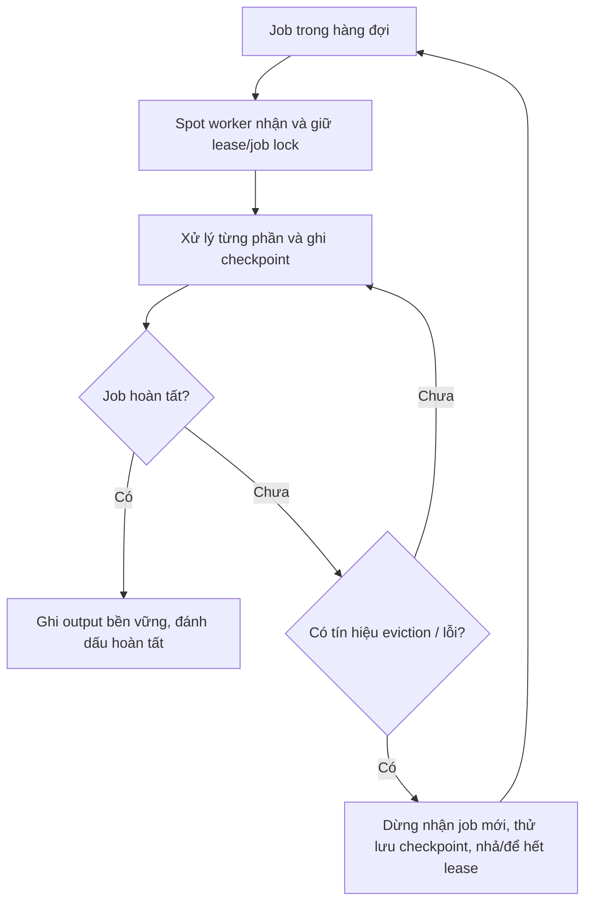
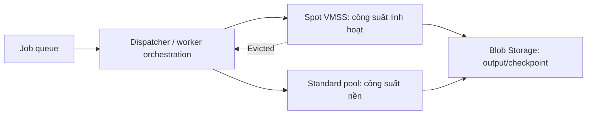

# Spot Virtual Machines và xử lý gián đoạn

Khi một hệ thống xử lý hàng nghìn ảnh, dựng video, chạy test tự động hoặc huấn luyện mô hình theo lô, không phải mọi máy ảo đều cần hoạt động liên tục. Có những công việc có thể dừng giữa chừng, lưu lại tiến độ và tiếp tục trên một máy khác. **Azure Spot Virtual Machines** cho phép khai thác phần công suất tính toán Azure chưa được sử dụng với mức giá có thể thấp hơn VM thông thường, đổi lại **Azure có thể thu hồi máy ảo bất cứ lúc nào** khi cần công suất hoặc khi điều kiện giá không còn phù hợp.

Điểm khó của Spot không nằm ở một nút tạo VM giá rẻ, mà ở cách xây workload có thể sống sót sau **eviction** (thu hồi/gián đoạn VM), xử lý lại một job an toàn và không làm mất dữ liệu. Một quy trình chỉ thành công nếu công việc thực sự hoàn tất, chứ không phải vì tất cả VM đã từng ở trạng thái `Running`.

Bài học thuộc chương **Compute co giãn và xử lý theo lô** trong module **CLOUD_PROVIDERS_AZURE**. Nội dung kết nối thiết kế VM/VM Scale Sets, Azure Batch, Azure Storage, mạng ảo, Microsoft Entra ID, Azure Monitor, bảo mật và kiểm soát chi phí của kiến trúc ứng dụng Azure.

> **Nguyên tắc cốt lõi:** chỉ chuyển workload sang Spot sau khi đã xác định rõ điều gì xảy ra nếu một máy bị lấy lại ngay giữa lúc xử lý. Spot không có cam kết thời gian chạy liên tục hoặc SLA về khả năng còn công suất.

## 1. Mục tiêu học tập

Sau bài học, bạn có thể:

1. Giải thích Azure Spot Virtual Machines hoạt động như thế nào và vì sao giá/công suất có thể thay đổi.
2. Phân biệt **eviction vì thiếu công suất** với **eviction theo giới hạn giá**, và hiểu tùy chọn `max price`.
3. So sánh `Deallocate` và `Delete` khi VM bị eviction, nhất là hậu quả đối với disk và chi phí.
4. Sử dụng Azure Scheduled Events để nhận tín hiệu `Preempt` và chủ động dừng nhận công việc mới.
5. Thiết kế queue, checkpoint, retry, idempotency và lưu dữ liệu bền vững bên ngoài Spot VM.
6. Tạo, kiểm tra, vận hành Spot VM bằng Azure CLI; đánh giá mô hình VM Scale Sets hoặc Azure Batch.
7. Thiết kế kết hợp Spot với năng lực On-Demand/Standard cho workload có hạn hoàn thành.
8. Theo dõi số lần gián đoạn, thời gian xử lý lại, mức hoàn thành và **chi phí trên mỗi kết quả thành công**.

## 2. Spot VM là gì?

Azure có những thời điểm còn công suất VM chưa được khách hàng sử dụng. **Spot Virtual Machines** cho phép chạy workload trên phần công suất đó với mô hình giá Spot. Khi công suất cần được thu hồi hoặc chính sách giá của VM bị vi phạm, Azure có quyền **evict** VM.

VM Spot vẫn là tài nguyên tính toán Azure, có CPU, RAM, hệ điều hành, NIC và storage theo cấu hình. Trong lúc đang chạy, ứng dụng không có một tập API riêng chỉ dành cho Spot để đọc file hoặc xử lý tác vụ: nó có thể sử dụng những công cụ thông thường của Linux/Windows và Azure SDK.

Sự khác biệt lớn nằm ở **tính sẵn có và vòng đời**:

| Khía cạnh | VM thông thường | Azure Spot VM |
|---|---|---|
| Mục tiêu | Công suất chạy ổn định theo điều kiện dịch vụ | Sử dụng công suất dư, chấp nhận bị thu hồi |
| Giá compute | Theo mô hình giá VM thông thường | Giá Spot có thể thấp hơn, thay đổi theo điều kiện |
| Khả năng cấp phát | Vẫn phụ thuộc SKU, quota và công suất | Phụ thuộc thêm công suất Spot khả dụng |
| Eviction do thiếu công suất Spot | Không theo chính sách Spot | Có thể xảy ra bất cứ lúc nào |
| Cam kết chạy liên tục | Theo điều kiện SLA/SKU/dịch vụ | **Không có SLA về thời gian chạy/không bị eviction** |
| Công việc phù hợp | Database chính, API quan trọng, dịch vụ cần uptime | Batch, render, CI, tác vụ stateless, worker có thể retry |
| Kiểm soát chi phí | Reservation, Savings Plan hoặc cơ chế khác nếu phù hợp | Giới hạn giá Spot, quy mô, ngân sách và xử lý interruption |

Không phải mọi VM SKU, region hay zone luôn có công suất Spot. Khả năng tạo VM thành công ở một thời điểm không bảo đảm rằng vài phút sau bạn có thể tạo thêm VM cùng loại.

### Spot không đồng nghĩa với VM cấu hình yếu

Spot có thể sử dụng những VM size với CPU/RAM tương tự VM thông thường cùng SKU. Giá thấp hơn đến từ **khả năng bị thu hồi**, không phải một lời cam kết rằng máy chạy chậm hơn theo quy luật.

Tuy nhiên, hiệu năng workload vẫn phụ thuộc VM size, giới hạn mạng/disk, tải thực tế và việc cần khởi tạo lại sau eviction.

## 3. Workload nào nên và không nên chạy trên Spot?

| Phù hợp để đánh giá Spot | Vì sao |
|---|---|
| Xử lý ảnh/video theo lô | Mỗi tệp có thể được xử lý độc lập và làm lại |
| CI/CD build hoặc kiểm thử tự động | Có thể đưa job trở lại queue khi runner mất |
| Render 3D, mô phỏng hoặc tính toán khoa học | Có thể chia thành tác vụ và lưu checkpoint |
| Data preprocessing / ETL phân đoạn | Có thể xử lý từng partition, ghi kết quả vào storage bền vững |
| Machine learning training có checkpoint | Có thể khôi phục từ trạng thái model/optimizer đã lưu |
| Worker nhận job qua hàng đợi | Có thể phân phối lại công việc sang VM khác |

| Không nên phụ thuộc hoàn toàn vào Spot | Vấn đề |
|---|---|
| Primary database không có HA/replication | Eviction có thể làm dừng ghi và gây mất khả năng phục vụ |
| Một VM duy nhất phục vụ API production quan trọng | Không có backend khỏe để tiếp tục nhận request |
| Tác vụ không thể restart, không có checkpoint | Mất toàn bộ tiến độ khi bị thu hồi |
| Job với deadline chặt nhưng không có công suất dự phòng | Không thể đảm bảo hoàn thành khi Spot hết capacity |
| Tác vụ giữ trạng thái duy nhất trong local disk hoặc RAM | Tăng nguy cơ mất dữ liệu hoặc không phục hồi được |
| Hệ thống thanh toán ghi hiệu ứng bên ngoài không idempotent | Retry có thể tạo giao dịch trùng lặp |

**Điều kiện quyết định:** công việc có thể được chia nhỏ, được phân phối lại, có kết quả bền vững và xử lý đúng khi chạy nhiều lần hay không? Nếu chưa, hãy thiết kế khả năng chịu gián đoạn trước khi tối ưu giá bằng Spot.

## 4. Khi nào và vì sao Azure evict Spot VM?

Có hai nhóm nguyên nhân chính:

1. **Capacity-based eviction:** Azure cần công suất phục vụ nhu cầu ưu tiên hơn hoặc không còn công suất dư phù hợp. Ngay cả khi ứng dụng sẵn sàng trả giá cao, Spot vẫn có thể bị thu hồi.
2. **Price-based eviction:** Giá Spot vượt quá **maximum price** do bạn cấu hình. Trường hợp này chỉ có ý nghĩa khi bạn đặt giới hạn giá hữu hạn.

Có thể xảy ra eviction sau một khoảng thời gian dài hoặc gần như ngay sau khi VM được cấp phát. **Không có thời lượng chạy tối thiểu được bảo đảm**.

### Maximum price là gì?

Khi tạo Spot VM, bạn có thể đặt `max-price`: mức giá compute tối đa bạn chấp nhận theo đơn vị/biểu giá Azure quy định cho VM size đó. Khi giá vượt mức giới hạn, Azure có thể evict VM.

Tùy chọn **`--max-price -1`** thường biểu thị rằng bạn không muốn bị evict **vì giới hạn giá Spot do bạn đặt**; giá compute thực tế vẫn theo cơ chế Spot và không vượt mức giá VM thông thường tương ứng theo quy định dịch vụ. Tùy chọn này **không** ngăn Azure thu hồi VM vì công suất.

Nếu chọn một mức giá thấp, bạn kiểm soát ngưỡng giá nhưng có thể tăng tần suất eviction theo biến động giá. Không có lựa chọn nào loại bỏ rủi ro capacity eviction.

### Spot price không phải mức chiết khấu cố định

Giá Spot thay đổi theo VM size, region và điều kiện dịch vụ. Không lấy một ví dụ giảm giá ở thời điểm trước làm mức tiết kiệm chắc chắn cho toàn dự án. Cần kiểm tra giá hiện hành và so sánh **tổng chi phí hoàn thành công việc**, gồm cả số lần làm lại, lưu checkpoint, log, storage và công suất dự phòng.

## 5. Hai eviction policy: Deallocate và Delete

Khi cấu hình Spot VM, bạn chọn cách Azure xử lý tài nguyên sau eviction. Hai cơ chế cơ bản là:

| Tiêu chí | `Deallocate` | `Delete` |
|---|---|---|
| Trạng thái VM sau eviction | VM được dừng/deallocate, tài nguyên VM còn để quản lý | VM bị xóa theo chính sách eviction |
| Khả năng khởi động lại | Có thể thử start lại khi công suất Spot khả dụng; **không được bảo đảm** | Không còn VM cũ để start; cần tạo instance mới |
| OS/data disks | Disk bền vững thường vẫn tồn tại theo cấu hình khi deallocate | Sự tồn tại/xóa của disk và tài nguyên liên quan phụ thuộc cấu hình vòng đời, loại disk và `deleteOption` được hỗ trợ |
| Chi phí compute khi không chạy | Không tính compute cho thời gian VM đã deallocate theo mô hình thông thường | Compute VM đó không còn |
| Chi phí ngoài compute | Managed disks, public IP và tài nguyên giữ lại có thể tiếp tục tính phí | Các tài nguyên giữ lại hoặc tách rời vẫn có thể tính phí |
| Cách dùng thường gặp | Muốn giữ cấu hình VM và thử tái sử dụng | Worker tạm thời, có thể tạo lại từ image và IaC |

### Vì sao `Deallocate` không tương đương “tạm dừng miễn phí”?

VM đã deallocate có thể không còn tính tiền compute, **nhưng storage và một số tài nguyên mạng vẫn có chi phí**. Nếu hàng trăm Spot worker đều bị thu hồi mà không được dọn, bạn có thể giữ hàng trăm OS disks hoặc public IP không cần thiết.

Ngoài ra, start lại VM vẫn phụ thuộc công suất Spot có sẵn. Nó không giống việc bật một VM đã đặt trước năng lực tính toán.

### Vì sao `Delete` cần lưu trạng thái bên ngoài VM?

Worker có thể mất VM và các tài nguyên gắn liền theo chính sách xóa đã chọn. Không lưu checkpoint quan trọng vào `/tmp`, temporary disk, ephemeral OS disk hoặc chỉ một managed disk có nguy cơ bị xóa theo vòng đời VM.

Nếu dùng managed disk có cấu hình giữ lại khi VM bị xóa, hãy kiểm tra chính xác `deleteOption` và runbook dọn tài nguyên. **Không coi việc giữ disk là thay thế cho lưu checkpoint trên hệ thống bền vững độc lập**.

**Khuyến nghị cho batch worker dễ tái tạo:** đặt output/checkpoint lên Blob Storage, Azure Files, Azure NetApp Files hoặc data store phù hợp và để hệ thống orchestration tạo worker mới khi cần. Quyết định `Delete` hay `Deallocate` nên dựa trên chi phí giữ tài nguyên, tốc độ phục hồi và yêu cầu vận hành.

## 6. Vòng đời của một job khi chạy trên Spot

Đây là một mô hình logic của worker xử lý một công việc từ hàng đợi:



Trong thực tế, **VM có thể biến mất trước khi kịp lưu checkpoint cuối**. Do đó thiết kế đúng phải vẫn chạy an toàn khi không có tín hiệu báo trước.

### Tách nơi chạy và nơi lưu kết quả

- **Compute:** Spot VM chạy tiến trình xử lý.
- **Queue:** Azure Queue Storage, Azure Service Bus hoặc hệ thống hàng đợi phù hợp giữ công việc chưa hoàn tất.
- **Checkpoint:** Blob Storage hoặc storage bền vững giữ trạng thái đã xử lý.
- **Final output:** ghi vào vị trí kết quả bền vững, có kiểm tra tính hoàn chỉnh.
- **Metadata/job state:** ghi trạng thái, số lần thử, version output và thời gian xử lý.
- **Monitoring:** Azure Monitor, log ứng dụng, queue metrics và thông tin eviction.

Nếu VM bị xóa, công việc vẫn có thể tìm thấy trong queue hoặc được đưa trở lại queue, trạng thái checkpoint còn nguyên, và VM mới tiếp tục phần chưa làm.

## 7. Nhận cảnh báo eviction bằng Azure Scheduled Events

Azure cung cấp cơ chế **Scheduled Events** qua endpoint metadata trong VM. Đối với Spot, tín hiệu thường quan tâm là **`Preempt`**, thông báo workload có nguy cơ bị thu hồi.

Có thể có khoảng thời gian báo trước ngắn, thường được mô tả **xấp xỉ 30 giây** cho Spot eviction. Đây không phải ngân sách thời gian mà ứng dụng được phép phụ thuộc hoàn toàn: việc nhận event, thời gian polling và điều kiện xảy ra sự cố có thể khiến worker không xử lý kịp.

**Nguyên tắc:** coi event là cơ hội để graceful shutdown, không coi nó là bảo đảm sẽ luôn nhận được.

### Gọi endpoint từ bên trong Azure VM

Ví dụ dùng Bash trong VM:

```bash
curl --noproxy '*' --fail --silent --show-error \
  -H 'Metadata: true' \
  'http://169.254.169.254/metadata/scheduledevents?api-version=2020-07-01'
```

Địa chỉ `169.254.169.254` là Azure Instance Metadata Service (IMDS), có thể truy cập từ môi trường VM được hỗ trợ; **không phải URL công khai để gọi từ laptop hoặc Cloud Shell**. Không đưa token, secret hay thông tin định danh nhạy cảm vào request.

Response có thể chứa danh sách `Events` cùng các trường như `EventType`, `Resources`, `NotBefore`, `EventStatus` theo phiên bản API. Một sự kiện liên quan đến Spot eviction có thể có `EventType: "Preempt"`.

### Ví dụ kiểm tra sự kiện `Preempt`

Nếu có `jq`:

```bash
curl --noproxy '*' --fail --silent --show-error \
  -H 'Metadata: true' \
  'http://169.254.169.254/metadata/scheduledevents?api-version=2020-07-01' \
  | jq '.Events[]? | select(.EventType == "Preempt")'
```

Lệnh chỉ **đọc** sự kiện. Worker production cần một vòng polling/agent được quản trị, có timeout và logging; không dựa vào thao tác SSH thủ công.

### Worker phải làm gì khi thấy `Preempt`?

1. **Đánh dấu draining:** ngừng lấy job mới từ queue.
2. **Ngắt việc có thể ngắt an toàn:** dừng nhận yêu cầu hoặc bắt đầu hoàn tất một đơn vị công việc nhỏ.
3. **Checkpoint nhanh:** ghi trạng thái quan trọng về storage bền vững nếu còn thời gian.
4. **Giải phóng lease/lock hoặc để cơ chế timeout xử lý** tùy queue.
5. **Ghi log metadata:** job ID, checkpoint ID, thời điểm và trạng thái; không ghi secret.
6. **Thoát tiến trình có kiểm soát:** không đợi một tác vụ dài hơn ngân sách eviction còn lại.
7. **Để scheduler tạo worker khác:** không cố ngăn Azure thu hồi VM.

Sự kiện có thể có trường `NotBefore`, nhưng không nên dùng đó để tính một lời hứa chính xác về số giây còn lại. Nếu cần quy trình lưu dữ liệu phức tạp mất nhiều phút, hãy checkpoint **định kỳ từ trước**, không chờ `Preempt`.

## 8. Chống mất công việc bằng checkpoint định kỳ

**Checkpoint** là trạng thái đủ để ứng dụng tiếp tục công việc mà không phải bắt đầu từ đầu.

Ví dụ một tác vụ xử lý 1.000 ảnh:

- Không có checkpoint: bị evict sau khi xử lý ảnh thứ 900 có thể phải làm lại toàn bộ.
- Checkpoint mỗi 100 ảnh: lần chạy mới có thể tiếp tục từ phần chưa được đánh dấu thành công.
- Checkpoint theo từng ảnh: giảm lượng làm lại, nhưng tăng chi phí thao tác đọc/ghi trạng thái.

Chọn tần suất checkpoint dựa trên:

```text
Thời gian mất trung bình do chạy lại
    so với
Chi phí ghi/đọc checkpoint và độ phức tạp phục hồi
```

### Yêu cầu của checkpoint tốt

- **Bền vững:** lưu ngoài Spot VM trên hệ thống không bị xóa theo VM.
- **Nhất quán:** không đánh dấu hoàn tất một bước trước khi output của bước đó thực sự có thể dùng.
- **Có phiên bản:** lưu job ID, tiến độ, version định dạng dữ liệu và checksum nếu cần.
- **Khôi phục được:** worker mới biết checkpoint nào mới nhất và hợp lệ.
- **Chịu chạy lặp:** nếu bị ngắt đúng lúc ghi checkpoint, worker mới không làm hỏng dữ liệu.
- **Giới hạn tần suất:** đừng tạo bottleneck hoặc chi phí storage quá lớn.

### Hai pha ghi kết quả để tránh file hỏng

Ví dụ xử lý một file đầu vào:

1. Worker đọc `jobs/123/input`.
2. Ghi kết quả vào vị trí tạm mang job ID và attempt ID, ví dụ `staging/123/attempt-7`.
3. Kiểm tra output đủ, checksum/schema hợp lệ.
4. Cập nhật trạng thái hoàn tất một cách có điều kiện hoặc sử dụng cơ chế commit/idempotency của data store.
5. Chỉ khi commit thành công mới xác nhận job đã hoàn tất trong queue.
6. Dọn file staging dư theo lifecycle policy.

Không phải mọi hệ thống storage hỗ trợ rename/transaction giống nhau. Thiết kế atomic commit dựa trên **API thực sự** của Azure Blob, database hoặc công nghệ bạn chọn; không giả định rename blob luôn là atomic rename kiểu POSIX.

## 9. Retry, idempotency và khả năng chạy ít nhất một lần

Trong kiến trúc queue, khi worker chết mà chưa xác nhận thành công, job có thể được giao lại. Vì vậy thiết kế thường tuân theo **at-least-once processing**: một job có thể được chạy nhiều lần.

Nếu job gửi email, ghi hóa đơn hoặc gọi API thanh toán mà không có chống trùng, chạy lại có thể tạo tác dụng phụ nhiều lần. **Idempotency** nghĩa là xử lý lại cùng một tác vụ không tạo thêm hiệu ứng sai.

### Ví dụ mô hình job

```json
{
  "jobId": "resize-photos-2026-001",
  "inputPrefix": "raw/2026-11/001/",
  "outputPrefix": "processed/2026-11/001/",
  "checkpointPath": "checkpoints/resize-photos-2026-001.json",
  "attempt": 3
}
```

Đây là dữ liệu minh họa, không chứa credential. Worker phải dùng **jobId ổn định** để nhận diện công việc, thay vì coi mỗi lần chạy là một job mới.

### Quy trình xử lý an toàn

```text
Nhận job -> Kiểm tra đã hoàn tất chưa?
         -> Nếu chưa: đọc checkpoint -> xử lý phần còn thiếu
         -> Ghi output bền vững -> xác nhận kết quả
         -> Chỉ sau đó mới ACK/delete message trong queue
```

Khi dùng Azure Queue Storage hoặc Azure Service Bus, cần hiểu **visibility timeout**, lease/lock và cơ chế gia hạn. Đặt timeout dài hơn thời gian xử lý một bước, hoặc gia hạn có kiểm soát khi job dài. Nếu worker bị evict, message/lock cuối cùng phải có cơ chế cho worker khác nhận lại.

### Chống retry storm

Nếu một vùng/VM family vừa mất Spot capacity, hàng nghìn job có thể cùng retry và cùng tạo VM mới. Điều này có thể gây tăng tải, throttling hoặc thất bại liên tục.

Dùng:

- Exponential backoff và jitter cho retry tạm thời.
- Giới hạn attempt, deadline và phân loại lỗi vĩnh viễn.
- Poison queue/dead-letter queue cho job lỗi lặp lại.
- Rate limit cho cơ chế tạo worker, tránh gọi API cấp phát quá dày.
- Alert về queue backlog và số job quá tuổi, không chỉ CPU VM.

## 10. Tạo Spot VM bằng Azure CLI

Ví dụ sau dùng **Azure Cloud Shell Bash** hoặc Bash có Azure CLI. Chỉ chạy trong subscription thử nghiệm được phép và đã có resource group, VNet và subnet phù hợp. Spot có thể không được cấp phát do công suất: lệnh tạo có thể thất bại dù cấu hình đúng.

### Bước 1 — Xác nhận subscription

```bash
az account show \
  --query "{subscription:name,id:id,tenant:tenantId}" \
  --output table

az account set --subscription "<SUBSCRIPTION_ID>"
```

Khai báo tên lab:

```bash
RG="rg-spot-lab"
VNET="vnet-spot-lab"
SUBNET="snet-workers"
VM="spot-worker-01"
SIZE="Standard_D2s_v5"
```

`SIZE` và image là minh họa; cần kiểm tra khả năng Spot cho VM SKU, region, zone và subscription trước khi triển khai.

### Bước 2 — Kiểm tra VM SKU trong region

```bash
LOC="southeastasia"

az vm list-skus \
  --location "$LOC" \
  --resource-type virtualMachines \
  --size "$SIZE" \
  --all \
  --output json
```

Lệnh cho biết thông tin SKU và restrictions có liên quan, **không cam kết còn Spot capacity ở thời điểm tạo**. Kiểm tra thêm quota, chính sách Azure Policy và các chỉ số khả dụng/placement score nếu môi trường có cơ chế hỗ trợ.

### Bước 3 — Tạo Spot VM với Deallocate

```bash
az vm create \
  --resource-group "$RG" \
  --name "$VM" \
  --image Ubuntu2204 \
  --size "$SIZE" \
  --vnet-name "$VNET" \
  --subnet "$SUBNET" \
  --admin-username azureuser \
  --generate-ssh-keys \
  --priority Spot \
  --eviction-policy Deallocate \
  --max-price -1 \
  --public-ip-address ""
```

Ý nghĩa:

- `--priority Spot`: sử dụng cơ chế Spot thay cho VM priority thông thường.
- `--eviction-policy Deallocate`: nếu bị thu hồi, giữ VM ở trạng thái deallocated thay vì xóa.
- `--max-price -1`: tránh eviction do giới hạn giá hữu hạn do bạn tự đặt; **vẫn có eviction vì công suất**.
- `--public-ip-address ""`: ví dụ tạo VM không cần public IP trực tiếp; quản trị qua Azure Bastion hoặc kết nối private được phê duyệt.

Nếu muốn worker hoàn toàn dùng image/tạo lại, có thể chọn `--eviction-policy Delete` và bảo đảm output/checkpoint nằm bên ngoài VM. Cần hiểu rõ tài nguyên disk/NIC nào được giữ hay bị xóa trước khi sử dụng chính sách này.

Lệnh có thể thất bại vì quota, SKU restriction, subnet, Azure Policy hoặc thiếu công suất Spot. Không retry vô hạn một tổ hợp SKU/zone không khả dụng; cần cơ chế fallback.

### Bước 4 — Kiểm tra cấu hình và trạng thái VM

```bash
az vm show \
  --resource-group "$RG" \
  --name "$VM" \
  --query "{name:name,priority:priority,evictionPolicy:evictionPolicy,maxPrice:billingProfile.maxPrice,zones:zones,provisioningState:provisioningState}" \
  --output json

az vm get-instance-view \
  --resource-group "$RG" \
  --name "$VM" \
  --output json
```

Các field thể hiện cấu hình priority, eviction policy và thông tin runtime theo API. `provisioningState: Succeeded` **không bảo đảm VM đang chạy hoặc sẽ tồn tại trong giờ tiếp theo**; phải đối chiếu power state và telemetry workload.

### Bước 5 — Dọn tài nguyên lab

Không xóa resource group nếu có tài nguyên dùng chung. Trước khi dọn, kiểm tra VM, managed disks, NIC, public IP, metrics/alerts và storage thử nghiệm. Với `Deallocate`, **disk vẫn có thể tính phí** sau eviction hoặc sau thao tác dừng.

## 11. VM Scale Sets với Spot

Một Spot VM đơn lẻ phù hợp cho thử nghiệm; hệ thống cần nhiều worker nên cân nhắc **Azure Virtual Machine Scale Sets (VMSS)**. VMSS giúp quản lý nhóm VM theo image/cấu hình chung, scale theo tải và thay thế instance theo cơ chế được hỗ trợ.

Với cấu hình Spot, từng instance có thể bị evict. VMSS hoặc orchestration tương ứng có thể cố gắng tạo instance thay thế theo chính sách, nhưng **việc khôi phục capacity không được bảo đảm** nếu Azure thiếu Spot capacity.

### Các lựa chọn quản trị

- Sử dụng một VMSS chứa các instance Spot theo cấu hình và tính năng được phép.
- Tách **Spot worker pool** và **Standard/On-Demand worker pool** để giữ năng lực tối thiểu ổn định.
- Đánh giá **mixed priority** trong VMSS Flex hoặc cơ chế tương ứng nếu subscription/region/SKU hỗ trợ; xác minh tính năng và giới hạn hiện hành trước khi phụ thuộc.
- Phân tán VM SKU/zone/region cho các workload có thể chạy ở nhiều nơi, nhưng phải cân nhắc latency tới dữ liệu và chi phí chuyển vùng.
- Dùng autoscale theo **queue depth, job age hoặc số worker có khả năng xử lý**, không chỉ CPU.

Ví dụ logic:



Đường nét đứt chỉ tình huống worker mất công suất; hệ thống orchestration cần theo dõi trạng thái và tăng/giảm nhóm worker phù hợp.

### Điều gì xảy ra khi tất cả Spot instance bị thu hồi?

- Queue vẫn giữ các job chưa hoàn tất.
- Standard pool xử lý mức tải tối thiểu hoặc các job có deadline.
- Autoscaler có thể thử phục hồi Spot instance ở SKU/zone khác nếu chính sách cho phép.
- Dashboard phải hiển thị backlog và thời gian hoàn thành dự kiến.
- Khi Spot trở lại, scheduler cấp thêm worker và tiếp tục từ checkpoint.

**Không coi desired instance count bằng actual healthy worker count.** Khi thiếu công suất, VMSS mong muốn 20 instance nhưng có thể cấp phát được ít hơn; vận hành phải theo dõi số worker thực sự đang xử lý.

## 12. Azure Batch và Spot cho công việc theo lô

Với các workload tính toán theo lô, **Azure Batch** giúp lập lịch job/task và quản lý compute pool. Tùy tính năng đang được hỗ trợ, pool có thể sử dụng Spot/low-priority nodes, thường phù hợp tác vụ có thể chạy lại.

Đối với một tác vụ Batch dài, có thể thiết kế:

1. Tách dữ liệu thành nhiều task nhỏ độc lập.
2. Đưa input và checkpoint lên Blob Storage.
3. Batch scheduler phân phối task tới node có sẵn.
4. Khi node bị evict, hệ thống quản lý task và retry theo chính sách.
5. Task tiếp tục hoặc chạy lại; việc duy trì trạng thái ngoài node vẫn là trách nhiệm thiết kế ứng dụng.
6. Đo tiến độ job và số task hoàn tất để đánh giá hiệu quả.

**Azure Batch không tự biến code chưa idempotent thành an toàn.** Nếu task có side effect, dùng key ổn định, kiểm tra đầu ra và cơ chế commit/transaction tương ứng.

### VMSS hay Azure Batch?

| Tiêu chí | VMSS | Azure Batch |
|---|---|---|
| Mô hình | Nhóm VM cho ứng dụng/worker do bạn quản lý | Compute pools và hệ thống lập lịch batch task |
| Quản lý job | Bạn xây queue, dispatcher, lease, retry | Có thành phần job/task scheduling của Batch |
| Phù hợp | Worker service tùy biến, cần kiểm soát OS/runtime cao | Batch processing, render, mô phỏng, xử lý job phân đoạn |
| Xử lý eviction | Worker/app và VMSS phối hợp phục hồi | Task retry/rescheduling theo cơ chế Batch + logic ứng dụng |
| Quan sát | VMSS + queue + application metrics | Batch job/task metrics + application/storage |
| Ràng buộc | VM orchestration, VM SKU, mạng, disk | Region/pool, Batch account/quota và yêu cầu task |

Cần đánh giá feature availability, quota và giới hạn hiện hành trước khi chọn dịch vụ; không có một giải pháp luôn tốt hơn cho mọi batch workload.

## 13. Thiết kế công suất nền và công suất linh hoạt

Một chiến lược thực tế thường có hai lớp:

- **Baseline capacity:** số VM Standard hoặc dịch vụ có SLA phù hợp để đáp ứng tác vụ khẩn cấp, orchestration và SLA tối thiểu.
- **Elastic capacity:** Spot worker mở rộng theo queue backlog khi có công suất rẻ hơn.

Ví dụ 10.000 task cần hoàn thành trong một cửa sổ xử lý. Thiết kế có thể giữ một nhóm Standard xử lý các task gần deadline, còn Spot xử lý phần còn lại. Nếu Spot bị evict hàng loạt, baseline vẫn tiến hành các task quan trọng và hệ thống phát cảnh báo.

Không nên dùng một tỷ lệ cứng như “90% Spot luôn tối ưu” mà không có số liệu. Cần đánh giá:

- Thời gian xử lý trung bình và p95/p99 mỗi task.
- Tỷ lệ eviction và số công đoạn phải làm lại.
- Peak backlog và deadline thực tế.
- Giá Spot thực tế theo SKU/region.
- Công suất tối thiểu luôn cần có.
- Thời gian khởi tạo image, tải model/dependency và warm-up.
- Chi phí checkpoint/storage, retry và monitoring.

### Chọn kích thước task

Task rất lớn sẽ mất nhiều công khi bị ngắt. Task rất nhỏ lại tạo overhead điều phối/queue lớn. Một phương án thường có ích là chia task thành các đơn vị **có thể hoàn thành hoặc checkpoint nhanh**, sau đó đo chi phí orchestration.

Có thể sử dụng checkpoint theo giai đoạn của job ML hoặc xử lý theo partition dữ liệu. Với tác vụ CPU/GPU đắt đỏ, thời gian khởi tạo lại và tải checkpoint có thể trở thành chi phí đáng kể.

## 14. Giám sát eviction, sức khỏe worker và job completion

Chỉ nhìn biểu đồ CPU hoặc số VM `Running` chưa đủ để đánh giá Spot. Bộ chỉ số cần có cả **khả năng hoàn thành công việc** và **chi phí**.

| Nhóm chỉ số | Ví dụ |
|---|---|
| Spot capacity | Số VM requested/provisioned/running/deallocated/evicted |
| Job throughput | Số job hoàn thành mỗi phút, dữ liệu xử lý mỗi giờ |
| Queue health | Queue depth, tuổi job lâu nhất, số job retry, dead-letter |
| Eviction | Số lần bị thu hồi, thời gian chạy trước eviction, nguyên nhân theo dữ liệu được ghi |
| Checkpoint | Tuổi checkpoint gần nhất, thời gian ghi/đọc, lỗi checkpoint |
| Latency/SLO | End-to-end job completion time, p95, tỷ lệ hoàn tất đúng hạn |
| Cost | VM compute theo priority, disk giữ lại, storage, transfer, monitoring và cost per completed job |
| Security | Quyền managed identity, lỗi truy cập storage, thay đổi role hoặc cấu hình VM |

### Nguồn tín hiệu

- **Azure Activity Log/Resource Health và trạng thái VM/VMSS**: thay đổi lifecycle và thông tin hạ tầng được cung cấp theo từng loại tài nguyên.
- **Scheduled Events**: giúp nhận tín hiệu `Preempt` ngay trong worker khi có.
- **Azure Monitor và VM Insights**: CPU, memory khi đã bật thu thập, disk và network, alerts.
- **Application Insights hoặc log ứng dụng**: job ID, thời gian, lỗi, retry, checkpoint và kết quả.
- **Storage/Service Bus/Queue metrics**: backlog, ingress/egress, lỗi, throttling.
- **Cost Management**: chi phí thực tế và forecast.

Dữ liệu eviction reason không nhất thiết có đầy đủ ở một metric duy nhất cho mọi loại VM/VMSS. Thiết kế telemetry của orchestrator cần ghi lại sự kiện đã nhận và thời gian node biến mất; dùng nguồn nền tảng để đối chiếu khi có.

### Alert mang tính hành động

1. Queue backlog tăng liên tục và tuổi job vượt ngưỡng.
2. Số worker khỏe thấp hơn mức nền yêu cầu.
3. Tỷ lệ job retry hoặc timeout cao bất thường.
4. Checkpoint không được cập nhật trong thời gian dự kiến.
5. Số lần eviction tăng cùng lúc với tỷ lệ hoàn thành giảm.
6. Chi phí disk/VM deallocated tăng dù số job không tăng.
7. Tỷ lệ job hoàn tất trước deadline thấp hơn SLO.

Ngưỡng cần dựa trên baseline workload và thời gian cao điểm; tránh cảnh báo chỉ vì một Spot VM bị evict, bởi eviction là hành vi được thiết kế để chấp nhận.

## 15. Chi phí: tính trên kết quả hoàn thành, không chỉ giá VM

Một Spot VM có đơn giá compute thấp chưa chắc làm cả pipeline rẻ hơn. Thử tưởng tượng một job phải chạy 90 phút trên Spot, nhưng thường bị gián đoạn ở phút 80 và phải làm lại toàn bộ: tổng thời gian compute bị lãng phí có thể lớn.

Ước lượng tổng chi phí:

```text
Total Cost = Spot compute đã chạy
           + Standard/on-demand baseline
           + Storage cho input/output/checkpoint
           + Data transfer/network
           + Monitoring/logging
           + Chi phí tính toán chạy lại do eviction
           + Chi phí vận hành và thời gian chờ (nếu lượng hóa)

Cost per successful job = Total Cost / số job hoàn tất hợp lệ
```

Đây là công thức lập kế hoạch, không phải quy tắc tính hóa đơn của Azure. Đơn giá và thành phần billing cụ thể thay đổi theo dịch vụ, region và thời điểm sử dụng.

### Một vài bẫy chi phí

- VM `Deallocate` không còn tính compute nhưng **managed disks vẫn được giữ và có thể bị tính phí**.
- Scale-out quá nhanh gây retry, download dependency và request storage lặp lại.
- Checkpoint quá thường xuyên làm tăng request/storage nhưng có thể vẫn đáng giá nếu giảm rework.
- Chọn một VM SKU rẻ nhưng khởi động quá lâu có thể khiến deadline bị trễ.
- Di chuyển tác vụ qua region khác có thể phát sinh phí transfer và tăng latency.
- Giữ baseline quá nhỏ làm hệ thống không đạt SLO khi Spot bị thu hồi.

Hãy đánh giá các phương án bằng số liệu ít nhất qua những giờ tải cao và giai đoạn Spot availability thay đổi, không chỉ dựa vào giá tại thời điểm tạo VM đầu tiên.

## 16. Bảo mật và vận hành an toàn

Spot VM có thể được tạo/xóa với tần suất cao. Vì vậy phải **tự động hóa cấu hình an toàn** và tránh để credential nằm trên image hoặc disk bị bỏ quên.

### Danh tính

- Ưu tiên **managed identity** cho worker truy cập Azure Storage, Queue, Key Vault và Azure Monitor khi dịch vụ hỗ trợ.
- Dùng RBAC tối thiểu: worker đọc input, ghi output/checkpoint của phạm vi phù hợp; không cấp Owner chỉ để tải blob.
- Không đưa storage account key hoặc client secret vào custom data, cloud-init log, image, startup script hoặc repository.
- Khi VM bị xóa, rà soát tài nguyên identity, role assignment và artifact nhạy cảm còn tồn tại theo lifecycle thực tế.

### Mạng

- Không mặc định Spot worker cần public IP. Dùng subnet private và Azure Bastion/đường quản trị được phê duyệt khi cần.
- Nếu worker gọi Internet, thiết kế outbound qua NAT Gateway, firewall hoặc phương án phù hợp; có thể cần IP nguồn ổn định cho API đối tác.
- Dùng Private Endpoint khi truy cập Azure Storage/service hỗ trợ qua mạng riêng và có yêu cầu bảo mật.
- Kiểm soát NSG, DNS và route khi worker được tạo lại ở subnet/zone khác.

### Image và cấu hình

- Dùng image có version xác định, được cập nhật bảo mật và kiểm thử.
- Đặt **bootstrap time** trong SLO; giảm cài đặt package kéo dài ở mỗi lần khởi động.
- Script khởi tạo nên **idempotent**: chạy lại không gây sửa cấu hình trùng, mất dữ liệu hoặc tạo quá nhiều tài nguyên phụ.
- Cấu hình shutdown handler phải chấp nhận việc VM bị xóa bất ngờ trước khi chạy xong.

### Data protection

Dữ liệu cần lưu lâu dài phải nằm ngoài tài nguyên dễ bị eviction, có quyền truy cập, encryption, backup/retention và chính sách xóa phù hợp. Giảm chi phí compute không phải lý do để bỏ qua bảo vệ dữ liệu.

## 17. Xử lý sự cố thường gặp

| Triệu chứng | Nguyên nhân có thể | Cách điều tra |
|---|---|---|
| Không tạo được Spot VM | Không đủ capacity, SKU/zone không phù hợp, quota hoặc Azure Policy | Xem error cấp phát, region/SKU, quota, quyền; dùng fallback |
| VM vừa tạo đã bị evict | Capacity Spot thay đổi hoặc điều kiện giá | Kiểm tra priority/eviction policy/maxPrice và lifecycle |
| `--max-price -1` nhưng vẫn bị evict | Eviction do capacity vẫn có thể xảy ra | Kiểm tra nguyên nhân; không coi `-1` là đảm bảo uptime |
| VM bị deallocate nhưng hóa đơn vẫn có chi phí | Disk hoặc public IP vẫn tồn tại | Kiểm kê tài nguyên và Cost Management |
| Sau eviction, job biến mất | Chỉ lưu trạng thái trong VM hoặc ACK queue quá sớm | Đưa checkpoint/output ra storage bền vững, sửa quy trình ACK |
| Job bị xử lý hai lần | Queue redelivery, lease timeout hoặc worker chết sau side effect | Idempotency key, transaction/commit có điều kiện |
| Worker không nhận event `Preempt` | Polling chậm, agent lỗi, event không kịp xử lý | Checkpoint định kỳ, telemetry, thiết kế không phụ thuộc notice |
| VMSS desired count cao nhưng actual thấp | Không còn Spot capacity hoặc provisioning lỗi | Xem instance health, lỗi cấp phát, SKU/zone và baseline |
| Càng scale Spot càng chậm | Tốn thời gian bootstrap, tải dữ liệu và contention | Cache dependency an toàn, đo startup/cold start, tune concurrency |
| Queue backlog tăng liên tục | Worker ít, task quá dài, retry liên tục | Theo dõi job age, completion, lỗi, tăng baseline khi cần |
| Ghi checkpoint nhưng resume lỗi | Trạng thái không atomic hoặc không tương thích phiên bản | Versioning, checksum, commit marker, test recovery |
| Chi phí Spot không giảm như kỳ vọng | Rework nhiều, disk giữ lại, transfer/log tốn phí | Đo cost per completed job thay vì compute hourly rate |

## 18. Bài thực hành: batch worker chịu gián đoạn

### Tình huống

Một ứng dụng xử lý 5.000 ảnh đầu vào mỗi đêm. Mỗi ảnh có thể xử lý độc lập, kết quả lưu trên Azure Blob Storage. Doanh nghiệp muốn giảm chi phí bằng Spot VM nhưng vẫn cần hoàn tất công việc trước giờ làm việc.

### Phần A — Thiết kế

1. Chọn mô hình hàng đợi cho mỗi ảnh hoặc một nhóm ảnh nhỏ.
2. Đặt input trên Blob Storage, output trên container riêng và dùng `jobId` ổn định.
3. Chỉ định nơi lưu checkpoint, trạng thái hoàn tất và dữ liệu retry/dead-letter.
4. Vẽ sơ đồ gồm queue, Spot VM worker, Standard baseline worker, Blob Storage và monitoring.
5. Giải thích vì sao không lưu trạng thái duy nhất trên OS disk của Spot VM.
6. Chọn `Deallocate` hoặc `Delete`, nêu tác động chi phí và vòng đời tài nguyên.
7. Viết quy trình worker khi nhận `Preempt` và khi mất máy mà **không có thông báo**.
8. Đặt tiêu chí idempotency khi hai worker cùng nhận lại một job.

### Phần B — Triển khai lab

1. Chuẩn bị resource group, VNet/subnet, Storage account và queue thử nghiệm theo quyền được cấp.
2. Tạo Spot VM thử bằng Azure CLI với `--priority Spot` và eviction policy được lựa chọn.
3. Xác minh `priority`, `evictionPolicy`, `maxPrice` và power state.
4. Từ bên trong VM, gọi endpoint Scheduled Events, kiểm tra cấu trúc JSON.
5. Chạy một worker xử lý dữ liệu giả, ghi checkpoint định kỳ lên storage bền vững.
6. Giả lập worker mất đột ngột bằng cách dừng process hoặc deallocate **VM lab được phép**, sau đó để queue phân phối lại job.
7. Khởi tạo worker khác và xác nhận chỉ những phần chưa hoàn tất được thực hiện lại.
8. Kiểm tra rằng output không bị ghi trùng hoặc hỏng khi worker bị dừng sau khi đã ghi file nhưng chưa ACK.
9. Đo queue backlog, số lần retry, tuổi checkpoint và thời gian hoàn thành.
10. Dọn VM, managed disks, NIC, log và tài nguyên thử nghiệm sau khi xác minh không còn phụ thuộc.

**Lưu ý:** thao tác dừng/deallocate VM bằng tay **không tái hiện chính xác** cơ chế Spot eviction và Scheduled Events `Preempt`. Đây là một bài kiểm thử resilience ở mức tiến trình/VM, giúp xác minh checkpoint và retry. Nếu muốn kiểm thử handler `Preempt`, dùng mock event hoặc cơ chế thử nghiệm được hỗ trợ; không cố ép Azure eviction trên tài nguyên production.

### Phần C — Phân tích kết quả

Ghi lại:

| Chỉ số | Cần báo cáo |
|---|---|
| Tổng job ban đầu | Số task thực sự cần hoàn thành |
| Job hoàn tất hợp lệ | Không tính output trùng/hỏng |
| Job bị retry | Số lần thử lại và nguyên nhân |
| Thời gian mất vì chạy lại | Thời gian compute không tạo ra kết quả mới |
| Thời gian khởi tạo worker | Bootstrap + tải dependency/checkpoint |
| Queue age / deadline | Tác vụ có hoàn tất trong hạn không? |
| Chi phí lab | Compute, disk, storage, networking, monitoring |
| Chi phí trên kết quả | Tổng chi phí chia cho số job thành công |

### Câu hỏi tự kiểm tra

**Câu 1.** Vì sao Spot VM có thể bị thu hồi dù bạn đặt `--max-price -1`?

**Câu 2.** Khác biệt quan trọng giữa eviction policy `Deallocate` và `Delete` là gì?

**Câu 3.** Scheduled Events có đảm bảo worker luôn có đủ thời gian để ghi checkpoint vài phút không? Vì sao?

**Câu 4.** Một worker đã ghi output nhưng chết trước khi xóa queue message. Thiết kế nào ngăn output bị tạo trùng khi worker khác xử lý lại?

**Câu 5.** Vì sao nên giữ Standard/On-Demand worker pool cho các job có deadline nghiêm ngặt?

**Câu 6.** Tại sao cần theo dõi queue backlog và cost per completed job thay vì chỉ số VM đang chạy và giá Spot theo giờ?

**Câu 7.** Một Spot VM ở trạng thái deallocated có nhất thiết hết mọi chi phí không?

**Câu 8.** Nếu toàn bộ Spot capacity trong một zone biến mất, nhóm vận hành cần quan sát và quyết định những gì?

**Tiêu chí hoàn thành:** người học giải thích được mô hình giá và eviction, tạo được Spot VM, kiểm tra được Scheduled Events, thiết kế job chịu chạy lại với checkpoint và idempotency, đồng thời đánh giá được tính đúng đắn, độ trễ và chi phí của một batch pipeline.

## Kết luận

**Azure Spot Virtual Machines** phù hợp để giảm chi phí compute cho công việc **có thể gián đoạn, có thể thử lại và không phụ thuộc vào một máy cụ thể**. Spot không phải phương án thay thế trực tiếp cho mọi VM production: capacity thay đổi, giá có thể biến động và eviction có thể xảy ra bất cứ lúc nào.

Kiến trúc đáng tin cậy kết hợp **queue, checkpoint lưu ngoài VM, output có idempotency, graceful shutdown khi nhận `Preempt`, Standard baseline capacity, autoscale và monitoring theo kết quả công việc**. Khi đo cả số job hoàn tất đúng hạn và chi phí thực tế của các lần làm lại, bạn mới có thể quyết định Spot có mang lại lợi ích kinh tế mà không làm ảnh hưởng đến cam kết của ứng dụng Azure hay không.

