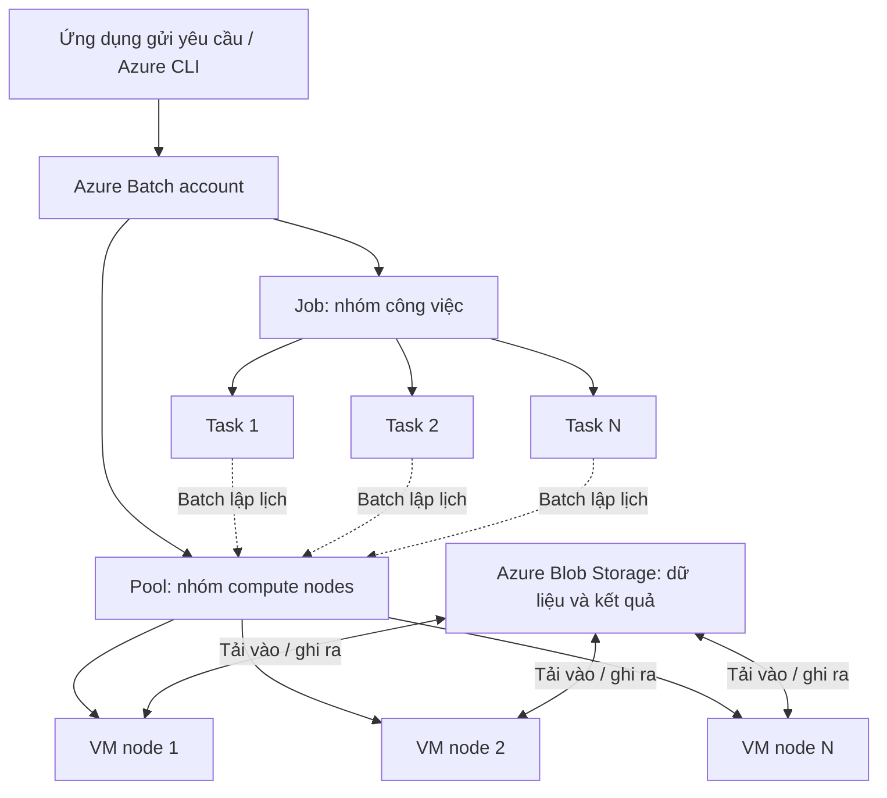
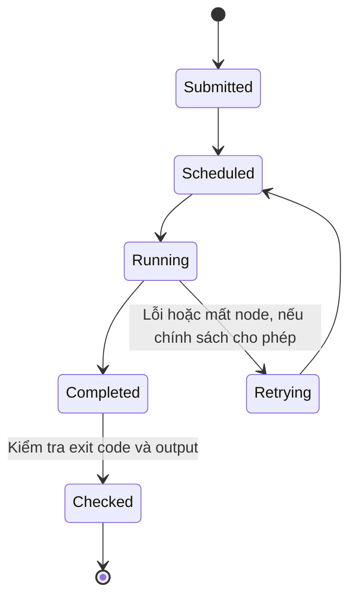
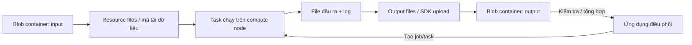

# Azure Batch, pool, job và task

Một công ty cần chuyển đổi 20.000 video, dựng hàng nghìn ảnh sản phẩm, chạy mô phỏng khoa học hoặc xử lý một tập dữ liệu lớn vào ban đêm. Công việc có thể chia thành nhiều phần tương đối độc lập, chạy song song trên nhiều máy và kết thúc khi hoàn thành. Nếu tự tạo hàng chục máy ảo, phân công công việc, theo dõi tiến độ rồi dọn dẹp tài nguyên, đội vận hành sẽ phải viết và bảo trì nhiều thành phần điều phối.

**Azure Batch** là dịch vụ lập lịch và quản lý năng lực tính toán cho các công việc xử lý theo lô (*batch processing*). Azure Batch giúp tạo các nhóm máy tính toán, phân phối tác vụ, quản lý vòng đời tác vụ và mở rộng hoặc thu nhỏ năng lực khi cần. Ứng dụng vẫn chịu trách nhiệm cung cấp chương trình xử lý, dữ liệu đầu vào, logic khôi phục và kết quả mong đợi.

Trong module **CLOUD_PROVIDERS_AZURE**, bạn tìm hiểu hệ sinh thái Azure từ subscription, resource group, Microsoft Entra ID tới mạng ảo, compute, storage, dữ liệu, triển khai, giám sát, bảo mật và quản lý chi phí. Bài học thuộc chương **Compute co giãn và xử lý theo lô**, tập trung vào bốn khái niệm cốt lõi: **Batch account, pool, job và task**, cùng cách triển khai và vận hành chúng thành một hệ thống xử lý thực tế.

## 1. Mục tiêu học tập

Sau bài học, bạn có thể:

- Mô tả công dụng của Azure Batch và nhận biết workload nào phù hợp.
- Phân biệt **Batch account**, **pool**, **compute node**, **job** và **task**.
- Giải thích cách Batch lập lịch task trên các node và thu thập trạng thái/exit code.
- Tạo pool và job bằng Azure portal, gửi task và kiểm tra kết quả bằng Azure CLI.
- Thiết kế đường đi dữ liệu qua Azure Blob Storage và xử lý đầu vào/đầu ra.
- Lựa chọn VM size, số node, task concurrency, retry, timeout và autoscale.
- Áp dụng Microsoft Entra ID, managed identity, Azure RBAC và bảo vệ kết nối.
- Theo dõi lỗi, tối ưu chi phí, xử lý node bị thu hồi và dọn dẹp tài nguyên an toàn.

## 2. Khi nào dùng Azure Batch?

Một workload phù hợp với Batch thường có thể chia thành **nhiều đơn vị công việc hữu hạn**, mỗi đơn vị có câu lệnh hoặc chương trình rõ ràng, có thể chạy trên máy tính toán rồi ghi kết quả ra nơi lưu trữ bền vững.

Ví dụ:

| Workload | Cách chia thành task | Tài nguyên cần cân nhắc |
|---|---|---|
| Chuyển mã video | Mỗi task xử lý một video hoặc một đoạn | vCPU, disk tạm, băng thông |
| Tạo ảnh thumbnail | Mỗi task xử lý một nhóm ảnh | CPU hoặc GPU, RAM |
| Mô phỏng Monte Carlo | Mỗi task chạy một tập tham số/hạt giống | CPU, số task song song |
| Kết xuất 3D | Mỗi task render một frame hoặc phân đoạn | GPU, VRAM, license |
| Phân tích dữ liệu định kỳ | Mỗi task xử lý một phân vùng dữ liệu | CPU, RAM, tốc độ đọc Blob |
| Kiểm thử nhiều cấu hình | Mỗi task chạy một cấu hình kiểm thử | Thời gian khởi động, môi trường phần mềm |

**Azure Batch không tự hiểu ý nghĩa nghiệp vụ của file hoặc dataset.** Nó lập lịch các câu lệnh/chương trình mà bạn cung cấp. Các bước phức tạp như xác định file cần xử lý, quản lý hàng đợi nghiệp vụ, phối hợp nhiều giai đoạn hoặc tổng hợp kết quả có thể cần thêm Logic Apps, Functions, Data Factory, hệ thống CI/CD hoặc một ứng dụng điều phối riêng.

### Batch khác gì với các lựa chọn compute khác?

| Giải pháp | Phù hợp khi | Khác biệt chính |
|---|---|---|
| **Azure Batch** | Nhiều tác vụ xử lý hữu hạn, cần chạy song song trên một nhóm VM | Có mô hình pool/job/task và lập lịch tác vụ |
| **Azure Virtual Machines** | Cần quản lý một máy chủ hoặc ứng dụng chạy liên tục | Tự điều phối workload và vòng đời nhiều VM |
| **Virtual Machine Scale Sets** | Cần quản lý nhóm VM có thể mở rộng | Có cơ chế scale VM nhưng không tự cung cấp mô hình Batch job/task |
| **Azure Functions** | Tác vụ hướng sự kiện, thời gian chạy và tài nguyên phù hợp gói hosting | Trừu tượng hóa phần lớn quản lý VM, có giới hạn theo hosting plan |
| **Azure Kubernetes Service** | Ứng dụng container nhiều thành phần hoặc hệ thống đã dùng Kubernetes | Tự thiết kế pipeline, Kubernetes Jobs và vận hành cluster |

Với tính toán dài, cần chạy mã native hoặc phần mềm khoa học trên VM chuyên dụng, Azure Batch thường là lựa chọn đáng xem xét. Với request web chạy liên tục, không nên dùng Batch như một web server thay cho App Service hoặc AKS.

## 3. Kiến trúc cốt lõi: account, pool, node, job và task

Các đối tượng quan trọng được tổ chức như sau:



### Batch account

**Batch account** là điểm quản lý dịch vụ Batch: cung cấp endpoint/API, chứa các đối tượng pool và job, chịu ảnh hưởng quota và cơ chế xác thực/quyền của account. Batch account thuộc một subscription và resource group, có region và các thiết lập liên quan.

Bạn có thể liên kết một Azure Storage account để hỗ trợ các chức năng như application packages hoặc lưu dữ liệu theo kịch bản. **Batch không tự động trở thành kho lưu trữ vĩnh viễn** cho mọi file đầu ra mà task tạo ra; cần thiết kế nơi chứa kết quả riêng.

### Pool

**Pool** là tập hợp **compute nodes** (máy ảo xử lý) với cấu hình chung: VM size, image hệ điều hành, node agent, số node đích, chính sách mở rộng và một số thông số mạng/lập lịch. Có thể có nhiều job sử dụng cùng một pool, tùy cách bạn tổ chức.

Batch quản lý vòng đời node trong pool, nhưng bạn vẫn chọn ảnh máy, cấu hình phần mềm và chiến lược phục hồi/dọn dẹp.

### Compute node

**Compute node** là một máy tính trong pool, nơi task thực sự chạy. Node có trạng thái vòng đời như đang tạo, khởi động, sẵn sàng hoặc gặp lỗi. Một node có thể chạy một hoặc nhiều task đồng thời khi pool được cấu hình phù hợp với số **task slots** và tài nguyên thực tế.

### Job

**Job** là đơn vị quản lý một nhóm task. Job thường được gắn với một pool thông qua cấu hình job, có chính sách ưu tiên và cách xử lý lỗi/hoàn tất theo khả năng API. Job **không tự xử lý dữ liệu**: nó tổ chức task để Batch lập lịch.

### Task

**Task** là đơn vị thực thi nhỏ nhất trong mô hình cơ bản: có **task ID**, command line, môi trường thực thi, yêu cầu tài nguyên và các tùy chọn retry/timeout. Task được giao cho một node có slot phù hợp. Một task có thể khởi động tiến trình Python, Java, ffmpeg hoặc chương trình native khác.

| Thành phần | Câu hỏi cần trả lời | Ví dụ |
|---|---|---|
| Account | Quản lý Batch ở đâu? | `batch-media-prod` |
| Pool | Chạy bằng nhóm máy nào? | `pool-cpu-video` |
| Node | Máy cụ thể nào thực thi? | Một VM Linux trong pool |
| Job | Đợt xử lý nào? | `job-2026-11-20` |
| Task | Một đơn vị phải thực hiện gì? | `task-video-0001` chuyển mã một file |

**Dễ nhầm:** pool không phải job và task không phải node. Pool quản lý *năng lực tính toán*; job/task mô tả *khối lượng công việc*. Thêm nhiều task không tự tạo đủ VM nếu pool chưa có khả năng scale.

## 4. Vòng đời thực thi của một job

Giả sử có 1.000 tệp video trong Blob Storage. Ứng dụng cần chuyển chúng thành định dạng chuẩn.

1. Đưa danh sách file đầu vào vào hệ thống quản lý job và chuẩn bị chương trình chuyển mã.
2. Tạo hoặc chọn một **pool** có VM size phù hợp và số node đáp ứng năng lực mong muốn.
3. Tạo một **job** liên kết với pool.
4. Tạo 1.000 **task**, mỗi task nhận đường dẫn input riêng và tên output khác nhau.
5. Azure Batch đưa task vào hàng chờ và phân công tới node có tài nguyên/slot khả dụng.
6. Node tải code/resource files hoặc sử dụng phần mềm đã cài, rồi chạy command line của task.
7. Task trả exit code và chuyển trạng thái; ứng dụng giám sát thành công/thất bại và thu thập log.
8. File đầu ra được tải lên Blob Storage theo cơ chế ứng dụng cấu hình.
9. Đối chiếu số output hợp lệ với số input, xử lý task lỗi, đóng job và giảm/xóa pool khi không còn cần compute.



Các trạng thái trong sơ đồ là **mô hình logic rút gọn**. Tên trạng thái chính xác trong Batch API có thể khác và một task ở trạng thái **completed** vẫn có thể có **exit code khác 0**. Luôn kiểm tra kết quả thực thi thay vì chỉ xem task đã kết thúc.

## 5. Thiết kế pool và compute node

Chọn pool dựa trên đặc tính workload, image, network, độ đồng thời và chi phí. Một pool thường có các quyết định sau:

| Quyết định | Câu hỏi cần hỏi | Ví dụ |
|---|---|---|
| VM size | Task cần nhiều CPU, RAM hay GPU? | CPU general purpose cho chuyển mã cơ bản |
| OS image | Phần mềm chạy trên Linux hay Windows? | Image Ubuntu được Batch hỗ trợ |
| Node agent | Agent có tương thích image đã chọn không? | Chọn node agent SKU phù hợp với image |
| Node count | Muốn có bao nhiêu VM đồng thời? | Bắt đầu với 2 dedicated nodes |
| Task slots | Mỗi node chạy được bao nhiêu task cùng lúc? | 1–2 task/node sau benchmark |
| Software | Cài đặt khi khởi tạo hay đóng gói sẵn? | Start task, application package, container |
| Network | Node cần truy cập Blob/private endpoint hoặc dịch vụ ngoài? | VNet/subnet, DNS, route phù hợp |
| Lifetime | Pool chạy lâu dài hay chỉ khi có job? | Resize về 0 khi nhàn rỗi, nếu phù hợp |

### Dedicated và Spot/low-priority nodes

Batch có thể sử dụng **dedicated nodes** và, trong những cấu hình hỗ trợ, **Spot/low-priority capacity** với mô hình chi phí thấp hơn nhưng có thể bị thu hồi khi Azure cần năng lực.

- **Dedicated:** phù hợp công việc cần độ ổn định hơn, song vẫn có thể gặp lỗi máy, sự kiện bảo trì hoặc gián đoạn.
- **Spot/low-priority:** phù hợp task độc lập có thể chạy lại, có checkpoint và chấp nhận bị ngắt giữa chừng.

Không dựa vào giá rẻ của Spot để giả định job sẽ hoàn thành đúng giờ. Nếu node bị thu hồi, task có thể phải chạy lại; đầu ra cần thiết kế **idempotent**, có checkpoint và được xác thực trước khi đánh dấu thành công. Tên gọi, điều kiện hỗ trợ và quota có thể khác theo chế độ cấu hình tài khoản/API.

### Số task chạy đồng thời

Một pool 4 node không nhất thiết chỉ chạy tối đa 4 task, cũng không có nghĩa luôn chạy 400 task. Mức thực thi đồng thời phụ thuộc số node đang sẵn sàng, số task slots mỗi node, yêu cầu tài nguyên, chính sách scheduling và tình trạng task.

Ví dụ, nếu có **4 node**, mỗi node được cấu hình **2 task slots**, và mỗi task cần một slot, mức tối đa lý thuyết là **8 task chạy đồng thời**. Tuy nhiên, 2 task cùng tranh CPU/disk/memory trên một VM có thể khiến thời gian xử lý dài hơn so với 1 task/node. Hãy benchmark để tìm throughput thực tế.

## 6. Job và task: từ mô tả công việc đến kết quả

### Job giữ những gì?

Khi tạo job, bạn cần xác định ít nhất **job ID** và **pool** sẽ chạy các task. Tùy API, job có thể có các chính sách như:

- **Priority:** ảnh hưởng cách các task của những job cạnh tranh tài nguyên pool được ưu tiên lập lịch.
- **Task constraints:** thời gian chạy tối đa, số lần thử lại khi phù hợp và thời gian giữ dữ liệu task.
- **On task failure / on all tasks complete:** cách job phản ứng khi task lỗi hoặc mọi task kết thúc, nếu được cấu hình.
- **Job preparation / release tasks:** thao tác chuẩn bị hoặc dọn dẹp ở cấp job trên các node trong những kịch bản được hỗ trợ.

Job có thể chứa hàng nghìn task nhưng không tự tạo đầu vào, không tự tổng hợp kết quả và không tự quyết định nghiệp vụ thế nào là thành công. Với hệ thống có nhiều giai đoạn, ví dụ **trích xuất → chuyển đổi → tổng hợp**, ứng dụng điều phối phải quản lý phụ thuộc hoặc dùng cơ chế task dependencies được Batch hỗ trợ sau khi cấu hình.

### Task gồm những gì?

| Thuộc tính | Ý nghĩa | Ví dụ |
|---|---|---|
| Task ID | Định danh task trong job | `task-file-0001` |
| Command line | Tiến trình cần chạy trên node | `/bin/bash -c "python3 worker.py ..."` |
| Resource files | File cần tải về trước khi chạy | Script, dữ liệu, manifest |
| Environment variables | Cấu hình môi trường của tiến trình | Tên input/output, batch ID |
| Constraints | Timeout, retry, thời gian giữ file | Thời gian tối đa cho một task |
| Output files | Quy tắc đẩy file đầu ra tới lưu trữ | Kết quả JSON/ảnh/zip |
| Container settings | Chạy trong container khi cấu hình hỗ trợ | Image có ffmpeg hoặc thư viện khoa học |

**Task command line không nên được coi là một shell script tự động.** Trên Linux, khi cần redirect, pipe hoặc dùng biến shell, hãy gọi rõ `/bin/bash -c` hoặc shell phù hợp; trên Windows có thể dùng `cmd /c` hay PowerShell với cú pháp riêng. Kiểm tra quyền thực thi, đường dẫn và image của node.

### Trạng thái hoàn thành và exit code

Task có thể đi qua những trạng thái như **active → running → completed**. Khi task báo completed, cần kiểm tra thêm `executionInfo.exitCode`, failure information và các file `stdout.txt`, `stderr.txt`.

- **Exit code 0:** tiến trình kết thúc thành công theo quy ước, nhưng phải kiểm tra kết quả nghiệp vụ.
- **Exit code khác 0:** tiến trình báo lỗi; cần xem log và quyết định retry có an toàn không.
- **Node bị mất/thu hồi:** Batch có thể phải lập lịch lại task tùy cấu hình và loại sự cố.
- **Task timeout:** cần cấu hình giới hạn thời gian và cách xử lý task treo, tránh chiếm node mãi.

Đối với task có tác dụng phụ (ghi database, gửi email, thanh toán), **retry tự động có thể thực hiện lại hành động**. Nên dùng khóa idempotency, checkpoint và ghi kết quả theo tên duy nhất để ngăn xử lý trùng.

## 7. Thực hành tạo Batch account và pool bằng Azure portal

Ví dụ xuyên suốt sử dụng tên minh họa:

| Tài nguyên | Giá trị dùng trong bài |
|---|---|
| Resource group | `rg-batch-lab` |
| Batch account | `batchlabdemo01` |
| Pool | `pool-linux-cpu` |
| Job | `job-hello` |
| Tasks | `task-001`, `task-002` |
| Node | Hai VM Linux theo SKU được region hỗ trợ |

Tên Batch account thực tế phải đáp ứng quy tắc đặt tên và khả năng sử dụng; không giả định tên minh họa còn trống. Những bước tạo tài nguyên có thể phát sinh chi phí VM và storage.

### Bước 1. Tạo Batch account

1. Đăng nhập [Azure portal](https://portal.azure.com/), xác nhận tenant và subscription.
2. Tìm **Batch accounts** và chọn **Create**.
3. Chọn resource group, tên account và region đáp ứng nhu cầu của workload.
4. Xem tùy chọn **pool allocation mode**. Chế độ **Batch service** và **user subscription** có cách cấp phát/quota/định vị tài nguyên khác nhau; kiểm tra điều kiện hỗ trợ của subscription và region.
5. Chọn storage account liên kết nếu workflow hoặc tính năng định sử dụng yêu cầu; lập kế hoạch nơi lưu input/output riêng.
6. Xác nhận cấu hình và tạo Batch account.

### Bước 2. Tạo pool

1. Vào Batch account vừa tạo, mở **Pools** và tạo pool mới.
2. Nhập `pool-linux-cpu` và chọn **virtual machine configuration**.
3. Chọn Linux image được Batch hỗ trợ, cùng **node agent SKU** tương thích. Không chọn image cũ đã hết hỗ trợ chỉ vì ví dụ trong tài liệu.
4. Chọn VM size đủ CPU/RAM; với lab, ưu tiên loại máy nhỏ, có sẵn theo region và quota.
5. Chọn ban đầu **2 dedicated nodes**, sau đó đối chiếu giới hạn concurrent tasks mỗi node.
6. Thiết lập network, disk, start task hoặc application package nếu workload yêu cầu.
7. Tạo pool, theo dõi các node chuyển sang trạng thái **idle/sẵn sàng**.

Một pool đã tạo **không có nghĩa tất cả node sẵn sàng ngay lập tức**. Azure còn phải cấp máy ảo, tải image, chạy node agent và thực hiện start task nếu có. Nếu node ở trạng thái lỗi, xem chi tiết start task, lỗi image hoặc network trước khi gửi job quy mô lớn.

### Bước 3. Tạo job và task

1. Mở phần **Jobs** của Batch account và tạo job `job-hello`.
2. Liên kết job với pool `pool-linux-cpu`.
3. Thêm hai task có command line Linux đơn giản để in thông tin môi trường và hoàn tất.
4. Theo dõi trạng thái task trên node.
5. Mở chi tiết task để xem exit code và các file stdout/stderr.

Giao diện có thể thay đổi theo phiên bản Azure portal. Nếu tùy chọn thêm task không có ở màn hình đang dùng, sử dụng Azure CLI hoặc SDK đã được cấu hình quyền truy cập thích hợp.

## 8. Thực hành gửi job và task bằng Azure CLI

Ví dụ dưới đây giả định **Batch account và pool Linux đã được tạo qua portal**, pool có node sẵn sàng, người dùng có quyền thích hợp và Azure CLI hỗ trợ các lệnh Batch. Lệnh tạo job/task có thay đổi tài nguyên dịch vụ; chỉ chạy trong subscription lab được phép.

### Bước 1. Chọn đúng subscription và Batch account

```bash
# Đăng nhập và xem subscription đang dùng
az login
az account set --subscription "<subscription-id>"
az account show --query "{subscription:id,tenant:tenantId}" --output table

# Thiết lập ngữ cảnh kết nối tới Batch account
# Phương thức xác thực thực tế phụ thuộc RBAC/config của account.
az batch account login \
  --name "batchlabdemo01" \
  --resource-group "rg-batch-lab"

# Xác nhận pool đã sẵn sàng
az batch pool list --output table
az batch node list --pool-id "pool-linux-cpu" --output table
```

Nếu lệnh đăng nhập không hoạt động, kiểm tra Azure CLI và Batch extension/command group đang cài, tenant, quyền của principal và cấu hình xác thực Batch account. Không đưa Batch account key vào script hay lịch sử lệnh để xử lý nhanh lỗi quyền.

### Bước 2. Tạo job

```bash
az batch job create \
  --id "job-hello" \
  --pool-id "pool-linux-cpu"

az batch job show --job-id "job-hello" --output json
```

Lệnh này tạo **job gắn với pool**, chưa tự thêm task. Trong production, có thể gửi cấu hình job chi tiết qua JSON/SDK để thiết lập chính sách ưu tiên, lỗi và kết thúc.

### Bước 3. Gửi task Linux

```bash
az batch task create \
  --job-id "job-hello" \
  --task-id "task-001" \
  --command-line "/bin/bash -c 'echo Hello from Azure Batch; hostname'"

az batch task create \
  --job-id "job-hello" \
  --task-id "task-002" \
  --command-line "/bin/bash -c 'echo Second task; date -u'"
```

Nếu pool là Windows, cú pháp command line phải phù hợp môi trường Windows; không dùng `/bin/bash` trừ khi thực tế đã cài và cấu hình. Nên kiểm tra lệnh trên một task nhỏ trước khi gửi hàng nghìn task.

### Bước 4. Theo dõi và kiểm tra kết quả

```bash
# Danh sách task và trạng thái
az batch task list \
  --job-id "job-hello" \
  --output table

# Kiểm tra thông tin thực thi của một task
az batch task show \
  --job-id "job-hello" \
  --task-id "task-001" \
  --output json

# Xem các file task như stdout.txt / stderr.txt
az batch task file list \
  --job-id "job-hello" \
  --task-id "task-001" \
  --output table
```

Trong giao diện portal hoặc lệnh tải file tương ứng, mở `stdout.txt` để thấy nội dung lệnh in ra. Nếu `stderr.txt` có lỗi hoặc exit code khác 0, xem log trước khi tăng retry. Việc một job còn trạng thái active sau khi mọi task đã kết thúc có thể là bình thường, tùy **chính sách kết thúc job**.

## 9. Dữ liệu đầu vào và đầu ra với Azure Blob Storage

Batch quản lý tiến trình, còn dữ liệu cần có **vòng đời độc lập** với node. Local disk của VM là nơi làm việc tạm thời; khi pool giảm node, node được reimage hoặc gặp lỗi, dữ liệu trên máy có thể biến mất.



### Đưa dữ liệu vào task

Có ba cách thường dùng, tùy khối lượng và kỹ thuật:

1. **Resource files:** Batch tải những file đã cấu hình vào môi trường task trước khi chạy; phù hợp script hoặc tập file nhỏ/vừa theo khả năng API.
2. **Task tự tải từ Blob:** chương trình dùng Storage SDK để stream dữ liệu khi chạy; phù hợp file lớn hoặc số lượng lớn cần kiểm soát cache.
3. **Application packages/container images:** đóng gói runtime và chương trình để nhiều task dùng chung, giảm khác biệt môi trường.

Batch không tự biết Azure Blob nào là input chỉ vì account có liên kết storage. Cần cấu hình rõ URL, container, phương thức xác thực và cách mapping từ task đến file. Nếu dùng SAS, chú ý **thời hạn** phải đủ dài cho cả thời gian xếp hàng và chạy task, đồng thời chỉ cấp quyền tối thiểu.

### Ghi kết quả ra nơi bền vững

Task cần upload thành phẩm sang Blob bằng **output files** hoặc SDK/API tương ứng. Với file lớn, nên sử dụng block upload và retry phù hợp; không giữ kết quả quan trọng chỉ trong thư mục cục bộ của node.

Thiết kế tên blob dựa trên **job ID + task ID + phiên bản/attempt ID** khi cần phân biệt lần chạy. Ví dụ:

```text
input/videos/001.mp4
input/videos/002.mp4

output/job-2026-11-20/task-video-0001/result.mp4
output/job-2026-11-20/task-video-0002/result.mp4

logs/job-2026-11-20/task-video-0001/stderr.txt
```

Với task có thể retry, kết quả cần **idempotent**: ghi vào vị trí tạm, xác minh checksum/metadata rồi đánh dấu output cuối cùng hợp lệ. Điều này giúp tránh việc một lần chạy lỗi ghi đè file tốt từ lần trước.

### Thư mục làm việc và dữ liệu dùng chung

Batch cung cấp các thư mục làm việc và biến môi trường liên quan tới task/node, ví dụ `AZ_BATCH_TASK_WORKING_DIR`. File nằm trong task working directory phù hợp cho tệp tạm của task; các thư mục shared trên node có phạm vi và tính bền vững giới hạn.

Không coi **node-local shared directory** là nơi chia sẻ dữ liệu giữa tất cả compute nodes. Muốn chia sẻ giữa node, dùng Blob Storage, dịch vụ file phù hợp hoặc một phương án dữ liệu khác được thiết kế rõ ràng.

## 10. Co giãn pool, quota và năng lực tính toán

### Manual resize và autoscale

Bạn có thể thiết lập **số dedicated/Spot nodes đích** thủ công hoặc cấu hình **autoscale** để Batch điều chỉnh pool theo công thức sử dụng các chỉ số được hỗ trợ.

Một ý tưởng ban đầu khi task cần một slot và mỗi node xử lý tối đa hai task đồng thời:

```text
desiredNodes = ceil(pendingTaskCount / 2)
targetNodes  = min(maxNodes, max(minNodes, desiredNodes))
```

Đây là **pseudocode lập kế hoạch**, không phải cú pháp autoscale formula của Azure Batch. Trong thực tế, công thức phải xét cả task đang chạy, node đã cấp, lịch sử mẫu dữ liệu, độ trễ cấp VM, loại node và cách giảm node để tránh hủy task giữa chừng.

### Những ràng buộc thường gặp

- **Quota:** số core/VM phù hợp cho Batch account và region; quota có thể khác theo pool allocation mode và loại node.
- **Capacity:** SKU còn trong danh sách không bảo đảm Azure luôn cấp được số node mong muốn vào đúng thời điểm.
- **Startup latency:** tạo node, tải image, chạy StartTask và khởi động container có thể mất thời gian đáng kể.
- **Task slots:** nhiều task đồng thời trên một node phải phù hợp CPU/RAM/disk của VM.
- **Node deallocation policy:** chọn thời điểm thu hồi node và xử lý các task đang chạy theo chính sách phù hợp, tránh mất output.
- **Chi phí và retry:** tăng quá nhiều node không cần thiết có thể làm chi phí tăng mà thông lượng không cải thiện.

Trong môi trường production, đặt **min/max nodes**, giới hạn ngân sách, cảnh báo backlog và chiến lược thu nhỏ rõ ràng. Khi công việc đã hoàn thành, giảm pool về 0 hoặc xóa pool nếu phù hợp; đừng giả định chỉ xóa job là các node tự biến mất.

## 11. Danh tính, quyền và bảo mật mạng

Azure Batch liên quan đến hai phạm vi quản lý:

1. **Management plane qua Azure Resource Manager:** tạo/sửa Batch account, quản lý một số cấu hình hạ tầng và quyền truy cập tài nguyên.
2. **Batch service operations:** thao tác với pool, job, task và node qua endpoint/API của Batch, theo cơ chế xác thực và quyền mà account/API hỗ trợ.

Không nên cho rằng **Azure RBAC Reader** trên resource group tự động được phép tạo mọi job/task, hoặc **Contributor** của một ứng dụng tự động đọc được mọi Blob. Hãy phân biệt quyền quản lý Batch, quyền sử dụng dịch vụ Batch và quyền dữ liệu Storage ở từng bước.

### Dùng Microsoft Entra ID và managed identity

**Microsoft Entra ID** là lựa chọn nên ưu tiên khi Batch client và tính năng đang sử dụng hỗ trợ; tránh đưa Batch account key vào source code hoặc pipeline. Tổ chức cần cấp đúng Azure RBAC role ở scope phù hợp và kiểm tra quyền thực tế của Batch service.

Nếu code chạy trên compute node cần đọc/ghi Azure Storage, có thể cấu hình **user-assigned managed identity cho pool** trong mô hình được hỗ trợ, rồi:

- Cấp **Storage Blob Data Reader** đối với container đầu vào.
- Cấp **Storage Blob Data Contributor** đối với container đầu ra cần ghi.
- Cấu hình SDK/token acquisition của tiến trình task dùng **đúng identity**.
- Kiểm chứng thư viện, network và endpoint trước khi chạy toàn bộ job.

Không phải mọi cơ chế `resourceFiles` hoặc `outputFiles` đều tự động sử dụng identity của code bên trong task. Tính năng/API có thể yêu cầu cách xác thực cụ thể, chẳng hạn SAS hoặc thiết lập identity riêng. Khi dùng SAS, chỉ cấp scope và thời hạn tối thiểu, đồng thời tránh ghi URL chứa token vào stdout/stderr công khai.

### Mạng và quyền truy cập dữ liệu

Pool trong VNet hoặc dùng private endpoint cần được kiểm tra kết nối:

- Node có thể liên lạc với các endpoint cần thiết của dịch vụ Batch và Azure Storage không?
- DNS và route có phân giải/định tuyến đúng tới storage private endpoint không?
- NSG, firewall hoặc proxy có chặn luồng quản lý node, tải application package hoặc truy cập container registry không?
- Task có cần Internet outbound không, và tổ chức đã có phương án egress thích hợp chưa?

**Giảm bề mặt tấn công:** không mở RDP/SSH từ Internet đến mọi compute node chỉ để debug; dùng các chức năng quản lý node và đường truy cập được cho phép, có kiểm soát. Chọn image và container đáng tin cậy, giữ cập nhật và giới hạn dữ liệu bí mật tiếp xúc với task.

## 12. Theo dõi hoạt động, lỗi và trạng thái job

Để quản trị Batch, cần quan sát cả ba lớp: **dịch vụ lập lịch**, **compute node** và **ứng dụng chạy trong task**.

| Lớp | Dữ liệu nên theo dõi | Ý nghĩa |
|---|---|---|
| Batch account/job | Số job đang hoạt động, task active/running/completed | Backlog và tiến độ xử lý |
| Pool/node | Target node count, node ready/unusable, allocation/resize errors | Khả năng cung cấp compute |
| Task | Exit code, retry count, start/end time, stdout/stderr | Thành công hay lỗi của chương trình |
| Ứng dụng | Số input, output hợp lệ, thời gian mỗi file, lỗi nghiệp vụ | Chất lượng kết quả xử lý |
| Storage | Số request, dung lượng, latency, lỗi truy cập | Nút thắt input/output |
| Chi phí | Thời gian VM cấp phát, disk, network, log và tài nguyên phụ trợ | Cost per completed item |

**Azure Monitor** có thể cung cấp metrics và cơ chế alert cho Batch theo khả năng dịch vụ. Log ứng dụng trong `stdout.txt`, `stderr.txt` hoặc file tùy chỉnh cần được thu thập và chuyển ra kho lưu trữ bền vững nếu muốn giữ lâu hơn vòng đời task/node.

Nếu dùng Microsoft Entra ID, hãy kiểm tra audit/sign-in logs phù hợp. Dùng Azure Activity Log cho các thay đổi tài nguyên quản lý, nhưng **không mặc định Activity Log chứa toàn bộ nội dung command line, output hoặc mọi lần task truy cập Blob**.

### Tiêu chí đánh dấu job thành công

Không nên chỉ kiểm tra *job finished*. Một quy trình hoàn tất có căn cứ gồm:

1. Số task dự kiến bằng số task đã ghi nhận theo manifest.
2. Mỗi task cần thiết kết thúc với exit code hợp lệ và không còn retry chưa hoàn tất.
3. Mọi output bắt buộc đã được ghi bền vững lên Blob và qua bước xác minh dữ liệu.
4. Không có input bị bỏ sót hoặc output bị nhân đôi do retry.
5. Job có thể được đóng, pool được thu nhỏ và kết quả được xuất cho hệ thống nghiệp vụ.

Nếu task có thể hoàn tất với một số lỗi nghiệp vụ có chủ đích, quy định rõ mã lỗi nào được chấp nhận và cách thu thập những trường hợp bị loại.

## 13. Tối ưu hiệu năng và chi phí

Azure Batch giúp co giãn năng lực tính toán, nhưng không bảo đảm mọi phương án chạy nhiều VM đều rẻ hoặc nhanh hơn. Hãy tính **đơn giá cho một sản phẩm đầu ra hoàn chỉnh**, không chỉ đơn giá VM theo giờ.

Một công thức ước lượng:

\[
\text{Chi phí mỗi output hợp lệ} =
\frac{\text{Compute}+\text{Storage}+\text{Network}+\text{Monitoring}+\text{Chi phí khác}}
{\text{Số output hợp lệ}}
\]

### Ví dụ ước lượng thời gian xử lý

Giả sử 1.200 task độc lập, mỗi task mất trung bình **3 phút**, không có lỗi và không có overhead. Pool có **6 node**, mỗi node chạy **2 task đồng thời**:

\[
\text{Số lượt}=\left\lceil\frac{1200}{6\times2}\right\rceil=100
\]

\[
\text{Thời gian lý tưởng}=100\times3=300\text{ phút}
\]

Nếu tăng lên **15 node**, cùng 2 task/node:

\[
\left\lceil\frac{1200}{15\times2}\right\rceil\times3=120\text{ phút}
\]

Đây chỉ là **cận ước lượng đơn giản**: thực tế có thể chậm hơn do cấp VM, khởi tạo phần mềm, tải dữ liệu, lệch thời gian task, Spot eviction, retry hoặc giới hạn mạng/Storage. Tăng node giảm thời gian xử lý nhưng có thể tăng chi phí tính toán và tạo áp lực lên dịch vụ lưu trữ.

### Các biện pháp tối ưu

- **Chọn VM size đúng nhu cầu:** CPU-bound dùng size có đủ vCPU; memory-bound ưu tiên RAM; GPU workload phải chọn đúng VRAM, driver và khả năng GPU.
- **Đo task duration:** task quá nhỏ có overhead lập lịch lớn; task quá lớn khó retry/checkpoint. Cân nhắc gom/tách theo dữ liệu thực.
- **Tận dụng cache hợp lý:** tải chương trình/dữ liệu chung một lần trong node nếu vòng đời và dung lượng cho phép, không dùng local disk làm nguồn kết quả duy nhất.
- **Giảm thời gian pool nhàn rỗi:** dùng autoscale hoặc resize về 0 sau khi hoàn tất khi phù hợp.
- **Cân nhắc Spot cho workload có thể thử lại:** chấp nhận rủi ro eviction và thiết kế retry để tránh mất toàn bộ công việc.
- **Chọn vùng đặt dữ liệu và compute:** hạn chế truyền dữ liệu lớn qua nhiều region nếu không cần.
- **Kiểm soát số request Blob và chi phí log:** task quá nhỏ hoặc ghi log quá chi tiết có thể làm tăng giao dịch và chi phí vận hành.

Đối với đơn giá, quota và tính khả dụng của VM/Spot/Storage, hãy kiểm tra thông tin hiện hành theo **region, subscription và loại tài nguyên** bằng Azure portal hoặc Pricing Calculator. Không suy giá cố định từ ví dụ đào tạo.

## 14. Tình huống thực tế: pipeline chuyển mã video

Một nền tảng nội dung nhận 5.000 video mới mỗi đêm. Mỗi video cần chuyển thành độ phân giải chuẩn và lưu lại ở Azure Blob Storage trước giờ làm việc sáng hôm sau.

**Thiết kế:**

```text
Blob input
   |
   v
Ứng dụng điều phối: liệt kê input và tạo job
   |
   v
Batch job: video-nightly-YYYYMMDD
   |
   +-- task-0001 --> ffmpeg(input-0001) --> Blob output/0001
   +-- task-0002 --> ffmpeg(input-0002) --> Blob output/0002
   +-- ...
   +-- task-5000 --> ffmpeg(input-5000) --> Blob output/5000
   |
   v
Kiểm tra đủ output và metadata -> công bố kết quả
   |
   v
Thu nhỏ/xóa pool theo chính sách
```

### Triển khai theo từng bước

1. **Chuẩn bị input manifest:** file ID, kích thước, codec và đường dẫn Blob. Mỗi input có task ID ổn định để dễ retry.
2. **Đóng gói chương trình:** chọn VM Linux và cài ffmpeg thông qua image/container/start task hoặc application package phù hợp.
3. **Chọn pool:** benchmark vài VM size D/F/N nếu workload có khả năng dùng GPU; xác định số task/node từ CPU/RAM thực tế.
4. **Tạo job:** gắn job với pool và gửi task cho những video cần chuyển.
5. **Truy cập dữ liệu:** task đọc input bằng identity được cấp quyền hoặc cơ chế an toàn đã thiết kế, ghi output sang Blob.
6. **Chống xử lý trùng:** retry cùng task ID phải ghi ra kết quả có thể kiểm chứng, tránh ghi đè output tốt bằng output chưa hoàn chỉnh.
7. **Giám sát:** đo task waiting time, execution time, exit code, output size, throughput và chi phí mỗi video hợp lệ.
8. **Kết thúc:** đối chiếu manifest, xử lý input thất bại, giảm node, giữ log theo yêu cầu và đóng job.

Nếu tất cả video đều có thời lượng khác nhau, việc chia task “mỗi video một task” có thể khiến vài task dài giữ node sau khi phần lớn task đã xong. Có thể cải tiến bằng cách chia theo đoạn hoặc ước lượng độ dài, nhưng phải bổ sung logic ghép kết quả và kiểm tra tính toàn vẹn.

## 15. Xử lý sự cố thường gặp

| Triệu chứng | Nguyên nhân có thể | Kiểm tra và xử lý |
|---|---|---|
| Pool tạo được nhưng không có node sẵn sàng | Quota, thiếu capacity, sai image/node agent, lỗi start task hoặc network | Kiểm tra pool allocation errors, node state/start task logs, SKU và quota |
| Node ở trạng thái unusable | Lỗi khởi tạo, disk hoặc tiến trình agent | Xem lỗi node, start task và tình trạng host |
| Task ở trạng thái active rất lâu | Không có node/slot phù hợp, pool đang cấp máy, task phụ thuộc chưa được đáp ứng | Kiểm tra số node ready, số task slots, scheduling và dependencies |
| Task completed nhưng output rỗng | Command chạy sai hoặc chương trình báo thành công giả | Kiểm tra exit code, stdout/stderr, input manifest và tính toàn vẹn output |
| Task lỗi `127` trên Linux | Không tìm thấy command hoặc đường dẫn executable | Xem image/start task, PATH, quyền thực thi và shell |
| Task nhận `403` khi đọc Blob | Sai identity/RBAC, SAS hết hạn hoặc firewall/private endpoint | Kiểm tra scope quyền, token/SAS, DNS và network rules |
| Task thường bị chạy lại | Node bị thu hồi, timeout, lỗi mã hoặc retry policy quá rộng | Kiểm tra lịch sử execution, loại node, exit codes và checkpoint |
| Job đã hoàn thành task nhưng node vẫn tốn phí | Pool còn target nodes hoặc autoscale chưa giảm | Kiểm tra pool size, autoscale formula và chính sách deallocation |
| Tăng node nhưng throughput không tăng | Nghẽn Blob, băng thông, CPU, license hoặc dữ liệu không chia được | Đo bottleneck, task duration và kết nối tới storage |
| Task bị mất kết quả sau khi node bị xóa | Output chỉ nằm ở local disk | Cấu hình upload output bền vững trước khi dọn node |

**Quy trình chẩn đoán:** bắt đầu từ Batch account, pool allocation, node state, trạng thái task và exit code; tiếp tục kiểm tra stdout/stderr, dữ liệu nguồn và quyền mạng. Hãy ghi lại job ID, task ID, pool ID, node ID, thời gian UTC và mã lỗi trước khi thay đổi cấu hình.

## 16. Bài tập tự kiểm tra

**Câu 1.** Một pool có 5 node, mỗi node chạy tối đa 2 task một lúc. Có 50 task cần chạy và mỗi task mất 4 phút. Thời gian lý tưởng, bỏ qua overhead, là bao lâu?

*Gợi ý:* 10 task đồng thời, 5 lượt, tổng **20 phút**. Đây chưa bao gồm thời gian cấp máy và tải dữ liệu.

**Câu 2.** Bạn đã tạo 500 task nhưng job không chạy vì pool chưa có node ready. Tăng số task lên 1.000 có giúp xử lý nhanh hơn không?

*Gợi ý:* Không. Cần xác định nguyên nhân pool không có compute node trước.

**Câu 3.** Task có trạng thái completed, exit code 1 và không có file output. Có nên đánh dấu thành công không?

*Gợi ý:* Không. Completed biểu thị tiến trình đã kết thúc; cần kiểm tra exit code và kết quả nghiệp vụ.

**Câu 4.** Vì sao chỉ lưu output trong task working directory không bảo đảm dữ liệu được giữ sau khi pool scale in?

*Gợi ý:* Disk node có vòng đời ngắn, có thể bị thu hồi/xóa; kết quả phải chuyển sang nơi lưu trữ bền vững.

**Câu 5.** Task chạy trên Spot node có thể bị thu hồi giữa chừng. Cần thiết kế gì?

*Gợi ý:* Checkpoint, retry an toàn, idempotent output, theo dõi lỗi và cân nhắc dedicated nodes cho phần bắt buộc đúng hạn.

## 17. Checklist triển khai Azure Batch

- [ ] Workload chia được thành task hữu hạn và có tiêu chí thành công rõ ràng.
- [ ] Đã tạo đúng Batch account, region, pool allocation mode và lựa chọn hình thức xác thực.
- [ ] VM size, image, node agent và phần mềm phù hợp với task.
- [ ] Đã kiểm tra quota/capacity, số node và số task slots trên mỗi node.
- [ ] Job liên kết pool đúng và task có ID, command line, input/output riêng.
- [ ] Thời gian timeout, retry, dependency và chính sách kết thúc job được xác định.
- [ ] Đã thiết kế đầu vào từ Blob, nơi chứa output bền vững và cách kiểm tra kết quả.
- [ ] Principal của client/node có quyền Batch/Storage đúng scope và credential được bảo vệ.
- [ ] Network, NSG, DNS và private endpoint cho phép các luồng cần thiết.
- [ ] Có log stdout/stderr, số liệu task/node, cảnh báo backlog và lỗi.
- [ ] Có xử lý task chạy lại, node lỗi/Spot eviction và kết quả trùng lặp.
- [ ] Đã chạy thử ít task để benchmark trước khi gửi hàng nghìn task.
- [ ] Có ngân sách, giới hạn pool size và quy trình giảm/xóa node khi không còn cần.

## Kết luận

Azure Batch giúp chạy các tác vụ tính toán theo lô trên một tập máy ảo co giãn: **Batch account** quản lý dịch vụ, **pool** cung cấp compute nodes, **job** nhóm công việc và **task** định nghĩa chương trình chạy thực tế. Để vận hành hiệu quả, cần thiết kế task đủ độc lập, đưa input/output vào lưu trữ bền vững, cấp đúng danh tính/quyền truy cập, chọn số node và độ đồng thời theo số liệu, đồng thời theo dõi lỗi, retry và chi phí. Giá trị của Azure Batch đến từ khả năng điều phối nhiều task có kiểm soát, trong khi chất lượng dữ liệu và tính đúng đắn của chương trình vẫn thuộc trách nhiệm ứng dụng.
