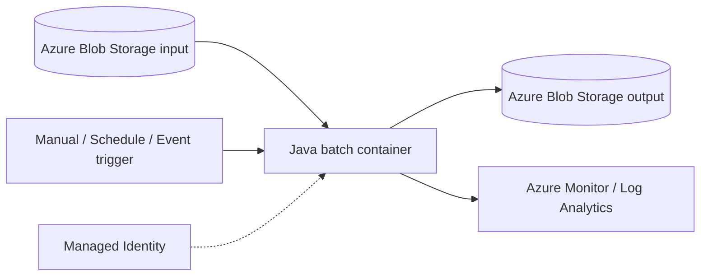

# Đóng gói và chạy batch job Java trên Azure

Một hệ thống doanh nghiệp không chỉ xử lý request HTTP theo thời gian thực. Nhiều tác vụ như tổng hợp đơn hàng cuối ngày, chuyển đổi tệp, tạo báo cáo tài chính, lập chỉ mục, xử lý ảnh hoặc nhập dữ liệu từ đối tác thường chạy theo **lô (batch)**. Các tác vụ này có thời điểm bắt đầu và kết thúc rõ ràng; không cần duy trì một web server hoạt động liên tục.

Với Java, một batch job có thể là chương trình có phương thức `main`, ứng dụng Spring Batch hoặc một tiến trình chạy trong container. Trên Microsoft Azure, ta có thể đóng gói mã Java thành **executable JAR**, đưa vào **container image** rồi chạy bằng **Azure Container Apps Jobs**. Với các workload có nhiều task, cần pool máy và lịch xử lý phức tạp hơn, **Azure Batch** là một lựa chọn khác.

Bài học thuộc chương **Compute co giãn và xử lý theo lô** của module Azure. Nội dung liên kết với subscription, resource group, Microsoft Entra ID, mạng ảo, lưu trữ Blob, quyền truy cập, giám sát và chi phí. Mục tiêu là xây dựng một quy trình batch **có thể tái lập, có khả năng kiểm chứng, dừng đúng lúc và không làm mất dữ liệu khi chạy lại**.

> Các lệnh tạo tài nguyên hoặc triển khai image là ví dụ thực hành. Chỉ chạy trong subscription và resource group được phép sử dụng. Cú pháp CLI, SKU, quota và điều kiện hỗ trợ có thể thay đổi theo phiên bản công cụ và region; trước khi triển khai production, kiểm tra trợ giúp lệnh và cấu hình hiện hành.

## Mục tiêu học tập

Sau bài học, bạn có thể:

- Phân biệt batch job với dịch vụ chạy liên tục và công việc xử lý theo sự kiện.
- Xác định yêu cầu input, output, tài nguyên, thời gian chạy và cơ chế retry của Java batch job.
- Xây dựng chương trình Java đọc CSV, tính tổng và trả exit code phù hợp.
- Đóng gói ứng dụng thành executable JAR với Maven và container image bằng Dockerfile.
- Lưu image trong Azure Container Registry (ACR) và chạy bằng Azure Container Apps Jobs.
- Phân biệt **Manual**, **Schedule** và **Event** trigger của Container Apps Jobs.
- Hiểu cách Azure Batch tổ chức pool, job và task khi cần xử lý số lượng lớn.
- Bảo vệ quyền đọc/ghi Blob bằng managed identity, RBAC và quy tắc mạng.
- Theo dõi execution, log, thất bại, retry, idempotency và chi phí.
- Thiết kế quy trình triển khai, kiểm thử và vận hành batch job trên Azure.

## 1. Batch job giải quyết vấn đề gì?

Một web API thường cần nhận request bất kỳ lúc nào, còn batch job chỉ cần chạy khi có công việc. Ví dụ, mỗi ngày lúc 02:00 UTC, hệ thống tổng hợp doanh số trong 24 giờ trước và xuất báo cáo.

Một batch job điển hình gồm:

1. Nhận **tham số**: thời gian xử lý, vị trí dữ liệu, định danh lần chạy.
2. Tải hoặc đọc **input** từ Azure Blob Storage, database hoặc nguồn đã phê duyệt.
3. Xử lý dữ liệu theo lô: parse, validate, aggregate, transform.
4. Ghi **output** bền vững tới Blob Storage, database hoặc hàng đợi.
5. Ghi log/metric để giám sát.
6. Kết thúc với **exit code 0** nếu thành công hoặc **khác 0** nếu thất bại.

### Đặc điểm khác ứng dụng web

| Tiêu chí | Web/API service | Batch job |
|---|---|---|
| Cách kích hoạt | HTTP request liên tục | Thủ công, lịch hoặc sự kiện |
| Vòng đời | Thường chạy lâu dài | Khởi động, xử lý, kết thúc |
| Tín hiệu thành công | HTTP status và độ trễ | Exit code, execution state và kết quả output |
| Mở rộng | Nhiều request/replica phục vụ | Nhiều job/task/replica hoặc chia partition dữ liệu |
| Xử lý lỗi | Retry request, circuit breaker | Retry execution/task, checkpoint và idempotency |
| Tính toán chi phí | Thời gian chạy service và tài nguyên nền | Thời gian thực thi, tài nguyên được cấp, lưu trữ, log và truyền dữ liệu |

**Không nên dùng HTTP request kéo dài nhiều giờ như một batch job** nếu nền tảng có giới hạn timeout hoặc web frontend có thể ngắt kết nối. Thay vào đó, dùng API để tạo yêu cầu rồi chạy công việc bằng hệ thống batch phù hợp.

## 2. Chọn dịch vụ Azure phù hợp

| Dịch vụ | Mô hình | Nên cân nhắc khi | Điểm cần chú ý |
|---|---|---|---|
| **Azure Container Apps Jobs** | Container chạy đến khi hoàn thành, kích hoạt Manual/Schedule/Event | Java batch đã đóng gói image, không muốn tự quản lý cluster | Thiết kế timeout, retry, trigger, identity và log |
| **Azure Batch** | Batch account, compute pool, job và task | Cần nhiều task song song, pool VM/SKU chuyên biệt hoặc HPC | Quản lý pool, runtime/image, task dependencies và quota |
| **AKS CronJob/Job** | Kubernetes Job/CronJob trong cluster | Tổ chức đã dùng AKS và có năng lực Kubernetes | Trách nhiệm vận hành cluster, node, identity và policy |
| **Azure Functions** | Code được gọi theo timer/event | Công việc tương đối gọn, phù hợp runtime/hosting plan và timeout | Kiểm tra thời gian tối đa, kích thước payload và mô hình Java Functions |
| **VM/VM Scale Sets + scheduler** | Script hoặc service lập lịch trên VM | Cần kiểm soát OS/agent đặc biệt, hệ thống legacy | Bản vá, HA, scale-down, giám sát và chi phí VM |
| **Azure Data Factory / dịch vụ pipeline** | Điều phối tác vụ dữ liệu và dependency | Cần workflow nhiều bước kết hợp nguồn dữ liệu | Không thay thế runtime Java; cần có nơi thực thi mã |

Trong bài học, lựa chọn chính là **Container Apps Jobs** để minh họa lifecycle của một batch Java đã container hóa. **Azure Batch** sẽ được giải thích như phương án xử lý tập task lớn hoặc workload có yêu cầu VM chuyên biệt.

## 3. Thiết kế bài toán: tổng hợp file đơn hàng

Chúng ta tạo một ứng dụng Java nhận CSV sau:

```csv
order_id,total
1001,150.50
1002,230.00
1003,19.50
```

Chương trình sẽ:

- Mở đường dẫn file được truyền qua command-line argument.
- Kiểm tra header có đúng `order_id,total` không.
- Đọc từng bản ghi và chuyển cột `total` sang `BigDecimal` để tránh sai số cơ bản khi cộng tiền.
- Ghi tổng số đơn hàng và tổng tiền ra `stdout`.
- Trả exit code khác 0 nếu file thiếu, dữ liệu sai hoặc công việc không hoàn thành.

Kết quả kỳ vọng:

```text
event=batch_completed job=order-summary orders=3 amount=400.00
```

Trong bài lab, CSV được **đóng gói trong image** để ví dụ có thể chạy mà không cần tạo Storage account. Khi triển khai production, input thường được lưu trong **Azure Blob Storage** và output phải được ghi tới nơi bền vững. Nội dung trong filesystem tạm của container không nên được coi là bản lưu trữ lâu dài.

### Quy trình dữ liệu tham chiếu



**Quan trọng:** sơ đồ cho thấy luồng production định hướng. Ví dụ Java tối giản ở phần tiếp theo đọc tệp local và ghi kết quả ra log; muốn triển khai input/output Blob thực, cần thêm lớp truy cập dữ liệu như Azure Storage SDK và cơ chế xác thực phù hợp.

## 4. Cấu trúc project Java với Maven

Một project mẫu:

```text
order-summary-job/
├── pom.xml
├── src/
│   └── main/
│       └── java/
│           └── vn/
│               └── example/
│                   └── batch/
│                       └── OrderSummaryJob.java
├── sample/
│   └── orders.csv
└── Dockerfile
```

Dùng **Java 21** và Maven phiên bản tương thích. Bạn có thể chọn LTS khác theo tiêu chuẩn của tổ chức, nhưng JDK dùng để compile phải phù hợp JRE trong container để tránh lỗi `UnsupportedClassVersionError`.

### Tệp pom.xml

```xml
<project xmlns="http://maven.apache.org/POM/4.0.0"
         xmlns:xsi="http://www.w3.org/2001/XMLSchema-instance"
         xsi:schemaLocation="http://maven.apache.org/POM/4.0.0
                             https://maven.apache.org/xsd/maven-4.0.0.xsd">
    <modelVersion>4.0.0</modelVersion>

    <groupId>vn.example</groupId>
    <artifactId>order-summary-job</artifactId>
    <version>1.0.0</version>
    <packaging>jar</packaging>

    <properties>
        <maven.compiler.release>21</maven.compiler.release>
        <project.build.sourceEncoding>UTF-8</project.build.sourceEncoding>
    </properties>

    <build>
        <plugins>
            <plugin>
                <groupId>org.apache.maven.plugins</groupId>
                <artifactId>maven-compiler-plugin</artifactId>
                <version>3.13.0</version>
            </plugin>
            <plugin>
                <groupId>org.apache.maven.plugins</groupId>
                <artifactId>maven-jar-plugin</artifactId>
                <version>3.4.2</version>
                <configuration>
                    <archive>
                        <manifest>
                            <mainClass>vn.example.batch.OrderSummaryJob</mainClass>
                        </manifest>
                    </archive>
                </configuration>
            </plugin>
        </plugins>
    </build>
</project>
```

Project chưa có thư viện ngoài JDK nên **JAR thông thường** đủ dùng. Nếu bổ sung Azure Storage SDK, database driver hoặc Spring Batch, phải bảo đảm các dependency được đưa vào classpath lúc chạy, chẳng hạn dùng Maven Shade Plugin để tạo **fat JAR/uber JAR** hoặc dùng plugin đóng gói của framework phù hợp. Chỉ đặt thuộc tính `Main-Class` không tự đóng gói mọi dependency.

## 5. Viết batch job Java có exit code và logging

Tệp `src/main/java/vn/example/batch/OrderSummaryJob.java`:

```java
package vn.example.batch;

import java.io.BufferedReader;
import java.io.IOException;
import java.math.BigDecimal;
import java.nio.charset.StandardCharsets;
import java.nio.file.Files;
import java.nio.file.Path;

public final class OrderSummaryJob {

    private OrderSummaryJob() {
    }

    public static void main(String[] args) {
        if (args.length != 1) {
            System.err.println("event=batch_failed reason=missing_input");
            System.exit(2);
        }

        try {
            process(Path.of(args[0]));
        } catch (Exception ex) {
            System.err.println(
                "event=batch_failed type=" +
                ex.getClass().getSimpleName() +
                " message=" + ex.getMessage()
            );
            System.exit(1);
        }
    }

    private static void process(Path file) throws IOException {
        long records = 0;
        BigDecimal amount = BigDecimal.ZERO;

        try (BufferedReader reader =
                Files.newBufferedReader(file, StandardCharsets.UTF_8)) {

            String header = reader.readLine();
            if (header == null ||
                    !header.trim().equals("order_id,total")) {
                throw new IllegalArgumentException("invalid_csv_header");
            }

            String line;
            long lineNo = 1;
            while ((line = reader.readLine()) != null) {
                lineNo++;
                if (line.isBlank()) {
                    continue;
                }

                // Chỉ dành cho CSV mẫu đơn giản, không chứa dấu phẩy
                // trong giá trị được quote. Production cần CSV parser.
                String[] parts = line.split(",", -1);
                if (parts.length != 2 ||
                        parts[0].isBlank() ||
                        parts[1].isBlank()) {
                    throw new IllegalArgumentException(
                        "invalid_row_at_" + lineNo
                    );
                }

                BigDecimal rowAmount =
                    new BigDecimal(parts[1].trim());
                if (rowAmount.signum() < 0) {
                    throw new IllegalArgumentException(
                        "negative_amount_at_" + lineNo
                    );
                }

                amount = amount.add(rowAmount);
                records++;
            }
        }

        System.out.println(
            "event=batch_completed job=order-summary" +
            " orders=" + records +
            " amount=" + amount.toPlainString()
        );
    }
}
```

### Vì sao thiết kế như vậy?

1. **Tham số hóa input:** cùng một JAR có thể chạy với tệp khác nhau.
2. **Đọc theo luồng:** `BufferedReader` không tải toàn bộ file vào RAM; phù hợp hơn với input lớn.
3. **BigDecimal:** tránh phép cộng bằng `double` cho số tiền cơ bản.
4. **Validate sớm:** header và từng dòng được kiểm tra, dữ liệu lỗi không bị bỏ qua âm thầm.
5. **Log có cấu trúc đơn giản:** `event=batch_completed` và `event=batch_failed` dễ tìm trong log.
6. **Exit code:** mã 0 biểu thị thành công, mã khác 0 báo hệ thống chạy job rằng chương trình thất bại.

Ví dụ cố ý chỉ hỗ trợ **CSV gồm hai cột đơn giản**. Nếu file thực chứa dấu phẩy trong chuỗi được quote, newline trong trường, encoding khác hoặc header biến đổi, phải dùng một CSV parser được bảo trì và có kiểm thử. Không dùng `String.split` như parser CSV tổng quát trong production.

### Ý nghĩa của exit code

| Exit code | Ý nghĩa trong ví dụ | Kết quả mong muốn |
|---|---|---|
| `0` | Đã xử lý hết input thành công | Execution được coi hoàn thành |
| `1` | Có lỗi đọc/parse/validate hoặc lỗi khác | Job runner nhận thất bại |
| `2` | Thiếu input argument | Thất bại do cấu hình invocation |

Không có chuyện in dòng `ERROR` rồi trả exit code 0 là đủ để hệ thống điều phối biết job thất bại. Hãy cho tiến trình trả trạng thái đúng và xử lý retry ở tầng orchestration phù hợp.

## 6. Build JAR và kiểm thử local

Tạo `sample/orders.csv`:

```csv
order_id,total
1001,150.50
1002,230.00
1003,19.50
```

Từ thư mục project:

```bash
mvn -B clean package

java -jar target/order-summary-job-1.0.0.jar sample/orders.csv
```

Kỳ vọng:

```text
event=batch_completed job=order-summary orders=3 amount=400.00
```

### Thử trường hợp thất bại

```bash
java -jar target/order-summary-job-1.0.0.jar sample/missing.csv
echo $?
```

Trong Bash, `echo $?` in exit code của lệnh ngay trước đó. Với file không tồn tại, chương trình ghi log `batch_failed` và trả `1`.

Nên thêm JUnit test riêng cho header lỗi, dòng thiếu cột, số âm, file rỗng và tổng tiền chính xác khi dự án phát triển thêm. **Bài học chỉ minh họa mã nguồn**, không khẳng định các lệnh build đã được chạy.

## 7. Đóng gói Java JAR thành container image

Một container image chứa Java runtime, ứng dụng và những tệp cần thiết để chạy. Image giúp cùng một bản build có thể được thử trên máy phát triển, staging và Azure.

### Dockerfile multistage

```dockerfile
# Giai đoạn 1: biên dịch Java
FROM maven:3.9-eclipse-temurin-21 AS build
WORKDIR /src
COPY pom.xml ./
COPY src ./src
RUN mvn -B -DskipTests package

# Giai đoạn 2: chỉ giữ JRE và artifact để chạy
FROM eclipse-temurin:21-jre
WORKDIR /opt/job
COPY --from=build /src/target/order-summary-job-1.0.0.jar /opt/job/job.jar
COPY sample/orders.csv /opt/job/input/orders.csv

# Lab chỉ cần quyền đọc các file đã đóng gói
USER 10001:10001
ENTRYPOINT ["java", "-XX:MaxRAMPercentage=70", "-jar", "/opt/job/job.jar", "/opt/job/input/orders.csv"]
```

`ENTRYPOINT` ở dạng JSON exec-form trên một dòng để có thể sử dụng trực tiếp. Các image tag là minh họa; trong môi trường yêu cầu nguồn cung ứng phần mềm chặt chẽ, pin digest, scan image, kiểm tra CVE và cập nhật image theo lịch.

### Vì sao dùng multistage?

- Giai đoạn build có Maven và JDK để compile.
- Giai đoạn runtime chỉ mang JRE, JAR và input lab, giảm thành phần không cần thiết.
- `USER 10001:10001` giúp chương trình không mặc định chạy bằng root khi môi trường hỗ trợ.
- `MaxRAMPercentage` giúp JVM tính heap theo giới hạn memory của container tốt hơn việc đặt heap quá lớn cố định.

**Quan trọng:** trong lab, `orders.csv` nằm **bên trong image**, nên mỗi execution đọc cùng dữ liệu. Trong production, file input phải được đọc từ vị trí bên ngoài như Blob Storage/volume, được truyền theo run ID hoặc tham số; không nên rebuild image mỗi ngày chỉ để thay dữ liệu.

### Build và chạy bằng Docker local

```bash
docker build -t order-summary-job:1.0.0 .
docker run --rm order-summary-job:1.0.0
```

Kết quả stdout tương tự chạy JAR trực tiếp. Nếu image không chạy, kiểm tra đường dẫn JAR, Java version, entrypoint, quyền đọc file và log từ container.

### Có cần Docker trên Cloud Shell không?

Không nên mặc định Azure Cloud Shell có Docker daemon chạy được `docker build`. Nếu muốn build ở Azure mà không cài Docker local, **Azure Container Registry Tasks** hỗ trợ build image từ context đã cung cấp bằng lệnh `az acr build` trong điều kiện dịch vụ và quyền phù hợp.

## 8. Đưa image lên Azure Container Registry

**Azure Container Registry (ACR)** là nơi lưu container image riêng của tổ chức. Azure Container Apps Jobs có thể kéo image từ registry phù hợp, sử dụng credential hoặc managed identity được cấu hình.

### Chuẩn bị subscription và resource group

Trong Bash của Azure CLI:

```bash
az account show --output table
az account set --subscription "<SUBSCRIPTION_ID>"

RG="rg-java-batch-lab"
LOCATION="southeastasia"
ACR="<UNIQUE_ACR_NAME>"

az group create \
  --name "$RG" \
  --location "$LOCATION"
```

Thay `<UNIQUE_ACR_NAME>` bằng tên registry hợp lệ, duy nhất trên Azure; kiểm tra quota và policy trước khi tạo.

### Tạo registry lab

```bash
az acr create \
  --resource-group "$RG" \
  --name "$ACR" \
  --sku Basic \
  --admin-enabled false
```

Việc không bật admin user giúp tránh coi tài khoản quản trị registry là lựa chọn mặc định cho mọi job.

### Build image lên ACR

Từ **thư mục gốc project** có Dockerfile, Maven project và `sample/orders.csv`:

```bash
az acr build \
  --registry "$ACR" \
  --image order-summary-job:1.0.0 \
  .
```

Lệnh gửi build context để dịch vụ build image trong ACR, không cần Docker daemon cục bộ. Kết quả chỉ thành công khi registry có tính năng/quyền build cần thiết và Dockerfile hợp lệ.

Kiểm tra repository/tag:

```bash
az acr repository list --name "$ACR" --output table

az acr repository show-tags \
  --name "$ACR" \
  --repository order-summary-job \
  --output table
```

Đường image có dạng:

```text
<UNIQUE_ACR_NAME>.azurecr.io/order-summary-job:1.0.0
```

Đối với production, ưu tiên tag có phiên bản bất biến hoặc tham chiếu image **digest** để biết chính xác bản chạy. Dùng `latest` cho job quan trọng gây khó khăn khi điều tra hoặc rollback.

## 9. Azure Container Apps Jobs: khái niệm execution

Azure Container Apps Jobs chạy container theo **đơn vị công việc**: khi job được kích hoạt, nền tảng tạo một **execution**. Trong execution có thể có một hoặc nhiều replica tùy cấu hình. Tiến trình thoát thành công hoặc thất bại, job runner dựa vào kết quả và giới hạn retry/timeout để xác định trạng thái.

Các thành phần chính:

| Khái niệm | Ý nghĩa |
|---|---|
| **Container Apps environment** | Môi trường dùng chung cho Container Apps/Jobs, có cấu hình mạng và quan sát liên quan |
| **Job definition** | Image, CPU/memory, biến môi trường, trigger, retry, timeout và các thiết lập |
| **Execution** | Một lần chạy do manual, schedule hoặc event kích hoạt |
| **Replica** | Một đơn vị thực thi container trong execution |
| **Replica retry limit** | Giới hạn thử lại replica bị thất bại theo cấu hình |
| **Replica timeout** | Giới hạn thời gian chạy của replica |
| **Parallelism** | Số replica có thể chạy song song theo cấu hình job |
| **Replica completion count** | Số replica cần hoàn thành thành công để execution đạt yêu cầu |
| **Trigger** | Manual, Schedule hoặc Event |

Một job `Manual` **không đồng nghĩa một lần chạy duy nhất suốt đời**: bạn có thể kích hoạt nhiều execution. Mỗi lần chạy phải có cách xác định dữ liệu cần xử lý và tránh xử lý trùng nếu nghiệp vụ yêu cầu.

## 10. Triển khai Container Apps Job từ image riêng

Để giữ image trong ACR **không công khai**, nên dùng **managed identity** cho Container Apps Job kéo image và cấp vai trò phù hợp trên registry. Trình tự Portal dưới đây phù hợp khi giao diện hỗ trợ các lựa chọn tương ứng; vị trí menu có thể thay đổi.

### Bước 1: tạo Container Apps environment

Trong Azure Portal:

1. Chọn đúng subscription và resource group.
2. Tạo **Container Apps environment** ở region được phê duyệt.
3. Cấu hình mạng/VNet nếu workload phải đọc Blob qua Private Endpoint hoặc có yêu cầu outbound riêng.
4. Chọn cấu hình observability/logging phù hợp.
5. Xác nhận môi trường đã sẵn sàng trước khi tạo job.

Ví dụ CLI để tạo environment khi subscription/region hỗ trợ:

```bash
ENV="cae-java-batch-lab"

az extension add --name containerapp --upgrade

az containerapp env create \
  --resource-group "$RG" \
  --name "$ENV" \
  --location "$LOCATION"
```

Lệnh tạo environment có thể sinh hoặc yêu cầu các tài nguyên phụ trợ tùy lựa chọn và phiên bản CLI. Cần xem cấu hình logging và chi phí thực tế sau khi tạo.

### Bước 2: thiết lập identity và quyền kéo image

Để job đọc image riêng tư trong ACR:

1. Chuẩn bị một **user-assigned managed identity** hoặc phương thức managed identity được job và registry hỗ trợ.
2. Cấp vai trò kéo image phù hợp trên ACR. Với chế độ ACR RBAC thông thường, vai trò **AcrPull** là lựa chọn quen thuộc; nếu registry dùng chế độ quyền repository-based/ABAC, kiểm tra vai trò và phạm vi tương ứng.
3. Khi tạo job, chọn image từ ACR và thiết lập **registry authentication bằng managed identity** đó.
4. Kiểm tra ACR cho phép truy cập từ môi trường chạy theo chính sách mạng và DNS.
5. Kiểm tra trạng thái image pull trước khi phân tích lỗi Java.

Managed identity cho **image pull** và managed identity cho **đọc/ghi Blob** có thể dùng cùng hoặc các identity riêng biệt. Tách identity giúp mỗi thành phần có phạm vi quyền tối thiểu. Không bật ACR admin user hoặc đặt registry password trực tiếp vào file cấu hình chỉ vì mục tiêu thử nghiệm nhanh.

### Bước 3: tạo job Manual

Trong **Azure Portal → Container Apps Jobs** (hoặc khu vực liên quan):

1. Chọn **Create** và đặt tên `job-order-summary`.
2. Chọn resource group và Container Apps environment đã tạo.
3. Chọn **Manual trigger**.
4. Chọn image `<ACR_NAME>.azurecr.io/order-summary-job:1.0.0`.
5. Cấu hình registry identity và quyền kéo image đã chuẩn bị.
6. Chọn CPU/memory phù hợp, ví dụ khởi đầu **0.5 vCPU / 1 GiB** nếu option đó được hỗ trợ trong môi trường.
7. Đặt replica timeout và retry limit ở mức thí điểm phù hợp.
8. Đặt parallelism = 1 và completion count = 1 cho job một file CSV.
9. Xác nhận command/arguments; image lab đã có `ENTRYPOINT` xử lý file mẫu.
10. Tạo job, kiểm tra trạng thái provisioning, sau đó kích hoạt execution đầu tiên.

Đối với triển khai bằng CLI/IaC, các nhóm tham số thường gặp là `--trigger-type Manual`, `--image`, `--cpu`, `--memory`, `--replica-timeout`, `--replica-retry-limit`, `--parallelism` và `--replica-completion-count`. Cấu hình private ACR identity cần khai báo đúng theo phiên bản CLI và kiểu managed identity đã chọn; vì vậy không nên chép lệnh thiếu phần auth vào production.

### Bước 4: kích hoạt execution

Sau khi job đã được tạo với image pull hoạt động:

```bash
JOB="job-order-summary"

az containerapp job start \
  --resource-group "$RG" \
  --name "$JOB"
```

Xem các execution:

```bash
az containerapp job execution list \
  --resource-group "$RG" \
  --name "$JOB" \
  --output table
```

Với những CLI phiên bản mới/cũ khác nhau, có thể cần xem `az containerapp job --help` và `az containerapp job execution --help` để xác nhận nhóm lệnh. Trạng thái execution, nguyên nhân thất bại và log cũng có thể kiểm tra tại Azure Portal.

### Bước 5: xem log

Trong Azure Portal, mở job → **Executions**, chọn execution gần nhất và xem logs/console theo khả năng của môi trường. Nếu đã cấu hình Log Analytics, có thể sử dụng log query để tìm `event=batch_completed`, `event=batch_failed` và đối chiếu thời gian, replica, execution ID.

Kỳ vọng từ image lab:

```text
event=batch_completed job=order-summary orders=3 amount=400.00
```

Dòng log này là **bằng chứng chương trình đã tính toán**, nhưng trong production phải bổ sung xác minh **output thực tế được ghi tới nơi lưu trữ bền vững**. Không coi sự tồn tại của một dòng log thành công là bằng chứng mọi file đã được xuất.

## 11. Các kiểu trigger: Manual, Schedule và Event

| Trigger | Khi nào chạy? | Ví dụ |
|---|---|---|
| **Manual** | Khi người vận hành/API/CLI khởi chạy execution | Chạy báo cáo một lần hoặc reprocess tập dữ liệu |
| **Schedule** | Theo cron expression của job | Tổng hợp dữ liệu cuối ngày |
| **Event** | Khi hệ thống scale rule theo sự kiện/queue được cấu hình | Xử lý lô tin nhắn trong hàng đợi |

### Schedule trigger

Với job chạy lúc 02:00 **UTC** mỗi ngày, có thể sử dụng cron biểu thức năm trường:

```text
0 2 * * *
```

Giờ cron của Container Apps Jobs được diễn giải theo UTC trong thiết kế được hỗ trợ. Nếu yêu cầu là 02:00 theo giờ Việt Nam, phải chuyển đổi trước khi cấu hình (giờ Việt Nam là UTC+7, không áp dụng đổi giờ mùa hè). Ví dụ 02:00 tại Việt Nam tương ứng 19:00 UTC của ngày hôm trước, nên biểu thức daily theo UTC là:

```text
0 19 * * *
```

Không nên nhầm cron job với sự đảm bảo **exactly-once execution**. Job có thể bị thử lại, có thể trễ hoặc xuất hiện các tình huống cần reprocess; phải thiết kế idempotency và ghi nhận kỳ dữ liệu.

### Event trigger

Event-driven job cần nguồn sự kiện/queue và scale rule phù hợp. Ví dụ: một queue chứa các công việc xử lý theo file. Khi có message, nền tảng có thể kích hoạt execution; mỗi execution xác định công việc từ message hoặc nguồn dữ liệu được định nghĩa.

Không tự suy luận rằng một container bắt đầu sẽ tự biết message nào cần xử lý. Cần lập quy tắc **message ownership, acknowledgment, visibility timeout, số replica/worker, retry và dead-letter** theo loại queue/dịch vụ. Tùy kiến trúc, một ứng dụng consumer chạy liên tục hoặc Azure Functions có thể phù hợp hơn event-triggered batch job.

### Manual để reprocess

Nếu cần chạy lại dữ liệu ngày trước, dùng job Manual hoặc một công cụ orchestration truyền tham số `processingDate`/`runId`. Đừng buộc chương trình luôn lấy ngày hiện tại vì việc chạy lại báo cáo tháng trước sẽ trở nên khó kiểm soát.

## 12. Đưa dữ liệu Blob Storage vào Java job thực tế

Image lab chứa CSV mẫu chỉ nhằm kiểm tra đóng gói và runtime. Trong production, **input và output phải độc lập với image**. Một thiết kế điển hình:

```text
Container image: Ứng dụng Java phiên bản 1.0.0
Job parameters:
  INPUT_CONTAINER=raw-orders
  INPUT_BLOB=2026/11/20/orders.csv
  OUTPUT_CONTAINER=reports
  OUTPUT_BLOB=daily/2026-11-20.json
  RUN_ID=orders-2026-11-20
```

Các biến chỉ là minh họa; không chứa secret.

### Truy cập Azure Blob bằng Java SDK

Trong ứng dụng production, có thể dùng Azure Storage Blob SDK cùng thư viện Azure Identity với **DefaultAzureCredential** hoặc credential được thiết kế rõ theo môi trường:

```java
// Minh họa phần tích hợp dữ liệu, không phải chương trình đầy đủ.
// Cần thêm đúng phiên bản thư viện azure-storage-blob và azure-identity
// qua Maven dependency management trước khi biên dịch đoạn mã này.

BlobServiceClient blobService =
    new BlobServiceClientBuilder()
        .endpoint("https://" + storageAccount + ".blob.core.windows.net")
        .credential(new DefaultAzureCredentialBuilder().build())
        .buildClient();

BlobClient source = blobService
    .getBlobContainerClient(inputContainer)
    .getBlobClient(inputBlobName);

String csv = source.downloadContent().toString();

// parse/validate/aggregate csv tại đây; đối với file lớn nên
// dùng streaming thay vì downloadContent toàn bộ vào RAM.
```

Tương ứng, có thể ghi kết quả bằng Blob SDK, dùng output blob name xác định trước và lựa chọn ghi đè/điều kiện ETag phù hợp. Với file lớn, ưu tiên streaming upload/download, chia partition và xử lý theo batch thay vì giữ toàn bộ nội dung trong một `String`.

### Cấu hình identity và quyền

Để đọc input và ghi output:

1. Bật managed identity cho Container Apps Job theo cách được hỗ trợ.
2. Cấp **Storage Blob Data Reader** trên input container.
3. Cấp **Storage Blob Data Contributor** trên output container nếu cần ghi blob.
4. Nếu Storage account chỉ cho phép private network, thiết kế Container Apps environment networking, Private Endpoint và private DNS đúng.
5. Test request thật bằng identity của execution, không chỉ bằng tài khoản cá nhân ở Azure Portal.

Nếu một identity có quyền ghi ở output, nó không cần quyền xóa mọi container khác. **Managed identity giải quyết danh tính**, còn Azure RBAC và Storage firewall giải quyết quyền dữ liệu và đường mạng.

### Tính nhất quán của dữ liệu

Nếu upstream vẫn đang upload `orders.csv`, job có thể đọc dữ liệu chưa đầy đủ. Những cơ chế có thể áp dụng:

- Upstream upload vào prefix staging rồi công bố khi hoàn thành.
- Gửi message hoặc marker **ready** sau khi dữ liệu đã ghi xong và kiểm tra.
- Dùng ETag/version hoặc manifest để xác định đúng phiên bản input.
- Chỉ tạo job sau khi có bằng chứng input đã sẵn sàng.
- Ghi output vào đường dẫn tạm, validate rồi publish phiên bản đã hoàn tất.

Việc sử dụng Blob Storage có thể giúp tách lifecycle của job khỏi VM/container, nhưng vẫn cần quy trình xác định **input hoàn chỉnh** và **output hợp lệ**.

## 13. Retry, idempotency và xử lý thất bại

Batch job có thể thất bại vì file nguồn thiếu, token hết hạn, Storage throttling, mất kết nối, container bị evict hoặc lỗi logic. Cơ chế retry là cần thiết nhưng có thể gây **xử lý trùng**.

### Idempotency

Một job **idempotent** được thiết kế sao cho chạy lại cùng công việc không gây kết quả nghiệp vụ bị cộng dồn sai.

Ví dụ:

- **Không tốt:** mỗi lần chạy sẽ append thêm tổng doanh số ngày vào một file chung, nên retry tạo doanh số nhân đôi.
- **Tốt hơn:** output có tên theo ngày hoặc run ID xác định, ví dụ `reports/daily/2026-11-20.json`, và job ghi theo chính sách kiểm soát phiên bản.
- **Mạnh hơn:** dùng transaction, conditional write/ETag, metadata trạng thái hoặc cơ chế khóa để một input version chỉ được publish một lần.

Với dữ liệu tài chính, việc ghi đè theo ngày cũng cần có quy tắc rõ ràng về **chạy lại**, **sửa lịch sử** và **phê duyệt**. Idempotency không chỉ là “ghi đè file trùng tên”.

### Phân loại lỗi

| Loại lỗi | Ví dụ | Chiến lược |
|---|---|---|
| **Tạm thời** | Timeout mạng, 429/throttling, lỗi dịch vụ có thể hồi phục | Retry giới hạn, exponential backoff và jitter |
| **Cấu hình** | Sai container, thiếu role, sai connection endpoint | Dừng, cảnh báo, sửa cấu hình; retry liên tục thường vô ích |
| **Dữ liệu** | CSV sai cấu trúc, bản ghi âm sai quy ước | Dừng hoặc đưa dữ liệu vào vùng cách ly, điều tra |
| **Tài nguyên** | Hết bộ nhớ, hết disk, timeout quá ngắn | Điều chỉnh memory/CPU, phân mảnh dữ liệu, đo lại |
| **Logic** | Bug, duplicate output, deadlock | Sửa code/test, chạy lại có kiểm soát |

### Retry ở hai tầng

- **Trong Java SDK/app:** retry có giới hạn với yêu cầu mạng có thể retry an toàn.
- **Ở nền tảng chạy job:** replica/execution retry theo cấu hình.

Nếu cả hai tầng retry không giới hạn, tổng số lần thử có thể tăng mạnh, gây tải và chi phí không mong muốn. Cần thống nhất timeout/retry budget để hệ thống dừng và cảnh báo đúng lúc.

### Timeout và tài nguyên

Đặt timeout dựa trên dữ liệu thí điểm, không quá ngắn khiến job hợp lệ bị hủy, cũng không quá dài khiến job treo chiếm tài nguyên. Theo dõi CPU, heap, GC, container OOM và throughput thực tế. Với Java, cấu hình heap phù hợp giới hạn memory của container, để dành bộ nhớ cho native allocations và runtime.

## 14. Chạy song song một công việc Java

Khi dữ liệu lớn, chạy một JVM duy nhất có thể quá chậm. Có hai hướng:

1. **Parallelism bên trong một JVM:** xử lý nhiều phần trong một process bằng thread pool, nhưng vẫn giới hạn CPU/RAM của replica.
2. **Parallelism giữa nhiều task/replica:** chia input thành partition và phân công cho nhiều execution/replica độc lập.

Ví dụ input được chia theo file:

```text
raw-orders/part-0001.csv
raw-orders/part-0002.csv
raw-orders/part-0003.csv
...
```

Mỗi task nhận một `partitionId` hoặc `inputBlob` và ghi output riêng. Một task tổng hợp cuối có thể merge kết quả theo manifest, chỉ khi mọi partition đã thành công.

### Không tăng parallelism tùy ý

Nếu chạy song song mà mỗi replica luôn đọc **cùng một file** và ghi cùng một output, chi phí tăng lên nhưng công việc bị lặp. Khi tăng `parallelism` trong Container Apps Jobs, phải thiết kế cách mỗi replica xác định phần công việc khác nhau hoặc dùng cơ chế phân phối từ queue có tính nhất quán phù hợp.

Cần kiểm tra giới hạn concurrent connection của database/Storage, cơ chế lock, throughput và retry khi nhiều worker hoạt động.

## 15. Azure Batch cho tập task song song quy mô lớn

**Azure Batch** là dịch vụ điều phối các tác vụ xử lý theo lô trên một **compute pool** gồm các node VM. Nó phù hợp với render, xử lý khoa học, batch analytics hoặc các job cần nhiều task độc lập, loại VM cụ thể và cơ chế scheduling đa dạng.

### Những khái niệm chính

| Khái niệm | Vai trò |
|---|---|
| **Batch account** | Tài nguyên quản lý dịch vụ Batch và quyền cấu hình |
| **Pool** | Tập compute nodes có image/SKU và cấu hình mạng tương ứng |
| **Compute node** | VM nhận nhiệm vụ xử lý |
| **Job** | Nhóm công việc chứa một hoặc nhiều task |
| **Task** | Đơn vị chạy command, có resource files, environment và output theo cấu hình |
| **Start task** | Bước chuẩn bị môi trường trên node, ví dụ cấu hình Java runtime nếu image chưa có |
| **Job/task scheduling** | Phân phối task, theo dõi retry và trạng thái |
| **Autoscale** | Điều chỉnh số node trong pool theo quy tắc được thiết kế |

### Chạy Java JAR trên Batch node

Một thiết kế khái niệm:

1. Đóng gói Java JAR và lưu artifact trong Blob Storage hoặc image/volume được phép dùng.
2. Tạo Batch pool với VM image có Java runtime phù hợp; nếu thiếu, chuẩn bị Java qua start task hoặc image tùy chỉnh.
3. Tạo Batch job chứa nhiều task.
4. Mỗi task nhận một `resource file` hoặc danh sách input và command tương tự:

```bash
java -Xmx2g -jar order-summary-job.jar part-0001.csv
```

5. Task xuất output/log theo cơ chế Batch và lưu file kết quả vào storage bền vững.
6. Giám sát task exit code, failure information, node health và chi phí pool.
7. Sau khi hoàn thành, giảm pool về số node thích hợp hoặc dọn tài nguyên theo chính sách.

Đoạn command là phần **thực thi trên node**, không phải lệnh tạo Batch task đầy đủ. Batch còn cần cách stage resource files, cấu hình identity/SAS, quyền trên Storage, application packages, network và output files theo khả năng dịch vụ.

### Khi nào chọn Batch thay vì Container Apps Jobs?

Chọn Azure Batch khi bạn cần:

- Hàng nghìn task độc lập và điều phối trên nhiều VM.
- CPU/RAM/VM SKU đặc biệt, GPU hoặc workload HPC theo khả năng region.
- Quản lý pool, node start task, task dependency hoặc phần mềm cài riêng ở node.
- Kiểm soát autoscaling và chi phí node theo tính chất tính toán.

Chọn Container Apps Jobs khi ứng dụng đã chạy tốt trong container, nhiệm vụ độc lập vừa phải, muốn giảm trách nhiệm quản trị pool VM và tích hợp trigger/log của Container Apps.

## 16. Giám sát execution và log trên Azure

Một job production cần trả lời:

- Execution nào chạy, vào lúc nào, vì trigger gì?
- Dữ liệu input nào và phiên bản input được xử lý?
- Image digest và cấu hình JVM nào đã chạy?
- Có bao nhiêu record thành công, bị bỏ qua hoặc lỗi?
- Output được ghi ở đâu; checksum hoặc manifest kiểm chứng ra sao?
- Job thất bại do ứng dụng hay do nền tảng?
- Job có bị retry, timeout, thiếu memory hoặc chặn mạng không?

### Lớp giám sát

| Nguồn | Thông tin | Hạn chế |
|---|---|---|
| **Container Apps Job execution** | Trạng thái execution, thời điểm, replica và outcome | Không thay thế kiểm tra dữ liệu output |
| **Container stdout/stderr** | Log ứng dụng, exception, số bản ghi | Chỉ có nếu ứng dụng ghi ra và log được giữ theo chính sách |
| **Azure Monitor/Log Analytics** | Truy vấn log, phân tích xu hướng, cảnh báo | Cần diagnostic/log pipeline đúng, có chi phí |
| **Azure Storage metrics/logs** | Giao dịch, lỗi truy cập, throttling theo khả năng | Không suy ra logic tổng hợp dữ liệu đúng |
| **Azure Activity Log** | Thay đổi control plane của Job, Registry, IAM | Không ghi từng dòng Java xử lý |
| **Application-level metrics** | `records_processed`, `duration_ms`, `failed_records` | Phải được code/pipeline phát ra |

Một format log hữu ích:

```text
event=batch_started run_id=orders-2026-11-20 input=raw-orders/2026-11-20.csv
event=batch_progress run_id=orders-2026-11-20 records=5000
event=batch_completed run_id=orders-2026-11-20 records=15000 duration_ms=42000
```

Đừng ghi dữ liệu cá nhân, token, connection string hoặc nội dung đơn hàng vào log không cần thiết. Nếu log thiếu `run_id` hoặc `input_version`, việc phân biệt các lần retry sẽ khó khăn.

### Cảnh báo vận hành

Nên có cảnh báo khi:

- Execution thất bại hoặc vượt thời hạn hoàn thành.
- Lịch chạy bị bỏ qua, không thấy execution mới trong khoảng dự kiến.
- Tăng đột biến thời gian xử lý hoặc số bản ghi lỗi.
- Memory/CPU vượt giới hạn dẫn tới OOM/timeout.
- Output không xuất hiện hoặc manifest không đạt.
- Số lượng retry tăng bất thường.
- Chi phí log, storage hoặc compute tăng nhanh.

**Không chỉ theo dõi có execution thành công:** một job có thể kết thúc với exit code 0 nhưng xuất nhầm kỳ dữ liệu, xử lý không đủ record hoặc không ghi output.

## 17. Bảo mật và kiểm soát mạng cho Java batch job

### Danh tính và RBAC

- Dùng **managed identity** của Container Apps Job hoặc Batch workload theo cơ chế được hỗ trợ.
- Tách quyền đọc input và ghi output nếu cần.
- Chỉ cấp role data plane như `Storage Blob Data Reader` hoặc `Storage Blob Data Contributor` ở container phù hợp.
- Không cấp `Owner` toàn subscription chỉ vì job cần tải CSV.
- Dùng RBAC, MFA/Conditional Access và PIM cho các tài khoản vận hành có quyền tạo/sửa job.

### Registry và chuỗi cung ứng image

- Registry ACR riêng, không bật admin user nếu không có lý do rõ ràng.
- Sử dụng managed identity với quyền pull phù hợp.
- Gắn tag version rõ ràng hoặc deploy bằng digest.
- Scan image và dependency; dùng image nguồn tin cậy, cập nhật JRE theo lịch.
- Không nhúng secret vào Dockerfile hoặc image layer.

### Network

- Nếu Blob Storage giới hạn public access, job phải nằm trong môi trường có network path tới **Private Endpoint** hoặc cơ chế truy cập được thiết kế.
- Cấu hình private DNS để hostname Storage phân giải đúng từ workload.
- Nếu dùng firewall/UDR, kiểm tra outbound HTTPS và các dependency của nền tảng.
- Kiểm tra ACR có thể được job truy cập theo firewall/private networking phù hợp.
- Chặn egress không cần thiết và lưu log khi yêu cầu tuân thủ.

### Data residency và compliance

Khi job xử lý dữ liệu nhạy cảm, cần xác định region của environment, nơi lưu input/output, log, backup và dữ liệu sao chép liên vùng. Đặt Container Apps environment ở một region không tự chứng minh mọi dữ liệu liên quan cũng lưu ở region đó.

## 18. Giảm chi phí batch theo vòng đời

Batch job thường tạo cơ hội tiết kiệm vì không cần chạy service liên tục. Tuy nhiên, chi phí vẫn đến từ nhiều phần.

| Thành phần | Chi phí cần tính |
|---|---|
| Container Apps Jobs | Tài nguyên CPU/memory và execution theo plan/biểu giá áp dụng; có thể có chi phí nền tùy môi trường |
| Azure Batch | Compute node, disk, networking và chi phí liên quan của pool |
| Azure Container Registry | SKU registry, storage và build/tasks theo cấu hình |
| Blob Storage | Lưu trữ input/output, request, tier, egress và replication |
| Log Analytics | Ingestion, retention, query/alert theo tính năng và biểu giá |
| Network | Private Endpoint, NAT/Firewall, peering/egress liên vùng khi áp dụng |

### Các cách tối ưu

1. Dùng size CPU/memory phù hợp sau khi đo workload thật.
2. Không để job chờ vô hạn; đặt timeout và retry budget.
3. Chỉ chạy những partition có dữ liệu thay đổi nếu nghiệp vụ cho phép.
4. Giới hạn log không cần thiết, lưu dữ liệu nhạy cảm ở nơi phù hợp.
5. Dùng image nhẹ, không build lại thường xuyên nếu code không đổi.
6. Với Batch pool, dùng autoscale hoặc dừng/giảm node khi hết việc.
7. Gắn tag `environment`, `owner`, `service` và `costCenter` khi chính sách hỗ trợ.
8. Sử dụng Azure Cost Management, budget và alert để quan sát chi phí.

**Budget alert không tự động dừng mọi tài nguyên khi vượt ngưỡng.** Với batch tự động, nên có giới hạn số execution/task và chính sách tắt hoặc giảm tài nguyên phù hợp.

## 19. Xử lý lỗi thường gặp

| Hiện tượng | Nguyên nhân khả dĩ | Cách xử lý |
|---|---|---|
| `mvn package` thất bại | JDK/Maven không tương thích, source lỗi hoặc thiếu dependency | Kiểm tra `mvn -version`, compiler error, dependency resolution |
| `java -jar` báo thiếu Main-Class | JAR manifest chưa khai báo main class | Kiểm tra maven-jar-plugin và artifact được chạy |
| `NoClassDefFoundError` sau khi thêm Azure SDK | JAR không chứa dependency runtime hoặc classpath thiếu | Dùng fat JAR/packaging phù hợp và kiểm tra dependency |
| Container không khởi động | ENTRYPOINT sai, thiếu file JAR, Java version không khớp | Chạy Docker local, xem container logs |
| `ImagePullBackOff` hoặc image pull thất bại | Registry auth/RBAC sai, image tag thiếu, mạng ACR bị chặn | Kiểm tra AcrPull/repository role, image digest, network và identity |
| Job execution thất bại ngay | Thiếu input, Java trả exit code khác 0, tham số sai | Đọc stdout/stderr, kiểm tra command/args |
| Container bị kill/OOM | JVM heap và memory limit không phù hợp | Giảm heap, tăng memory hoặc stream/chia partition |
| Execution timeout | Khối lượng dữ liệu quá lớn hoặc deadline thấp | Đo thời gian, tăng timeout hợp lý hoặc chia workload |
| Không đọc được Blob dù identity tồn tại | Thiếu Blob Data role hoặc firewall/DNS sai | Kiểm tra RBAC data plane, Private Endpoint, token và logs |
| Schedule chạy sai giờ | Nhầm UTC và giờ địa phương | Chuyển giờ chính xác, kiểm tra cron và thời điểm execution |
| Retry tạo báo cáo trùng | Không có run ID/idempotency hoặc output append | Dùng output key xác định, transaction/conditional write |
| Job chạy thành công nhưng không có output | Chỉ ghi vào filesystem tạm hoặc ứng dụng thiếu bước persist | Kiểm tra Blob output, manifest và log |
| Azure Batch task thất bại trên node | Thiếu JRE, resource file hoặc đường dẫn command sai | Kiểm tra pool image, start task, task stderr/stdout |
| Chi phí tăng mạnh | Quá nhiều replica, retry, pool idle hoặc log dài hạn | Xem Cost Management, job config, pool scale và log retention |

Khi gặp lỗi, xác định trước **bước nào thất bại: build → image → image pull → execution → data access → persist output**. Không khắc phục nhanh bằng cách mở toàn bộ Storage firewall, bật ACR admin user hoặc cấp Owner toàn subscription.

## 20. Bài thực hành tổng hợp

**Yêu cầu:** đóng gói chương trình tổng hợp CSV, build container, chạy một lần trên Azure Container Apps Jobs và thu bằng chứng execution thành công.

### Các bước

1. **Chuẩn bị project:** tạo `pom.xml`, `OrderSummaryJob.java`, `sample/orders.csv` và Dockerfile theo phần 4–7.
2. **Build local:** chạy `mvn -B clean package` và xác nhận `orders=3 amount=400.00`.
3. **Chạy container local:** build Docker image, chạy và kiểm tra exit code/log.
4. **Đưa lên ACR:** tạo registry trong resource group lab và chạy `az acr build`.
5. **Thiết lập environment:** tạo Container Apps environment và cấu hình logging/network.
6. **Cấp identity pull:** sử dụng managed identity và quyền pull image trên ACR theo mô hình quyền registry.
7. **Tạo Manual Job:** chọn image version `1.0.0`, một replica, CPU/memory và timeout đủ cho input mẫu.
8. **Start job:** chạy `az containerapp job start`.
9. **Kiểm chứng:** mở Executions, đọc stdout, xác nhận exit code/success và tổng tiền.
10. **Tái chạy:** kích hoạt execution mới; nhận cùng kết quả vì input lab nằm trong image.
11. **Thử lỗi:** tạo một image lab có CSV sai header, chạy trong môi trường thử nghiệm và xác nhận job thất bại có log và exit code khác 0.
12. **Đánh giá production:** thay tệp trong image bằng input/output Blob, cấp managed identity data roles, thiết kế partition và idempotency.
13. **Dọn dẹp:** xác nhận resource group chỉ chứa tài nguyên lab trước khi xóa, chú ý Registry, environment/logging, identity và Storage liên quan.

### Bảng đánh giá kết quả

| Phép thử | Kết quả mong đợi |
|---|---|
| Maven build | Tạo executable JAR và chạy đúng trên Java runtime |
| Docker local | Container tự kết thúc sau khi in kết quả |
| ACR build | Repository và image tag xuất hiện |
| Job dùng managed identity kéo image | Image pull thành công mà không dùng password trong script |
| Start execution | Execution được tạo và chuyển tới trạng thái hoàn thành |
| Valid CSV | `orders=3 amount=400.00` và exit code 0 |
| Invalid CSV | Có `batch_failed` và execution thất bại theo retry config |
| Chạy lại | Không phát sinh hiệu ứng nghiệp vụ trùng, trong lab chỉ in kết quả |
| Giới hạn mạng Storage production | Chỉ workload có identity và network phù hợp được truy cập |
| Output production | File báo cáo tồn tại trong Blob với tên, phiên bản và nội dung đã kiểm chứng |

## 21. Checklist triển khai production

- [ ] Đã xác định input, output, partition, SLA và kỳ xử lý dữ liệu.
- [ ] Project Java có build/test tái lập, dependency được quản lý và JDK/JRE tương thích.
- [ ] Image dùng base tin cậy, chạy bằng user không phải root khi phù hợp, có scan bảo mật.
- [ ] Đã chọn Container Apps Jobs, Azure Batch hoặc nền tảng khác theo yêu cầu thực tế.
- [ ] Image trong ACR có tag/version hoặc digest rõ ràng.
- [ ] Job có identity, role kéo registry và quyền dữ liệu tối thiểu.
- [ ] Đã kiểm tra Storage firewall, Private Endpoint, DNS và outbound network.
- [ ] Không có password/SAS/account key dài hạn nằm trong code, image hay log.
- [ ] Có Manual/Schedule/Event trigger được kiểm thử; cron timezone đã xác nhận.
- [ ] Timeout, retry limit, completion count và parallelism phù hợp.
- [ ] Job trả exit code khác 0 khi thất bại và ghi log đủ chẩn đoán.
- [ ] Có run ID, dữ liệu input version rõ ràng, chiến lược retry và idempotency.
- [ ] Output được lưu bền vững, có manifest/checksum hoặc kiểm chứng phù hợp.
- [ ] Có cơ chế giảm rủi ro khi job chạy song song, dữ liệu chưa hoàn tất hoặc nguồn thiếu.
- [ ] Đã cấu hình logs/metrics/alerts và runbook vận hành.
- [ ] Đã thử job thất bại, mất quyền, timeout và reprocess trong môi trường thử nghiệm.
- [ ] Có ngân sách, tags, theo dõi chi phí registry/compute/storage/log và kế hoạch dọn dẹp.

## 22. Câu hỏi tự kiểm tra

1. Batch job khác web API liên tục ở những điểm nào?
2. Vì sao nên để Java batch trả exit code khác 0 khi file CSV bị lỗi?
3. Khi project dùng thêm Azure SDK, vì sao một JAR chứa Main-Class có thể vẫn không chạy được?
4. Multistage Dockerfile giúp ích gì cho runtime image?
5. Vì sao không nên đóng gói dữ liệu đơn hàng production cố định bên trong image?
6. Azure Container Apps Job Manual, Schedule và Event khác nhau như thế nào?
7. Cron ở 02:00 UTC có tương ứng 02:00 theo giờ Việt Nam không?
8. Vì sao tăng parallelism mà không phân chia input có thể xử lý trùng dữ liệu?
9. Managed identity khác role `Storage Blob Data Reader` ở điểm nào?
10. Một execution báo Success đã đủ chứng minh output nghiệp vụ đúng chưa?
11. Idempotency cần thiết ra sao khi job được retry hoặc được chạy lại thủ công?
12. Trường hợp nào nên chọn Azure Batch thay cho Container Apps Jobs?
13. Làm thế nào để phân biệt lỗi image pull với lỗi Java application?
14. Khi kết thúc một batch lab, những tài nguyên nào vẫn có thể tạo chi phí?

## Kết luận

Đóng gói batch job Java trên Azure bắt đầu từ một ứng dụng **có đầu vào rõ ràng, trả exit code chính xác và tự kết thúc khi hoàn thành**. Maven tạo JAR; Dockerfile biến ứng dụng thành container image; Azure Container Registry lưu phiên bản image; Azure Container Apps Jobs chạy execution theo thao tác thủ công, lịch hoặc sự kiện. Với xử lý song song nhiều task và yêu cầu VM chuyên biệt, Azure Batch là lựa chọn đáng cân nhắc.

Một hệ thống batch production cần đi xa hơn việc “container chạy được”: dữ liệu phải được lưu bền vững, quyền truy cập và mạng phải phù hợp, retry phải an toàn, output cần kiểm chứng và chi phí phải được giám sát. Khi kết hợp Java, managed identity, Azure Blob Storage, monitoring và quy trình triển khai có kiểm soát, chúng ta có thể xây dựng các tác vụ batch Azure co giãn, dễ tái lập và dễ vận hành.
