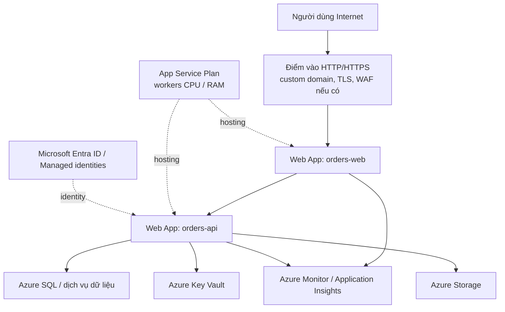

# App Service Plan và mô hình tài nguyên ứng dụng

Trong module **CLOUD_PROVIDERS_AZURE**, chúng ta khám phá hệ sinh thái Microsoft Azure từ subscription, resource group và Microsoft Entra ID đến mạng ảo, dịch vụ tính toán, lưu trữ và dữ liệu. Mục tiêu là biết triển khai, giám sát, bảo vệ và kiểm soát chi phí một kiến trúc ứng dụng trên Azure. Ở chương **Ứng dụng web với App Service**, trước khi đưa một website hay API lên Azure, cần hiểu hai tài nguyên thường được tạo cùng nhau nhưng có nhiệm vụ khác nhau: **App Service Plan** và **Web App**.

Ví dụ, hệ thống đặt hàng có giao diện web cho khách và một API xử lý đơn hàng. Nếu triển khai cả hai vào một App Service Plan, chúng có thể dùng chung năng lực tính toán và chia sẻ chi phí nền tảng. Tuy nhiên, API bị tải đột biến có thể ảnh hưởng website, và thao tác tăng số instance của plan cũng tác động đến những ứng dụng cùng dùng plan. Vì vậy, quyết định **ứng dụng nào đặt trên plan nào** là quyết định kiến trúc, hiệu năng, bảo mật và chi phí, không chỉ là bước chọn tên tài nguyên trong Azure Portal.

Sau bài học, bạn có thể:

- Phân biệt Azure App Service, App Service Plan, Web App, deployment slot và các tài nguyên phụ thuộc.
- Giải thích quan hệ giữa **SKU/tier**, kích thước worker, số instance, hệ điều hành và Azure region.
- Quyết định khi nào nên đặt nhiều ứng dụng chung plan và khi nào cần tách plan.
- Hiểu tác động của **scale up**, **scale out**, autoscale, deployment slots và các giới hạn tài nguyên.
- Tạo và kiểm tra App Service Plan/Web App bằng Azure CLI, cấu hình ứng dụng và triển khai có kiểm soát.
- Thiết kế nguyên tắc phân quyền, quan sát, tính chi phí và dọn tài nguyên an toàn.

## 1. Azure App Service là gì?

**Azure App Service** là một nền tảng dịch vụ (PaaS) để triển khai và vận hành các ứng dụng web, REST API và những workload web được hỗ trợ mà không phải tự quản lý toàn bộ hệ điều hành, lớp web server và hạ tầng VM nền. Tùy hệ điều hành, stack và SKU, App Service có thể chạy ứng dụng .NET, Java, Node.js, Python, PHP hoặc container theo cách được hỗ trợ.

Khi triển khai ứng dụng lên App Service, Azure quản lý nhiều thành phần của nền tảng như cấp phát worker, hạ tầng dịch vụ và tích hợp deployment. Nhưng đội ứng dụng **vẫn chịu trách nhiệm** với mã nguồn, thư viện, thông tin cấu hình, secrets, quyền truy cập, dữ liệu, bảo mật ở tầng ứng dụng, monitoring và các quyết định scaling.

### 1.1. Hai lớp cần tách bạch

```text
Azure subscription
└── Resource group: rg-orders-prod
    ├── App Service Plan: asp-orders-prod
    │   ├── SKU: Premium v3 (ví dụ)
    │   ├── OS: Linux
    │   ├── Region: Southeast Asia
    │   └── Worker instances: 2
    │
    ├── Web App: app-orders-web-prod
    │   ├── Mã giao diện web, runtime, app settings
    │   └── Site URL / custom domain / identity
    │
    └── Web App: app-orders-api-prod
        ├── Mã REST API, runtime, app settings
        └── Site URL / custom domain / identity

Cả hai Web App tham chiếu cùng App Service Plan.
```

**App Service Plan** xác định **năng lực tính toán và môi trường hosting** dành cho các ứng dụng. **Web App** xác định **đơn vị ứng dụng** được triển khai: code/runtime, hostname, app settings, authentication, deployment và các thiết lập vận hành riêng.

Trong Azure Resource Manager, các resource type chính thường gặp:

| Thành phần | Resource type | Trách nhiệm chính |
|---|---|---|
| App Service Plan | `Microsoft.Web/serverfarms` | SKU/tier, OS, region, worker capacity/instance |
| Web App | `Microsoft.Web/sites` | Ứng dụng, cấu hình runtime, hostname, identity, deployment |
| Deployment slot | `Microsoft.Web/sites/slots` | Môi trường triển khai phụ thuộc ứng dụng chủ; swap theo khả năng |
| Autoscale setting | `Microsoft.Insights/autoscaleSettings` | Quy tắc tự điều chỉnh năng lực khi hỗ trợ và được cấu hình |
| Application Insights | `Microsoft.Insights/components` | Thu thập telemetry ứng dụng theo cách tích hợp |
| Managed identity | Danh tính nền tảng liên quan Web App | Cho workload lấy token truy cập dịch vụ khác theo RBAC |
| VNet / DNS / private endpoint | Các loại resource mạng tương ứng | Đường kết nối đến backend hoặc truy cập riêng vào ứng dụng |

Không phải mọi thành phần trong bảng đều tự sinh ra khi tạo một Web App. Bạn chọn, tạo và liên kết các thành phần như giám sát, mạng, chứng chỉ, secrets, database và logging theo nhu cầu thực tế.

### 1.2. App Service Plan không phải gói cấu hình ứng dụng

Tên gọi **plan** dễ gây hiểu nhầm rằng nó chỉ chứa hạn mức tính tiền. Trên các tier dedicated, plan đại diện cho **tập tài nguyên compute dùng chung** để chạy các app gắn vào nó. Còn app là tài nguyên logic có lifecycle, hostname, deployment và cấu hình riêng.

Hai app cùng plan không có nghĩa chúng dùng chung source code, environment variables hoặc managed identity. Mỗi app có thể có cấu hình và identity khác nhau. Tuy nhiên, chúng chia sẻ năng lực worker của plan và thường chia sẻ tác động khi thay SKU hoặc scale plan. Điều này tạo ra cả lợi ích tiết kiệm lẫn rủi ro “noisy neighbor” ở cấp plan.

## 2. App Service Plan xác định những yếu tố nào?

Một App Service Plan có các đặc tính quan trọng:

1. **Azure region:** vị trí triển khai hạ tầng worker. App tạo trong plan hoạt động trong phạm vi region tương thích của plan.
2. **Operating system:** Windows hoặc Linux, theo cấu hình plan. Không dùng chung một plan cho Web App Windows và Web App Linux.
3. **Pricing tier / SKU:** mức khả năng, kích thước tài nguyên và những tính năng có thể sử dụng.
4. **Số instance:** số worker instance phục vụ ứng dụng trên plan theo cơ chế scaling và SKU.
5. **Kiểu môi trường hosting:** shared infrastructure ở một số tier cơ bản hoặc dedicated/isolation theo plan và các tùy chọn được hỗ trợ.

Một plan có thể host nhiều app nếu các app đáp ứng giới hạn tương thích và năng lực tính toán. Azure không bảo đảm một plan có thể chứa vô hạn ứng dụng: số lượng app khả thi phụ thuộc workload, memory, CPU, I/O, cấu hình, giới hạn dịch vụ và các quy định SKU.

### 2.1. Các tier thường gặp

| Nhóm tier | Đặc điểm khái quát | Khi cân nhắc |
|---|---|---|
| **Free (F1)** | Khả năng và quota thấp, dùng hạ tầng chia sẻ, giới hạn tính năng | Học tập, thử nghiệm nhỏ |
| **Shared (D1)** | Hạ tầng chia sẻ, tính năng và quota bị giới hạn | Thử nghiệm không đòi hỏi khả dụng production |
| **Basic (B)** | Compute chuyên dụng theo cấu hình plan, một số tính năng cao cấp không có | Dịch vụ nhỏ không cần nhiều khả năng triển khai nâng cao |
| **Standard (S)** | Dedicated; hỗ trợ nhiều tính năng vận hành hơn, ví dụ deployment slots/autoscale theo điều kiện | Ứng dụng doanh nghiệp vừa và nhỏ |
| **Premium (các thế hệ/tên SKU phù hợp)** | Năng lực cao hơn, lựa chọn scaling/networking/tính năng tùy SKU | Workload có nhu cầu performance hoặc khả năng chuyên biệt |
| **Isolated / App Service Environment** | Môi trường hosting được cô lập theo mô hình ASE phù hợp | Doanh nghiệp có yêu cầu môi trường mạng/compute riêng nghiêm ngặt |

Đây là **mô tả kiến trúc**, không phải bảng giá hoặc ma trận tính năng đầy đủ cho một ngày/region cụ thể. Các thế hệ Premium, giới hạn deployment slot, yêu cầu vùng và loại instance thay đổi theo tính năng; trước khi chọn SKU hãy kiểm tra khả năng hiện hành tại **region, OS, subscription** của workload.

**Free/Shared** không nên được coi tương đương Dedicated chỉ vì chúng cũng được hiển thị là App Service Plan. Cách chia sẻ hạ tầng, quota và quy tắc tính phí khác; không dùng kết luận “trả tiền cho toàn plan theo số instance” của dedicated để suy ra chính xác chi phí trên mọi tier.

### 2.2. Scale up: đổi kích thước và tier

**Scale up (vertical scaling)** là thay đổi năng lực hoặc tier của plan, chẳng hạn từ Standard S1 sang một lựa chọn Premium phù hợp. Việc thay SKU có thể mở thêm CPU/memory/tính năng, nhưng cần kiểm tra tính tương thích, quota, khả năng cung cấp theo region và tác động đến workload đang chạy.

```text
Trước: App Service Plan S1, 1 worker
      web + api chia sẻ tài nguyên nhỏ hơn

Sau:   App Service Plan Premium phù hợp, 1 worker
      web + api chia sẻ tài nguyên worker lớn hơn
```

Scale up thường liên quan **tất cả app cùng plan**, vì tài nguyên compute nền bị thay đổi. Không dùng scale up để giải quyết ngay một lỗi do query database chậm hoặc memory leak nếu chưa đo đạc nguyên nhân.

### 2.3. Scale out: tăng số worker instance

**Scale out (horizontal scaling)** là tăng số instance trong plan, ví dụ từ 1 lên 3 worker để phân phối lưu lượng và năng lực xử lý. Trên mô hình nhiều app cùng plan thông thường, mỗi app chạy trên các worker của plan, và việc scale plan ảnh hưởng năng lực của cả nhóm app.

```text
App Service Plan: 3 worker instances

       Worker 1       Worker 2       Worker 3
       +---------+    +---------+    +---------+
       | web     |    | web     |    | web     |
       | api     |    | api     |    | api     |
       +---------+    +---------+    +---------+
```

Sơ đồ thể hiện mô hình plan shared compute thông thường. Một số tính năng như **per-app scaling** có điều kiện hỗ trợ riêng; nếu sử dụng chúng, phải kiểm tra phạm vi instance của app và quy tắc scale của SKU. Không giả định app nào trong cùng plan cũng có thể tăng instance độc lập theo ý muốn.

Scale out đòi hỏi ứng dụng sẵn sàng chạy trên nhiều instance: session không phụ thuộc bộ nhớ của một worker, dữ liệu được lưu bền vững ở dịch vụ phù hợp, background jobs tránh xử lý trùng và các thao tác khởi tạo không giả định chỉ có một máy.

## 3. Quan hệ giữa Plan, Web App và Deployment Slot

### 3.1. Một plan có thể chứa nhiều app

Ví dụ sản phẩm đặt hàng:

```text
asp-orders-nonprod (Standard, Linux, Southeast Asia)
   ├── app-orders-web-dev
   ├── app-orders-api-dev
   └── app-orders-admin-test

asp-orders-prod-web (Premium, Linux, Southeast Asia)
   └── app-orders-web-prod

asp-orders-prod-api (Premium, Linux, Southeast Asia)
   └── app-orders-api-prod
```

Trong môi trường dev/test, các ứng dụng nhỏ có thể cùng plan để sử dụng năng lực compute hiệu quả hơn. Trong production, website và API có nhu cầu scaling khác nhau nên được tách vào hai plan nhằm giảm ảnh hưởng lẫn nhau.

Đây là **một cách thiết kế**, không phải quy tắc Azure buộc mọi môi trường production phải tách app. Nếu web và API có cùng mức tải, cùng nhóm vận hành và còn nhiều dư địa năng lực, dùng chung plan vẫn có thể hợp lý.

### 3.2. Deployment slot là gì?

**Deployment slot** là một môi trường triển khai của một Web App, thường được sử dụng cho `staging` để kiểm tra bản release trước khi đưa vào production. Slot là tài nguyên con của app, có hostname và một số cấu hình triển khai riêng theo cơ chế được hỗ trợ. Các slot của app **chia sẻ năng lực của App Service Plan**, không phải các plan độc lập.

```text
App Service Plan: asp-orders-prod
   |
   +-- Web App: app-orders-api-prod
         |
         +-- Production slot
         |     https://app-orders-api-prod.azurewebsites.net
         |
         +-- Staging slot
               https://app-orders-api-prod-staging.azurewebsites.net
```

**Slot swap** có thể giúp chuyển phiên bản triển khai giữa slot nguồn và slot đích theo các quy tắc App Service. Không phải mọi thiết lập đều swap giống nhau: một số **slot settings** được đánh dấu “deployment slot setting” để giữ riêng theo môi trường, trong khi những thiết lập khác có thể được trao đổi theo khả năng và quy trình swap.

Ví dụ, connection string production cần trỏ tới database production; staging trỏ tới database staging. Trước khi swap, phải kiểm tra app settings, connection strings, managed identity, cấu hình xác thực, domain, certificate và những thiết lập nhạy cảm khác theo quy tắc swap của App Service. **Không suy ra mọi loại cấu hình và identity đều được swap hoặc giữ cố định cùng một cách.**

Slot **phụ thuộc tier**: không thể tạo deployment slot trên một plan Free/Shared/Basic nếu tier đó không hỗ trợ. Ngoài ra, slot đang chạy cũng tiêu thụ CPU, memory và I/O của plan, nên số lượng slot có thể ảnh hưởng hiệu năng production.

### 3.3. Plan là ranh giới compute, không phải ranh giới bảo mật tuyệt đối

Web App có thể có hostname, runtime settings, managed identity, access restrictions và đường triển khai riêng. Nhưng cùng plan, các app vẫn chia sẻ tài nguyên hosting; không nên dựa vào việc tách thành hai app trong một plan để khẳng định đã có **compute isolation** hoàn toàn.

Nếu cần phân tách nghiêm ngặt do nhóm vận hành, hiệu năng, rủi ro, quy định hoặc nhu cầu scaling, hãy cân nhắc **hai plan riêng**, kết hợp mạng, identity, RBAC và chính sách bảo mật phù hợp. Việc tách plan cũng chưa tự tạo ra đầy đủ ranh giới quản trị nếu cả hai nhóm vẫn dùng chung subscription và vai trò quá rộng.

## 4. Chọn cách nhóm ứng dụng vào plan

Khi thiết kế, trả lời các câu hỏi:

| Câu hỏi | Nếu câu trả lời là “khác nhau” | Hàm ý |
|---|---|---|
| Web và API có profile CPU/RAM tương tự không? | Một bên bị tải đột biến | Cân nhắc tách plan để tránh noisy neighbor |
| Chúng cần cùng Windows/Linux không? | OS khác nhau | Phải dùng các plan tương thích riêng |
| Chúng chạy cùng Azure region không? | Khác region | Cần plan theo region tương ứng |
| Chúng có cùng yêu cầu SKU/tính năng không? | Một app cần slot/networking hoặc khả năng khác | Không nên ép cả hai dùng tier không phù hợp |
| Chúng có cùng chu kỳ triển khai và owner không? | Nhóm bảo trì độc lập | Tách plan có thể giúp kiểm soát blast radius |
| Môi trường dev/test/prod có yêu cầu cách ly không? | Production nhạy cảm | Ưu tiên tách plan/môi trường theo chính sách |
| Workload có thể dùng cùng worker mà không cạnh tranh không? | Có nguy cơ memory/CPU pressure | Đo tải, đặt giới hạn và phân tách khi cần |
| Chi phí tiết kiệm được có đáng với rủi ro chia sẻ không? | Không | Chọn plan riêng và theo dõi chi phí |

**Điểm cần cân bằng:** giảm số plan giúp gom workload và tận dụng tài nguyên nhàn rỗi, nhưng tăng số app trên cùng plan khiến vận hành hiệu năng và thay đổi tier ảnh hưởng nhiều thành phần. Ngược lại, một plan cho mỗi app có thể tăng chi phí và độ phức tạp nếu ứng dụng rất nhỏ.

### 4.1. Ranh giới resource group và subscription

**Resource group** là đơn vị quản lý vòng đời, RBAC và tập hợp tài nguyên Azure, còn **App Service Plan** là tập compute. Hai khái niệm không tương đương. Quyền xóa resource group có thể xóa nhiều app và plan trong đó; tách app khỏi plan theo resource group (khi được hỗ trợ) không thay đổi ranh giới năng lực tính toán.

Việc tạo hoặc chuyển app giữa các plan chịu ràng buộc về region, OS, nhóm tài nguyên và đơn vị triển khai hạ tầng (**webspace**), tùy thao tác, SKU và kiểu App Service. **Không giả định có thể chuyển mọi app sang một plan bất kỳ** dù tên region giống nhau. Trước khi move/switch, kiểm tra các điều kiện Azure hỗ trợ, cấu hình mạng, certificate, deployment slot, capacity và chi phí.

Trong nhiều thiết kế, đặt plan và các app phụ thuộc trong cùng một resource group giúp dễ hiểu vòng đời. Khi hạ tầng dùng chung nhiều nhóm, cần xác định ai có quyền sửa/xóa plan và những app nào bị tác động trước khi tổ chức các resource group.

## 5. App Service Plan khác VM và container hosting tự quản lý thế nào?

Khi lựa chọn nơi chạy ứng dụng, đội kỹ thuật thường so sánh:

| Lựa chọn | Đơn vị tính toán/quản trị | Điểm mạnh | Trách nhiệm cần lưu ý |
|---|---|---|---|
| **Azure App Service** | Web App chạy trên App Service Plan | Ít phải quản lý VM/OS, tích hợp deployment, TLS, monitoring và scale | Cần thiết kế ứng dụng stateless, bảo mật và chọn đúng plan |
| **Azure Virtual Machines** | VM với OS, disk, NIC | Kiểm soát sâu hệ điều hành và cài đặt ứng dụng | Tự quản lý patch, availability, web server và nhiều phần hạ tầng |
| **Azure Container Apps** | Ứng dụng container trên môi trường phù hợp | Phù hợp các luồng container/microservice và scaling theo cơ chế dịch vụ | Kiểm tra traffic, revision, scaling, chi phí và vận hành container |
| **Azure Kubernetes Service (AKS)** | Cluster/node pool/pods | Linh hoạt cho kiến trúc Kubernetes | Cần năng lực quản trị cluster, networking, workload và bảo mật |

App Service là lựa chọn tốt khi workload chủ yếu là **website, web API hoặc web application** có runtime được hỗ trợ và không cần truy cập tùy ý vào hạ tầng máy chủ nền. Không có một dịch vụ nào luôn rẻ hơn hoặc an toàn hơn trong mọi trường hợp; so sánh cần dựa trên nhu cầu mạng, hiệu năng, CI/CD, đội vận hành và tính sẵn sàng.

Một **App Service Plan không đồng nghĩa với VM mà bạn sở hữu và SSH vào như root**. Azure quản lý worker ở tầng nền tảng; khả năng truy cập console/SSH hoặc tùy chỉnh môi trường tùy runtime và kiểu container, không cấp toàn quyền quản trị host nền.

## 6. Mô hình triển khai ứng dụng với các tài nguyên phụ thuộc

Một ứng dụng web thường cần nhiều resource hơn một App Service Plan và một Web App:



Sơ đồ là ví dụ khái niệm, không phải khẳng định web và API mặc nhiên nằm trên một VNet riêng hoặc traffic nội bộ đã được mã hóa/kiểm soát tự động. Nếu có truy cập dịch vụ dữ liệu riêng, đội triển khai phải cấu hình các thành phần networking và identity tương ứng.

### 6.1. Những cấu hình thuộc Web App

Những yếu tố thường quản lý ở cấp **app**:

- **Runtime stack** hoặc container image của ứng dụng; tương thích với OS của plan.
- **Application settings / connection strings**, được trình bày cho ứng dụng qua cơ chế môi trường theo khả năng nền tảng.
- **Managed identity** của app để gọi Key Vault, Storage hoặc các dịch vụ Azure hỗ trợ.
- **Hostnames, custom domains và TLS/certificate**.
- **Authentication/authorization** của người dùng qua tích hợp App Service hoặc logic ứng dụng.
- **Deployment source, deployment slots, startup command, health check và logs** theo tính năng được hỗ trợ.
- **Access restrictions**, VNet integration và private endpoint phù hợp với mô hình mạng.

App settings giữa hai Web App khác nhau không tự động giống nhau vì chúng cùng plan. Ví dụ `orders-web` có `PUBLIC_API_URL`, còn `orders-api` có `DATABASE_ENDPOINT`; không nên chia sẻ secrets bằng cách tạo một file trên OS worker và mong app khác đọc lại.

### 6.2. Cấu hình nào thuộc plan?

Những thay đổi thường có hiệu ứng ở cấp **plan**:

- Chuyển tier/SKU tương thích (scale up/down).
- Tăng/giảm số worker instance (scale out/in).
- Đặc tính nền tảng hosting theo OS, region và các lựa chọn availability/capacity được hỗ trợ.
- Những giới hạn CPU/memory/throughput liên quan đến năng lực worker trên plan.

Khi một app bị đơ vì tiêu thụ nhiều memory, không chỉ app đó gặp vấn đề: **các app khác dùng cùng pool compute** có thể bị ảnh hưởng. Vì vậy, cần quan sát cả metric của plan và metric từng app.

### 6.3. Kết nối mạng không giống nhau giữa inbound và outbound

**VNet integration** trên App Service thường được sử dụng để hỗ trợ **lưu lượng outbound** của app đi tới những đích qua VNet theo mô hình được hỗ trợ. Nó **không tự biến điểm vào HTTP của app thành private-only**.

Muốn kiểm soát truy cập **inbound**, xem xét access restrictions, private endpoint, cấu hình public network access, WAF/Front Door/Application Gateway và DNS theo nhu cầu. Muốn kết nối an toàn từ app tới Azure SQL/Storage qua private endpoint, thường phải thiết kế thêm VNet integration, DNS và route cho phía outbound.

Phân biệt:

| Nhu cầu | Công cụ liên quan |
|---|---|
| App gọi database/private endpoint trong VNet | VNet integration, private DNS, route, NSG/firewall nếu áp dụng |
| Người dùng nội bộ truy cập Web App qua IP riêng | Private endpoint phía inbound, private DNS và hạn chế public access |
| Public website cần bảo vệ HTTP | HTTPS/TLS, access restrictions, WAF và xác thực người dùng khi phù hợp |
| App cần gọi Key Vault bằng danh tính | Managed identity, RBAC/permission model của Key Vault và kết nối mạng hợp lệ |

Việc chọn plan cũng có thể bị ràng buộc bởi **tính năng networking**, khả năng hỗ trợ SKU, region, OS và những giới hạn tích hợp của dịch vụ.

## 7. Chi phí: tính theo plan hay theo ứng dụng?

Với các tier **dedicated** như Basic, Standard và Premium, mức compute của App Service thường được tính theo **App Service Plan, SKU/worker và số instance**, chứ không đơn giản nhân số Web App trong plan thành số gói compute độc lập.

Ví dụ khái niệm:

```text
Phương án A:
    1 App Service Plan S1, 2 instances
       ├── web
       ├── api
       └── admin
    => Ba app chia sẻ năng lực hai worker của một plan.

Phương án B:
    1 App Service Plan S1, 2 instances cho web
    1 App Service Plan S1, 2 instances cho api
    => Hai pool compute độc lập, có chi phí capacity riêng.
```

**Không dùng số app để thay cho số plan/instance khi dự toán.** Với hai app nhỏ chia sẻ một plan còn nhiều dư CPU/RAM, tiết kiệm có thể đáng kể. Nhưng nếu web và API cạnh tranh tài nguyên khiến phải tăng SKU hoặc instance cho toàn plan, phần tiết kiệm có thể mất đi.

### 7.1. Plan có thể tiếp tục phát sinh phí khi app dừng

Trên dedicated tier, việc **Stop một Web App không nhất thiết dừng tính phí App Service Plan**: worker capacity vẫn được cấp cho plan còn tồn tại. Tương tự, một plan paid không còn app nhưng chưa bị xóa hoặc chưa thay đổi cấu hình vẫn có thể tiếp tục phát sinh chi phí.

Đối với Free/Shared, mức phí/quota áp dụng theo quy tắc riêng của tier và không nên suy trực tiếp từ dedicated. Với Isolated/ASE, chi phí môi trường và compute có thêm đặc tính riêng. Luôn đối chiếu bảng giá Azure theo SKU/region và nguồn dữ liệu Cost Management.

### 7.2. Các khoản chi phí ngoài compute plan

Một Web App có thể phát sinh chi phí thêm từ:

| Khoản mục | Ví dụ |
|---|---|
| Data transfer | Outbound data/egress theo mô hình mạng và giá tương ứng |
| Network | Private endpoint, gateway, NAT, Firewall, Front Door hoặc WAF khi triển khai |
| Monitoring | Log Analytics ingestion/retention, Application Insights và alert |
| Storage/database | Azure SQL, Blob Storage, Azure Cache hoặc tài nguyên khác |
| Domain/certificate | Một số loại domain, chứng chỉ hoặc dịch vụ bảo mật có chi phí riêng |
| Deployment/test | Plan, slot hoặc app môi trường staging/dev đang tiêu thụ tài nguyên |

**Deployment slot không nhất thiết tạo một khoản phí compute plan riêng**, nhưng nó chạy trên worker của plan và có thể khiến bạn phải chọn tier cao hơn, nhiều instance hơn hoặc sử dụng dịch vụ hỗ trợ bổ sung. Điều đó vẫn làm tăng tổng chi phí.

### 7.3. Một công thức dự toán đơn giản

```text
Chi phí ước tính =
  phí compute của App Service Plan theo tier / size / instances / thời gian
  + mạng, lưu trữ, cơ sở dữ liệu và dịch vụ liên quan
  + monitoring, log retention và các tính năng bổ sung
```

Không thể lấy một con số giá mặc định cho mọi tài khoản: phí tùy Azure region, OS, SKU, hình thức cam kết, lưu lượng và điều kiện hợp đồng. Khi lập ngân sách, hãy dùng **Azure Pricing Calculator** với cấu hình thật và sau triển khai đối chiếu **Azure Cost Management**.

## 8. Scale và bảo đảm năng lực ứng dụng

### 8.1. Manual scale

Manual scale hữu ích khi:

- Chuẩn bị trước một đợt cao điểm dự kiến.
- Chuyển tier để bật tính năng cần thiết.
- Thực hiện capacity planning và kiểm thử tải có kiểm soát.
- Thay đổi số instance theo kế hoạch vận hành.

Nhược điểm là cần người theo dõi; nếu tải thay đổi bất ngờ, ứng dụng có thể quá tải trước khi đội vận hành tăng capacity.

### 8.2. Autoscale

**Autoscale** giúp thay đổi số instance dựa trên metric/điều kiện khi tier và cách hosting hỗ trợ. Ví dụ dùng CPU percentage hoặc lịch theo giờ; cấu hình phải bao gồm **min/max/default instance**, điều kiện tăng/giảm và cooldown để tránh liên tục co giãn.

```text
CPU cao liên tục
       |
       v
Metric + autoscale rule
       |
       v
Tăng số instances của plan (trong khoảng giới hạn đã đặt)
       |
       v
Kiểm tra CPU, HTTP latency, 5xx, memory và readiness
```

Không chỉ đặt một rule “CPU > ngưỡng thì thêm instance”. Cần xem xét:

- Mức tải thực sự là CPU hay bottleneck database/storage/network.
- Thời gian scale và thời gian ứng dụng warm-up.
- Ngưỡng tăng/giảm, số instance tối thiểu và giới hạn quota.
- Tính sẵn sàng và phân tán của backend trong thời gian scale.
- Tác động tới **tất cả app trên plan**, đặc biệt nếu metric đại diện tổng compute.

App Service có nhiều cơ chế scaling/automatic scaling với điều kiện và giới hạn theo SKU, OS, loại app và tính năng. Không áp dụng một quy tắc autoscale dành cho mô hình này sang mô hình khác mà không kiểm tra hỗ trợ hiện hành.

### 8.3. Scale không thay thế thiết kế ứng dụng

Giả sử `orders-api` lưu session vào biến trong memory của worker thứ nhất. Khi scale out lên ba instance, request tiếp theo có thể được xử lý ở instance khác; session có nguy cơ bị mất hoặc không nhất quán.

Để scale an toàn:

1. Ưu tiên ứng dụng **stateless** và dùng cache/session store tập trung nếu cần.
2. Lưu file người dùng và dữ liệu bền vững trong Storage/DB thay vì giả định ổ cục bộ của worker luôn tồn tại.
3. Thiết kế background tasks không xử lý trùng ngoài ý muốn khi nhiều instance cùng chạy.
4. Chuẩn bị graceful shutdown, health checks và ứng dụng warm-up.
5. Kiểm tra connection pool và giới hạn database khi số instance tăng.

**Sticky session** hoặc thiết lập affinity trong một số kiến trúc có thể giúp một số luồng, nhưng không nên xem nó là giải pháp lâu dài thay thế trạng thái ứng dụng được quản lý đúng.

### 8.4. Availability và khả năng khôi phục

Tăng số instance của plan có thể giúp ứng dụng chịu lỗi worker tốt hơn trong các điều kiện thích hợp. Nhưng nó không tự giải quyết được:

- Lỗi triển khai code làm toàn bộ instance cùng lỗi.
- Azure region bị gián đoạn.
- Database hoặc service backend không có redundancy.
- Secret hoặc DNS cấu hình sai.
- Dữ liệu lưu cục bộ không được sao lưu.

Hãy thiết kế theo **SLA/SLO thật**, đặt health check, kiểm thử failure, cấu hình backup dữ liệu và cân nhắc zone redundancy/multi-region theo SKU/region và yêu cầu workload. Khả năng zone redundancy, số instance cần thiết và điều kiện hỗ trợ phụ thuộc kế hoạch triển khai, không nên mặc định mọi plan đều có.

## 9. Bảo mật và quản trị theo đúng cấp tài nguyên

### 9.1. Phân quyền quản lý plan khác quyền triển khai app

Trong Azure RBAC, quyền thay đổi App Service Plan có thể cho phép tăng/giảm capacity hoặc thay tier, ảnh hưởng nhiều ứng dụng. Quyền sửa Web App có thể cho phép thay code, app settings hoặc identity của ứng dụng, cũng là quyền nhạy cảm.

Gợi ý phân định:

| Nhóm | Nhiệm vụ | Nguyên tắc quyền |
|---|---|---|
| Platform team | Chọn tier, tạo/sửa plan, network baseline và quota | Quyền quản lý plan theo phạm vi được phê duyệt |
| Application team | Triển khai code, app config và kiểm tra releases | Quyền ở đúng Web App/slot cần quản lý |
| Security team | Thiết kế identity, access restrictions, policies và secrets | Quyền cấu hình/giám sát có kiểm soát |
| Operations/SRE | Xem metrics, logs, health và thực hiện incident response | Quyền xem và quyền thực thi change theo quy trình |

Không nhất thiết tạo bốn nhóm cho hệ thống nhỏ; mục tiêu là tránh cấp Owner ở subscription cho mọi người chỉ để họ triển khai một API.

### 9.2. Managed identity và secrets

Mỗi Web App có thể bật **system-assigned managed identity** hoặc gán **user-assigned identity** nếu dịch vụ/thiết kế hỗ trợ. Backend dùng identity này để lấy token từ Microsoft Entra ID và gọi Key Vault hoặc dịch vụ Azure khác, thay vì hard-code client secret.

Lưu ý:

- **Identity của App Service Plan** không phải danh tính ứng dụng thay thế cho identity của từng Web App.
- Bật identity không tự cấp quyền đọc Key Vault; phải cấu hình RBAC hoặc permission model tương ứng.
- Hai Web App cùng plan có thể dùng **identities khác nhau**, giúp phân tách quyền dữ liệu.
- App settings có thể chứa thông tin nhạy cảm; tránh lưu bí mật trực tiếp khi có thể dùng Key Vault references hoặc identity-based connection phù hợp.

### 9.3. Mạng và điểm truy cập

Một URL dạng `https://<app-name>.azurewebsites.net` thường là endpoint của Web App. Tính công khai/riêng tư và cách bảo vệ phụ thuộc cấu hình App Service, access restrictions, private endpoint và các thành phần mạng khác.

Với ứng dụng production:

- Bật HTTPS/TLS theo yêu cầu bảo mật và quản lý certificate.
- Xác thực người dùng/khách hàng và phân quyền dữ liệu ở tầng app.
- Hạn chế truy cập trang quản trị/SCM và endpoint triển khai khi phù hợp.
- Đánh giá WAF nếu có HTTP endpoint public nhạy cảm.
- Cấu hình private endpoint hoặc VNet integration đúng chiều lưu lượng cần bảo vệ.
- Không mở toàn bộ outbound mạng để xử lý một lỗi DNS hoặc RBAC chưa xác định.

**Tách app hoặc tách plan không tự bảo đảm endpoint trở thành private.** Thiết kế network security phải độc lập và được kiểm tra thực tế.

## 10. Thực hành Azure CLI: tạo App Service Plan và Web App

Bài thực hành dưới đây minh họa việc tạo một plan **Standard S1 chạy Linux** và một Web App trong môi trường thử nghiệm. Tất cả tên, subscription và runtime cần được thay theo môi trường thực tế. **Các lệnh dùng Bash/Cloud Shell**, không phải cú pháp PowerShell.

**Điều kiện đầu vào:**

- Có Azure subscription đang hoạt động, Azure CLI và quyền tạo resource group, App Service Plan, Web App.
- Region được chọn hỗ trợ SKU và runtime dự kiến.
- Có ngân sách thử nghiệm; **S1 là tier trả phí**. Phải dọn tài nguyên sau lab nếu không còn dùng.
- Tên Web App phải hợp lệ và không trùng với tên đã được người khác sử dụng trong namespace dịch vụ tương ứng.

### 10.1. Xem subscription và chọn biến

```bash
az login
az account show --output table
az account set --subscription "<subscription-id>"

RG="rg-orders-app-dev"
LOCATION="southeastasia"
PLAN="asp-orders-dev-linux"
APP="app-orders-api-dev-<unique-suffix>"
```

`<unique-suffix>` là placeholder. Hãy thay bằng chuỗi hợp lệ, duy nhất, không giữ dấu ngoặc nhọn trong tên thật.

### 10.2. Tạo resource group và App Service Plan

```bash
az group create \
  --name "$RG" \
  --location "$LOCATION"

az appservice plan create \
  --resource-group "$RG" \
  --name "$PLAN" \
  --location "$LOCATION" \
  --sku S1 \
  --is-linux
```

Sau khi tạo, kiểm tra plan:

```bash
az appservice plan show \
  --resource-group "$RG" \
  --name "$PLAN" \
  --query "{name:name,location:location,sku:sku.name,tier:sku.tier,workers:numberOfWorkers,isLinux:reserved,id:id}" \
  --output json
```

Trong dữ liệu App Service, thuộc tính `reserved` thường dùng để nhận diện plan Linux. Không chỉnh trực tiếp JSON resource để đổi Windows/Linux cho một plan đang chạy; nếu cần chuyển hệ điều hành, hãy xây dựng plan và ứng dụng tương thích theo quy trình migration.

### 10.3. Chọn runtime rồi tạo Web App

Kiểm tra danh sách runtime được Azure CLI trả về cho Linux:

```bash
az webapp list-runtimes --os-type linux --output table
```

Lấy **một giá trị runtime hợp lệ** từ kết quả ở region/tier mục tiêu. Ví dụ sau giả sử mã runtime Node.js mà CLI hiện hỗ trợ:

```bash
RUNTIME="<runtime-value-from-list>"

az webapp create \
  --resource-group "$RG" \
  --plan "$PLAN" \
  --name "$APP" \
  --runtime "$RUNTIME"
```

Runtime của Web App phải tương thích **OS Linux** của plan. Nếu đang triển khai ứng dụng Java, .NET hoặc container, hãy chọn cấu hình stack tương ứng với dịch vụ và công cụ triển khai; không dùng một mã runtime Node.js cho mọi ứng dụng.

Kiểm tra Web App và quan hệ với plan:

```bash
az webapp show \
  --resource-group "$RG" \
  --name "$APP" \
  --query "{name:name,location:location,state:state,defaultHostName:defaultHostName,planId:serverFarmId,kind:kind}" \
  --output json
```

Giá trị `serverFarmId` trên Web App phải tham chiếu App Service Plan đã tạo. Nếu kết quả khác dự kiến, kiểm tra resource group, subscription và tên plan trước khi tiến hành triển khai production.

### 10.4. Cấu hình ứng dụng và managed identity

Đặt một app setting **không nhạy cảm**:

```bash
az webapp config appsettings set \
  --resource-group "$RG" \
  --name "$APP" \
  --settings APP_ENV=development
```

Bật system-assigned managed identity:

```bash
az webapp identity assign \
  --resource-group "$RG" \
  --name "$APP"

az webapp identity show \
  --resource-group "$RG" \
  --name "$APP" \
  --output json
```

Từ kết quả trên, bạn có thể lấy `principalId` để cấp quyền ở dịch vụ đích nếu ứng dụng cần. **Bật identity không tự cấp quyền truy cập Azure SQL, Key Vault hoặc Storage.** Mỗi dịch vụ đích còn yêu cầu phân quyền data plane và networking phù hợp.

Không lưu access key, mật khẩu database hoặc client secret trong ví dụ `APP_ENV`. Với cấu hình bí mật, cân nhắc Key Vault references hoặc identity-based connection theo khả năng stack/dịch vụ.

### 10.5. Kiểm tra hostname và trạng thái HTTP

Lấy hostname đã cấp:

```bash
APP_HOST=$(az webapp show \
  --resource-group "$RG" \
  --name "$APP" \
  --query defaultHostName --output tsv)

echo "https://$APP_HOST/"
```

Ứng dụng vừa được tạo có thể chưa chứa mã nghiệp vụ của bạn hoặc đang hiển thị trang mặc định. Để kiểm thử đầy đủ, triển khai code/container đúng runtime và thiết lập một endpoint health check phù hợp. **Có hostname không có nghĩa ứng dụng đã qua kiểm thử triển khai.**

### 10.6. Tăng số worker instance

Với tier và quota hỗ trợ, thử tăng số instance của plan:

```bash
az appservice plan update \
  --resource-group "$RG" \
  --name "$PLAN" \
  --number-of-workers 2

az appservice plan show \
  --resource-group "$RG" \
  --name "$PLAN" \
  --query "{sku:sku.name,workers:numberOfWorkers}" \
  --output json
```

Lệnh này thay đổi **plan**, không chỉ một app. Nếu thêm Web App thứ hai vào plan, hãy đánh giá việc tăng instance sẽ tác động đến cả hai ứng dụng và làm tăng chi phí compute.

### 10.7. Thử deployment slot nếu tier hỗ trợ

Với Standard S1 trong ví dụ, có thể tạo slot `staging` theo số slot được tier hỗ trợ:

```bash
az webapp deployment slot create \
  --resource-group "$RG" \
  --name "$APP" \
  --slot staging

az webapp deployment slot list \
  --resource-group "$RG" \
  --name "$APP" \
  --output table
```

Sau khi triển khai phiên bản mới vào staging, kiểm tra app settings đánh dấu slot-specific, kết nối database và behavior trước khi cân nhắc swap. Một lệnh swap mẫu là:

```bash
# Chỉ thực hiện khi đã review slot settings và xác nhận staging sẵn sàng.
az webapp deployment slot swap \
  --resource-group "$RG" \
  --name "$APP" \
  --slot staging \
  --target-slot production
```

**Cảnh báo:** Swap có thể đổi phiên bản code/cấu hình và làm ảnh hưởng traffic nếu thực hiện trên production. Không chạy lệnh swap theo thói quen khi chưa kiểm tra tính tương thích database, health checks và cấu hình slot.

### 10.8. Kiểm kê tài nguyên trước khi dọn lab

```bash
az webapp list \
  --resource-group "$RG" \
  --query "[].{app:name,plan:serverFarmId,state:state}" \
  --output table

az appservice plan list \
  --resource-group "$RG" \
  --query "[].{plan:name,sku:sku.name,workers:numberOfWorkers}" \
  --output table
```

Nếu **resource group được tạo chỉ cho lab và không chứa bất kỳ tài nguyên nào khác**, có thể xem xét xóa sau khi kiểm kê và xác nhận hậu quả:

```bash
# Chỉ là ví dụ. Xóa resource group có thể xóa toàn bộ resource trong group.
# az group delete --name "$RG"
```

Không xóa một plan dùng chung chỉ vì app lab đã dừng: các app khác có thể còn đang phụ thuộc vào plan. Với production, xóa plan/resource group phải theo quy trình thay đổi và kiểm tra ràng buộc dữ liệu, monitoring và CI/CD.

## 11. Hạ tầng dưới dạng mã (IaC): mô hình tham chiếu

Với đội ngũ vận hành nhiều môi trường, nên quản lý App Service Plan và Web App bằng **Bicep, ARM hoặc Terraform** để giảm sai lệch cấu hình. Dưới đây là một manifest **mô tả khái niệm**, không phải schema có thể triển khai trực tiếp:

```yaml
environment: production
region: southeastasia

plans:
  - name: asp-orders-web-prod
    os: Linux
    sku: Premium
    instances: 2
  - name: asp-orders-api-prod
    os: Linux
    sku: Premium
    instances: 2

apps:
  - name: app-orders-web-prod
    plan: asp-orders-web-prod
    runtime: "<supported-runtime>"
    managedIdentity: SystemAssigned
    httpsOnly: true
  - name: app-orders-api-prod
    plan: asp-orders-api-prod
    runtime: "<supported-runtime>"
    managedIdentity: SystemAssigned
    httpsOnly: true

monitoring:
  applicationInsights: true
  alerting: true
```

Các trường `sku: Premium` ở ví dụ là tên nhóm cho người đọc; file triển khai thật phải chỉ rõ **SKU hợp lệ** như một mã Premium cụ thể được region hỗ trợ. Mọi thành phần mạng, datastore, secret, diagnostics và deployment cũng cần có resource/config thật theo API của công cụ IaC được lựa chọn.

### 11.1. Nên quản lý những thứ nào bằng IaC?

- Plan: region, SKU, OS, số instance và cấu hình phù hợp.
- App: liên kết plan, runtime, identity, HTTPS-only, hostname và app settings không nhạy cảm.
- Slot: tên, các slot-specific settings và quy trình deploy/swap.
- Network: VNet integration, private endpoints, DNS, access restrictions theo khả năng.
- Monitoring: Application Insights, log settings, metrics, alerts và dashboard.
- RBAC: scope và role cho deployment identity, app managed identity và đội vận hành.
- Governance: tags, policies, cost budget và release/change metadata.

Với secrets, đừng lưu giá trị thực trong repository IaC hoặc log pipeline. Chỉ tham chiếu nguồn bí mật an toàn và dùng cơ chế triển khai thích hợp.

### 11.2. Quản lý drift

Một thay đổi thủ công trong Azure Portal có thể làm môi trường khác với định nghĩa IaC. Khi chuẩn hóa:

1. Thay đổi được đề xuất qua pull request.
2. Pipeline chạy lint/validate và **what-if/plan** theo công cụ hỗ trợ.
3. Người chịu trách nhiệm review chênh lệch capacity, security, cost.
4. Triển khai theo thứ tự dev/test/prod, kèm kiểm thử ứng dụng.
5. Theo dõi drift và đưa các thay đổi khẩn cấp được duyệt trở lại mã nguồn.

Điều này đặc biệt quan trọng với App Service Plan dùng chung: một lần chỉnh tier hoặc scale có thể tác động tới nhiều Web App hơn người thao tác nhìn thấy trên màn hình.

## 12. Giám sát App Service Plan và từng ứng dụng

Giám sát chỉ một Web App có thể bỏ sót nguyên nhân thực tế. Khi nhiều app dùng chung plan, cần quan sát **hai cấp**:

| Cấp giám sát | Tín hiệu cần theo dõi | Ý nghĩa |
|---|---|---|
| **Plan/compute** | CPU Percentage, Memory Percentage và metrics worker có sẵn | Phát hiện pressure do tổng workload chia sẻ |
| **Web App** | HTTP request rate, response time, HTTP 4xx/5xx, health checks | Phát hiện lỗi người dùng thực sự gặp |
| **Ứng dụng** | Traces, dependency calls, exceptions, distributed tracing | Xác định code/query/backend gây chậm |
| **Nền tảng** | Deployment events, restart, scale events, availability, resource changes | Phân biệt sự cố deployment/capacity với bug code |
| **Chi phí** | Chi phí theo plan, subscription, resource group, tags và dịch vụ liên quan | Xác nhận dự toán có phù hợp workload |

Azure Monitor và Application Insights có thể hỗ trợ thu thập telemetry tương ứng khi được cấu hình. **Không phải mọi metric hiện diện trên mọi tier, runtime hoặc kiểu resource**, và tên metric có thể thay đổi; luôn liệt kê các metric khả dụng của resource thật.

### 12.1. Kiểm tra danh sách metrics qua CLI

Lấy Resource ID của plan:

```bash
PLAN_ID=$(az appservice plan show \
  --resource-group "$RG" \
  --name "$PLAN" \
  --query id --output tsv)

az monitor metrics list-definitions \
  --resource "$PLAN_ID" \
  --output table
```

Sau khi xác nhận một metric có sẵn, có thể xem giá trị trong một khoảng thời gian:

```bash
# Tên metric là ví dụ; xác nhận qua list-definitions trước.
az monitor metrics list \
  --resource "$PLAN_ID" \
  --metric "CpuPercentage" \
  --interval PT5M \
  --output json
```

Không suy ra một CPU metric tăng cao là bằng chứng ứng dụng nào đó đang làm nghẽn plan. Bạn cần đối chiếu app metrics, request logs, performance traces và thời điểm của các thay đổi.

### 12.2. Quy trình điều tra khi một app dùng chung plan bị chậm

Ví dụ API phản hồi chậm nhưng web không có nhiều request:

1. **Xác nhận phạm vi:** chỉ API chậm hay tất cả Web App cùng plan đều chậm?
2. **Kiểm tra plan metrics:** CPU/memory pressure có trùng thời điểm?
3. **Kiểm tra từng app:** traffic, exceptions, 5xx, request duration và restart.
4. **Kiểm tra dependency:** database latency, connection pool, storage, network và DNS.
5. **Kiểm tra deployment/scale:** có thay SKU, số instance hoặc deploy slot trong thời điểm xảy ra lỗi?
6. **Đối chiếu tài nguyên dùng chung:** một ứng dụng batch hoặc admin site có tăng CPU/RAM không?
7. **Lựa chọn biện pháp:** sửa code/cache/query, tăng capacity tạm thời hoặc tách workload sang plan riêng.

Nếu plan còn dư năng lực nhưng API gọi database chậm, việc scale plan có thể không cải thiện được độ trễ. Nếu CPU/memory pressure chủ yếu do một app, tách app đó khỏi plan có thể hữu ích hơn việc liên tục tăng capacity cho tất cả ứng dụng.

## 13. Các sai lầm thường gặp

### 13.1. Coi một Web App là một App Service Plan

Hậu quả: dự toán sai, không nhận ra web và API chia sẻ worker, bỏ sót tác động khi scaling. Cách sửa: luôn kiểm tra `serverFarmId` của từng app và lập danh sách tất cả app đang dùng plan trước thay đổi.

### 13.2. Dừng app để “dừng mọi chi phí”

Hậu quả: App Service Plan dedicated vẫn có thể đang được tính phí. Cách sửa: xem resource plan còn hoạt động, SKU/instance và những app khác phụ thuộc; chỉ xóa/giảm tier khi quy trình cho phép.

### 13.3. Tạo quá nhiều app cùng một plan vì chi phí thấp hơn

Hậu quả: một app chiếm CPU/memory và ảnh hưởng các app còn lại. Cách sửa: đo tải thực tế, đặt mục tiêu SLO, kiểm soát background tasks, xem xét grouping theo owner và load profile.

### 13.4. Dùng chung plan giữa Windows và Linux

Hậu quả: cấu hình không tương thích với OS plan hoặc không thể tạo/switch app như kỳ vọng. Cách sửa: chọn plan theo OS và runtime được hỗ trợ ngay từ thiết kế.

### 13.5. Tưởng autoscale plan là cân bằng tải và tối ưu code tự động

Hậu quả: tăng instances nhưng bottleneck ở database hoặc ứng dụng không stateless. Cách sửa: phối hợp autoscale với health checks, load tests, state management và dependency monitoring.

### 13.6. Mặc định mọi SKU có deployment slots hoặc networking giống nhau

Hậu quả: deployment thất bại hoặc tính năng không khả dụng khi chuyển môi trường. Cách sửa: kiểm tra tính năng theo tier, OS, region và số slot tối đa trước khi chọn SKU.

### 13.7. Nhầm VNet integration với truy cập inbound riêng

Hậu quả: app vẫn có endpoint public dù có VNet integration. Cách sửa: thiết kế riêng inbound access restrictions/private endpoint và outbound VNet integration.

### 13.8. Đặt file quan trọng trên filesystem worker

Hậu quả: dữ liệu hoặc trạng thái tạm có thể không bền vững khi restart, scale hoặc thay instance tùy filesystem/hosting. Cách sửa: dùng Azure Storage hoặc database cho dữ liệu cần giữ; phân biệt rõ thư mục persistent được nền tảng hỗ trợ và vùng lưu trữ tạm.

### 13.9. Swap slot mà không kiểm tra secret và môi trường backend

Hậu quả: bản staging có thể gọi nhầm database hoặc dịch vụ production/test. Cách sửa: phân loại slot-specific settings, xác nhận identity và secret bindings, kiểm thử trước và sau swap.

### 13.10. Xóa plan dùng chung khi xóa một app

Hậu quả: các Web App khác mất hosting. Cách sửa: kiểm kê dependency của plan, RBAC và các app còn lại trước khi xóa plan hoặc resource group.

## 14. Tình huống thiết kế cho một hệ thống đặt hàng

### 14.1. Yêu cầu

Một doanh nghiệp có ba ứng dụng:

- `orders-web`: website nhận đơn; tải vừa phải, traffic tăng vào cuối tuần.
- `orders-api`: REST API xử lý đơn; CPU cao hơn, phụ thuộc database và queue.
- `orders-admin`: giao diện nội bộ, ít request, chỉ quản trị viên được truy cập.

Tổ chức có môi trường dev và production ở Southeast Asia. Dev cần tối ưu chi phí, còn production cần triển khai liên tục, kiểm tra staging và khả năng chịu tải của API. Database và secrets được quản lý bằng các dịch vụ riêng, không lưu trên disk cục bộ của App Service worker.

### 14.2. Ba lựa chọn kiến trúc

| Phương án | Tổ chức plan | Ưu điểm | Rủi ro |
|---|---|---|---|
| **A. Gộp cả ba app** | Một plan production | Đơn giản, dễ dùng chung capacity | Noisy neighbor, scale API khiến tăng chi phí của cả nhóm |
| **B. Tách web và API** | Một plan web/admin, một plan API | API có capacity và scaling riêng | Hai plan cần monitoring, quản trị và ngân sách riêng |
| **C. Tách tất cả** | Mỗi app một plan | Cô lập compute rõ ràng hơn theo workload | Tăng số pool compute và chi phí tối thiểu |

Một phương án tham khảo:

```text
Dev:
  asp-orders-dev (Linux, tier phù hợp)
      ├── app-orders-web-dev
      ├── app-orders-api-dev
      └── app-orders-admin-dev

Production:
  asp-orders-web-prod (Linux, tier có slot/scale phù hợp)
      ├── app-orders-web-prod
      └── app-orders-admin-prod (nếu cùng load/owner được phê duyệt)

  asp-orders-api-prod (Linux, tier có slot/scale phù hợp)
      └── app-orders-api-prod
            └── staging slot
```

Quyết định cuối cùng phụ thuộc **đo đạc hiệu năng, yêu cầu bảo mật và ngân sách**. Nếu admin app phải cách ly khỏi web do quy định hoặc chứa chức năng có đặc quyền cao, có thể đặt admin ở plan riêng, kết hợp access restrictions và identity riêng. Nếu ứng dụng chỉ nhận ít traffic và thuộc cùng đội, gộp vẫn có thể phù hợp khi kiểm tra tải cho thấy còn dư capacity.

### 14.3. Kế hoạch triển khai

1. Chọn OS, runtime, tier và region; kiểm tra khả năng hỗ trợ deployment slots/VNet.
2. Tạo resource groups, các App Service Plans và Web Apps bằng IaC.
3. Bật managed identity **riêng cho từng app**; cấp quyền tối thiểu với Key Vault và database/storage.
4. Kết nối mạng, cấu hình private DNS/private endpoints của backend và bảo vệ inbound của web/admin.
5. Thiết lập Application Insights, metrics, health checks và cảnh báo ở cả app/plan.
6. Triển khai code vào dev, kiểm thử tải, ghi nhận CPU/memory và latency.
7. Tạo staging slot cho những app production được hỗ trợ, kiểm thử app settings và swap.
8. Chạy canary/rollout, kiểm tra thực tế response time và 5xx; autoscale theo yêu cầu.
9. Xem chi phí theo plan và cân nhắc thay grouping sau khi đã có số liệu vận hành.

## 15. Bài tập thực hành

### Bài tập 1: phân biệt tài nguyên

Bạn thấy trong Azure Portal:

```text
asp-commerce-prod
  SKU: S1
  Instances: 2

app-commerce-api-prod
  serverFarmId: .../serverfarms/asp-commerce-prod

app-commerce-web-prod
  serverFarmId: .../serverfarms/asp-commerce-prod
```

Hãy trả lời:

1. Đâu là tài nguyên compute và đâu là ứng dụng?
2. Nếu tăng plan lên 3 instances, những app nào có thể chịu tác động?
3. Nếu Stop riêng web, liệu phí dedicated plan tự động ngừng?
4. Nếu API bị CPU spike, kiểm tra những metric nào trước khi tăng SKU?
5. Nếu web cần chạy Windows trong khi plan hiện tại là Linux, nên làm gì?

**Hướng giải:** `asp-commerce-prod` là plan; hai app tham chiếu cùng pool compute. Scale plan ảnh hưởng capacity của cả hai. Stop web không mặc nhiên ngừng phí plan. Kiểm tra metrics plan và app, dependencies, request latency, errors. Web Windows cần plan Windows tương thích, không dùng chung Linux plan.

### Bài tập 2: chọn plan cho ba workload

Đề xuất grouping cho:

- Web public: traffic theo mùa, có staging deployment.
- API nội bộ: CPU cao, cần khả năng mở rộng riêng.
- Admin portal: chỉ nhóm nội bộ truy cập, rất ít traffic.

Nêu **ít nhất ba tiêu chí** khiến bạn tách hoặc gộp, chỉ rõ yêu cầu SKU/tier, bảo mật inbound và phương pháp kiểm soát chi phí. Không được dùng “đặt app trong một plan là cách ly mạng” làm lập luận.

**Hướng giải:** API nên được cân nhắc plan riêng nếu tải/scale khác. Web cần tier hỗ trợ slots và capacity phù hợp. Admin có thể ở plan chung web nếu tải nhỏ và chính sách cho phép, nhưng phải cấu hình identity và access restrictions riêng. Theo dõi CPU, RAM, request latency, chi phí để quyết định lại khi cần.

### Bài tập 3: phân tích sự cố

Sau khi deploy một bản mới của API, cả API và web cùng tăng độ trễ. App Service Plan đang chạy hai app với CPU cao, trong khi database metrics bình thường.

Hãy mô tả thứ tự điều tra:

1. App nào thay đổi gần thời điểm lỗi?
2. Các metrics plan và từng app chỉ ra điều gì?
3. Có background job hoặc memory leak không?
4. Tăng worker có giải quyết vấn đề lâu dài không?
5. Khi nào nên rollback code, khi nào nên tách API sang plan riêng?

**Hướng giải:** đối chiếu lịch deploy với spike CPU/memory, traces và exceptions; rollback code nếu lỗi mới gây ra. Tăng instance có thể giúp giảm tải tạm nhưng không thay thế sửa code. Nếu API thường xuyên gây pressure lên web với profile khác nhau, tách compute pool sau khi đo tải.

## 16. Câu hỏi tự kiểm tra

**1. App Service Plan chứa code ứng dụng hay xác định capacity?** Chủ yếu xác định môi trường hosting và capacity; Web App chứa cấu hình và đơn vị triển khai ứng dụng.

**2. Hai Web App dùng chung plan có tự chia sẻ managed identity không?** Không. Danh tính của mỗi app được cấu hình riêng.

**3. Scale up khác scale out thế nào?** Scale up đổi tier/kích thước worker; scale out thay số worker instance.

**4. Mọi tier đều hỗ trợ staging slot và autoscale như nhau không?** Không. Tùy SKU, OS, region và tính năng.

**5. Dừng mọi Web App trong một plan dedicated có tự xóa chi phí plan không?** Không mặc nhiên; plan compute còn được cấp có thể tiếp tục bị tính phí.

**6. VNet integration có tự làm cho Web App chỉ nhận request từ IP private không?** Không. Nó chủ yếu phục vụ outbound connectivity; inbound cần thiết kế riêng.

**7. Một app được tạo ở region nào khi sử dụng plan đã có?** App phải tương thích với region của plan và các ràng buộc của mô hình hosting.

**8. Tại sao ứng dụng cần stateless khi scale out?** Request có thể được xử lý trên các worker khác nhau; trạng thái cục bộ từng worker không tự đồng bộ.

**9. Một slot staging có plan riêng không?** Không; slot thuộc Web App và dùng tài nguyên plan, với quy tắc hỗ trợ theo tier.

**10. Muốn biết Web App đang dùng plan nào, kiểm tra trường gì?** `serverFarmId` của Web App hoặc quan hệ tương đương trong Azure Portal/IaC.

## 17. Checklist áp dụng trong production

- [ ] Đã phân biệt đúng plan, app, slot, RG và các dịch vụ phụ thuộc.
- [ ] Đã chọn region, OS, tier/SKU và runtime tương thích.
- [ ] Đã kiểm tra hỗ trợ tính năng slots, autoscale, networking, backups và khả năng sẵn sàng theo SKU.
- [ ] Đã đánh giá tải CPU/RAM/I/O và grouping của những app chia sẻ plan.
- [ ] Production có mức cách ly compute và ownership phù hợp với SLA/SLO.
- [ ] Đã xác định chiến lược scale up/out, số instance tối thiểu/tối đa và cooldown.
- [ ] Ứng dụng xử lý state, session, background jobs và file storage phù hợp với nhiều instance.
- [ ] Đã thiết lập identity, Key Vault, RBAC và các app settings không chứa secret không cần thiết.
- [ ] Đã thiết kế inbound/outbound network, access restrictions, private endpoints và DNS.
- [ ] Đã có health checks, request logging, Application Insights, alert và metrics ở cả plan/app.
- [ ] Đã kiểm tra slot-specific settings, kết nối backend và kế hoạch rollback trước swap.
- [ ] Đã có IaC, phân quyền thay đổi plan riêng với quyền deploy app và quy trình review.
- [ ] Đã dự toán compute theo plan/instance và chi phí các dịch vụ liên quan.
- [ ] Đã kiểm kê app cùng plan trước khi resize, move hoặc xóa tài nguyên.

## Kết luận

**App Service Plan** là ranh giới năng lực tính toán và hosting của Azure App Service, còn **Web App** là đơn vị triển khai và vận hành ứng dụng. Một plan có thể phục vụ nhiều ứng dụng, giúp dùng chung tài nguyên và tiết kiệm chi phí, nhưng các ứng dụng cùng chịu tác động của năng lực worker, việc scale hoặc thay SKU của plan.

Thiết kế đúng cần cân nhắc **OS, region, SKU, mức tải, vòng đời, rủi ro chia sẻ và ngân sách**. Hãy đặt các ứng dụng có nhu cầu khác nhau lên plan phù hợp, quản lý từng Web App bằng identity và cấu hình riêng, dùng deployment slots/monitoring khi được hỗ trợ và kiểm tra chi phí theo compute pool. Khi kết hợp App Service với Microsoft Entra ID, mạng, lưu trữ, giám sát và IaC, bạn có thể triển khai hệ thống web/API Azure nhất quán, vận hành được và dễ mở rộng.
