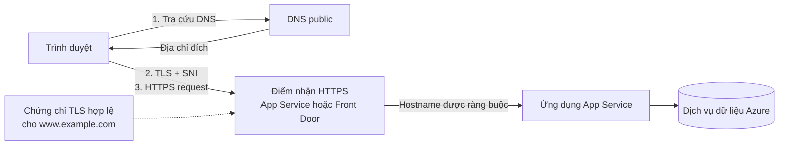
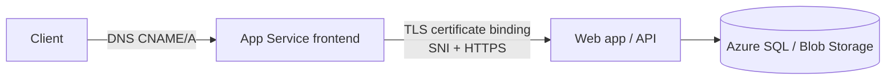
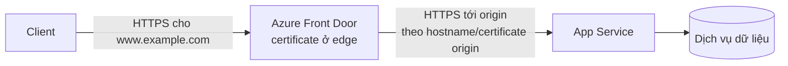

# Custom domain, chứng chỉ và cấu hình HTTPS

Khi triển khai ứng dụng lên **Azure App Service**, bạn có thể truy cập ngay qua một địa chỉ mặc định như `orders-portal.azurewebsites.net`. Nhưng khách hàng thường muốn dùng tên miền của doanh nghiệp, chẳng hạn `www.example.com` hoặc `api.example.com`, với biểu tượng ổ khóa hợp lệ trên trình duyệt. Để hoàn thành mục tiêu đó, chỉ thêm bản ghi DNS là **chưa đủ**: App Service phải được cấu hình nhận hostname tùy chỉnh, chứng chỉ TLS phải bao phủ đúng tên và các request HTTP cần được xử lý theo chính sách HTTPS.

Bài học thuộc chương **Ứng dụng web với App Service** trong module **CLOUD_PROVIDERS_AZURE**. Module giới thiệu hệ sinh thái Microsoft Azure từ subscription, resource group và Microsoft Entra ID đến mạng ảo, tính toán, lưu trữ, dữ liệu, rồi đến triển khai, giám sát, bảo vệ và kiểm soát chi phí của một kiến trúc ứng dụng. Trong bối cảnh đó, custom domain và HTTPS là lớp **định danh công khai, mã hóa kết nối và vận hành tin cậy** cho website hoặc API chạy trên App Service.

Sau bài học, bạn có thể:

- Giải thích vai trò của **DNS**, **custom hostname binding**, **chứng chỉ TLS**, **SNI** và **HTTPS Only**.
- Chọn bản ghi **CNAME**, **A**, **TXT** phù hợp cho subdomain và apex/root domain.
- Thực hiện quy trình xác minh quyền sở hữu domain trước khi kết nối vào App Service.
- Phân biệt **App Service Managed Certificate** với chứng chỉ do tổ chức quản lý.
- Thiết kế TLS, chuyển hướng HTTP, HSTS và điểm chấm dứt TLS khi có reverse proxy/Front Door.
- Kiểm tra DNS, chứng chỉ, hostname, HTTPS và xử lý những lỗi phổ biến trong triển khai.
- Lập runbook gia hạn chứng chỉ, chuyển dịch DNS và rollback an toàn cho production.

## 1. Luồng request từ tên miền tới App Service

Giả sử ứng dụng có:

```text
App Service app name: orders-portal
Hostname mặc định:    orders-portal.azurewebsites.net
Hostname nghiệp vụ:   www.example.com
Scheme mong muốn:     https://
```

Khi người dùng truy cập `https://www.example.com`, các bước khái quát là:

1. Trình duyệt hỏi DNS và nhận địa chỉ đích của ứng dụng hoặc của tầng proxy/gateway phía trước ứng dụng.
2. Trình duyệt mở kết nối TCP tới cổng 443 và bắt đầu **TLS handshake**.
3. Trong TLS handshake, tên miền được truyền qua **Server Name Indication (SNI)** khi client hỗ trợ; phía kết thúc TLS chọn chứng chỉ tương ứng.
4. Client xác thực chứng chỉ: tên miền phù hợp, chuỗi chứng chỉ tin cậy, thời hạn còn hiệu lực và các kiểm tra khác.
5. Sau khi TLS thiết lập, client gửi HTTP request có hostname; App Service hoặc proxy định tuyến theo custom hostname đã cấu hình.
6. Ứng dụng trả kết quả qua kết nối đã mã hóa.



Ba phần độc lập nhưng liên kết với nhau:

| Thành phần | Trả lời câu hỏi nào? | Nếu thiếu |
|---|---|---|
| **DNS** | `www.example.com` trỏ đến đâu? | Client không tìm được đúng endpoint |
| **Custom domain/hostname binding** | App Service có nhận request mang hostname này không? | Có thể gặp lỗi hostname không được nhận hoặc phản hồi không như dự kiến |
| **TLS certificate binding** | Điểm nhận HTTPS có chứng chỉ hợp lệ cho tên miền không? | Trình duyệt cảnh báo tên/chuỗi chứng chỉ hoặc TLS handshake thất bại |
| **HTTPS Only / TLS policy** | Client có bị buộc dùng HTTPS và phiên bản TLS an toàn không? | Có thể còn đường HTTP hoặc chấp nhận cấu hình không đúng yêu cầu bảo mật |

**Không đồng nhất “DNS resolve thành công” với “HTTPS đã an toàn”.** DNS đúng nhưng chưa bind hostname hoặc chứng chỉ vẫn không tạo thành một dịch vụ web hoạt động chuẩn.

## 2. Phân biệt hostname mặc định và custom domain

### 2.1. Hostname `azurewebsites.net`

Khi tạo App Service, Azure cấp hostname mặc định dạng `<app-name>.azurewebsites.net`. Azure quản lý chứng chỉ cho hostname mặc định theo cơ chế nền tảng, nên ứng dụng có thể thử HTTPS mà không phải mua domain riêng.

Hostname mặc định hữu ích để kiểm tra deploy và health check. Tuy nhiên, dùng hostname riêng của doanh nghiệp hỗ trợ thương hiệu, phân tách website/API và quản trị liên kết với khách hàng.

### 2.2. Custom domain và hostname binding

Một custom domain như `example.com` là vùng tên tổ chức sở hữu/quản lý. **Custom hostname binding** của App Service kết nối một hostname cụ thể — `www.example.com` hoặc `api.example.com` — tới ứng dụng.

Mỗi tên được phục vụ cần được xem xét độc lập:

- `example.com` (apex/root domain).
- `www.example.com` (subdomain website).
- `api.example.com` (subdomain API).
- `*.example.com` (wildcard, chỉ khi thật sự cần và hỗ trợ).

Gắn `www.example.com` **không** mặc nhiên gắn `example.com`. Cũng không nên cho rằng chứng chỉ chỉ bao phủ `example.com` sẽ tự hợp lệ cho `www.example.com`: cần kiểm tra danh sách **Subject Alternative Names (SAN)** hoặc phạm vi wildcard của chứng chỉ.

### 2.3. Điều kiện tiền đề

Trước khi cấu hình:

1. Có App Service hoạt động và biết subscription, resource group, app name.
2. App Service Plan thuộc tier/hình thức triển khai **hỗ trợ custom domains và tính năng chứng chỉ dự kiến**; khả năng hỗ trợ phụ thuộc SKU và môi trường.
3. Có quyền thay đổi DNS tại đơn vị quản lý tên miền hoặc DNS zone.
4. Có quyền cập nhật custom domains và TLS/SSL settings của App Service.
5. Xác định điểm nhận HTTPS: trực tiếp App Service hay qua Azure Front Door, Application Gateway, CDN hoặc reverse proxy.
6. Thống nhất chủ sở hữu, chính sách gia hạn certificate và thời gian cutover.

Không cần chuyển DNS production ngay khi mới xác minh domain; hãy chuẩn bị, kiểm tra và chọn cửa sổ thay đổi thích hợp.

## 3. DNS: CNAME, A, TXT và trường hợp apex domain

### 3.1. CNAME cho subdomain

Với `www.example.com`, một cách thông dụng là trỏ CNAME tới hostname mặc định của App Service:

```dns
www.example.com.  300  IN  CNAME  orders-portal.azurewebsites.net.
```

DNS resolver đi qua CNAME để lấy địa chỉ IP hiện tại của dịch vụ đích. CNAME thường giảm gánh nặng phải tự theo dõi IP của App Service khi nền tảng có thay đổi.

**Lưu ý:** không được đặt CNAME cùng tên với các record dữ liệu không tương thích theo quy tắc DNS. Record xác minh domain thường được tạo dưới **tên khác**, chẳng hạn `asuid.www.example.com`, nên không xung đột với CNAME `www.example.com`.

### 3.2. A record hoặc cơ chế alias cho apex/root

Đối với tên miền gốc `example.com`, DNS chuẩn không cho phép CNAME tại zone apex nếu nó xung đột với các record bắt buộc của zone như SOA/NS. Một lựa chọn là dùng **A record** trỏ tới inbound IPv4 của App Service:

```dns
example.com.  300  IN  A  <APP_SERVICE_INBOUND_IPV4>
```

Giá trị `<APP_SERVICE_INBOUND_IPV4>` phải lấy từ App Service thực tế; đây là **placeholder**, không phải IP có thể sử dụng nguyên văn. Nếu DNS provider hỗ trợ **ALIAS/ANAME/CNAME flattening** hoặc Azure DNS alias record trong ngữ cảnh đích được hỗ trợ, có thể đánh giá cách đó để giảm rủi ro quản lý IP thủ công.

Địa chỉ inbound IP của App Service có thể thay đổi trong một số tình huống như thay đổi cấu hình hạ tầng, gói, dịch chuyển hoặc tái tạo tài nguyên. Vì vậy, khi dùng A record, cần có quy trình phát hiện và cập nhật IP; đừng giả định IP ổn định vĩnh viễn.

### 3.3. TXT xác minh quyền sở hữu domain

App Service sử dụng thông tin xác minh hostname để giảm nguy cơ người không sở hữu domain tự ý liên kết tên miền đó. Khi cấu hình custom domain, Azure Portal có thể yêu cầu bản ghi TXT tại **`asuid`** hoặc **`asuid.<subdomain>`**, chứa **Domain Verification ID** do Azure hiển thị.

Ví dụ minh họa:

```dns
asuid.www.example.com.  300 IN TXT "<DOMAIN_VERIFICATION_ID_FROM_APP_SERVICE>"
asuid.example.com.      300 IN TXT "<DOMAIN_VERIFICATION_ID_FROM_APP_SERVICE>"
```

Ở ví dụ này, record đầu tiên dùng cho `www.example.com`, record thứ hai dùng cho apex `example.com`. Nếu đang chỉnh zone `example.com`, giao diện DNS provider có thể yêu cầu nhập host chỉ là `asuid.www` hoặc `asuid`, tùy cách provider hiển thị FQDN. Không tự thêm đuôi `example.com` hai lần.

**Lấy đúng giá trị xác minh và tên record từ giao diện App Service của ứng dụng đích.** Không lấy app ID, subscription ID hay giá trị tự tạo để thay thế; đừng coi chuỗi minh họa là bản ghi có thể dùng.

### 3.4. Bảng quyết định DNS

| Hostname cần phục vụ | Cách trỏ DNS thường dùng | TXT xác minh thường gặp | Điều cần lưu ý |
|---|---|---|---|
| `www.example.com` | CNAME tới `orders-portal.azurewebsites.net` | `asuid.www` trong zone `example.com` | CNAME đúng và hostname phải được bind |
| `api.example.com` | CNAME tới app API hoặc endpoint proxy | `asuid.api` | API có chứng chỉ và chính sách CORS/auth phù hợp |
| `example.com` | A tới inbound IP hoặc alias phù hợp | `asuid` | Apex không dùng CNAME thuần nếu xung đột record bắt buộc |
| `*.example.com` | Theo tính năng wildcard được hỗ trợ | Theo yêu cầu xác minh thực tế | Chứng chỉ wildcard và rủi ro mở rộng phạm vi hostname |

**TXT xác minh quyền sở hữu không phải bản ghi định tuyến.** Một domain có TXT đúng nhưng CNAME/A sai vẫn không dẫn người dùng đến ứng dụng đúng. Ngược lại, CNAME/A đúng nhưng không vượt qua yêu cầu xác minh cũng chưa được App Service chấp nhận để binding.

## 4. Quy trình gắn custom domain vào App Service

Một quy trình được tổ chức tốt có thể gồm:

1. **Kiểm tra nguồn:** App Service chạy bình thường qua `orders-portal.azurewebsites.net`; xác định backend sẽ phục vụ `www.example.com`.
2. **Xác minh plan/quyền:** tài khoản Azure có quyền quản trị App Service, người quản trị DNS sẵn sàng phối hợp.
3. **Nhận thông tin từ Azure:** domain verification ID, inbound IP hoặc CNAME target theo chỉ dẫn của App Service.
4. **Thêm TXT xác minh**, truy vấn DNS authoritative hoặc public resolver để xác nhận đã xuất hiện.
5. **Thêm record định tuyến** CNAME/A/alias phù hợp; với chuyển đổi production, cân nhắc thời điểm cập nhật record đang phục vụ khách hàng.
6. **Bind hostname** trong App Service bằng phần Custom domains; kiểm tra Azure chấp nhận hostname.
7. **Chuẩn bị và bind chứng chỉ TLS** cho hostname đó, theo cách triển khai được hỗ trợ.
8. **Kiểm thử HTTPS end-to-end**, sau đó bật chính sách HTTPS Only/TLS và thực hiện cutover có giám sát.

Đối với **website đang chạy ở nhà cung cấp khác**, có thể tạo TXT xác minh trước để chứng minh quyền sở hữu mà chưa thay đổi lưu lượng. Tuy nhiên, **việc cấp một App Service Managed Certificate có thể đòi hỏi hostname/DNS trỏ và được xác minh theo những điều kiện hiện hành**. Đừng xây kế hoạch cutover phụ thuộc vào giả định chứng chỉ managed sẽ được phát hành trước khi DNS đúng.

### 4.1. Các trạng thái cần theo dõi

| Giai đoạn | Bằng chứng thành công | Nếu lỗi |
|---|---|---|
| DNS verification | TXT `asuid` đúng tên và đúng giá trị | Kiểm tra zone thật, TTL, DNS cache và quyền cập nhật |
| DNS routing | CNAME/A trỏ endpoint mong muốn | Kiểm tra record cũ và proxy/CDN |
| Hostname binding | `www.example.com` nằm trong danh sách custom domains của app | Kiểm tra xác minh, quyền, app/slot đích và hostname đã gắn nơi khác |
| Certificate availability | Certificate hợp lệ, đúng SAN, không hết hạn | Kiểm tra CA validation, CAA, DNS, chain và loại chứng chỉ |
| TLS binding | App/proxy chọn đúng certificate theo SNI | Kiểm tra hostname, TLS/SSL binding và điểm kết thúc TLS |
| HTTPS | `https://...` truy cập được không có lỗi chứng chỉ | Kiểm tra port 443, TLS versions, application response |

Không kết luận đã xong chỉ vì Azure Portal báo custom domain “validated”. **Validation, binding, certificate issuance và HTTPS traffic là những bước riêng**.

## 5. Chứng chỉ TLS: những thuộc tính phải hiểu

TLS bảo vệ kết nối giữa client và **điểm kết thúc TLS**. Chứng chỉ máy chủ (server certificate) dùng để chứng minh điểm đó có quyền sử dụng tên miền theo quy trình của Certificate Authority (CA), đồng thời hỗ trợ thiết lập kết nối được mã hóa.

### 5.1. Tên miền và SAN

Một chứng chỉ TLS phải hợp lệ cho hostname được client yêu cầu:

- `www.example.com` không nhất thiết được bao phủ bởi chứng chỉ chỉ có `example.com`.
- Wildcard `*.example.com` thường bao phủ một mức subdomain như `www.example.com` và `api.example.com`, nhưng **không** tự bao phủ apex `example.com` hoặc subdomain lồng sâu như `a.b.example.com`.
- Chứng chỉ có nhiều SAN có thể bao phủ đồng thời apex và các subdomain cụ thể.

Trình duyệt không đánh giá chỉ dựa trên tên hiển thị trong giao diện quản trị. Nó kiểm tra **chứng chỉ thực sự được server trả về** khi kết nối đến hostname.

### 5.2. Chuỗi tin cậy và thời hạn

Một chứng chỉ phù hợp còn cần:

- Chưa hết hạn và nằm trong khoảng thời gian hợp lệ.
- Chữ ký/chứng thực tin cậy với client, có chain intermediate CA thích hợp.
- Key/certificate phù hợp thuật toán TLS và chính sách an toàn hiện hành.
- Không bị ảnh hưởng bởi tình trạng bị thu hồi hoặc các vấn đề xác thực khác trong mô hình kiểm tra của client.

Gia hạn chứng chỉ **không đủ** nếu chứng chỉ mới chưa được gắn vào binding đang phục vụ traffic. Cần giám sát cả **ngày hết hạn** lẫn **certificate thumbprint/chain hiện được trình duyệt nhận**.

### 5.3. SNI là gì?

**Server Name Indication (SNI)** là extension trong TLS ClientHello giúp server biết client muốn truy cập hostname nào. Một IP có thể phục vụ nhiều hostname và chọn chứng chỉ phù hợp với tên miền được yêu cầu.

```text
Client: TLS ClientHello, SNI = www.example.com
Server: Chọn certificate có SAN www.example.com
Client: Kiểm tra SAN, CA chain, validity
Client: Gửi HTTPS request với Host = www.example.com
```

Trong App Service, **SNI SSL binding** là lựa chọn thông dụng khi liên kết custom hostname với chứng chỉ. Một số loại binding hoặc môi trường có lựa chọn khác theo hỗ trợ, nhưng không nên yêu cầu dedicated IP chỉ vì cần nhiều HTTPS hostnames.

## 6. Chọn loại chứng chỉ cho App Service

### 6.1. App Service Managed Certificate

**App Service Managed Certificate** là lựa chọn chứng chỉ TLS do Azure cung cấp và quản lý cho các tình huống App Service custom domain được hỗ trợ. Khi đủ điều kiện, Azure có thể thực hiện gia hạn tự động, giảm việc vận hành trực tiếp private key và quy trình renewal.

Những điểm cần xác minh:

- App Service Plan, loại ứng dụng, hostname và cách xác minh domain có đáp ứng điều kiện hiện hành hay không.
- Chứng chỉ managed có hỗ trợ tên miền cụ thể cần dùng không; **không coi đây là chứng chỉ wildcard**.
- Các yêu cầu DNS, CAA, public reachability và giới hạn khi dùng proxy/private networking.
- Tình trạng phát hành/gia hạn thực tế; việc gia hạn tự động vẫn cần DNS/domain binding ổn định theo điều kiện dịch vụ.
- Khả năng xuất certificate/private key: managed certificate không dành cho mô hình tự mang key sang hệ thống khác.

Với website tiêu chuẩn chỉ cần TLS cho từng hostname đủ điều kiện, managed certificate thường đơn giản hơn chứng chỉ do tổ chức tự vận hành. Nhưng không nên chỉ dựa vào câu “free certificate” khi chưa xác minh feature/SKU và chính sách.

### 6.2. Bring Your Own Certificate (BYOC)

Một tổ chức có thể tự có chứng chỉ từ CA của mình, rồi tải/nhập vào App Service hoặc tích hợp qua cơ chế chứng chỉ và Key Vault được hỗ trợ.

Trường hợp thường gặp:

- Cần **wildcard certificate**.
- Cần chứng chỉ có các SAN cụ thể hoặc chính sách tổ chức về CA.
- Cần kiểm soát vòng đời, ngày cấp, thuật toán, cách gia hạn và dùng certificate ở nhiều endpoint.
- Sử dụng Azure Key Vault để quản lý certificate/secret theo mô hình được Azure hỗ trợ.

Với đường nhập PFX, file phải chứa chứng chỉ và private key phù hợp, kèm chain theo yêu cầu; mật khẩu PFX là **secret** cần bảo vệ. Không lưu PFX/private key trong source repository, log hoặc artifact chia sẻ rộng. Quyền đọc certificate và quyền đọc secret/private key trong Key Vault phải được quản trị chặt.

### 6.3. Chọn chứng chỉ theo tình huống

| Nhu cầu | Hướng nên xem xét | Lưu ý |
|---|---|---|
| Website có một hoặc vài hostname chuẩn | App Service Managed Certificate nếu đủ điều kiện | Xác minh hỗ trợ, DNS và tự gia hạn |
| Nhiều subdomain cần một wildcard | BYOC wildcard phù hợp | Wildcard không bao phủ apex |
| Chính sách doanh nghiệp yêu cầu CA/thuật toán riêng | BYOC từ CA được duyệt | Quản lý private key, chain, lịch gia hạn |
| Ứng dụng đứng sau Azure Front Door | Chứng chỉ tại Front Door cho custom domain ở edge; origin TLS theo thiết kế | Không nhầm edge certificate với origin certificate |
| Domain nội bộ không thể đáp ứng điều kiện managed certificate | Chứng chỉ và thiết kế mạng/PKI theo hỗ trợ | Xem điều kiện CA public/private và cấu hình khách hàng |

**Nơi TLS kết thúc rất quan trọng.** Nếu client đi qua Azure Front Door trước App Service, trình duyệt sẽ nhận certificate của **Front Door**, không nhất thiết là certificate đang bind trực tiếp trong App Service.

## 7. Bind chứng chỉ, cấu hình HTTPS và TLS policy

### 7.1. SSL/TLS binding

Sau khi custom domain được xác minh và certificate đã sẵn sàng:

1. Chọn hostname cụ thể trong App Service.
2. Chọn certificate đủ điều kiện, có SAN phù hợp.
3. Tạo hoặc cập nhật **TLS/SSL binding**, thường theo SNI.
4. Kiểm tra trạng thái binding trong Azure.
5. Kiểm chứng bằng browser/curl từ bên ngoài tới đúng hostname.

Một website có thể bind nhiều hostname và cần chứng chỉ tương ứng cho từng hostname. Nếu phục vụ cả `example.com` và `www.example.com`, hãy kiểm tra TLS cho **cả hai**.

### 7.2. HTTPS Only

**HTTPS Only** của App Service giúp chuyển các request HTTP trên endpoint được hỗ trợ sang HTTPS. Đây là biện pháp nên cân nhắc bật cho website/API public sau khi certificate/binding đã hoạt động.

Điều cần nhớ:

- Redirect không mã hóa **request HTTP đầu tiên**: client đã gửi request HTTP trước khi nhận redirect. Vì vậy không gửi cookie/token/secret trên HTTP.
- Redirect từ `http://example.com` tới HTTPS chỉ thành công nếu hostname HTTPS và certificate thực sự hợp lệ.
- Các hệ thống gọi API có thể không theo redirect như trình duyệt; nên yêu cầu client dùng `https://` ngay từ đầu.
- Khi có reverse proxy, kiểm tra sơ đồ TLS termination và protocol forwarding để tránh vòng lặp redirect.

### 7.3. Minimum TLS version

App Service có chính sách về phiên bản TLS tối thiểu cho kết nối inbound; hãy đặt giá trị theo yêu cầu bảo mật tổ chức và khả năng client. Với nhiều ứng dụng hiện đại, **TLS 1.2** là mức tối thiểu thông dụng, nhưng cần kiểm tra khả năng **TLS 1.3** và chính sách hỗ trợ của môi trường hiện tại.

Hãy xem cả:

- **Minimum TLS version** cho endpoint ứng dụng.
- **SCM/Kudu minimum TLS version** hoặc các cấu hình TLS riêng cho endpoint quản trị/triển khai khi được hỗ trợ.
- **FTPS state** nếu tổ chức không dùng FTP/FTPS triển khai.
- Các cài đặt giao thức/định tuyến ở Front Door, Application Gateway hoặc reverse proxy nếu có.

Chỉ chọn con số TLS trong Portal không chứng minh server phía trước đã dùng cấu hình đó cho client; cần đo handshake từ Internet tại endpoint thực tế.

### 7.4. HSTS và các biện pháp ứng dụng

**HTTP Strict Transport Security (HSTS)** là HTTP response header hướng dẫn trình duyệt ưu tiên HTTPS cho hostname trong một khoảng thời gian. Ví dụ:

```http
Strict-Transport-Security: max-age=31536000
```

Đây là ví dụ cho website đã xác minh HTTPS hoạt động ổn định. HSTS phải được ứng dụng/edge phát hành theo thiết kế; **HTTPS Only không mặc nhiên đồng nghĩa HSTS được cấu hình**.

Đừng bật `includeSubDomains` hoặc tham gia **HSTS preload** khi chưa đánh giá **mọi subdomain** có phục vụ HTTPS hợp lệ hay không; cấu hình sai có thể khiến client không truy cập được dịch vụ cũ. Ngoài ra nên dùng cookie `Secure`, `HttpOnly`, `SameSite` phù hợp, tránh mixed content HTTP và bảo vệ token/secret.

## 8. Kiến trúc trực tiếp App Service và qua Azure Front Door

### 8.1. Client kết nối trực tiếp App Service



Phù hợp cho nhiều ứng dụng đơn giản. Điểm public chính là App Service frontend, nên cần cấu hình DNS/hostname/TLS tại app, HTTP→HTTPS, bảo vệ xác thực và access restrictions theo nhu cầu.

### 8.2. Client đi qua Front Door / gateway



Trong mô hình có proxy:

- DNS custom domain thường hướng tới **Front Door/edge**, không trỏ trực tiếp vào App Service.
- Hostname/certificate của người dùng được cấu hình ở **edge**; origin phải có HTTPS và certificate/hostname hợp lệ theo chính sách kiểm tra origin.
- Cần chọn đúng **origin host header**, SNI và host-based routing để request không bị từ chối.
- Chuyển tiếp `X-Forwarded-Proto` hoặc header phù hợp theo cơ chế tin cậy để ứng dụng biết giao thức phía client.
- Nếu cần bắt buộc người dùng đi qua WAF/edge, phải **giới hạn đường truy cập trực tiếp tới App Service origin** theo mô hình được hỗ trợ. Nếu không, người dùng có thể bypass lớp kiểm tra tại edge bằng hostname origin mặc định.

Không kết luận chỉ cần bật HTTPS ở Front Door thì toàn bộ tuyến **Front Door → App Service** đã được mã hóa/kiểm tra đúng. Đây là hai chặng TLS khác nhau và cần cấu hình, giám sát riêng.

### 8.3. Lỗi redirect loop sau proxy

Giả sử client dùng HTTPS tới Front Door nhưng Front Door gọi origin bằng HTTP. Ứng dụng thấy request HTTP và redirect sang HTTPS; nếu edge lại dùng HTTP tới origin, vòng lặp có thể tiếp diễn.

Khắc phục theo kiến trúc: cấu hình HTTPS tới origin khi phù hợp, thiết lập chính sách redirect ở **một vị trí rõ ràng**, đảm bảo ứng dụng tin đúng forwarded protocol header từ proxy được ủy quyền và không tin header do client Internet tự ý gửi. Cần kiểm chứng bằng request thực tế, không tắt HTTPS Only một cách vội vàng.

## 9. Thực hành: cấu hình custom domain cho website mẫu

### 9.1. Mục tiêu lab

```text
Resource group: rg-web-lab
App Service:    orders-portal
Default domain: orders-portal.azurewebsites.net
Custom domain:  www.example.com
DNS provider:   nơi tổ chức quản lý zone example.com
Chứng chỉ:      Managed Certificate nếu đủ điều kiện
Policy:         HTTPS Only + minimum TLS theo tiêu chuẩn tổ chức
```

Đây là ví dụ **mô phỏng**. Không cấu hình `example.com` thật nếu bạn không sở hữu domain hoặc không có quyền thay đổi DNS. Kiểm tra App Service Plan, quyền và điều kiện managed certificate trước khi triển khai.

### 9.2. Bước 1 — Kiểm tra trạng thái app

Trong Azure Portal, vào App Service → **Overview** để lấy default domain và thông tin inbound IP (cách hiển thị có thể khác theo giao diện). Xem **Custom domains** và **TLS/SSL settings** trong khu vực cấu hình tương ứng.

Qua Azure CLI, các lệnh dưới đây **chỉ đọc**:

```bash
RG="rg-web-lab"
APP="orders-portal"

az account show \
  --query "{subscription:name,id:id,tenant:tenantId}" \
  -o table

az webapp show \
  --resource-group "$RG" \
  --name "$APP" \
  --query "{name:name,defaultHostName:defaultHostName,hostNames:hostNames,httpsOnly:httpsOnly,enabled:enabled}" \
  -o json
```

Kiểm tra ứng dụng hoạt động qua `https://orders-portal.azurewebsites.net` trước khi thay DNS hoặc bind certificate.

### 9.3. Bước 2 — Lấy verification ID và cập nhật DNS

Trong giao diện **Custom domains** của App Service, chọn thêm tên miền `www.example.com` và đọc thông tin Azure yêu cầu: CNAME target, TXT verification record và mã Domain Verification ID.

Thêm các record theo giá trị thực tế, chẳng hạn:

```dns
www.example.com.       300 IN CNAME orders-portal.azurewebsites.net.
asuid.www.example.com. 300 IN TXT   "<VERIFICATION_ID_FROM_AZURE>"
```

Nếu website production chưa thể chuyển DNS, trước hết có thể thêm **TXT** để bắt đầu xác minh quyền sở hữu, sau đó lên kế hoạch cập nhật **CNAME** trong cửa sổ cutover. Không thay record hiện có nếu chưa biết nó đang phục vụ hệ thống nào.

### 9.4. Bước 3 — Kiểm tra record

Sử dụng công cụ DNS trên máy quản trị:

```bash
nslookup -type=CNAME www.example.com
nslookup -type=TXT asuid.www.example.com
```

Với `dig`, nếu có cài:

```bash
dig www.example.com CNAME
dig asuid.www.example.com TXT
```

Record có thể bị cache theo TTL và resolver có thể cập nhật khác thời điểm. Nếu kết quả chưa đúng, kiểm tra **authoritative DNS nameserver**, cách nhập hostname ở DNS provider và việc record có đang được proxy/CDN xử lý. Không chỉ thay đổi bản ghi rồi liên tục click “Validate” khi chưa biết DNS đang trả gì.

### 9.5. Bước 4 — Bind custom hostname

Trong Azure Portal → App Service → **Custom domains**, xác minh và thêm `www.example.com`. Hoàn thành bước này trước khi kết luận tên miền đã sẵn sàng phục vụ người dùng.

Có thể dùng Azure CLI để xem các hostname đã gắn:

```bash
az webapp config hostname list \
  --resource-group "$RG" \
  --webapp-name "$APP" \
  -o table
```

Các thao tác tạo binding có thể thực hiện qua Portal hoặc API/CLI theo cú pháp được hỗ trợ. Không chạy lệnh ghi trên production khi chưa xác minh host đã được giải phóng khỏi app cũ, quyền DNS và kế hoạch rollback.

### 9.6. Bước 5 — Tạo/nhập và bind TLS certificate

Với hostname đủ điều kiện, sử dụng tính năng cấp **App Service Managed Certificate** từ phần Custom domains/TLS của Azure Portal; nếu không phù hợp, dùng chứng chỉ tổ chức quản lý và nhập theo quy trình bảo vệ private key.

Sau đó:

- Bind certificate vào **đúng hostname** `www.example.com`.
- Chọn loại TLS binding phù hợp, thường **SNI SSL**.
- Kiểm tra certificate thumbprint/SAN/expiry trong giao diện và qua kết nối thực.
- Nếu dùng cả apex và `www`, xử lý chứng chỉ/binding cho cả hai hostname.

Lệnh chỉ đọc để xem cấu hình TLS và các chứng chỉ được liệt kê (tùy quyền):

```bash
az webapp config show \
  --resource-group "$RG" \
  --name "$APP" \
  --query "{minTlsVersion:minTlsVersion,scmMinTlsVersion:scmMinTlsVersion,ftpsState:ftpsState}" \
  -o json

az webapp config ssl list \
  --resource-group "$RG" \
  -o table
```

Danh sách certificate ở resource group không tự chứng minh chứng chỉ nào đang được trả về cho `www.example.com`. Cần xác minh **hostname binding** và thực hiện TLS handshake từ client.

### 9.7. Bước 6 — Bật HTTPS Only và kiểm tra TLS

Sau khi HTTPS đã hoạt động đúng, bật **HTTPS Only** trong cấu hình App Service và đặt minimum TLS version theo chuẩn bảo mật. Một ví dụ Azure CLI về thao tác **có thay đổi trạng thái**:

```bash
# Chỉ chạy sau phê duyệt thay đổi cấu hình trên ứng dụng thực.
az webapp update \
  --resource-group "$RG" \
  --name "$APP" \
  --https-only true

# Tham khảo: đặt TLS tối thiểu khi App Service/configuration hỗ trợ.
az webapp config set \
  --resource-group "$RG" \
  --name "$APP" \
  --min-tls-version 1.2
```

Không chạy các lệnh trên khi hostname HTTPS/certificate còn lỗi. Việc đổi chính sách TLS có thể ảnh hưởng các client cũ, webhook hoặc agent tích hợp; nên kiểm tra compatibility và có kế hoạch rollback.

## 10. Kiểm chứng HTTPS thực tế

### 10.1. Kiểm tra DNS và HTTP redirect

```bash
nslookup www.example.com

curl -I http://www.example.com/
curl -I https://www.example.com/
```

Điều mong muốn:

- DNS đưa request đến đúng App Service hoặc edge.
- Request HTTP nhận chuyển hướng sang HTTPS nếu chính sách áp dụng.
- HTTPS trả một phản hồi có ý nghĩa (ví dụ 200, 301 hợp lệ hoặc 401 của API có auth); không có lỗi certificate.
- Các response không lộ thông tin nhạy cảm và không tạo vòng lặp redirect.

`curl -I` dùng HTTP HEAD. Nếu endpoint không hỗ trợ HEAD, cần kiểm tra bằng GET/health endpoint phù hợp thay vì kết luận website hỏng chỉ vì HEAD trả mã lỗi.

### 10.2. Kiểm tra certificate và SNI

Với OpenSSL:

```bash
openssl s_client \
  -connect www.example.com:443 \
  -servername www.example.com \
  -showcerts
```

Kiểm tra subject/SAN của certificate, issuer, chain và expiry. Lưu ý: lệnh `s_client` dùng để **chẩn đoán**; chỉ nhìn thấy certificate hoặc dòng handshake thành công **chưa đủ** để khẳng định mọi bước hostname/CA validation đã PASS. Có thể dùng `-verify_hostname`, `-verify_return_error` cùng CA store phù hợp khi môi trường OpenSSL hỗ trợ, hoặc kiểm tra trực tiếp bằng browser/curl với cơ chế xác thực TLS mặc định.

### 10.3. Thử kết nối trước khi DNS cutover

Nếu đã biết IP endpoint đích và muốn thử HTTPS với hostname chính xác **trước khi thay DNS public**, curl hỗ trợ:

```bash
curl -I \
  --resolve www.example.com:443:<TARGET_IPV4> \
  https://www.example.com/
```

Thay `<TARGET_IPV4>` bằng IP được phép dùng của App Service hoặc edge cần kiểm thử. `--resolve` buộc curl kết nối đến IP được chỉ định nhưng vẫn dùng **www.example.com** cho hostname, SNI và kiểm tra chứng chỉ. Đây là công cụ chẩn đoán hữu ích, **không thay thế** record DNS production và không đảm bảo managed certificate đã có sẵn trước cutover.

### 10.4. Kiểm tra trên nhiều client

Ngoài máy quản trị, kiểm tra:

- Trình duyệt desktop và mobile, môi trường khách hàng thực sự sử dụng.
- Client API, webhook và hệ thống tích hợp có yêu cầu CA/TLS riêng.
- Các tên `example.com`, `www.example.com`, `api.example.com` theo phạm vi triển khai.
- Đường có và không có CDN/proxy nếu kiến trúc cho phép.
- Chuyển hướng đường dẫn/query string, cookie `Secure` và nội dung HTTP bị tải lẫn vào HTTPS.

**HTTPS hoạt động trên máy phát triển không đủ** để chứng minh DNS đã lan truyền đúng và không có client còn truy cập endpoint cũ.

## 11. Case study: chuyển website production sang App Service

Giả sử doanh nghiệp có website `www.example.com` trên nhà cung cấp cũ và muốn chuyển sang `orders-portal.azurewebsites.net` mà không làm gián đoạn khách hàng.

### 11.1. Kế hoạch đề xuất

| Giai đoạn | Hoạt động | Điều kiện xác minh |
|---|---|---|
| Chuẩn bị | Kiểm tra ứng dụng trên hostname mặc định và health checks | API/website hoạt động, dữ liệu/identity đúng |
| Quyền sở hữu | Thêm TXT `asuid.www` theo Azure | Record xác minh đúng ở DNS |
| Hostname | Chuẩn bị custom hostname binding ở app mới | Azure chấp nhận binding; app cũ có thể cần phối hợp release |
| Certificate | Chọn managed/BYOC, đảm bảo issuance và binding | Certificate hợp lệ tại hostname đích |
| Cutover DNS | Giảm TTL trước theo kế hoạch, thay CNAME | DNS dần trả endpoint mới |
| Theo dõi | Kiểm tra traffic, TLS, lỗi 4xx/5xx, latency và log | Không có bất thường đáng kể |
| Hoàn tất | Duy trì HTTPS, loại bỏ record/route cũ sau thời gian quan sát | Có rollback plan và ownership rõ |

Trong thực tế, thứ tự hostname/certificate/DNS có thể phụ thuộc việc domain đã được bind ở nơi khác và điều kiện cấp managed certificate. Nếu certificate managed yêu cầu DNS đã chuyển, cần kế hoạch **khoảng chuyển đổi** hoặc dùng phương án certificate khác được hỗ trợ để giảm rủi ro. Không giả định có thể bind cùng hostname tùy ý trên hai App Service apps đồng thời.

### 11.2. Vấn đề apex và www

Nếu doanh nghiệp muốn cả `example.com` và `www.example.com`:

1. Gắn, xác minh và bảo vệ TLS cho **cả hai hostname**.
2. Chọn một hostname chuẩn (*canonical hostname*), chẳng hạn `www.example.com`.
3. Cấu hình redirect ở ứng dụng hoặc edge từ hostname còn lại sang hostname chuẩn, giữ path/query khi phù hợp.
4. Kiểm tra SEO/canonical URL, callback OAuth/OpenID Connect, CORS, cookie domain và các URL tuyệt đối.

Đổi hostname có thể làm hỏng redirect URI đăng nhập Microsoft Entra ID nếu chưa cập nhật danh sách redirect URI theo quy trình ứng dụng. Cần kiểm tra cả integration với bên thứ ba và webhook dựa trên URL cũ.

### 11.3. Rollback khi sự cố

Nếu TLS hoặc routing lỗi sau cutover:

- Kiểm tra nhanh DNS/CNAME/A và certificate thật sự được trả về để khoanh vùng.
- Có thể khôi phục record DNS cũ theo quyết định change owner khi hệ thống cũ vẫn sẵn sàng, nhưng quá trình hoàn nguyên bị ảnh hưởng bởi **TTL và DNS cache**, không tức thời với mọi client.
- Không xóa hostname/certificate cũ trước khi vượt qua giai đoạn quan sát.
- Nếu sự cố chỉ nằm ở application content, rollback bản deploy/image có thể an toàn hơn đổi lại DNS.
- Nếu nguyên nhân là certificate, sửa certificate binding ở đúng điểm chấm dứt TLS, không đổi record DNS một cách ngẫu nhiên.

## 12. Gia hạn, theo dõi và bảo vệ domain

### 12.1. Vòng đời chứng chỉ

Với chứng chỉ do tổ chức tự quản:

1. Lưu người phụ trách domain và certificate.
2. Theo dõi ngày hết hạn với ngưỡng cảnh báo đủ sớm cho quy trình CA.
3. Gia hạn/tạo mới, bảo quản private key, kiểm tra SAN và chain.
4. Cập nhật certificate trong App Service/Key Vault theo phương án hỗ trợ.
5. **Bind chứng chỉ mới**, xác minh từ client thực tế.
6. Chỉ xóa chứng chỉ cũ sau khi xác minh không còn binding sử dụng.

Với managed certificate, Azure hỗ trợ renewal theo điều kiện dịch vụ, nhưng đội vận hành vẫn nên theo dõi **certificate được phát hành/đang được phục vụ** và các thay đổi DNS có thể ảnh hưởng việc gia hạn.

### 12.2. Domain renewal và DNS ownership

Hết hạn đăng ký **domain** là rủi ro khác với hết hạn **certificate**. Dù certificate chưa hết hạn, domain không còn thuộc quyền quản lý hoặc DNS bị trỏ sai có thể khiến dịch vụ ngừng truy cập hoặc bị chiếm quyền điều hướng.

Nên có:

- Tự gia hạn domain hoặc cảnh báo gia hạn; quản lý thông tin registrar.
- MFA và phân quyền tối thiểu cho tài khoản DNS/registrar.
- Quy trình phê duyệt thay đổi DNS, audit log và khả năng rollback.
- Theo dõi các hostname cũ, CNAME không còn ứng dụng đích và record xác minh tồn dư.

### 12.3. Dangling DNS và subdomain takeover

Một CNAME trỏ đến một App Service đã bị xóa nhưng DNS vẫn còn là cấu hình nguy hiểm: kẻ khác có thể tìm cách chiếm quyền sử dụng hostname đích trong một số điều kiện nếu tổ chức không dọn record và không bảo vệ ownership đúng. Đây là một dạng **dangling DNS/subdomain takeover risk**.

Quy trình khi hủy ứng dụng:

1. Xác định toàn bộ custom hostnames, CNAME/A và TXT liên quan.
2. Chuyển hoặc xóa DNS records theo change process.
3. Gỡ hostname bindings và certificate không còn dùng.
4. Sau đó mới hủy tài nguyên app hoặc endpoint khi thích hợp.
5. Kiểm tra lại DNS public và record ownership để tránh để lại đường trỏ mồ côi.

TXT `asuid` giúp cơ chế xác minh domain, nhưng không nên coi một TXT record tồn tại là sự thay thế cho quy trình dọn DNS và quản lý quyền sở hữu.

## 13. Các lỗi thường gặp và cách chẩn đoán

| Triệu chứng | Nguyên nhân thường gặp | Hướng kiểm tra |
|---|---|---|
| `NXDOMAIN` hoặc không resolve được | Chưa tạo record, sai nameserver/zone hoặc domain hết hạn | Kiểm tra registrar, authoritative NS và DNS records |
| App Service báo không xác minh được domain | Sai TXT `asuid`, mã xác minh của app khác, DNS chưa cập nhật | Đọc ID trên app đích, truy vấn TXT ở hostname đúng |
| `www` trỏ sai app | CNAME cũ, proxy/CDN hoặc record khác đang chi phối | Kiểm tra CNAME/A, DNS provider và route edge |
| Trình duyệt báo `NET::ERR_CERT_COMMON_NAME_INVALID` | Chứng chỉ không có SAN của hostname hoặc proxy trả sai cert | Kiểm tra SNI, certificate binding, edge/origin |
| Chứng chỉ báo hết hạn | Renewal không thành công, binding chưa chuyển sang cert mới | Kiểm tra expiry/chain/automation và cert thực tế trên 443 |
| Managed certificate không được cấp | Điều kiện plan/domain/DNS/CAA/proxy chưa đáp ứng | Xác minh eligibility, quyền ownership và tình trạng CA validation |
| HTTPS trả `404`/hostname không được nhận | DNS đúng nhưng hostname chưa bind ở App Service/edge | Xem custom domains và host routing |
| HTTP được nhưng HTTPS lỗi | Chưa bind cert, lỗi TLS version/chain hoặc proxy cấu hình sai | Kiểm tra 443, s_client/curl, binding và TLS policy |
| Vòng lặp chuyển hướng HTTP↔HTTPS | Proxy dùng HTTP đến origin hoặc forward protocol sai | Xem origin HTTPS, trusted forwarded headers, redirect location |
| API client lỗi TLS nhưng browser được | Client cũ không hỗ trợ TLS policy/CA chain | Kiểm tra TLS handshake và khả năng tương thích client |
| DNS mới đúng ở nơi này, cũ ở nơi khác | TTL, recursive resolver cache, provider propagation | So authoritative DNS và nhiều resolver |
| Sau cutover không đăng nhập được Entra ID | Redirect URI/OAuth callback vẫn dùng hostname cũ | Kiểm tra application registration và callback settings |
| Edge an toàn nhưng origin vẫn public | Chưa giới hạn trực tiếp App Service | Cấu hình access restrictions/private origin theo kiến trúc |

### 13.1. Quy trình debug theo tầng

1. **Xác nhận hostname** mà người dùng đang gọi, có phải apex hay subdomain?
2. **DNS**: record authoritative và resolver public trả endpoint nào? Có CNAME/TXT đúng không?
3. **App Service binding**: hostname được Azure chấp nhận ở đúng app/slot hay chưa?
4. **TLS endpoint**: certificate nào được trả theo SNI, SAN và chain có phù hợp không?
5. **HTTPS policy**: minimum TLS, redirect, HSTS, origin protocol, proxy headers.
6. **Ứng dụng**: route, auth/callback, CORS, cookie domain, health endpoint và dependency.
7. **Vận hành**: domain/cert renewal, thay đổi DNS, rollback, Azure Activity Log và telemetry.

Chỉ sửa lớp đã có bằng chứng lỗi. Nếu DNS đúng nhưng certificate sai SAN, không thay đổi CNAME một cách tùy tiện; nếu lỗi là OAuth callback sau đổi domain, sửa redirect URI và cấu hình app thay vì đổi TLS.

## 14. Checklist triển khai production

- [ ] App Service Plan và môi trường hỗ trợ custom hostname và loại certificate cần dùng.
- [ ] Có quyền DNS, subscription/RG/App Service và người phê duyệt thay đổi.
- [ ] Xác nhận hostname mặc định chạy đúng trước khi gắn custom domain.
- [ ] DNS CNAME/A/alias hợp lệ; apex và subdomain được xử lý riêng.
- [ ] Record TXT `asuid` đúng tên và đúng verification ID của app.
- [ ] Hostname được bind vào đúng app/slot hoặc edge endpoint.
- [ ] Chứng chỉ bao phủ SAN chính xác, chain tin cậy và chưa hết hạn.
- [ ] SNI/TLS binding đúng hostname; cả apex và `www` được kiểm thử nếu dùng.
- [ ] HTTPS Only và minimum TLS version được đặt theo chính sách sau khi thử nghiệm.
- [ ] HSTS/cookie Secure/redirect không gây mixed content hoặc vòng lặp.
- [ ] Nếu có Front Door/gateway: bảo vệ TLS cả hai chặng và hạn chế truy cập bypass origin khi cần.
- [ ] Cập nhật OAuth redirect URI, webhook, CORS và các URL tuyệt đối liên quan.
- [ ] Theo dõi DNS, certificate expiration, HTTP 4xx/5xx, TLS failures và log deployment.
- [ ] Có kế hoạch cutover/rollback, TTL, owner, thời gian quan sát và gia hạn domain.
- [ ] Có quy trình xóa DNS/binding khi ngừng sử dụng ứng dụng.

## 15. Câu hỏi tự kiểm tra

1. Vì sao chỉ trỏ CNAME `www.example.com` về `orders-portal.azurewebsites.net` chưa đủ để kết luận HTTPS hoạt động đúng?
2. Tại sao apex `example.com` thường cần A/alias thay vì CNAME thông thường?
3. Record TXT `asuid.www` dùng để làm gì? Nó có trực tiếp định tuyến request tới App Service không?
4. Chứng chỉ chỉ có SAN `example.com` có mặc nhiên hợp lệ cho `www.example.com` không?
5. Vai trò của SNI là gì khi nhiều hostname chia sẻ một endpoint HTTPS?
6. So sánh App Service Managed Certificate với BYOC về quản lý private key, gia hạn và wildcard.
7. HTTPS Only có mã hóa request HTTP ban đầu trước khi nhận redirect không? HSTS giúp gì và có rủi ro gì?
8. Khi Azure Front Door kết thúc TLS cho client, ứng dụng có cần kiểm tra kết nối HTTPS từ Front Door tới origin không?
9. Một website hoạt động ở `orders-portal.azurewebsites.net` nhưng `https://www.example.com` báo sai certificate. Bạn sẽ kiểm tra những lớp nào theo thứ tự?
10. Sau cutover domain, trình duyệt nhận HTTP 302 lặp vô hạn. Những nguyên nhân nào liên quan tới reverse proxy và forwarded protocol?
11. Vì sao thay DNS có thể không có hiệu lực tức thời ở mọi client ngay cả khi authoritative record đã đúng?
12. Việc để một CNAME trỏ đến App Service đã xóa có thể gây rủi ro gì, và cần dọn những gì?

## Kết luận

Để dùng **custom domain và HTTPS trên Azure App Service**, phải phối hợp bốn lớp: **DNS trỏ đúng endpoint**, **Azure xác minh và bind hostname**, **chứng chỉ TLS hợp lệ được bind ở nơi kết thúc TLS**, và **chính sách HTTPS/TLS bảo vệ request thực tế**. CNAME thường phù hợp với subdomain; apex cần A hoặc giải pháp alias tương thích; TXT `asuid` hỗ trợ xác minh quyền sở hữu. App Service Managed Certificate giảm gánh nặng gia hạn khi đủ điều kiện, còn BYOC phục vụ nhu cầu certificate chuyên biệt. Với Front Door hoặc gateway, cần phân biệt TLS ở edge và origin. Cuối cùng, một triển khai production đáng tin cậy phải có kiểm thử DNS, SNI/SAN, HTTPS Only, TLS phiên bản tối thiểu, giám sát expiry và kế hoạch cutover/rollback để bảo vệ dịch vụ và thương hiệu doanh nghiệp.
