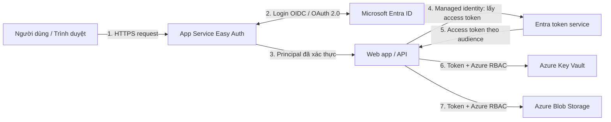
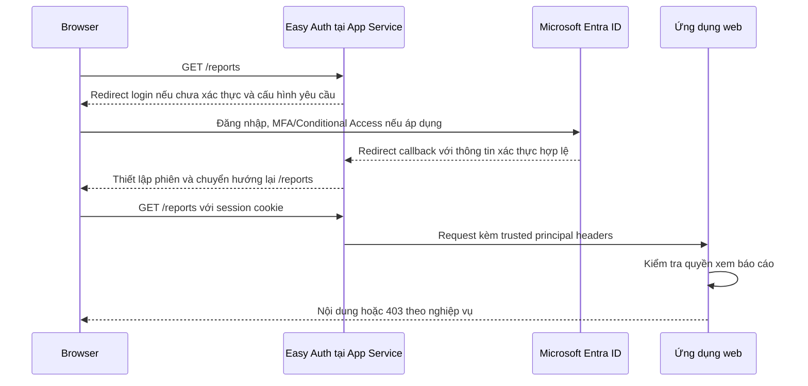
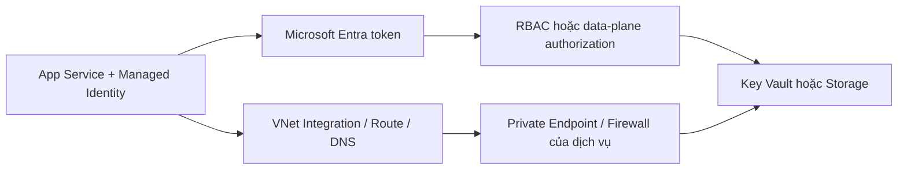
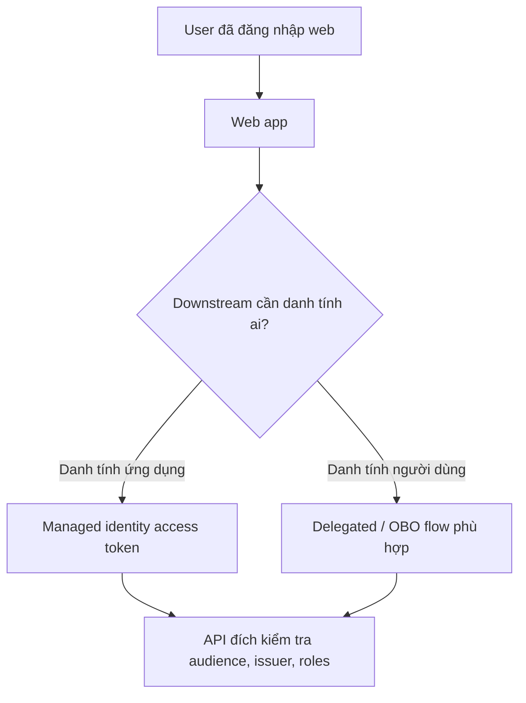
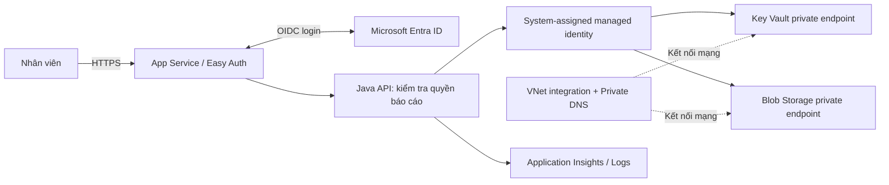

# Xác thực tích hợp và managed identity cho web app

Một ứng dụng web chạy trên **Azure App Service** thường gặp hai yêu cầu bảo mật khác nhau. Thứ nhất, ứng dụng cần biết **ai đang truy cập**, ví dụ một nhân viên đăng nhập để xem báo cáo hoặc một khách hàng gọi API. Thứ hai, khi ứng dụng cần lấy bí mật từ Azure Key Vault, đọc một blob trong Azure Storage hoặc truy vấn một dịch vụ Azure khác, bản thân ứng dụng phải có **danh tính được tin cậy**, thay vì nhúng mật khẩu hay access key vào mã nguồn.

Azure cung cấp hai cơ chế bổ sung nhau: **App Service Authentication/Authorization**, thường gọi là **Easy Auth**, giúp thực hiện xác thực ở lớp nền tảng trước khi request đến mã ứng dụng; và **managed identity** giúp workload App Service nhận token Microsoft Entra ID để truy cập các dịch vụ được cấp quyền. Hai cơ chế này giải quyết **hai hướng giao tiếp riêng biệt**, không thay thế cho nhau.

Bài học thuộc chương **Ứng dụng web với App Service** của mô-đun Microsoft Azure. Nội dung kết nối kiến thức về resource group, Microsoft Entra ID, Azure RBAC, mạng ảo, Key Vault, Storage và giám sát để thiết kế web app an toàn, ít phụ thuộc vào secrets dài hạn và có khả năng vận hành trong production.

## Mục tiêu học tập

Sau bài học, bạn có thể:

1. Phân biệt **authentication (AuthN)**, **authorization (AuthZ)** và **identity của người dùng** với **identity của ứng dụng**.
2. Mô tả cách **Easy Auth** làm việc với Microsoft Entra ID, OpenID Connect, session và request headers.
3. Cấu hình App Service Authentication trong Azure Portal cho web app hoặc HTTP API, chọn đúng hành vi đối với request chưa xác thực.
4. Phân biệt **system-assigned** và **user-assigned managed identity**, xác định nơi cấp Azure RBAC cho quyền data plane.
5. Dùng Azure CLI để kiểm tra và bật managed identity, cấp quyền đọc secret trong Key Vault theo mô hình RBAC.
6. Sử dụng **DefaultAzureCredential** trong ứng dụng Java để lấy thông tin từ Key Vault hoặc Blob Storage mà không hard-code credential.
7. Chẩn đoán các lỗi đăng nhập, token, role assignment, networking và secret resolution thường gặp.

## 1. Hai hướng xác thực trong cùng một web app

Hãy xét một trang báo cáo nội bộ. Nhân viên mở `https://reports.example.com`, đăng nhập bằng tài khoản công ty, rồi xem báo cáo đã được phân quyền. Backend truy cập một Azure Storage container riêng để lấy dữ liệu báo cáo và đọc cấu hình từ Key Vault.



Hai câu hỏi độc lập:

| Câu hỏi | Cơ chế phù hợp | Danh tính được dùng |
|---|---|---|
| **Ai đang vào web app?** | App Service Authentication (Easy Auth) và Microsoft Entra ID. | Người dùng, hoặc ứng dụng gọi API với bearer token được chấp nhận. |
| **Người đó có được xem báo cáo A không?** | Authorization logic trong backend; có thể dựa vào claims, app roles và dữ liệu nghiệp vụ. | Principal đã xác thực cộng với chính sách ứng dụng. |
| **Web app lấy secret từ Key Vault bằng cách nào?** | Managed identity + Azure RBAC/Key Vault authorization. | Service principal gắn với managed identity của web app. |
| **Web app đọc blob bằng quyền nào?** | Managed identity lấy token và role data plane như Storage Blob Data Reader. | Identity của workload, không phải mặc nhiên identity của người đang duyệt web. |

**Lưu ý quan trọng:** Easy Auth không tự cấp cho mọi user quyền xem mọi hóa đơn, và managed identity không tự đăng nhập người dùng vào trang web. Nếu ứng dụng dùng managed identity để đọc một container chứa nhiều khách hàng, ứng dụng phải tự giới hạn **khách nào được nhận dữ liệu nào**, vì tất cả request từ backend có thể sử dụng cùng identity của workload.

## 2. Authentication, authorization, OpenID Connect và OAuth 2.0

### 2.1. Authentication và authorization khác nhau

- **Authentication (AuthN):** xác minh chủ thể, ví dụ nhân viên A đã đăng nhập bằng tài khoản Microsoft Entra ID hợp lệ.
- **Authorization (AuthZ):** quyết định hành động được phép, ví dụ nhân viên A chỉ đọc báo cáo của phòng A, không được xóa báo cáo toàn công ty.
- **Identification:** một ID, email hoặc username chỉ là thông tin định danh, không phải bằng chứng đã xác thực hoặc đã được cấp quyền.

Ví dụ trả HTTP status:

| Trường hợp | Phản hồi thường phù hợp | Ý nghĩa |
|---|---|---|
| Chưa gửi credential hoặc token không hợp lệ | `401 Unauthorized` | Cần xác thực hợp lệ trước khi dùng API. |
| Đã xác thực nhưng thiếu quyền truy cập báo cáo | `403 Forbidden` | Principal hợp lệ nhưng không có quyền nghiệp vụ. |
| Trình duyệt cần đăng nhập tương tác | `302` redirect tới identity provider theo cấu hình. | Bắt đầu luồng login; không phù hợp với mọi API client. |

### 2.2. ID token, access token và session cookie

Trong một luồng sử dụng **OpenID Connect (OIDC)** và **OAuth 2.0**:

- **ID token** diễn đạt thông tin về sự kiện xác thực người dùng, dành cho client thích hợp. Nó không tự động là credential đúng để gọi mọi API.
- **Access token** được cấp cho **một resource/audience** và tập quyền/scope phù hợp. API phải kiểm tra issuer, audience, hiệu lực và quyền theo cách tương thích với mô hình xác thực.
- **Session cookie** có thể được App Service Authentication sử dụng để duy trì phiên đăng nhập của browser sau khi hoàn thành quy trình xác thực.

Ví dụ, access token dành cho Microsoft Graph **không** đương nhiên là token hợp lệ để gọi API của công ty; API phải kiểm tra trường `aud` đúng với application/resource đã được cấu hình. Tương tự, một token Key Vault mà managed identity lấy được không phải token dùng để chứng minh người dùng đã đăng nhập web app.

### 2.3. Claims, scopes, groups và app roles

Claims thường gặp trong token của Entra ID gồm tenant (`tid`), object ID (`oid`), subject (`sub`), issuer (`iss`), audience (`aud`) và thông tin tên/username theo cấu hình. Với API, quyền có thể được thể hiện qua **delegated scopes** (`scp`) hoặc **application roles** (`roles`) tùy loại token và mô hình cấp quyền.

Không dùng email hiển thị làm khóa định danh bất biến; email có thể thay đổi hoặc không tồn tại cho một số identity. Khi xây bản ghi người dùng, cân nhắc định danh bất biến có phạm vi tenant phù hợp và chính sách dành cho guest/multi-tenant users.

**Scopes** và **roles** không tự thay thế phân quyền nghiệp vụ. Ví dụ role `ReportReader` có thể cho phép vào khu vực báo cáo, nhưng để biết một người có quyền đọc *đúng hóa đơn số 481* vẫn cần kiểm tra ownership hoặc ACL trong dữ liệu của ứng dụng.

## 3. App Service Authentication (Easy Auth) là gì?

**App Service Authentication/Authorization** là tính năng của nền tảng Azure App Service xử lý một phần công việc xác thực HTTP trước khi request đi vào application code. Tùy provider và cấu hình, nó hỗ trợ luồng đăng nhập, xác thực token, duy trì phiên và chuyển thông tin principal đã xác thực đến ứng dụng.

Ưu điểm:

1. Có thể tích hợp provider như **Microsoft Entra ID** với ít mã đăng nhập hơn.
2. Xử lý một số quy trình redirect/callback, token validation và session theo cấu hình.
3. Cho phép định nghĩa hành vi khi request chưa được xác thực ngay tại App Service.
4. Cung cấp thông tin identity cho backend bằng các **request headers do nền tảng thiết lập** và những endpoint hệ thống được hỗ trợ.

Những việc Easy Auth **không mặc nhiên làm**:

- Không thay thế authorization theo bản ghi/tài nguyên của chính ứng dụng.
- Không tạo quyền Azure RBAC tới Key Vault, Storage hay database cho web app.
- Không bảo đảm mọi endpoint được bảo vệ nếu bạn cấu hình cho phép anonymous requests.
- Không tự thay thế WAF, network access restrictions, rate limiting, CSRF protection hoặc các kiểm soát web security khác.
- Không đồng nghĩa API của bạn chấp nhận mọi access token từ Microsoft Entra ID; **issuer, audience, tenant và client authorization** phải đúng.

### 3.1. Vị trí của Easy Auth trong luồng request



Conditional Access/MFA được quản trị theo chính sách Entra ID của tổ chức và khả năng license/chính sách áp dụng; việc bật Easy Auth một mình **không** đồng nghĩa MFA đã bắt buộc. Bật MFA không loại bỏ nhu cầu session lifetime phù hợp và kiểm soát quyền trong ứng dụng.

### 3.2. Microsoft Entra ID là identity provider

Trong Azure Portal, bạn có thể cấu hình **Microsoft** làm identity provider cho App Service Authentication. Tùy lựa chọn, quy trình có thể tạo mới **app registration** hoặc tham chiếu một app registration có sẵn trong tenant. App registration mô tả ứng dụng với Entra ID, bao gồm client/application ID, tenant và những redirect URI, secret/certificate hoặc thiết lập cần thiết cho mô hình confidential client được chọn.

**App registration của Easy Auth và managed identity của web app là hai đối tượng có vai trò khác nhau**. App registration phục vụ sign-in của khách truy cập/kiểm tra token; managed identity cung cấp credential của workload khi gọi Azure APIs. Không được xóa app registration chỉ vì web app đã được cấp managed identity.

## 4. Chuẩn bị trước khi cấu hình Easy Auth

Ví dụ ứng dụng nội bộ:

```text
Web app:         app-reports-prod
Default host:    app-reports-prod.azurewebsites.net
Custom domain:   reports.example.com (nếu có)
Identity tenant: Tenant Microsoft Entra ID của doanh nghiệp
Protected route: /reports và /api/reports
Public route:    /healthz (chỉ nếu kiến trúc cần và có kiểm soát)
```

Kiểm tra các điều kiện:

- Bạn có quyền thay đổi App Service Authentication và, nếu tạo/điều chỉnh app registration, có quyền thích hợp trong Entra ID.
- HTTPS hoạt động; tên miền và redirect URI phù hợp với hostname client thực tế sử dụng.
- Đã chọn **single-tenant**, multi-tenant hoặc tập người dùng được phép theo yêu cầu ứng dụng. Không vô tình cho phép người dùng từ tenant ngoài khi dữ liệu là nội bộ.
- Có kế hoạch cho guest users, groups/app roles và phân quyền theo nghiệp vụ.
- Đã quyết định web app chủ yếu là **browser app** hay **API**: hành vi redirect login và trả HTTP 401 thường khác nhau.
- Đã thống nhất tuyến health check/monitoring và những endpoint có cần bypass authentication hay không; tránh mở anonymous rộng chỉ để health probe thành công.
- Có môi trường thử nghiệm hoặc deployment slot thích hợp để xác minh đăng nhập trước khi đổi production.

### 4.1. Redirect URI và callback

Với provider Microsoft Entra ID của App Service Authentication, callback path thường sử dụng dạng:

```text
https://<app-name>.azurewebsites.net/.auth/login/aad/callback
```

Nếu ứng dụng phục vụ bằng custom domain và dùng hostname đó trong luồng login, có thể cần redirect URI phù hợp, ví dụ:

```text
https://reports.example.com/.auth/login/aad/callback
```

Chỉ đăng ký redirect URI được phép và đang sử dụng; tránh wildcard rộng hoặc chuyển hướng tới miền không kiểm soát. Cấu hình custom domain, proxy phía trước, forward headers và callback phải nhất quán để không tạo vòng lặp đăng nhập hoặc lỗi `redirect_uri`.

## 5. Cấu hình Easy Auth với Microsoft Entra ID trong Azure Portal

Các bước dưới đây mang tính hướng dẫn logic; nhãn giao diện có thể khác nhau theo phiên bản Azure Portal và lựa chọn auth v2.

### Bước 1. Chọn đúng App Service

Trong Azure Portal, mở **App Services → web app mục tiêu → Authentication**. Kiểm tra subscription, resource group, environment/slot và hostname; không cấu hình nhầm production khi chỉ thực hành trên một app thử nghiệm.

### Bước 2. Thêm identity provider

Chọn **Add identity provider**, chọn **Microsoft** và cấu hình app registration trong Microsoft Entra ID. Nếu dùng registration có sẵn, kiểm tra client ID, tenant/issuer, supported account types và redirect URI. Xác định cách lưu client secret/certificate khi provider yêu cầu: không ghi trực tiếp vào code hoặc repo.

### Bước 3. Quyết định hành vi với request chưa xác thực

Các lựa chọn phổ biến về mặt thiết kế:

- **Browser UI nội bộ:** yêu cầu đăng nhập; request chưa có phiên được chuyển tới nhà cung cấp danh tính theo cấu hình.
- **JSON REST API:** thường trả **401** cho request thiếu bearer token hợp lệ thay vì trả trang HTML hoặc redirect đăng nhập tương tác.
- **Ứng dụng kết hợp:** xác định rõ route hoặc mô hình triển khai để browser và API clients có hành vi phù hợp; kiểm thử từng loại request.

Nếu chọn cho phép unauthenticated requests ở mức nền tảng, controller/API **phải tự thực hiện kiểm tra** khi truy cập tài nguyên nhạy cảm. Đừng cho rằng bật provider đồng nghĩa toàn bộ URL tự động bị chặn.

### Bước 4. Kiểm tra issuer, audience và tenant restriction

Chọn đúng tenant và audience cho luồng browser/API. Nếu API nhận bearer tokens, yêu cầu token được cấp cho **API này**, không chấp nhận token dành cho một ứng dụng không liên quan. Với multi-tenant, cần có quyết định tin tưởng tenant/organization và mô hình onboarding/authorization. Sai audience thường làm request bị 401 dù token có chữ ký hợp lệ.

### Bước 5. Cân nhắc token store và session

App Service Authentication có khả năng **token store** theo cấu hình để quản lý một số provider tokens và phiên đăng nhập. Chỉ bật khi workload thật sự cần, kiểm tra dữ liệu token được lưu/trả, lifetime, refresh behavior và các giới hạn hiện hành. Không giả định token được lưu sẽ tự trở thành quyền gọi mọi downstream API.

### Bước 6. Lưu, triển khai thử và xác minh

Kiểm tra trường hợp anonymous, user đúng tenant, user sai tenant, user không có quyền nghiệp vụ, token API đúng/sai audience và callback custom domain. Nếu có staging slot, kiểm tra auth settings và secrets của **chính slot đó**; không mặc định cấu hình production tự áp dụng hoàn toàn giống staging.

## 6. Các endpoint và request headers của Easy Auth

App Service Authentication có những endpoint hệ thống dạng `/.auth/*`. Với Microsoft provider, các URL thường thấy gồm:

```text
/.auth/login/aad
/.auth/login/aad/callback
/.auth/me
/.auth/logout
```

**`/.auth/login/aad`** có thể bắt đầu đăng nhập tương tác theo cấu hình provider; **`/.auth/logout`** hỗ trợ kết thúc phiên ứng dụng theo cơ chế nền tảng (không mặc nhiên thu hồi toàn bộ phiên/token ở mọi hệ thống). **`/.auth/me`** có thể cung cấp thông tin principal và provider tokens khi phiên/cấu hình hỗ trợ, vì vậy cần thận trọng với dữ liệu nhạy cảm và không dùng endpoint này làm nguồn dữ liệu public.

### 6.1. Headers do nền tảng cung cấp

Sau xác thực, Easy Auth có thể chuyển các header như:

| Header | Thông tin thường được dùng | Lưu ý |
|---|---|---|
| `X-MS-CLIENT-PRINCIPAL` | Principal được biểu diễn theo định dạng JSON mã hóa Base64. | Phải giải mã và xử lý claims đúng kiểu; không tự là quyết định authorization. |
| `X-MS-CLIENT-PRINCIPAL-ID` | ID của principal theo cơ chế provider. | Không dựa vào nó như ID khách hàng nghiệp vụ nếu chưa xác định phạm vi/độ ổn định. |
| `X-MS-CLIENT-PRINCIPAL-NAME` | Tên hiển thị hoặc định danh người dùng theo provider. | Không nên dùng tên/email hiển thị làm khóa phân quyền bất biến. |
| Các header `X-MS-TOKEN-*` được hỗ trợ | Có thể cung cấp provider token trong những cấu hình cụ thể. | Không log hoặc gửi ra client tùy ý; kiểm tra audience và lifetime trước khi dùng. |

Ví dụ principal sau khi giải mã **chỉ để minh họa cấu trúc**:

```json
{
  "auth_typ": "aad",
  "name_typ": "http://schemas.xmlsoap.org/ws/2005/05/identity/claims/name",
  "role_typ": "http://schemas.microsoft.com/ws/2008/06/identity/claims/role",
  "claims": [
    {"typ": "name", "val": "Demo User"},
    {"typ": "tid", "val": "<tenant-id>"},
    {"typ": "oid", "val": "<user-object-id>"}
  ]
}
```

Tên claim thực tế phụ thuộc phiên bản/provider, đôi khi là URI thay vì tên rút gọn; không viết code dựa duy nhất vào định dạng mẫu. Phải kiểm tra claims thực của chính cấu hình xác thực và lập mapping có kiểm thử.

### 6.2. Vì sao không nên tin header do client tự gửi?

Khi Easy Auth bật và request đi qua đường xử lý đáng tin cậy của App Service, nền tảng quản lý những header identity mà nó cung cấp. Nhưng bất kỳ hệ thống tự xây nào nhận `X-MS-CLIENT-PRINCIPAL` từ bên ngoài mà không bảo đảm nguồn trusted đều có nguy cơ **header spoofing**. Không lấy header do client trực tiếp tự đặt làm bằng chứng xác thực; không cung cấp một endpoint song song bỏ qua lớp auth rồi vẫn tin những header ấy.

Trong microservice, nếu một backend khác nhận HTTP request từ web app, **không tự động chuyển tiếp principal header như credential**. Dùng access token có audience đúng cho dịch vụ đích, hoặc một cơ chế delegation/trust đã thiết kế và validate rõ ràng.

### 6.3. Phân quyền tại controller/service

Một controller nhận principal hợp lệ vẫn cần kiểm tra quyền:

```text
GET /api/reports/481
  |
  +--> Easy Auth: user đã xác thực chưa? Nếu chưa: 401/redirect
  |
  +--> App: user có role ReportReader không? Nếu không: 403
  |
  +--> App: report 481 thuộc tổ chức/phòng nào?
  |
  +--> App: user có quyền đọc đúng report 481 không? Nếu không: 403/404 theo chính sách
  |
  +--> App: dùng managed identity lấy file trong Blob Storage
```

**Phân quyền theo tenant và theo đối tượng dữ liệu** là trách nhiệm của ứng dụng, kể cả khi Easy Auth đã thực hiện login và managed identity có quyền đọc toàn bộ container ở tầng Storage.

## 7. Managed identity là gì?

**Managed identity** là một danh tính do Azure quản lý, gắn với tài nguyên Azure được hỗ trợ. Workload dùng identity này để yêu cầu access token Microsoft Entra ID mà không phải tự quản lý client secret hoặc certificate dài hạn. Azure quản lý vòng đời credential nền tảng theo cơ chế dịch vụ.

Managed identity giúp giảm các vấn đề thường gặp:

- Password hoặc storage account key bị hard-code trong repository.
- Secret được sao chép qua nhiều môi trường nhưng không được xoay vòng.
- Token hết hạn mà ứng dụng không có cơ chế lấy lại token.
- Một account key rộng quyền được dùng chung cho hàng chục ứng dụng.

Tuy nhiên, **managed identity không tự mang sẵn quyền truy cập dữ liệu**. Sau khi bật identity phải cấp Azure RBAC hoặc data-plane permission phù hợp ở đích, đồng thời bảo đảm network route, firewall, private endpoint và tên DNS hoạt động.

### 7.1. System-assigned vs user-assigned managed identity

| Đặc điểm | System-assigned identity | User-assigned identity |
|---|---|---|
| Gắn với | Một tài nguyên Azure cụ thể, ví dụ một web app. | Một resource identity độc lập rồi gắn vào một hoặc nhiều tài nguyên hỗ trợ. |
| Vòng đời | Gắn với tài nguyên; xóa tài nguyên sẽ xóa identity tương ứng. | Tồn tại độc lập; có thể tiếp tục tồn tại khi web app bị xóa. |
| Dùng chung | Không phải mô hình chia sẻ cùng identity cho nhiều web app. | Có thể được gắn cho nhiều workload khi có lý do bảo mật/vận hành. |
| Quản trị | Đơn giản, thích hợp cho từng web app có quyền riêng. | Thuận tiện khi cần danh tính ổn định qua thay đổi tài nguyên hoặc nhiều workload. |
| Rủi ro chính | Khi tái tạo web app, principal ID có thể thay đổi và cần gán quyền lại. | Dùng chung identity quá rộng làm tăng blast radius khi một workload bị xâm nhập. |

**System-assigned** thường là điểm khởi đầu cho một web app tự vận hành độc lập. **User-assigned** có ích khi một identity cần gắn vào workload được thay thế/tái tạo, hoặc cần được dùng theo kiến trúc nhiều tài nguyên. Nhưng dùng chung identity không nên là cách né yêu cầu phân quyền tối thiểu giữa các ứng dụng.

### 7.2. Principal ID, client ID và resource ID

Khi làm việc với managed identity, bạn có thể thấy:

- **Principal ID / object ID:** danh tính service principal trong tenant, được sử dụng phổ biến khi tạo Azure role assignment.
- **Client ID:** định danh ứng dụng/service principal dùng khi lựa chọn một user-assigned managed identity cụ thể trong SDK.
- **Azure resource ID:** đường dẫn ARM của web app hoặc user-assigned identity, dùng để quản lý tài nguyên trong subscription/resource group.

Các giá trị **không thể thay thế tùy tiện** cho nhau. Một lỗi hay gặp là truyền resource ID vào tham số SDK cần client ID, hoặc gán role cho sai principal ID và chờ mãi không có hiệu lực.

### 7.3. Managed identity không phải tài khoản người dùng

Managed identity biểu diễn **ứng dụng/dịch vụ**. Nó không có quyền đọc email người dùng, truy vấn Microsoft Graph hoặc gọi mọi API mặc định. Khi yêu cầu access token, workload phải chỉ định đúng resource/scope (ví dụ Key Vault, Storage hoặc API được bảo vệ) và nhận quyền từ hệ thống đích. Nó cũng không thay thế quy trình user login/OIDC của trình duyệt.

## 8. Quyền dữ liệu: Azure RBAC, data plane và network

Giả sử web app `app-reports-prod` cần đọc secret trong Key Vault `kv-reports-prod` và tải một PDF từ private Blob container. Các bước gồm:

1. Bật managed identity cho web app.
2. Cấp role phù hợp cho identity ở **phạm vi tài nguyên đích**, không phải bừa bãi ở subscription.
3. Cấp đường mạng và DNS phù hợp nếu Key Vault/Storage sử dụng firewall hoặc Private Endpoint.
4. Dùng Azure SDK để lấy token và gọi dịch vụ.
5. Xác minh truy cập bằng runtime identity của chính web app, không chỉ bằng tài khoản developer.

| Tác vụ | Vai trò/quyền để đánh giá | Lưu ý |
|---|---|---|
| Đọc secret từ Key Vault RBAC mode | **Key Vault Secrets User** ở scope phù hợp. | Cần vault dùng Azure RBAC authorization; nếu dùng access-policy mode phải áp dụng cơ chế quyền tương ứng. |
| Đọc blob | **Storage Blob Data Reader** ở scope phù hợp. | `Reader` hoặc `Contributor` ở ARM management plane không tự đồng nghĩa có quyền đọc nội dung blob. |
| Tải blob lên | **Storage Blob Data Contributor** hoặc permission ít hơn nếu dùng role tùy chỉnh. | Không cấp quyền ghi khi chỉ cần download. |
| Đọc resource metadata qua Azure Resource Manager | Role ARM phù hợp với thao tác. | Khác data-plane permissions của Storage hoặc Key Vault. |

**Mọi role phải được scope đủ hẹp.** Nếu web app chỉ đọc một container, cân nhắc role assignment ở scope container (theo khả năng dịch vụ) thay vì cả storage account. Với Key Vault, kiểm tra mô hình cấp quyền và separation of duties, tránh cấp quyền quản trị vault khi chỉ cần đọc một secret.

### 8.1. Mạng và danh tính là hai điều kiện độc lập



Một token hợp lệ không vượt qua firewall. Nếu Key Vault chỉ cho phép Private Endpoint, web app cần cấu hình outbound networking, VNet Integration và DNS private phù hợp để đến endpoint đó. Ngược lại, thông đường mạng không cho phép một ứng dụng thiếu quyền RBAC đọc secret.

## 9. Thực hành Azure CLI: bật managed identity và cấp quyền Key Vault

Các lệnh sau dùng **Bash/Cloud Shell** và một web app đã tồn tại. Lệnh `identity assign` và `role assignment create` **thay đổi quyền thật**, vì thế chỉ thực hiện trên resource group thực hành hoặc môi trường được phê duyệt. Những giá trị trong dấu `<>` cần được thay bằng tên thật.

### 9.1. Xác minh tài nguyên và AuthN hiện có

```bash
az login
az account list --output table
az account set --subscription "<subscription-id>"

RG="rg-appservice-lab"
APP="app-reports-lab"
VAULT="kv-reports-lab"

az webapp show \
  --resource-group "$RG" \
  --name "$APP" \
  --query "{name:name,host:defaultHostName,state:state,identity:identity}" \
  --output json

az webapp auth show \
  --resource-group "$RG" \
  --name "$APP" \
  --output json
```

Lệnh `az webapp auth show` giúp xem cấu hình authentication của web app, **không phải** quyền của managed identity. Kiểm tra trước identity provider, chính sách yêu cầu login và tenant/audience theo cấu hình; tránh chia sẻ nguyên phần cấu hình chứa dữ liệu nhạy cảm trong ticket công khai.

### 9.2. Bật system-assigned managed identity

```bash
az webapp identity assign \
  --resource-group "$RG" \
  --name "$APP"

az webapp identity show \
  --resource-group "$RG" \
  --name "$APP" \
  --output json

PRINCIPAL_ID="$(az webapp identity show \
  --resource-group "$RG" \
  --name "$APP" \
  --query principalId --output tsv)"
```

Xác minh `principalId` không rỗng và đúng web app. **Không** dùng principal ID của account đang chạy CLI hoặc của một VM khác. Sau khi tạo identity, Azure RBAC hoặc Entra ID có thể cần thời gian để thông tin lan truyền; lỗi 403 ngay lập tức sau role assignment không luôn có nghĩa cú pháp sai.

### 9.3. Lấy resource ID của Key Vault

```bash
VAULT_ID="$(az keyvault show \
  --name "$VAULT" \
  --query id --output tsv)"

az keyvault show \
  --name "$VAULT" \
  --query "{name:name,id:id,rbacEnabled:properties.enableRbacAuthorization}" \
  --output json
```

**Điều kiện của ví dụ:** Key Vault sử dụng **Azure RBAC permission model** (`enableRbacAuthorization` bật). Nếu vault dùng mô hình access policy cũ, thao tác role assignment ở bước sau không tự thay thế quyền data plane cần thiết. Hãy xác nhận mô hình permission trước khi cấp quyền.

### 9.4. Cấp quyền đọc secret cho identity của web app

```bash
az role assignment create \
  --assignee-object-id "$PRINCIPAL_ID" \
  --assignee-principal-type ServicePrincipal \
  --role "Key Vault Secrets User" \
  --scope "$VAULT_ID"
```

Lệnh gán quyền ở **scope của Key Vault**, không phải toàn subscription. Trên production, có thể chọn scope hẹp hơn khi nhu cầu và permission model hỗ trợ. Đây là quyền truy cập **secret value**; không dùng role này cho người/ứng dụng không thực sự cần đọc secret.

Kiểm tra role assignment:

```bash
az role assignment list \
  --assignee "$PRINCIPAL_ID" \
  --scope "$VAULT_ID" \
  --output table
```

Role tồn tại là điều kiện cần, không đủ để khẳng định đọc secret thành công. Web app còn cần network route, DNS, token phù hợp và secret name chính xác. Để xác thực end-to-end, nên chạy một request thử trong **ứng dụng thực tế** dùng identity của nó, thay vì thử với token của tài khoản Azure CLI trên laptop.

### 9.5. Nếu cần quyền đọc Blob Storage

Với storage account đã tồn tại, ví dụ:

```bash
STORAGE="<storage-account-name>"
STORAGE_ID="$(az storage account show \
  --resource-group "$RG" \
  --name "$STORAGE" \
  --query id --output tsv)"

az role assignment create \
  --assignee-object-id "$PRINCIPAL_ID" \
  --assignee-principal-type ServicePrincipal \
  --role "Storage Blob Data Reader" \
  --scope "$STORAGE_ID"
```

Phạm vi storage account được dùng để giải thích, còn production nên xem xét giới hạn role tới **container cụ thể** nếu có thể. Khi ứng dụng chỉ đọc blob, đừng cấp Storage Blob Data Contributor theo thói quen. Không cấp thêm quyền quản trị subscription để “chữa” một lỗi 403 data plane.

## 10. Ứng dụng Java lấy secret qua managed identity

Với ứng dụng Java chạy trên App Service, **Azure SDK for Java** và thư viện `azure-identity` giúp nhận token từ nguồn credential phù hợp. **DefaultAzureCredential** thường dùng được cho cả môi trường phát triển và runtime Azure, nhưng hai môi trường có thể chọn **hai danh tính khác nhau**: local developer qua Azure CLI/IDE, production qua managed identity.

### 10.1. Dependencies và cấu hình

Trong dự án Java, cần các thư viện Azure SDK tương ứng (quản lý version theo **Azure SDK BOM** hoặc dependency management phù hợp):

```text
com.azure:azure-identity
com.azure:azure-security-keyvault-secrets
com.azure:azure-storage-blob       (nếu truy cập Blob)
```

Đặt biến cấu hình **không chứa secret**:

```text
KEY_VAULT_URL=https://kv-reports-lab.vault.azure.net/
```

### 10.2. Ví dụ Java đọc một secret

```java
import com.azure.core.credential.TokenCredential;
import com.azure.identity.DefaultAzureCredentialBuilder;
import com.azure.security.keyvault.secrets.SecretClient;
import com.azure.security.keyvault.secrets.SecretClientBuilder;

public final class SecretReader {
    public static void main(String[] args) {
        String vaultUrl = System.getenv("KEY_VAULT_URL");
        if (vaultUrl == null || vaultUrl.isBlank()) {
            throw new IllegalStateException("KEY_VAULT_URL is required");
        }

        TokenCredential credential = new DefaultAzureCredentialBuilder()
                .build();
        SecretClient client = new SecretClientBuilder()
                .vaultUrl(vaultUrl)
                .credential(credential)
                .buildClient();

        // Chỉ đọc trong môi trường được cấp quyền; không in giá trị secret.
        String secretValue = client.getSecret("downstream-api-key").getValue();
        useSecretWithinTrustedServerCode(secretValue);
    }

    private static void useSecretWithinTrustedServerCode(String value) {
        // Tích hợp SDK/client thật; không log, trả về HTTP hoặc lưu ra file.
        if (value == null || value.isBlank()) {
            throw new IllegalStateException("Required secret is empty");
        }
    }
}
```

**Không đưa đoạn code đọc secret vào frontend JavaScript**, nơi người dùng có thể xem mã và giá trị. Đây là **server-side code** chạy trong backend App Service. Secret nên chỉ tồn tại trong phạm vi cần sử dụng và không đi qua request logs/exception messages. Nếu Azure service hỗ trợ xác thực trực tiếp bằng managed identity, cách tốt hơn có thể là **không cần secret nào cả**.

### 10.3. Dùng user-assigned managed identity trong Java

Nếu web app gắn **nhiều** user-assigned identities, SDK cần biết identity nào được dùng. Ví dụ:

```java
import com.azure.core.credential.TokenCredential;
import com.azure.identity.DefaultAzureCredentialBuilder;

String clientId = System.getenv("AZURE_CLIENT_ID");
TokenCredential credential = new DefaultAzureCredentialBuilder()
        .managedIdentityClientId(clientId)
        .build();
```

Chỉ dùng ví dụ này nếu đã tạo/gắn user-assigned identity và có **client ID** thật. Tên biến/cách lựa chọn identity cần đối chiếu phiên bản `azure-identity` hiện hành. Nếu biến không tồn tại, gọi phương thức với `null` có thể không phù hợp cho mọi cấu hình; production nên kiểm tra cấu hình bắt buộc và fail fast với thông báo không lộ bí mật.

**Lưu ý:** DefaultAzureCredential là credential chain, nên trong môi trường có nhiều nguồn credential, code có thể chọn danh tính khác với dự kiến. Đối với production yêu cầu xác định chặt chẽ, kiểm tra môi trường, loại credential được chọn và cân nhắc `ManagedIdentityCredential` trực tiếp theo thiết kế. Không tự tạo credential chain chứa secret vô tình ưu tiên hơn managed identity của workload.

### 10.4. Đọc Blob bằng quyền data-plane của workload

Ví dụ Java sử dụng cùng credential để kết nối Blob Storage:

```java
import com.azure.core.credential.TokenCredential;
import com.azure.identity.DefaultAzureCredentialBuilder;
import com.azure.storage.blob.BlobServiceClient;
import com.azure.storage.blob.BlobServiceClientBuilder;

TokenCredential credential = new DefaultAzureCredentialBuilder().build();
BlobServiceClient blobs = new BlobServiceClientBuilder()
        .endpoint("https://<storage-account>.blob.core.windows.net")
        .credential(credential)
        .buildClient();

boolean exists = blobs.getBlobContainerClient("reports")
        .getBlobClient("2026/11/example.pdf")
        .exists();
```

Snippet thể hiện cách cấp credential cho Storage SDK; cần đặt trong method/class hợp lệ khi chạy. Quyền cần có là **Storage Blob Data Reader** hoặc quyền tương ứng cho thao tác đọc. Nếu truy cập Storage qua Private Endpoint, web app vẫn phải có networking và private DNS đúng; RBAC không tự tạo tuyến mạng.

## 11. Key Vault references trong App Service Configuration

Không phải mọi ứng dụng cần tự gọi Key Vault SDK. **App Service Key Vault references** cho phép một app setting hoặc connection string tham chiếu secret trong Key Vault theo cú pháp được hỗ trợ. Ví dụ một **app setting**:

```text
Setting name: THIRD_PARTY_API_KEY
Setting value: @Microsoft.KeyVault(SecretUri=https://kv-reports-lab.vault.azure.net/secrets/downstream-api-key)
```

Khi cấu hình hợp lệ và identity của App Service có quyền cần thiết, nền tảng giải quyết reference để ứng dụng đọc setting theo cách thông thường. Không cần ghi secret trực tiếp trong phần setting value được triển khai. Tuy nhiên, **secret sau khi được resolve vẫn là dữ liệu nhạy cảm bên trong tiến trình**, cần bảo vệ khi log, dump hoặc trả response.

Những lưu ý:

- Theo mặc định, App Service dùng identity thích hợp theo cấu hình Key Vault reference; nếu dùng user-assigned identity cần cấu hình identity được chọn cho reference theo tính năng của nền tảng.
- Key Vault phải ở trạng thái mạng/danh tính cho phép web app truy cập.
- Secret rotation và thời điểm App Service làm mới reference có cơ chế cache/refresh riêng; **không mặc định đổi secret trong vault là mọi instance dùng giá trị mới ngay tức thì**.
- Nếu một reference không resolve được, cần kiểm tra trạng thái resolution, role/access policy, secret URI, network và identity trước khi sửa mã ứng dụng.
- Không đưa toàn bộ app settings chứa secrets vào logs hoặc artifacts; bảo vệ quyền đọc cấu hình App Service.

**Phân biệt:** Key Vault reference giúp lấy giá trị secret vào app settings; managed identity + SDK là cách app chủ động truy cập tài nguyên. Nếu downstream hỗ trợ Microsoft Entra ID, nên ưu tiên **token trực tiếp** thay vì lưu password/connection string trong Key Vault chỉ vì thói quen.

## 12. Gọi API bảo vệ bằng Microsoft Entra ID từ web app

Một tình huống khác là web app gọi API nội bộ được bảo vệ bằng Entra ID. Có hai cách về mặt danh tính:

1. **Application-to-application:** web app dùng managed identity để lấy **access token cho API đích**, API đích xác minh audience/issuer và application permission/role của workload theo mô hình được hỗ trợ.
2. **On-behalf-of user:** API cần quyền của chính người đang đăng nhập; khi đó phải dùng mô hình delegated permissions hoặc **on-behalf-of flow** phù hợp, không tự biến token managed identity thành token của user.

Ví dụ một web app dùng managed identity để gọi một API đã đăng ký trong Entra ID. API phải cấp quyền cho **service principal của identity workload**, và web app phải yêu cầu token cho **audience/API đúng**. Nếu API yêu cầu phân quyền theo từng người dùng, token của managed identity **không chứa tự động toàn bộ quyền của người dùng truy cập website**.



**Không gửi ID token của web app tới API làm bearer token** chỉ vì nó chứa tên người dùng. Mỗi access token chỉ nên được sử dụng tại resource/audience mà nó được cấp, với scopes/roles thực sự được API chấp nhận.

## 13. Kiến trúc bảo mật end-to-end cho web app

Một cấu hình tham khảo:



Mô hình này có **bốn lớp kiểm soát**:

| Lớp | Câu hỏi | Biện pháp |
|---|---|---|
| Identity của người gọi | Request đến từ user/client hợp lệ không? | Easy Auth, Entra ID, OIDC/OAuth2, MFA/Conditional Access theo chính sách. |
| Quyền nghiệp vụ | User có quyền xem tài nguyên cụ thể không? | Roles/claims, kiểm tra tenant và ownership/ACL trong ứng dụng. |
| Identity của workload | Backend có quyền gì trên Azure resource? | Managed identity, Azure RBAC data-plane, quyền tối thiểu. |
| Đường mạng & giám sát | Có thể đi đến resource bằng đường an toàn và phát hiện sự cố không? | HTTPS/TLS, VNet Integration, Private Endpoint, firewall, logging và alerts. |

**Không nhầm authenticated user với authorized backend.** Một request từ nhân viên thật có thể bị từ chối vì thiếu quyền xem báo cáo, dù web app vẫn có managed identity đủ quyền đọc tệp báo cáo từ Storage. Đây là hành vi bảo mật đúng.

### 13.1. Một số điểm vận hành cần chú ý

- **Deployment slots:** xác định identity, app registration redirect URI, auth configuration, Key Vault references và role assignment của từng slot. System-assigned identities của các slot/tài nguyên không nên bị giả định là cùng một principal.
- **Custom domains và reverse proxies:** kiểm tra HTTPS hostname, redirect URI, forward headers và cookie settings khi dùng Front Door/Application Gateway ở phía trước.
- **Scale-out:** nhiều instance cùng chạy backend không nên phụ thuộc vào session chỉ nằm trong RAM một máy. Kiểm tra behavior của session auth nền tảng, cache và ứng dụng.
- **Managed identity endpoint:** chỉ code ở runtime tin cậy mới được sử dụng; không expose endpoint/token ra phía người dùng hoặc thông qua chức năng URL fetch không kiểm soát (nguy cơ SSRF).
- **Least privilege:** tách identities giữa web app và background worker khi hai workload cần tập quyền khác nhau.

## 14. Kiểm thử xác thực và phân quyền

Một quy trình kiểm thử cần đánh giá **nhiều tình huống**, không chỉ xem trang login có hiện hay không.

| Tình huống | Kỳ vọng |
|---|---|
| Browser chưa có phiên truy cập trang bắt buộc đăng nhập | Redirect login theo cấu hình, không lộ nội dung báo cáo. |
| API client không mang token tới endpoint bắt buộc xác thực | Nhận `401` hoặc behavior đã định; không nhận HTML trang login nếu API yêu cầu JSON. |
| User đúng tenant nhưng không có role | App từ chối với `403`, không chỉ dựa vào trạng thái Easy Auth success. |
| User A yêu cầu bản ghi thuộc user B | App từ chối, dù backend có quyền đọc blob ở Storage. |
| API bearer token đúng chữ ký nhưng sai `aud` hoặc `iss` | Bị từ chối; không coi là token hợp lệ cho API này. |
| Web app có managed identity nhưng chưa gán role Key Vault | Key Vault trả lỗi quyền, không được tự cấp quyền quá rộng để chữa. |
| Role assignment đúng nhưng Key Vault có firewall/private endpoint | Request vẫn cần mạng, route và DNS đúng. |
| Identity bị thay đổi khi tạo lại web app/slot | Role assignments phải được đối chiếu với principal ID mới. |
| Secret được thay đổi trong Key Vault | Ứng dụng chỉ nhận giá trị mới theo cơ chế refresh/cache được hỗ trợ. |

### 14.1. Các lệnh kiểm tra nhanh không lộ secrets

```bash
# Cấu hình xác thực inbound của App Service
az webapp auth show --resource-group "$RG" --name "$APP" --output json

# Identity gắn vào web app
az webapp identity show --resource-group "$RG" --name "$APP" --output json

# Quyền được gán cho workload đối với Key Vault
az role assignment list \
  --assignee "$PRINCIPAL_ID" \
  --scope "$VAULT_ID" \
  --output table
```

Không hiển thị token, account key hay secret trong lệnh kiểm thử. Đối với API, nên dùng một test client đáng tin cậy được cấp **access token đúng audience** và chỉ ghi kết quả HTTP status/request ID. Trình duyệt cần được kiểm tra behavior session, logout, expiry và cross-site redirect theo cấu hình thực tế.

## 15. Troubleshooting: 401, 403, redirect loop và không lấy được token

| Triệu chứng | Nguyên nhân có thể | Bước xác minh |
|---|---|---|
| Browser lặp lại trang login | Redirect URI/hostname/cookie sai, tenant hoặc session configuration không khớp. | Kiểm tra callback, custom domain, HTTPS và app registration redirect URI. |
| `AADSTS50011` hoặc lỗi redirect URI mismatch | URI ứng dụng gửi không có trong app registration. | So sánh **chính xác** scheme, hostname và callback path được cấu hình. |
| API client nhận `302` thay vì `401` | Chọn hành vi login redirect cho endpoint API. | Kiểm tra unauthenticated action và mô hình browser/API. |
| Token hợp lệ ở Entra ID nhưng bị API `401` | Audience, issuer, tenant, token type hoặc provider config không phù hợp. | Kiểm tra `aud`, `iss`, `tid`, allowed audiences và API registration. |
| User đăng nhập được nhưng bị `403` | Role/group/permission nghiệp vụ không đủ hoặc ứng dụng kiểm tra sai claims. | Phân tích authorization policy và user/resource mapping. |
| `X-MS-CLIENT-PRINCIPAL` rỗng | Easy Auth không áp dụng request, cho phép anonymous hoặc request đi sai đường. | Kiểm tra Authentication settings và đường request qua App Service. |
| `ManagedIdentityCredential authentication unavailable` | Managed identity chưa bật, chạy ngoài môi trường hỗ trợ, chọn sai client ID hoặc cấu hình runtime sai. | `az webapp identity show`, SDK diagnostics và môi trường thực thi. |
| Key Vault trả `403 Forbidden` | Sai identity, thiếu Key Vault Secrets User/access policy, hoặc firewall. | Đối chiếu principal ID, permission model, role, route và Key Vault logs. |
| Blob trả `403 AuthorizationPermissionMismatch` | Chưa có quyền data plane tương ứng, role chưa lan truyền hoặc dùng token sai. | Kiểm tra Storage Blob Data Reader/Contributor, scope, danh tính runtime. |
| Key Vault reference không resolve | Secret URI sai, chưa có quyền hoặc private DNS/network lỗi. | Xem trạng thái reference, role, Key Vault settings và endpoint mạng. |
| Local chạy được, production thất bại | Local dùng Azure CLI credentials có nhiều quyền hơn runtime MI. | Thử bằng managed identity trên App Service, so sánh role scopes. |

### 15.1. Phân biệt lỗi AuthN, AuthZ và mạng

Một chuỗi chẩn đoán hữu ích:

```text
Browser/API request gặp lỗi
  ├─ Không vào được trang login/callback -> kiểm tra OIDC config, tenant, URI
  ├─ 401 khi gọi API -> kiểm tra bearer token, issuer, audience, authentication
  ├─ 403 khi xem báo cáo -> kiểm tra quyền nghiệp vụ của người dùng
  └─ 500 khi API gọi Key Vault/Storage
       ├─ Managed identity token không lấy được -> identity/runtime SDK
       ├─ Token lấy được nhưng dịch vụ trả 403 -> RBAC/data-plane rights
       └─ Timeout/name resolution -> VNet, route, firewall, private DNS
```

Không dùng HTTP status của response bên ngoài làm suy luận duy nhất: một API có thể trả 500 vì lỗi Key Vault 403 nếu code không xử lý ngoại lệ tốt. Cần correlation ID giữa frontend, backend và dependency telemetry để tìm đúng bước thất bại.

### 15.2. Logging và giám sát

Sử dụng Azure Monitor, App Service logs, Application Insights và log tại Key Vault/Storage theo tính năng hỗ trợ. Ghi nhận:

- Số request bị 401/403, tỷ lệ login/callback thất bại và thời gian xác thực.
- Lỗi token acquisition của managed identity, lỗi RBAC và dependency latency.
- Thay đổi auth settings, identity assignments và role assignments qua các kênh audit quản trị phù hợp.
- Dấu hiệu lạm dụng tài khoản, truy cập vượt phạm vi tenant hoặc các quyền nhạy cảm.

**Không log** access token, ID token, authorization code, session cookie, client secret, giá trị Key Vault secret hoặc toàn bộ identity principal không cần thiết. Azure Activity Log chủ yếu phản ánh các thao tác quản trị resource, không phải log từng request xác thực hay từng lần đọc blob. Phải cấu hình telemetry và retention phù hợp nếu cần audit chi tiết.

## 16. Bảo mật và kiểm soát chi phí

### 16.1. Nguyên tắc production

1. **HTTPS only:** TLS cho sign-in, callback, API và các kết nối tới dịch vụ khác.
2. **Tenant restriction:** chỉ chấp nhận tenant/account types được tổ chức phê duyệt; thiết kế B2B guest access rõ ràng khi cần.
3. **Least privilege:** phân quyền nghiệp vụ ở backend và RBAC nhỏ nhất cho managed identity.
4. **Không nhúng secrets:** tránh connection string chứa password và account keys; ưu tiên Entra ID/managed identity.
5. **Bảo vệ tokens và headers:** không đưa bearer tokens/session cookies vào logs; chống header spoofing và SSRF.
6. **MFA và Conditional Access:** quản trị qua chính sách Entra ID phù hợp, không dựa vào việc bật provider đơn thuần.
7. **Quản trị vòng đời:** tài liệu ownership của app registration, managed identities, role assignments, rotation và quy trình xóa/redeploy.
8. **Kiểm thử trước release:** staging slot, cả browser/API flow, guest/multi-tenant và network fail scenarios.

### 16.2. Chi phí

Easy Auth và managed identity giúp giảm công vận hành secrets, nhưng không có nghĩa toàn bộ giải pháp không phát sinh chi phí. App Service Plan tính theo tier/capacity; các dịch vụ liên quan như Key Vault, Storage, VNet/private networking, Application Insights/Log Analytics có cơ chế tính phí riêng. Một số tính năng của Microsoft Entra ID hoặc Conditional Access còn có yêu cầu license phù hợp.

Thiết kế nên theo dõi **số lượng request phụ thuộc Key Vault/Storage**, tránh lấy secret liên tục mỗi request nếu có thể cache an toàn và vẫn đáp ứng rotation. Tránh gán quá nhiều quyền hoặc tài nguyên network chỉ vì cấu hình dễ; sử dụng Azure Cost Management và monitoring để xác nhận tổng chi phí thực tế.

## 17. Tình huống thiết kế: web app nội bộ đọc hóa đơn riêng tư

Một công ty có `app-billing-prod` chạy trên Azure App Service. Nhân viên đăng nhập bằng Microsoft Entra ID, chỉ được xem hóa đơn thuộc đơn vị của mình. File hóa đơn PDF nằm trong **private Blob container**, còn API key của một hệ thống đối tác nằm trong Key Vault. Storage và Key Vault chỉ cho phép kết nối qua private network. Công ty không muốn lưu storage account key hoặc mật khẩu trong source code.

**Giải pháp đề xuất:**

1. Bật **App Service Authentication** với Microsoft Entra ID, giới hạn tenant, cấu hình login behavior và redirect URI đúng hostname.
2. Dùng role/group hoặc claims phù hợp làm tầng kiểm tra sơ bộ; backend kiểm tra **đơn vị và quyền xem đúng hóa đơn** từ dữ liệu nghiệp vụ.
3. Bật **system-assigned managed identity** cho web app. Gán **Storage Blob Data Reader** ở scope container thích hợp và **Key Vault Secrets User** tại vault RBAC mode (hoặc cách cấp quyền khác nếu vault không dùng RBAC).
4. Cấu hình **VNet Integration**, Private Endpoints và **Private DNS** để app kết nối Key Vault/Storage đúng private IP; giữ firewall restrictions phù hợp.
5. Sử dụng **DefaultAzureCredential** của Java SDK khi đọc blob hoặc secret. Chỉ đưa thông tin hóa đơn cho người có quyền; không trả secret cho browser.
6. Giám sát 401/403, dependency errors, token acquisition, Key Vault/Storage access và chi phí.
7. Kiểm thử user thuộc đơn vị A truy cập hóa đơn của B, user sai tenant, identity thiếu role và sự cố private DNS; xác nhận các truy cập trái phép bị chặn.

### Câu hỏi tự kiểm tra

1. Vì sao Easy Auth và managed identity không phải hai tên gọi cho cùng một tính năng?
2. Khi người dùng đăng nhập thành công, ứng dụng có được bỏ qua kiểm tra ownership của hóa đơn không?
3. Web app có `Reader` ở resource group chứa Storage, đã chắc chắn đọc được blob chưa?
4. Vì sao managed identity lấy được access token nhưng Key Vault vẫn trả 403 hoặc timeout?
5. Khi tạo lại App Service, điều gì có thể thay đổi với **system-assigned** identity và role assignments?
6. Vì sao access token dành cho Microsoft Graph không nên được dùng trực tiếp để gọi API báo cáo của bạn?
7. Cách xác thực nào phù hợp với API client không thể tương tác với trang đăng nhập?

**Gợi ý trả lời:** Easy Auth xác thực inbound request; managed identity xác thực workload khi gọi outbound. Đăng nhập không tự cấp quyền nghiệp vụ. Reader management plane không đồng nghĩa Blob Data Reader. Lỗi 403 có thể do data-plane RBAC; timeout có thể do network/DNS. System-assigned identity mới có thể có principal ID mới. API cần token đúng audience và quyền; API clients thường dùng bearer-token flow phù hợp thay cho browser redirect.

## 18. Checklist trước khi đưa vào production

- [ ] Đã phân biệt rõ luồng **user/client → web app** và luồng **web app → Azure resource**.
- [ ] Microsoft Entra ID app registration có tenant, supported accounts và redirect URI đúng domain/slot.
- [ ] Easy Auth có provider và hành vi unauthenticated request phù hợp với browser/API.
- [ ] API kiểm tra issuer, audience, lifetime, scopes/roles theo mô hình token được sử dụng.
- [ ] Backend có authorization theo **user/tenant/role và từng đối tượng dữ liệu**, không chỉ kiểm tra login.
- [ ] Principal headers chỉ được tin khi đi qua lớp App Service authentication đáng tin cậy.
- [ ] Web app có system-assigned hoặc user-assigned managed identity thích hợp.
- [ ] Principal/client/resource IDs được sử dụng đúng mục đích; RBAC data plane cấp ở scope tối thiểu.
- [ ] Key Vault/Storage được thử từ **identity của runtime**, không chỉ tài khoản developer local.
- [ ] VNet Integration, Private Endpoint, DNS, route và firewall được kiểm thử nếu dùng private access.
- [ ] Không có secret/account key/token trong mã nguồn, frontend bundle, logs hoặc telemetry.
- [ ] Key Vault references/secret rotation và behavior cache đã được kiểm chứng.
- [ ] Đã thử 401, 403, login redirect, sai tenant/audience, lỗi RBAC và lỗi mạng.
- [ ] Đã đánh giá deployment slots, identity lifecycle, role assignment và kế hoạch rollback.
- [ ] Có monitoring/authentication audit và kiểm soát chi phí App Service, Storage, Key Vault và logging.

## Kết luận

Để bảo vệ một web app trên Microsoft Azure, cần tách bạch **xác thực người dùng truy cập** với **xác thực danh tính của chính ứng dụng khi gọi dịch vụ**. **App Service Authentication (Easy Auth)** kết hợp Microsoft Entra ID giúp xử lý sign-in, token/session và cung cấp principal cho backend; nhưng **authorization theo vai trò, tenant và từng tài nguyên nghiệp vụ** vẫn phải được thực thi trong ứng dụng. **Managed identity** giúp web app dùng Microsoft Entra ID và Azure RBAC để truy cập Key Vault, Blob Storage hoặc downstream APIs mà không lưu mật khẩu dài hạn. Khi kết hợp hai cơ chế này với HTTPS, least privilege, VNet/Private Endpoint, giám sát và kiểm thử các tình huống lỗi, bạn có thể triển khai web app Azure an toàn, dễ mở rộng và dễ vận hành hơn.
