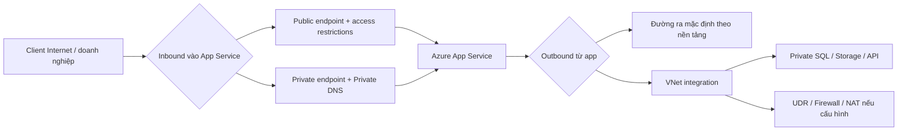
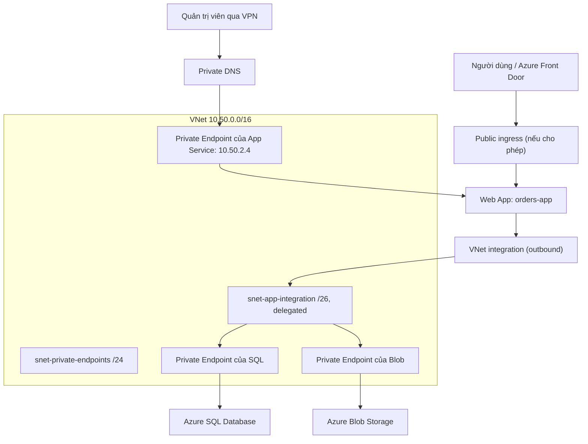
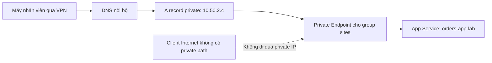
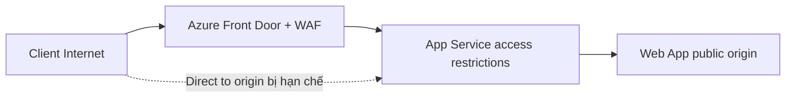
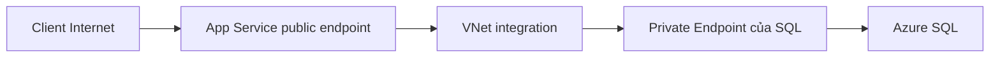
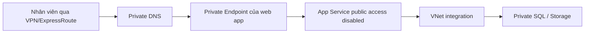
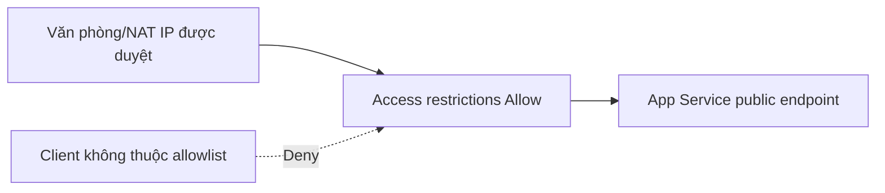
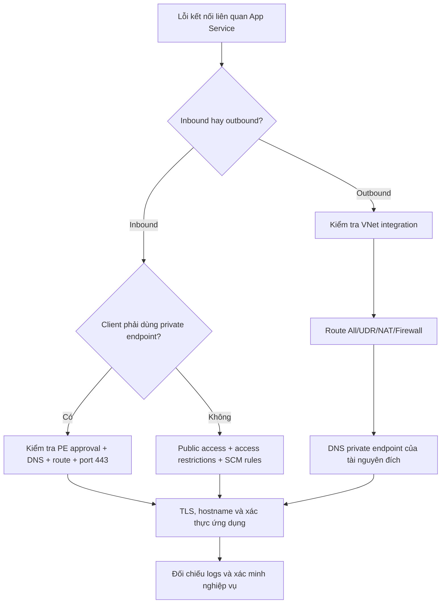

# VNet integration, private endpoint và access restriction

Một ứng dụng đặt trên **Azure App Service** thường có thể nhận HTTP/HTTPS qua địa chỉ công khai và chủ động gọi ra các dịch vụ khác. Tuy nhiên, ứng dụng doanh nghiệp có thể phải truy cập **Azure SQL Database hoặc Storage qua private endpoint**, chỉ cho nhân viên nội bộ mở trang quản trị, hoặc chỉ nhận yêu cầu từ **Azure Front Door** thay vì từ toàn bộ Internet. Những nhu cầu ấy liên quan đến mạng, nhưng được giải quyết bằng **ba cơ chế khác nhau**:

- **VNet integration:** cho phép ứng dụng App Service **kết nối đi (outbound)** vào tài nguyên có thể truy cập qua một virtual network.
- **Private endpoint:** cung cấp **đường truy cập vào (inbound)** App Service thông qua **địa chỉ IP riêng** trong một VNet, dựa trên Azure Private Link.
- **Access restrictions:** **lọc yêu cầu inbound tới endpoint công khai/mặc định** của App Service theo rule IP, service tag hoặc loại điều kiện được hỗ trợ.

Bài thuộc chương **Ứng dụng web với App Service** trong module `CLOUD_PROVIDERS_AZURE`. Nó kết nối những kiến thức về subscription, resource group, Microsoft Entra ID, VNet, DNS, tính toán, lưu trữ và dữ liệu để triển khai ứng dụng Azure có đường mạng **đúng hướng**, bảo mật, quan sát được và có chi phí vận hành phù hợp.

## Mục tiêu học tập

Sau bài này, bạn có thể:

1. Phân biệt dứt khoát **inbound** và **outbound** từ góc nhìn ứng dụng App Service.
2. Thiết kế subnet riêng cho **regional VNet integration** và subnet dành cho **private endpoint**, tránh nhầm việc ủy quyền (delegation).
3. Hiểu **Route All**, DNS, NAT Gateway, user-defined routes (UDR), firewall và đường ra Internet của ứng dụng.
4. Tạo private endpoint cho Web App, cấu hình **Private DNS** cho cả website và cổng quản trị **SCM/Kudu**.
5. Xây access restrictions bằng IP/service tag, phân biệt rule của **main site** và **SCM site**, cùng hành vi mặc định cho yêu cầu không khớp.
6. Chọn một trong ba cơ chế hoặc kết hợp chúng cho những tình huống công khai, nội bộ và hybrid.
7. Kiểm tra bằng Azure Portal/CLI, DNS và HTTP, nhận diện lỗi `403`, DNS, timeout hoặc lỗi deploy.
8. Đặt ra checklist vận hành về IAM, giám sát, thay đổi an toàn và chi phí.

## 1. Điểm mấu chốt: xác định hướng lưu lượng

Hãy lấy **App Service làm tâm điểm**:

| Luồng | Ví dụ | Câu hỏi kiến trúc |
|---|---|---|
| **Inbound** tới App Service | Người dùng mở `https://orders-app.azurewebsites.net` | Ai được gọi app và qua địa chỉ mạng nào? |
| **Outbound** từ App Service | App gọi `sql-prod.database.windows.net:1433` | App đi tới SQL bằng IP/route/DNS nào? |
| **Inbound quản trị** | CI/CD hoặc lập trình viên truy cập `orders-app.scm.azurewebsites.net` | SCM có được truy cập qua đường mạng được phép không? |
| **Outbound Internet** | App gọi API đối tác trên HTTPS | Có cần route qua firewall hoặc giữ ổn định public egress IP không? |

Sơ đồ định hướng:



**VNet integration không biến một web app công khai thành web app riêng tư.** **Private endpoint không tự cung cấp đường outbound vào VNet**. **Access restrictions không tạo địa chỉ IP riêng cho app**. Cả ba thường được phối hợp nhưng phải hiểu đúng chức năng và phạm vi từng cơ chế.

## 2. App Service networking hoạt động ở những lớp nào?

**Azure App Service** là PaaS chạy Web App/API trên hạ tầng được quản lý. Người dùng sở hữu cấu hình ứng dụng, App Service Plan, danh tính và các thiết lập mạng được hỗ trợ; không trực tiếp kiểm soát toàn bộ network interface hoặc máy chủ nền tảng như với Azure VM.

Các khái niệm cần phân biệt:

| Khái niệm | Ý nghĩa |
|---|---|
| **App Service Plan** | Năng lực tính toán, SKU/tier và region phục vụ các ứng dụng |
| **Web App** | Ứng dụng web cụ thể, có hostname chính và cấu hình riêng |
| **Default hostname** | Thường có dạng `<appname>.azurewebsites.net` |
| **SCM/Kudu hostname** | Thường có dạng `<appname>.scm.azurewebsites.net`, phục vụ triển khai và chẩn đoán theo khả năng nền tảng |
| **Regional VNet integration** | Đường outbound được app sử dụng để đi vào VNet |
| **Private Link / Private endpoint** | Địa chỉ inbound riêng trong VNet để client kết nối đến app |
| **Public network access** | Chính sách cho phép/tắt đường inbound công khai của web app |
| **Access restrictions** | Rule lọc nguồn inbound tới public/default endpoint |
| **Microsoft Entra Authentication** | Xác thực/ủy quyền người dùng; là lớp khác với lọc IP |

**App Service Plan tier, hệ điều hành, loại môi trường và vùng triển khai quyết định những tính năng mạng khả dụng.** Các ví dụ sau chủ yếu giả định **multitenant Azure App Service** với tier hỗ trợ regional VNet integration và private endpoint. Free/Shared hoặc các cấu hình đặc biệt có thể không hỗ trợ; cần kiểm tra trong subscription thực tế.

**App Service Environment (ASE)** là phương án App Service dành cho môi trường cách ly với mô hình mạng riêng, không thể coi mọi hành vi subnet/routing của multitenant App Service là giống ASE.

## 3. Bảng so sánh ba cơ chế

| Tiêu chí | VNet integration | Private endpoint | Access restrictions |
|---|---|---|---|
| Hướng lưu lượng chính | **Outbound** từ app | **Inbound** đến app | **Inbound** đến public endpoint |
| Vai trò | App gọi tài nguyên qua VNet | Client truy cập app qua private IP | Cho phép/từ chối nguồn truy cập theo rule |
| Có tạo private IP để client gọi app? | **Không** | **Có** | **Không** |
| Có tự tắt public ingress? | Không | Không nên mặc định; cần kiểm tra/cấu hình public network access | Không, nhưng có thể từ chối nguồn ngoài danh sách được phép |
| Có cho app gọi private SQL/Storage? | **Có**, khi routing/DNS/quyền đúng | Không phải mục đích của nó | Không |
| VNet subnet | Subnet **delegated** cho `Microsoft.Web/serverFarms` | Subnet dành cho private endpoint; **không phải subnet integration được delegated** | Không bắt buộc có subnet trong trường hợp rule IP |
| DNS đặc biệt | Phân giải các dịch vụ private mà app gọi | Private DNS cho hostname App Service và SCM | Thường không thay hostname |
| Ai sử dụng? | Workload App Service | Client/CI/CD trong mạng có đường tới private IP | Client truy cập endpoint công khai |
| Ví dụ | API gọi SQL private endpoint | Web app nội bộ qua VPN | Chỉ cho IP văn phòng hoặc Front Door tới public app |

### Ba câu dễ bị hiểu sai

**“Tôi đã bật VNet integration nhưng người dùng ngoài Internet vẫn thấy website.”** Điều này là bình thường: VNet integration xử lý **outbound**, không khóa **inbound**.

**“Tôi tạo private endpoint cho App Service nên app có thể truy cập Blob private.”** Chưa đủ: cần **VNet integration cho outbound**, cùng route, DNS và quyền đến Blob.

**“Tôi đã tắt public access thì chỉ cần allow rule IP cho nhân viên là dùng được.”** Không đúng: khi tắt đường công khai, rule allow trên public endpoint không thể thay thế một private network path. Cần client đi qua private endpoint và DNS thích hợp.

## 4. Thiết kế tham chiếu: web app gọi SQL và Storage qua mạng riêng

Ví dụ tổ chức có:

- App Service `orders-app` phục vụ HTTP.
- Azure SQL Database và Blob Storage chỉ cho phép đường private theo chính sách.
- Quản trị viên dùng VPN từ mạng doanh nghiệp; đường deploy phải được kiểm soát.
- VNet `vnet-orders-prod` ở cùng region phù hợp với App Service Plan và chứa các subnet độc lập.



Trong mô hình này:

1. **Đường vào App Service**: hoặc public endpoint với access restrictions, hoặc private endpoint cho client từ mạng có quyền; có thể triển khai cả hai nếu nghiệp vụ và chính sách cho phép.
2. **Đường ra từ App Service**: dùng VNet integration để kết nối các private endpoint của SQL/Storage.
3. **DNS**: tên App Service, SQL và Storage phải được phân giải đến địa chỉ phù hợp **từ đúng nơi thực hiện truy vấn**; mỗi dịch vụ có Private DNS zone riêng.
4. **Identity**: dù traffic đã qua private IP, ứng dụng vẫn cần Microsoft Entra ID/managed identity hoặc phương thức xác thực được hỗ trợ để truy cập SQL/Blob.
5. **Observability**: cần log HTTP/App Service, Activity Log, DNS và thông tin mạng để chẩn đoán vấn đề, không chỉ một biểu tượng “Connected”.

## 5. VNet integration: outbound từ App Service

**Regional VNet integration** cho phép web app gửi lưu lượng outbound tới các địa chỉ có thể định tuyến qua VNet được tích hợp. VNet integration **không tạo inbound private IP cho web app** và **không cung cấp trực tiếp quyền truy cập vào tài nguyên**.

### Điều kiện thường gặp

Trước khi tích hợp, kiểm tra:

1. **App Service Plan** dùng tier hỗ trợ tính năng; kiểm tra mode và vùng phù hợp.
2. **VNet** và integration subnet ở region được hỗ trợ theo mô hình App Service đang dùng; với regional integration thông thường, VNet ở **cùng region** với App Service.
3. **Subnet dành riêng cho integration**, được delegated sang `Microsoft.Web/serverFarms`.
4. **Dung lượng địa chỉ IP subnet** đủ cho số instance đang chạy, scale-out và các hoạt động nâng cấp/điều chuyển. Với nhiều workload, một subnet `/26` là điểm khởi đầu thuận lợi hơn một subnet quá nhỏ; yêu cầu tối thiểu và giới hạn phụ thuộc tính năng/tier.
5. Cấu hình **NSG, route table, DNS** và các dịch vụ mạng khác không làm mất kết nối đến dịch vụ ứng dụng cần.
6. Identity/operator có quyền với App Service và quyền quản trị subnet/virtual network cần thiết.

### Subnet delegation nghĩa là gì?

Subnet integration được Azure App Service sử dụng để hỗ trợ kết nối outbound. Việc `delegation = Microsoft.Web/serverFarms` báo cho Azure biết subnet dùng cho dịch vụ này theo mô hình tương ứng. Không xem nó như subnet để tùy ý đặt VM hoặc private endpoint trong cùng không gian; subnet bị ràng buộc bởi giới hạn của delegation.

**VNet integration subnet và private endpoint subnet nên là hai subnet khác nhau.** Một bên dành cho App Service **đi ra**, bên còn lại chứa NIC của **điểm vào private**.

### Những luồng VNet integration xử lý

- App gọi một VM hoặc API nội bộ trong VNet nếu route và firewall cho phép.
- App gọi một private endpoint của Azure SQL, Storage, Key Vault hoặc dịch vụ được hỗ trợ.
- App gọi tài nguyên ở **VNet được peering** hoặc mạng on-premises qua VPN/ExpressRoute nếu route, peering và DNS được cấu hình phù hợp.
- App có thể được cấu hình để đưa thêm lưu lượng outbound qua VNet theo cơ chế **Route All**.

VNet integration không đồng nghĩa app có thể khám phá mọi subnet hoặc bỏ qua NSG. Các tài nguyên đích vẫn có thể từ chối vì sai service port, firewall, route, DNS hoặc quyền ứng dụng.

## 6. Route All và đường Internet outbound

Khi dùng VNet integration, câu hỏi tiếp theo là: **lưu lượng nào đi qua integration subnet?**

### Mô hình mặc định và Route All

Trong nhiều cấu hình multitenant App Service, traffic đi tới các địa chỉ private theo cơ chế VNet integration, còn một phần traffic Internet có thể sử dụng đường outbound của nền tảng nếu không bật chế độ định tuyến tất cả. **Route All** yêu cầu app gửi lưu lượng outbound phù hợp qua VNet integration để các chính sách route/NSG, NAT hoặc firewall có thể áp dụng.

| Tình huống | Đường đi mong muốn | Cấu hình cần chú ý |
|---|---|---|
| Gọi SQL private endpoint | Qua VNet integration đến IP riêng | Private DNS, route, firewall, identity |
| Gọi API nội bộ ở VNet peered | Qua VNet integration và peering | Peering, address space, UDR, NSG |
| Gọi API Internet nhưng muốn kiểm soát egress | Qua VNet khi **Route All** bật | Egress architecture, UDR/NAT/Firewall |
| Gọi Internet theo đường mặc định | Không nhất thiết đi qua VNet | Outbound IP/App Service behavior phụ thuộc cấu hình |

Trong Azure Portal, kiểm tra trang **Networking → VNet integration** và tùy chọn routing/Route All theo UI hiện tại. Ở các API/cấu hình App Service có thuộc tính như `vnetRouteAllEnabled`; môi trường đời cũ có thể dùng app setting tương ứng. Khi tự động hóa, ưu tiên **thuộc tính cấu hình chính thức được tính năng hỗ trợ** và kiểm tra trạng thái sau khi lưu thay vì kết hợp các tùy chọn cũ/mới một cách tùy tiện.

### Route All không tự tạo đường ra Internet

Nếu ép traffic outbound đi qua VNet mà subnet không có đường egress hợp lệ, ứng dụng có thể **không còn gọi được** API Internet, endpoint tải package hay hệ thống định danh. Cần thiết kế một trong các đường ra được hỗ trợ:

- **NAT Gateway**: cung cấp public outbound egress IP được kiểm soát từ subnet phù hợp.
- **Azure Firewall hoặc NVA**: thực thi rule, logging, network policy, FQDN/application rule hoặc inspection tùy khả năng.
- **UDR/Route table**: điều hướng các dải mạng phù hợp đến next hop; phải bảo đảm đường quay lại và không tạo blackhole.
- **DNS resolver/forwarder**: phân giải tên miền private và public đúng theo kiến trúc.

**Không nên cho rằng** bật VNet integration tự thay đổi public outbound IP thành IP của VNet hoặc của private endpoint. Nếu hệ thống đối tác yêu cầu allowlist một IP outbound cố định, hãy thiết kế Route All và NAT/Firewall egress được hỗ trợ rồi kiểm tra từ chính app.

### Ảnh hưởng tới DNS

Khi web app gọi `sql-prod.database.windows.net` nhưng SQL có private endpoint, client phải phân giải hostname này về **private IP thích hợp** từ ngữ cảnh DNS của app. DNS cấu hình cho VNet, private DNS zones, custom DNS server và forwarding quyết định kết quả. **Tạo private endpoint cho SQL không đảm bảo mọi app ở mọi VNet tự phân giải đúng**.

## 7. Cấu hình VNet integration bằng Azure Portal

Giả sử đã có:

| Thành phần | Giá trị minh họa |
|---|---|
| Resource group | `rg-app-lab` |
| Web App | `orders-app-lab` |
| App Service Plan | Tier hỗ trợ regional VNet integration |
| VNet | `vnet-orders-lab`, `10.50.0.0/16` |
| Integration subnet | `snet-app-integration`, ví dụ `10.50.1.0/26` |
| Delegation | `Microsoft.Web/serverFarms` |

Các bước:

1. Trên Azure Portal, vào **App Services → orders-app-lab → Networking**.
2. Trong phần **VNet integration** hoặc **Outbound traffic**, chọn thêm tích hợp với VNet.
3. Chọn VNet, subnet được phép tích hợp và đúng region/tier.
4. Kiểm tra subnet delegation, dải IP còn trống và các rule NSG/route.
5. Hoàn tất thay đổi và xem trạng thái **Connected**.
6. Khi cần định tuyến traffic outbound qua VNet, thiết lập **Route All** theo thiết kế và xác minh đường NAT/Firewall đã sẵn sàng trước khi bật.
7. Thử từ chính app: phân giải DNS và gọi thử cổng/tài nguyên đích; đừng chỉ xem trạng thái tích hợp.

Nếu Portal yêu cầu **tạo mới subnet** hoặc quyền ghi vào subnet, chỉ thao tác khi người học được quyền và đúng phạm vi lab. Không đưa subnet của VM hoặc private endpoint vào vị trí integration vì “còn địa chỉ IP trống”.

### Azure CLI: truy vấn và tích hợp

Chọn đúng subscription:

```bash
az login --tenant "<tenant-id>"
az account set --subscription "<subscription-id>"

az account show \
  --query "{name:name,id:id,tenant:tenantId}" \
  --output json
```

Xem cấu hình VNet integration hiện tại:

```bash
az webapp vnet-integration list \
  --resource-group "rg-app-lab" \
  --name "orders-app-lab" \
  --output json
```

Nếu VNet/subnet đã tồn tại, được delegated đúng và có quyền thực hiện:

```bash
az webapp vnet-integration add \
  --resource-group "rg-app-lab" \
  --name "orders-app-lab" \
  --vnet "vnet-orders-lab" \
  --subnet "snet-app-integration"
```

Lệnh trên **thay đổi cấu hình mạng của ứng dụng**. Trong môi trường production phải có review và phương án rollback; chỉ dùng ở lab được giao. Phiên bản CLI, permission và yêu cầu subnet có thể khác theo loại App Service/region; nếu bị từ chối, hãy kiểm tra điều kiện thay vì cấp quyền Owner trên subscription.

Đọc trạng thái cấu hình liên quan từ ARM:

```bash
az webapp show \
  --resource-group "rg-app-lab" \
  --name "orders-app-lab" \
  --query "{name:name,location:location,publicNetworkAccess:publicNetworkAccess,subnet:virtualNetworkSubnetId,outboundIps:outboundIpAddresses}" \
  --output json
```

Để xem Route All, vào **Networking** trên Portal hoặc đọc cấu hình site theo API/CLI hiện hành. **Lệnh `az webapp vnet-integration list` chứng minh có tích hợp VNet, không tự chứng minh traffic Internet đi qua NAT.**

## 8. Private endpoint: inbound App Service qua Private Link

**Private endpoint của App Service** là một **network interface** trong subnet VNet, nhận private IP và cung cấp đường vào web app thông qua Azure Private Link. Client trong VNet hoặc mạng kết nối hợp lệ có thể truy cập ứng dụng qua **hostname thông thường**, nhưng DNS nội bộ phân giải tới IP của private endpoint.



### Điểm quan trọng

- Private endpoint là cơ chế **inbound tới App Service**, không dùng làm interface outbound cho app.
- Private endpoint được tạo trong VNet có subnet và quyền phù hợp. **Subnet đó không phải integration subnet delegated sang Microsoft.Web/serverFarms**.
- App Service Plan/tier và loại ứng dụng phải hỗ trợ Private Link.
- Cấu hình public network access quyết định app có còn chấp nhận inbound qua public endpoint hay không; **chủ động kiểm tra/tắt** khi yêu cầu ứng dụng chỉ private.
- Một ứng dụng có thể cần quản lý riêng private endpoint của các **deployment slots** theo group/subresource được hỗ trợ; không giả định private endpoint production bao phủ mọi slot.
- Client vẫn phải được **xác thực và ủy quyền** ở tầng ứng dụng; private IP không thay thế login.

### Không đổi URL ứng dụng thành private IP

Giả sử private IP là `10.50.2.4`. Client nên tiếp tục gọi:

```text
https://orders-app-lab.azurewebsites.net/
```

Thay vì:

```text
https://10.50.2.4/
```

Truy cập bằng IP có thể sai **TLS SNI, Host header, chứng chỉ và routing** của App Service. Azure Private Link được thiết kế để giữ hostname, còn **DNS** chuyển kết nối đến private IP phù hợp.

## 9. Private DNS: phần dễ thiếu nhất của Private Endpoint

Giả sử Web App `orders-app-lab` có private endpoint và client trong mạng công ty cần mở web:

```text
Hostname do người dùng mở:
orders-app-lab.azurewebsites.net

Private DNS zone thông dụng:
privatelink.azurewebsites.net

Bản ghi private:
orders-app-lab     A 10.50.2.4
orders-app-lab.scm A 10.50.2.4
```

Tên app mặc định có thể đi qua chuỗi CNAME/alias liên quan `privatelink`. Trong mạng được liên kết Private DNS zone, resolver trả địa chỉ IP riêng để client kết nối đến private endpoint.

**Phải xác minh DNS từ chính nơi người dùng/CI agent chạy**, không chỉ từ máy trong một VNet khác. Một private DNS zone chưa được link đúng VNet hoặc DNS on-premises chưa forward đúng có thể khiến truy vấn trả IP public.

### Tại sao cần bản ghi SCM?

Ngoài site chính, App Service có **SCM/Kudu** endpoint thường dùng cho:

- Triển khai zip/package theo cơ chế được hỗ trợ.
- Xem log/diagnostics và dùng các công cụ phát triển.
- Một số luồng CI/CD hoặc quản trị ứng dụng.

Khi app chỉ truy cập private, **SCM cũng phải được truy cập qua đường và DNS phù hợp**. Nếu chỉ có bản ghi `orders-app-lab` nhưng thiếu `orders-app-lab.scm` trong private DNS, trang ứng dụng có thể hoạt động trong khi pipeline deploy hoặc Kudu không hoạt động.

### Private DNS cho custom domain

Nếu ứng dụng dùng `internal.example.com` thay cho hostname mặc định:

1. Cấu hình custom domain và chứng chỉ HTTPS hợp lệ theo App Service.
2. Trong DNS phù hợp với mạng nội bộ, cho custom hostname trỏ đến đích private theo mô hình hỗ trợ.
3. Duy trì Host header/SNI phù hợp; không chỉ gắn A record vào IP mà bỏ qua xác minh domain/certificate.
4. Kiểm tra cả nơi client dùng custom domain lẫn nơi CI/CD dùng SCM hostname mặc định.

### Trường hợp hybrid

Máy on-premises truy cập qua VPN/ExpressRoute phải có:

- **Route** đến private endpoint IP trong VNet.
- **DNS forwarding hoặc resolver** cung cấp kết quả private, thay vì luôn dùng public resolver.
- **Firewall/NSG** cho phép kết nối HTTPS tới private endpoint.
- **Xác thực ứng dụng** hợp lệ.

Private DNS zone trên Azure **không tự làm DNS của công ty biết đến bản ghi** nếu không cấu hình resolution path.

## 10. Tạo Private Endpoint bằng Azure Portal

Ví dụ tách riêng:

| Thành phần | Giá trị minh họa |
|---|---|
| App | `orders-app-lab` |
| App resource group | `rg-app-lab` |
| VNet | `vnet-orders-lab` |
| Private endpoint subnet | `snet-private-endpoints`, `10.50.2.0/24` |
| Private endpoint resource | `pe-orders-app` |
| Subresource / group ID | `sites` (production site) |
| Private DNS zone | `privatelink.azurewebsites.net` |

Trên Portal:

1. Vào **App Service → Networking → Private endpoint connections** hoặc giao diện tương đương.
2. Chọn **Add private endpoint**, chọn subscription, resource group, region và tên.
3. Chọn VNet cùng subnet **dành cho private endpoints**; không chọn subnet delegated cho VNet integration.
4. Chọn App Service resource và subresource `sites` cho production site theo tính năng hỗ trợ.
5. Thiết lập/duyệt kết nối Private Link nếu quy trình yêu cầu.
6. Tích hợp **private DNS zone** và kiểm tra bản ghi của hostname chính cùng hostname `scm`.
7. Kiểm tra public network access: nếu cần app **chỉ hoạt động trong mạng riêng**, tắt public network access theo chính sách và xác nhận đường private hoạt động trước.
8. Từ VM/agent ở trong VNet hoặc mạng VPN, chạy `nslookup`/`curl` với hostname thường dùng.

**Việc tạo private endpoint chưa tạo đường kết nối từ máy laptop bên ngoài đến IP riêng.** Để truy cập cần có VNet route, VPN/ExpressRoute, Bastion/jump environment đã được phép hoặc một nguồn nằm trong mạng liên quan.

### Azure CLI: xác định App ID và kiểm tra private endpoint

Lấy resource ID ứng dụng:

```bash
APP_ID=$(az webapp show \
  --resource-group "rg-app-lab" \
  --name "orders-app-lab" \
  --query id \
  --output tsv)

echo "$APP_ID"
```

Tạo private endpoint trong **sandbox đã được cấp quyền**, nếu subnet và resource sẵn sàng:

```bash
az network private-endpoint create \
  --resource-group "rg-app-lab" \
  --name "pe-orders-app" \
  --vnet-name "vnet-orders-lab" \
  --subnet "snet-private-endpoints" \
  --private-connection-resource-id "$APP_ID" \
  --group-id "sites" \
  --connection-name "pe-orders-app-conn"
```

**Lệnh này chưa cấu hình toàn bộ DNS zone/link hoặc bảo đảm public network access bị tắt.** Dùng Portal/Private DNS zone group và kiểm tra hoạt động sau khi tạo; các thao tác tạo public/private endpoint trong production cần phê duyệt vì có thể ảnh hưởng route/khả dụng và phát sinh chi phí.

Kiểm tra endpoint:

```bash
az network private-endpoint show \
  --resource-group "rg-app-lab" \
  --name "pe-orders-app" \
  --query "{name:name,subnet:subnet.id,connections:privateLinkServiceConnections}" \
  --output json

az network private-endpoint list \
  --resource-group "rg-app-lab" \
  --output table
```

Nếu `privateLinkServiceConnections` trống, kiểm tra các loại kết nối được dùng (thủ công/đã phê duyệt) trong JSON đầy đủ. Một private endpoint có trạng thái Pending/Rejected không thể dùng như kết nối đã được phê duyệt.

### Nhận diện Private DNS zone group

```bash
az network private-endpoint dns-zone-group list \
  --resource-group "rg-app-lab" \
  --endpoint-name "pe-orders-app" \
  --output json
```

Kiểm tra zone group liên kết đến `privatelink.azurewebsites.net` và DNS records đúng private IP. Nếu quản lý DNS bằng Bicep/Terraform thay vì Portal, phải cấu hình link tới VNet nguồn hoặc DNS forwarding theo kiến trúc.

## 11. Access restrictions: lọc inbound vào public endpoint

**Access restrictions** kiểm soát lưu lượng đến **default/public App Service endpoint** bằng các rule theo điều kiện dịch vụ hỗ trợ, chẳng hạn IP/CIDR, service tag hoặc VNet service endpoint với những giới hạn tương ứng.

Ví dụ app có public URL:

```text
https://orders-app-lab.azurewebsites.net/
```

Tổ chức chỉ cho phép hai nguồn:

| Nguồn | Quy tắc | Tác động mong muốn |
|---|---|---|
| Mạng văn phòng `203.0.113.10/32` | `Allow` priority `100` | Nhân viên tại IP egress văn phòng được truy cập |
| Nguồn khác | `Deny` theo default unmatched behavior | Không mở web từ Internet ngoài danh sách |

`203.0.113.10` là địa chỉ ví dụ trong dải dành cho tài liệu; trong thực tế phải dùng **IP public egress được phê duyệt** của doanh nghiệp. Không dùng private IP của laptop làm IP allowlist cho public App Service vì app nhìn thấy public source address sau NAT/proxy.

### Quy tắc và thứ tự ưu tiên

Mỗi access restriction rule có thể có:

- **Name** và **priority** để xác định thứ tự đánh giá.
- **Action** `Allow` hoặc `Deny`.
- **Source condition**, ví dụ một IP/CIDR, service tag hoặc VNet/subnet với tính năng hỗ trợ.
- **Header filter** được hỗ trợ trong một số kịch bản, ví dụ hạn chế traffic từ một Azure Front Door cụ thể.

Các rule có priority thấp hơn thường được xem trước theo cơ chế của App Service. Khi không khớp rule nào, **default unmatched rule action** quyết định ứng dụng allow hay deny; cần kiểm tra rõ thay vì suy luận từ một rule đã tạo.

**Access restrictions không giống xác thực.** Một người ở IP được allow vẫn phải đăng nhập Entra ID hoặc có token/quyền ứng dụng khi trang có yêu cầu; lọc IP chỉ là một lớp kiểm soát nguồn kết nối.

### Main site và SCM/Kudu có thể có rule khác nhau

App Service cung cấp khả năng cấu hình **access restrictions cho main site và advanced tools (SCM)**. Tùy cấu hình, SCM có thể **dùng chung rule với main site** hoặc có **rule riêng**. Việc chỉ bảo vệ main site nhưng để SCM tự do truy cập có thể không đáp ứng yêu cầu bảo mật; ngược lại, siết SCM quá sớm có thể chặn pipeline triển khai.

Kiểm tra cả:

- `https://orders-app-lab.azurewebsites.net`: traffic ứng dụng.
- `https://orders-app-lab.scm.azurewebsites.net`: traffic triển khai/chẩn đoán.

Với private endpoint, SCM cần **DNS/đường private đúng**; với public endpoint, SCM cần access restriction phù hợp theo chính sách. Hai cơ chế khác nhau và có thể gây ra triệu chứng lỗi giống nhau nếu chẩn đoán không đúng.

### Private endpoint traffic và access restrictions

**Access restrictions không phải lớp lọc các request đi vào thông qua private endpoint.** Những rule inbound của access restrictions chủ yếu áp dụng cho **default/public endpoint**. Traffic đi qua private endpoint được kiểm soát bằng đường mạng/private DNS, private network security theo khả năng hỗ trợ, và xác thực/ủy quyền ứng dụng.

Nếu cần chỉ **một nhóm người dùng** truy cập qua private endpoint, hãy thiết kế route, network segmentation, firewall/NSG theo khả năng được hỗ trợ, đồng thời **Entra ID/Easy Auth** hoặc ủy quyền nghiệp vụ. Không giả định rule `Allow 203.0.113.10/32` của public endpoint sẽ lọc client ở private endpoint.

## 12. Tạo access restrictions qua Portal và Azure CLI

### Qua Azure Portal

1. Chọn App Service → **Networking → Access restrictions** hoặc **Inbound traffic** theo UI hiện tại.
2. Xem các rule **main site** và tùy chọn kế thừa/cấu hình **SCM**.
3. Thêm `Allow` rule cho source IP/CIDR được phê duyệt, đặt priority.
4. Chọn hành vi mặc định cho traffic không khớp, ví dụ `Deny` nếu muốn allowlist.
5. Kiểm tra rule và thử từ **hai nguồn**: IP được allow và một nguồn không được allow.
6. Thực hiện tương tự hoặc cấu hình tách riêng SCM theo đường deploy thực tế.

**Trước khi chuyển mặc định sang Deny**, bảo đảm admin/CI/CD có đường quản trị còn hoạt động. Việc mở lại có thể cần quyền thay đổi cấu hình qua Azure Resource Manager; không dựa vào việc có thể truy cập trang Kudu để sửa khi chính Kudu đang bị chặn.

### CLI: xem rule trước khi thay đổi

```bash
az webapp config access-restriction show \
  --resource-group "rg-app-lab" \
  --name "orders-app-lab" \
  --output json
```

Kiểm tra các trường thể hiện rules, priority, unmatched default action và rule của SCM. Tên trường hiển thị có thể khác theo CLI/API version; khi thiếu trường, xem JSON đầy đủ.

Thêm rule ví dụ **chỉ ở môi trường được phép**:

```bash
az webapp config access-restriction add \
  --resource-group "rg-app-lab" \
  --name "orders-app-lab" \
  --rule-name "AllowOfficeEgress" \
  --action Allow \
  --ip-address "203.0.113.10/32" \
  --priority 100
```

Đây là lệnh **thay đổi truy cập** của app, không phải lệnh chỉ đọc. Nó chưa chắc định nghĩa đủ default unmatched action hoặc SCM strategy mong muốn. Sau thay đổi, xem lại `access-restriction show`, thử từ các nguồn thực tế và xác minh đường CI/CD.

Nếu dùng **service tag** hoặc filter HTTP header, tham khảo các option của `az webapp config access-restriction add -h` và xác nhận loại nguồn/tag hỗ trợ trên App Service hiện tại; không tự tạo header filter bằng property chưa được xác minh.

## 13. Access restrictions và Azure Front Door

Một website public có thể đặt **Azure Front Door** phía trước App Service để dùng WAF, caching/routing và global edge. Trong trường hợp origin App Service vẫn dùng **public endpoint**, cần ngăn client **đi tắt** trực tiếp tới origin bỏ qua Front Door.

Một phương án thường được xem xét:

1. Đưa Front Door làm điểm tiếp nhận traffic chính.
2. Tại App Service public access restrictions, cho phép source phù hợp với **service tag `AzureFrontDoor.Backend`** theo tính năng.
3. Kết hợp điều kiện header như **`X-Azure-FDID`** để phân biệt Front Door instance/route được cấp phép theo hướng dẫn dịch vụ, không chỉ cho phép toàn bộ traffic từ mọi khách hàng Front Door.
4. Đặt unmatched default action là Deny và kiểm tra SCM riêng.
5. Giám sát HTTP 403, WAF và origin health.



Đây là **mẫu public origin lockdown**, không phải Private Endpoint. Phải kiểm tra giá trị FDID, service tag, header và cấu hình rule phù hợp với sản phẩm/tier hiện tại. Nếu dùng **Azure Front Door Premium + Private Link origin** được hỗ trợ cho App Service, đường vào origin có thể dùng mô hình riêng khác; lúc đó private networking/DNS/approval cần thiết kế theo tính năng Front Door, không áp dụng máy móc public access restriction.

## 14. Private endpoint và public ingress có thể kết hợp thế nào?

Ba mô hình phổ biến:

### Mô hình A — App public có outbound riêng



**Chọn khi:** web/API cần nhận traffic công khai, nhưng database/secret/data services phải private. Inbound có thể được bảo vệ bằng Front Door, WAF và access restrictions; outbound dùng VNet integration. **Không nhất thiết tạo private endpoint của chính web app**.

### Mô hình B — Web app chỉ dùng nội bộ



**Chọn khi:** trang quản trị, API nội bộ hoặc ứng dụng xử lý dữ liệu nhạy cảm không được nhận inbound trực tiếp từ Internet. Phải có private endpoint, private DNS và đường kết nối của người dùng/agent. VNet integration chỉ cần nếu app còn phải **gọi các tài nguyên private** ở outbound.

### Mô hình C — Public endpoint chỉ nhận từ IP/edge được phép



**Chọn khi:** nhu cầu chỉ là hạn chế public inbound tới một tập nguồn biết trước, không nhất thiết yêu cầu private IP hoặc kết nối riêng. Access restrictions thường là giải pháp cấu hình đơn giản hơn Private Endpoint, nhưng **không cung cấp ranh giới mạng private giống Private Link**.

### Tóm tắt quyết định

| Câu hỏi | Cơ chế nên bắt đầu |
|---|---|
| App cần gọi private IP trong VNet? | **VNet integration** |
| App cần gọi Azure SQL qua private endpoint? | **VNet integration + Private DNS cho SQL** |
| Người dùng cần gọi chính app bằng private IP? | **Private endpoint của App Service** |
| App chỉ được nội bộ truy cập, không qua public ingress? | **Private endpoint + disable public network access + private DNS** |
| App public chỉ nhận từ văn phòng? | **Access restrictions IP allowlist** |
| App chỉ nhận traffic từ Front Door public origin? | **Access restrictions với service tag/header** hoặc mô hình origin private được hỗ trợ |
| App cần stable public outbound IP? | **VNet integration + Route All + NAT Gateway/egress architecture** |
| App cần bảo vệ API bằng token/người dùng đăng nhập? | **Microsoft Entra Authentication/authorization**; mạng chỉ là lớp bổ sung |

## 15. Triển khai hoàn chỉnh: ứng dụng nội bộ dùng private SQL

### Tình huống

Một đội vận hành xây `orders-app-lab` trên App Service Linux/Windows tier phù hợp. Ứng dụng gọi Azure SQL qua private endpoint; nhân viên vào ứng dụng bằng VPN; CI/CD dùng self-hosted agent trong mạng đã kết nối. Mục tiêu là **không có public inbound trực tiếp** tới main site hoặc SCM.

### Thiết kế tài nguyên

| Tài nguyên | Giá trị minh họa |
|---|---|
| Web App | `orders-app-lab` |
| App Service Plan | SKU hỗ trợ VNet integration và private endpoint |
| VNet | `vnet-orders-lab`, `10.50.0.0/16` |
| Subnet outbound integration | `snet-app-integration`: `10.50.1.0/26`, delegated `Microsoft.Web/serverFarms` |
| Subnet inbound private endpoint | `snet-private-endpoints`: `10.50.2.0/24` |
| Web App private endpoint | `pe-orders-app`, group `sites` |
| Web App Private DNS | `privatelink.azurewebsites.net` |
| SQL private endpoint | Cấu hình theo Azure SQL và subnet private endpoint thích hợp |
| SQL private DNS | `privatelink.database.windows.net` trong kiến trúc thông dụng |
| Private management | VPN/ExpressRoute hoặc máy/agent trong VNet |

### Thứ tự triển khai an toàn

1. **Chuẩn bị app và DNS dependency:** chạy app cơ bản, kiểm thử qua đường hiện có; tạo SQL private endpoint và private DNS của SQL.
2. **Thực hiện VNet integration:** tích hợp app với `snet-app-integration`, kiểm tra DNS từ app trả private IP cho SQL và truy cập TCP/1433.
3. **Cấu hình quyền dữ liệu:** managed identity/Entra ID hoặc credential doanh nghiệp theo cách được SQL hỗ trợ; xác minh query thật, không chỉ TCP.
4. **Tạo private endpoint cho app:** ở `snet-private-endpoints`, chọn subresource `sites`; kiểm tra approval state.
5. **Cấu hình Private DNS của app:** link zone vào VNet nơi nhân viên/agent phân giải, thiết lập/kiểm tra bản ghi site và SCM.
6. **Kiểm thử từ đúng nguồn:** từ máy/agent qua VPN mở `https://orders-app-lab.azurewebsites.net` và `https://orders-app-lab.scm.azurewebsites.net` theo quyền.
7. **Chuyển public network access sang Disabled** sau khi private path và CI/CD đã hoạt động và có rollback plan.
8. **Kiểm tra nguồn bên ngoài:** từ mạng không có private path, app không cho phép public inbound theo thiết kế.
9. **Ghi log, alert, owner và runbook:** lưu endpoint IDs, DNS zones, IP, VNet links, SCM deployment path, quyền và biện pháp phục hồi.

### Các phép thử chấp nhận

| Phép thử | Nơi thực hiện | Kết quả mong muốn |
|---|---|---|
| DNS web app | VM/agent trong VNet | Hostname app phân giải tới private IP |
| HTTPS web app | VM/agent trong VNet | Kết nối HTTPS, ứng dụng trả response hợp lệ |
| DNS SCM/Kudu | Agent deploy trong VNet | Hostname `scm` phân giải private IP |
| CI/CD deploy | Agent được quyền và có network path | Triển khai thành công, không cần mở public SCM |
| SQL private DNS | App Service runtime/console | SQL hostname phân giải tới private IP |
| SQL query | App Service identity | Có thể xác thực và truy vấn theo quyền nghiệp vụ |
| Public inbound | Client bên ngoài không có VPN | Bị chặn theo public network access policy |
| Logs/metrics | Nhóm vận hành | Có dữ liệu chẩn đoán và cảnh báo theo yêu cầu |

**Không nên tắt public access ở bước đầu tiên** nếu đội phát triển hiện chỉ có public build agent để deploy và chưa có private DNS/đường mạng: có thể làm pipeline bị khóa khỏi SCM dù app chính vẫn chạy.

## 16. Chẩn đoán DNS, route và cổng kết nối

Khi App Service không gọi được tài nguyên hoặc người dùng không mở được trang, hãy **tách hướng lưu lượng** trước khi sửa bất kỳ rule nào.

### Kiểm tra inbound từ VM trong VNet

Trên Linux VM hoặc self-hosted agent đã có route vào private endpoint:

```bash
nslookup orders-app-lab.azurewebsites.net
nslookup orders-app-lab.scm.azurewebsites.net

curl -I --connect-timeout 5 \
  https://orders-app-lab.azurewebsites.net/
```

Quan sát hostname được phân giải thành **private IP** hay public IP; HTTP status và chứng chỉ TLS. `curl -I` gửi HTTP HEAD; nếu ứng dụng không hỗ trợ HEAD, thử GET tới endpoint đọc phù hợp. Không bỏ qua xác minh TLS chỉ để thử nghiệm được “xanh”.

Trên Windows PowerShell:

```powershell
Resolve-DnsName orders-app-lab.azurewebsites.net
Resolve-DnsName orders-app-lab.scm.azurewebsites.net

Test-NetConnection orders-app-lab.azurewebsites.net -Port 443
```

### Kiểm tra outbound từ App Service

Tùy hệ điều hành App Service và tính năng được hỗ trợ, có thể dùng **SSH/Console**, chẩn đoán mạng trong Portal hoặc command tiện ích để xem DNS/kết nối. Ví dụ từ shell Linux phù hợp:

```bash
nslookup sql-prod.database.windows.net

# Chỉ kiểm tra HTTPS tới một endpoint nếu endpoint thực sự hỗ trợ HTTPS
curl -I --connect-timeout 5 https://example.com/
```

Với Azure SQL Database cần kiểm tra TCP port `1433` bằng công cụ kết nối TCP/SQL phù hợp; **không dùng `curl https://sql-prod.database.windows.net` để kết luận SQL đã kết nối được**. Kết quả DNS trả private IP là điều kiện mạng, còn việc truy vấn thành công đòi hỏi thêm credential/role và chính sách SQL.

### DNS có thể khác ở ba vị trí

| Vị trí truy vấn | Kỳ vọng khi dùng Private Endpoint App Service |
|---|---|
| Máy văn phòng qua VPN và DNS forwarding | FQDN web app → private IP của private endpoint |
| Azure VM trong VNet có link private DNS zone | FQDN web app → private IP |
| Client Internet ngoài mạng private | Có thể phân giải qua DNS công khai, nhưng không có private route; với public access disabled, public ingress bị chặn |

Một kết quả `nslookup` trên laptop không có VPN **không xác nhận** hệ thống DNS nội bộ đã cấu hình sai. Cần thử đúng network context.

## 17. Các lỗi thường gặp và cách sửa đúng lớp

| Triệu chứng | Nguyên nhân có thể | Cách kiểm tra |
|---|---|---|
| Web app public vẫn truy cập được sau khi bật VNet integration | Tính năng chỉ ảnh hưởng outbound | Kiểm tra public network access hoặc access restrictions nếu mục tiêu là inbound |
| App gọi SQL private bị timeout | Thiếu VNet integration, NSG, UDR, route peering, SQL firewall | Xem integration, private DNS của SQL, kiểm tra TCP/1433 |
| App gọi SQL trả `403`/login failure | Identity, SQL permissions hoặc chính sách | Xác minh auth/authorization sau khi network đã thông |
| App chỉ gọi được private SQL nhưng API Internet không hoạt động sau Route All | VNet chưa có outbound NAT/Firewall route hoặc DNS phù hợp | Kiểm tra UDR, NAT Gateway, firewall, route và DNS |
| Tạo private endpoint nhưng FQDN app vẫn trả IP public | Private DNS zone, A record, VNet link hoặc forwarding sai | `nslookup` từ VM/agent trong mạng riêng |
| Trang app private chạy nhưng SCM/Kudu/deploy lỗi | Thiếu bản ghi `<app>.scm` hoặc agent không có private path | Kiểm tra SCM DNS và HTTP/443 từ CI agent |
| Client bên ngoài nhận `403` | Public network access bị tắt, access rule deny hoặc auth | Đối chiếu đường truy cập và HTTP response/log |
| Rule Allow IP văn phòng không có hiệu lực | IP thật sau proxy/NAT khác, priority/default action, rule SCM/site khác | Kiểm tra public source IP, rule order và diagnostic logs |
| Private Endpoint `Pending` | Connection chưa được chủ tài nguyên phê duyệt | Xem private endpoint connection state |
| Không thêm integration subnet | Subnet không delegated, thiếu IP, region/tier sai, quyền không đủ | Kiểm tra `Microsoft.Web/serverFarms`, CIDR, plan/region |
| Không tạo PE trong integration subnet | Integration subnet delegated, không phù hợp với PE | Dùng subnet PE riêng không có delegation gây xung đột |
| Custom domain trả lỗi TLS/404 qua PE | Sai DNS, Host header, SNI hoặc thiếu binding/certificate | Kiểm tra custom domain/cert và hostname gốc |
| Access restriction vào Front Door làm origin unhealthy | Service tag/header/priority không đúng, probe bị chặn | Xem Front Door origin health, App Service restrictions, logs |
| Website private nhưng GitHub hosted runner không deploy được | Runner không có route và DNS vào private SCM | Dùng private/self-hosted agent hoặc mô hình deploy được hỗ trợ |
| Ứng dụng chạy nhưng egress IP không cố định | Chưa có Route All/NAT egress được thiết kế đúng | Kiểm tra IP thấy ở đối tác và đường ra thực tế |

### Sơ đồ xử lý sự cố



**Không sửa bằng cách bật tất cả public access hoặc mở rule `Any/Any`.** Một thay đổi như vậy có thể “làm hết timeout” nhưng đánh mất mục tiêu bảo mật và che khuất lỗi DNS/route gốc.

## 18. Bảo mật và phân quyền quản trị

### Network access khác Authentication

- **Network controls** xác định một nguồn có thể kết nối đến endpoint qua đường được thiết kế hay không.
- **Microsoft Entra Authentication/App Service Authentication (“Easy Auth”)** và logic ứng dụng xác định **ai là người dùng, token có hợp lệ và người đó được làm gì**.
- **Managed identity** giúp ứng dụng gọi Storage, SQL, Key Vault hoặc API được hỗ trợ mà không lưu secret dài hạn; nó không tự tạo đường mạng.
- **Azure RBAC** kiểm soát ai được sửa web app, VNet, subnet, private endpoint, DNS zone và access restrictions ở control plane.

Một request có thể qua được private endpoint nhưng trả `401` vì chưa xác thực, hoặc qua access restriction nhưng trả `403` vì thiếu quyền nghiệp vụ. Đừng chỉ dựa vào mã HTTP để quyết định vấn đề mạng.

### Phân tách vai trò

| Nhóm | Trách nhiệm ví dụ | Giới hạn nên áp dụng |
|---|---|---|
| Nhóm mạng | VNet/subnet, route, private endpoint, DNS forwarding | Không cần sửa mã ứng dụng |
| Nhóm ứng dụng | App settings, code, deployment, health endpoint | Không tự ý mở public access hoặc xóa Private DNS zone |
| Nhóm bảo mật | Policy, IAM, access restrictions, audit | Không phải giữ mật khẩu quản trị ứng dụng thường trực |
| CI/CD identity | Deploy application theo phạm vi được phê duyệt | Không cấp Owner toàn subscription |
| Kiểm toán/vận hành | Xem logs, metrics, change history và sự cố | Không cần quyền ghi vào tất cả cấu hình |

**Thay đổi access restrictions hoặc public network access là thay đổi có thể gây downtime ngay lập tức.** Sử dụng IaC, review, xác minh đường quản trị và khả năng hoàn nguyên trước khi thực hiện ở production.

## 19. Giám sát, vận hành và kiểm soát chi phí

### Những tín hiệu nên theo dõi

| Tầng | Tín hiệu và bằng chứng cần thu |
|---|---|
| App Service | HTTP status/latency, 4xx/5xx, availability, logs ứng dụng, health check |
| VNet integration | Trạng thái integration, subnet delegation, Route All, thay đổi route/NSG |
| Private endpoint | Connection state, private IP, DNS zone group, VNet links, truy cập từ mạng nguồn |
| Access restrictions | Rule và thứ tự ưu tiên, default unmatched behavior, SCM rules, những thay đổi cấu hình |
| Private dependency | DNS của SQL/Blob/Key Vault, kết nối cổng, authorization logs |
| CI/CD | Trạng thái deployment, khả năng kết nối SCM, thay đổi agent network location |
| Chi phí | App Service Plan, Private Link, DNS, NAT/Firewall, data transfer, Log Analytics |

Nguồn quan sát có thể gồm **Azure Monitor**, **App Service diagnostics (“Diagnose and solve problems”)**, **Activity Log**, logs ứng dụng, NSG/firewall logs và **Network Watcher** cho những tài nguyên mạng được hỗ trợ. Không phải mọi luồng bên trong App Service đều có packet capture trực tiếp như một VM bạn tự quản lý.

### Chi phí quan trọng

- **App Service Plan:** tính phí compute theo tier/instance và các thành phần theo mô hình dịch vụ.
- **Private Endpoint/Private Link:** có thể tính phí theo endpoint/thời gian và lượng dữ liệu xử lý.
- **Private DNS:** zone, truy vấn và các dịch vụ resolver/forwarding nếu dùng.
- **NAT Gateway, Azure Firewall, VPN/ExpressRoute:** chi phí tài nguyên, giờ hoạt động và/hoặc dữ liệu.
- **Egress và data transfer:** lưu lượng Internet, giữa region hoặc qua dịch vụ mạng có thể phát sinh phí.
- **Log Analytics và monitoring:** ingestion, retention và cảnh báo.
- **WAF/Front Door:** nếu dùng để bảo vệ public origin, đây là tầng chi phí riêng.

VNet integration và private endpoint làm kiến trúc an toàn hơn **khi đáp ứng đúng nhu cầu**, nhưng không có nghĩa mọi tổ hợp là tối ưu chi phí. Một web app không cần inbound private không nhất thiết phải có private endpoint; một app không truy cập private data services có thể không cần VNet integration.

## 20. Bài thực hành có kiểm soát

**Mục tiêu:** lựa chọn cấu hình mạng đúng cho một ứng dụng App Service trong môi trường sandbox. Nếu không có subscription/region/tier phù hợp, có thể làm toàn bộ bài ở dạng thiết kế và phân tích output minh họa; không cần cấp phát tài nguyên tốn phí chỉ để hoàn thành câu hỏi.

### Tình huống 1 — Web API public, database private

Yêu cầu:

1. `orders-app-lab` nhận HTTPS từ Internet thông qua Front Door hoặc public ingress được bảo vệ.
2. SQL Database không cho phép public access.
3. Web app phải kết nối SQL bằng private IP và danh tính được cấp quyền.

**Lựa chọn:** VNet integration cho outbound, private endpoint **của SQL**, DNS SQL private, identity. Không bắt buộc private endpoint **của App Service** nếu web API cần public inbound. Thêm access restrictions cho public app khi cần chỉ chấp nhận Front Door hoặc nguồn khác được phê duyệt.

**Kiểm thử:** gọi API public thành công; DNS SQL trong app trả private IP; query SQL thành công; client Internet không truy cập SQL trực tiếp.

### Tình huống 2 — Trang điều hành chỉ cho người trong công ty

Yêu cầu:

1. Trang web và SCM không được truy cập qua public Internet.
2. Nhân viên truy cập bằng VPN.
3. CI/CD agent có thể deploy dù app private.

**Lựa chọn:** private endpoint của App Service (group `sites`), private DNS zone cho site và SCM, VPN/route, tắt public network access; CI agent phải có private connectivity. Nếu app cần gọi database private, bổ sung VNet integration cho outbound.

**Kiểm thử:** site/SCM từ VPN hoạt động; từ mạng Internet không có private path bị chặn; pipeline deploy từ private agent thành công.

### Tình huống 3 — Chỉ IP văn phòng được dùng website

Yêu cầu: website vẫn dùng public endpoint, nhưng nhân viên từ public IP cố định của công ty mới được truy cập.

**Lựa chọn:** access restrictions với `Allow` IP/CIDR của văn phòng, default unmatched `Deny`; kiểm tra main site và SCM policy. Không cần private endpoint nếu không có yêu cầu private IP.

**Kiểm thử:** HTTP từ IP được cho phép và từ IP khác cho kết quả đúng với policy; vẫn yêu cầu user authentication nếu ứng dụng có thông tin nhạy cảm.

### Bảng ghi kết quả

```text
Workload: <tên>
App Service plan/tier: <loại và region>
Inbound requirement: <public/private, nguồn nào>
Outbound requirement: <private VNet/Internet>
Chosen controls: <VNet integration / PE / access restrictions>
Integration subnet: <CIDR, delegation, Route All>
Private endpoint: <resource/group ID/IP/approval>
Private DNS: <zone, VNet link, app + scm records>
Public network access: <Enabled/Disabled>
Access rules: <name/priority/action/default/SCM>
Identity: <managed identity, authorization>
Tests: <DNS, HTTPS, SQL/Storage, CI/CD>
Security approval: <người phê duyệt>
Monitoring/rollback: <alert và biện pháp phục hồi>
Costs: <plan, PE, DNS, NAT/Firewall, logs>
```

### Dọn dẹp sau lab

Chỉ xóa những tài nguyên **do bạn tạo và sở hữu trong resource group sandbox** sau khi kiểm kê. Private endpoint, DNS zone links, NAT Gateway, App Service Plan và Log Analytics có thể tiếp tục phát sinh phí ngay cả khi application không có traffic. Không xóa Private DNS zone hoặc integration subnet dùng chung với đội khác. Luôn kiểm tra lại **public access, access restrictions và CI/CD path** khi hoàn nguyên để tránh để lộ một endpoint từng được giữ private.

## 21. Những hiểu nhầm phổ biến

**“VNet integration làm web app nhận IP riêng để người dùng truy cập.”** Sai. VNet integration phục vụ outbound. Inbound private dùng private endpoint hoặc một mô hình private hosting khác được hỗ trợ.

**“Private endpoint của App Service giúp app gọi private Storage.”** Sai hướng. Phải cấu hình outbound VNet integration và đường mạng/DNS tới private endpoint của Storage.

**“Private endpoint thì không cần DNS.”** Sai. Ứng dụng/CI thường gọi hostname App Service; private DNS cần trả private IP cho đúng nguồn, bao gồm SCM.

**“Access restrictions là lớp bảo vệ traffic qua private endpoint.”** Không đúng phạm vi. Access restrictions chủ yếu kiểm soát inbound public/default endpoint; private traffic cần network segmentation và auth riêng.

**“Chỉ cần cho phép IP private của laptop trong access restrictions.”** Không đúng cho public endpoint nếu client đi qua NAT/proxy. Phải xác định public egress IP thực mà App Service nhìn thấy.

**“Bật Route All tự tạo NAT Gateway và IP outbound tĩnh.”** Sai. Phải cấu hình egress path cụ thể và kiểm chứng địa chỉ thực tế.

**“Một subnet có thể vừa delegated cho VNet integration vừa chứa private endpoint app.”** Đây không phải thiết kế phù hợp. Tách subnet theo vai trò và quy tắc delegation.

**“Private site đã mở được thì CI/CD chắc chắn deploy được.”** Không. SCM hostname, private DNS, quyền và đường mạng của CI agent có thể khác client chính.

**“Bật access restriction Allow từ Front Door là đủ khóa origin.”** Cần xem service tag, header/FDID, unmatched policy, SCM và đặc điểm cấu hình. Nếu không, client có thể bỏ qua kiểm soát mong muốn.

**“Có private IP nghĩa là không cần xác thực.”** Sai. Private Link giới hạn đường mạng, không thay thế Entra ID, token, roles hay authorization của ứng dụng.

## 22. Câu hỏi tự kiểm tra

**Câu 1.** App Service gọi SQL Database có private endpoint. Trong ba cơ chế của bài, lựa chọn nào dành cho hướng outbound?

**Đáp án:** VNet integration, cùng route và private DNS của SQL. Ứng dụng vẫn cần identity/quyền SQL thích hợp.

**Câu 2.** App đã bật VNet integration nhưng khách ngoài Internet vẫn mở được default hostname. Đây có phải lỗi cấu hình?

**Đáp án:** Không nhất thiết. VNet integration không kiểm soát inbound. Muốn giới hạn public ingress, dùng access restrictions hoặc private endpoint kết hợp tắt public network access theo yêu cầu.

**Câu 3.** App Service private endpoint có thể đặt vào subnet delegated `Microsoft.Web/serverFarms` không?

**Đáp án:** Không dùng chung integration subnet đã delegated theo thiết kế này. Private endpoint cần subnet phù hợp riêng; integration subnet phục vụ outbound.

**Câu 4.** Vì sao cần bản ghi `orders-app-lab.scm` trong `privatelink.azurewebsites.net`?

**Đáp án:** SCM/Kudu có hostname khác site chính. Nếu DNS/đường private của SCM thiếu, CI/CD hoặc công cụ quản trị có thể không kết nối được dù web site chính chạy.

**Câu 5.** Access restrictions có chặn traffic vào app qua private endpoint không?

**Đáp án:** Không theo mô hình lọc public/default endpoint của access restrictions. Kiểm soát private traffic phải dựa trên đường mạng, DNS, segmentation và xác thực/ủy quyền thích hợp.

**Câu 6.** App cần public egress IP cố định để đối tác allowlist. Chỉ bật VNet integration đã đủ chưa?

**Đáp án:** Chưa. Cần xác định Route All và thiết kế NAT Gateway/Azure Firewall/egress được hỗ trợ, sau đó đo IP mà đối tác thực sự nhìn thấy.

**Câu 7.** Khi bật Route All, app không gọi được API Internet. Nên kiểm tra gì?

**Đáp án:** Route table/UDR, NAT Gateway, firewall/proxy, DNS, NSG và đường egress của integration subnet. Không mở inbound port tùy tiện để sửa lỗi outbound.

**Câu 8.** Web app riêng tư chỉ cho nhân viên qua VPN. Có cần private endpoint không?

**Đáp án:** Có thể dùng private endpoint của App Service với private DNS/route và tắt public network access, hoặc mô hình private hosting phù hợp. Chỉ dùng access restrictions public IP không tạo private IP/path.

**Câu 9.** Vì sao app dùng private endpoint của SQL vẫn có thể nhận `Login failed`?

**Đáp án:** Đường mạng và phân giải tên không thay thế authentication/authorization. Cần xác minh identity, credential và quyền trong SQL.

**Câu 10.** Đưa website sau Azure Front Door có bảo đảm người dùng không truy cập trực tiếp public origin?

**Đáp án:** Không tự động. Cần public access restriction với service tag và header/FDID được cấu hình đúng, hoặc mô hình Private Link origin có hỗ trợ.

**Câu 11.** Một rule `Allow 203.0.113.10/32` đã được thêm, nhưng Internet khác vẫn vào được. Điều gì cần kiểm tra?

**Đáp án:** Default unmatched action, rule khác có priority cao hơn, khác biệt main site/SCM và nguồn IP thật. Không giả định thêm một rule Allow luôn làm default Deny.

**Câu 12.** Tại sao `curl https://10.50.2.4` không phải phép kiểm thử chuẩn cho private endpoint App Service?

**Đáp án:** Vì TLS SNI, Host header và routing dùng hostname, không phải bare IP. Hãy giữ hostname gốc và xác minh DNS từ mạng riêng.

**Câu 13.** Nếu máy của CI nằm ngoài VNet và public access đã tắt, pipeline deploy qua SCM có thể lỗi không?

**Đáp án:** Có. CI agent cần route và private DNS tới SCM hoặc phải dùng phương án deployment hỗ trợ khác; không mở public SCM chỉ để khắc phục tạm thời mà thiếu đánh giá.

**Câu 14.** Có thể dùng cùng một Private DNS zone cho App Service và SQL không?

**Đáp án:** Không nên gộp tùy ý: mỗi dịch vụ có namespace private DNS riêng, ví dụ `privatelink.azurewebsites.net` cho App Service và `privatelink.database.windows.net` cho Azure SQL theo thiết kế thông dụng.

**Câu 15.** Khi chọn access restrictions thay vì private endpoint, điều gì bị đánh đổi?

**Đáp án:** Access restrictions lọc nguồn tới public endpoint nhưng không cung cấp private IP/VNet path; lựa chọn dựa trên yêu cầu mạng riêng, nguồn truy cập, DNS, chi phí và mức kiểm soát được phê duyệt.

## Tổng kết

Trong Azure App Service, ba tính năng cần nhớ theo **hướng lưu lượng**: **VNet integration cho outbound**, **Private endpoint cho inbound private**, và **Access restrictions để kiểm soát inbound qua public/default endpoint**. Để một ứng dụng private hoạt động thực sự, cần thiết kế subnet đúng vai trò, DNS cho hostname chính và SCM, route của người dùng/CI, public network access và identity/authorization ở các dịch vụ dữ liệu.

Khi triển khai thực tế, hãy bắt đầu từ sơ đồ client → App Service → dependency, chọn ít thành phần nhất đáp ứng bảo mật, sau đó kiểm thử **DNS, TCP/HTTPS, xác thực, CI/CD và luồng Internet egress** từ đúng mạng nguồn. Bổ sung monitoring, review thay đổi, runbook và kiểm soát chi phí để hệ thống vừa **kết nối đúng, bảo vệ đúng, vừa có thể vận hành và khôi phục**.
