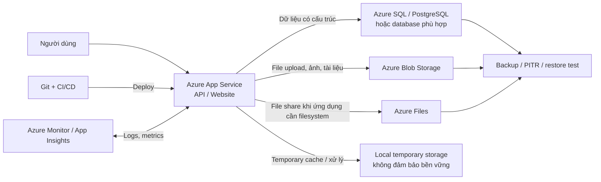

# Lưu trữ, backup và dữ liệu bền vững của ứng dụng

Một website trên Azure App Service có thể hoạt động bình thường nhiều tháng, nhưng khi triển khai bản mới, scale out hoặc thay instance, ảnh người dùng vừa upload đột nhiên biến mất. Một nhóm khác chỉ sao lưu mã nguồn, đến lúc xảy ra sự cố mới phát hiện dữ liệu trong database và file đính kèm không có bản khôi phục. Những vấn đề này xuất phát từ việc chưa phân biệt **nơi chạy ứng dụng**, **nơi lưu dữ liệu bền vững** và **cơ chế backup/restore**.

Trong module **CLOUD_PROVIDERS_AZURE**, bạn tìm hiểu Microsoft Azure từ subscription, resource group và Microsoft Entra ID đến mạng ảo, tính toán, lưu trữ, dữ liệu, triển khai, giám sát, bảo vệ và kiểm soát chi phí. Bài học thuộc chương **Ứng dụng web với App Service**, tập trung vào cách dùng đúng vùng lưu trữ của App Service, lưu dữ liệu ứng dụng bên ngoài runtime, thiết kế sao lưu và thực hành khôi phục có kiểm chứng.

## 1. Mục tiêu học tập

Sau bài học, bạn có thể:

- Phân biệt **file ứng dụng**, **temporary storage**, **persistent/shared content** và **dữ liệu nghiệp vụ bền vững**.
- Giải thích điều gì xảy ra với file khi App Service restart, scale out, redeploy hoặc dùng deployment slot.
- Chọn **Azure Blob Storage**, **Azure Files** hoặc database được quản lý cho loại dữ liệu thích hợp.
- Kết nối App Service với Azure Storage bằng **managed identity** và Azure RBAC khi dịch vụ hỗ trợ.
- Hiểu lợi ích và giới hạn của tính năng **App Service backup/restore** so với backup dữ liệu ngoài.
- Thiết kế mục tiêu **RPO/RTO**, retention, soft delete, versioning và quy trình phục hồi.
- Theo dõi quota lưu trữ, lỗi I/O, backup, chi phí và thực hiện diễn tập khôi phục.

## 2. App Service là nền tảng chạy ứng dụng, không phải một database

**Azure App Service** cung cấp môi trường được quản lý để chạy web application hoặc API trên Windows/Linux, có khả năng triển khai và mở rộng số instance. Một instance có hệ điều hành, tiến trình ứng dụng, file system và cấu hình riêng theo nền tảng. Không phải mọi đường dẫn có thể ghi trên instance đều là nơi phù hợp để giữ dữ liệu khách hàng.

Cần tách bốn khái niệm:

| Lớp dữ liệu | Ví dụ | Nơi nên quản lý |
|---|---|---|
| **Mã và artifact triển khai** | JAR, DLL, static assets, cấu hình không nhạy cảm | Git/CI-CD, artifact registry, gói triển khai và vùng content của App Service |
| **Dữ liệu tạm** | File xử lý trung gian, ảnh đang resize, cache có thể dựng lại | Temporary/local storage có vòng đời ngắn, giới hạn dung lượng |
| **Nội dung file chia sẻ của ứng dụng** | Một số file content cần các instance cùng đọc | Persistent/shared content của App Service hoặc Azure Files nếu đáp ứng yêu cầu |
| **Dữ liệu nghiệp vụ** | File người dùng, hóa đơn, transaction, hồ sơ, dữ liệu database | Azure Blob Storage, Azure Database hoặc dịch vụ lưu trữ bền vững được thiết kế riêng |

**Nguyên tắc kiến trúc:** ứng dụng nên có khả năng **thay mới instance mà không mất dữ liệu nghiệp vụ**. Code có thể redeploy từ nguồn; file upload và trạng thái nghiệp vụ phải có vòng đời độc lập với instance chạy App Service.



Đây là sơ đồ định hướng. Chỉ sử dụng những storage service thật sự cần thiết; một ứng dụng đơn giản có thể không cần Azure Files, và database có thể nằm ở một hệ thống khác.

## 3. Persistent storage và temporary storage của App Service

App Service cung cấp nhiều vùng filesystem với tính chất khác nhau. Tên đường dẫn, cách mount và quota có thể phụ thuộc Windows/Linux, loại container và App Service Plan. **Không nên coi toàn bộ ổ đĩa nhìn thấy từ code là storage bền vững.**

### 3.1. Vùng HOME / persistent content

Trong các mô hình App Service hỗ trợ, vùng **`HOME`** chứa nội dung được duy trì qua các lần khởi động lại ứng dụng thông thường và có thể được chia sẻ giữa các instance của cùng app. Những đường dẫn thường gặp:

- **Windows App Service:** vùng content điển hình là `D:\home` hoặc đường dẫn tương đương do biến môi trường `HOME` cung cấp.
- **Linux App Service:** vùng persistent content thường được mount ở `/home` trong những cấu hình hỗ trợ.
- **Linux custom container:** muốn dữ liệu trong `/home` được duy trì bằng nền tảng storage do App Service cung cấp, cần kiểm tra cách cấu hình **`WEBSITES_ENABLE_APP_SERVICE_STORAGE`** (thường là `true` khi bật persistence), khả năng hỗ trợ và hành vi thực tế của loại container/plan.

Ưu tiên lấy đường dẫn bằng biến môi trường `HOME` thay vì hard-code theo một OS. **Không nên dựa vào một giá trị mặc định suy ra từ môi trường Linux built-in để áp dụng cho mọi custom container**.

Vùng shared content hữu ích cho những file cần App Service phục vụ hoặc triển khai, nhưng không nên xem là một kho dữ liệu nghiệp vụ độc lập: vùng này có **quota**, hiệu năng và vòng đời liên quan đến App Service/plan, cũng như những hành vi khác với Blob Storage hoặc database. Không xóa app hoặc thay đổi cấu hình storage khi còn dữ liệu duy nhất chưa được di chuyển/backup.

### 3.2. Temporary / local storage

Vùng tạm được dùng cho nội dung có thể tạo lại: file giải nén, ảnh tạm trong pipeline resize, cache và dữ liệu của tiến trình.

- Trên Windows thường có vùng temp/local như `D:\local` hoặc đường dẫn do biến môi trường `TEMP`/`TMP` cung cấp.
- Trên Linux, những thư mục như `/tmp` thường được dùng cho file tạm, tùy image/container.
- Temporary storage **không được đảm bảo duy trì** khi worker restart, recycle, thay host hoặc scale; thường **không chia sẻ nhất quán** giữa các instance.
- Dung lượng temporary storage có giới hạn và có thể được nhiều app/process trong cùng plan sử dụng theo cơ chế nền tảng.

**Quy tắc:** có thể ghi file tạm để xử lý, nhưng phải upload kết quả cần giữ sang Blob/Files/database **trước khi** trả về trạng thái nghiệp vụ “hoàn thành”.

### 3.3. Tác động của restart, scale và deploy

| Sự kiện | Dữ liệu temporary/local | Vùng persistent/shared được hỗ trợ | Dữ liệu nằm ngoài App Service |
|---|---|---|---|
| Restart/recycle instance | Có thể mất | Thường được duy trì theo cơ chế nền tảng | Không phụ thuộc vào restart app |
| Scale out từ 1 lên nhiều instance | Không tự đồng bộ giữa instance | Có thể chia sẻ theo mô hình content được hỗ trợ | Các instance cùng truy cập qua API/kết nối |
| Đổi instance/host | Không bảo đảm tồn tại | Theo chính sách persistence của vùng mount | Tiếp tục tồn tại nếu không bị thao tác xóa |
| Redeploy phiên bản code | Có nguy cơ bị thay/ghi đè theo kiểu deploy | Cần xem chính sách deployment và đường dẫn | Không tự bị thay bằng artifact triển khai |
| Xóa hoặc tạo lại App Service | Không bảo đảm giữ | Có thể mất theo vòng đời tài nguyên | Độc lập hơn nhưng vẫn cần kiểm soát RBAC và backup |

Bảng mô tả **nguyên tắc vận hành**, không phải cam kết mọi đường dẫn của App Service sẽ có hành vi giống nhau. Với các loại image, container và gói triển khai khác nhau, phải kiểm thử trường hợp cụ thể của ứng dụng.

### 3.4. Khác biệt giữa Windows/Linux và custom container

Ứng dụng dùng **Run From Package** hoặc một kiểu triển khai content bất biến có thể có thư mục ứng dụng **read-only**. Trong trường hợp đó, ghi file upload vào thư mục code không chỉ thiếu tính bền vững mà còn có thể thất bại ngay. Cần tách khu vực ghi dữ liệu khỏi nơi chạy package.

Với **custom container**, filesystem bên trong container có thể thay đổi hoặc bị tạo lại khi container được thay thế. Cấu hình volume/mount là yếu tố quyết định file có được duy trì hay không, không phải việc file nằm trong một thư mục tên `data` hay `uploads`.

## 4. Chọn loại storage cho từng dữ liệu ứng dụng

Không có một loại lưu trữ duy nhất tối ưu cho tất cả nhu cầu.

| Nhu cầu | Lựa chọn thường phù hợp | Lưu ý |
|---|---|---|
| Ảnh, video, file upload, file xuất báo cáo | **Azure Blob Storage** | Truy cập bằng object API/SDK, có versioning, soft delete, tiering tùy cấu hình |
| Ứng dụng cũ yêu cầu đường dẫn file share hoặc thao tác filesystem | **Azure Files** | Cân nhắc SMB/NFS, mount và hiệu năng/permission model được hỗ trợ |
| Dữ liệu quan hệ, transaction, query, foreign key | **Azure SQL / Azure Database for PostgreSQL** | Cần backup/PITR và quản lý schema riêng |
| Session hoặc cache ngắn hạn chia sẻ giữa các instance | **Cache phân tán** như dịch vụ Redis phù hợp | Cache không phải nguồn dữ liệu duy nhất nếu có thể mất |
| Log và telemetry | **Azure Monitor / Application Insights / Log Analytics** | Có retention và phí ingestion; không thay thế backup dữ liệu |
| File trung gian, dữ liệu có thể tái tạo | **Temporary local storage** | Phải chịu được mất file khi restart/scale |
| Artifact build, container image | **Git/CI-CD, registry/artifact store** | Có version và rollback độc lập với dữ liệu người dùng |

### Vì sao Blob Storage thường tốt hơn `/home/uploads`?

Blob Storage thiết kế cho đối tượng có lifecycle riêng, có thể truy cập từ nhiều instance, cho phép phân quyền theo scope, áp dụng các khả năng bảo vệ dữ liệu được hỗ trợ và tách **vòng đời app** khỏi **vòng đời file**. Dùng Blob cũng giúp triển khai stateless app, scale out và blue-green deployment thuận tiện.

Ví dụ, hệ thống học tập có 3 App Service instances. Khi một người dùng upload `avatar.png`, API lưu vào Blob rồi lưu **blob name/URI và metadata** trong database. Dù request sau được xử lý bởi instance khác, ứng dụng vẫn truy cập đúng file qua storage API.

Không lưu **SAS URL dài hạn** hoặc account key làm khóa tham chiếu chính trong database; lưu object identifier bền vững và tạo URL truy cập có thời hạn khi cần.

### Azure Files và storage mount

App Service hỗ trợ **cấu hình storage mounts** cho các trường hợp, OS, plan và storage type nhất định. Bạn có thể dùng Azure Files khi ứng dụng thật sự cần filesystem chung, chẳng hạn đọc một tập file cấu hình hoặc tài sản tĩnh mà phần mềm cũ khó chuyển sang object API.

Tuy nhiên, mount không biến Azure Files thành một database: ứng dụng phải xử lý khóa file, ghi đồng thời, độ trễ mạng, permission và thất bại kết nối. Không giả định mọi loại Blob mount có semantics POSIX/SMB giống ổ đĩa truyền thống. Kiểm tra tính năng mount được **App Service OS/plan/storage protocol** hỗ trợ trước khi chọn.

## 5. Thiết kế dữ liệu bền vững khi scale nhiều instance

**Stateless compute** không có nghĩa ứng dụng không có dữ liệu; nó có nghĩa state quan trọng được đưa ra hệ thống phù hợp, còn instance có thể thay thế mà không mất trạng thái nghiệp vụ.

Một thiết kế web app có thể dùng:

```text
Client
  |
  v
App Service (instance A / B / C)
  |
  +--> Database: user, order, file metadata
  |
  +--> Blob Storage: file thực tế
  |
  +--> Distributed cache: session/cache có thể tái tạo
  |
  +--> Logs/telemetry: Application Insights
```

**Các rủi ro cần xử lý:**

1. Hai request upload cùng tên file: dùng object key duy nhất, điều kiện ghi hoặc versioning.
2. Database ghi metadata thành công nhưng blob upload lỗi: cần xử lý trạng thái trung gian, retry/cleanup hoặc thiết kế eventual consistency.
3. Blob upload thành công nhưng cập nhật database lỗi: ghi nhận orphaned blob và có job dọn dẹp có kiểm soát.
4. Ứng dụng trả thành công trước khi dữ liệu được ghi bền vững: nguy cơ mất file khi instance recycle.
5. Một instance giữ session local: request tới instance khác có thể mất trạng thái; chuyển sang cookie token phù hợp hoặc cache/session store phân tán.

Với hệ thống có yêu cầu nhất quán cao, cần thiết kế workflow và trạng thái giao dịch; **không giả định Blob Storage và database có một giao dịch ACID dùng chung**.

## 6. Thực hành: App Service lưu file vào Azure Blob Storage

**Tình huống:** một API Java chạy trên App Service phải lưu file người dùng vào container `uploads`. Dữ liệu phải tồn tại khi App Service restart, redeploy, scale out hoặc thay deployment slot. Thay vì lưu file duy nhất trong `/tmp` hay thư mục code, API dùng **Azure Blob Storage**.

### Chuẩn bị tài nguyên

Giả sử môi trường lab có:

| Tài nguyên | Giá trị minh họa |
|---|---|
| Resource group | `rg-web-lab` |
| App Service | `web-uploads-demo` |
| Storage account | `stwebuploads01` |
| Blob container | `uploads` |
| Danh tính chạy app | **System-assigned managed identity** |
| Quyền dữ liệu | **Storage Blob Data Contributor** tại scope container |

Các tên trên chỉ để học, cần thay bằng tên tài nguyên có thật của tổ chức. Trước khi thực hành, xác nhận subscription, quyền quản lý identity/role assignment và các thiết lập mạng cho phép ứng dụng truy cập Storage.

### Bước 1. Bật managed identity

Trong [Azure portal](https://portal.azure.com/):

1. Mở App Service đích.
2. Vào **Identity** và bật **System assigned**.
3. Lưu, xác nhận identity được tạo và ghi lại **Principal ID**.
4. Đảm bảo Storage account và container `uploads` đã tồn tại.

Một cách tương đương bằng Azure CLI, dùng trong môi trường được phép tạo/thay đổi cấu hình:

```bash
az login
az account set --subscription "<subscription-id>"

az webapp identity assign \
  --resource-group "rg-web-lab" \
  --name "web-uploads-demo"

# Đọc lại principal ID của managed identity
az webapp identity show \
  --resource-group "rg-web-lab" \
  --name "web-uploads-demo" \
  --query principalId \
  --output tsv
```

**Principal ID** là định danh của security principal dùng để cấp Azure RBAC; không nhầm với client ID của app registration hoặc resource ID của chính App Service. System-assigned identity có vòng đời gắn với App Service; nếu xóa và tạo lại app, cần xem xét identity và role assignment mới.

### Bước 2. Cấp quyền dữ liệu đúng scope

Để app upload blob, role thường dùng là **Storage Blob Data Contributor**. Có thể cấp tại **container** thay vì toàn storage account để giảm quyền. Người thực hiện phải có quyền quản lý role assignment, ví dụ Role Based Access Control Administrator hoặc Owner tại scope phù hợp.

```bash
PRINCIPAL_ID=$(az webapp identity show \
  --resource-group "rg-web-lab" \
  --name "web-uploads-demo" \
  --query principalId --output tsv)

STORAGE_ID=$(az storage account show \
  --resource-group "rg-web-lab" \
  --name "stwebuploads01" \
  --query id --output tsv)

CONTAINER_SCOPE="$STORAGE_ID/blobServices/default/containers/uploads"

az role assignment create \
  --assignee-object-id "$PRINCIPAL_ID" \
  --assignee-principal-type ServicePrincipal \
  --role "Storage Blob Data Contributor" \
  --scope "$CONTAINER_SCOPE"

# Xem assignment tại scope, gồm role được kế thừa
az role assignment list \
  --scope "$CONTAINER_SCOPE" \
  --include-inherited \
  --output table
```

Role được cấp có thể cần thời gian đồng bộ trước khi request Blob có hiệu lực. **Azure RBAC Contributor** ở resource group không tự động là quyền đọc/ghi Blob qua Microsoft Entra ID; cần phân biệt management plane và data plane.

### Bước 3. Upload bằng Java SDK

Trong ứng dụng Java, dùng các thư viện **`azure-identity`** và **`azure-storage-blob`** ở phiên bản SDK được tổ chức hỗ trợ. Ví dụ dưới đây minh họa cách xử lý file tạm rồi chuyển dữ liệu sang Blob. Mẫu tạo file text thử nghiệm, không phải endpoint nhận file thật từ Internet.

```java
import com.azure.identity.DefaultAzureCredentialBuilder;
import com.azure.storage.blob.BlobClient;
import com.azure.storage.blob.BlobServiceClient;
import com.azure.storage.blob.BlobServiceClientBuilder;

import java.nio.charset.StandardCharsets;
import java.nio.file.Files;
import java.nio.file.Path;
import java.util.UUID;

public class DurableUploadExample {
    public static void main(String[] args) throws Exception {
        String storageAccount = "stwebuploads01";
        String containerName = "uploads";
        String blobName = "samples/" + UUID.randomUUID() + ".txt";

        BlobServiceClient service = new BlobServiceClientBuilder()
            .endpoint("https://" + storageAccount + ".blob.core.windows.net/")
            .credential(new DefaultAzureCredentialBuilder().build())
            .buildClient();

        BlobClient blob = service
            .getBlobContainerClient(containerName)
            .getBlobClient(blobName);

        // File tạm chỉ phục vụ giai đoạn xử lý hiện tại.
        Path temporaryFile = Files.createTempFile("web-upload-", ".txt");
        try {
            Files.writeString(temporaryFile, "Demo App Service upload",
                    StandardCharsets.UTF_8);

            // Không ghi đè nếu blob cùng tên đã tồn tại.
            blob.uploadFromFile(temporaryFile.toString(), false);

            // Chỉ ghi metadata nghiệp vụ khi upload thành công.
            System.out.println("Uploaded blob: " + blobName);
        } finally {
            Files.deleteIfExists(temporaryFile);
        }
    }
}
```

**Điểm quan trọng của ví dụ:**

- `DefaultAzureCredential` có thể dùng developer credential ở local và managed identity trong Azure khi được cấu hình. **Principal local khác với identity của App Service**, nên cần test thực tế trên môi trường triển khai.
- File tạm được tạo để xử lý, nhưng kết quả cần giữ đã được upload thành object của Blob Storage.
- Tên blob có UUID giúp giảm xung đột khi nhiều instance cùng ghi. Với dữ liệu nghiệp vụ cần quy tắc tên, versioning hoặc điều kiện ghi thích hợp.
- `uploadFromFile(..., false)` tránh ghi đè file cùng tên theo API ví dụ. Trong production, cần xử lý riêng trường hợp object đã tồn tại hoặc upload thất bại.
- File thực tế cần được xác minh loại nội dung, kích thước, antivirus/malware scanning theo chính sách và giới hạn upload; không tin tên tệp do người dùng cung cấp.
- Không lưu account key trong source code. Khi dùng user-assigned identity, cần chọn đúng client ID trong cấu hình `DefaultAzureCredential` để tránh nhầm danh tính.

### Bước 4. Kiểm tra mạng và truy cập

Nếu Storage account sử dụng **firewall/private endpoint**, phải bảo đảm App Service có đường mạng tới endpoint Blob và DNS phân giải phù hợp. **Có Azure RBAC role không vượt qua được firewall**. Với kiến trúc private endpoint, đánh giá App Service VNet integration, routing, private DNS và cơ chế outbound cần thiết.

Nếu request trả `403`, xác minh lần lượt identity thực tế, role/scope, thời gian propagation, public network access, DNS và đường mạng. Không khắc phục bằng cách cấp Owner toàn subscription hoặc bật truy cập Storage công khai vô điều kiện.

## 7. Gắn Azure Files vào App Service khi cần đường dẫn filesystem

Không phải ứng dụng nào cũng dễ chuyển từ file API sang Blob SDK. Một số ứng dụng cũ yêu cầu cấu trúc thư mục và thao tác đọc/ghi file trên một đường dẫn ổn định. Khi **OS, plan và storage type** hỗ trợ, App Service cho phép cấu hình **Azure Storage mounts** từ portal để app nhìn thấy dữ liệu qua một đường dẫn.

Quy trình thiết kế:

1. Tạo Azure Files share với dung lượng, hiệu năng và cơ chế bảo vệ phù hợp.
2. Mở App Service → **Configuration** hoặc mục **Path mappings / Azure Storage mounts** theo giao diện hiện hành.
3. Thêm mount, chọn tài khoản lưu trữ và file share được hỗ trợ, chỉ định **mount path** không xung đột đường dẫn hệ thống.
4. Cấu hình phương thức xác thực theo tính năng đang dùng, bảo vệ credential/key nếu loại mount yêu cầu; không mặc định mount hỗ trợ managed identity ở mọi giao thức.
5. Kiểm tra app đọc/ghi trên mount, khởi động lại, scale out và thử truy cập từ nhiều instance.
6. Cấu hình **backup của Azure Files share** độc lập với backup App Service, có retention và thử restore file thực tế.

### Rủi ro của filesystem chia sẻ

| Tình huống | Rủi ro | Cách giảm thiểu |
|---|---|---|
| Hai instance cùng sửa một file | Ghi chồng hoặc file ở trạng thái không nhất quán | Thiết kế locking/atomic write hoặc chuyển mô hình lưu dữ liệu |
| Azure Files không kết nối được | App đọc/ghi thất bại, timeout | Retry có giới hạn, cảnh báo, phương án failover |
| File bị xóa nhầm | Mất dữ liệu trên share dùng chung | Snapshot/backup theo khả năng, least privilege |
| File share tăng dung lượng | Chi phí và quota tăng | Metrics, lifecycle, dọn dữ liệu có kiểm soát |
| App được deploy ở slot khác | Có thể trỏ nhầm môi trường hoặc mount khác | Kiểm tra cấu hình slot và thực hành swap/rollback |

**Không ghi trạng thái giao dịch quan trọng vào một file chia sẻ nếu bài toán yêu cầu tính nhất quán ở cấp database.** Azure Files giải quyết khả năng lưu file theo giao thức phù hợp, không thay thế cơ chế transaction của hệ quản trị cơ sở dữ liệu.

## 8. Hiểu đúng App Service backup/restore

App Service có các khả năng **backup và restore** được cung cấp theo **plan/tier, loại ứng dụng, OS và phiên bản tính năng**. Có thể có **automatic backup** và **custom backup** trong những cấu hình hỗ trợ. Bạn phải kiểm tra tính khả dụng thực tế trong portal/tài liệu dịch vụ trước khi thiết kế RPO/RTO.

### App Service backup có thể bảo vệ những gì?

Tùy chế độ backup, phiên bản và cấu hình, bản backup có thể bao gồm **nội dung site**, một số **cấu hình ứng dụng** và, đối với những tính năng/tích hợp được hỗ trợ và cấu hình rõ ràng, **dữ liệu database liên quan**.

Nhưng **không giả định** một bản backup App Service bao gồm tất cả:

- Dữ liệu của Azure Blob Storage, Azure Files mount hoặc một storage account bên ngoài.
- Mọi cơ sở dữ liệu Azure SQL, PostgreSQL, MySQL hoặc hệ thống dữ liệu khác mà app kết nối.
- Bí mật trong Key Vault, danh tính/role assignment và cấu hình mạng của những tài nguyên khác.
- Tất cả lịch sử log, telemetry, deployment pipeline hoặc artifact được lưu ở dịch vụ ngoài.
- Dữ liệu temporary/local đã mất trước lúc backup.

Đối với **Azure SQL hoặc PostgreSQL**, thường phải cấu hình và kiểm tra **backup/point-in-time restore (PITR) của chính dịch vụ database**. Đối với **Blob Storage**, dùng các khả năng bảo vệ dữ liệu riêng như versioning, soft delete hoặc backup/PITR khi được hỗ trợ. Đối với **Azure Files**, dùng share snapshot/backup phù hợp.

### Automatic backup và custom backup

| Khía cạnh | Automatic backup | Custom backup |
|---|---|---|
| Cách hoạt động | Nền tảng duy trì bản sao theo tính năng/tier hỗ trợ | Người vận hành chủ động lập lịch hoặc yêu cầu sao lưu theo chế độ hỗ trợ |
| Cấu hình | Có thể có sẵn theo điều kiện của App Service Plan | Có thể cần chọn storage container, xác thực và cấu hình backup |
| Retention | Theo chính sách và giới hạn tính năng | Theo chính sách lưu giữ được hỗ trợ/cấu hình |
| Nơi lưu | Theo khả năng nền tảng của chế độ backup | Có thể liên quan Azure Storage account đã chọn |
| Mục đích | Khôi phục nội dung/cấu hình app trong phạm vi tính năng | Kiểm soát lịch và bản backup để phục hồi theo kế hoạch |

**Giới hạn backup** có thể bao gồm tổng dung lượng, loại site, phương thức triển khai hoặc loại database hỗ trợ. Những giới hạn này có thể thay đổi theo plan và phiên bản tính năng; **không đưa một kích thước hay lịch backup cố định vào thiết kế nếu chưa xác minh** trên App Service thực tế.

## 9. Tạo backup và thử restore trên Azure portal

Thực hành chỉ nên triển khai trên **app thử nghiệm** hoặc môi trường được phép quản trị. Restore có thể thay đổi nội dung/cấu hình ứng dụng và gây gián đoạn nếu ghi đè đích.

### Bước 1. Kiểm tra khả năng backup

1. Mở App Service trên [Azure portal](https://portal.azure.com/) và xác nhận subscription/resource group.
2. Kiểm tra **App Service Plan**, OS và kiểu triển khai của ứng dụng.
3. Tìm mục **Backups** hoặc chức năng sao lưu được portal cung cấp.
4. Kiểm tra backup feature có khả dụng với plan/OS hiện tại hay không; nếu không, cần dùng chiến lược bảo vệ mã nguồn/cấu hình/dữ liệu ngoài phù hợp thay vì giả định backup App Service bắt buộc tồn tại.
5. Ghi lại vùng dữ liệu cần bảo vệ và những nguồn **không nằm trong bản backup**.

### Bước 2. Tạo hoặc kiểm tra một bản backup

1. Với chế độ **automatic backup** được hỗ trợ, kiểm tra danh sách bản backup và thông tin retention.
2. Với chế độ **custom backup** được hỗ trợ, cấu hình nơi lưu và lịch/backup thủ công theo yêu cầu portal, cấp quyền cần thiết và chọn đúng đối tượng backup.
3. Theo dõi trạng thái; đợi thông báo thành công thực tế thay vì suy từ việc đã bấm **Backup**.
4. Ghi lại timestamp UTC, loại backup, kết quả và tài nguyên được bảo vệ.
5. Nếu backup dựa vào container/quyền truy cập Storage, kiểm tra network, xác thực và thời hạn của thông tin truy cập liên quan.

**Lưu ý bảo mật:** một số luồng backup cần cách xác thực hoặc network access riêng với ứng dụng. Không nên vô hiệu hóa Storage firewall hay chia sẻ account key chỉ vì một lần backup lỗi; xác định yêu cầu chính xác của tính năng backup đang sử dụng.

### Bước 3. Thử restore an toàn

1. Chọn bản backup của app lab với thời điểm rõ ràng.
2. Ưu tiên **restore sang một app/test environment riêng** khi tính năng và quota hỗ trợ, thay vì ghi đè ngay production.
3. Xác định mục nào sẽ được restore: content, cấu hình hoặc đối tượng được tính năng hỗ trợ.
4. Khôi phục theo hướng dẫn portal và đợi hoàn tất.
5. Chạy smoke test: endpoint trả kết quả, phiên bản app đúng, identity/connection hoạt động và dữ liệu mẫu có thể đọc.
6. So sánh với mốc RPO/RTO, ghi lại tổng thời gian và những việc thủ công phải bổ sung.

Một backup chỉ có ý nghĩa khi **khôi phục được và ứng dụng hoạt động đúng sau restore**. Nếu restore ứng dụng nhưng database vẫn ở phiên bản mới hoặc file người dùng chưa được phục hồi, hệ thống có thể mất tính nhất quán dù website khởi động thành công.

## 10. Thiết kế RPO, RTO và chính sách sao lưu

Hai chỉ số cần xác định **trước sự cố**:

- **Recovery Point Objective (RPO):** mức mất dữ liệu tối đa được chấp nhận, tính theo thời gian. RPO 1 giờ nghĩa là doanh nghiệp phải chuẩn bị để phục hồi với mức mất dữ liệu không quá khoảng một giờ theo mục tiêu đã định.
- **Recovery Time Objective (RTO):** thời gian tối đa mục tiêu để dịch vụ trở lại trạng thái hoạt động đáp ứng yêu cầu sau một sự cố.

**Ví dụ:** website bán hàng cần RPO **15 phút** cho đơn hàng, RTO **2 giờ** cho dịch vụ đặt hàng. File ảnh sản phẩm có thể chấp nhận RPO dài hơn nếu có nguồn tạo lại, trong khi giao dịch thanh toán không thể tùy tiện mất dữ liệu.

Một snapshot hoặc bản backup database chụp mỗi 24 giờ **không đáp ứng RPO 15 phút** khi đó là cơ chế bảo vệ duy nhất. Tương tự, có backup đúng mỗi giờ nhưng phục hồi mất 8 giờ thì không đáp ứng RTO 2 giờ.

### Lập ma trận bảo vệ theo từng loại dữ liệu

| Dữ liệu | Rủi ro chính | Cơ chế bảo vệ cần xem xét | Kiểm chứng |
|---|---|---|---|
| Source code và artifact | Deploy lỗi, mất pipeline | Git, versioned artifacts, release/rollback | Deploy lại app từ phiên bản đã phê duyệt |
| Cấu hình App Service | Thay đổi nhầm app settings, kết nối | IaC, cấu hình versioned, backup tính năng hỗ trợ | Tạo lại môi trường test từ IaC |
| File upload trong Blob | Xóa/ghi đè nhầm, ransomware, mất account | Blob soft delete, versioning, backup/PITR khi hỗ trợ | Restore vài file và kiểm tra nội dung |
| File share Azure Files | Xóa/sửa file trên share | Azure Files snapshots/backup theo cơ chế hỗ trợ | Restore file/thư mục |
| Database | Xóa record, migration sai, lỗi logic | Backup/PITR của database, replication phù hợp | Restore tại mốc thời gian và kiểm tra schema |
| Secret/credential | Mất key hoặc quyền truy cập | Key Vault protection, vòng đời/rotation, quy trình khôi phục | Kiểm tra identity truy cập lại được |
| Logs/audit | Mất dấu vết điều tra | Diagnostic settings, retention, export khi cần | Truy vấn được log đúng khoảng thời gian |

Thời hạn lưu giữ (*retention*) nên bao phủ cả sự cố được phát hiện chậm. Backup giữ quá ngắn có thể khiến tổ chức chỉ còn các bản đã chứa dữ liệu hỏng; giữ quá dài lại tăng chi phí và rủi ro lưu dữ liệu không cần thiết.

### Ước lượng RTO

Một công thức lập kế hoạch đơn giản:

\[
\text{RTO thực tế} \approx \text{phát hiện} + \text{quyết định} +
\text{khôi phục hạ tầng} + \text{khôi phục dữ liệu} + \text{kiểm thử}
\]

Ví dụ: phát hiện/điều phối 20 phút, dựng app 15 phút, restore database 45 phút, kiểm thử 30 phút. Tổng thời gian **110 phút**, chưa kể độ trễ phát sinh. Nếu RTO mục tiêu là 2 giờ, chỉ còn 10 phút dự phòng; cần diễn tập để xác minh và có chiến lược rút ngắn.

RPO/RTO là **mục tiêu nghiệp vụ**, không phải chỉ số Azure tự cam kết cho từng ứng dụng. Chúng phải được gắn với thiết kế storage, backup, nhân sự trực và kết quả restore test.

## 11. Bảo vệ dữ liệu trên Azure Storage và database

### 11.1. Soft delete, versioning, snapshots và backup khác nhau thế nào?

| Cơ chế | Giải quyết chủ yếu | Không nên nhầm với |
|---|---|---|
| **Blob soft delete** | Khôi phục blob bị xóa trong khoảng giữ lại được cấu hình | Bản backup độc lập khỏi toàn bộ storage account |
| **Blob versioning** | Giữ các phiên bản cũ khi object bị cập nhật/ghi đè | Khôi phục toàn bộ hệ thống dữ liệu tại mốc nhất quán |
| **Blob snapshots** | Lưu trạng thái điểm thời gian của blob khi tạo snapshot | Backup tất cả dịch vụ bên ngoài |
| **Blob point-in-time restore/backup** | Khôi phục theo khả năng và điều kiện của tính năng được hỗ trợ | Tính năng mặc định cho mọi account hoặc dữ liệu |
| **Azure Files share snapshots/backup** | Bảo vệ nội dung file share theo lịch/chính sách | App Service backup |
| **Database automated backup/PITR** | Khôi phục dữ liệu database đến mốc phù hợp | Bản lưu file trong App Service |
| **Geo-redundant storage** | Duy trì bản sao theo vùng để tăng độ bền/khả dụng | Chống mọi thao tác xóa/ghi sai đã được đồng bộ |

**Replication không thay thế backup.** Nếu ứng dụng xóa nhầm một file hoặc ghi sai dữ liệu, thay đổi có thể được nhân bản sang các bản sao. Cần một khả năng **khôi phục phiên bản cũ hoặc dữ liệu tại thời điểm trước lỗi**, với quyền quản lý và thời hạn lưu giữ được kiểm soát.

### 11.2. Quyền truy cập dữ liệu

Ứng dụng cần được cấp quyền theo **least privilege**:

- App đọc ảnh tĩnh: thường chỉ cần **Storage Blob Data Reader** tại container phù hợp.
- API nhận upload: dùng **Storage Blob Data Contributor** ở container upload, không mặc định ở subscription.
- Công cụ backup: có quyền cần thiết để ghi, đọc và khôi phục theo chức năng; danh tính backup nên được tách khỏi danh tính ứng dụng nếu yêu cầu bảo mật.
- Dịch vụ database: dùng cơ chế danh tính/quyền riêng, không dùng Storage Blob RBAC thay cho quyền SQL.

Ưu tiên **managed identity** và các cơ chế xác thực Entra được dịch vụ hỗ trợ. Không đưa storage account key hoặc SAS URL dài hạn vào code, file cấu hình trong repository hoặc logs. Khi dùng SAS để cấp URL tải xuống, tạo quyền và thời hạn tối thiểu phù hợp.

**Quyền truy cập và network là hai lớp riêng:** một identity có role đúng vẫn có thể không kết nối được vì firewall, VNet integration, DNS hay private endpoint. Ngược lại, kết nối mạng thông suốt không có nghĩa có quyền đọc dữ liệu.

### 11.3. Bảo vệ trước xóa nhầm và thay đổi cấu hình

Đối với dữ liệu quan trọng, nên cân nhắc:

1. Bật soft delete/versioning hoặc backup tương ứng trước khi hệ thống đi vào hoạt động.
2. Phân tách quyền **ghi dữ liệu** của ứng dụng với quyền **xóa cấu hình bảo vệ** của quản trị viên.
3. Kiểm soát người có quyền thay đổi retention, xóa account hoặc chỉnh backup policy.
4. Giám sát Activity Log, Storage logs và log database theo khả năng dịch vụ.
5. Thử phục hồi file đã xóa nhầm và database bị cập nhật sai trên môi trường test.

Các tính năng bảo vệ vẫn có giới hạn theo loại account, access tier, region, API và chế độ backup. Kiểm tra giới hạn thực tế trước khi cam kết mục tiêu phục hồi.

## 12. Deployment slots, CI/CD và dữ liệu bền vững

**Deployment slot** giúp thử phiên bản mới trên một hostname/môi trường slot, sau đó **swap** để chuyển bản mới sang production trong cấu hình hỗ trợ. Đây là cơ chế giảm rủi ro triển khai mã, **không phải** phương án backup dữ liệu nghiệp vụ.

Những khác biệt cần nhớ:

- **Code/artifact** có thể thay theo slot và quá trình swap.
- **App settings/connection strings** có thể được đánh dấu **deployment slot setting** (*sticky*) theo khả năng nền tảng, giúp giữ cấu hình môi trường cần thiết với slot.
- **Database, Blob, file share bên ngoài** tồn tại độc lập với hành động swap; nếu staging và production trỏ cùng dữ liệu, bản staging có thể **chỉnh sửa dữ liệu production** trước khi swap.
- **Schema migration** và API compatibility cần chiến lược riêng. Rollback code không tự rollback database.

### Ví dụ lỗi thiết kế

Một nhóm tạo slot `staging`, sao chép chuỗi kết nối production sang staging rồi chạy job “dọn dữ liệu cũ” để kiểm thử. Job xóa dữ liệu thật của production vì hai slot cùng trỏ đến một database.

**Thiết kế tốt hơn:** dùng database/container riêng cho staging, giữ configuration sticky theo môi trường; khi cần kiểm thử dữ liệu gần production thì sử dụng bản sao đã khử dữ liệu nhạy cảm, giới hạn quyền và áp dụng lịch xóa rõ ràng.

### Kế hoạch triển khai an toàn

1. Deploy version mới vào staging và kiểm tra health endpoint.
2. Kiểm tra slot settings, identity, Storage account và connection tới database đúng môi trường.
3. Nếu có database migration, áp dụng phương pháp **backward-compatible / expand-and-contract** phù hợp và có backup/restore plan.
4. Swap theo quy trình được phê duyệt; theo dõi error rate, latency và database migrations.
5. Nếu lỗi, rollback mã theo khả năng triển khai; **không giả định rollback mã đồng nghĩa khôi phục dữ liệu trước đó**.

## 13. Giám sát dung lượng lưu trữ, lỗi và backup

Một chiến lược lưu trữ tốt phải có **quan sát được**. Khi thiếu metrics, ứng dụng có thể ngừng ghi file vì đầy vùng temporary storage hoặc backup liên tục thất bại mà không ai phát hiện.

| Nguồn | Theo dõi | Hành động khi bất thường |
|---|---|---|
| App Service metrics | Dung lượng file system, CPU/memory, HTTP errors, response time (theo metrics hỗ trợ) | Kiểm tra quota, quá tải, thiết lập app |
| Guest/app logs | Lỗi `ENOSPC`, `IOException`, timeout khi upload | Xác định temp đầy, mount lỗi hay Storage/network lỗi |
| Azure Blob Storage metrics/logs | Transactions, ingress/egress, latency, 4xx/5xx, capacity | Kiểm tra RBAC, firewall, throttling và dữ liệu |
| Azure Files metrics/logs | Share capacity, latency, lỗi truy cập | Xem mount, giao thức, quyền và network |
| Database metrics/backup | Storage, connection count, backup/restore point, backup status | Mở rộng hoặc điều tra backup thất bại |
| App Service backup view | Thời điểm, trạng thái backup và retention | Cảnh báo khi quá hạn hoặc lỗi |
| Azure Monitor / Application Insights | Exception, traces, request correlation | Phân biệt lỗi ứng dụng và dịch vụ phụ thuộc |

App Service metrics cụ thể thay đổi theo OS, plan và loại ứng dụng. **Không giả định App Service file system quota và dung lượng Storage account ngoài là cùng một chỉ số.** Nên có cảnh báo riêng theo từng tài nguyên.

### Azure CLI: kiểm tra app và danh sách metric hỗ trợ

Đoạn lệnh dưới đây chỉ đọc thông tin quản lý; không in tất cả app settings để tránh vô tình lộ thông tin nhạy cảm.

```bash
az login
az account set --subscription "<subscription-id>"

APP_ID=$(az webapp show \
  --resource-group "rg-web-lab" \
  --name "web-uploads-demo" \
  --query id --output tsv)

# Xác nhận ứng dụng, loại runtime và trạng thái
az webapp show \
  --resource-group "rg-web-lab" \
  --name "web-uploads-demo" \
  --query "{name:name,kind:kind,state:state,hostname:defaultHostName}" \
  --output json

# Xem các metric name thực sự được Azure Monitor công bố
az monitor metrics list-definitions \
  --resource "$APP_ID" \
  --output table
```

Sau khi biết metric name hỗ trợ, có thể cấu hình chart và alert theo thời gian. Một lần đo lưu trữ ở một thời điểm không thể chứng minh ứng dụng sẽ đủ dung lượng vào mùa cao điểm.

### Log và retention

Application logs trên filesystem có thể bị xoay vòng hoặc mất theo vòng đời instance, tùy cấu hình. Với production, cân nhắc **Application Insights**, diagnostic settings và nơi lưu log phù hợp. Nếu log chứa thông tin cá nhân, dữ liệu nhạy cảm hoặc token, cần lọc/redact, phân quyền truy cập và tuân thủ chính sách retention.

Không dùng log như một bản backup của database: log hữu ích để điều tra và tái hiện, nhưng không bảo đảm đủ dữ liệu để phục hồi trạng thái nghiệp vụ.

## 14. Playbook khôi phục: mã mới gây lỗi và dữ liệu bị ghi sai

**Bối cảnh:** sau khi triển khai phiên bản mới, API đơn hàng gặp lỗi; một số bản ghi trong database bị cập nhật sai và vài file hóa đơn đã bị ghi đè.

### Bước 1. Xác nhận sự cố và giới hạn thiệt hại

- Mở incident, ghi UTC timestamp, phiên bản deploy, môi trường, loại dữ liệu bị ảnh hưởng và phạm vi khách hàng.
- Dừng luồng ghi sai theo phương án đã duyệt; có thể tạm vô hiệu hóa tính năng hoặc chuyển lưu lượng nếu kiến trúc cho phép.
- Giữ log và bằng chứng cần thiết trước khi thay đổi cấu hình diện rộng.

### Bước 2. Đánh giá theo từng nguồn dữ liệu

| Thành phần | Câu hỏi điều tra | Phương án cần xem |
|---|---|---|
| App Service artifact | Bản code nào gây lỗi? | Rollback phiên bản deploy hoặc slot |
| Database đơn hàng | Bản ghi nào bị sửa từ thời điểm nào? | Database PITR hoặc khôi phục chọn lọc theo quy trình |
| Blob hóa đơn | Object nào bị ghi đè/xóa? | Versioning, soft delete, backup/point-in-time restore được hỗ trợ |
| App settings | Connection trỏ nhầm database/Storage? | IaC/change history, slot settings và audit |
| File tạm | Có dữ liệu duy nhất chưa chuyển lên storage? | Đánh giá khả năng mất dữ liệu, không giả định có thể phục hồi |

### Bước 3. Khôi phục trong môi trường tách biệt

1. Chọn restore point phù hợp với phạm vi và RPO.
2. Restore database hoặc dữ liệu bị ảnh hưởng vào môi trường an toàn khi khả thi.
3. So sánh dữ liệu trước/sau, tránh ghi đè những thay đổi hợp lệ xảy ra sau thời điểm sự cố.
4. Khôi phục bản code ổn định, cấu hình đúng và xác minh backward compatibility.
5. Chạy smoke test, kiểm tra một số giao dịch và file có hash hoặc metadata đã biết.

### Bước 4. Trả lại lưu lượng và kiểm soát hậu sự cố

Chỉ đưa hệ thống trở lại bình thường khi người phụ trách dữ liệu xác nhận kết quả kiểm thử. Theo dõi tỷ lệ lỗi, latency, database consistency và Storage operations. Ghi thời gian phục hồi thực tế so với RTO, mức dữ liệu mất thực tế so với RPO; sau đó cập nhật runbook, kiểm soát triển khai và retention.

**Sai lầm nghiêm trọng:** chỉ dùng “Swap back” để đưa code cũ trở lại rồi đóng incident, trong khi database hoặc Blob đã chứa dữ liệu sai. **Rollback code** và **restore dữ liệu** là hai quyết định độc lập cần được phối hợp.

## 15. Tối ưu chi phí và quản lý vòng đời

Kiến trúc lưu trữ ngoài App Service giúp mở rộng và khôi phục tốt hơn, nhưng bổ sung chi phí cần quản trị.

- **App Service Plan:** phí compute và tier; dung lượng nội dung/temporary có quota theo plan.
- **Blob Storage:** dung lượng, access tier, transactions, retrieval/rehydration và network egress theo cấu hình.
- **Azure Files:** dung lượng/provisioned capacity, transactions, snapshots và backup tùy loại share.
- **Database:** compute, storage, backup retention và khả năng HA/geo-replication.
- **Giám sát và backup:** log ingestion, retention, kho backup, phiên restore và môi trường kiểm thử.

Để tối ưu:

1. Phân loại dữ liệu theo giá trị, tần suất truy cập, thời gian lưu và yêu cầu pháp lý.
2. Áp dụng lifecycle/tiering cho Blob khi phù hợp; không chuyển file đang được truy cập thường xuyên sang tier có độ trễ/chi phí truy xuất không đáp ứng yêu cầu.
3. Đặt retention cho backups, logs và phiên bản file; kiểm soát soft-deleted data vẫn chiếm dung lượng.
4. Theo dõi dung lượng theo app/container để tránh đội này gây chi phí bất ngờ cho đội khác.
5. Dọn môi trường lab, nhưng **không xóa storage account chỉ vì đã xóa App Service** khi dữ liệu vẫn cần giữ.

Chi phí thực tế phụ thuộc region, tier, truy cập và chính sách bảo vệ đang bật. Cần xem bảng giá và Cost Management theo subscription đang sử dụng thay vì đưa một đơn giá cố định vào thiết kế.

## 16. Bài tập thực hành và tự kiểm tra

### Bài tập A: Phân loại dữ liệu

Một website có bốn loại file: ảnh đại diện do khách hàng tải lên, log truy cập, file tạm tạo PDF và mã nguồn ứng dụng. Hãy chọn vị trí phù hợp cho mỗi loại.

**Gợi ý:** ảnh → Blob Storage; log → telemetry/Log Analytics theo yêu cầu; file tạo PDF trung gian → temp, kết quả cần giữ → Blob; mã nguồn → Git/artifact pipeline. Không dùng vùng temporary làm kho ảnh duy nhất.

### Bài tập B: Mất file khi scale out

Ứng dụng có hai instance. Người dùng upload file lên instance A, nhưng request tải file sau đó đi đến instance B và nhận `404`. Nguyên nhân có thể là gì?

**Gợi ý:** file được lưu trong filesystem local của instance A, không phải shared storage hoặc Blob. Chuyển file sang nơi lưu trữ bền vững, cập nhật metadata và kiểm tra tính nhất quán.

### Bài tập C: App Service backup có đủ không?

API chạy App Service, lưu đơn hàng trong PostgreSQL và hóa đơn trong Blob Storage. Đội vận hành chỉ bật backup tính năng App Service, chưa kiểm tra backup database hoặc Blob. Điều gì còn thiếu?

**Gợi ý:** cần backup/PITR cho PostgreSQL và bảo vệ/restore plan cho Blob độc lập, sau đó kiểm thử khôi phục phối hợp để đáp ứng RPO/RTO.

### Bài tập D: Phân quyền upload

API dùng system-assigned managed identity được cấp **Storage Blob Data Reader** tại container `uploads`. Lệnh ghi Blob trả `403 AuthorizationPermissionMismatch`. Nên kiểm tra gì?

**Gợi ý:** quyền đọc không có thao tác ghi; cấp role dữ liệu có quyền phù hợp như Storage Blob Data Contributor tại scope tối thiểu, đồng thời kiểm tra principal, propagation, network và endpoint.

### Bài tập E: Tính RTO

Một incident được phát hiện sau 15 phút, chuẩn bị restore cần 20 phút, database phục hồi mất 50 phút và smoke test mất 25 phút. Tổng thời gian bao lâu? Có đạt RTO mục tiêu 90 phút không?

**Gợi ý:** `15 + 20 + 50 + 25 = 110 phút`. Không đạt mục tiêu 90 phút; cần cải tiến quy trình hoặc khả năng phục hồi.

### Bài tập F: Diễn tập restore end-to-end

Trên môi trường lab được phép sử dụng:

1. Deploy một web app mẫu và bật managed identity.
2. Tạo Blob container cho file test, cấp Blob Data Contributor tại scope container.
3. Upload một file mẫu, ghi lại object name, kích thước và hash.
4. Restart app, thử scale nếu môi trường cho phép; xác nhận file vẫn đọc từ Blob.
5. Tạo một bản backup App Service theo tính năng được hỗ trợ và ghi nhận chính xác nội dung được bảo vệ.
6. Khôi phục app vào môi trường test nếu khả thi, đồng thời khôi phục dữ liệu Blob từ cơ chế bảo vệ độc lập.
7. Đối chiếu phiên bản code, cấu hình, dữ liệu và đo RPO/RTO thực tế; thu dọn tài nguyên lab an toàn.

## 17. Checklist trước khi đưa App Service vào production

### Lưu trữ và thiết kế dữ liệu

- [ ] Đã phân loại code, temporary files, shared content, file upload và database.
- [ ] Dữ liệu nghiệp vụ không phụ thuộc vào local temp hoặc container filesystem có thể bị thay thế.
- [ ] Các file upload cần giữ được lưu vào Blob Storage hoặc storage phù hợp, có metadata và naming policy.
- [ ] Nếu dùng Azure Files mount, đã xác minh OS/plan/protocol, permission và hành vi khi nhiều instance ghi đồng thời.
- [ ] Đã kiểm tra restart, redeploy, scale out và slot swap không làm mất hoặc trỏ nhầm dữ liệu.

### Bảo mật

- [ ] App dùng managed identity và Azure RBAC data role với scope tối thiểu khi có thể.
- [ ] Credential, account key và SAS được bảo vệ; không xuất hiện trong source code hoặc log.
- [ ] Storage firewall, private endpoint, VNet integration và DNS được thử từ môi trường chạy thực.
- [ ] Có least privilege cho người vận hành, identity ứng dụng và danh tính backup/restore.

### Backup và khôi phục

- [ ] RPO/RTO được chủ hệ thống phê duyệt cho từng loại dữ liệu.
- [ ] Đã xác minh khả năng, giới hạn và nội dung thật của App Service backup theo plan/OS.
- [ ] Có backup/PITR riêng cho database và chính sách bảo vệ dữ liệu Blob/Files.
- [ ] Backup có retention phù hợp, cảnh báo thất bại và nơi lưu được bảo vệ.
- [ ] Đã thử restore trên môi trường an toàn, đo thời gian và kiểm tra tính toàn vẹn.
- [ ] Có playbook phục hồi code, cấu hình, database và file theo thứ tự nhất quán.

### Vận hành và chi phí

- [ ] Có metrics/cảnh báo dung lượng, I/O error, Storage 4xx/5xx, backup status và application exceptions.
- [ ] Có cấu hình log và retention phù hợp, không lưu secret vào log.
- [ ] Đã dự báo chi phí App Service Plan, Storage, database, backup, network và monitoring.
- [ ] Có lịch diễn tập khôi phục, rà soát quyền và thử nghiệm rollback định kỳ.

## Kết luận

Với Azure App Service, **dữ liệu bền vững không được đánh đồng với nơi ứng dụng có thể ghi file**. Temporary storage chỉ dùng cho dữ liệu có thể tạo lại; vùng `HOME`/shared content có vai trò và giới hạn riêng; còn file người dùng, dữ liệu giao dịch và trạng thái cần giữ phải được thiết kế trên Blob Storage, Azure Files hoặc database phù hợp. Cùng với việc tách dữ liệu khỏi instance, hệ thống cần **backup độc lập theo từng nguồn**, mục tiêu RPO/RTO rõ ràng, quyền truy cập an toàn và **diễn tập restore có kiểm chứng**. Đó là nền tảng để ứng dụng có thể redeploy, scale và phục hồi sự cố mà không đánh mất dữ liệu quan trọng.
