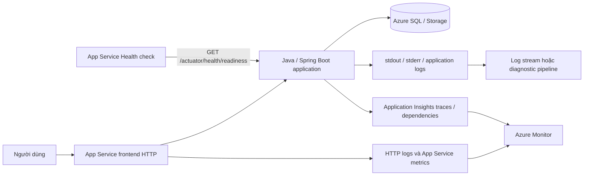
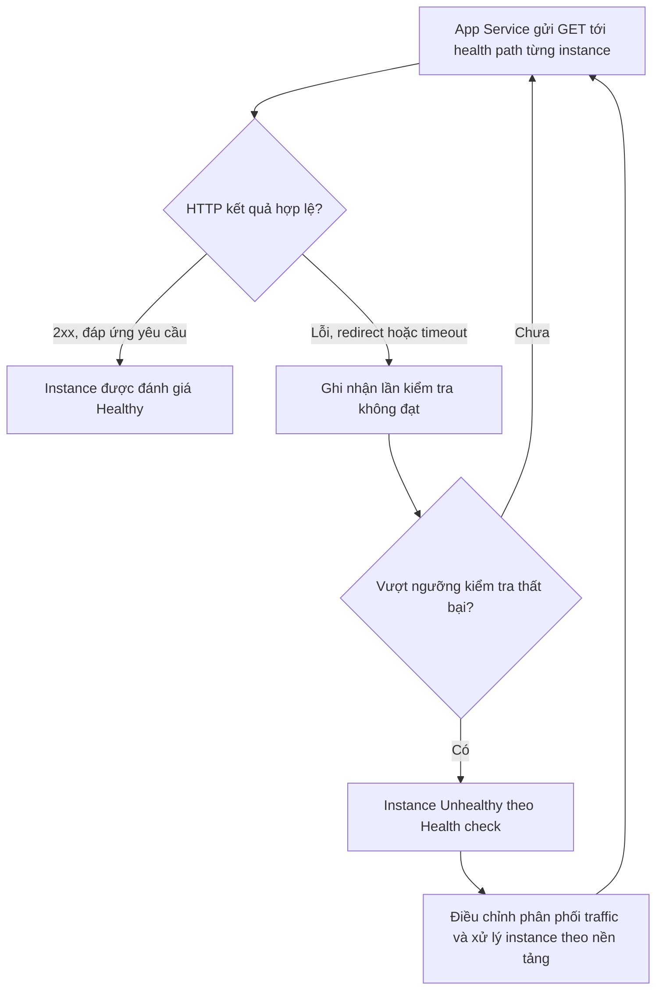
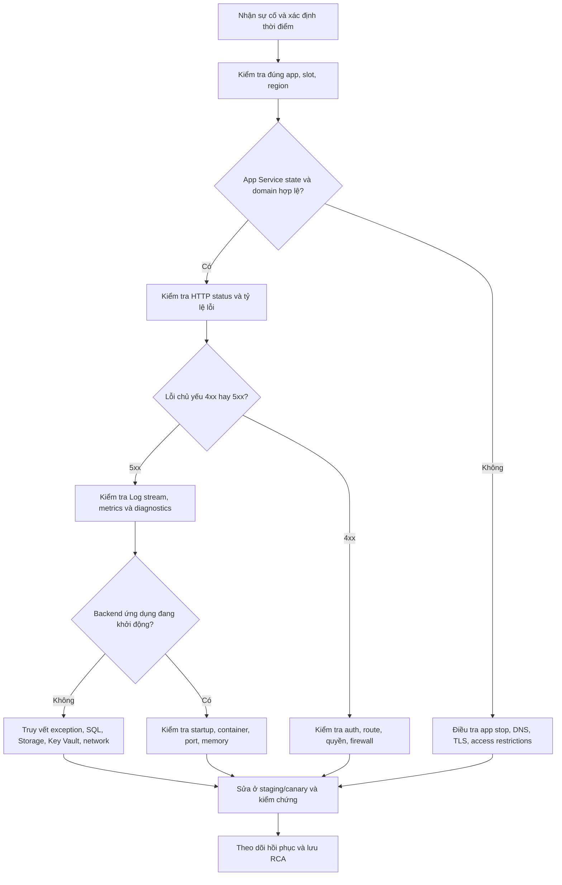

# Log stream, health check và chẩn đoán lỗi App Service

Một ứng dụng web triển khai lên **Azure App Service** có thể ở trạng thái *Running* nhưng người dùng vẫn gặp lỗi HTTP 500, 502, 503, request chậm hoặc không kết nối được database. Trạng thái tài nguyên cho biết nền tảng đã cấp phát và chạy ứng dụng ở mức nào, **không tự chứng minh ứng dụng đang phục vụ nghiệp vụ đúng cách**.

Để điều tra lỗi hiệu quả, cần kết hợp ba nhóm năng lực:

- **Log stream:** theo dõi thông điệp ứng dụng hoặc container theo thời gian gần thực khi có request hay lỗi xảy ra.
- **Health check:** cho App Service một đường dẫn HTTP để đánh giá từng instance có sẵn sàng nhận lưu lượng không.
- **Chẩn đoán lỗi:** dùng **Diagnose and solve problems**, Azure Monitor, Application Insights, deployment logs và kiểm tra cấu hình/mạng để xác định nguyên nhân.

Bài học thuộc chương **Ứng dụng web với App Service** trong module Microsoft Azure. Kiến thức kết nối subscription, resource group, Microsoft Entra ID, mạng ảo, các dịch vụ tính toán, Blob Storage, database, giám sát, bảo mật và kiểm soát chi phí. Ví dụ minh họa tập trung vào ứng dụng Java/Spring Boot nhưng nguyên tắc quan sát và chẩn đoán cũng hữu ích cho .NET, Node.js, Python và container tùy tính năng App Service được hỗ trợ.

> **Phạm vi:** Các lệnh trong bài là ví dụ để chạy trên tài nguyên lab hoặc môi trường đã được phê duyệt. Không tự bật log chứa thông tin nhạy cảm, thay đổi cấu hình health check hoặc restart ứng dụng production mà chưa xác định tác động và có quyền phù hợp.

## Mục tiêu học tập

Sau khi học, bạn có thể:

1. Phân biệt application logs, web server/HTTP logs, container console, platform logs, metrics và distributed traces.
2. Bật hoặc xem **Log stream** trong Azure Portal và dùng Azure CLI để quan sát ứng dụng.
3. Thiết kế endpoint **readiness/health** trả kết quả chính xác, nhẹ và không làm lộ dữ liệu.
4. Cấu hình **Health check** của App Service và hiểu tác động với nhiều instance, scale-out và chuyển lưu lượng.
5. Dùng **Diagnose and solve problems** tìm dấu hiệu lỗi, nhưng vẫn kiểm chứng bằng log/metrics.
6. Phân tích request fail bằng **Application Insights** và Azure Monitor Logs khi có tích hợp.
7. Tách lỗi ứng dụng, triển khai, tài nguyên, network, DNS, TLS và phụ thuộc dữ liệu.
8. Xây dựng runbook xử lý 5xx, độ trễ, lỗi startup hoặc health check thất bại.
9. Chọn cách ghi log, retention, sampling và cảnh báo để hỗ trợ vận hành mà không tăng chi phí vô kiểm soát.

## 1. Mô hình quan sát một ứng dụng App Service

Giả sử hệ thống đơn hàng có frontend web trên App Service, gọi API Java và Azure SQL Database qua mạng được kiểm soát.



Một request lỗi có thể để lại tín hiệu ở các lớp khác nhau:

| Lớp | Tín hiệu | Câu hỏi trả lời |
|---|---|---|
| **App Service platform** | Site state, restart, event, instance, HTTP 5xx | Ứng dụng có chạy, có thay instance hoặc bị giới hạn tài nguyên không? |
| **Web/HTTP server** | Method, URL path, status, latency, kết nối | Request có đến frontend và trả mã nào? |
| **Ứng dụng Java** | Log exception, stack trace, startup, business event | Phần code nào thất bại, với request nào? |
| **Dependency** | SQL timeout, 429, Storage 403, DNS, TLS | Lỗi phát sinh khi gọi dịch vụ bên ngoài hay không? |
| **Health check** | Trạng thái readiness theo instance | Instance có đủ điều kiện phục vụ request mới không? |
| **Traces/telemetry** | Request trace, dependency call, correlation | Một request đi qua những dịch vụ nào, mất thời gian ở đâu? |

Điều quan trọng là **không dựa vào một tín hiệu đơn lẻ**. Một dòng log `ERROR` có thể chỉ liên quan một request; một App Service báo Running vẫn có thể bị lỗi cho mọi người dùng; một health endpoint trả HTTP 200 chưa chắc tính năng đặt hàng hoạt động.

## 2. Log stream là gì và không phải là gì?

**Log stream** là chế độ xem các thông điệp log được App Service cung cấp gần thời gian thực. Khi đang tái hiện lỗi, người vận hành có thể mở Log stream, gửi request có kiểm soát tới ứng dụng rồi quan sát log liên quan.

Ví dụ ứng dụng Java ghi:

```text
2026-11-20T08:00:01Z INFO  order-api request_started trace_id=abc123 path=/api/orders
2026-11-20T08:00:02Z ERROR order-api sql_timeout trace_id=abc123 elapsed_ms=30000
2026-11-20T08:00:02Z INFO  order-api request_completed trace_id=abc123 status=503
```

Nhờ `trace_id`, ba dòng log có thể được liên hệ tới cùng một request. Đây chỉ là dữ liệu giả lập, không phải log thu được từ một App Service thật.

### Log stream khác lưu trữ log dài hạn

| Cơ chế | Dùng tốt nhất khi | Hạn chế |
|---|---|---|
| **Log stream** | Xem output hiện tại, tái hiện sự cố tức thời | Không phải kho lịch sử có retention và truy vấn toàn diện |
| **Application logging (filesystem)** | Ghi log ứng dụng trong môi trường App Service được hỗ trợ | Dung lượng, vòng đời và thời hạn lưu có giới hạn; không dùng như kho kiểm toán lâu dài |
| **Container console logs** | Xem stdout/stderr của ứng dụng container | Chất lượng phụ thuộc ứng dụng có ghi console đúng cách |
| **HTTP/web server logs** | Phân tích status code, URL, latency, request | Không chứa đầy đủ nguyên nhân lỗi trong Java |
| **Diagnostic settings → Log Analytics / Storage / Event Hubs** | Tập trung log, truy vấn lịch sử, retention và xuất log | Cần cấu hình category, destination và chịu chi phí liên quan |
| **Application Insights** | Request, dependency, exception, phân tán trace | Phụ thuộc instrumentation, sampling và cấu hình telemetry |

**Không thể kết luận “ứng dụng không lỗi” vì Log stream trống**. Có thể chưa bật loại log thích hợp, ứng dụng không ghi stdout/stderr, đang xem nhầm deployment slot hoặc instance, pipeline chưa hoạt động hay lỗi xảy ra trước khi logging khởi tạo.

### Phân biệt loại log theo hệ điều hành và runtime

App Service hỗ trợ Windows, Linux built-in runtime và custom container với cách cung cấp log có thể khác nhau:

- **Windows App Service:** có các tùy chọn application logging, web server logging, detailed error messages và failed request tracing theo khả năng sản phẩm.
- **Linux built-in runtime:** ứng dụng cần ghi thông điệp ra console hoặc kênh logging được App Service thu thập; một số tùy chọn Windows không áp dụng.
- **Linux custom container:** log `stdout`/`stderr` của container thường là nguồn quan trọng; cần kiểm tra cấu hình container logging và trạng thái khởi động.
- **Application Insights:** là luồng observability bổ sung; không mặc định mọi thông điệp trong Application Insights xuất hiện trực tiếp trong Log stream.

Tên menu/tùy chọn khác nhau theo OS, SKU, kiểu image và phiên bản Portal. Chỉ bật những nhóm log mà môi trường thực tế hỗ trợ.

## 3. Bật và xem Log stream trong Azure Portal

Quy trình thực hành cơ bản:

1. Mở **Azure Portal → App Services** và chọn đúng web app.
2. Xác nhận **subscription, resource group, app name, deployment slot** và môi trường (development/staging/production).
3. Mở **Monitoring → App Service logs** hoặc mục logging tương ứng.
4. Bật **Application logging (Filesystem)** nếu runtime/OS hỗ trợ hoặc bật loại **container logging** phù hợp cho custom container.
5. Chọn log level phù hợp khi giao diện cung cấp. Với production, ưu tiên mức `Information`, `Warning` hoặc `Error` theo nhu cầu thay vì ghi chi tiết liên tục.
6. Lưu cấu hình, xác nhận thông báo đã áp dụng và xem trạng thái logging.
7. Mở **Monitoring → Log stream**.
8. Tạo một request kiểm thử tới endpoint được cho phép; quan sát log và thời gian.
9. Kiểm tra lại tên slot, instance, request ID và log level nếu không thấy dòng mong đợi.

Một số tùy chọn log ghi filesystem nhằm **khắc phục sự cố ngắn hạn** và có chính sách tự ngừng/xóa theo khả năng nền tảng. Với yêu cầu giữ lịch sử, thiết kế **diagnostic settings** hoặc Application Insights/Log Analytics độc lập.

### Không bật log quá chi tiết vô thời hạn

Log level `Debug` hay `Trace` có thể tạo lượng dữ liệu lớn, làm tăng I/O và chi phí ingestion, đồng thời có nguy cơ ghi request payload, token hoặc dữ liệu cá nhân. Khi cần mở mức chi tiết:

- Xác định triệu chứng và khoảng thời gian cần quan sát.
- Chỉ bật trong thời gian được phê duyệt.
- Che giấu secrets và PII.
- Khôi phục log level ban đầu sau điều tra.
- Ghi lại ai thay đổi và lý do.

## 4. Xem log bằng Azure CLI

Trong Bash của Azure Cloud Shell hoặc máy có Azure CLI đã đăng nhập:

```bash
az account show --output table
az account set --subscription "<SUBSCRIPTION_ID>"

RG="<RESOURCE_GROUP>"
APP="<APP_SERVICE_NAME>"
```

Không thay các placeholder bằng production app nếu chưa có quyền và quy trình điều tra tương ứng.

### Xem thông tin cơ bản của app

```bash
az webapp show \
  --resource-group "$RG" \
  --name "$APP" \
  --query "{name:name,state:state,kind:kind,defaultHostName:defaultHostName,httpsOnly:httpsOnly,serverFarmId:serverFarmId}" \
  --output json
```

Lệnh này là **read-only**, giúp xác định app, trạng thái và App Service Plan. Trạng thái `Running` là tín hiệu quản lý tài nguyên, chưa phải health check ứng dụng.

### Bật application logging khi được hỗ trợ

```bash
az webapp log config \
  --resource-group "$RG" \
  --name "$APP" \
  --application-logging filesystem \
  --level information
```

Với ứng dụng Linux custom container, cần kiểm tra các tùy chọn `--docker-container-logging` hoặc cấu hình container logging tương ứng mà phiên bản Azure CLI/runtime hỗ trợ. Không sử dụng một tập tham số Windows cho mọi Linux/container app.

### Theo dõi trực tiếp

```bash
az webapp log tail \
  --resource-group "$RG" \
  --name "$APP"
```

Mở một terminal để stream log, dùng terminal khác hoặc client đã được phép để gọi endpoint kiểm thử. Kết thúc stream bằng `Ctrl+C` khi hoàn tất; thao tác này dừng **client log tail**, không có nghĩa stop web app.

Nếu không có log, kiểm tra:

- Application logging/container logging đã bật đúng chưa?
- Ứng dụng có thực sự ghi ra stdout/stderr hoặc log channel được thu thập không?
- Request có đến đúng hostname/slot không?
- App đang có instance/replica nào xử lý request?
- CLI và dịch vụ có hỗ trợ streaming trong môi trường đó không?
- Có diagnostic pipeline riêng mà log chỉ xuất hiện ở Log Analytics không?

**Lưu ý về slot:** khi app có deployment slot, dùng tùy chọn `--slot <SLOT_NAME>` ở những lệnh CLI hỗ trợ để tránh chẩn đoán nhầm production và staging.

### Download log để điều tra

Khi phiên bản và loại App Service hỗ trợ:

```bash
az webapp log download \
  --resource-group "$RG" \
  --name "$APP" \
  --log-file "./appservice-diagnostics.zip"
```

Đây là thao tác lấy dữ liệu chẩn đoán về máy. Log có thể chứa thông tin nhạy cảm; lưu trong thư mục được bảo vệ và không chia sẻ tràn lan. Nội dung được download phụ thuộc OS, log đã bật và tính năng App Service; không coi file ZIP là bản sao đầy đủ của mọi log ở Azure Monitor.

## 5. Ghi log tốt cho ứng dụng Java/Spring Boot

Ứng dụng nên ghi vào **stdout/stderr** hoặc cấu hình logging được nền tảng hỗ trợ, đặc biệt với container. Java thường dùng SLF4J cùng Logback/Log4j2 hoặc logging framework do ứng dụng cung cấp.

Ví dụ Spring Boot:

```java
import org.slf4j.Logger;
import org.slf4j.LoggerFactory;
import org.springframework.http.ResponseEntity;
import org.springframework.web.bind.annotation.GetMapping;
import org.springframework.web.bind.annotation.PathVariable;
import org.springframework.web.bind.annotation.RestController;

@RestController
public class OrderController {
    private static final Logger LOG =
        LoggerFactory.getLogger(OrderController.class);

    @GetMapping("/api/orders/{id}")
    public ResponseEntity<String> findOrder(
            @PathVariable String id) {

        LOG.info("event=order_lookup_started order_id={}", id);

        // Minh họa thao tác đọc; ứng dụng thật cần service/data layer.
        String result = "order:" + id;

        LOG.info("event=order_lookup_completed order_id={}", id);
        return ResponseEntity.ok(result);
    }
}
```

Ví dụ chỉ nhằm minh họa logging; class này cần nằm trong một dự án Spring Boot đã thêm dependencies web và SLF4J phù hợp. Không log order ID nếu nó là dữ liệu nhạy cảm trong bối cảnh thực tế; thay bằng ID giả danh hoặc correlation ID được phép.

### Nên ghi gì trong log?

- **Timestamp** thống nhất, ưu tiên UTC.
- **Log level** và component/service name.
- **Request ID/trace ID** để liên hệ request qua các dịch vụ.
- **Event** có tên ổn định, ví dụ `payment_retry`, `sql_timeout`.
- **Duration** và số lượng đối tượng khi cần.
- **Exception type** và stack trace khi thực sự có lỗi; tránh che mất dấu vết quan trọng.

### Không nên ghi gì?

- Password, access token, refresh token, SAS URL, storage account key, connection string có secret.
- Full HTTP Authorization header hoặc cookie đăng nhập.
- Thông tin cá nhân/nhạy cảm không cần cho mục tiêu vận hành.
- Payload của mọi request ở production mà không có kiểm soát.
- Bí mật lấy từ Key Vault hoặc biến môi trường cấu hình ứng dụng.

**Log stream có thể hiển thị cho người có quyền vận hành.** Cần thiết kế Azure RBAC và quy trình truy cập log phù hợp, không coi log là kênh lưu trữ dữ liệu riêng tư tuyệt đối.

## 6. Health check là gì?

**Health check của App Service** cho phép cấu hình một đường dẫn HTTP trên ứng dụng, ví dụ `/health/ready`. Nền tảng gửi yêu cầu đến từng instance theo cơ chế của App Service và sử dụng kết quả để đánh giá instance có khỏe hay không.

Mục tiêu là tránh tiếp tục gửi lưu lượng tới instance không còn đáp ứng điều kiện sức khỏe theo cấu hình, đặc biệt khi có **nhiều instance**.

### Health check không giống chỉ kiểm tra VM/container đang chạy

Một process có thể vẫn sống nhưng:

- Thread pool bị kẹt.
- Web server không nhận request.
- Ứng dụng lỗi khởi tạo.
- Một phần cấu hình quan trọng bị thiếu.
- Kết nối tới phụ thuộc bắt buộc gặp sự cố.

Vì vậy, một endpoint health tốt phải phản ánh **readiness để phục vụ loại request dự kiến**, không chỉ trả `200 OK` vô điều kiện.

### Luồng đánh giá khái niệm



Sơ đồ là mô hình tư duy, không thể hiện mọi trạng thái/chu kỳ thực thi của nền tảng. Health check không phải một tính năng tự tạo bản sao database, và không đảm bảo thay thế instance nếu ứng dụng có cấu hình/nguồn lỗi chung trên mọi instance.

### HTTP response nên như thế nào?

Một health path cho App Service nên:

- Trả **HTTP 200–299** khi instance đáp ứng điều kiện khỏe.
- Trả status **khác 2xx** hoặc lỗi thích hợp khi không sẵn sàng.
- Phản hồi nhanh, ổn định, không có tác dụng phụ.
- Không redirect tới trang login hoặc một URL khác.
- Không cần session/cookie người dùng hoặc token đăng nhập tương tác.
- Không trả thông tin nhạy cảm về database, cấu hình hoặc stack trace.
- Hoạt động trên **mỗi instance**; không dựa vào state chỉ có ở instance khác.

Nếu ứng dụng bật App Service Authentication/Authorization hoặc cơ chế xác thực tập trung, cần kiểm tra cách **Health check tương tác với lớp auth** theo tính năng được hỗ trợ. Không tắt bảo vệ toàn bộ ứng dụng chỉ để mở đường health; chỉ thiết kế một endpoint health tối thiểu hoặc cơ chế kiểm tra nội bộ phù hợp.

## 7. Liveness khác readiness: chọn cái nào cho App Service?

Trong vận hành container/ứng dụng, hai khái niệm thường bị trộn:

- **Liveness:** process còn sống và có khả năng đáp ứng kiểm tra cơ bản hay không?
- **Readiness:** instance đã khởi tạo và có khả năng xử lý request nghiệp vụ được định tuyến tới nó hay chưa?

Ví dụ:

| Tình trạng | Liveness | Readiness | Ý nghĩa |
|---|---|---|---|
| Ứng dụng khởi động chưa xong | Có thể OK | Chưa sẵn sàng | Chưa nhận traffic |
| Web server hoạt động bình thường | OK | OK | Có thể nhận traffic |
| Thread pool kẹt, không trả HTTP | Fail | Fail | Cần can thiệp hoặc thay instance |
| Database bắt buộc mất kết nối | Có thể OK | Có thể Fail | Phải quyết định có nên ngừng route vào instance không |
| Dịch vụ gửi email phụ tạm lỗi | OK | Có thể vẫn OK | Không nên hạ toàn bộ site nếu email không ảnh hưởng request chính |

**Không đưa mọi dependency vào readiness một cách máy móc.** Nếu tất cả instance cùng dùng một database và database bị lỗi tạm thời, việc đánh dấu toàn bộ instance Unhealthy có thể không tạo thêm năng lực phục vụ mà còn gây restart hoặc churn không cần thiết. Hãy phân loại dependency nào thực sự **bắt buộc** để nhận request và tránh check sâu gây tải hoặc hiệu ứng phụ.

## 8. Ví dụ health endpoint trong Spring Boot

Nếu ứng dụng dùng Spring Boot và đã thêm **Spring Boot Actuator**, có thể dùng health probes thay vì tự viết nhiều logic health.

Ví dụ cấu hình `application.properties`:

```properties
management.endpoints.web.exposure.include=health,info
management.endpoint.health.probes.enabled=true
management.endpoint.health.show-details=never
```

Khi tính năng probes được hỗ trợ và cấu hình đúng, endpoint readiness thường có dạng:

```text
GET /actuator/health/readiness
```

Với Spring Boot Actuator, health group có thể phản ánh trạng thái ứng dụng qua `readinessState`. Các health indicators của database hoặc dịch vụ khác có thể được thêm vào bằng cấu hình riêng nếu thực sự cần. **Đường dẫn và hành vi cụ thể phụ thuộc phiên bản Spring Boot, context path và security configuration**; hãy kiểm tra response thật trước khi nhập path vào Azure.

### Kiểm thử local

```bash
curl -i http://localhost:8080/actuator/health/readiness
```

Kỳ vọng khi sẵn sàng:

```http
HTTP/1.1 200 OK
Content-Type: application/vnd.spring-boot.actuator.v3+json

{"status":"UP"}
```

Content-Type và JSON thực tế có thể khác theo version, customization và security; phần quan trọng với App Service là **HTTP status hợp lệ và phản ánh readiness**.

Nếu endpoint trả 401/403 vì Spring Security, redirect 302 tới login hoặc 404 do chưa bật Actuator, health check có thể đánh giá thất bại. Hãy sửa chính xác cấu hình endpoint/auth, không mở toàn bộ API.

### Tự viết health endpoint khi không dùng Actuator

Một ứng dụng có thể tự cài `GET /health/ready`, dùng status 200 khi ready và 503 khi không ready. Đường này không nên:

- Ghi database hay gửi message mới.
- Truy vấn quá nhiều bảng dữ liệu.
- Gọi hàng loạt API chậm mỗi lần probe.
- Trả tên nội bộ, credential hoặc dữ liệu hệ thống nhạy cảm.
- Dựa vào sự hiện diện của một tài khoản người dùng.

## 9. Cấu hình Health check trên Azure Portal

Trong Azure Portal:

1. Mở đúng web app và slot trong **App Services**.
2. Tạo hoặc xác minh endpoint health trong ứng dụng đang chạy; thử gọi từ môi trường phù hợp.
3. Mở **Monitoring → Health check**.
4. Bật **Health check** nếu App Service Plan, OS và cấu hình hiện hành hỗ trợ tính năng.
5. Nhập **Path**, ví dụ `/actuator/health/readiness`. Đây là path tương đối, không cần ghi URL đầy đủ.
6. Lưu và kiểm tra trạng thái từng instance.
7. Theo dõi ít nhất một khoảng thời gian đủ để health probe chạy và đánh giá; không kỳ vọng mọi thay đổi phản ánh tức thì.
8. Tạo thử nghiệm staging/canary để kiểm tra trường hợp endpoint trả lỗi đúng cách.

App Service Health check thường kiểm tra path **định kỳ** và cần một số lần thất bại liên tiếp trước khi đánh dấu instance không khỏe. Các ngưỡng, thời gian và hành vi xử lý instance còn tùy plan/tính năng và cấu hình. Không nên đặt kỳ vọng từ một lần HTTP 503 duy nhất rằng nền tảng sẽ loại instance ngay lập tức.

Một số App Service Plan thấp có hạn chế tính năng và không phù hợp yêu cầu health check sản xuất. Kiểm tra tính năng health check theo **SKU/plan** và khả năng scale-out trước khi sử dụng.

### Các app settings liên quan

Trong môi trường cần điều chỉnh ngưỡng, App Service có setting **`WEBSITE_HEALTHCHECK_MAXPINGFAILURES`** theo phạm vi giá trị được nền tảng cho phép để kiểm soát số lần ping thất bại trước khi instance bị coi là Unhealthy. Không đặt giá trị quá nhỏ chỉ để phản ứng nhanh mà chưa đánh giá tải và những sự cố chập chờn.

Khi cấu hình app settings trên Azure Portal hoặc CLI, thay đổi có thể gây restart app. Trước khi chỉnh sửa production, hãy dùng quy trình thay đổi, theo dõi tác động và có phương án rollback.

### Một instance so với nhiều instance

- **Nhiều instance:** Health check có thể giúp App Service tránh chuyển request tới instance không khỏe khi còn instance khác phù hợp.
- **Một instance:** không có instance khác để chuyển traffic. Health check vẫn cung cấp tín hiệu hữu ích và nền tảng có cơ chế xử lý sức khỏe, nhưng không tạo ra tính sẵn sàng cao chỉ bằng một nút bật.
- **Lỗi dùng chung:** nếu database/configuration chung bị lỗi, tất cả instance có thể bị ảnh hưởng. Cần xử lý root cause chứ không chỉ restart toàn bộ.

Các chi tiết về số instance unhealthy tối đa, thời gian thay thế hoặc trạng thái cân bằng tải cần đọc từ tài liệu tính năng phù hợp và thực tế trạng thái ứng dụng tại thời điểm vận hành.

## 10. Health check không thay thế monitoring và kiểm thử nghiệp vụ

Một health check trả 200 chỉ chứng minh điều kiện health **được ứng dụng triển khai** đã đạt. Nó không tự chứng minh:

- Người dùng đăng nhập được qua Microsoft Entra ID.
- Mọi API endpoint đều hoạt động.
- Database không bị thiếu dữ liệu hoặc lỗi permission.
- Storage blob có thể đọc/ghi từ workload identity.
- Những request chậm hiếm gặp không xảy ra.
- Cấu hình DNS/TLS bên ngoài App Service đúng cho mọi người dùng.

Vì vậy nên kết hợp:

1. **Health check nội bộ:** theo từng instance, nhẹ và nhanh.
2. **Synthetic availability test:** gửi request từ ngoài hệ thống theo đường frontend người dùng thực, khi có khả năng và chi phí phù hợp.
3. **Application Insights request/dependency telemetry:** phân tích hành vi thực tế.
4. **Business metric:** tỷ lệ giao dịch thành công hoặc xử lý đúng nghiệp vụ.

Một luồng có thể “Healthy” nhưng chỉ 40% giao dịch thanh toán hoàn tất; lúc đó cảnh báo nghiệp vụ quan trọng hơn trạng thái instance.

## 11. Diagnose and solve problems trong App Service

**Diagnose and solve problems** là khu vực chẩn đoán tích hợp của Azure App Service. Công cụ trình bày những detector hoặc kịch bản điều tra theo dữ liệu mà nền tảng có quyền quan sát, giúp tìm dấu hiệu bất thường mà không phải bắt đầu từ một truy vấn trống.

### Cách mở

1. Trong Azure Portal, chọn đúng App Service hoặc App Service Plan liên quan.
2. Mở **Diagnose and solve problems**.
3. Chọn nhóm vấn đề tương ứng như **Availability and Performance**, lỗi HTTP, configuration, networking hoặc các mục được hiển thị ở giao diện hiện tại.
4. Xem khoảng thời gian, thông tin instance, đồ thị, gợi ý và sự kiện nền tảng.
5. Đối chiếu với **Metrics, Log stream, Application Insights và deployment history** trước khi đưa ra kết luận.

Tên detector và phạm vi dữ liệu có thể thay đổi theo OS, runtime, plan, thời điểm và khả năng nền tảng.

### Những câu hỏi công cụ hỗ trợ

| Triệu chứng | Nhóm điều tra | Tín hiệu cần kiểm tra |
|---|---|---|
| HTTP 5xx tăng | HTTP Errors / Availability | Tỷ lệ 5xx, instance, thời điểm triển khai |
| Thời gian phản hồi cao | Performance | CPU, memory, request latency, dependency |
| Ứng dụng tự restart | Availability / Configuration | Container startup, memory, platform restart |
| Không vào website | Availability / Networking | DNS, hostname, TLS, access restrictions |
| Deployment xong nhưng site lỗi | Deployment / Configuration | Deployment logs, startup command, environment settings |
| Lỗi kết nối database | Networking / Application | VNet Integration, DNS, TLS, identity, firewall |
| Một vài instance lỗi | Instance health / Performance | Health check, instance-specific logs và tải |

**Detector tạo ra giả thuyết**, không phải bằng chứng duy nhất. Ví dụ, đồ thị CPU cao trùng thời điểm HTTP 503 có thể là nguyên nhân hoặc hệ quả của retry tăng; cần thêm traces hoặc profiler/diagnostic được hỗ trợ để phân biệt.

## 12. Azure Monitor Metrics: dấu hiệu mức nền tảng

Azure Monitor metrics giúp xem xu hướng theo thời gian và đối chiếu sự cố với sự kiện thay đổi.

Những metric thường hữu ích:

- **Requests:** số request đến App Service theo khoảng thời gian.
- **HTTP 4xx / HTTP 5xx:** số response theo nhóm mã lỗi.
- **Average Response Time:** thời gian phản hồi trung bình; cần chú ý percentile nếu có telemetry hỗ trợ.
- **CPU / Memory:** mức dùng tài nguyên của App Service Plan hoặc instance, tùy metric scope.
- **Connections, HTTP queue, restart/instance-related metrics:** dùng khi metric khả dụng và có ý nghĩa với plan/OS.
- **Application Insights requests/dependencies:** độ trễ, tỷ lệ lỗi theo endpoint và dependency.

### Truy vấn metrics bằng Azure CLI

```bash
APP_ID=$(az webapp show \
  --resource-group "$RG" \
  --name "$APP" \
  --query id --output tsv)

az monitor metrics list \
  --resource "$APP_ID" \
  --metric Requests Http5xx \
  --interval PT5M \
  --aggregation Total \
  --output json
```

Tên metric và những aggregation được hỗ trợ có thể khác theo resource type và API. Nếu CLI báo metric không hợp lệ, hãy xem danh sách metric definitions của đúng resource trước khi dùng tên cố định.

### Cách đọc số liệu

Nếu HTTP 5xx tăng đột ngột lúc 10:05, hãy xác định:

1. Có deployment hoặc config change lúc đó không?
2. Chỉ một instance hay mọi instance bị ảnh hưởng?
3. CPU/memory có tăng trước khi HTTP 5xx tăng không?
4. Lỗi tập trung ở `/api/orders` hay mọi endpoint?
5. Lỗi dependency SQL/Storage có trùng thời gian không?
6. Health check có đánh dấu instance không khỏe hay không?

Để tránh nhầm, luôn đối chiếu **UTC, timezone của dashboard, độ phân giải metric và sampling**. Một spike rất ngắn có thể bị che bởi trung bình 1 giờ.

## 13. Application Insights cho request, dependency và exception

**Application Insights** thuộc Azure Monitor giúp quan sát ứng dụng, đặc biệt khi code được instrument bằng SDK hoặc OpenTelemetry.

Với Java, một ứng dụng Spring Boot có thể sử dụng **Azure Monitor OpenTelemetry** theo cơ chế phù hợp để thu nhận:

- Request HTTP và response.
- Lỗi exception trong luồng xử lý.
- Dependency calls như HTTP hoặc một số thư viện database hỗ trợ instrumentation.
- Trace/context để nối các dịch vụ.
- Custom business events/metrics khi ứng dụng chủ động phát.

### Vì sao cần Application Insights nếu đã có Log stream?

Ví dụ: một request `GET /api/orders/1001` mất 8 giây. Log stream chỉ có thể cho thấy dòng `request completed`. Với distributed tracing, bạn có thể thấy:

```text
GET /api/orders/1001       8000 ms
  ├── Authenticate user       20 ms
  ├── GET inventory API      110 ms
  ├── SQL SELECT            7600 ms
  └── Serialize response      15 ms
```

Thời gian chỉ minh họa. Tracing giúp thấy **nút thắt ở SQL** thay vì tối ưu nhầm Java servlet layer.

### Sampling và độ đầy đủ

Để kiểm soát chi phí, telemetry có thể được **sampled**. Vì vậy không phải mọi request đều hiện thành trace riêng. Với thống kê cần độ chính xác cao, phải hiểu sampling, aggregation, retention và phương pháp đo phù hợp.

Không nên tắt sampling hoặc bật thu thập mọi payload ở production chỉ vì muốn điều tra một lỗi hiếm; cân nhắc sampling có kiểm soát và dữ liệu bổ sung theo giai đoạn.

## 14. Diagnostic settings và Azure Monitor Logs

Để giữ log tập trung, có thể cấu hình **Diagnostic settings** trên App Service gửi category phù hợp tới:

- **Log Analytics workspace:** truy vấn Kusto Query Language (KQL), dashboard và alert.
- **Storage account:** lưu trữ và lifecycle phù hợp nhu cầu kiểm toán.
- **Event Hubs:** chuyển log sang nền tảng phân tích/sự kiện khác.

Một số category thường gặp là `AppServiceHTTPLogs`, `AppServiceConsoleLogs`, `AppServiceAppLogs`, `AppServicePlatformLogs` hoặc category khác tùy dịch vụ/OS và khả năng hỗ trợ. **Không giả định mọi category đều xuất hiện trên mọi App Service**, và schema bảng phụ thuộc cách lưu AzureDiagnostics hay resource-specific tables.

### Các bước

1. Mở App Service → **Monitoring → Diagnostic settings**.
2. Chọn **Add diagnostic setting**.
3. Chọn category log/metric phù hợp với tình huống.
4. Chọn destination, ví dụ Log Analytics workspace được tổ chức phê duyệt.
5. Kiểm tra **region, data residency, quyền truy cập workspace, retention và chi phí**.
6. Lưu cấu hình, phát sinh request kiểm thử.
7. Kiểm tra log xuất hiện sau khoảng thời gian ingestion thích hợp; diagnostic pipeline không nhất thiết hiển thị tức thì.

### KQL ví dụ: tỷ lệ HTTP 5xx

Nếu workspace dùng resource-specific table `AppServiceHTTPLogs` với các trường được hỗ trợ:

```kusto
AppServiceHTTPLogs
| where TimeGenerated > ago(1h)
| where _ResourceId has "/sites/<APP_SERVICE_NAME>"
| summarize
    Requests = count(),
    ServerErrors = countif(ScStatus >= 500 and ScStatus < 600)
    by bin(TimeGenerated, 5m)
| extend ErrorRatePct = iff(Requests == 0, 0.0,
                            100.0 * todouble(ServerErrors) / Requests)
| order by TimeGenerated asc
```

Đây là truy vấn minh họa, chỉ chạy khi đã định tuyến HTTP logs về bảng và trường đúng như vậy. Nếu workspace dùng `AzureDiagnostics` hoặc schema khác, phải điều chỉnh tên bảng/cột theo dữ liệu thực tế.

### KQL ví dụ: lỗi theo đường dẫn

```kusto
AppServiceHTTPLogs
| where TimeGenerated > ago(30m)
| where _ResourceId has "/sites/<APP_SERVICE_NAME>"
| where ScStatus >= 500
| summarize Errors = count()
    by CsUriStem, ScStatus
| top 20 by Errors desc
```

Nên kết hợp với Application Insights nếu cần biết exception và dependency của đường dẫn bị lỗi. HTTP logs thường không có stack trace Java, còn application logs có thể không ghi đầy đủ HTTP metadata.

## 15. Quy trình chẩn đoán sự cố từ đầu đến cuối

Khi nhận báo cáo “website bị lỗi”, hãy tránh restart ngay nếu chưa có bằng chứng. Quy trình chuẩn:



### Bước 1: xác định phạm vi

Ghi nhận:

- App name, subscription, resource group, deployment slot.
- Thời điểm bắt đầu lỗi theo UTC.
- Hostname, URL path, HTTP method và một request ID/trace ID nếu có.
- Tần suất lỗi, số người dùng ảnh hưởng, region hoặc mạng nguồn.
- Sự kiện thay đổi gần nhất: deployment, scale, app settings, certificate, firewall, DNS hoặc database failover.

### Bước 2: kiểm tra từ phía client

```bash
curl -I https://<APP_SERVICE_NAME>.azurewebsites.net/
curl -i https://<APP_SERVICE_NAME>.azurewebsites.net/health/ready
```

Không mặc định ứng dụng có đường `/health/ready`: thay bằng health path đã được cấu hình. Khi ứng dụng có custom domain hoặc access restriction, thử đúng hostname/route người dùng đang gặp lỗi, đồng thời không tiết lộ dữ liệu nhạy cảm trong URL.

### Bước 3: kiểm tra Portal

- App Service **Overview**: Running/Stopped, domain, plan, slot.
- **Log stream**: exception, startup, request errors.
- **Metrics**: Requests/HTTP 5xx/CPU/memory/latency.
- **Health check**: trạng thái từng instance.
- **Diagnose and solve problems**: detector phù hợp.
- **Deployment Center**: thay đổi phiên bản, deployment log.
- **Application Insights**: failed requests, dependency failures, traces.
- **Networking**: access restrictions, VNet Integration, Private Endpoint và DNS.

### Bước 4: đưa ra giả thuyết và kiểm chứng

Ví dụ: Java log ghi `SQLTransientConnectionException`, metrics cho thấy 503 tăng cùng thời gian, nhưng CPU không tăng. Thay vì scale CPU ngay, nên kiểm tra database health, connection pool, firewall, DNS, token và kết nối mạng.

### Bước 5: xử lý an toàn

Ưu tiên:

1. Khôi phục thay đổi gây lỗi khi có bằng chứng rõ và phương án rollback.
2. Giảm tải hoặc tách instance lỗi theo công cụ/năng lực được hỗ trợ.
3. Chỉnh sửa application config, certificate, network hoặc credential bằng quy trình thay đổi.
4. Chỉ restart khi có lý do cụ thể và đánh giá tác động tới phiên người dùng.
5. Theo dõi sau khắc phục để xác nhận request và nghiệp vụ trở lại bình thường.

## 16. Những lỗi phổ biến trên App Service

| Hiện tượng | Nguyên nhân khả dĩ | Nơi kiểm tra |
|---|---|---|
| **404** ở một route | Route không được triển khai, reverse proxy rewrite, context path sai | Application routing, deployment artifact, HTTP logs |
| **401/403** | Authentication/authorization, App Service access restrictions, Storage/API permission | Entra ID, RBAC, auth logs, network rules |
| **500** | Exception Java, cấu hình thiếu, bug hoặc database lỗi | Application logs, stack trace, Application Insights |
| **502 Bad Gateway** | Backend không phản hồi, app crash, startup fail, reverse proxy/ingress upstream lỗi | Platform logs, startup, health, backend dependencies |
| **503 Service Unavailable** | Instance không sẵn sàng, overload, recycle, dependency failure, platform availability | Health check, metrics, diagnostics, app logs |
| **504 Gateway Timeout** | Request vượt timeout ở proxy/ngõ vào hoặc dependency chậm | Duration trace, gateway, SQL/API dependency |
| **429 Too Many Requests** | Throttling ở app/dependency/API, giới hạn request | Rate limiter, dependency headers/metrics |
| **Startup loop** | JAR/entrypoint lỗi, port, env var hoặc image missing | Container console, startup logs, configuration |
| **Chậm sau deploy** | Cold start, JVM warm-up, connection pool, thiếu Always On theo plan | Metrics, startup time, plan, deployment history |
| **Intermittent 5xx** | Một instance lỗi, GC/OOM, DNS/network chập chờn | Instance logs, health, memory, traces |

HTTP status có thể được trả bởi **App Service frontend, ứng dụng, upstream gateway hoặc dependency**. Không xác định nguyên nhân chỉ bằng mã status; phải tìm tầng thực sự tạo response.

## 17. Lỗi startup Java và custom container

Với App Service Java, ứng dụng có thể thất bại **trước khi xử lý request đầu tiên**.

### Một số nguyên nhân

- JDK/JRE không khớp class file version.
- Artifact JAR/WAR hoặc startup command sai.
- Java Spring profile không được cấu hình như dự kiến.
- Environment variable quan trọng thiếu hoặc sai.
- Container image không kéo được từ ACR.
- Custom container không lắng nghe cổng mà App Service mong đợi/cấu hình.
- Heap quá lớn gây OOM trong giới hạn memory của plan/container.
- Ứng dụng kết nối database đồng bộ trong startup và bị timeout.
- Certificate/truststore lỗi khi gọi API hoặc database.

### Runbook startup

1. Đọc **container console/application startup logs** trước khi chỉnh sửa.
2. Kiểm tra image tag/digest hoặc deployment artifact và phiên bản runtime.
3. Kiểm tra startup command, cổng lắng nghe và cách App Service forward request.
4. Xác nhận app settings mà **không in toàn bộ giá trị bí mật** ra console/ticket.
5. Xem CPU/memory và dấu hiệu OOM, GC hoặc restart.
6. Tách vấn đề application readiness khỏi khả năng route của frontend.
7. Thử artifact/image giống production tại staging với cấu hình tương đương.
8. Rollback bản deploy lỗi nếu cần và đo lại health/request.

### Java-specific: đừng chỉ sửa port tùy tiện

App Service built-in Java runtime và custom container có cấu hình cổng, startup và routing khác nhau. Với custom container, phải bảo đảm container lắng nghe đúng interface/port theo thiết lập App Service và image. Với built-in runtime, phải dùng biến runtime/port được dịch vụ cung cấp; không hardcode giả định mọi kế hoạch đều dùng `8080` hoặc `80`.

Đối với Spring Boot, việc ứng dụng log “Started” trước khi hoàn thành khởi tạo dependency cũng không bảo đảm nó đang sẵn sàng xử lý request. Hãy dựa vào readiness endpoint đúng.

## 18. Chẩn đoán lỗi kết nối Azure SQL, Storage và Key Vault

App Service thường phụ thuộc các tài nguyên được bảo vệ bằng VNet/Private Endpoint hoặc firewall. Một URL không truy cập được có thể do **DNS/route/network** thay vì Java code.

### Luồng kiểm tra

1. Xác định hostname tài nguyên đích và port/protocol.
2. Kiểm tra **outbound VNet Integration** của App Service có được cấu hình đúng với subnet và plan không.
3. Nếu dùng Private Endpoint, kiểm tra **private DNS** từ môi trường có cùng network path.
4. Kiểm tra NSG, route table, Azure Firewall, service endpoint hoặc private endpoint rule theo topology.
5. Kiểm tra firewall và public network access ở SQL/Storage/Key Vault.
6. Kiểm tra **managed identity**, Azure RBAC/data roles và token/credential.
7. Đo latency, timeout và pool saturation của dependency trong traces.
8. Thực hiện test có kiểm soát, không mở tạm tài nguyên cho mọi IP.

**Phân biệt:** App Service **VNet Integration** chủ yếu hỗ trợ luồng **outbound từ ứng dụng vào VNet**. Để truy cập web app bằng private IP từ phía client, xem xét **Private Endpoint inbound** hoặc kiến trúc ingress phù hợp. Hai cơ chế không thay thế lẫn nhau.

### Ví dụ

Ứng dụng Java đọc blob và báo HTTP 403 từ Azure Storage:

- Nếu thông điệp là thiếu `Storage Blob Data Reader` hoặc quyền data plane, cần sửa Azure RBAC cho identity đúng.
- Nếu Storage firewall chặn nguồn, cần sửa đường mạng hoặc allowlist hợp lệ.
- Nếu hostname Storage phân giải sai khi dùng Private Endpoint, cần sửa DNS/VNet link/forwarding.
- Không khắc phục bằng cách chia sẻ Storage account key hoặc tắt firewall toàn bộ.

Với Azure SQL, hãy phân biệt timeout kết nối TCP, lỗi SQL login, lỗi TLS và hết connection pool. Mỗi loại cần nhóm kiểm soát khác nhau; một health check `503` chỉ nói ứng dụng không sẵn sàng, không tự xác định nguyên nhân.

## 19. App Service deployment slots và rollback

**Deployment slots** giúp triển khai phiên bản ứng dụng mới vào môi trường như `staging` trước khi swap sang production ở những App Service Plan hỗ trợ. Chúng hữu ích để:

- Xem Log stream và health check của bản mới trước khi nhận lưu lượng chính.
- Kiểm thử App settings, mạng, dependency và schema migration.
- Warm up ứng dụng Java trước khi chuyển traffic.
- Rollback bằng chiến lược swap hoặc deploy lại bản trước, tùy sự cố và quy trình.

### Cẩn trọng khi swap

Không phải mọi app setting và kết nối đều phải hoán đổi cùng code. Một số thiết lập được đánh dấu **slot setting** sẽ bám theo slot; cần hiểu tác động tới connection string, identity và secret references. Schema migration hoặc ghi dữ liệu đã xảy ra có thể **không rollback** đơn giản bằng swap lại.

Quy trình cơ bản:

1. Deploy bản mới vào staging.
2. Kiểm tra readiness, smoke test API và dependency.
3. So sánh các app settings slot-specific.
4. Quyết định và thực hiện swap theo quy trình phê duyệt.
5. Theo dõi 5xx, latency và metrics nghiệp vụ.
6. Rollback theo runbook nếu lỗi; kiểm tra các thay đổi dữ liệu không thể đảo ngược.

Health check và log nên được cấu hình/quan sát ở đúng slot, tránh đưa nhầm kết luận của staging sang production.

## 20. Bài thực hành: tái hiện HTTP 500 và xác minh health

**Mục tiêu:** sử dụng một ứng dụng App Service lab để xem log, truy vết lỗi và kiểm tra health check. Không cố tình tạo lỗi trong ứng dụng production.

### Điều kiện

- Có App Service và App Service Plan hỗ trợ tính năng cần dùng.
- Ứng dụng Java/Spring Boot hoặc runtime tương đương có route health.
- Có quyền xem logs/diagnostics và quyền chỉnh App Service logs/Health check trên môi trường lab.
- Biết tên subscription, resource group, web app và deployment slot (nếu có).
- Có một endpoint kiểm thử lỗi chỉ tồn tại ở lab hoặc một kịch bản dữ liệu lỗi đã được phê duyệt.

### Bước 1: triển khai health endpoint

Dùng Spring Boot Actuator theo phần 8, hoặc một endpoint `/health/ready` tự viết trả 200 khi sẵn sàng. Test bằng `curl` trước khi cấu hình Health check.

### Bước 2: bật logging và mở Log stream

Trong Portal bật loại application logging phù hợp, mở Log stream. Dùng CLI `az webapp log tail` ở terminal khác nếu muốn so sánh.

### Bước 3: gọi endpoint khỏe

```bash
curl -i https://<APP_SERVICE_NAME>.azurewebsites.net/actuator/health/readiness
```

Ghi nhận HTTP status, thời gian phản hồi và log liên quan. Nếu đường health không được công khai trong thiết kế lab, thực hiện từ một client hợp lệ theo access restrictions.

### Bước 4: tái hiện lỗi có kiểm soát

Thực hiện request tới một **endpoint giả lập lỗi được thiết kế riêng cho lab**. Ví dụ, endpoint đó cố ý phát sinh exception để trả 500, chỉ cho phép từ người thử nghiệm.

Ghi lại:

- Thời điểm UTC.
- Method/route.
- HTTP status và request/trace ID.
- Các dòng log trước/sau request.
- Metrics `Http5xx` trong khoảng thời gian tương ứng.

### Bước 5: kiểm tra Diagnose and solve problems

Chọn nhóm HTTP 5xx hoặc Availability trong **Diagnose and solve problems**. Xem thông tin được trình bày và đối chiếu với lỗi có thể quan sát trong log.

### Bước 6: kiểm tra Application Insights hoặc Log Analytics

Nếu có telemetry, tìm failed request, exception, stack trace và dependency của request. Nếu chưa cấu hình diagnostic settings, không mặc định sẽ thấy dữ liệu ở Log Analytics.

### Bước 7: bật Health check

Cấu hình health path đúng; chờ đủ chu kỳ đánh giá và xem trạng thái. Không làm hỏng ứng dụng để thử thay instance trên production. Trong staging/lab, có thể kiểm thử endpoint trả status khác 2xx nếu quy trình và plan cho phép.

### Bước 8: đưa về trạng thái bình thường

- Vô hiệu hóa endpoint giả lập lỗi nếu không còn cần.
- Khôi phục mức logging ban đầu.
- Xác minh health và 5xx trở về mức dự kiến.
- Xóa hoặc lưu log lab theo retention/PII policy.
- Ghi nhận kết luận điều tra và những tín hiệu hữu ích nhất.

### Kết quả cần thu được

| Bằng chứng | Kỳ vọng |
|---|---|
| HTTP health | Trả 2xx khi ứng dụng sẵn sàng |
| Log stream | Có log liên quan request/exception khi ứng dụng phát ra |
| Azure metrics | Số 5xx tăng trong khoảng thử nghiệm |
| Diagnose and solve problems | Có tín hiệu/phân tích phù hợp tùy tính năng và dữ liệu |
| App Insights / Logs (nếu bật) | Có request/dependency/exception hoặc HTTP records tương ứng |
| Sau khôi phục | 5xx giảm, readiness bình thường, log level được trả về trạng thái kiểm soát |

## 21. Vận hành chủ động: cảnh báo, runbook và chi phí

### Những alert đáng cân nhắc

- Tỷ lệ HTTP 5xx vượt ngưỡng trong khoảng quan sát.
- Request latency tăng đột biến, đặc biệt percentile cao nếu telemetry có dữ liệu.
- Health check liên tục báo instance không khỏe.
- Application Insights availability test thất bại.
- CPU/memory hoặc restart bất thường trên plan/instance.
- Lỗi dependency SQL/Storage tăng.
- Không nhận log hoặc telemetry từ service quan trọng trong thời gian bất thường.
- Sau deployment, tỷ lệ lỗi tăng so với trước triển khai.

Ngưỡng cảnh báo phải dựa trên **baseline** và mức độ quan trọng của ứng dụng, không nhất thiết cố định một tỷ lệ cho mọi workload. Nếu service ít request, một lỗi đơn lẻ có thể làm tỷ lệ 5xx cao nhưng không cùng ý nghĩa với một dịch vụ hàng triệu request.

### Runbook xử lý sự cố

Mỗi alert quan trọng nên gắn với:

- Người/nhóm on-call và quyền xử lý.
- Link App Service/slot/resource group liên quan.
- Dashboard, Log stream, Application Insights và metrics.
- Cách tái hiện an toàn, nguồn dữ liệu cần giữ.
- Tiêu chí cần rollback/scale/restart.
- Thứ tự liên lạc khi phát hiện lỗi dependency hoặc sự cố mạng.
- Kiểm tra sau xử lý và mẫu ghi **Root Cause Analysis (RCA)**.

### Chi phí quan sát

Logging và monitoring có thể tạo chi phí từ:

- Log Analytics ingestion và retention.
- Application Insights telemetry/sampling.
- Diagnostic data export tới Storage/Event Hubs.
- Truy vấn, alert và thời gian lưu dữ liệu.
- Dung lượng/file system log trên App Service khi bật theo cấu hình.

Không giữ debug logs hoặc full stack traces ở mức cao vô thời hạn. Hãy lựa chọn category, retention, sampling và masking phù hợp; đo chi phí thực tế trong Azure Cost Management.

## 22. Checklist trước khi đưa App Service vào production

- [ ] Có endpoint readiness trả status rõ, nhanh, không redirect, không lộ secret.
- [ ] Health path được kiểm tra ở đúng runtime, slot và từng instance khi có thể.
- [ ] Health check được bật ở plan hỗ trợ và kiểm thử trước production.
- [ ] Đã đánh giá tác động với ứng dụng có một instance và dependency dùng chung.
- [ ] Ứng dụng Java ghi log có timestamp, level, correlation ID, không ghi bí mật.
- [ ] Có khả năng mở Log stream để điều tra; log level không quá chi tiết mặc định.
- [ ] Đã cấu hình diagnostic settings/Application Insights khi cần lịch sử dài hạn.
- [ ] Có dashboard HTTP 4xx/5xx, latency, CPU/memory và dependency.
- [ ] App Service Plan/SKU, Java runtime và startup command đã xác minh.
- [ ] Nếu dùng custom container, đã kiểm tra port, entrypoint và image pull.
- [ ] Đã phân biệt VNet Integration outbound và Private Endpoint inbound.
- [ ] Network/DNS/firewall tới SQL/Storage/Key Vault đã kiểm tra.
- [ ] Identity và Azure RBAC được cấp tối thiểu.
- [ ] Có staging slot/canary hoặc quy trình rollback được kiểm thử nếu phù hợp.
- [ ] Có alert, on-call, runbook và phương án bảo toàn log điều tra.
- [ ] Đã xác định retention, PII masking, log permissions và ngân sách quan sát.
- [ ] Có bước kiểm tra business transaction thực tế, không chỉ health 200.

## 23. Câu hỏi tự kiểm tra

1. Vì sao App Service hiển thị Running nhưng người dùng vẫn gặp HTTP 503?
2. Log stream khác Application Insights và Log Analytics ở mục tiêu sử dụng nào?
3. Khi Log stream trống, những nguyên nhân nào cần kiểm tra trước khi kết luận không có lỗi?
4. Vì sao không nên bật Debug/Trace logging lâu dài trên production?
5. Health check của App Service cần status code nào để coi endpoint khỏe?
6. Vì sao một health endpoint redirect tới login có thể làm Health check thất bại?
7. Liveness và readiness khác nhau như thế nào?
8. Khi toàn bộ instance cùng phụ thuộc một SQL Database bị lỗi, việc đưa database check vào readiness có rủi ro gì?
9. Tại sao health check đơn lẻ không bảo đảm HA cho App Service chỉ có một instance?
10. Diagnose and solve problems có thay thế log và telemetry để tìm root cause không?
11. Nếu HTTP 5xx tăng sau deployment, bạn sẽ kiểm tra những dữ liệu nào theo thứ tự?
12. Khi App Service không gọi được Storage bằng private endpoint, cần tách các vấn đề DNS, network và RBAC ra sao?
13. Vì sao deployment slot swap không phải lúc nào cũng rollback được thay đổi dữ liệu?
14. Tại sao phải so sánh dữ liệu cùng timezone và cùng khoảng thời gian?
15. Làm thế nào để kiểm chứng ứng dụng thực sự phục hồi sau khi tắt chế độ lỗi lab?

## Kết luận

**Log stream** giúp quan sát thông điệp ứng dụng gần thời gian thực; **Health check** cung cấp tín hiệu về readiness của từng App Service instance; **Diagnose and solve problems** đưa ra góc nhìn chẩn đoán dựa trên dữ liệu nền tảng. Khi kết hợp Azure Monitor Metrics, Application Insights, diagnostic logs, deployment history và kiểm tra mạng/danh tính, ta có thể phân biệt lỗi code, lỗi startup, thiếu tài nguyên, lỗi dependency hoặc cấu hình sai.

Một quy trình vận hành đáng tin cậy không chỉ làm website “chạy lại” mà cần **tái hiện có kiểm soát, thu bằng chứng, tìm nguyên nhân gốc, kiểm chứng sau sửa và ngăn tái diễn**. Đó là nền tảng để triển khai ứng dụng Azure an toàn, đáp ứng nhu cầu giám sát, bảo mật và kiểm soát chi phí trong production.
