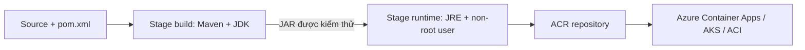
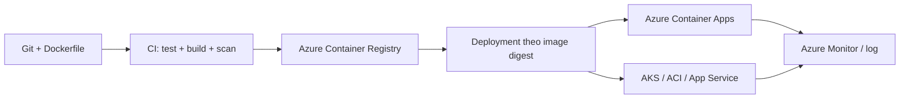
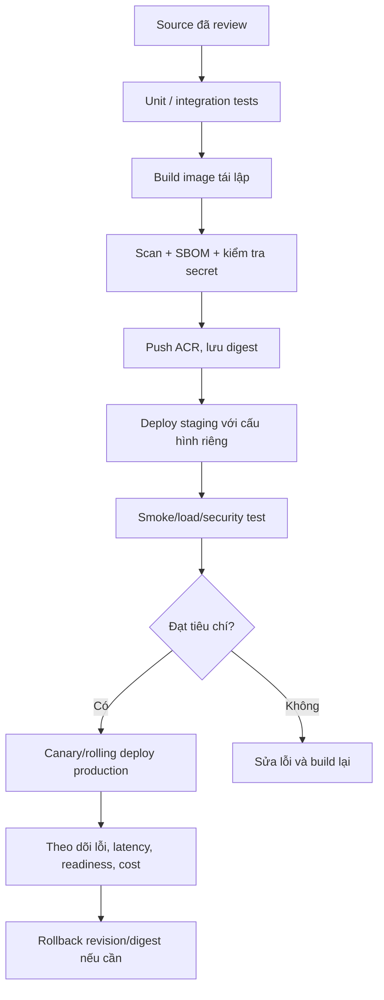

# Xây dựng image container phù hợp môi trường Azure

Một ứng dụng chạy tốt trên máy cá nhân chưa chắc chạy ổn định khi được đóng gói thành container và triển khai trên Microsoft Azure. Image có thể quá lớn, chứa mật khẩu, dùng kiến trúc CPU không phù hợp, chạy bằng quyền root, ghi dữ liệu quan trọng vào hệ thống tệp tạm hoặc không trả lời health probe. Những lỗi đó dẫn đến khởi động chậm, lỗi kéo image, rủi ro bảo mật và gián đoạn dịch vụ khi scale.

**Container image** là gói bất biến theo nội dung, chứa những thành phần cần thiết để khởi động ứng dụng: runtime, thư viện, tập tin ứng dụng và metadata. Image được xây dựng một lần, đẩy vào **Azure Container Registry (ACR)** hoặc registry phù hợp, sau đó được kéo về để chạy trên **Azure Container Apps, Azure Kubernetes Service (AKS), Azure Container Instances (ACI)** hay dịch vụ hỗ trợ container khác.

Trong module **CLOUD_PROVIDERS_AZURE**, thuộc chương **Container Registry và Container Apps**, bài học này tập trung vào thiết kế, xây dựng, kiểm thử, bảo mật và phát hành image sẵn sàng cho môi trường Azure. Các ví dụ sử dụng ứng dụng Java để minh họa; nguyên tắc chung cũng áp dụng cho Node.js, Python, .NET, Go và những runtime khác.

## 1. Mục tiêu học tập

Sau bài học, bạn có thể:

1. Phân biệt Dockerfile, build context, image, container, registry, tag và digest.
2. Viết Dockerfile **multi-stage** để tách môi trường build khỏi runtime, giảm kích thước và bề mặt tấn công.
3. Chọn base image, kiến trúc CPU, runtime, cổng mạng, user và cách ghi log phù hợp với dịch vụ Azure đích.
4. Dùng `.dockerignore`, quản lý dependency và tránh đưa credential vào image hoặc lịch sử build.
5. Kiểm thử image trước khi đẩy lên ACR; phân biệt lỗi build, pull, start và runtime.
6. Xây image bằng Docker hoặc **ACR Tasks**, gắn phiên bản và triển khai theo **digest** khi cần tính tái lập.
7. Thiết kế quyền kéo image, quét lỗ hổng, cập nhật base image, rollback và giám sát sau triển khai.
8. Giải thích ảnh hưởng của image size, cache, startup, CPU/memory và egress mạng tới hiệu năng và chi phí.

## 2. Image, container và registry khác nhau thế nào?

Một hệ thống container có ít nhất bốn khái niệm:

| Khái niệm | Vai trò | Ví dụ |
|---|---|---|
| **Dockerfile** | Công thức gồm các bước xây image | `FROM`, `COPY`, `RUN`, `USER`, `ENTRYPOINT` |
| **Image** | Các lớp filesystem và metadata, dùng làm đầu vào khởi chạy container | `api:1.4.2` |
| **Container** | Instance đang chạy hoặc đã dừng từ image, có process và trạng thái runtime | Container phục vụ HTTP port 8080 |
| **Registry** | Nơi lưu trữ và phân phối image/artifact | `demo.azurecr.io` (Azure Container Registry) |

Một image có thể chạy thành nhiều container. Nếu cần tăng từ 2 lên 10 replica, nền tảng thường kéo cùng image và tạo thêm instance; **không cần build lại image cho từng replica**.

Ví dụ tên image:

```text
demo.azurecr.io/orders-api:1.4.2
└── Registry ──┘ └Repository┘ └Tag┘

demo.azurecr.io/orders-api@sha256:<DIGEST>
└── Registry ──┘ └Repository┘ └Content digest┘
```

**Tag** là tên tham chiếu có thể được gắn lại cho image khác nếu registry cho phép. **Digest** nhận diện nội dung manifest theo hash; khi sử dụng digest cụ thể và registry còn lưu artifact, bạn có thể xác định chính xác nội dung được kéo. Digest của manifest đơn kiến trúc có thể khác digest của manifest index đa kiến trúc.

### Image không phải VM image

VM image chứa nền hệ điều hành cho một máy ảo. Container image chứa không gian người dùng và ứng dụng; container thông thường **chia sẻ kernel với host** theo mô hình runtime. Vì vậy container Linux cần host/container runtime hỗ trợ Linux; container Windows có yêu cầu host và tương thích riêng. Không thể biến Windows container thành Linux container chỉ bằng cách đổi extension file.

## 3. Tiêu chí của một image phù hợp Azure

Một image production nên thỏa các nhóm yêu cầu sau:

| Nhóm | Tiêu chí cụ thể |
|---|---|
| **Tính đúng đắn** | Chạy được đúng ứng dụng, đúng runtime và dependencies |
| **Tính tương thích** | Linux/Windows, `amd64`/`arm64`, thư viện native phù hợp với môi trường đích |
| **Bảo mật** | Không chứa secret, chạy non-root khi có thể, cập nhật bản vá, giảm package thừa |
| **Khởi động** | Process chính nhận signal, startup trong ngân sách probe/scale, có health endpoints |
| **Kết nối** | Lắng nghe đúng interface/port, dùng TLS tới dependency, xử lý DNS/proxy |
| **Vận hành** | Log ra stdout/stderr, stateless hoặc dùng storage bên ngoài, có telemetry và version |
| **Tái lập** | Dependency/version được quản lý; image được gắn tag có ý nghĩa và có digest |
| **Chi phí** | Kích thước hợp lý, không tải lại artifact không cần thiết, tài nguyên chạy phù hợp |

Một image rất nhỏ nhưng thiếu CA certificates hoặc thư viện mà ứng dụng cần vẫn là image kém. Tối ưu hóa phải bắt đầu từ **đúng chức năng và bảo mật**, sau đó mới giảm kích thước.

## 4. Chọn base image và runtime

**Base image** là lớp nền trong chỉ thị `FROM`. Một ứng dụng Java có thể dùng:

- Image có **JDK** khi biên dịch Java.
- Image có **JRE** khi chỉ cần chạy JAR.
- Image tối giản hoặc distroless nếu dependencies và quy trình debug/quan sát cho phép.

Cân nhắc các yếu tố:

1. Nguồn cung cấp đáng tin cậy và chu kỳ cập nhật bảo mật.
2. Phiên bản runtime tương thích với ứng dụng, ví dụ Java 21.
3. Hệ điều hành và thư viện hệ thống, bao gồm `glibc` hoặc `musl` nếu có thư viện native.
4. Kiến trúc CPU được cung cấp, ví dụ `linux/amd64` hay `linux/arm64`.
5. Có CA certificates, timezone data, font hoặc thư viện cần cho nghiệp vụ hay không.
6. Quyền mặc định của user, thư mục ghi được và cơ chế xử lý signal.
7. Kích thước, số lớp, bản vá và khả năng lấy SBOM.

**Không sử dụng `latest` như cơ chế quản lý phiên bản production.** Một tag động có thể thay nội dung giữa hai lần build. Có thể cố định tag phiên bản được quản trị và, khi cần độ tái lập cao, **pin digest** sau khi xác nhận provenance. Pin digest không miễn trừ cập nhật: đội vận hành vẫn phải chủ động nhận bản vá bằng cách đổi digest sang image đã được kiểm thử.

### Multi-stage build

Một môi trường build có Maven, compiler và nhiều cache; ứng dụng runtime thường chỉ cần JRE và file JAR. **Multi-stage build** cho phép dùng stage build nặng, sau đó chỉ sao chép artifact cần chạy vào final image.



Compiler, Maven local cache và source code không cần xuất hiện trong final image, trừ khi thiết kế ứng dụng có yêu cầu đặc biệt.

## 5. Ví dụ Dockerfile multi-stage cho Java 21

Giả sử một dự án Java/Maven có cấu trúc:

```text
orders-api/
  Dockerfile
  .dockerignore
  pom.xml
  src/
    main/...
    test/...
```

Ứng dụng xây một JAR thực thi tại `target/app.jar`, lắng nghe HTTP port 8080 và cung cấp endpoint `/health/live` và `/health/ready`. Nếu dự án Maven chưa tạo JAR tên `app.jar`, có thể cấu hình `<finalName>app</finalName>` trong `pom.xml` hoặc điều chỉnh đường dẫn `COPY` cho đúng artifact thực tế. Với Spring Boot cần bảo đảm JAR đã được repackaged thành executable JAR.

Ví dụ Dockerfile:

```dockerfile
# syntax=docker/dockerfile:1

# Stage 1: chỉ dùng để biên dịch
FROM maven:3.9-eclipse-temurin-21 AS build
WORKDIR /workspace

# Tách khai báo dependency để tận dụng build cache.
COPY pom.xml ./
RUN mvn -B -ntp dependency:go-offline

COPY src ./src
RUN mvn -B -ntp -DskipTests package

# Stage 2: chỉ chứa những gì cần chạy
FROM eclipse-temurin:21-jre-jammy AS runtime

RUN groupadd --gid 10001 appgroup \
    && useradd --uid 10001 --gid 10001 \
       --no-create-home --shell /usr/sbin/nologin appuser

WORKDIR /app
COPY --from=build --chown=10001:10001 \
    /workspace/target/app.jar /app/app.jar

USER 10001:10001
ENV JAVA_TOOL_OPTIONS="-XX:MaxRAMPercentage=75 -XX:+ExitOnOutOfMemoryError"
EXPOSE 8080

ENTRYPOINT ["java", "-jar", "/app/app.jar"]
```

### Giải thích từng quyết định

**Stage build:** sử dụng Maven/JDK để biên dịch; source, compiler và Maven repository không được đưa vào final image. Tách `COPY pom.xml` trước `COPY src` có thể giúp tận dụng cache khi chỉ source thay đổi.

**Stage runtime:** sử dụng JRE vì ứng dụng không cần compiler khi chạy. Base image được chọn ở đây là ví dụ có hệ điều hành tương thích với lệnh tạo user Linux.

**User non-root:** `USER 10001:10001` giảm đặc quyền mặc định của process trong container. Đây chỉ là một lớp giảm rủi ro; host, kernel, seccomp, network policy và quyền dịch vụ vẫn phải được bảo vệ riêng.

**Memory-aware Java:** `MaxRAMPercentage` giúp JVM quản lý heap tương đối với giới hạn bộ nhớ container; ứng dụng vẫn cần headroom cho non-heap memory, thread stack và native buffers.

**`EXPOSE 8080`:** ghi metadata rằng container dự kiến lắng nghe port 8080. Lệnh này **không tự mở ingress trên Azure** và không đảm bảo ứng dụng thực sự bind port. Phải cấu hình port ở ứng dụng và dịch vụ Azure đích.

**Exec-form ENTRYPOINT:** process Java nhận signal trực tiếp hơn so với lệnh bao qua shell không được cấu hình `exec`. Điều này hỗ trợ shutdown có kiểm soát, nhưng ứng dụng vẫn cần xử lý SIGTERM và hoàn thành request đang chạy theo thời hạn của nền tảng.

### Điều còn phải làm trước production

Dockerfile minh họa cố ý chưa coi mọi thứ là hoàn tất:

- Pipeline phải chạy unit/integration tests; `-DskipTests` trong stage build chỉ giúp tách build image khỏi bước test CI.
- Pin base image theo chính sách; kiểm tra các CVE và rebuild định kỳ.
- Xác nhận JAR thực thi, loại dependencies, chứng chỉ CA và timezone cần thiết.
- Kiểm tra image với CPU/memory limit và hệ thống file read-only nếu có yêu cầu.
- Cấu hình quyền truy cập registry và secret **tại runtime**, không đóng gói chúng vào JAR/image.

Nếu ứng dụng tạo file tạm, cần cung cấp thư mục ghi phù hợp (ví dụ `/tmp` hoặc volume được mount), không bật read-only filesystem rồi bỏ qua lỗi ghi.

## 6. Dùng .dockerignore để giới hạn build context

**Build context** là những file Docker/BuildKit có thể truy cập khi build. Nếu gửi cả thư mục dự án, những file không cần thiết hoặc nhạy cảm có thể đi cùng context đến builder. `.dockerignore` giúp loại bỏ phần lớn dữ liệu không cần.

Ví dụ:

```dockerignore
.git
.github
.idea
.vscode
target/
build/
*.log
*.tmp
.env
.env.*
**/*.pem
**/*.key
**/secrets/**
**/node_modules
README-local.md
```

Điều chỉnh theo dự án: đừng loại nhầm file cấu hình hoặc asset mà build thật sự cần. Đối với dự án multi-module, Maven wrapper, dependency file hoặc scripts build có thể phải được giữ lại.

**Một ngoại lệ quan trọng:** `.dockerignore` giảm dữ liệu gửi vào context nhưng không thay thế secret scanning và kiểm soát repository. Nếu secret đã commit vào Git hoặc xuất hiện trong build log, thêm tên file vào `.dockerignore` không làm secret đã lộ trở nên an toàn.

## 7. Bảo vệ secret ở build time và runtime

Không viết secret trong Dockerfile:

```dockerfile
# KHÔNG AN TOÀN — chỉ để minh họa lỗi
ENV DATABASE_PASSWORD="hardcoded-password"
ARG PRIVATE_REGISTRY_TOKEN
RUN echo "token=$PRIVATE_REGISTRY_TOKEN"
```

Giá trị có thể bị lộ qua source, image metadata, build history, cache, logs hoặc artifact trong pipeline. `ARG` không phải cơ chế lưu bí mật; `ENV` thường trở thành cấu hình image/container.

### Secret cần thiết khi build

Nếu build phải tải dependencies từ repository riêng, hãy dùng cơ chế secret injection được công cụ build hỗ trợ, chẳng hạn **BuildKit secret mount**, để tránh tạo image layer chứa credential:

```dockerfile
# syntax=docker/dockerfile:1
FROM maven:3.9-eclipse-temurin-21 AS build
WORKDIR /workspace
COPY pom.xml .
COPY src ./src

# Ví dụ minh họa: build secret chỉ được mount vào lệnh cần dùng.
# Phải cấu hình Maven settings thực tế phù hợp với repository.
RUN --mount=type=secret,id=maven_settings,target=/root/.m2/settings.xml \
    mvn -B -ntp package
```

Khi dùng Docker BuildKit hỗ trợ `--secret`, secret được đưa vào qua kênh build riêng. **Không in nội dung secret hoặc cố tình copy secret ra image layer**; nếu script làm điều đó thì secret mount cũng không cứu được.

### Secret cần thiết khi container đang chạy

Với Azure, ưu tiên:

- **Managed identity** hoặc workload identity federation cho dịch vụ và môi trường hỗ trợ.
- Azure Key Vault hoặc nguồn secret được nền tảng hỗ trợ, có quyền truy cập tối thiểu.
- Cơ chế inject secret ở runtime cho Azure Container Apps, AKS hoặc App Service theo chính sách tổ chức.
- Rotation secret và restart/refresh runtime nếu ứng dụng còn cache credential cũ.

Phân biệt **quyền kéo image từ ACR** với **quyền của ứng dụng để truy cập Key Vault/Storage**. Hai nhiệm vụ có thể sử dụng các identity và role khác nhau. Việc container pull thành công không có nghĩa application identity đã được cấp quyền truy cập dữ liệu.

## 8. Image phải hoạt động đúng trong môi trường container

### Lắng nghe mọi interface thích hợp

Trong container, ứng dụng cần lắng nghe trên interface mà runtime có thể chuyển traffic tới, thường là `0.0.0.0:8080` với IPv4. Nếu web server chỉ bind `127.0.0.1`, ứng dụng có thể hoạt động khi gọi bên trong container nhưng không nhận request từ ingress proxy qua địa chỉ network của container.

Ví dụ cho ứng dụng Spring Boot khi cần đặt rõ port và host:

```properties
server.address=0.0.0.0
server.port=8080
```

Dùng cấu hình environment-aware; không hard-code hostname, IP container hoặc public IP của cluster. Giá trị `server.port` cũng có thể được cung cấp qua biến môi trường theo convention của framework.

### Health probe

Với HTTP service, nên có những endpoint tách biệt:

| Endpoint | Vai trò | Điều không nên làm |
|---|---|---|
| `/health/live` | Process còn sống, không deadlock ở mức cơ bản | Không kiểm tra mọi dependency theo cách gây restart liên tục |
| `/health/ready` | Instance đã sẵn sàng nhận request thật | Không trả 200 khi dependency thiết yếu chưa dùng được |
| `/health/startup` (nếu có) | Ứng dụng đã hoàn tất startup ban đầu | Không đặt timeout quá ngắn với runtime khởi động lâu |

Azure Container Apps và AKS có cơ chế probe riêng. Chỉ thêm chỉ thị Dockerfile `HEALTHCHECK` **không có nghĩa mọi dịch vụ Azure tự động dùng nó với cùng hành vi**. Hãy khai báo probes theo cơ chế runtime đích và kiểm thử failure threshold, interval, timeout, đường dẫn/cổng.

### Graceful shutdown

Khi triển khai revision mới, scale-in hoặc node bị thay, nền tảng có thể yêu cầu container dừng. Ứng dụng nên:

1. Nhận `SIGTERM` hoặc tín hiệu dừng được runtime hỗ trợ.
2. Dừng nhận công việc mới.
3. Hoàn tất hoặc đưa lại vào queue các tác vụ chưa xử lý xong.
4. Flush log/tracing và trạng thái có thể lưu bền vững.
5. Đóng connection pool trong ngân sách termination grace period.
6. Kết thúc process với exit code phù hợp.

Không giả định container luôn có vài phút để kết thúc: thời gian shutdown phụ thuộc cấu hình nền tảng, tình huống lỗi hoặc scale.

### Stateless và lưu trữ bền vững

Filesystem writable bên trong container thường gắn với vòng đời container/replica. Không lưu thông tin đơn hàng, ảnh upload, khóa ứng dụng hoặc checkpoint quan trọng chỉ trong đó. Dùng **Azure Blob Storage, Azure Files, Azure Database** hoặc hệ thống dữ liệu phù hợp. Nếu cần một thư mục chia sẻ, đánh giá volume mount và semantics file theo dịch vụ.

## 9. Logging, cấu hình và resource limits

### Ghi log theo chuẩn container

Ứng dụng nên ghi log hoạt động bình thường ra **stdout** và lỗi ra **stderr**, ở định dạng có timestamp, level, correlation ID và thông tin cần thiết. Azure Container Apps/AKS/App Service có khả năng thu thập log theo cấu hình giám sát.

Không ghi access token, client secret, cookie phiên hoặc dữ liệu nhạy cảm vào log. Cần chọn mức log phù hợp; bật debug liên tục có thể tăng chi phí ingestion và lộ dữ liệu.

### Sử dụng biến môi trường đúng mục đích

Biến môi trường hữu ích cho **cấu hình không nhạy cảm** như port, tên môi trường, feature flag hoặc URL dịch vụ. Với secret, dùng cơ chế bí mật do nền tảng quản lý; nếu nền tảng inject secret vào environment, vẫn phải hạn chế quyền đọc, crash dumps và debug logs vì environment variables không tự được mã hóa trong process memory.

Nguyên tắc **build once, deploy many**: cùng một image digest chạy ở dev, staging, production; khác biệt nằm ở cấu hình và danh tính môi trường. Không xây ba image khác nhau chỉ để nhúng endpoint hoặc mật khẩu môi trường.

### Giới hạn CPU/memory

Một ứng dụng chạy bình thường khi Docker local dùng nhiều RAM có thể bị OOM trên Azure nếu workload vượt memory limit. Kiểm thử với CPU/memory đại diện, bao gồm peak traffic, thread count, heap, native memory, connection pools và thời gian startup.

Lưu ý với Java: `MaxRAMPercentage=75` chỉ giới hạn tỷ lệ heap do JVM tính toán, không phải giới hạn tổng RAM của ứng dụng. Direct buffers, metaspace, JIT và stack vẫn cần headroom.

## 10. Kiểm thử image trên máy phát triển hoặc CI

Sau khi tạo Dockerfile và `.dockerignore`, thử build:

```bash
docker build --pull -t orders-api:local .
```

`--pull` yêu cầu thử lấy base image phù hợp từ registry; nó không tự kiểm tra rằng image không có CVE. CI nên có bước cập nhật dependency/scan riêng.

Chạy container thử nghiệm:

```bash
docker run --rm \
  --name orders-api-test \
  --memory 512m \
  --cpus 1 \
  -e SERVER_PORT=8080 \
  -p 127.0.0.1:8080:8080 \
  orders-api:local
```

Lệnh bind port vào localhost của máy thử nghiệm, tránh vô tình mở dịch vụ tới mọi interface host. Nếu ứng dụng không hỗ trợ biến môi trường `SERVER_PORT`, phải cấu hình port theo framework tương ứng.

Trong terminal khác:

```bash
curl --fail --silent --show-error http://127.0.0.1:8080/health/live
curl --fail --silent --show-error http://127.0.0.1:8080/health/ready
```

Kiểm tra metadata:

```bash
docker image inspect orders-api:local \
  --format '{{.Os}}/{{.Architecture}} user={{.Config.User}}'

docker image history orders-api:local
```

`docker image history` giúp phát hiện một số chỉ thị hoặc thao tác không mong muốn, nhưng không thay thế scanner: secret có thể tồn tại trong file layer dù không lộ ở chuỗi history.

### Kiểm thử filesystem chỉ đọc

Nếu ứng dụng dự kiến chạy với root filesystem read-only, thử trong môi trường lab:

```bash
docker run --rm \
  --read-only \
  --tmpfs /tmp:rw,nosuid,size=64m,mode=1777 \
  --memory 512m \
  -p 127.0.0.1:8080:8080 \
  orders-api:local
```

Container sẽ chỉ thành công nếu ứng dụng không ghi ngoài những nơi được phép. Điều chỉnh tmpfs hoặc volume theo yêu cầu thực tế. Một thử nghiệm read-only thành công không tự bảo đảm runtime Azure đích hỗ trợ cấu hình identical; phải dùng option của platform tương ứng.

### Kiểm thử shutdown và restart

- Gửi `docker stop orders-api-test` với container đang chạy, quan sát shutdown.
- Xác minh không có request bị mất bất thường hoặc transaction chưa commit nếu ứng dụng đã nhận SIGTERM.
- Chạy nhiều instance để phát hiện việc lưu state local làm phiên mất nhất quán.
- Thử chạy dưới CPU/memory limit thấp hơn môi trường local để phát hiện OOM và startup timeout.
- Kiểm tra kết nối DNS/TLS tới dependency test qua network giống Azure khi có thể.

## 11. Kiến trúc CPU và image đa nền tảng

Azure cung cấp các loại máy có kiến trúc CPU khác nhau tùy dịch vụ và SKU. Một image chỉ hỗ trợ `linux/amd64` có thể không chạy trên worker `linux/arm64`; lỗi điển hình là **exec format error** hoặc thiếu manifest tương ứng.

### Kiểm tra kiến trúc

```bash
docker image inspect orders-api:local \
  --format 'OS={{.Os}}, ARCH={{.Architecture}}'
```

Khi xây cho một platform xác định bằng Buildx:

```bash
docker buildx build \
  --platform linux/amd64 \
  -t orders-api:amd64 \
  --load .
```

Nếu cần hỗ trợ cả amd64 và arm64, có thể dùng build pipeline đa kiến trúc:

```bash
docker buildx build \
  --platform linux/amd64,linux/arm64 \
  -t "<REGISTRY>.azurecr.io/orders-api:<VERSION>" \
  --push .
```

Lệnh đa kiến trúc cần builder hỗ trợ build multi-platform, base images cho cả hai kiến trúc và các dependency/native library tương thích. Môi trường build có thể cần worker kiến trúc tương ứng hoặc emulation phù hợp.

Không chọn image đa kiến trúc nếu chỉ ứng dụng thuần Java mà không kiểm thử: thư viện JNI, image processing, native DNS/TLS library hoặc agent quan sát vẫn có thể phụ thuộc CPU/OS.

## 12. Azure Container Registry: nơi lưu và phân phối image

**Azure Container Registry (ACR)** là registry riêng được quản lý, dùng lưu OCI/Docker images và các artifact phù hợp. Với dự án Azure, ACR giúp thống nhất quyền truy cập, lifecycle, build pipeline và triển khai tới các dịch vụ Azure.

Ví dụ đường đi:



### Tạo ACR trong môi trường thử nghiệm

Ví dụ Bash/Azure Cloud Shell:

```bash
az account show --query "{name:name,id:id,tenantId:tenantId}" -o table

RG="rg-container-lab"
LOC="southeastasia"
ACR="<UNIQUE_ACR_NAME>"

az acr create \
  --resource-group "$RG" \
  --name "$ACR" \
  --location "$LOC" \
  --sku Basic
```

Giả sử resource group đã tồn tại, subscription có quyền tạo registry và `ACR` là tên toàn cục khả dụng. **ACR Basic** phù hợp cho một số lab đơn giản nhưng không có mọi tính năng mạng/replication của các SKU cao hơn; hãy chọn SKU theo yêu cầu và xác nhận hỗ trợ hiện hành trước triển khai.

Lấy login server:

```bash
LOGIN_SERVER=$(az acr show \
  --name "$ACR" \
  --query loginServer \
  --output tsv)

echo "$LOGIN_SERVER"
```

### Build và push bằng ACR Tasks

**ACR Tasks** có thể thực hiện cloud build dựa trên source/Dockerfile được truyền vào, không nhất thiết cần Docker daemon trên máy tác giả lệnh.

```bash
REPO="orders-api"
TAG="1.4.2"

az acr build \
  --registry "$ACR" \
  --image "$REPO:$TAG" \
  .
```

Lệnh được chạy từ thư mục có Dockerfile và build context. Nó có thể phát sinh chi phí, sử dụng tài nguyên build của ACR và truy cập nguồn dependencies theo cấu hình mạng. Pipeline thực phải bổ sung test, scan, version, secret management và quyền push riêng, không chỉ chạy lệnh này.

Xem tag có trong repository:

```bash
az acr repository show-tags \
  --name "$ACR" \
  --repository "$REPO" \
  --output table
```

Kiểm tra digest được tham chiếu bởi tag:

```bash
az acr repository show \
  --name "$ACR" \
  --image "$REPO:$TAG" \
  --query digest \
  --output tsv
```

Một deployment cần tái lập có thể tham chiếu dạng:

```text
<REGISTRY>.azurecr.io/orders-api@sha256:<DIGEST>
```

Digest phải lấy từ kết quả thực tế, không tự viết một chuỗi SHA-256 giả. Khi dùng multi-platform manifest, hãy bảo đảm digest tham chiếu đúng manifest/index mà runtime mong muốn.

### Build local rồi push

Nếu tổ chức có Docker engine và đã được cấp quyền:

```bash
az acr login --name "$ACR"

docker tag orders-api:local "$LOGIN_SERVER/$REPO:$TAG"
docker push "$LOGIN_SERVER/$REPO:$TAG"
```

`az acr login` cung cấp cách đăng nhập bằng Azure identity trong tình huống được hỗ trợ. Không bật admin user của ACR chỉ để tiện chạy pipeline khi có thể dùng identity/RBAC tối thiểu.

## 13. Registry authorization: push khác pull

Quyền xây/đẩy image và quyền môi trường runtime kéo image phải được tách riêng.

| Danh tính | Nhu cầu | Nguyên tắc |
|---|---|---|
| CI builder | Push image/metadata vào repository được phép | Chỉ quyền push cần thiết |
| Azure Container Apps hoặc AKS runtime | Kéo image khi tạo revision/pod | Chỉ quyền pull cần thiết |
| Ứng dụng trong container | Đọc Storage/Key Vault hoặc gọi API | Managed identity/workload identity và data-plane roles riêng |
| Người vận hành | Xem/redeploy hoặc kiểm tra registry | RBAC theo vai trò vận hành |

Trong mô hình ACR RBAC truyền thống, các role thường gặp là `AcrPull` và `AcrPush`. Registry có thể dùng mô hình phân quyền theo repository/ABAC tùy cấu hình và loại tính năng, khi đó phải chọn role phù hợp thay vì mặc định mọi chính sách đều hoạt động giống `AcrPull` cổ điển.

**AKS:** có thể dùng integration với ACR để kubelet identity kéo image, theo cơ chế và role được cấu hình. **Container Apps:** có thể khai báo registry credentials hoặc identity để kéo image; ưu tiên managed identity khi tương thích. Quyền app dùng Key Vault/Storage là vấn đề khác, không tự suy ra từ quyền pull.

Khi registry có firewall/private endpoint, ngoài RBAC còn cần **đường mạng, DNS và egress** phù hợp để runtime truy cập registry cùng các endpoint liên quan. Một deployment có credential chính xác vẫn có thể báo lỗi ImagePull nếu không phân giải/đi tới registry.

## 14. Triển khai image trên Azure Container Apps

**Azure Container Apps (ACA)** là nền tảng chạy container ứng dụng được quản lý, hỗ trợ revisions, scaling và ingress theo tính năng/dịch vụ. Trước khi dùng ACR image, chuẩn bị:

1. Container Apps environment trong subscription/region phù hợp.
2. Registry `<REGISTRY>.azurecr.io` chứa image đã build.
3. Identity/credential được cấp quyền **pull** từ registry, cộng đường mạng tới registry.
4. Container App với image, CPU/memory, environment variables, secret references và workload profile nếu cần.
5. Ingress/TCP/HTTP target port đúng với cổng ứng dụng lắng nghe.
6. Startup/liveness/readiness probes theo khả năng runtime và nhu cầu ứng dụng.
7. Logging/monitoring, scale rules và policy triển khai revision.

### Cổng mạng

Nếu ứng dụng trong image lắng nghe `0.0.0.0:8080`, Container App có **target port 8080** khi bật ingress. Không chỉ dựa vào Dockerfile `EXPOSE 8080` hoặc giả định mọi ứng dụng container tự dùng port 80.

Container chạy thành công nhưng ingress bị `502`/timeout có thể do process lắng nghe sai port, bind loopback, route, startup probe hoặc dependency khởi động thất bại.

### Revision và image digest

Khi phát hành image mới, tạo/cập nhật revision theo cơ chế ACA và kiểm tra traffic split/rollout. Trong quy trình production, tham chiếu image bằng **tag bất biến đã kiểm soát** hoặc digest được xác nhận thay vì cập nhật `latest` và đoán rằng mọi replica sẽ tự kéo phiên bản mới.

Ví dụ cập nhật image cho một Container App **đã tồn tại và đã cấu hình quyền pull**:

```bash
APP="orders-api"
RG="rg-container-lab"
IMAGE_REF="$LOGIN_SERVER/$REPO:$TAG"

az containerapp update \
  --resource-group "$RG" \
  --name "$APP" \
  --image "$IMAGE_REF"
```

Lệnh ví dụ không tự tạo environment, registry identity, ingress hay secrets; các thành phần đó phải được cấu hình trước. Sau update, xác minh revision mới thực sự Ready và hoạt động trước khi chuyển toàn bộ traffic.

### Scale-to-zero và trạng thái

ACA có thể scale-to-zero tùy ingress, revision mode, workload profile và scale rule hỗ trợ. Ứng dụng phải chuẩn bị cho **cold start**: khi có request, nền tảng cần kéo image (nếu chưa có), tạo container, khởi động Java và chờ readiness. Image lớn và startup quá lâu có thể làm trải nghiệm kém.

Không lưu session hoặc file upload duy nhất trong container instance nếu hệ thống có khả năng scale hoặc thay replica.

## 15. Triển khai tới AKS, ACI và App Service

Một image có thể dùng ở nhiều nền tảng, nhưng yêu cầu runtime và cách quản lý khác nhau.

| Dịch vụ | Mục đích | Các điều phải kiểm tra |
|---|---|---|
| **Azure Container Apps** | Web/API, event-driven worker, microservices được quản lý | Revisions, ingress targetPort, scale rules, environment, probes |
| **Azure Kubernetes Service** | Kubernetes orchestration với kiểm soát sâu | Pod securityContext, Deployment, Service, ingress, resources, probes, imagePullPermissions |
| **Azure Container Instances** | Container/job tương đối đơn giản, ngắn hạn hoặc nhu cầu riêng | CPU/memory, OS/architecture, networking, lifecycle và restart policy |
| **App Service custom container** | Web app trên PaaS với image tùy chỉnh | Port/ingress, startup và health checks, ACR pull identity, persistent storage khi cần |

### Ví dụ manifest Kubernetes

Manifest này chỉ minh họa cách khai báo image, port, probes, giới hạn và user. Để áp dụng được, phải có cluster AKS, cấu hình quyền pull ACR và endpoint HTTP tương ứng:

```yaml
apiVersion: apps/v1
kind: Deployment
metadata:
  name: orders-api
spec:
  replicas: 2
  selector:
    matchLabels:
      app: orders-api
  template:
    metadata:
      labels:
        app: orders-api
    spec:
      containers:
        - name: orders-api
          image: <REGISTRY>.azurecr.io/orders-api:1.4.2
          ports:
            - containerPort: 8080
          securityContext:
            runAsNonRoot: true
            runAsUser: 10001
            allowPrivilegeEscalation: false
          resources:
            requests:
              cpu: "250m"
              memory: "512Mi"
            limits:
              cpu: "1"
              memory: "1Gi"
          startupProbe:
            httpGet:
              path: /health/startup
              port: 8080
            periodSeconds: 5
            failureThreshold: 30
          readinessProbe:
            httpGet:
              path: /health/ready
              port: 8080
            periodSeconds: 5
          livenessProbe:
            httpGet:
              path: /health/live
              port: 8080
            periodSeconds: 10
```

Với Kubernetes, nên đặt `image` theo digest được phê duyệt cho release quan trọng. Cấu hình Pod còn có thể cần `readOnlyRootFilesystem`, seccomp profile, capabilities drop, service account và network policy theo security baseline của cluster.

**Quan trọng:** manifest Deployment trên chưa tạo Kubernetes Service hoặc ingress; container port không tự làm API truy cập được bên ngoài cluster.

## 16. Bảo mật image và chuỗi cung ứng phần mềm

Một Dockerfile không chứa secret vẫn có thể không an toàn nếu base image có lỗ hổng hoặc dependency độc hại. Cần bảo vệ chuỗi từ source → build → registry → deployment.

### Bảo vệ nguồn và pipeline

- Build từ commit/revision rõ ràng; kiểm soát pull request và quyền sửa Dockerfile.
- Pin dependencies, có lockfile hoặc cơ chế quản lý version theo runtime.
- Kiểm thử source và dependencies trước khi phát hành.
- Dùng identity ngắn hạn/federation thay cho secret push dài hạn nếu nền tảng CI hỗ trợ.
- Hạn chế network/secret trong build runner và không dùng build log để in biến nhạy cảm.

### Kiểm soát artifact

- Quét image và dependencies để phát hiện CVE bằng công cụ phù hợp.
- Sinh và lưu **SBOM (Software Bill of Materials)** cho phiên bản phát hành.
- Gắn provenance/attestation và chữ ký image theo giải pháp được tổ chức chấp nhận.
- Thiết lập quy tắc cho phép triển khai chỉ những artifact được phê duyệt, khi runtime hỗ trợ enforcement.
- Hạn chế quyền xóa image hoặc retag release.
- Rà soát retention để không xóa digest đang được production tham chiếu.

ACR và hệ sinh thái Azure có thể tích hợp các công cụ đánh giá bảo mật, bao gồm các khả năng của Microsoft Defender for Cloud tùy cấu hình và gói dịch vụ. Không mặc định mọi loại registry và SKU đã bật quét hoặc tự chặn image nguy hiểm.

### Phân biệt scan với sửa lỗ hổng

Scan chỉ **phát hiện** vấn đề. Khi base image hoặc dependency có bản vá, cần rebuild, kiểm thử, push digest mới và triển khai có kiểm soát. Image đã được pin digest không tự cập nhật bản vá nếu không phát hành lại.

### Non-root không phải sandbox tuyệt đối

Chạy non-root làm giảm đặc quyền, nhưng vẫn cần:

- Cấu hình runtime bảo mật, hạn chế privilege escalation.
- Chỉ mount volume cần thiết và phân quyền thư mục.
- Giới hạn egress/inbound network.
- Hạn chế quyền registry và data plane Azure.
- Cập nhật OS packages/dependencies.
- Không chạy daemon nhạy cảm hoặc Docker socket trong ứng dụng trừ khi kiến trúc thực sự yêu cầu và đã đánh giá rủi ro.

## 17. Tối ưu kích thước, cache và tốc độ triển khai

### Vì sao image nhỏ hữu ích?

Image nhỏ thường giúp giảm dữ liệu cần tải, thời gian cold start, dung lượng registry và bề mặt gói phần mềm cần cập nhật. Nhưng thời gian khởi động còn phụ thuộc image cache trên node, mạng, VM/CPU, Java startup, dependency initialization và health checks.

**Không tối ưu theo số MB một cách cực đoan** nếu việc loại bỏ runtime files khiến TLS, locale, timezone hoặc font của ứng dụng không hoạt động.

### Tối ưu layer và cache

1. Đặt bước ít thay đổi (base, dependency declarations) trước bước thay đổi nhiều (source).
2. Tận dụng Maven/Gradle/npm cache của builder theo cách không làm lộ secret.
3. Giảm số lần tải dependencies từ Internet; dùng artifact repository được quản trị.
4. Chỉ copy file thật sự cần thiết bằng `.dockerignore` và multi-stage build.
5. Không chạy `apt-get upgrade` không kiểm soát rồi bỏ qua chính sách version/base image.
6. Tạo artifact compile một lần khi pipeline và môi trường cho phép, tránh build lại source vô ích.
7. Theo dõi image size, thời gian pull/start và hiệu quả cache qua nhiều lần deploy.

### Image tag và retention

Đề xuất:

```text
orders-api:1.4.2
orders-api:git-a1b2c3d
orders-api@sha256:<DIGEST>
```

Tag semantic version và git commit giúp con người truy vết; digest giúp chỉ đúng nội dung. Không nhất thiết cần cả hai loại tag cho mọi project, nhưng nên có quy tắc phát hành và không retag bừa một bản production.

Cẩn trọng khi xóa image: registry có thể giữ manifest/tags theo nhiều tham chiếu. Nếu xóa digest mà deployment vẫn tham chiếu, lần scale-out/restore sau có thể pull thất bại. Retention cần gắn với lifecycle rollout và rollback.

## 18. Vận hành: kiểm thử, triển khai và rollback

Để tránh “build thành công nhưng production lỗi”, dùng pipeline nhiều cổng kiểm soát:



### Điều cần kiểm chứng ở staging

- Image đúng `linux/amd64` hoặc platform đích.
- Không yêu cầu quyền root hay file write ngoài thiết kế.
- Cổng, protocol, health probe và shutdown đúng.
- App lấy credential qua runtime identity/secret reference.
- Gọi được dependency qua DNS, private endpoint hoặc firewall.
- Resource requests/limits đủ cho peak cơ bản.
- Logs, traces, metric và correlation ID hoạt động.
- Dữ liệu không mất khi replica bị xóa hoặc scale-in.
- Startup và cold start nằm trong SLO.
- Build provenance/digest đúng release được phê duyệt.

### Rollback

Rollback thường là chuyển traffic/revision hoặc deployment về **digest đã biết hoạt động tốt**, không phải build lại code cũ rồi gắn `latest`.

Điều này chỉ an toàn nếu:

1. Registry vẫn còn digest cũ và workload còn quyền pull.
2. Schema dữ liệu/config có **tương thích ngược** với phiên bản cũ.
3. Secrets và API dependencies còn hỗ trợ.
4. Hệ thống có đủ capacity để đưa các replica cũ lên.
5. Traffic chuyển có kiểm soát và có metric xác nhận phục hồi.

Thay image không tự rollback migration database không tương thích; cần kế hoạch dữ liệu riêng.

## 19. Troubleshooting: từ build tới runtime

| Hiện tượng | Nguyên nhân thường gặp | Kiểm tra |
|---|---|---|
| `COPY failed` hoặc không thấy file JAR | `.dockerignore` loại nhầm, Maven tạo tên khác hoặc build stage lỗi | Kiểm tra build context, tên artifact và cấu hình `pom.xml` |
| Image lớn bất thường | Copy source/build cache vào runtime, base image quá nặng | Dùng `docker image history`, multi-stage, `.dockerignore` |
| `exec format error` | Image không phù hợp kiến trúc CPU | Inspect OS/architecture, image manifest và node architecture |
| Container exit ngay với code khác 0 | Command/JAR sai, thiếu dependency, config lỗi | Container logs, ENTRYPOINT và test run local |
| `permission denied` ở runtime | Non-root user không có quyền đọc/ghi file | Owner, mode, volume mount, UID/GID và writable paths |
| Java OOM/killed | Memory limit thấp, heap/native memory hoặc tải lớn | Container metrics, JVM config, heap dump an toàn |
| 502/503 sau deploy ACA | Sai target port, bind localhost, readiness fail, app chưa startup | Cổng, ingress, probes, log và replica state |
| `ImagePullBackOff` hoặc pull lỗi | Sai image ref, tag/digest không tồn tại, sai quyền ACR hoặc lỗi network | Registry, auth, role pull, private DNS, firewall |
| Registry báo unauthorized | Identity không có quyền hoặc token hết hạn | ACR RBAC/ABAC, auth mode, scope của identity |
| Staging chạy nhưng production không chạy | Config/secret/identity/network khác nhau | So sánh cấu hình runtime, không rebuild image để nhúng secret |
| Secret xuất hiện trong image layer | Dùng ARG/ENV, COPY file credential hoặc script ghi secret | Scan layer/history, thu hồi credential bị lộ và sửa build |
| CrashLoopBackOff trên AKS | Process lỗi, liveness quá chặt, port/probe sai | `kubectl describe pod`, logs, probe thresholds |
| Rollback thất bại | Digest cũ đã bị xóa hoặc database đã migration không tương thích | Registry retention, migration strategy và config |
| Cold start chậm | Image lớn, tải dependencies khi start, JVM warm-up | Đo pull/start/readiness, prebuild artifact và tối ưu startup |

### Thứ tự điều tra hợp lý

1. Xác nhận **image ref, tag/digest** chính xác và manifest có đúng platform.
2. Xác nhận runtime có quyền kéo ACR và có DNS/route tới registry.
3. Đọc log khởi động: ứng dụng có chạy đúng process không?
4. Kiểm tra memory/CPU limits, filesystem và quyền user.
5. Kiểm tra port, ingress và health probe.
6. Kiểm tra secrets, managed identity và network tới dependencies.
7. Kiểm tra telemetry, rollout history và thay đổi cấu hình gần nhất.

Không sửa đồng thời Dockerfile, NSG, image tag và probes khi chưa xác định nguyên nhân; điều này khiến khó biết thay đổi nào thực sự khắc phục lỗi.

## 20. Bài thực hành tổng hợp

### Bối cảnh

Nhóm phát triển có một ứng dụng REST Java 21. Mục tiêu là xây image chạy bằng user không đặc quyền, phát hành vào ACR, sau đó triển khai lên Azure Container Apps hoặc môi trường container tương đương. Ứng dụng trả kết quả HTTP trên port 8080 và cần truy cập dữ liệu ở Azure Storage.

### Phần A — Chuẩn bị Dockerfile

1. Mô tả khác biệt giữa stage build dùng Maven/JDK và stage runtime dùng JRE.
2. Viết `.dockerignore` để loại Git metadata, build outputs, log và file secret.
3. Tạo Dockerfile multi-stage, sao chép duy nhất JAR thực thi vào final image.
4. Cấu hình `USER 10001`, port 8080 và exec-form `ENTRYPOINT`.
5. Không đưa storage connection string, account key hoặc client secret vào Dockerfile.
6. Xác minh bản JAR khởi động và trả response của `/health/live`, `/health/ready`.

### Phần B — Kiểm thử local

1. Chạy `docker build --pull -t orders-api:local .`.
2. Dùng `docker image inspect` xác nhận OS, architecture và user.
3. Chạy container với port mapping vào localhost và memory limit.
4. Kiểm thử health endpoints và shutdown bằng `docker stop`.
5. Thử root filesystem read-only; chỉ cấp thư mục tạm khi ứng dụng thực sự cần.
6. Xem image history và kiểm tra secret scan bằng công cụ của pipeline.
7. Ghi kích thước image, thời gian build và thời gian startup.

### Phần C — Phát hành lên Azure

1. Xác nhận subscription, resource group, tên ACR và quyền phù hợp.
2. Dùng `az acr build` để tạo `orders-api:1.4.2` trong ACR thử nghiệm.
3. Xem repository/tags và lấy digest thực tế.
4. Chuẩn bị identity chỉ có quyền pull phù hợp với môi trường Azure đích.
5. Triển khai image với target port 8080, CPU/memory và health probes.
6. Đặt cấu hình endpoint/storage ở runtime; ứng dụng truy cập storage qua managed identity nếu hỗ trợ.
7. Kiểm tra revision/pod healthy, log và request từ bên ngoài hoặc bên trong theo thiết kế ingress.
8. Tạo bản cập nhật nhỏ, build image mới, kiểm thử rollout và chuyển traffic.
9. Mô tả cách rollback về digest cũ sau khi một release gây lỗi.
10. Dọn tài nguyên lab theo quyền và quy trình, kiểm tra registry/compute/log có phát sinh chi phí hay không.

### Câu hỏi tự kiểm tra

**Câu 1.** Vì sao nên dùng multi-stage build thay vì đưa Maven và source code vào runtime image?

**Câu 2.** `EXPOSE 8080` có tự mở cổng Azure Container Apps hay Kubernetes Service không? Điều gì phải được cấu hình thêm?

**Câu 3.** Tag `orders-api:latest` và digest `sha256:...` khác nhau ở điểm nào? Vì sao điều này quan trọng khi rollback?

**Câu 4.** Một Dockerfile dùng `ARG PRIVATE_TOKEN` rồi chạy lệnh in token ra log có an toàn hơn `ENV PRIVATE_TOKEN` không?

**Câu 5.** Image chạy tốt trên laptop Apple Silicon nhưng AKS node x86_64 báo `exec format error`. Bạn sẽ kiểm tra gì?

**Câu 6.** Vì sao container phải có readiness probe và cơ chế shutdown khi nền tảng scale-in?

**Câu 7.** Role kéo image từ ACR có cho phép ứng dụng đọc secret từ Key Vault hoặc blob trong Storage không?

**Câu 8.** Khi Container Apps trả 502 dù image pull thành công, những lớp nào cần kiểm tra?

**Câu 9.** Vì sao quét CVE một lần trước khi push chưa đủ bảo vệ image sống lâu trong production?

**Câu 10.** Nếu cùng một image chạy ở dev và production, khác biệt hostname, secret và cấu hình database nên được đưa vào đâu?

**Tiêu chí hoàn thành:** người học xây và kiểm thử được image Java non-root, multi-stage, không chứa secret; nhận diện đúng platform/port; phát hành image vào ACR, triển khai theo phiên bản/digest và xây được quy trình kiểm tra, bảo mật, rollback trên dịch vụ container Azure.

## Kết luận

Một container image **phù hợp môi trường Azure** không chỉ là image build thành công. Nó phải được thiết kế để **nhỏ gọn hợp lý, tái lập được, bảo mật, tương thích kiến trúc, chạy non-root, lắng nghe đúng port, có health probes, graceful shutdown và không giữ dữ liệu/credential quan trọng bên trong image**.

Azure Container Registry cung cấp nơi quản lý và phân phối image, trong khi Azure Container Apps, AKS, ACI hoặc App Service cung cấp môi trường runtime với những lựa chọn về ingress, identity, network, scale và giám sát khác nhau. Khi kết hợp **multi-stage build, version/digest, quản lý secret tại runtime, quét lỗ hổng, kiểm thử staging và rollback có kiểm soát**, nhóm phát triển có thể phát hành ứng dụng Azure nhanh hơn mà vẫn giữ được khả năng truy vết, sẵn sàng và kiểm soát chi phí.

