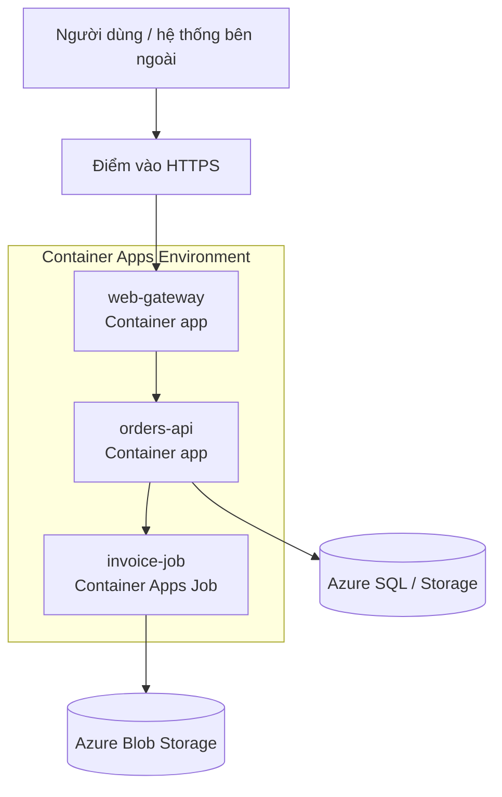
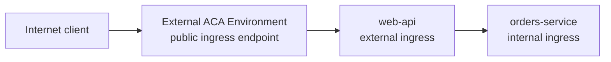
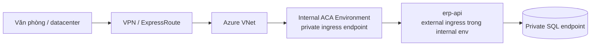
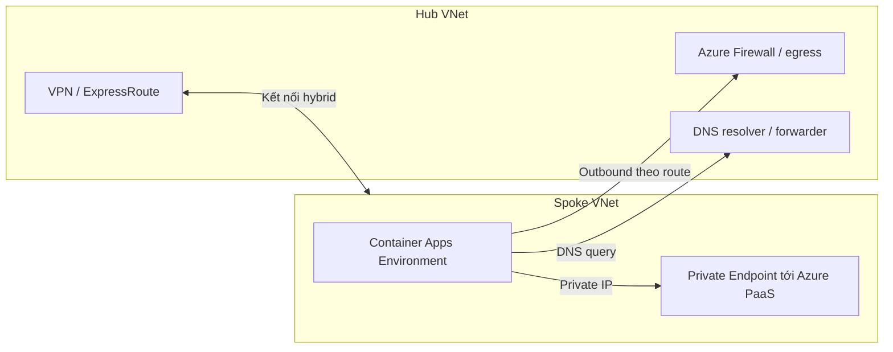
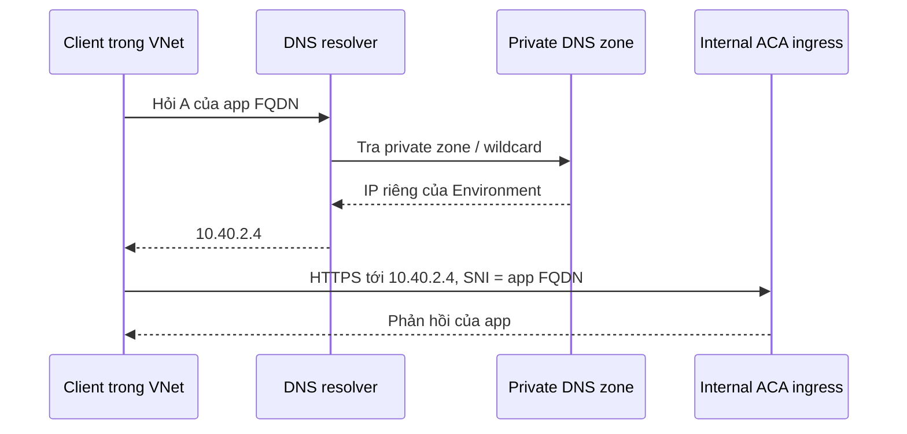
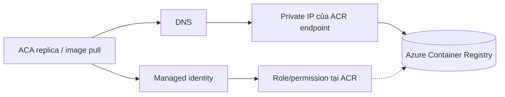
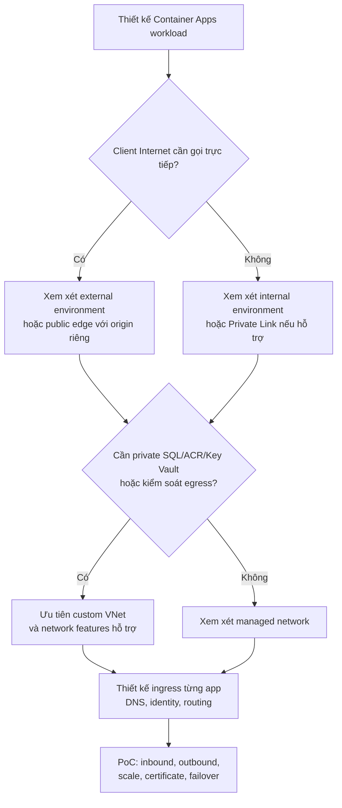
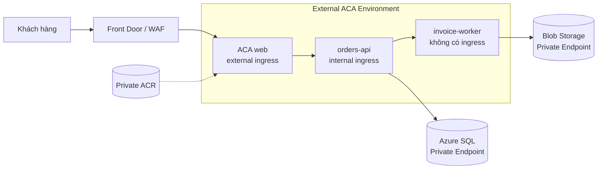
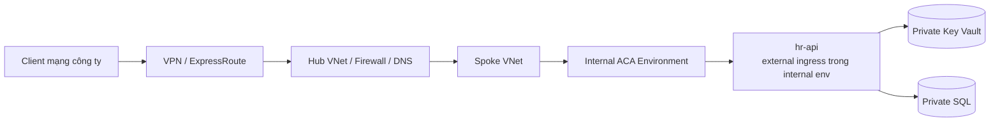

# Container Apps Environment và lựa chọn cấu hình mạng

Khi một hệ thống triển khai nhiều microservice trên **Azure Container Apps (ACA)**, câu hỏi đầu tiên không phải chỉ là “container chạy cổng nào?” mà còn là **các ứng dụng được đặt trong Container Apps Environment nào, ai được phép gọi chúng, lưu lượng ra ngoài đi theo đường nào và tên miền được phân giải ra sao**. Một API hướng tới khách hàng cần điểm vào HTTPS công khai, trong khi dịch vụ xử lý thanh toán hoặc worker nền có thể chỉ nên giao tiếp trong mạng riêng.

Bài học thuộc chương **Container Registry và Container Apps** của module **CLOUD_PROVIDERS_AZURE**. Module khám phá hệ sinh thái Microsoft Azure từ subscription, resource group và Microsoft Entra ID đến mạng ảo, tính toán, lưu trữ, dữ liệu; đồng thời hướng dẫn triển khai, giám sát, bảo vệ và kiểm soát chi phí một kiến trúc ứng dụng trên Azure. Với Container Apps, lựa chọn mạng tại **environment** ảnh hưởng đến tất cả ứng dụng và job đặt trong đó, nên cần xem xét ngay từ thiết kế.

Sau bài học, bạn có thể:

- Phân biệt **Container Apps Environment**, **container app**, **revision**, **job** và **workload profile**.
- Phân biệt môi trường **external** và **internal**, cùng thiết lập **external/internal ingress** của từng app.
- Chọn dùng mạng do Azure quản lý hoặc tích hợp **custom Azure VNet** cho yêu cầu bảo mật, DNS và hybrid.
- Mô tả luồng DNS, inbound, outbound, Private Endpoint và kết nối tới Azure Container Registry/Key Vault/Storage.
- Xác định các bước kiểm tra subnet, routing, NSG, firewall, TLS, identity và khả năng mở rộng.
- Chẩn đoán các lỗi thường gặp và lập kế hoạch triển khai/migration có kiểm soát.

## 1. Container Apps Environment là gì?

**Container Apps Environment** là ranh giới triển khai và vận hành chung cho một hay nhiều **container apps** và **container app jobs** trong cùng một vùng Azure. Environment cung cấp những thành phần nền tảng dùng chung như cấu hình mạng, miền DNS mặc định, cách cấp phát năng lực tính toán, một phần thiết lập quan sát hệ thống và khả năng giao tiếp giữa các ứng dụng.

Để tránh nhầm thuật ngữ:

| Đối tượng | Vai trò | Ví dụ |
|---|---|---|
| **Container Apps Environment** | Không gian chung về mạng, region, cấu hình hạ tầng và kết nối | `aca-env-prod` |
| **Container app** | Ứng dụng chạy container, có revision, replica, ingress và scale rules | `orders-api` |
| **Revision** | Phiên bản cấu hình/template ứng dụng có thể có replica và traffic weight riêng | `orders-api--v2` |
| **Replica** | Một instance đang chạy của revision | Replica phục vụ HTTP request |
| **Container Apps Job** | Công việc chạy đến khi hoàn tất, theo lịch/sự kiện/thủ công | `invoice-worker` |
| **Workload profile** | Loại năng lực tính toán/cấp phát trong các environment hỗ trợ workload profiles | Consumption hoặc dedicated profile |

**Environment không phải container app.** Thay đổi ingress của `orders-api` không đồng nghĩa thay đổi ingress của `payment-worker`. Ngược lại, một quyết định tại environment về mạng hoặc kiểu triển khai có thể ảnh hưởng tới mọi app thuộc environment đó.

### 1.1. Cùng environment mang lại điều gì?

Nhiều ứng dụng trong cùng environment có thể sử dụng cơ chế khám phá/gọi dịch vụ nội bộ mà ACA cung cấp, đồng thời chia sẻ bối cảnh mạng và region. Chẳng hạn frontend gọi API nội bộ và API gọi worker qua một luồng được kiểm soát.

Tuy nhiên, **cùng environment không có nghĩa tất cả ứng dụng phải có cùng quyền danh tính**. Mỗi app có thể có managed identity, secret, cấu hình ingress, revision và scaling riêng. Environment cũng không tự tạo một ranh giới tuân thủ tuyệt đối giữa các nhóm ứng dụng; cần thêm cơ chế identity, network và application authorization.



Sơ đồ mô tả quan hệ logic; một job nền thường nhận công việc qua queue/sự kiện thay vì được API gọi trực tiếp bằng HTTP. Cần chọn giao thức kết nối phù hợp từng loại workload.

## 2. Hai lớp quyết định inbound: Environment và app ingress

Đây là phần dễ gây lỗi thiết kế nhất. Có **hai câu hỏi khác nhau**:

1. **Environment là external hay internal?** Tầng ingress của environment có điểm vào công khai hay chỉ riêng trong VNet?
2. **Từng container app bật external hay internal ingress?** App có cho phép client ngoài chính environment gọi tới endpoint của nó hay chỉ các thành phần nội bộ?

**External ingress của một app không nhất thiết có nghĩa Internet public.** Nếu app thuộc **internal environment**, đường vào “external” của app được hiểu là có thể gọi **từ ngoài app/environment qua điểm vào nội bộ của environment**, nhưng vẫn bị giới hạn bởi khả năng kết nối tới mạng riêng.

### 2.1. Ma trận bốn trường hợp

| Kiểu Environment | Ingress của app | Ai có thể tiếp cận về mặt mạng? | Phù hợp với |
|---|---|---|---|
| **External** | **External** | Client Internet có thể đi tới endpoint công khai, nếu cấu hình mạng/allowlist cho phép | Website và public API |
| **External** | **Internal** | Chủ yếu các app trong cùng environment, theo cơ chế service-to-service nội bộ | Backend không muốn xuất bản công khai |
| **Internal** | **External** | Client có đường đến VNet/điểm vào riêng của environment, gồm mạng kết nối hợp lệ | API dùng trong doanh nghiệp, ứng dụng hybrid |
| **Internal** | **Internal** | Các thành phần nội bộ trong cùng environment theo cơ chế ACA | Microservice không có nhu cầu trực tiếp phục vụ client VNet |

Ma trận nói về **khả năng kết nối**, không tự chứng minh request được phép ở tầng ứng dụng. HTTPS, Entra ID/OAuth, mTLS (nếu được thiết kế và hỗ trợ), API key, authorization hoặc chính sách khác vẫn cần thiết.

### 2.2. Ingress là tùy chọn, không phải app nào cũng cần

Một container app xử lý hàng đợi có thể **không bật ingress**: nó kết nối ra Azure Service Bus hoặc Storage Queue, nhận việc và ghi kết quả. Không cần xuất bản cổng HTTP chỉ để app tồn tại.

Khi ingress được bật, cần chỉ định cấu hình thích hợp:

- **HTTP/HTTPS, gRPC hoặc TCP** theo khả năng dịch vụ và nhu cầu thật.
- **Target port** mà tiến trình trong container lắng nghe.
- **External/internal** ở cấp app.
- **Ingress traffic weights** giữa các revision khi dùng chia traffic.
- **IP restrictions, TLS/custom domain và cơ chế xác thực** theo tính năng được hỗ trợ.

Không nhầm cổng container `8080` với cổng client HTTPS `443`. ACA ingress có thể kết thúc TLS và chuyển tiếp request tới target port của container.

## 3. External Environment và Internal Environment

### 3.1. External Environment

Một **external environment** có khả năng cung cấp ingress từ mạng công cộng cho các app được bật external ingress. Đây thường là lựa chọn cho:

- Website hoặc REST API cần phục vụ Internet.
- Dịch vụ được đặt sau Azure Front Door/Application Gateway nhưng vẫn sử dụng một origin có đường vào công khai được kiểm soát.
- Lab đơn giản cần thử nghiệm nhanh, chưa có yêu cầu kết nối riêng đến hạ tầng nội bộ.

**Cần tránh:** triển khai frontend sau WAF nhưng để origin của app chấp nhận mọi client trực tiếp. Khi đó, một client biết hostname mặc định của app có thể tìm cách **bỏ qua WAF**. Tùy mô hình, nên dùng access restriction, private ingress, private endpoint ở tầng thích hợp hoặc cơ chế xác thực origin và chính sách mạng hỗ trợ.

### 3.2. Internal Environment

Một **internal environment** sử dụng điểm vào riêng trong VNet theo mô hình hạ tầng được hỗ trợ. Client cần có route và DNS đến địa chỉ private của environment. Phù hợp với:

- API chỉ dành cho nhân viên qua VPN/ExpressRoute.
- Hệ thống back-office hoặc nghiệp vụ có yêu cầu không tiếp nhận request trực tiếp từ Internet.
- Microservice cần giao tiếp với dịch vụ private trong hub-spoke/hybrid.
- Backend đứng sau một gateway nằm trong mạng doanh nghiệp hoặc một edge có đường kết nối riêng phù hợp.

Không nên coi “internal” là chứng nhận an toàn tuyệt đối. Một máy bị xâm nhập trong mạng có đường kết nối đến VNet vẫn có thể thử gọi API; app cần kiểm tra danh tính và phân quyền.

### 3.3. External vs Internal: hai sơ đồ





Hai sơ đồ mô tả hướng truy cập. **DNS đúng và route tồn tại** là điều kiện để client thực sự đến được endpoint. VNet peering hoặc VPN không tự động cấu hình Private DNS cho mọi hostname.

## 4. Chọn mạng Azure quản lý hay custom VNet

Một câu hỏi khác, độc lập với ingress app, là: **Environment sử dụng hạ tầng mạng do dịch vụ cấp/quản lý hay một subnet trong VNet do tổ chức kiểm soát?**

| Tiêu chí | Mạng do ACA/Azure quản lý | Custom VNet |
|---|---|---|
| Mục tiêu | Đơn giản hóa triển khai, ít quản trị mạng | Kiểm soát địa chỉ IP, kết nối private và routing |
| Định tuyến nội bộ | Chủ yếu theo hạ tầng dịch vụ | Có thể thiết kế với VNet/subnet/peering theo hỗ trợ |
| Kết nối đến private resources | Có thể bị giới hạn nếu không có tích hợp mạng riêng | Phù hợp hơn khi truy cập private endpoint của Storage/SQL/ACR/Key Vault |
| Hybrid VPN/ExpressRoute | Không phải đường kết nối nội bộ tùy chỉnh mặc định | Có thể triển khai qua VNet/hub theo quy định |
| DNS doanh nghiệp | Hạn chế mức kiểm soát môi trường DNS | Có thể kết hợp custom DNS/Private DNS Resolver theo kiến trúc |
| Outbound firewall / NAT / UDR | Kiểm soát có thể hạn chế | Có thể cân nhắc các tính năng được hỗ trợ bởi loại environment |
| Vận hành | Ít đối tượng mạng cần quản trị | Cần quy hoạch subnet, route, DNS, NSG, quota, cost |

Chọn custom VNet khi **bắt buộc tích hợp private network** hoặc cần áp dụng chính sách egress chi tiết. Với ứng dụng thử nghiệm đơn giản và không có dependency private, mô hình Azure quản lý có thể giúp triển khai nhanh và giảm độ phức tạp.

### 4.1. Lựa chọn mạng ở cấp Environment mang tính nền tảng

Phải quyết định kiến trúc VNet/subnet từ đầu. Không nên lập kế hoạch dựa trên giả định **có thể đổi tùy ý từ mạng mặc định sang custom VNet, từ external sang internal hoặc thay VNet của environment đang chạy mà không tái triển khai**. Nhiều thay đổi mạng nền tảng đòi hỏi tạo environment mới rồi chuyển ứng dụng.

Trước khi triển khai production, cần chốt:

1. Environment sẽ ở region nào?
2. Cần public ingress hay private ingress?
3. Có cần kết nối mạng tới SQL, Storage, Key Vault, ACR hoặc on-premises?
4. Ai quản trị DNS, VNet, NSG, route table và firewall?
5. Cần quota, địa chỉ subnet và IP cho scale-out ở mức nào?
6. Có yêu cầu về availability zone, workload profile hoặc private endpoint không?

### 4.2. Consumption-only vs Workload profiles Environment

Azure Container Apps có các thế hệ/kiểu environment, trong đó **Consumption-only** và **Workload profiles** khác nhau về khả năng đặt workload và một số tính năng mạng.

- **Consumption-only** tập trung chạy container theo mức tiêu thụ, có giới hạn và yêu cầu subnet riêng khi tích hợp VNet.
- **Workload profiles environment** hỗ trợ mô hình tính toán theo profile (chẳng hạn Consumption và các dedicated profiles được dịch vụ hỗ trợ), đồng thời là nền tảng của một số lựa chọn networking và isolation nâng cao.
- **Subnet delegation, kích thước subnet tối thiểu, NAT Gateway, UDR, NSG, private endpoints và khả năng sử dụng các profile** có quy tắc hỗ trợ khác nhau theo loại environment và thời điểm triển khai.

Ví dụ, các tài liệu/triển khai có thể yêu cầu subnet **được delegate cho `Microsoft.App/environments`** ở chế độ workload profiles, trong khi consumption-only có quy tắc subnet riêng. Không sao chép một mạng hoặc giá trị CIDR từ hướng dẫn kiểu environment này sang kiểu khác khi chưa xác nhận giới hạn hiện hành.

**Bài học quan trọng:** “Consumption” là loại compute, còn “internal/external” là mô hình ingress của environment; hai trục quyết định này **không đồng nghĩa**.

## 5. Quy hoạch VNet và subnet cho Environment

### 5.1. Subnet chuyên biệt

Khi tích hợp ACA vào custom VNet, hãy thiết kế **subnet dành riêng cho hạ tầng Container Apps Environment** theo điều kiện hỗ trợ. Không tùy tiện đặt VM, Private Endpoint của dịch vụ khác hoặc resource không tương thích vào subnet hạ tầng ACA.

Checklist subnet:

- VNet và subnet thuộc **region và phạm vi triển khai được hỗ trợ**.
- Không có CIDR chồng lấn với mạng on-premises hoặc các VNet kết nối.
- Dải địa chỉ đủ cho **replica, scale-out, các thành phần hệ thống** và kế hoạch phát triển.
- Subnet có **delegation** đúng hoặc không delegate tùy loại environment.
- NSG, route table và service endpoints (nếu có) tuân thủ giới hạn network features của loại environment.
- Không có policy hoặc security automation tự động đổi/xóa subnet gây gián đoạn.

Đừng lấy “chạy được hai replica hôm nay” làm tiêu chí sizing subnet. Sự thiếu địa chỉ ở lúc scale đột biến có thể gây lỗi provisioning dù autoscale rule được cấu hình đúng.

### 5.2. Subnet size không có một giá trị dùng cho mọi mode

Những hướng dẫn Azure Container Apps có thể quy định **CIDR tối thiểu khác nhau giữa Consumption-only và Workload profiles**. Thay vì học thuộc một con số như `/23` hoặc `/27` cho mọi environment, hãy xác minh:

1. Loại environment và workload profiles thực sự sẽ tạo.
2. Quy định subnet delegation và CIDR tối thiểu cho loại đó.
3. Cách ACA sử dụng địa chỉ khi thêm replicas/revisions/jobs.
4. Quy mô cao nhất và vùng dự phòng cần phục vụ.
5. Khả năng mở rộng sau này và chi phí thay environment nếu hết địa chỉ.

Việc chọn CIDR quá nhỏ là lỗi khó khắc phục sau khi environment đã chứa nhiều ứng dụng. Nên dự phòng địa chỉ theo growth plan và tiêu chuẩn IPAM của tổ chức.

### 5.3. Hub-spoke và DNS

Trong kiến trúc hub-spoke, Container Apps Environment thường nằm ở **spoke VNet**. Các dịch vụ chung như firewall, DNS Private Resolver, VPN/ExpressRoute hoặc observability nằm ở hub. Chỉ có peering không đủ: cần kiểm tra routing, DNS, NSG, route return path và chính sách UDR ở từng subnet.



Sơ đồ giả định những route được hỗ trợ đã thiết lập. Nếu môi trường dùng DNS tùy chỉnh, máy chủ DNS đó phải biết phân giải private zones của dịch vụ và domain của ACA theo cấu hình tương ứng.

## 6. Luồng ingress HTTP/TCP vào Container Apps

### 6.1. Từ client đến app

Để nhận HTTP request, app phải bật ingress, khai báo target port và protocol/transport phù hợp. Một mô hình đơn giản:

```text
Client -> DNS app FQDN -> ACA ingress endpoint -> revision/replica -> container port
```

Đối với app có external ingress trong external environment, client Internet có thể đi tới endpoint công khai. Đối với app có external ingress trong internal environment, client ở mạng được phép cần phân giải đúng **private IP của environment** và có route tới đó.

**Không nhầm lỗi 404/502/503 với lỗi DNS:** DNS và TLS có thể thành công nhưng ứng dụng không ready, target port sai hoặc revision không có healthy replicas.

### 6.2. Internal ingress dành cho service-to-service

Một app backend có thể cấu hình **internal ingress** để các app khác trong cùng environment gọi qua tên/FQDN nội bộ do nền tảng hỗ trợ. Cách gọi này giúp tránh công bố backend cho client ngoài environment.

Tuy nhiên, đây là **network reachability**, không phải mặc định bảo vệ authorization. API xử lý đơn hàng vẫn cần xác thực service caller, phân quyền đối với dữ liệu đơn hàng và giới hạn những thao tác nguy hiểm.

### 6.3. Ingress không có nghĩa toàn bộ traffic đều đi qua HTTP

Ngoài các API web, ACA còn có jobs, event-driven scaling và outbound connections tới queue/database. Một số workload dùng TCP ingress hoặc gRPC; điều kiện hỗ trợ cổng, transport và phạm vi external/internal phải được kiểm tra theo tài liệu của dịch vụ. Không tự suy rằng bất kỳ cổng TCP/UDP nào cũng có thể public giống một VM với public IP.

## 7. DNS: mắt xích quan trọng của Internal Environment

### 7.1. Vì sao có private IP nhưng app vẫn không truy cập được?

Với internal environment, ACA có thể cấp một **static IP riêng** cho điểm ingress nội bộ và một **default domain**. Client trong VNet phải phân giải tên app về đúng IP đó.

Ví dụ giá trị minh họa:

```text
Environment:          aca-env-internal-prod
Environment static IP: 10.40.2.4
Default domain:       <actual-default-domain-returned-by-ACA>
App:                  orders-api
App FQDN:             <actual-app-fqdn-returned-by-ACA>
```

Không tự tạo default domain bằng cách đoán region hoặc nối chuỗi theo một khuôn cố định. **Luôn lấy `defaultDomain` và `staticIp` từ resource ACA Environment thực tế** rồi dùng giá trị đó thiết kế DNS.

### 7.2. Private DNS zone và wildcard record

Một mô hình thường dùng cho internal environment là tạo **Azure Private DNS zone** theo domain mặc định do ACA cung cấp và thêm record wildcard trỏ tới private IP của environment:

```text
Private DNS zone name: <ENV_DEFAULT_DOMAIN>
Record: *   A  10.40.2.4
Record: @   A  10.40.2.4   (nếu cần phân giải apex của zone)
VNet link: VNet nơi client/resolver phân giải DNS
```

Tên record và nhu cầu apex phụ thuộc cách domain được sử dụng. Nếu app FQDN được giải quyết qua một lớp DNS khác hoặc tổ chức dùng custom DNS, phải xác minh cả chuỗi phân giải thay vì thêm record theo trí nhớ.



**Ứng dụng nên gọi FQDN đúng**, không nên đổi URL thành `https://10.40.2.4`. TLS certificate/SNI và host routing cần hostname phù hợp.

### 7.3. VNet peering và on-premises

Client ở VNet khác hoặc on-premises cần hai thứ độc lập:

1. **Kết nối IP**: có route tới private IP của environment qua peering, VPN/ExpressRoute hoặc mạng được phép, với firewall/NSG phù hợp.
2. **Phân giải tên**: DNS trả đúng private IP cho app FQDN.

Peering **không tự động liên kết Azure Private DNS zone** sang VNet bên kia. Với DNS tùy chỉnh hoặc on-premises, có thể dùng DNS forwarder hoặc Azure DNS Private Resolver theo thiết kế; không gửi truy vấn trực tiếp tới `168.63.129.16` từ on-premises như thể đó là public DNS.

### 7.4. Custom domain cho app khác custom domain của Environment

Nếu doanh nghiệp muốn API là `api.internal.example.com`, cần kiểm tra:

- App ingress hỗ trợ custom hostname và chứng chỉ TLS tương ứng.
- DNS doanh nghiệp phân giải hostname về đúng điểm ingress nội bộ/edge.
- Certificate SAN bao phủ hostname; quản lý private key và gia hạn.
- Client dùng đúng SNI/Host header khi đi qua proxy hoặc gateway.
- Đường nội bộ đã được giới hạn đúng bằng network controls và application auth.

Custom domain giúp đặt tên dễ nhớ, **không tự tạo private network hoặc tự đóng public endpoint**.

## 8. Outbound traffic: truy cập dependency và Internet

Ngay cả khi environment được thiết kế chỉ nhận inbound riêng, app **vẫn có thể cần outbound connectivity** để:

- Pull image từ Azure Container Registry.
- Nhận token từ Microsoft Entra ID hoặc dùng managed identity theo cơ chế hỗ trợ.
- Kết nối Azure SQL, Storage, Key Vault, Cosmos DB hoặc Service Bus.
- Gửi log/metric tới hệ thống quan sát.
- Gọi API của đối tác bên ngoài.

Đừng đánh đồng **internal ingress** với **không có lưu lượng outbound ra Internet**. Đây là hai chiều mạng khác nhau.

### 8.1. Các phương án egress

| Yêu cầu | Phương án có thể xem xét | Phải xác minh |
|---|---|---|
| App cần gọi API công khai thông thường | Outbound mặc định của môi trường theo hỗ trợ | DNS, NSG/firewall, source IP không được mặc định cố định |
| Đối tác yêu cầu whitelist một địa chỉ outbound | NAT Gateway hoặc egress có IP cố định theo kiểu environment hỗ trợ | Routing/subnet, chi phí, IP thực tế phía đối tác nhìn thấy |
| Tất cả outbound phải được kiểm soát | Route qua Azure Firewall/NVA nếu loại environment hỗ trợ UDR | Đường return, SNAT, DNS, FQDN rules và throughput |
| App chỉ cần PaaS riêng | Private Endpoint và Private DNS cho từng dịch vụ | Data-plane auth, route và DNS của subresource |
| Kết nối tới trung tâm dữ liệu | Custom VNet + VPN/ExpressRoute/hub routing | CIDR không chồng lấn, NSG, firewall, DNS, return path |

**Không cấu hình NAT Gateway, UDR, NSG hoặc firewall theo giả định “mọi Container Apps Environment đều hỗ trợ giống Azure VM”.** Cần đối chiếu kiểu environment, subnet delegation và các network capabilities được Azure hỗ trợ.

### 8.2. Tránh làm mất các đường phụ thuộc của platform

Một chính sách egress “deny all” thiếu chuẩn bị có thể khiến:

- Container mới không pull được image.
- App không lấy được secret/token.
- Scale-out thất bại hoặc replica không ready.
- Logs không xuất hiện ở hệ thống quan sát.
- Job không kết nối được queue.

Hãy lập danh mục outbound dependencies, bao gồm các dịch vụ Azure mà ACA cần truy cập trong kiểu environment đang dùng. Nếu dùng firewall hoặc proxy, phải cho phép **các endpoint/service tags/FQDN được hỗ trợ và được phê duyệt**, không mở toàn Internet chỉ để khắc phục một lỗi image pull.

## 9. Azure Container Registry, Key Vault và Private Link

### 9.1. Pull image từ Azure Container Registry (ACR)

Một container app có thể dùng **managed identity** để xác thực khi kéo image từ ACR thay vì lưu mật khẩu admin hoặc registry secret dài hạn. Thiết kế cần đáp ứng:

1. Managed identity được gán đúng app và có quyền phù hợp ở registry, ví dụ role pull theo cơ chế quản lý quyền ACR đang dùng.
2. ACR cho phép kết nối từ network của environment.
3. Nếu ACR dùng **Private Endpoint**, DNS của container app phân giải registry và những data endpoints liên quan thành private IP đúng.
4. Outbound tới ACR không bị NSG, UDR hoặc firewall chặn.
5. Image/tag/digest thực tế tồn tại và kiến trúc CPU phù hợp.

**Nhầm lẫn phổ biến:** gán đúng vai trò kéo image không làm container thành công nếu DNS trả public IP trong khi ACR chỉ cho phép private access. Ngược lại, private endpoint không tự cấp quyền pull image.



### 9.2. Key Vault và Storage/SQL

Tương tự với Key Vault, Azure Storage và Azure SQL:

- Dịch vụ đích có thể có **Private Endpoint** riêng và **Private DNS zone** tương ứng.
- ACA app cần route từ environment đến private IP.
- Managed identity hoặc credential phải được cấp đúng quyền của **data plane**.
- Bản thân environment có ingress nội bộ **không biến mọi dependency thành private**.
- Nếu SDK gọi hostname chuẩn của dịch vụ, DNS phải đưa nó về đúng endpoint riêng trong ngữ cảnh client.

Không nhầm **Private Endpoint của ACR/SQL/Key Vault** với **private ingress của Container Apps Environment**. Đó là các đối tượng và chiều kết nối khác nhau.

### 9.3. Private Endpoint tới chính Container Apps Environment

Một số kiểu **workload profiles environment** hỗ trợ dùng **Azure Private Link/Private Endpoint** để truy cập inbound tới Container Apps Environment theo điều kiện dịch vụ. Đây là lựa chọn phải đánh giá riêng với internal environment dựa trên VNet/điểm vào nội bộ.

Nếu thiết kế yêu cầu Private Endpoint cho ACA, kiểm tra:

- Environment type và region có hỗ trợ tính năng không.
- Cơ chế public network access và yêu cầu liên quan theo cấu hình Private Link.
- Private Endpoint approval và cách quản lý private DNS.
- Mạng client nào cần kết nối và có thể đi tới private IP.
- Tích hợp Front Door/Application Gateway hoặc hệ thống hybrid có phù hợp không.

**Private Link, internal environment và app internal ingress không đồng nghĩa**, dù đều có thể giảm bề mặt truy cập công cộng. Nên vẽ sơ đồ packet flow trước khi chọn.

## 10. Ma trận ra quyết định

| Tình huống | Environment/network đáng cân nhắc | Ingress app | Vì sao |
|---|---|---|---|
| Website public không có dependency private | External, có thể dùng managed networking | External cho web | Ưu tiên triển khai đơn giản |
| Website public gọi backend riêng trong cùng environment | External, custom VNet nếu cần private dependencies | Web external, backend internal | Public chỉ ở điểm vào cần thiết |
| Back-office dùng qua VPN | Internal + custom VNet | External cho API dùng từ VNet, internal cho dịch vụ kín | Có endpoint riêng cho mạng được phép |
| Worker xử lý job từ queue | Theo yêu cầu outbound/VNet | Thường không cần ingress | Giảm số điểm vào không cần thiết |
| API public nhưng tất cả outbound phải qua firewall | Custom VNet và loại environment hỗ trợ chính sách egress | External có kiểm soát | Cần kiểm soát outbound, DNS và IP |
| App cần pull image từ ACR private | Custom VNet + Private Endpoint/DNS tới ACR | Tùy mục tiêu app | Đường network + identity đều bắt buộc |
| API chỉ truy cập được qua Private Link | Tính năng Private Endpoint của ACA ở kiểu environment được hỗ trợ | Theo thiết kế private endpoint | Không mở public ingress ngoài ý muốn |

### 10.1. Cây quyết định



Đây là phương pháp chọn hướng thiết kế, không phải công thức thay thế cho ma trận hỗ trợ sản phẩm. Ví dụ, internal environment thường gắn với VNet phù hợp; nếu một lựa chọn không hỗ trợ kiểu môi trường mong muốn, phải điều chỉnh kiến trúc từ bước đầu.

## 11. Case study A: Website đặt hàng công khai, backend riêng

**Yêu cầu:** khách hàng truy cập website qua Internet; API nội bộ trao đổi dữ liệu đặt hàng; database và registry không được mở công khai.

Một thiết kế khả thi:



Các quyết định:

1. Website `web` cần external ingress, nhưng origin phải có bảo vệ phù hợp để tránh bypass WAF.
2. `orders-api` dùng internal ingress, áp dụng xác thực/authorization giữa service caller và API.
3. Worker xử lý queue không xuất bản endpoint HTTP.
4. Nếu SQL, Blob và ACR dùng private endpoints, environment cần network integration, DNS và route thích hợp.
5. App identities được cấp quyền tối thiểu tới từng dịch vụ; không cấp quyền registry/database cho toàn bộ app nếu không cần.
6. Scale web và worker theo metric riêng; không để tăng replica gây nghẽn database/queue.

**Bài kiểm thử:** từ Internet chỉ gọi được hostname web được phép; không gọi được backend trực tiếp; image pull và database connection vẫn thành công; log chứng minh luồng outbound đi đúng mạng được thiết kế.

## 12. Case study B: API nghiệp vụ chỉ dành cho mạng doanh nghiệp

**Yêu cầu:** nhân viên ở văn phòng truy cập API qua VPN/ExpressRoute; không có website public; dữ liệu nằm trong Azure SQL và Key Vault có private endpoints.

Một thiết kế tham khảo:



Quy trình xác minh:

- Internal environment nhận được private IP và domain mặc định đúng.
- DNS on-premises có thể phân giải app FQDN sang private IP qua DNS forwarding/resolver.
- VPN/ExpressRoute và peering có route tới private IP, không bị NSG/firewall chặn.
- API yêu cầu Entra token hoặc cơ chế xác thực doanh nghiệp, **không chỉ dựa vào private network**.
- SQL/Key Vault private endpoints có DNS và quyền truy cập đúng.
- Quy trình CI/CD, quan sát hệ thống và image pull không bị chặn bởi egress rules.

**Nếu người dùng báo không truy cập được:** kiểm tra DNS từ máy công ty trước, sau đó route tới IP, ingress ACA, TLS/SNI, authentication và dependency; không mặc định đó là lỗi container.

## 13. Kiểm tra cấu hình hiện tại bằng Azure CLI

Các lệnh dưới đây **chỉ đọc cấu hình**. Chúng không tạo environment, subnet hay private endpoint. Dùng Azure CLI có tiện ích mở rộng/phiên bản hỗ trợ `containerapp`, đăng nhập với quyền xem subscription/resource group tương ứng.

### 13.1. Xác định subscription, environment và workload profiles

```bash
RG="rg-aca-prod"
ENV="aca-env-prod"

az account show \
  --query "{name:name,id:id,tenantId:tenantId}" \
  -o table

az containerapp env show \
  --resource-group "$RG" \
  --name "$ENV" \
  -o json
```

Trong kết quả, xác định những giá trị như **`defaultDomain`, `staticIp`, `vnetConfiguration`, `publicNetworkAccess`, `workloadProfiles`** và trạng thái provisioning nếu được trả về. Tên đường dẫn JSON có thể phụ thuộc bản API/CLI, vì vậy hãy xem đầu ra thực tế trước khi viết truy vấn JMESPath.

**Không suy rằng private IP tồn tại nghĩa public endpoint đã bị đóng.** Kiểm tra cả environment ingress type, public network access và ingress của từng app.

### 13.2. Xem ingress của app

```bash
APP="orders-api"

az containerapp show \
  --resource-group "$RG" \
  --name "$APP" \
  -o json

az containerapp ingress show \
  --resource-group "$RG" \
  --name "$APP" \
  -o json
```

Chú ý `external`, `targetPort`, `transport`, `fqdn`, traffic weights và các IP restrictions được hỗ trợ. Nếu app không có ingress, không kết luận nó bị lỗi triển khai — có thể đây là worker chạy nền theo thiết kế.

### 13.3. Xem subnet của custom VNet

```bash
RG_NET="rg-network-prod"
VNET="vnet-app-prod"
SUBNET="snet-aca-infra"

az network vnet subnet show \
  --resource-group "$RG_NET" \
  --vnet-name "$VNET" \
  --name "$SUBNET" \
  -o json
```

Kiểm tra CIDR, delegation, network security group và route table. Đối chiếu subnet ID thực tế với `vnetConfiguration` của environment và quy tắc của loại environment được triển khai. Đừng sửa delegation/subnet khi có các workload đang chạy trước khi có kế hoạch thay đổi.

### 13.4. Kiểm tra DNS

Từ máy/VM ở **đúng VNet hoặc mạng client cần truy cập**:

```bash
nslookup <actual-app-fqdn>
nslookup <acr-login-server>
```

Nếu dùng Windows PowerShell:

```powershell
Resolve-DnsName <actual-app-fqdn>
Test-NetConnection <actual-app-fqdn> -Port 443
```

Với internal environment, IP trả về cho app nên tương thích với IP riêng/đường mạng dự kiến. Nếu ACR dùng Private Link, DNS phải trả endpoint đúng theo kiến trúc private. Không kiểm thử duy nhất từ máy cá nhân ngoài VNet rồi suy ra workload trong ACA sẽ có cùng kết quả.

### 13.5. Kiểm tra HTTP/TLS và phân biệt lỗi

```bash
curl -Iv --connect-timeout 5 https://<actual-app-fqdn>/
```

Kết quả có thể là `200`, `301`, `401`, `403`, `404` hoặc một mã khác tùy API, auth và route. **HTTP response chứng minh đã đến một endpoint HTTP, không tự chứng minh ứng dụng đã hoạt động đúng về nghiệp vụ.** Nếu DNS không resolve, sửa DNS trước. Nếu TCP/TLS lỗi, xem route và certificate; nếu `401/403`, xem identity/authorization.

## 14. Triển khai có kiểm soát: ví dụ mô hình tạo environment

Khi chuẩn bị môi trường **workload profiles** trong lab, một lệnh Azure CLI theo kiểu minh họa có thể dùng custom subnet và internal ingress:

```bash
# CHỈ DÙNG TRONG LAB ĐƯỢC PHÊ DUYỆT.
# Các tham số và tính năng cần xác minh theo CLI, region và loại environment.
RG="rg-aca-lab"
ENV="aca-env-internal-lab"
LOCATION="southeastasia"
SUBNET_ID="<full-resource-id-of-supported-delegated-subnet>"

az containerapp env create \
  --resource-group "$RG" \
  --name "$ENV" \
  --location "$LOCATION" \
  --infrastructure-subnet-resource-id "$SUBNET_ID" \
  --internal-only true \
  --enable-workload-profiles
```

**Đây là lệnh có thay đổi trạng thái và phát sinh tài nguyên/chi phí**, không chạy trong bài học này. Hỗ trợ `--enable-workload-profiles`, yêu cầu delegation, subnet size và giới hạn mạng phải kiểm tra theo bản CLI/region hiện hành trước khi áp dụng. Nếu environment đã được tạo sai kiểu mạng, cần thiết kế phương án tạo environment mới thay vì cố sửa trực tiếp các thuộc tính bất biến.

Ví dụ bật ingress cho một app **đã tồn tại**:

```bash
# LỆNH GHI: kiểm tra lại trước khi chạy trong môi trường thật.
az containerapp ingress enable \
  --resource-group "$RG" \
  --name "hr-api" \
  --type external \
  --target-port 8080 \
  --transport auto
```

Trong **internal environment**, `--type external` được hiểu theo phạm vi truy cập từ ngoài app/environment **trong mạng riêng mà environment cho phép**, không tự biến environment thành public Internet. Với backend chỉ dành cho app cùng environment, có thể chọn `internal` theo kiểu ingress được hỗ trợ.

Trước khi bật ingress, đảm bảo container thật sự lắng nghe đúng port, có health/readiness check phù hợp và dùng authentication. Không mở ingress cho worker không cần nhận request.

## 15. Chẩn đoán các lỗi mạng thường gặp

| Triệu chứng | Nguyên nhân cần kiểm tra | Hướng xử lý |
|---|---|---|
| Public client không vào được app | Environment internal, app không bật external ingress hoặc DNS sai | Xác minh scope truy cập, ingress type và endpoint thực |
| Client VNet không gọi được app trong internal env | Thiếu private DNS wildcard/VNet link/route | Truy vấn từ client, đối chiếu `defaultDomain` và `staticIp` |
| Có private IP nhưng TCP timeout | NSG/UDR/firewall/route không cho phép hoặc ingress lỗi | Kiểm tra next hop, cổng 443, provisioning/health |
| TLS lỗi, sai chứng chỉ hoặc 404 theo host | Gọi thẳng IP, sai SNI/custom hostname hoặc binding | Dùng FQDN chuẩn, kiểm tra Host header và TLS |
| App A không gọi được app B | App B không có ingress cần thiết, sai service name, auth hoặc revision không ready | Kiểm tra ingress, app logs, DNS/service discovery |
| Pull image từ ACR thất bại | Thiếu quyền pull, managed identity sai hoặc DNS/network tới ACR chặn | Kiểm tra cả IAM và private endpoint/data endpoint |
| App không đọc được Key Vault/Storage | Thiếu data-plane RBAC, DNS private sai, firewall chặn | Kiểm tra identity, role, FQDN, route và access policy |
| Deploy/scale-out lỗi sau khi khóa outbound | Chặn endpoint platform/ACR/Entra/logs | Kiểm tra egress dependencies và firewall logs |
| Outbound IP bị thay đổi | Dùng egress mặc định không có cam kết IP ổn định | Chọn phương án NAT/egress được hỗ trợ và kiểm chứng IP |
| Environment không tạo được với custom subnet | CIDR quá nhỏ, delegation sai, region/SKU không hỗ trợ, IP chồng lấn | Kiểm tra giới hạn kiểu environment và subnet |
| Kết nối hybrid lúc được lúc không | DNS forwarding, asymmetric route, firewall state/NAT | Kiểm tra chiều đi/chiều về, DNS từng mạng |
| App bị 502/503 sau deploy | Container không listen đúng port, startup/health/revision lỗi | Xem logs, ingress targetPort, readiness và scaling |
| Private Endpoint đã tạo nhưng public vẫn truy cập được | Public network access/ingress chưa giới hạn | Kiểm tra chính sách public và cấu hình Private Link tương ứng |

### 15.1. Quy trình debug có thứ tự

1. **Nguồn gọi:** client ở Internet, VNet khác, on-premises hay app cùng environment?
2. **Mô hình truy cập:** environment external/internal; app external/internal/no ingress?
3. **DNS:** FQDN phân giải thành public hay private IP; resolver nào trả lời?
4. **Routing:** có đường tới đích và đường về hợp lệ không; NSG/firewall/NAT có chặn không?
5. **TLS/Host:** đúng hostname, certificate, SNI và cổng chưa?
6. **Ứng dụng:** replica healthy, target port, auth, revisions, service discovery đúng không?
7. **Dependency/outbound:** ACR image pull, Entra ID, SQL, Storage, Key Vault, queue hoạt động không?
8. **Vận hành:** thay đổi route/policy gần đây, chi phí, scale events và deployment history?

Không đổi đồng thời DNS, routing và identity khi chưa phân biệt lớp lỗi. Với mỗi thay đổi, ghi lại bằng chứng trước/sau để xác nhận nguyên nhân.

## 16. Chi phí, bảo mật và các quyết định khó thay đổi

### 16.1. Chi phí mạng có thể đáng kể

Tổng chi phí không chỉ là số replica:

- Compute của Consumption/dedicated workload profiles theo model áp dụng.
- VNet, NAT Gateway, Azure Firewall, VPN/ExpressRoute và Private DNS Resolver khi có.
- Private Endpoint và dữ liệu qua các kết nối theo biểu giá hiện hành.
- Log Analytics/observability và lưu lượng dữ liệu/egress.
- Chi phí vận hành nhiều environment, môi trường dự phòng hoặc migration khi cần đổi thiết kế mạng.

Tổ chức có ít traffic nhưng yêu cầu internal environment với hub/firewall/DNS riêng có thể tốn chi phí cố định đáng kể. Hãy đánh giá **tổng chi phí sở hữu (TCO)** và chính sách bảo mật trước khi quyết định.

### 16.2. Trách nhiệm chia lớp

| Lớp | Cần kiểm soát |
|---|---|
| Subscription/resource group | Azure RBAC và Azure Policy cho quyền cấu hình mạng/ACA |
| Container Apps Environment | Kiểu mạng, region, subnet, DNS và public access |
| Container app | Ingress, TLS, revisions, secrets, identity và scale |
| Azure Container Registry | Quyền pull, private endpoint, network rules, image provenance |
| Azure SQL/Storage/Key Vault | Data-plane RBAC, firewall/private endpoints và DNS |
| Ứng dụng | OAuth/authorization, input validation, API security và log dữ liệu nhạy cảm |
| Vận hành | Alert, backup/DR, runbook, incident review và cost controls |

Không dùng “mạng private” như lý do bỏ qua phân quyền ứng dụng. Ngược lại, có xác thực mạnh không có nghĩa nên mở database và secret store ra Internet.

### 16.3. Migration khi đổi lựa chọn mạng

Nếu một app ban đầu ở environment dùng mạng Azure quản lý, sau này cần custom VNet/internal ingress:

1. Kiểm kê apps, jobs, ingress/FQDN, identities, secrets, scaling, custom domains và dependencies.
2. Thiết kế environment mới với subnet, delegation, route, DNS và loại workload profiles phù hợp.
3. Tạo môi trường mới và triển khai ứng dụng song song bằng IaC/pipeline.
4. Xác minh image pull, DNS, route, certificate, auth, private dependencies và autoscale.
5. Chuyển traffic hoặc job producer có kiểm soát; xử lý queue và các phiên đang hoạt động.
6. Theo dõi telemetry, quota và chi phí trong giai đoạn chạy song song.
7. Giữ khả năng rollback trước khi tháo bỏ environment cũ.

**Không giả định custom domain, certificate, static IP hoặc revision của environment cũ tự di chuyển sang environment mới.** Phải xác minh/bind lại những thành phần phù hợp và tính tới DNS TTL.

## 17. Checklist thiết kế production

- [ ] Đã xác định client Internet, VNet, on-premises và service-to-service cần gọi app nào.
- [ ] Đã chọn external/internal environment theo luồng inbound thực tế.
- [ ] Đã chọn external/internal/no ingress cho **từng app/job**; không mở thừa endpoint.
- [ ] Đã xác định môi trường cần custom VNet hay managed networking.
- [ ] Đã kiểm tra kiểu environment, workload profiles, region, subnet delegation/CIDR và IP growth.
- [ ] DNS của internal environment hoạt động từ đúng VNet và mạng hybrid.
- [ ] Private endpoints của ACR, Key Vault, Storage/SQL có DNS và route phù hợp.
- [ ] App dùng managed identity và data-plane roles tối thiểu; không lưu registry/admin key trong code.
- [ ] Outbound egress policy cho phép các dependency được phê duyệt; không chặn image pull.
- [ ] NSG, UDR, NAT Gateway và firewall phù hợp **ma trận hỗ trợ của loại environment**.
- [ ] TLS/custom domain và authentication được xác minh từ client thật.
- [ ] Không có đường bypass WAF/edge khi chính sách yêu cầu traffic đi qua gateway.
- [ ] Đã kiểm thử scale-out, rollout, revision, health check và network khi tăng replica.
- [ ] Có metrics, logs, owner, cost alerts và runbook ứng phó sự cố.
- [ ] Có kế hoạch thay environment/migration nếu các lựa chọn nền tảng không thể đổi tại chỗ.

## 18. Câu hỏi tự kiểm tra

1. Container Apps Environment khác container app và revision ở những thuộc tính nào?
2. Trong internal environment, app bật **external ingress** có đồng nghĩa public Internet không? Vì sao?
3. Một worker chỉ đọc Service Bus Queue có cần bật ingress HTTP không?
4. Vì sao không nên dùng cùng giá trị subnet/delegation cho mọi kiểu Consumption-only và Workload profiles environment?
5. Trong hub-spoke, vì sao VNet peering không đủ để bảo đảm client phân giải đúng app FQDN ở internal environment?
6. Một app gọi ACR private bị lỗi image pull. Hãy tách kiểm tra quyền managed identity và đường DNS/network.
7. Private Endpoint của Key Vault khác với private ingress của Container Apps Environment ra sao?
8. App external ingress đang nằm sau Front Door/WAF. Cần làm gì để giảm nguy cơ bypass origin?
9. Vì sao internal ingress không tự ngăn app gọi Internet qua outbound connection?
10. Một người dùng từ on-premises đã phân giải đúng private IP ACA nhưng vẫn bị timeout. Những lớp nào cần kiểm tra tiếp?
11. Tại sao thiết kế environment mới có thể an toàn hơn cố đổi VNet của environment đã chạy production?
12. Khi kiểm thử API nhận `401` sau khi DNS/TLS thành công, có nên lập tức sửa route không? Vì sao?

## Kết luận

Trong **Azure Container Apps**, Environment là quyết định hạ tầng chung, còn ingress là quyết định truy cập **theo từng app**. Cần phân biệt **external/internal environment**, **external/internal/no ingress**, **mạng do dịch vụ quản lý/custom VNet** và **kiểu Consumption-only/Workload profiles**: chúng giải quyết các mục tiêu khác nhau. Với ứng dụng public, hãy chỉ xuất bản điểm vào cần thiết và bảo vệ origin. Với ứng dụng doanh nghiệp, internal environment cần subnet, DNS và route đúng để client VNet/hybrid truy cập được. Dù inbound dùng đường nào, outbound tới ACR, Entra ID, SQL, Storage và Key Vault vẫn cần identity, Private Endpoint/DNS hoặc firewall phù hợp. Quy hoạch mạng ngay từ đầu, thử theo từng lớp và đo chi phí sẽ giúp kiến trúc Container Apps có khả năng mở rộng, vận hành an toàn và tránh migration tốn kém về sau.
