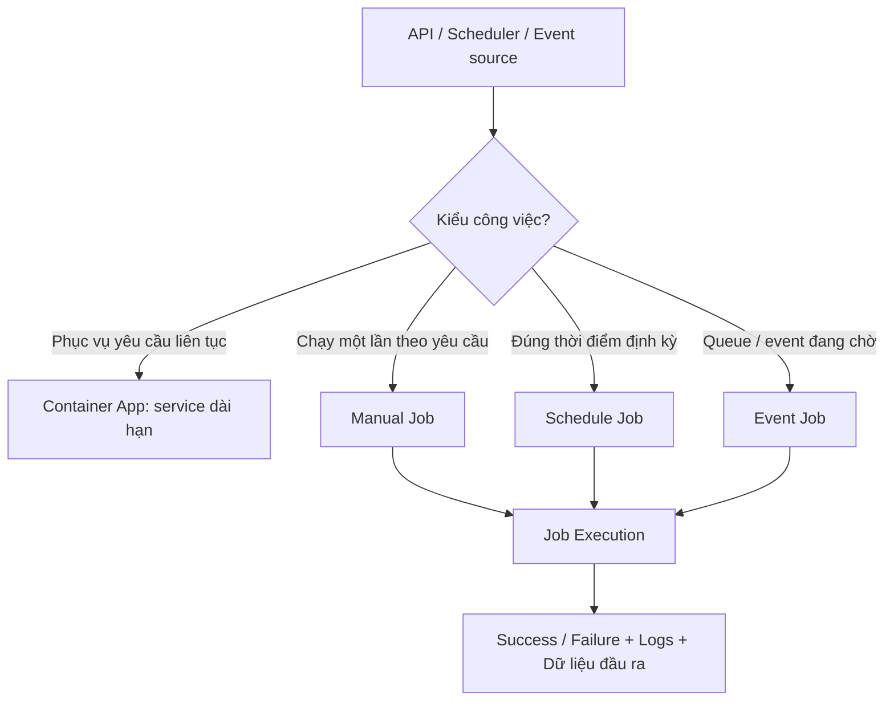
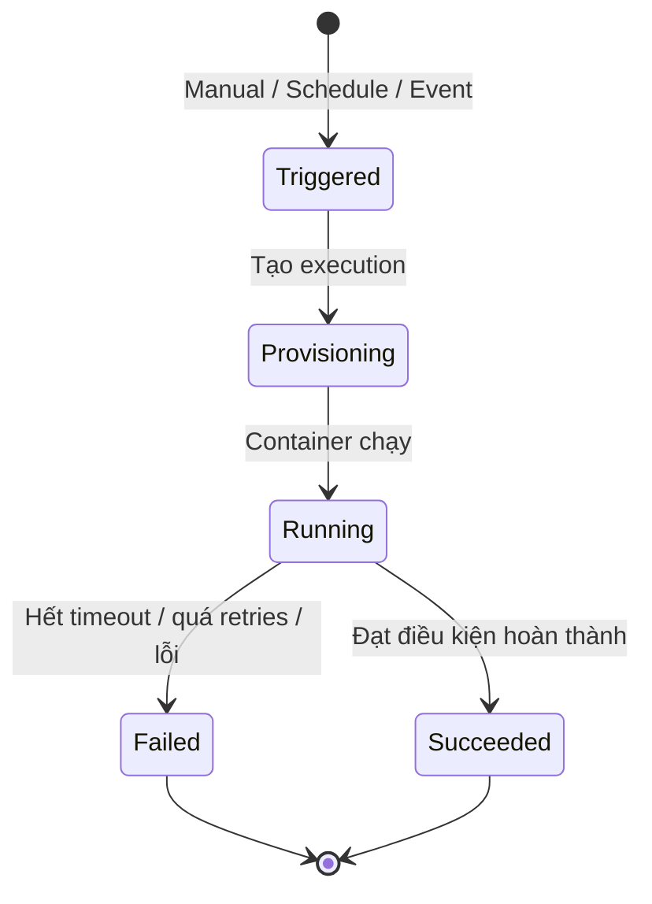
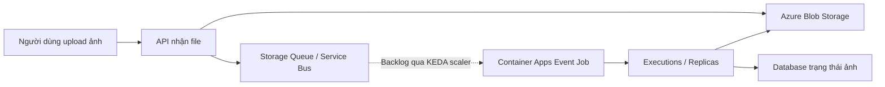
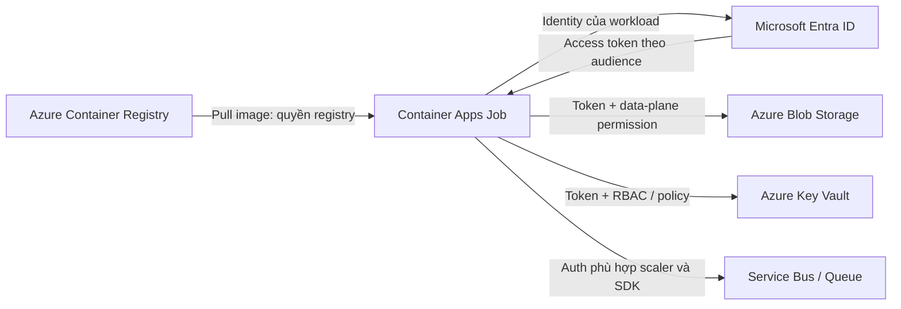

# Container Apps Jobs cho tác vụ nền và tác vụ theo lịch

Không phải mọi container trên Microsoft Azure đều cần chạy liên tục để phục vụ HTTP request. Một hệ thống thương mại điện tử có thể cần tạo báo cáo doanh thu lúc 09:00 mỗi ngày, xử lý hàng nghìn ảnh mới tải lên, nhập dữ liệu từ đối tác hoặc dọn dẹp dữ liệu tạm sau khi hết hạn. Những công việc này có điểm chung: **có thời điểm bắt đầu, khối lượng cần xử lý và điều kiện kết thúc**. Nếu đặt chúng vào một web app hoặc một container luôn bật, đội ngũ vận hành phải tự xây scheduler, điều phối worker, xử lý retry và thanh toán cho thời gian nhàn rỗi.

**Azure Container Apps Jobs** cho phép thực thi **container có thời hạn** theo ba cách: chạy thủ công/theo yêu cầu (**Manual**), chạy theo biểu thức lịch (**Schedule**) hoặc kích hoạt bởi sự kiện (**Event**). Dịch vụ tận dụng môi trường Azure Container Apps, hỗ trợ các cấu hình tài nguyên, kết nối mạng, secrets và managed identity thích hợp, đồng thời cung cấp thông tin về các lần thực thi (**executions**). Jobs đặc biệt hữu ích khi workload đã được đóng gói thành container và có thể tự hoàn thành rồi thoát.

Bài học thuộc chương **Container Registry và Container Apps** của mô-đun Azure. Chúng ta kết nối kiến thức về Azure Container Registry (ACR), Microsoft Entra ID, managed identity, resource group, mạng ảo, dịch vụ dữ liệu, giám sát và kiểm soát chi phí để thiết kế những tác vụ nền/tác vụ theo lịch có thể triển khai và vận hành trong production.

## Mục tiêu học tập

Sau bài học, bạn có thể:

1. Giải thích sự khác biệt giữa **Container App** chạy dài hạn và **Container Apps Job** chạy đến khi hoàn tất.
2. Chọn chính xác kiểu trigger **Manual**, **Schedule** hoặc **Event** cho từng nhu cầu nghiệp vụ.
3. Hiểu **job execution**, **replica**, **parallelism**, **replica completion count**, **timeout**, **retry limit** và ý nghĩa exit code.
4. Viết lịch cron năm trường theo **UTC**, chuyển đổi lịch sang múi giờ Việt Nam khi cần.
5. Đóng gói một worker thành container, tạo và theo dõi Jobs bằng Azure CLI/Portal.
6. Thiết kế event-triggered job sử dụng hàng đợi và cơ chế scaling dựa trên **KEDA**, có bảo vệ idempotency, retry và xử lý message lỗi.
7. Áp dụng managed identity/ACR, Azure RBAC, secrets, network policies, logging, cảnh báo, tối ưu chi phí và quy trình phục hồi.

## 1. Vì sao dùng Container Apps Jobs thay vì một web app luôn chạy?

Giả sử hệ thống bán hàng có ba nhóm chức năng:

| Nhu cầu | Đặc tính thực thi | Phương án cần xem xét |
|---|---|---|
| API nhận đơn hàng | Luôn sẵn sàng cho HTTP request, thường chạy nhiều replica liên tục. | **Azure Container App** có ingress; hoặc App Service/AKS tùy kiến trúc. |
| Xuất báo cáo doanh thu lúc 09:00 mỗi ngày | Chỉ cần chạy trong một khoảng ngắn rồi thoát. | **Container Apps Job — Schedule**. |
| Chuyển đổi ảnh khi có message trong queue | Có thể xuất hiện từng đợt, nhiều job độc lập. | **Container Apps Job — Event**, hoặc worker Container App có event scaling tùy mô hình xử lý. |
| Khôi phục dữ liệu một lần theo yêu cầu quản trị | Có người/công cụ điều phối yêu cầu chạy khi cần. | **Container Apps Job — Manual**. |

Một **Container App** thông thường thường hướng tới service chạy liên tục hoặc phản ứng với traffic/sự kiện thông qua các replicas có vòng đời dài hơn. **Job** được thiết kế cho công việc **hữu hạn**: container bắt đầu, thực hiện phần việc, kết thúc và trả trạng thái. Nó không cần cung cấp một HTTP endpoint hoặc ingress để nhận truy cập từ Internet.



**Chọn Job không tự làm chương trình trở nên idempotent, không bảo đảm mỗi sự kiện chỉ được xử lý đúng một lần và không thay thế database transaction.** Các chức năng đó cần được thiết kế ở tầng ứng dụng và nguồn sự kiện.

## 2. Những khái niệm cần hiểu trước khi tạo Job

### 2.1. Container Apps environment

**Container Apps environment** là ranh giới triển khai và vận hành cho các ứng dụng/container jobs. Nó có những đặc tính liên quan tới mạng, quan sát và tài nguyên hạ tầng. Bạn tạo **job resource** bên trong environment tương thích, trỏ tới một **container image** đã được xây dựng và đẩy lên registry (thường là ACR).

Environment không tự chạy tác vụ. **Job configuration** mới xác định image, lệnh thực thi, CPU/RAM, trigger, concurrency, secrets và cách xử lý retry. Những lần job chạy sử dụng cấu hình có hiệu lực tại thời điểm được điều phối, theo cơ chế dịch vụ.

### 2.2. Job, execution, replica và container

| Thành phần | Định nghĩa | Ví dụ |
|---|---|---|
| **Job resource** | Cấu hình định danh tác vụ, image, trigger và chính sách thực thi. | `job-daily-report`. |
| **Job execution** | Một lần thực thi riêng biệt của job. | Lần chạy ngày 20/11 và lần chạy ngày 21/11 là hai executions. |
| **Replica của execution** | Một instance thực thi trong lần chạy, có container theo template. | Execution xử lý dữ liệu bằng 3 replicas song song. |
| **Container image** | Nội dung chương trình đã đóng gói, có tag hoặc digest. | `myacr.azurecr.io/reports:1.4.2`. |
| **Exit code** | Mã thoát của tiến trình chính trong container. | `0` thường biểu thị thành công; mã khác 0 thường là lỗi. |

Không đồng nhất **một execution** với **một message**: với Event Jobs, mức độ gom sự kiện, số execution, replicas và việc lấy message phụ thuộc trigger/scaler và cách chương trình xử lý. Cần thiết kế rõ worker nhận một hay nhiều phần việc, tránh kỳ vọng cứ mỗi message chắc chắn có đúng một execution độc lập.

### 2.3. Vòng đời tiêu biểu



Sơ đồ là mô hình tư duy; tên trạng thái và thời điểm chuyển trạng thái chính thức được dịch vụ biểu diễn theo API/Portal. Job có thể được retry hoặc các replicas có thể kết thúc ở thời điểm khác nhau. **Một job execution được đánh dấu hoàn tất không tự chứng minh dữ liệu đầu ra đã được xác minh bởi hệ thống nghiệp vụ.**

### 2.4. Tác vụ phải tự kết thúc

Một container job cần có **tiến trình chính kết thúc** khi không còn công việc phải làm. Ví dụ chương trình Java xuất file CSV, upload file vào Blob Storage, xác nhận hoàn tất rồi trả **exit code 0**. Nếu có lỗi không thể khôi phục, chương trình nên trả **non-zero exit code**, tạo tín hiệu thất bại để chính sách retry/monitoring hoạt động.

Không sử dụng image được thiết kế để chạy HTTP server vô thời hạn cho Schedule Job nếu mục tiêu là xuất báo cáo rồi kết thúc; container có thể tiếp tục chạy tới timeout và bị đánh dấu lỗi. Ngược lại, đừng chỉ ghi log lỗi rồi `return 0`, vì hệ thống sẽ khó phân biệt một lần xử lý thất bại với lần hoàn tất thành công.

## 3. Ba kiểu trigger: Manual, Schedule và Event

### 3.1. Manual Job: chạy khi được yêu cầu

**Manual trigger** không tự động tạo execution định kỳ. Người vận hành hoặc một hệ thống có quyền phù hợp chủ động bắt đầu execution bằng Azure Portal, Azure CLI hoặc API/automation được hỗ trợ.

Tình huống thường gặp:

- Reprocess một tập dữ liệu đã sửa sau khi đối tác gửi bản mới.
- Chạy migration/đồng bộ một lần trong cửa sổ bảo trì.
- Thực thi batch khi có sự phê duyệt của người quản trị.
- Chạy công cụ kiểm tra tính toàn vẹn của dữ liệu theo một yêu cầu đặc biệt.

Manual Job **không có nghĩa** bất kỳ người dùng ứng dụng nào cũng có thể kích hoạt. Azure RBAC và danh tính của automation phải giới hạn quyền start/update/delete job. Nếu nghiệp vụ cho phép người dùng nhấn nút “Xuất báo cáo ngay”, backend nên kiểm tra quyền và gọi API quản trị job bằng identity tin cậy, không trao Azure control-plane credential cho trình duyệt.

### 3.2. Schedule Job: chạy theo lịch cron

**Schedule trigger** tạo những executions theo lịch đã định với **cron expression**. Cách này thích hợp cho báo cáo hằng ngày, xử lý tổng hợp vào cuối tuần, quét dữ liệu quá hạn hoặc đồng bộ file theo giờ.

Azure Container Apps Jobs sử dụng cron dạng **năm trường** (phút, giờ, ngày trong tháng, tháng, thứ trong tuần) theo **UTC** trong cấu hình lịch của dịch vụ:

```text
┌──────── minute (0–59)
│ ┌────── hour (0–23)
│ │ ┌──── day-of-month (1–31)
│ │ │ ┌── month (1–12)
│ │ │ │ ┌ weekday (0–6 hoặc tên, theo cú pháp được hỗ trợ)
│ │ │ │ │
0  2  *  *  *
```

Ví dụ:

| Cron UTC | Ý nghĩa lịch theo UTC | Nếu vận hành tại Việt Nam (UTC+7) |
|---|---|---|
| `0 2 * * *` | Mỗi ngày lúc 02:00 UTC. | 09:00 cùng ngày. |
| `0 16 * * *` | Mỗi ngày lúc 16:00 UTC. | 23:00 cùng ngày. |
| `0 */6 * * *` | Mỗi sáu giờ vào phút 0. | 01:00, 07:00, 13:00 và 19:00 giờ Việt Nam. |
| `30 1 * * 1-5` | 01:30 UTC từ thứ Hai đến thứ Sáu. | 08:30 giờ Việt Nam các ngày làm việc. |

Ví dụ nếu mục tiêu là 09:00 sáng theo giờ Việt Nam, dùng **`0 2 * * *`** thay vì `0 9 * * *` (lệnh thứ hai chạy lúc 16:00 giờ Việt Nam). Cần xác minh cú pháp ngày trong tuần khi dùng lịch phức tạp, đặc biệt trường hợp kết hợp ngày trong tháng và thứ trong tuần. Không thêm trường **giây** thứ sáu nếu dịch vụ yêu cầu năm trường.

**Schedule là tín hiệu khởi chạy, không phải cam kết xử lý exactly-once.** Workload cần chịu được execution bị retry, chạy lâu vượt sang khung giờ tiếp theo hoặc được người vận hành khởi chạy lại. Nếu không muốn hai kỳ báo cáo cùng ghi một file, phải có cơ chế khóa/định danh kỳ xử lý ở tầng dữ liệu.

### 3.3. Event Job: chạy khi có công việc chờ

**Event trigger** thường dựa trên cơ chế **KEDA** (Kubernetes Event-driven Autoscaling) cùng các **scale rules** tương thích để quan sát nguồn sự kiện như queue và quyết định tạo executions. Đây là cách xử lý khi nhu cầu tới không theo giờ cố định.

Ví dụ hệ thống upload hình ảnh:



Event Job phù hợp khi một đơn vị công việc có thể được chạy hữu hạn, thường với mức song song tùy nhu cầu. Tuy nhiên, **queue consumer trong container vẫn phải chủ động nhận message, xử lý và hoàn tất/ack message đúng giao thức**; scaler không thay thế toàn bộ logic consumer và không tự bảo đảm dữ liệu nghiệp vụ đã hoàn tất.

### 3.4. Bảng lựa chọn nhanh

| Nhu cầu | Trigger khuyến nghị | Vì sao? |
|---|---|---|
| Quản trị viên chạy job import khi được phê duyệt | Manual | Kiểm soát thời điểm phát lệnh. |
| Xuất báo cáo lúc 09:00 sáng mỗi ngày | Schedule | Có lịch lặp ổn định, chuyển đổi đúng UTC. |
| Xử lý file khi queue có message | Event | Co giãn theo backlog thay vì lịch cố định. |
| Worker HTTP phải luôn sẵn sàng | Container App | Không phải một công việc hữu hạn. |
| Batch hàng triệu tác vụ, nhiều node chuyên biệt | Đánh giá Azure Batch / AKS Jobs | Có thể cần điều phối workload và quota chuyên biệt hơn. |
| Gửi email theo một workflow nhiều bước có approval | Đánh giá Logic Apps/Functions | Có thể đơn giản hơn tự quản lý container job. |

## 4. Các tham số thực thi ảnh hưởng đến độ tin cậy

### 4.1. Replica timeout

**Replica timeout** giới hạn thời gian một replica được phép chạy cho một lần thử. Nếu tiến trình bị treo hoặc job không thoát, timeout giúp ngăn chiếm tài nguyên vô hạn. Ví dụ `1800` giây = 30 phút cho một tác vụ xuất báo cáo có thời gian bình thường 5–10 phút.

Đặt timeout quá ngắn có thể hủy job đang xử lý hợp lệ; quá dài làm thời gian phát hiện tác vụ bị treo và chi phí tăng. Cần đo p95/p99 thời gian chạy, tính thời gian đọc dữ liệu, gọi API và upload kết quả, rồi thiết kế cancellation hoặc checkpoint phù hợp.

### 4.2. Replica retry limit

**Replica retry limit** xác định giới hạn số lần thử lại replica khi có lỗi theo cơ chế dịch vụ. Ví dụ một kết nối Blob thất bại tạm thời có thể thành công ở lần sau. Nhưng retry một nghiệp vụ gửi tiền hoặc phát hành hóa đơn mà không có idempotency key có thể gây **thao tác trùng lặp**.

Phân biệt hai tầng retry:

- **Retry trong ứng dụng:** retry ngắn hạn với exponential backoff và jitter cho lỗi mạng/HTTP 429/503.
- **Retry ở cấp Job replica/execution:** dịch vụ chạy lại khi lần thử không thành công theo thiết lập.

Tổng số lần tác động lên downstream là **tích lũy của cả hai tầng**; cần giới hạn retry, timeout và số lần thực hiện có tác dụng phụ. Lỗi dữ liệu sai định dạng, thiếu quyền vĩnh viễn hoặc schema không hợp lệ không nên bị retry vô hạn.

### 4.3. Parallelism và replica completion count

Trong một execution, **parallelism** kiểm soát số replicas có thể chạy đồng thời theo cấu hình; **replica completion count** là số replicas cần hoàn tất thành công để execution đạt điều kiện kết thúc. Hai tham số này có liên quan nhưng **không phải hai tên gọi cho cùng một giá trị**.

| Kiểu công việc | Ví dụ thiết lập khởi đầu | Điều kiện cần xem xét |
|---|---|---|
| Báo cáo mỗi ngày một lần | `parallelism=1`, `replica-completion-count=1`. | Không chạy lặp một báo cáo trong cùng execution. |
| Xử lý nhiều phân vùng độc lập | Tăng parallelism và completion count phù hợp. | Mỗi replica phải nhận được phân vùng riêng, tránh cùng xử lý dữ liệu. |
| Event queue cần nhiều worker | Cân nhắc số executions/replicas và concurrency. | Queue semantics, mức độ song song và throughput downstream. |

**Tăng parallelism không tự chia một file thành những phần khác nhau.** Nếu container của mọi replica đều chạy lệnh `process-all-orders`, hai replicas có thể xử lý toàn bộ đơn hàng hai lần. Phải thiết kế partition IDs, leasing, message consumption hoặc cơ chế điều phối nguồn công việc. Với jobs schedule, thông thường bắt đầu bằng **một replica** cho đến khi thật sự có nhu cầu phân chia công việc.

### 4.4. Giới hạn thực thi song song theo event

Event trigger có các giới hạn và tham số mở rộng như số executions tối thiểu/tối đa được đặt theo scale rules và cấu hình dịch vụ. **Max executions** là hàng rào quan trọng để bảo vệ ngân sách và hệ thống đích; không có nghĩa mọi message đang chờ sẽ ngay lập tức trở thành một execution độc lập. KEDA có nhịp polling, metric evaluation và giới hạn tài nguyên, nên quy mô thực tế phải được kiểm thử.

Giả sử mỗi execution xử lý 10 ảnh/giây và backlog 20.000 ảnh: tăng tối đa lên 50 executions có thể làm Azure Storage/DB chịu lượng kết nối rất lớn. Cần đặt giới hạn dựa trên **throughput của toàn pipeline**, không chỉ số lượng tác vụ chờ.

## 5. Đóng gói một tác vụ Java thành container chạy hữu hạn

Job dễ vận hành nhất khi image chứa một **batch command** rõ ràng: đọc cấu hình, bắt đầu xử lý, ghi dữ liệu/telemetry, thoát có exit code phù hợp. Ví dụ đóng gói ứng dụng Java dạng JAR:

```dockerfile
FROM eclipse-temurin:21-jre
WORKDIR /app
COPY target/report-job.jar /app/report-job.jar
USER 10001
ENTRYPOINT ["java", "-jar", "/app/report-job.jar"]
```

Ví dụ chỉ mô tả Dockerfile của một JAR đã được build, không chạy Maven/Gradle trong bài học. Khi sử dụng thực tế, kiểm tra quyền đọc thư mục, CA certificates, time zone, architecture, dependency vulnerabilities và cách pipeline tạo JAR. Nếu image yêu cầu ghi file tạm, chọn đường dẫn có quyền ghi và dung lượng phù hợp cho non-root user.

### 5.1. Thoát đúng trạng thái

Pseudocode cho job xuất báo cáo:

```text
main():
    runKey = period + reportType
    acquireLeaseOrCheckIdempotency(runKey)

    try:
        data = loadRecordsForPeriod(period)
        report = transformAndValidate(data)
        writeTemporaryBlob(runKey, report)
        publishResultAtomicallyOrConditionally(runKey)
        markRunSucceeded(runKey)
        exit(0)
    catch RetryableError:
        recordFailureWithoutSecrets(runKey)
        exit(nonZero)
    catch PermanentInvalidData:
        quarantineInputAndAlert(runKey)
        exit(nonZeroOrExplicitHandledPolicy)
    finally:
        releaseLeaseIfOwned(runKey)
```

Đây là **pseudocode thiết kế**, không phải Java code có thể biên dịch nguyên trạng. `publishResultAtomicallyOrConditionally` có thể dùng conditional write/ETag hoặc cơ chế transaction phù hợp; nó không bảo đảm transaction xuyên Blob và database nếu bạn không tự thiết kế. Cần quyết định hành vi khi một lần chạy bị dừng sau khi đã ghi kết quả nhưng trước khi đánh dấu thành công.

### 5.2. Không lưu kết quả quan trọng trong filesystem tạm của container

Container có thể bị loại bỏ khi execution hoàn tất hoặc lỗi. **Filesystem cục bộ không phải nơi lưu dữ liệu bền vững của job.** Ghi báo cáo ra Azure Blob Storage, data lake hoặc database; gửi trạng thái sang hệ thống theo dõi. Có thể dùng bộ nhớ tạm để xử lý, nhưng phải tính đến quota/IOPS và việc dữ liệu bị mất khi replica kết thúc.

### 5.3. Nhận tín hiệu dừng và timeout

Worker nên xử lý tín hiệu dừng theo môi trường runtime để ngừng nhận công việc mới, flush trạng thái và kết thúc trong giới hạn. Với Java, có thể dùng shutdown hook và quản lý executor/thread pool, nhưng không tin rằng hệ thống luôn có đủ thời gian để hoàn tất toàn bộ transaction khi bị hủy. Đối với task dài, nên có **checkpoint** và idempotency để lần chạy sau có thể khôi phục an toàn.

## 6. Chuẩn bị hạ tầng và image registry

Trước khi tạo Job cần có:

1. **Subscription và resource group** mà bạn được phép tạo Container Apps resource.
2. **Container Apps environment** ở region và network phù hợp với nguồn dữ liệu.
3. **Container image** có thể pull được, ví dụ `myacr.azurecr.io/jobs/reports:1.4.2`, đã build/scan và chạy thử bằng lệnh tương đương ở local/CI.
4. **Quyền registry** để runtime pull image; nếu dùng ACR riêng tư, ưu tiên managed identity và quyền phù hợp như `AcrPull` theo cơ chế registry/Container Apps được hỗ trợ.
5. **Quyền dữ liệu** của Job đối với Storage/Key Vault/Service Bus được cấp riêng qua Azure RBAC hoặc cơ chế data-plane của dịch vụ.
6. **Đường mạng, DNS và firewall** phù hợp, đặc biệt nếu ACR, Key Vault, Storage hay Service Bus có private endpoint hoặc network restrictions.
7. **Log Analytics/monitoring** và chính sách retention để điều tra những executions lỗi.

### 6.1. Registry credential không phải quyền truy cập dữ liệu

Khi Job pull một image từ Azure Container Registry, runtime cần quyền **đọc image**. Khi container sau đó đọc Blob Storage, nó cần **quyền data-plane Storage**. Quyền `AcrPull` không cho phép đọc blob, và `Storage Blob Data Reader` không cho phép tự pull image ACR. Đây là **hai mối quan hệ ủy quyền** khác nhau.

### 6.2. Dùng tag hay digest?

Image tag như `reports:latest` có thể được ghi đè và thay đổi nội dung không mong muốn. Với tác vụ theo lịch chạy nhiều ngày, nên dùng **versioned tag** bất biến theo quy ước hoặc **image digest** để truy vết mỗi execution đã sử dụng phiên bản nào. Khi cập nhật Job, có kế hoạch rollback và xác minh tác vụ cũ/đang chạy không bị nhầm phiên bản.

## 7. Thực hành Azure CLI: tạo Scheduled Job lúc 09:00 giờ Việt Nam

Mục tiêu: tạo một **Schedule Job** chạy container tác vụ hữu hạn mỗi ngày lúc **02:00 UTC (09:00 giờ Việt Nam)**, kiểm tra cấu hình và quan sát các executions. Bài thực hành giả định resource group, Container Apps environment và image đã tồn tại. Tên và địa chỉ đều là ví dụ, thay theo môi trường của bạn.

### 7.1. Điều kiện trước khi chạy

- Có Azure CLI với nhóm lệnh `az containerapp` hỗ trợ Jobs trong phiên bản/extension được cài.
- Có quyền tạo job trong resource group và environment phù hợp.
- Image thực sự chạy batch command rồi **exit 0** khi thành công; **không** dùng web server chạy vô hạn.
- Nếu image nằm trong ACR private, bạn đã cấu hình registry auth/managed identity theo phương thức được dịch vụ hỗ trợ.
- Có kết nối đến các nguồn dữ liệu cần thiết và ngân sách cho CPU/RAM, logs, network, dịch vụ phụ trợ.

**Lưu ý:** các lệnh dưới đây **tạo và có thể kích hoạt tài nguyên tính phí**. Không dùng subscription hoặc environment production khi chưa được phép. Nếu CLI trên máy chưa hỗ trợ flags Jobs, cập nhật/kiểm tra extension và `az containerapp job create --help` thay vì tự đoán tham số.

### Bước 1. Chọn đúng subscription và đặt biến

```bash
az login
az account list --output table
az account set --subscription "<subscription-id>"

RG="rg-container-jobs-lab"
ENV="cae-jobs-lab"
JOB="job-daily-report"
IMAGE="<registry-name>.azurecr.io/jobs/report:1.4.2"
```

Xác minh environment đã tồn tại:

```bash
az containerapp env show \
  --resource-group "$RG" \
  --name "$ENV" \
  --query "{name:name,id:id,location:location}" \
  --output json
```

Mục tiêu của bài là Container Apps **Job** nên không tạo một container app có ingress HTTP rồi mong nó tự kết thúc theo cron.

### Bước 2. Tạo Scheduled Job

```bash
az containerapp job create \
  --resource-group "$RG" \
  --name "$JOB" \
  --environment "$ENV" \
  --trigger-type Schedule \
  --cron-expression "0 2 * * *" \
  --replica-timeout 1800 \
  --replica-retry-limit 1 \
  --parallelism 1 \
  --replica-completion-count 1 \
  --image "$IMAGE" \
  --cpu 0.5 \
  --memory 1.0Gi
```

Giải thích:

| Tùy chọn | Vai trò |
|---|---|
| `--trigger-type Schedule` | Lịch tạo execution tự động. |
| `--cron-expression "0 2 * * *"` | Chạy 02:00 UTC hằng ngày, tức 09:00 giờ Việt Nam. |
| `--replica-timeout 1800` | Giới hạn 30 phút mỗi lần thử theo cơ chế timeout của Job. |
| `--replica-retry-limit 1` | Cho phép retry ở mức replica theo chính sách. |
| `--parallelism 1` | Bắt đầu một replica đồng thời; đơn giản hóa báo cáo một kỳ. |
| `--replica-completion-count 1` | Yêu cầu một replica hoàn tất thành công. |
| `--cpu 0.5 --memory 1.0Gi` | Cấp tài nguyên ban đầu để thử nghiệm, chưa phải sizing production. |

Đây là cú pháp triển khai ví dụ. Nếu image yêu cầu environment variables, secrets, managed identity hoặc lệnh container tùy chỉnh thì bổ sung các cấu hình đó **trước khi chạy production**. Với ACR private, lệnh tạo Job không tự cấp role pull image chỉ vì image URL trỏ vào ACR.

### Bước 3. Đọc lại Job resource

```bash
az containerapp job show \
  --resource-group "$RG" \
  --name "$JOB" \
  --output json
```

Trong output, kiểm tra **trigger type**, cron expression, image, timeout, retry limit, parallelism, completion count, resource requests và target environment. Không đăng công khai toàn bộ cấu hình nếu có secrets hoặc giá trị môi trường nhạy cảm.

### Bước 4. Quan sát các executions

```bash
az containerapp job execution list \
  --resource-group "$RG" \
  --name "$JOB" \
  --output table
```

Với Schedule Job mới tạo, chưa chắc đã có execution ngay; nó chạy khi đến lịch hoặc khi được khởi chạy theo cơ chế được hỗ trợ. Theo dõi Portal tại mục Jobs/Executions và Log Analytics nếu đã cấu hình. **Có execution không đồng nghĩa file báo cáo đã được upload đúng**: cần xác minh output tại Blob Storage/DB và metric nghiệp vụ.

### Bước 5. Kiểm tra lỗi thất bại

Nếu không thấy execution hoặc execution lỗi:

1. Kiểm tra ngày giờ UTC của cron và khoảng thời gian bạn đang quan sát.
2. Kiểm tra event/job execution state và log container từ Portal/Log Analytics.
3. Kiểm tra khả năng pull image, ACR permissions, image entrypoint và image architecture.
4. Kiểm tra identity, secret resolution, kết nối tới dữ liệu và môi trường mạng.
5. Kiểm tra timeout, exit code, CPU/memory và thời gian chạy thực tế.

**Chưa xóa resource sau khi quan sát một lần chạy thành công** nếu còn cần đối chiếu dữ liệu hoặc lịch test. Việc dọn dẹp phải được phê duyệt và chỉ tác động đến các tài nguyên thực hành thuộc sở hữu của bạn.

## 8. Thực hành Manual Job cho một lần xử lý dữ liệu

Manual Job thích hợp với job phải được chạy theo một thao tác quản trị. Ví dụ dưới đây sử dụng **image và environment đã chuẩn bị** ở bước trước; tạo một job riêng để không thay đổi scheduled job:

```bash
MANUAL_JOB="job-import-on-demand"

az containerapp job create \
  --resource-group "$RG" \
  --name "$MANUAL_JOB" \
  --environment "$ENV" \
  --trigger-type Manual \
  --replica-timeout 1800 \
  --replica-retry-limit 1 \
  --parallelism 1 \
  --replica-completion-count 1 \
  --image "$IMAGE" \
  --cpu 0.5 \
  --memory 1.0Gi

# Khởi chạy một execution khi đã được phép
az containerapp job start \
  --resource-group "$RG" \
  --name "$MANUAL_JOB"

# Đọc danh sách executions
az containerapp job execution list \
  --resource-group "$RG" \
  --name "$MANUAL_JOB" \
  --output table
```

**Quan trọng:** cả Manual và Schedule ở ví dụ đều tham chiếu cùng image. Nếu image mặc định luôn tạo báo cáo, Manual Job sẽ chạy báo cáo chứ không tự thành chức năng import. Trong ứng dụng thực, dùng image/command/args hoặc cấu hình nghiệp vụ khác để lựa chọn phần việc đúng. Đừng cho rằng tên resource `job-import-on-demand` thay đổi chương trình bên trong container.

Để người dùng cuối khởi chạy công việc, không đưa `az` credential lên trình duyệt. Backend có thể nhận yêu cầu, kiểm tra quyền, ghi audit, sử dụng managed identity/service principal có Azure RBAC thích hợp để khởi chạy job qua control plane, rồi trả về execution/correlation ID để theo dõi.

## 9. Event Job: kết nối hàng đợi và scale theo nhu cầu tải

Một **Event Job** được thiết kế để hệ thống tạo những executions dựa trên **scale rule**. Với bài toán xử lý ảnh, một API lưu ảnh gốc rồi gửi message vào **Azure Service Bus Queue** hoặc **Azure Storage Queue**. Hệ thống dùng KEDA-compatible scaler để quan sát backlog và kích hoạt job khi cần. Container phải hiểu schema message, nhận đúng message và hoàn tất việc xử lý theo giao thức của queue.

### 9.1. Quy trình cấu hình Event Job trong Portal

1. Chuẩn bị một **queue** thuộc Service Bus hoặc Storage Queue, cấu hình thông số retry/lock/visibility và dead-letter theo loại queue.
2. Chuẩn bị container image có logic consumer: nhận message, xử lý dữ liệu, ghi kết quả, xác nhận xử lý thành công rồi thoát theo thiết kế của execution.
3. Trong Azure Portal, mở **Container Apps → Jobs → Create**, chọn resource group, environment, image và **trigger type: Event**.
4. Cấu hình **scale rule** theo scaler hỗ trợ: loại nguồn sự kiện, tên queue/namespace, ngưỡng backlog hoặc metadata cần thiết, và phương thức authentication.
5. Cấu hình **min/max executions** và giới hạn replica phù hợp với số lượng việc đến, khả năng của Storage/database và hạn mức ngân sách.
6. Cấu hình **replica timeout**, retry và parallelism, đặc biệt khi xử lý file lớn hoặc có thao tác không thể hoàn tác.
7. Cấp quyền cho Job truy cập queue, Storage hoặc Key Vault; xác nhận networking, DNS và firewall.
8. Gửi một message **thử nghiệm vô hại**, quan sát executions/logs, xác nhận message được xử lý và kết quả được ghi đúng nơi.

**Tên thuộc tính trên Portal/CLI có thể thay đổi theo loại scaler và phiên bản hỗ trợ.** Khi dùng identity-based scaler, phải xác nhận nguồn sự kiện và cơ chế auth đó được KEDA/Container Apps hỗ trợ. Nếu scaler yêu cầu connection string, chỉ tham chiếu thông qua secret được bảo vệ, không viết credential trong YAML hoặc command được log công khai.

### 9.2. Queue trigger không tự đảm bảo exactly-once

Ví dụ queue có một message:

```json
{
  "jobId": "image-9135",
  "blobPath": "uploads/user-42/photo.jpg",
  "requestedVariant": "thumbnail-256"
}
```

Worker có thể chuyển đổi ảnh và ghi kết quả vào `processed/image-9135/thumbnail-256.jpg`. Nhưng nếu worker hoàn thành upload rồi bị mất kết nối **trước khi ack message**, queue có thể chuyển message lại cho lần chạy khác. Do đó cùng một công việc có thể được thực thi **nhiều hơn một lần**.

Để tránh kết quả sai:

- Sử dụng `jobId` hoặc business key ổn định làm **idempotency key**.
- Kiểm tra công việc đã hoàn thành trước khi thực hiện side effect hoặc dùng conditional write/transaction tương ứng.
- Không xóa/complete message trước khi ghi kết quả quan trọng thành công.
- Đặt **maximum delivery count**, dead-letter hoặc quarantine cho message không thể xử lý.
- Kết hợp retry có giới hạn, exponential backoff và logging có correlation ID.
- Đừng cho rằng thứ tự xử lý giữa các executions luôn giống thứ tự message đi vào queue.

### 9.3. Bảo vệ message đang xử lý khi job chạy lâu

Với **Service Bus**, có cơ chế peek-lock, thời hạn lock, gia hạn lock và dead-letter theo cấu hình. Với **Storage Queue**, có visibility timeout và quy trình xóa message bằng receipt sau khi xử lý. Nếu xử lý một ảnh mất 20 phút nhưng lock/visibility chỉ có vài phút và không được gia hạn phù hợp, message có thể được nhận lại khi worker cũ vẫn chạy.

**Timeout Job và lock timeout của queue là hai giới hạn độc lập.** Một Job được phép chạy 30 phút không có nghĩa Service Bus tự gia hạn lock đúng 30 phút. Worker phải dùng SDK/processor và policy phù hợp; khi không đảm bảo thời gian, cân nhắc chia tác vụ thành những bước nhỏ có checkpoint.

### 9.4. Từ backlog đến số executions

Giả sử queue có 900 ảnh, mỗi execution xử lý một lô 30 ảnh trong 2 phút và mục tiêu hoàn thành backlog trong 10 phút. Ước lượng sơ bộ, nếu không có message mới:

\[
N\approx\left\lceil\frac{900/30\times 2}{10}\right\rceil=6
\]

Kết quả là khoảng **6 executions chạy song song** để giải tỏa lô dữ liệu trong điều kiện lý tưởng. Đây không phải giá trị KEDA sẽ tự suy ra từ mọi scale rule: cần cấu hình mức ngưỡng và giới hạn đồng thời theo scaler, tính thời gian tạo execution, task variance, retries, message lock và downstream throughput.

Nếu Database chỉ chịu được 3 workers cùng lúc, mở max executions lên 20 có thể làm tăng lỗi connection pool. Đặt mức tối đa theo **nút thắt thực tế** và cảnh báo nếu backlog vượt thời gian xử lý mong muốn.

## 10. Thiết kế job an toàn: idempotency, trạng thái và chống trùng lặp

Tác vụ nền thường tác động đến dữ liệu thật: xuất báo cáo, tính phí, gửi thông báo, cập nhật trạng thái đơn hàng. Một cách xây dựng đáng tin cậy là lưu **bản ghi tiến trình** ngoài container, thay vì chỉ trông chờ exit code.

### 10.1. Khóa nghiệp vụ và trạng thái

Ví dụ Scheduled Job xuất báo cáo ngày 20/11:

```text
businessKey = daily-report:2026-11-20

PENDING -> RUNNING -> SUCCEEDED
              |
              +----> RETRYABLE_FAILURE -> PENDING
              |
              +----> PERMANENT_FAILURE -> REVIEW
```

Khi execution bắt đầu, nó cố gắng tạo/claim bản ghi có `businessKey` **bằng thao tác nguyên tử**. Nếu bản ghi đã thành công, job có thể ghi nhận “already completed” và kết thúc theo chính sách. Nếu một run bị treo, cơ chế **lease/heartbeat với expiry** cho phép xử lý lại an toàn. Không triển khai khóa bằng cách `SELECT` rồi `INSERT` tách rời nếu hai executions có thể chạy đồng thời mà không có unique constraint hoặc atomic operation.

### 10.2. Ghi kết quả nhất quán

Một quy trình xuất file hữu ích:

1. Tạo file kết quả trong vùng staging với tên chứa `businessKey` và `executionId`.
2. Kiểm tra schema, số dòng, checksum hoặc manifest.
3. Ghi/commit metadata nghiệp vụ bằng thao tác có điều kiện hoặc transaction thích hợp.
4. Chỉ xuất bản đường dẫn thành phẩm cho người dùng sau khi kiểm chứng.
5. Đánh dấu run thành công; nếu retry, kiểm tra `businessKey` để không tạo bản chính trùng.

Lưu ý: Blob Storage và database thường **không** có transaction phân tán tự động. Muốn tránh trạng thái “đã ghi blob nhưng DB chưa commit”, cần thiết kế **outbox/saga/reconciliation** hoặc quy trình bù trừ. Exit code 0 chỉ nên được trả khi điều kiện hoàn tất đã được kiểm chứng.

### 10.3. Re-run và backfill

Khi thiếu báo cáo của ba ngày trước, bạn có thể cần **backfill** mà không thay đổi lịch hiện tại. Thiết kế worker nhận kỳ dữ liệu qua args/env hoặc một work item có ID; Manual Job/automation có thể điều phối lại những kỳ thiếu và ghi audit. Không chỉ dựa trên `now()` vì chạy bù cho ngày cũ có thể vô tình xuất dữ liệu của hôm nay.

Nếu job chạy quá khung lịch tiếp theo, phải chọn chính sách: **cho phép chồng lấn**, **bỏ qua kỳ mới**, hoặc **đưa kỳ mới vào queue**. Quyết định thuộc nghiệp vụ và cách lưu khóa/idempotency, không phải tự động được giải quyết chỉ bằng cron.

## 11. Managed identity, Azure Container Registry và secrets

Trong production, Job thường cần truy cập image registry và nguồn dữ liệu riêng tư. **Không đưa registry password, Storage account key hay Service Bus connection string trực tiếp vào Dockerfile.**



### 11.1. System-assigned và user-assigned identity

| Loại | Ưu điểm | Điểm cần kiểm soát |
|---|---|---|
| **System-assigned managed identity** | Gắn vòng đời với một Job resource; đơn giản cho workload độc lập. | Khi xóa/tạo lại Job, principal có thể thay đổi và phải rà soát role assignments. |
| **User-assigned managed identity** | Identity là resource riêng, dùng được qua vòng đời của nhiều deployment khi có chủ đích. | Nếu chia sẻ quá rộng giữa nhiều Jobs sẽ mở rộng phạm vi ảnh hưởng khi bị tấn công. |

Các quyền ví dụ:

- **ACR:** quyền pull image, chẳng hạn `AcrPull` trong mô hình role truyền thống tương thích; kiểm tra role/repository permissions nếu registry sử dụng cơ chế phân quyền khác.
- **Blob Storage:** `Storage Blob Data Contributor` chỉ khi cần upload; `Storage Blob Data Reader` nếu chỉ tải file.
- **Service Bus:** quyền data receiver/sender phù hợp cho consumer/producer khi sử dụng Entra ID, không cấp quyền quản trị toàn namespace chỉ để nhận message.
- **Key Vault:** `Key Vault Secrets User` theo permission model RBAC nếu cần đọc secret; kiểm tra access-policy mode nếu khác.

**Quyền pull image và quyền đọc dữ liệu là độc lập.** Một Job có thể không khởi động được vì image pull 401 dù đã có quyền đọc Blob; cũng có thể pull thành công nhưng xử lý thất bại 403 do thiếu Storage role. Chẩn đoán theo từng bước.

### 11.2. Kết nối ACR qua identity

Một quy trình tổng quát:

1. Tạo/gắn managed identity vào Job theo tính năng dịch vụ.
2. Cấp role pull image phù hợp cho principal trên ACR/repository ở scope tối thiểu.
3. Cấu hình Job registry authentication sử dụng identity đó, thay vì username/password dài hạn.
4. Kiểm tra environment có thể phân giải và kết nối ACR endpoint, kể cả private networking nếu áp dụng.
5. Triển khai image theo tag/digest cụ thể và kiểm tra log image pull khi execution đầu tiên chạy.

Nếu dùng `az role assignment create`, cần có **principal ID** thật và resource ID của ACR; không truyền lẫn lộn client ID, principal ID và Azure resource ID. Với tính năng Job CLI/Portal có khác biệt version, xem cấu hình registry/identity ở đúng resource Job; không đoán rằng cấu hình registry của một Container App khác tự động áp dụng cho Job.

### 11.3. Secrets và biến môi trường

Job có thể nhận tham số không nhạy cảm bằng env vars, ví dụ `REPORT_REGION`, `OUTPUT_CONTAINER` hoặc `BATCH_SIZE`. Với credential mà nguồn dịch vụ chưa hỗ trợ identity-based access, dùng **Container Apps secrets** và **secret references** theo cơ chế hỗ trợ; có thể tích hợp Key Vault references khi khả dụng và được cấu hình đúng.

Không đặt secrets dưới dạng plaintext ở source control, script build, image layer, Docker ARG, logs hoặc command được ghi lại. Quyết định rõ chính sách rotation và cách Job lấy giá trị mới; **không giả định rằng đang chạy execution sẽ tự nhận secret vừa được thay**.

## 12. Network, DNS và khả năng truy cập dịch vụ riêng tư

Một Job có thể có managed identity hợp lệ nhưng vẫn không đến được Storage hay Key Vault do **routing, Private Endpoint, DNS hoặc firewall**. Nếu nguồn dữ liệu chỉ mở private network, cần thiết kế Container Apps environment/VNet theo khả năng hỗ trợ và xem xét:

- Đường ra (egress) tới storage account, Key Vault, registry hoặc Service Bus endpoint.
- Private DNS zone links và khả năng phân giải hostname ra đúng private IP.
- Firewall/NSG/UDR/Azure Firewall và đường trả về khi qua network virtual appliance.
- TLS certificates, outbound proxy và DNS resolution trong container.
- Giới hạn băng thông, egress và khả năng phục hồi khi một dịch vụ đích chậm.

**Job thường không cần HTTP ingress**. Việc cần đọc/ghi Storage là yêu cầu **outbound networking**, không phải lý do để công khai job ra Internet. Nếu người dùng muốn kích hoạt từ bên ngoài, thiết kế API/web app có xác thực làm lớp tiếp nhận rồi gọi control plane để start manual job hoặc gửi message vào queue.

## 13. Logging, trạng thái execution và monitoring

Container Apps Jobs là workload không chạy liên tục; nếu chỉ xem application logs khi có lỗi, bạn có thể phát hiện quá muộn. Cần theo dõi cả **job orchestration** và **kết quả nghiệp vụ**.

### 13.1. Những tín hiệu cần thu thập

| Tín hiệu | Nguồn theo dõi | Cảnh báo gợi ý |
|---|---|---|
| Execution bắt đầu/kết thúc | Container Apps Jobs executions, Portal/CLI/API. | Không có execution vào khung giờ dự kiến. |
| Exit status, retry, timeout | Job execution/replica status và system logs. | Failed executions hoặc nhiều lần retry liên tiếp. |
| stdout/stderr | Container logs được thu thập theo cấu hình environment/Log Analytics. | Exception hoặc log lỗi tăng đột biến. |
| Kết quả nghiệp vụ | Database trạng thái, Blob manifest, report checksum. | Job báo success nhưng file thiếu hoặc số dòng không đúng. |
| Queue backlog/oldest age | Azure Monitor metric của queue/service bus. | Backlog không giảm dù max executions đã đạt. |
| Thời gian chạy p95/p99 | Application metrics/correlation ID. | Job sát timeout hoặc vượt hạn báo cáo. |
| Chi phí/usage | Azure Cost Management, metrics liên quan. | Chi phí tăng do retries hoặc quá nhiều executions. |

### 13.2. Định dạng log có cấu trúc

Một log entry có thể chứa:

```json
{
  "event": "report_finished",
  "jobName": "job-daily-report",
  "executionId": "<execution-id>",
  "businessKey": "daily-report:2026-11-20",
  "durationMs": 41500,
  "rowsWritten": 12034,
  "outcome": "success"
}
```

Không log file chứa dữ liệu cá nhân, token Microsoft Entra ID, managed identity token hoặc connection string. Với lỗi, ghi mã lỗi, request/correlation ID, bước thất bại và mức độ retryable; tránh ghi nguyên body của dữ liệu khách hàng.

### 13.3. Truy vấn log trong Log Analytics

Nếu Container Apps environment đã gửi console logs tới Log Analytics, có thể tìm log theo Job/tên container thông qua bảng được workspace cung cấp. Tên bảng và cột có thể khác nhau giữa schema/phiên bản (ví dụ bảng logs kiểu `_CL` ở một số cấu hình). **Không coi câu query dưới đây là cú pháp chung cho mọi workspace**:

```kusto
// Ví dụ cho workspace sử dụng bảng và cột có hậu tố _CL
ContainerAppConsoleLogs_CL
| where TimeGenerated > ago(24h)
| where ContainerAppName_s has "job-daily-report"
| order by TimeGenerated desc
| take 100
```

Nếu query trả lỗi không có bảng/cột, trước hết xác định đúng **workspace và schema log hiện hữu**, mở Logs tại tài nguyên Job/environment để xem dữ liệu có sẵn, rồi sửa query cho đúng. Đừng tạo ra một kết luận “job không chạy” chỉ vì bạn truy vấn nhầm workspace.

### 13.4. Log thành công chưa đủ

Ví dụ Job kết thúc `Succeeded` sau khi ghi 200 tệp, nhưng kỳ vọng là 250 tệp. Về mặt orchestration, container có thể đã `exit(0)`, nhưng về mặt nghiệp vụ, kết quả thiếu. Vì vậy cần **business success criteria** như số record, checksum, batch manifest, trạng thái commit và kiểm thử tính toàn vẹn dữ liệu.

Azure Activity Log giúp truy dấu thay đổi cấu hình job/role ở management plane; nó không thay thế application logs hoặc audit từng message. Khi phát hiện một execution lỗi, kết hợp execution status, container logs, queue state và downstream telemetry theo cùng correlation ID.

## 14. Tính toán hiệu năng và chi phí

Container Apps Jobs có thể giúp giảm thời gian compute nhàn rỗi so với worker luôn chạy, nhưng **không có nghĩa tổng chi phí bằng không khi không có execution**. Mô hình tính phí có thể phụ thuộc vào loại Container Apps environment, cấu hình workload profile, tài nguyên được cấp, số giây chạy, mạng, Log Analytics, registry, Storage, queue và những dịch vụ liên quan. Luôn kiểm tra bảng giá theo region và chế độ triển khai thực tế.

### 14.1. Ước lượng mức tiêu thụ compute

Giả sử một Scheduled Job sử dụng 0,5 vCPU và 1 GiB RAM, chạy trung bình 8 phút/ngày trong 30 ngày:

```text
Tổng thời gian thực thi dự kiến: 8 × 30 = 240 phút = 14.400 giây
Tổng vCPU-giây dự kiến:        0,5 × 14.400 = 7.200 vCPU-s
Tổng GiB-giây dự kiến:        1 × 14.400 = 14.400 GiB-s
```

Đây là **ước lượng tài nguyên ứng dụng trên thời gian chạy**, không phải hóa đơn chính xác. Phải tính thêm cách tính phí environment/workload profile, thời gian khởi động, concurrency, retries, tối thiểu tính phí nếu áp dụng và các thành phần khác. Ví dụ nếu job bị retry hai lần trong nhiều ngày, tổng thời gian compute và số request downstream sẽ tăng.

### 14.2. Scale-out nhanh chưa chắc làm batch rẻ hơn

Nếu mười replicas cùng đọc dữ liệu từ một DB chậm, throughput có thể không tăng mà chi phí compute/network tăng. Trước khi tăng parallelism/max executions, đo:

1. Thời gian chạy theo từng giai đoạn: đọc, xử lý, ghi kết quả, chờ network.
2. CPU/memory thực dùng và giới hạn tài nguyên của container.
3. Throughput/quota của database, Blob, queue và ACR pull khi có nhiều replicas.
4. Tỷ lệ retry, timeout, dead-letter và các lỗi tài nguyên.
5. Mức ảnh hưởng tới SLO của API/web app đang dùng chung downstream.

Tối ưu concurrency và batching trước khi chỉ tăng số executions. Đặt **max executions**, **timeout**, **retry limit**, **resource limits** và **budget alerts** theo dữ liệu đo được.

## 15. Khi nào nên chọn Jobs, Functions, AKS CronJob hoặc Azure Batch?

| Dịch vụ | Mô hình nổi bật | Khi đáng cân nhắc |
|---|---|---|
| **Container Apps Jobs** | Container hữu hạn, Manual/Schedule/Event, managed runtime trong Container Apps environment. | Có image sẵn, muốn giảm vận hành hạ tầng, cần batch/scheduled/event-triggered tasks. |
| **Azure Container Apps (service)** | Container apps với HTTP/event ingress và replicas tồn tại theo nhu cầu. | API, background consumer chạy dài hoặc service cần traffic routing. |
| **Azure Functions** | Event-driven code functions, triggers/bindings, cơ chế scale theo hosting plan. | Logic tương đối ngắn, muốn tích hợp event nhanh và không cần tự quản toàn bộ container job. |
| **AKS CronJob / Kubernetes Job** | Kubernetes-native orchestration, pod templates, volumes và hệ sinh thái K8s. | Tổ chức đã có AKS, cần kiểm soát sâu cấu hình Kubernetes. |
| **Azure Batch** | Điều phối pool nodes, jobs/tasks và autoscale theo workload HPC/batch. | Nhiều tác vụ song song quy mô lớn, HPC, yêu cầu điều phối compute chuyên biệt. |
| **Logic Apps** | Workflow với connectors, recurrence, branching/approval. | Quy trình tích hợp nhiều hệ thống có step và orchestration rõ ràng. |

**Không chọn Container Apps Jobs chỉ vì có chữ “job”.** Nếu công việc chỉ là gửi email sau khi có một sự kiện nhỏ, Functions có thể đơn giản hơn. Nếu cần tối ưu hàng nghìn tác vụ CPU/GPU phức tạp, Batch/AKS có thể phù hợp. Nếu đã có image Java/Python chạy hữu hạn và muốn kích hoạt khi có queue hoặc theo cron mà không tự quản Kubernetes, Container Apps Jobs là ứng viên tốt.

## 16. Troubleshooting: job không chạy, chạy thất bại hoặc chạy trùng

| Triệu chứng | Nguyên nhân thường gặp | Hướng kiểm tra |
|---|---|---|
| Không có execution đúng giờ | Cron nhập theo local time thay vì UTC; sai ngày/tuần; chưa đúng thời gian. | Đọc lại cron năm trường, đối chiếu UTC và trạng thái schedule. |
| Manual start thất bại | Thiếu RBAC hoặc job resource không hợp lệ. | Kiểm tra identity, scope, `az containerapp job show` và lỗi control plane. |
| Image pull thất bại | Image/tag không tồn tại, thiếu quyền ACR, registry networking. | Kiểm tra tag/digest, `AcrPull`/registry auth, private DNS và egress. |
| Execution chạy mãi không kết thúc | Image chạy web server/infinite loop, worker không exit. | Kiểm tra entrypoint, timeout và logic hoàn tất. |
| Execution trả non-zero exit | Lỗi app, missing env, thiếu secret hoặc dependency. | Kiểm tra console logs, exception, identity và config. |
| Job bị timeout | Data quá lớn, nguồn chậm, deadlock hoặc timeout quá ngắn. | Đo runtime, chia nhỏ task, checkpoint hoặc điều chỉnh timeout hợp lý. |
| Event Job không scale lên | Scale rule sai, scaler auth thiếu, nguồn event/metric không hỗ trợ. | Kiểm tra queue metadata, secret/identity, event rule và system logs. |
| Event Job scale quá nhiều | Ngưỡng thấp, backlog lớn, max quá cao hoặc poison messages. | Giới hạn max executions, kiểm tra retry/dead-letter và throughput downstream. |
| Kết quả tạo trùng | Retry sau khi side effect hoàn tất, nhiều executions cùng xử lý một business key. | Unique business key, idempotency và atomic claim/commit. |
| Job success nhưng không thấy file | Ghi ra filesystem tạm hoặc sai container/account. | Xác nhận output vào Blob/DB, đường dẫn và business manifest. |
| 403 khi đọc Storage/Key Vault | Sai runtime identity, thiếu data-plane RBAC hoặc firewall. | Xem principal ID, scope, Private Endpoint/DNS và log phía dịch vụ. |
| Không thấy logs | Sai workspace, logging chưa bật hoặc tìm sai execution/schema. | Kiểm tra environment logs, execution ID và bảng/cột thật. |

### 16.1. Quy trình chẩn đoán theo lớp

```text
Không thấy kết quả của Job
  |
  +-- Có execution chưa?
  |    +-- Chưa: kiểm tra trigger, cron UTC, event scaler, RBAC
  |
  +-- Execution có start được không?
  |    +-- Không: kiểm tra environment, image pull, registry, CPU/RAM quota
  |
  +-- Container có chạy và exit đúng không?
  |    +-- Không: kiểm tra entrypoint, exception, timeout/retry
  |
  +-- Dịch vụ dữ liệu có truy cập được không?
  |    +-- Không: managed identity, data-plane RBAC, DNS, firewall
  |
  +-- Kết quả nghiệp vụ có hợp lệ không?
       +-- Không: idempotency, message ack, validation, transaction
```

Không xử lý lỗi image pull bằng cách cấp quyền Storage rộng hơn; không sửa lỗi thiếu data-plane role bằng cách cho job quyền `Owner` toàn subscription; không tăng retry vô hạn khi job đang xử lý sai dữ liệu. Luôn điều tra **bước đầu tiên thất bại** trong chuỗi.

## 17. Tình huống thiết kế: báo cáo theo lịch và xử lý ảnh theo sự kiện

Một công ty vận hành API bán hàng trên Azure Container Apps. Có hai nhu cầu:

**Nhu cầu A — báo cáo:** mỗi ngày 09:00 giờ Việt Nam, hệ thống truy vấn dữ liệu ngày trước đó, xuất tệp Parquet/CSV, lưu vào Blob Storage và ghi status vào database. Thời gian chạy bình thường 7 phút, đôi khi tới 18 phút. Không được xuất hai báo cáo cùng kỳ nếu có retry.

**Nhu cầu B — xử lý ảnh:** khi khách tải ảnh lên, API đưa message vào Service Bus. Mỗi ảnh xử lý 10–30 giây, số message có thể tăng đột biến, và việc xử lý trùng sẽ tạo dữ liệu sai.

### Thiết kế gợi ý cho nhu cầu A

1. Tạo **Schedule Job** với cron `0 2 * * *` để bắt đầu lúc 09:00 giờ Việt Nam.
2. Sử dụng image batch Java có điểm kết thúc rõ, `parallelism=1`, `replica-completion-count=1` làm cấu hình khởi đầu.
3. Chọn timeout lớn hơn thời gian p99 và cân nhắc retry giới hạn; không dùng timeout mặc định mà chưa đo.
4. Sử dụng `businessKey=report:<date>` với unique constraint/lease và conditional write để ngăn trùng khi retry hoặc manual rerun.
5. Dùng managed identity đọc dữ liệu và ghi Blob; cấp quyền tối thiểu trên container/DB thích hợp.
6. Gửi cảnh báo nếu không thấy report thành phẩm trước deadline hoặc số bản ghi không đạt kiểm tra.

### Thiết kế gợi ý cho nhu cầu B

1. Tạo **Event Job** dùng scaler phù hợp với Service Bus Queue, cấu hình authentication an toàn.
2. Mỗi worker nhận message qua SDK, xử lý ảnh, ghi blob đầu ra rồi complete message sau khi thành công.
3. Đặt `imageId+variant` làm idempotency key; xử lý retry và dead-letter message hỏng.
4. Giới hạn max executions/concurrency theo throughput của Storage/DB; theo dõi oldest-message age.
5. Khi ảnh rất lớn hoặc có deadline dài, cân nhắc chia công việc và checkpoint để một retry không làm lại toàn bộ xử lý.
6. Theo dõi chi phí theo CPU/RAM execution time, operations và egress; giới hạn dữ liệu log.

### Câu hỏi tự kiểm tra

1. Vì sao Scheduled Job tại Việt Nam lúc 09:00 cần dùng `0 2 * * *` thay vì `0 9 * * *`?
2. Vì sao tăng `parallelism` lên 10 không tự làm báo cáo chạy nhanh gấp 10 lần?
3. Container chạy HTTP server vô hạn sẽ gặp vấn đề gì khi triển khai như Job?
4. Vì sao một message Service Bus có thể bị xử lý hai lần dù worker đã ghi file thành công?
5. Khác biệt giữa quyền ACR pull image và quyền đọc Blob Storage là gì?
6. Nếu Job execution `Succeeded` nhưng thiếu 30% dữ liệu đầu ra, hệ thống đã thành công theo nghiệp vụ chưa?
7. Nên kiểm tra gì khi Event Job không tăng executions dù queue dài?

**Gợi ý trả lời:** cron của Jobs dùng UTC; parallelism cần partition nguồn việc rõ; container phải thoát khi hoàn tất hoặc sẽ timeout; message có thể redeliver nếu ack thất bại; ACR và Storage dùng quyền/data-plane riêng; business success phải được kiểm chứng; event scaling phụ thuộc scale rule, scaler auth, backlog, max executions và trạng thái nguồn event.

## 18. Checklist triển khai production

- [ ] Đã chọn đúng **Container App** hay **Container Apps Job** dựa trên vòng đời workload.
- [ ] Trigger **Manual/Schedule/Event** được chọn theo nguồn kích hoạt thực tế, không dùng cron để giả lập event trong mọi trường hợp.
- [ ] Cron dùng **năm trường UTC**, đã kiểm tra chuyển đổi timezone/ngày và kỳ chạy chồng lấn.
- [ ] Image có entrypoint xử lý hữu hạn, exit code 0 khi thật sự thành công và non-zero khi thất bại.
- [ ] Image dùng tag/digest truy vết được, đã scan và thử bằng dữ liệu đại diện.
- [ ] Timeout, retry limit, parallelism và replica completion count được đo/test theo đặc tính công việc.
- [ ] Với Event Jobs, đã cấu hình scaler auth, source metadata, min/max executions, queue lock/visibility và dead-letter.
- [ ] Ứng dụng có idempotency key, atomic claim/commit, retry budget và checkpoint cho task dài.
- [ ] Output quan trọng nằm trong Blob/Database hoặc storage bền vững; không phụ thuộc filesystem tạm.
- [ ] Job dùng managed identity/secret references, ACR permissions và data-plane RBAC tối thiểu.
- [ ] Container Apps environment có DNS, network egress/firewall, private access và TLS đúng nhu cầu.
- [ ] Có execution status, stdout/stderr, correlation ID và metrics về kết quả nghiệp vụ.
- [ ] Có cảnh báo failed/missing executions, backlog age, quota, timeout và chi phí bất thường.
- [ ] Đã kiểm thử manual rerun, job chạy lặp, message redelivery, sự cố downstream và xử lý trước khi scale-in/stop.
- [ ] Đã có quy trình rollback image, cấp lại quyền, cleanup và lưu giữ dữ liệu/log theo chính sách.

## Kết luận

**Azure Container Apps Jobs** phù hợp cho các container thực thi một công việc có giới hạn rồi kết thúc. **Manual Jobs** chạy theo yêu cầu, **Schedule Jobs** chạy theo cron UTC và **Event Jobs** phản ứng với nguồn sự kiện qua các scale rules/KEDA. Để vận hành an toàn, cần kết hợp **exit code đúng, timeout, retry có giới hạn, parallelism phù hợp, idempotency, message acknowledgment, managed identity, ACR permissions và dữ liệu đầu ra bền vững**. Một execution `Succeeded` chỉ là trạng thái hạ tầng; thành công nghiệp vụ còn cần được xác minh bằng kết quả và audit. Khi quan sát được cả trigger, executions, lỗi, backlog và chi phí, Container Apps Jobs trở thành một giải pháp hiệu quả để chạy tác vụ nền và tác vụ theo lịch trong kiến trúc Microsoft Azure mà không phải tự quản lý máy chủ worker liên tục.
