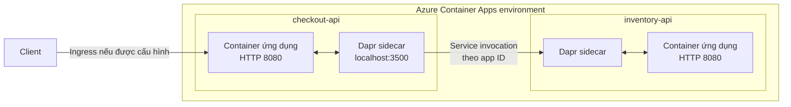
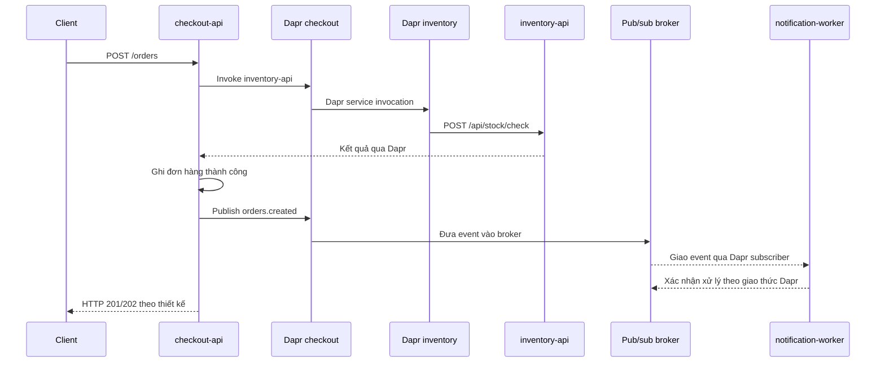
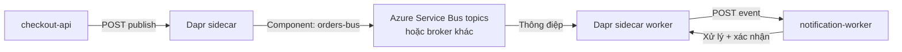

# Dapr và giao tiếp giữa các dịch vụ trong Container Apps

Một hệ thống bán hàng được chia thành nhiều dịch vụ: `checkout-api` nhận đơn hàng, `inventory-api` kiểm tra tồn kho và `notification-worker` gửi thông báo sau khi đơn được tạo. Nếu mỗi dịch vụ tự xử lý địa chỉ của dịch vụ khác, xác thực, retry, kết nối đến message broker và sự khác biệt giữa môi trường dev/prod, mã ứng dụng sẽ nhanh chóng phức tạp. **Dapr (Distributed Application Runtime)** giúp chuẩn hóa một số cách giao tiếp giữa các dịch vụ thông qua các API và thành phần cấu hình chung.

Trong module **CLOUD_PROVIDERS_AZURE**, bạn khám phá hệ sinh thái Microsoft Azure từ subscription, resource group và Entra ID đến mạng ảo, compute, lưu trữ, dữ liệu, triển khai, giám sát, bảo vệ và kiểm soát chi phí. Bài thuộc chương **Container Registry và Container Apps**, tập trung vào cách tích hợp Dapr trong **Azure Container Apps** để gọi dịch vụ đồng bộ, trao đổi sự kiện bất đồng bộ và vận hành hệ thống microservices.

> **Phạm vi:** Các ví dụ giả định container apps đã được tạo trong môi trường được phép quản trị. Tên tài nguyên, endpoint và giá trị cấu hình chỉ để minh họa. Khả năng cụ thể của Dapr và Container Apps phụ thuộc phiên bản runtime, region và cấu hình hiện hành; cần kiểm tra trước khi đưa vào production.

## 1. Mục tiêu học tập

Sau bài học, bạn có thể:

- Giải thích **Dapr sidecar** là gì, lợi ích và giới hạn của nó trong Azure Container Apps.
- Phân biệt **HTTP ingress nội bộ** của Container Apps, **Dapr service invocation** và **Dapr pub/sub**.
- Cấu hình Dapr app ID, app port, protocol và biết cách truy cập API của Dapr tại localhost.
- Gọi một dịch vụ khác bằng Dapr service invocation qua HTTP.
- Mô tả cách tạo **Dapr component**, publish event và đăng ký subscription với một message broker.
- Thiết kế retry, timeout, idempotency, bảo mật và quan sát luồng giao tiếp giữa dịch vụ.
- Xử lý các lỗi phổ biến: sai app ID, sai port, thiếu component, broker không truy cập được hoặc subscriber không xác nhận message.

## 2. Dapr và Azure Container Apps giải quyết những phần nào?

**Azure Container Apps** cung cấp nền tảng chạy container theo mô hình serverless, có revision, ingress, scaling và tích hợp hạ tầng vận hành. Container Apps quản lý vòng đời môi trường và replica; ứng dụng vẫn phải triển khai nghiệp vụ và giao tiếp với các hệ thống khác.

**Dapr** là runtime mã nguồn mở cung cấp các building blocks theo API, ví dụ:

| Building block | Mục đích | Ví dụ trong hệ thống |
|---|---|---|
| **Service invocation** | Gọi một ứng dụng Dapr khác qua app ID | Checkout gọi inventory |
| **Publish/subscribe** | Phát sự kiện và nhận qua pub/sub component | Checkout phát sự kiện tạo đơn; worker nhận |
| **State management** | Lưu/đọc trạng thái qua state store component được cấu hình | Lưu checkpoint workflow |
| **Bindings** | Tương tác hệ thống ngoài qua binding được hỗ trợ | Gọi một hệ thống tích hợp |
| **Secrets API** | Đọc secret từ secret store component được cấp quyền | Lấy cấu hình nhạy cảm qua cơ chế được hỗ trợ |
| **Workflow/actors và tính năng khác** | Điều phối hoặc quản lý trạng thái theo mô hình phù hợp | Quy trình đa bước có state |

Bài này tập trung vào **service invocation** và **pub/sub**, vì đây là hai mô hình giao tiếp thường gặp nhất giữa các Container Apps. Các building blocks khác chỉ nên bật khi thực sự có nhu cầu và đã đánh giá khả năng hỗ trợ.

### Dapr sidecar

Với mô hình tích hợp trong Azure Container Apps, bạn **bật Dapr trên từng container app** cần dùng Dapr. Nền tảng vận hành một **Dapr sidecar** bên cạnh ứng dụng. Sidecar cung cấp HTTP/gRPC API để tiến trình ứng dụng gọi, rồi xử lý việc tìm dịch vụ, tương tác với component hoặc giao tiếp với Dapr sidecar phía đích.



Các cổng `8080` và `3500` chỉ là ví dụ thông dụng; **app port** phải khớp với cổng thực tế ứng dụng đang lắng nghe, còn **HTTP port của Dapr sidecar** được runtime cung cấp (thường qua biến môi trường `DAPR_HTTP_PORT`).

### Dapr không thay thế điều gì?

- Không tự triển khai mã API, sửa lỗi nghiệp vụ hoặc tạo database.
- Không làm cho giao tiếp giữa dịch vụ **tự động an toàn** nếu ứng dụng vẫn bỏ qua kiểm tra quyền và dữ liệu đầu vào.
- Không tạo message broker thực tế từ hư không: một pub/sub component thường cần hạ tầng như Azure Service Bus hoặc broker khác.
- Không tự biến một sự kiện thành giao dịch ACID xuyên nhiều dịch vụ.
- Không bảo đảm gọi HTTP hay xử lý event chỉ diễn ra **đúng một lần**; ứng dụng phải thiết kế retry và idempotency.

## 3. Ba cách giao tiếp thường gặp trong Container Apps

| Cách giao tiếp | Cơ chế | Phù hợp | Điều cần chú ý |
|---|---|---|---|
| **Gọi qua URL/FQDN nội bộ của Container Apps** | HTTP trực tiếp qua ingress nội bộ | Dịch vụ REST đơn giản, không cần Dapr | Phụ thuộc URL, ingress, networking và bảo mật ứng dụng |
| **Dapr service invocation** | Gọi local Dapr API với `app ID`; sidecar định tuyến tới đích | Request/response đồng bộ giữa các app có Dapr | Hai bên cần cấu hình Dapr tương thích; vẫn có timeout/lỗi |
| **Dapr publish/subscribe** | Publisher gửi sự kiện vào component; broker phân phối tới subscribers | Xử lý nền, fan-out, giảm phụ thuộc thời gian | Cần component, broker, subscription, retry, xử lý trùng |

**Chọn đồng bộ khi người gọi thật sự cần phản hồi ngay.** Ví dụ checkout cần biết số lượng tồn kho còn đủ trước khi chấp nhận đơn.

**Chọn bất đồng bộ khi người gọi không cần đợi tác vụ hậu xử lý.** Ví dụ sau khi đơn hàng đã ghi nhận thành công, dịch vụ gửi email hoặc tạo báo cáo có thể xử lý event trong nền.

Không nên cho rằng chỉ cần thêm Dapr vào mọi dịch vụ là kiến trúc sẽ tốt hơn. Dapr tạo một tầng runtime và thêm chi phí vận hành, tài nguyên sidecar, phiên bản và cấu hình. Với một dịch vụ đơn lẻ hoặc hai app rất đơn giản, HTTP trực tiếp có thể đủ.

## 4. Các khái niệm Dapr quan trọng

| Khái niệm | Ý nghĩa | Ví dụ |
|---|---|---|
| **Dapr app ID** | Tên logic để dịch vụ khác gọi đến ứng dụng có Dapr | `inventory-api` |
| **Dapr app port** | Cổng mà sidecar dùng gọi về tiến trình ứng dụng | `8080` |
| **Dapr app protocol** | Giao thức sidecar sử dụng khi gọi app | `http` hoặc `grpc` tùy hỗ trợ |
| **Dapr HTTP port** | Cổng HTTP API của sidecar để app gọi cục bộ | Thường `3500`, đọc `DAPR_HTTP_PORT` |
| **Component** | Cấu hình bộ kết nối tới backend cụ thể | `orders-bus` dùng Azure Service Bus |
| **Component scope** | Danh sách app ID được phép nhìn thấy component theo cơ chế Dapr | `checkout-api`, `notification-worker` |
| **Subscription** | Khai báo app muốn nhận topic nào qua pub/sub | Topic `orders.created` |
| **Container Apps environment** | Ranh giới môi trường của các Container Apps và tài nguyên tích hợp | `aca-orders-dev` |

**App ID không phải tên container, image hoặc URL.** Nên chọn app ID rõ nghĩa, thống nhất giữa bên gọi, bên nhận và cấu hình component. Trong mô hình service invocation nội bộ thông thường, các app có Dapr phải nằm trong phạm vi service discovery được môi trường hỗ trợ, thường là **cùng một Container Apps environment**; không giả định có thể gọi qua app ID giữa hai environment độc lập.

**App port khác ingress target port về mục đích.** Ingress target port là cổng nhận lưu lượng do ingress định tuyến; Dapr app port là cổng sidecar dùng để chuyển request tới ứng dụng. Hai cổng thường trùng khi cùng dùng một HTTP server nhưng phải cấu hình rõ, đặc biệt với app có nhiều listener.

## 5. Một kiến trúc ví dụ: đặt hàng và phát thông báo

Xét ba container apps trong cùng môi trường:

- `checkout-api`: nhận request tạo đơn hàng, xác thực nghiệp vụ, gọi kiểm tra tồn kho và phát event.
- `inventory-api`: tiếp nhận request đồng bộ `/api/stock/check`; trả thông tin hàng có đủ không.
- `notification-worker`: nhận sự kiện `orders.created` rồi gửi thông báo hoặc tạo bản ghi công việc phụ.



Sơ đồ mô tả **thứ tự nghiệp vụ mong muốn**, không có giao dịch phân tán tự động giữa database và broker. Nếu ghi đơn hàng thành công nhưng publish thất bại, hệ thống cần cơ chế khôi phục; với nghiệp vụ quan trọng có thể dùng **transactional outbox** hoặc quy trình ghi sự kiện bền vững trước khi xác nhận hoàn tất.

## 6. Bật Dapr cho Container Apps

### Điều kiện chuẩn bị

- Có subscription/resource group và **Container Apps environment** đã triển khai.
- Có tối thiểu hai container apps với ứng dụng HTTP thực sự lắng nghe cổng phù hợp.
- Có quyền quản lý Container Apps và quyền đối với environment/components khi cần.
- Azure CLI và extension `containerapp` tương thích với phiên bản nền tảng.
- Ứng dụng nguồn và đích cùng phạm vi Dapr service discovery được hỗ trợ; các app ID không gây nhầm lẫn.

### Qua Azure portal

1. Mở [Azure portal](https://portal.azure.com/), chọn đúng subscription và resource group.
2. Chọn container app `inventory-api`.
3. Tìm phần **Dapr** trong cấu hình ứng dụng; bật tính năng Dapr.
4. Đặt **App ID** là `inventory-api`, **App port** là `8080` và **App protocol** là `HTTP` nếu ứng dụng dùng HTTP.
5. Áp dụng thay đổi; xác minh revision mới, replica và sức khỏe ứng dụng nếu nền tảng yêu cầu rollout.
6. Lặp lại với `checkout-api` và `notification-worker`, mỗi app dùng **app ID riêng** và cổng/protocol đúng của mình.

Bật Dapr có thể thay đổi cấu hình revision và khiến replica được tạo lại hoặc cập nhật. Nên thử ở môi trường dev, đo ảnh hưởng đến startup, probes và tài nguyên sidecar trước khi bật trên production.

### Azure CLI: bật và kiểm tra cấu hình Dapr

Các lệnh sau **thay đổi cấu hình app**; chỉ chạy trên môi trường được phép. Giả sử cả `checkout-api` và `inventory-api` đang lắng nghe HTTP 8080.

```bash
az login
az account set --subscription "<subscription-id>"

RG="rg-orders-demo"

az containerapp dapr enable \
  --name "inventory-api" \
  --resource-group "$RG" \
  --dapr-app-id "inventory-api" \
  --dapr-app-port 8080 \
  --dapr-app-protocol http

az containerapp dapr enable \
  --name "checkout-api" \
  --resource-group "$RG" \
  --dapr-app-id "checkout-api" \
  --dapr-app-port 8080 \
  --dapr-app-protocol http

# Kiểm tra Dapr configuration đã lưu
az containerapp dapr show \
  --name "inventory-api" \
  --resource-group "$RG" \
  --output json
```

**Kiểm tra lệnh và extension:** nếu tham số khác với phiên bản CLI đang cài, chạy `az containerapp dapr enable --help`; không đoán lệnh thay thế và áp dụng trực tiếp lên production. Bật Dapr chưa tự tạo API endpoint của ứng dụng: `inventory-api` vẫn cần route `/api/stock/check` trong code.

## 7. Service invocation: gọi đồng bộ bằng app ID

### Luồng hoạt động

Khi `checkout-api` cần hỏi `inventory-api` về tồn kho, code gọi **Dapr HTTP API của sidecar tại localhost**, không cần biết hostname/replica cụ thể của inventory:

```text
checkout-api
  |
  | POST http://localhost:<DAPR_HTTP_PORT>
  |      /v1.0/invoke/inventory-api/method/api/stock/check
  v
Dapr sidecar của checkout
  |
  | Tìm app ID và chuyển request
  v
Dapr sidecar của inventory
  |
  | POST http://localhost:8080/api/stock/check
  v
inventory-api -> trả HTTP status và dữ liệu
```

Đường dẫn API của Dapr có dạng:

```text
http://localhost:<DAPR_HTTP_PORT>/v1.0/invoke/<TARGET_APP_ID>/method/<TARGET_ROUTE>
```

Ở đây `inventory-api` là **Dapr app ID**, còn `api/stock/check` là route HTTP thật của ứng dụng đích. Nếu ứng dụng đích chưa cài HTTP handler tương ứng, Dapr không thể tự tạo handler thay bạn.

### Gọi từ container nguồn bằng curl

Để kiểm thử từ **bên trong container ứng dụng có Dapr sidecar**, dùng lệnh sau khi container có `curl`:

```bash
DAPR_PORT="$DAPR_HTTP_PORT"
if [ -z "$DAPR_PORT" ]; then DAPR_PORT=3500; fi

curl --fail-with-body -i \
  -X POST \
  "http://127.0.0.1:$DAPR_PORT/v1.0/invoke/inventory-api/method/api/stock/check" \
  -H "Content-Type: application/json" \
  -d '{"sku":"SKU-100","quantity":2}'
```

Lệnh minh họa API kiểm tra tồn kho **do bạn tự triển khai**. Nếu image không chứa `curl`, dùng HTTP client của ứng dụng hoặc công cụ được tổ chức cho phép. Đừng nhầm local Dapr port với port **8080** của inventory.

### Ví dụ Java 11+: gọi qua Dapr HTTP API

Không bắt buộc dùng Dapr SDK để gọi service invocation: có thể dùng HTTP client chuẩn. Mã dưới đây minh họa phần **client** chạy bên trong `checkout-api`:

```java
import java.net.URI;
import java.net.http.HttpClient;
import java.net.http.HttpRequest;
import java.net.http.HttpResponse;
import java.time.Duration;

public class InventoryClient {
    private final HttpClient httpClient = HttpClient.newBuilder()
            .connectTimeout(Duration.ofSeconds(3))
            .build();

    public String checkStock(String jsonBody) throws Exception {
        String port = System.getenv().getOrDefault("DAPR_HTTP_PORT", "3500");
        String url = "http://127.0.0.1:" + port
                + "/v1.0/invoke/inventory-api/method/api/stock/check";

        HttpRequest request = HttpRequest.newBuilder(URI.create(url))
                .timeout(Duration.ofSeconds(5))
                .header("Content-Type", "application/json")
                .POST(HttpRequest.BodyPublishers.ofString(jsonBody))
                .build();

        HttpResponse<String> response = httpClient.send(
                request, HttpResponse.BodyHandlers.ofString());

        if (response.statusCode() / 100 != 2) {
            throw new IllegalStateException(
                    "Inventory failed, HTTP " + response.statusCode());
        }
        return response.body();
    }
}
```

Ví dụ giả định `inventory-api` trả JSON hợp lệ và chỉ nhằm minh họa đường gọi. Trong production, cần parse response theo schema, xử lý timeout, lỗi HTTP, tracing và quyết định retry dựa trên **tính an toàn của thao tác**. Không retry vô hạn một request có thể làm thay đổi tồn kho hoặc tạo giao dịch nếu thiếu idempotency key.

### Khi service invocation bị lỗi

| Biểu hiện | Nơi cần kiểm tra |
|---|---|
| Không gọi được localhost Dapr API | Dapr chưa bật, sidecar chưa sẵn sàng, sai `DAPR_HTTP_PORT` |
| Không tìm thấy app ID | Sai `dapr-app-id`, app không cùng phạm vi discovery, app đích chưa bật Dapr |
| App đích có Dapr nhưng trả 404 | Sai route `/api/stock/check`, app chưa cung cấp endpoint |
| Timeout hoặc 503 | Đích chưa có replica ready, scale-to-zero/cold start, DNS/network hoặc lỗi app |
| 401/403 | Chính sách xác thực/authorization ở tầng ứng dụng, sidecar hoặc hạ tầng; cần xem log cụ thể |
| 500 | Exception trong app, lỗi backend hoặc lỗi runtime; đối chiếu distributed traces |

**Service invocation là request/response**: nếu app đích hoặc mạng không sẵn sàng, bên gọi có thể phải xử lý lỗi ngay. Dapr không thay thế circuit breaker, timeout hợp lý hoặc thiết kế degrade gracefully.

## 8. Publish/subscribe: giao tiếp bất đồng bộ bằng sự kiện

Trong ví dụ đặt hàng, sau khi ghi đơn hàng thành công, `checkout-api` phát một sự kiện `orders.created`. Nó không cần biết có bao nhiêu ứng dụng đăng ký sự kiện đó. `notification-worker` và các dịch vụ khác có thể xử lý bằng cơ chế pub/sub được cấu hình.



Khác với service invocation, **publish thành công không có nghĩa tất cả subscribers đã xử lý xong**. Thường nó cho biết yêu cầu publish đã được backend/component chấp nhận; quá trình phân phối và xử lý event diễn ra độc lập.

### Dapr pub/sub component là gì?

**Component** mô tả một backend tích hợp, chẳng hạn Azure Service Bus topics, Redis pub/sub hoặc dịch vụ tương thích được Dapr hỗ trợ. Trong Container Apps, Dapr components thường được cấu hình ở **cấp Container Apps environment** và có thể giới hạn các app ID sử dụng bằng **scopes**.

Phân biệt:

- `orders-bus` — tên **component** Dapr do bạn đặt.
- `pubsub.azure.servicebus.topics` — **component type** kết nối tới Azure Service Bus topics.
- `orders.created` — tên **topic** mà publisher gửi và subscriber đăng ký.
- `checkout-api` và `notification-worker` — Dapr app IDs sử dụng component.

**Component không phải broker.** Trước khi sử dụng Azure Service Bus, phải có namespace và quyền truy cập phù hợp; tùy cấu hình, thực thể topic/subscription cũng cần được tạo hoặc cho phép component quản lý theo API và role hỗ trợ.

## 9. Tạo component pub/sub trong Container Apps

Ví dụ file khai báo một component kết nối Azure Service Bus. **Đây là mẫu minh họa cấu trúc**; bạn phải thay giá trị bằng backend thật, xác minh schema hiện hành và chọn cơ chế xác thực phù hợp trước khi triển khai.

```yaml
componentType: pubsub.azure.servicebus.topics
version: v1
metadata:
  - name: connectionString
    secretRef: servicebus-connection
secrets:
  - name: servicebus-connection
    value: "<SET_FROM_SECURE_SECRET_SOURCE>"
scopes:
  - checkout-api
  - notification-worker
```

Giá trị `<SET_FROM_SECURE_SECRET_SOURCE>` **không phải connection string hợp lệ**. Tuyệt đối không commit file chứa connection string thật vào Git, không gửi nó qua ticket hoặc dùng trên production khi chưa kiểm soát đường truyền và vòng đời secret. **Ưu tiên cơ chế Microsoft Entra ID/managed identity nếu component, Container Apps và backend hỗ trợ**, cùng các role Azure Service Bus tương ứng. Cấu hình khi dùng identity sẽ khác ví dụ `connectionString` ở trên và cần đối chiếu tài liệu component hiện hành.

### Áp dụng component qua Azure CLI

Giả sử file `pubsub.yaml` đã được chuẩn bị an toàn **ngoài repository chứa mã nguồn** và Azure Service Bus namespace đã tồn tại:

```bash
az containerapp env dapr-component set \
  --name "aca-orders-dev" \
  --resource-group "rg-orders-demo" \
  --dapr-component-name "orders-bus" \
  --yaml "./pubsub.yaml"

# Liệt kê component đã cấu hình trong environment
az containerapp env dapr-component list \
  --name "aca-orders-dev" \
  --resource-group "rg-orders-demo" \
  --output table
```

Lệnh thay đổi cấu hình môi trường, có thể ảnh hưởng nhiều app dùng chung component. Rà soát **component name, type, scopes, secret references, region và identity** trước khi thực thi. Nếu CLI báo tham số không có, chạy `az containerapp env dapr-component set --help` để kiểm tra version/extension.

### Vì sao cần scopes?

Trong ví dụ, `scopes` giới hạn những **Dapr app IDs** được sử dụng component `orders-bus` theo cơ chế Dapr. Một ứng dụng ngoài danh sách không nên dựa vào component này làm đường giao tiếp.

**Scopes không thay thế Azure RBAC, firewall hoặc quyền Service Bus của identity.** Chúng cũng không tự cho phép một principal bên ngoài truy cập broker. Cần kiểm soát cả:

1. Ai được tạo/sửa Dapr component trên environment.
2. Identity/credential nào truy cập Azure Service Bus, được publish/subscribe topic nào.
3. App ID nào được scope cho component.
4. Mạng, TLS, secret storage và log của hệ thống.

## 10. Publish event qua Dapr HTTP API

Từ `checkout-api`, ứng dụng có thể publish một JSON event lên topic `orders.created` qua sidecar:

```bash
DAPR_PORT="$DAPR_HTTP_PORT"
if [ -z "$DAPR_PORT" ]; then DAPR_PORT=3500; fi

curl --fail-with-body -i \
  -X POST \
  "http://127.0.0.1:$DAPR_PORT/v1.0/publish/orders-bus/orders.created" \
  -H "Content-Type: application/json" \
  -d '{"orderId":"ORD-1001","customerId":"C-42","total":150000}'
```

Cú pháp chung:

```text
POST http://localhost:<DAPR_HTTP_PORT>/v1.0/publish/<PUBSUB_NAME>/<TOPIC_NAME>
```

`PUBSUB_NAME` phải đúng tên Dapr component đã cấu hình, không phải tên Service Bus namespace. Payload nên chứa **event ID**, **schema version**, thời điểm xảy ra và dữ liệu tối thiểu cần xử lý; không nhét thông tin nhạy cảm không cần thiết vào sự kiện.

Dapr mặc định có thể bao dữ liệu trong **CloudEvents envelope**, tùy API/header và cấu hình. Bên nhận cần phân biệt event envelope với `data` nghiệp vụ. Ví dụ dạng minh họa:

```json
{
  "specversion": "1.0",
  "id": "event-ord-1001",
  "source": "checkout-api",
  "type": "com.example.orders.created",
  "datacontenttype": "application/json",
  "data": {
    "orderId": "ORD-1001",
    "customerId": "C-42",
    "total": 150000
  }
}
```

Envelope trên là ví dụ minh họa; ID, type và source thực tế phụ thuộc cách publisher gửi sự kiện và Dapr runtime xử lý CloudEvents. Nếu subscriber dùng raw payload mode hoặc cấu hình khác, hình dạng request có thể khác.

## 11. Đăng ký topic và xử lý event ở subscriber

Ứng dụng `notification-worker` phải đăng ký topic. Dapr hỗ trợ các cơ chế subscription, chẳng hạn **declarative subscription** hoặc **programmatic subscription** qua endpoint của app. Với ví dụ HTTP dưới đây, ứng dụng cung cấp:

```text
GET /dapr/subscribe
```

Response JSON:

```json
[
  {
    "pubsubname": "orders-bus",
    "topic": "orders.created",
    "routes": {
      "default": "/events/orders-created"
    }
  }
]
```

Sau đó Dapr gửi event đến:

```text
POST http://localhost:8080/events/orders-created
Content-Type: application/cloudevents+json
```

Handler của `notification-worker` cần:

1. Đọc event ID và phần `data`, kiểm tra định dạng/schema.
2. Kiểm tra event đã xử lý chưa bằng một kho lưu idempotency có khả năng duy trì dữ liệu.
3. Thực hiện nghiệp vụ, ví dụ lưu yêu cầu thông báo vào database hoặc gửi email.
4. Ghi nhận trạng thái thành công bền vững trước khi xác nhận hoàn thành.
5. Trả HTTP response theo giao thức Dapr để báo xử lý thành công hoặc yêu cầu retry/drop theo thiết kế.

Một handler trả **2xx** thường được coi là đã xử lý thành công theo mô hình HTTP pub/sub. Nếu handler báo lỗi hoặc không phản hồi, Dapr/broker có thể retry theo chính sách và khả năng backend. Khi lỗi không thể xử lý, cần có **dead-letter/poison-message strategy** tương ứng với component và broker đang dùng.

### Những điều không nên giả định

- Không có bảo đảm **exactly-once business processing** chỉ vì Dapr đã gửi event.
- Khi retry hoặc có nhiều replica, subscriber có thể nhận **cùng một sự kiện hơn một lần**.
- Thứ tự nhận event **không được bảo đảm chung** cho mọi component/topic/partition.
- Một thông điệp thành công ở broker không chứng minh email, payment hoặc database transaction đã hoàn tất.
- Scale-to-zero, thời gian khởi động, queue backlog và khả năng mở rộng của broker có thể ảnh hưởng độ trễ.

## 12. Đảm bảo độ tin cậy: retry, timeout, idempotency

Giao tiếp microservices luôn có khả năng thất bại: container restart, revision chưa ready, broker tạm thời throttling, mạng đứt hoặc bên nhận phản hồi chậm. Dapr giúp thống nhất một phần cơ chế giao tiếp, nhưng ứng dụng cần chủ động thiết kế **độ tin cậy ở mức nghiệp vụ**.

### Với service invocation

Giả sử checkout gọi inventory để **kiểm tra số lượng**. Nếu inventory timeout:

1. Client phải đặt **timeout hữu hạn** để không giữ request người dùng vô thời hạn.
2. Phân biệt lỗi có thể retry (ví dụ mất kết nối tạm thời) và lỗi nghiệp vụ (ví dụ hết hàng).
3. Nếu retry, dùng số lần giới hạn với backoff/jitter; tránh đồng loạt retry khi đích quá tải.
4. Nếu inventory vẫn không hoạt động, lựa chọn trả lỗi có kiểm soát, giảm chức năng hoặc đưa yêu cầu vào hàng chờ tùy nhu cầu nghiệp vụ.

**Lưu ý:** kiểm tra tồn kho có thể là tác vụ đọc, nhưng **giữ hàng/trừ tồn kho** là tác vụ thay đổi trạng thái. Retry lệnh giữ hàng mà không có idempotency key có thể khiến xử lý trùng hoặc tạo nhiều reservation.

### Với pub/sub

Trong một hệ thống sử dụng broker, thông điệp có thể được giao lại nếu subscriber lỗi trước khi xác nhận. Thiết kế **at-least-once processing** là giả định an toàn trong nhiều trường hợp.

```text
Nhận CloudEvent
    |
    v
Kiểm tra event ID + schema
    |
    v
Tra bảng processed_events (khóa event ID)
    |
    +-- Đã xử lý --> Trả SUCCESS/2xx theo giao thức
    |
    +-- Chưa xử lý --> Thực hiện thay đổi nghiệp vụ
                         |
                         v
                   Ghi nhận event đã xử lý
                         |
                         v
                   Trả SUCCESS/2xx
```

Đây là quy trình logic. Để chống trùng thực sự, cần một **thao tác nguyên tử hoặc ràng buộc unique** giữa việc xử lý nghiệp vụ và đánh dấu event đã xử lý khi cùng database hỗ trợ; nếu không, vẫn có cửa sổ lỗi. Với hệ thống có side effect ngoài database như gửi email, cân nhắc outbox, request ID ở nhà cung cấp và retry policy phù hợp.

### Transactional outbox

Một lỗi nguy hiểm thường xảy ra khi `checkout-api` đã ghi đơn hàng thành công nhưng process chết trước khi publish sự kiện. Khi đó, đơn tồn tại nhưng worker không bao giờ nhận event.

Giải pháp thường dùng là **transactional outbox**:

1. Trong một transaction database, ghi **đơn hàng** và **bản ghi outbox event**.
2. Một tiến trình phát sự kiện đọc những bản ghi outbox chưa gửi rồi publish qua Dapr.
3. Sau khi broker chấp nhận, cập nhật trạng thái outbox; nếu tiến trình chết giữa chừng, vẫn có thể publish lại.
4. Subscriber xử lý idempotently theo event ID.

Outbox giúp hạn chế mất event giữa database và broker, nhưng không tự tạo bảo đảm exactly-once; việc publish lại vẫn có thể gây **duplicate delivery** và cần kiểm tra bên nhận.

### Dead-letter và poison messages

Nếu một event có schema sai hoặc không thể xử lý sau nhiều lần retry, retry vô hạn có thể làm nghẽn subscriber. Hãy thiết kế:

- Số lần thử lại và khoảng backoff hợp lý.
- Dead-letter topic/queue hoặc cơ chế xử lý lỗi được **broker và Dapr component** hỗ trợ.
- Cảnh báo, dashboard và quy trình mở lại message sau khi đã sửa nguyên nhân.
- Phân biệt message lỗi vĩnh viễn với lỗi tạm thời như timeout database.

Đừng tự động chuyển một message thất bại sang trạng thái thành công chỉ để backlog về 0. Mất nghiệp vụ vẫn là mất dữ liệu dù dashboard không còn cảnh báo.

## 13. Scale, revision và tính sẵn sàng

Azure Container Apps có thể scale replica dựa trên cấu hình, nhưng **việc bật Dapr không đồng nghĩa mọi subscription tự động có scale rule phù hợp**. Cần đánh giá riêng cơ chế scale của Container Apps và nguồn metrics của workload.

| Thành phần | Điều cần xem |
|---|---|
| `checkout-api` | HTTP concurrency, peak requests, min/max replicas, thời gian cold start |
| `inventory-api` | p95 latency, CPU/memory, số kết nối database, số replica ready |
| `notification-worker` | Backlog Service Bus, throughput xử lý, max replicas và giới hạn API bên ngoài |
| Dapr sidecar | Mức sử dụng tài nguyên và khả năng khởi động/ready cùng app |
| Broker | Message count, throttling, quota, dead-letter, concurrency của consumer |

Nếu service invocation có yêu cầu độ trễ thấp, đặt **min replicas** phù hợp có thể giảm rủi ro cold start. Với worker event, scale-to-zero có thể là lựa chọn tiết kiệm, nhưng phải có **scale rule tương ứng với broker** và kiểm tra quá trình worker thức dậy, đăng ký subscription, xử lý backlog. Dapr subscription **không tự bảo đảm** việc worker scale từ 0 theo mọi nguồn event.

### Revision và triển khai phiên bản

Container Apps dùng **revisions** và có thể phân phối lưu lượng giữa các phiên bản. Điều này có tác động đến service invocation và pub/sub:

- Khi rollout `inventory-api`, kiểm tra route ở các revision vẫn tương thích với caller.
- Khi thay đổi schema event, hỗ trợ giai đoạn publisher/subscriber phiên bản cũ và mới cùng hoạt động.
- Trước khi nâng Dapr runtime hoặc đổi component, thử các đường gọi hiện có trong staging.
- Khi app ID hoặc tên component đổi, các caller/subscriber liên quan phải được cập nhật có kế hoạch.
- Tránh để hai bản consumer không tương thích cùng nhận sự kiện nếu broker/subscription và chiến lược phân phối không được thiết kế cho tình huống đó.

**Không dùng tên revision làm định danh nghiệp vụ bền vững.** App ID, topic name và event schema là hợp đồng tích hợp cần quản trị độc lập với số replica hoặc vòng đời release.

## 14. Danh tính, phân quyền và bảo vệ giao tiếp

Dapr giúp chuẩn hóa giao tiếp nhưng **không xóa bỏ ranh giới bảo mật** giữa client, sidecar, broker và backend.

### Các lớp cần kiểm soát

1. **Ingress của Container Apps:** quyết định app có endpoint public/internal, cơ chế TLS và yêu cầu xác thực từ bên ngoài.
2. **Local Dapr API:** app nói chuyện với sidecar trên localhost; không công bố cổng Dapr như một API công cộng.
3. **Service-to-service invocation:** kiểm tra nguồn yêu cầu và quyền ở app đích khi nghiệp vụ cần; không mặc định biết app ID là đủ quyền thay đổi dữ liệu.
4. **Dapr component scopes:** giảm phạm vi app ID nhìn thấy/sử dụng component.
5. **Backend identity/RBAC:** phân quyền Azure Service Bus, Storage, Key Vault hoặc dịch vụ khác bằng identity thực tế.
6. **Mạng:** VNet, DNS, network restriction và khả năng kết nối outbound tới broker/private endpoint.

Trong nhiều trường hợp có thể dùng **managed identity** của Container App để backend nhận token theo khả năng hỗ trợ của component. Với Azure Service Bus, principal phải có các role dữ liệu phù hợp, chẳng hạn **Azure Service Bus Data Sender** để gửi hoặc **Azure Service Bus Data Receiver** để nhận, tại scope cần thiết. Hãy kiểm tra chính xác **identity mà Dapr component đang sử dụng**, vì quyền của ứng dụng và đường xác thực của sidecar không nên được suy đoán là một.

### Quy tắc bảo mật quan trọng

- Không lưu connection string hoặc SAS trong repository, container image hay log.
- Ưu tiên secrets/managed identity và quyền tối thiểu; có phương án rotation/thu hồi credential.
- Bảo vệ quyền sửa Dapr component: một thay đổi component có thể tác động đến nhiều app trong environment.
- Tách environment dev/staging/prod hoặc phân vùng quyền thích hợp; không trộn broker production với môi trường thử nghiệm.
- Xác thực và kiểm tra dữ liệu nghiệp vụ ở mọi endpoint; đừng coi lời gọi nội bộ là mặc nhiên đáng tin.
- Dùng mã hóa/TLS cho kết nối broker và kiểm tra khả năng bảo vệ liên sidecar của nền tảng đang triển khai.
- Không xuất bản endpoint `/dapr/subscribe` và event handler ra Internet trừ khi kiến trúc thực sự cần và đã có bảo vệ thích hợp.

**Dapr app ID là định danh định tuyến, không phải bằng chứng ủy quyền của người dùng cuối.** Nếu checkout hành động thay mặt khách hàng, thông tin user authorization phải được kiểm tra/lan truyền theo thiết kế chứ không chỉ dựa vào việc caller có thể gọi inventory.

## 15. Quan sát hệ thống: log, trace và metrics

Một lỗi giao tiếp có thể nằm ở container app nguồn, sidecar nguồn, mạng, sidecar đích, app đích hoặc broker. Vì thế, cần gắn **correlation ID/trace ID** xuyên toàn bộ request và event.

| Nguồn quan sát | Dữ liệu hữu ích | Khi nào dùng |
|---|---|---|
| Container app nguồn | Method, target app ID, HTTP status, timeout, trace ID | Gọi inventory thất bại |
| Dapr sidecar nguồn/đích | Lỗi resolve app ID, component initialization, invoke/publish | Phân biệt lỗi runtime và lỗi app |
| Container app đích | Route, exception, latency, code trả về | Gọi đã đến app nhưng lỗi |
| Azure Service Bus | Publish failures, active/dead-letter messages, quota | Event không được giao hoặc bị dồn |
| Application Insights / Azure Monitor | End-to-end traces, request/dependency metrics, alert | Phân tích luồng nhiều dịch vụ |
| Container Apps revisions/replicas | Replica ready, scale, restart, CPU/RAM | Cold start, lỗi rollout, thiếu capacity |

**OpenTelemetry** và distributed tracing giúp theo dõi luồng gọi qua các dịch vụ khi được cấu hình; mức độ hỗ trợ/thu thập trace của Dapr và Container Apps phải xác minh theo runtime và backend quan sát. Không giả định chỉ cần bật Dapr là có sẵn toàn bộ trace trong Application Insights.

### Azure CLI: kiểm tra cấu hình và log

```bash
RG="rg-orders-demo"

az containerapp dapr show \
  --name "checkout-api" \
  --resource-group "$RG" \
  --output json

az containerapp revision list \
  --name "checkout-api" \
  --resource-group "$RG" \
  --output table

# Đọc log app; dùng portal/logging theo cấu hình để xem log sidecar
az containerapp logs show \
  --name "checkout-api" \
  --resource-group "$RG" \
  --type console \
  --tail 100

az containerapp env dapr-component list \
  --name "aca-orders-dev" \
  --resource-group "$RG" \
  --output table
```

Các lệnh ví dụ này là thao tác đọc. Với log sidecar, tham số chọn replica/container và cách truy cập log có thể thay đổi theo CLI/portal. Nếu lệnh không hỗ trợ một cờ, kiểm tra `--help`. Log cần loại bỏ credential, token, dữ liệu cá nhân và payload nhạy cảm trước khi lưu hoặc chia sẻ.

## 16. Khắc phục sự cố Dapr trong Container Apps

| Triệu chứng | Nguyên nhân có thể | Thao tác kiểm tra |
|---|---|---|
| Gọi `localhost:3500` bị từ chối | Sidecar chưa chạy, Dapr chưa bật hoặc HTTP port khác | Xem Dapr config, revision, biến `DAPR_HTTP_PORT`, log sidecar |
| `checkout-api` không gọi được `inventory-api` | Sai app ID, app đích chưa bật Dapr hoặc phạm vi discovery không phù hợp | So app IDs, environment, trạng thái app/revision |
| Sidecar gọi được nhưng báo 404 | Đường dẫn endpoint hoặc method của app đích sai | Test route trực tiếp trong đích, xem application logs |
| Invocation timeout | App đích quá tải, cold start, mạng hoặc dependency chậm | Kiểm tra replicas ready, latency, traces, timeout |
| Publish trả lỗi không tìm thấy component | Sai `orders-bus`, component chưa tạo, scope không có app ID | Xem Dapr component, type, scopes, khởi tạo sidecar |
| Service Bus trả lỗi quyền | Identity/secret hết hạn, thiếu Sender/Receiver, cấu hình namespace sai | Kiểm tra credential, RBAC, broker và log Dapr |
| Event được publish nhưng subscriber không nhận | Không có subscription, sai topic/route, backend không có consumer | Kiểm tra `GET /dapr/subscribe`, topic name, broker, logs |
| Event xử lý nhiều lần | Retry, broker redelivery, replica restart | Thiết kế idempotency, event ID, transaction/outbox |
| Event nhận nhưng app trả 500 | Lỗi handler, database hoặc external API | Xem stdout/stderr, traces, dead-letter policy |
| Worker không xử lý khi min replicas = 0 | Scale rule chưa phù hợp hoặc scale không kích hoạt | Kiểm tra KEDA/Container Apps scale rule và queue backlog |
| Dev hoạt động, prod thất bại | Khác identity, component scope, private DNS, network, secret | So cấu hình theo môi trường, tránh copy credential |

**Trình tự chẩn đoán được khuyến nghị:** kiểm tra app/revision → Dapr enabled/app ID/port → endpoint app → component và subscription → quyền backend → network → retry/log/correlation ID. Không nên xử lý lỗi bằng cách cấp Owner toàn subscription, tắt firewall hoặc mở public ingress vô điều kiện.

## 17. Tình huống thực tế: đơn hàng và thông báo bất đồng bộ

Một công ty có 3 Container Apps cùng environment:

```text
checkout-api         Dapr app ID = checkout-api        port 8080
inventory-api        Dapr app ID = inventory-api       port 8080
notification-worker  Dapr app ID = notification-worker port 8080

Dapr component: orders-bus
Type: pubsub.azure.servicebus.topics
Topic: orders.created
```

Quy trình triển khai có kiểm soát:

1. **Chuẩn bị app đích:** triển khai `inventory-api` với `POST /api/stock/check`, có health check và quyền database phù hợp.
2. **Bật Dapr:** đặt app IDs/ports cho cả ba app; xác minh `az containerapp dapr show` và replica ready.
3. **Kiểm tra gọi đồng bộ:** từ `checkout-api`, gọi inventory qua `/v1.0/invoke/inventory-api/method/api/stock/check`. Kiểm thử tồn kho đủ, không đủ, timeout và 500.
4. **Chuẩn bị broker:** tạo Azure Service Bus namespace/topic hoặc thực thể cần thiết; cấp identity quyền gửi/nhận tối thiểu.
5. **Tạo Dapr component:** `orders-bus` ở environment, cấu hình backend/secret hoặc identity và scopes cho publisher/subscriber.
6. **Đăng ký event:** `notification-worker` trả subscription cho `orders.created` và cài handler `/events/orders-created`.
7. **Phát event đúng thời điểm:** sau khi đơn được ghi bền vững, dùng outbox/publisher để gửi event qua Dapr.
8. **Xác nhận an toàn:** subscriber lưu event ID, xử lý nghiệp vụ idempotently rồi xác nhận; kiểm tra dead-letter khi có lỗi.
9. **Kiểm thử lỗi có chủ đích:** restart worker, tạm làm hỏng broker connection trong lab và xem hệ thống retry/khôi phục backlog ra sao.
10. **Đo lường:** so sánh p95 latency của invocation, số event xử lý/phút, backlog, số lần retry, chi phí compute và Service Bus.

**Tiêu chí thành công:** tạo một đơn hàng chỉ có một kết quả nghiệp vụ hợp lệ, không mất event sau khi publish bị gián đoạn, lỗi inventory được trả rõ ràng và notification có thể xử lý lại an toàn. Không đánh giá thành công chỉ bằng việc API publish trả status 2xx.

## 18. Chi phí và lựa chọn kiến trúc

Dapr thường không phải là một dòng phí độc lập cho mọi API invocation, nhưng các **thành phần hạ tầng thực tế** có chi phí cần tính: Container Apps compute/memory và số replica, tài nguyên của sidecar, backend pub/sub như Azure Service Bus, lưu trữ state, network egress và logs/telemetry.

| Quyết định | Lợi ích | Chi phí/rủi ro |
|---|---|---|
| Dùng Dapr invocation | Gọi theo app ID, giảm phụ thuộc hostname | Thêm sidecar và khả năng debug nhiều hop |
| Dùng pub/sub | Tách publisher khỏi consumer, chịu tải bất đồng bộ | Broker, lưu message, retry và xử lý trùng |
| Giữ min replicas lớn hơn 0 | Giảm cold start cho API cần latency thấp | Chi phí compute khi nhàn rỗi |
| Scale worker theo backlog | Tăng throughput khi có nhiều event | Cần scale rule, giám sát broker quota |
| Bật tracing/log chi tiết | Dễ điều tra lỗi liên dịch vụ | Phí ingestion/retention và rủi ro lộ dữ liệu |
| Tách môi trường dev/prod | Cô lập cấu hình, identity và broker | Thêm tài nguyên môi trường cần quản trị |

Để chọn giải pháp, hãy trả lời: có thật sự cần Dapr không, hay HTTP nội bộ của Container Apps đủ? Có cần message broker bền vững, hay luồng xử lý phù hợp một job theo sự kiện? Tính **chi phí mỗi đơn hàng/sự kiện xử lý thành công** và mức độ tin cậy, không chỉ chi phí container app.

## 19. Bài tập và câu hỏi tự kiểm tra

### Bài tập A: Chọn hình thức giao tiếp

Hệ thống có ba yêu cầu: (1) checkout cần biết tồn kho ngay; (2) gửi email sau khi đơn được tạo; (3) lưu hồ sơ người dùng trong database. Hãy quyết định dùng service invocation, pub/sub hay truy cập database.

*Gợi ý:* (1) service invocation/HTTP đồng bộ; (2) pub/sub bất đồng bộ; (3) truy cập database qua service chịu trách nhiệm dữ liệu, không dùng pub/sub như kho hồ sơ.

### Bài tập B: Chẩn đoán app ID

`checkout-api` gọi `/v1.0/invoke/inventory/method/api/stock/check` nhưng cấu hình Dapr của app đích đặt `dapr-app-id=inventory-api`. Vì sao request thất bại?

*Gợi ý:* Dapr service discovery tìm theo **app ID chính xác**; `inventory` và `inventory-api` là hai tên khác nhau.

### Bài tập C: Xử lý trùng event

`notification-worker` nhận cùng `event-ord-1001` hai lần sau khi replica restart. Nếu worker gửi hai email và ghi nhận hai lượt thanh toán thì vấn đề gì đã xảy ra?

*Gợi ý:* Thiếu idempotency và thiếu tách tác vụ chỉ gửi thông báo khỏi thanh toán. Thiết kế processed event ID, transaction/outbox hoặc khóa idempotency phù hợp.

### Bài tập D: Pub/sub có cần external broker?

Đội vận hành đã bật Dapr trên cả ba app nhưng gọi `POST /v1.0/publish/orders-bus/orders.created` bị lỗi “component not found”. Cần kiểm tra gì?

*Gợi ý:* Chưa có component `orders-bus` ở environment, sai tên, scopes không chứa publisher hoặc component khởi tạo thất bại. Bật Dapr đơn thuần không tự tạo Service Bus.

### Bài tập E: Thực hành lab end-to-end

1. Tạo environment lab và hai container apps HTTP với route kiểm thử.
2. Bật Dapr cho cả hai, dùng app ID rõ ràng.
3. Gọi app đích qua Dapr invocation từ bên trong app nguồn.
4. Chuẩn bị một broker/test component được tổ chức phê duyệt, cấu hình pub/sub ở environment.
5. Tạo một subscription và publish event mẫu.
6. Ghi lại event ID, số lần handler được gọi, HTTP status, log và trace.
7. Mô phỏng handler tạm trả lỗi rồi phục hồi; kiểm tra retry/idempotency.
8. Thu hồi tài nguyên lab, secrets và role assignments **chỉ của bài thực hành**, không xóa broker dùng chung.

## 20. Checklist trước khi đưa Dapr vào production

### Kiến trúc

- [ ] Đã xác định đâu là lời gọi đồng bộ, đâu là sự kiện bất đồng bộ.
- [ ] Dapr thật sự giải quyết nhu cầu của hệ thống thay vì chỉ thêm tầng runtime không cần thiết.
- [ ] Các Container Apps nằm trong phạm vi Dapr discovery được hỗ trợ.
- [ ] Dapr app ID, app port và protocol được định nghĩa rõ, tránh xung đột.
- [ ] Thành phần pub/sub và topic/subscription được đặt tên, versioned và ghi nhận owner.
- [ ] Event schema có version, contract và quy tắc tương thích khi triển khai revision mới.

### Reliability

- [ ] Có timeout, retry/backoff giới hạn, xử lý lỗi và khả năng degrade gracefully.
- [ ] Request có side effect và event handler được bảo vệ bằng idempotency.
- [ ] Có outbox hoặc phương án tương đương để hạn chế mất event khi ghi database thành công nhưng publish lỗi.
- [ ] Có dead-letter/poison-message workflow và phương án xử lý lại.
- [ ] Đã kiểm thử restart, broker outage, cold start, scale-to-zero và quá tải.

### Bảo mật

- [ ] Quyền Azure RBAC/backend và component scopes đã được phân tách rõ.
- [ ] Ưu tiên managed identity khi được hỗ trợ; secret không nằm trong code/image/log.
- [ ] Ingress, service-to-service auth, TLS, network và DNS đáp ứng chính sách.
- [ ] Dapr HTTP API không bị phơi lộ trực tiếp ra Internet.
- [ ] Dev/staging/prod không dùng nhầm topic, storage hoặc identity production.

### Vận hành

- [ ] Có logs, traces, metrics, correlation ID và cảnh báo cho lỗi invocation/pubsub.
- [ ] Có scale rules theo nhu cầu, quota và giới hạn ngân sách.
- [ ] Có quy trình rollout/rollback Dapr component và tương thích event schema.
- [ ] Đã ghi nhận chi phí Container Apps, sidecar, broker, network và monitoring.

## Kết luận

**Dapr** giúp các dịch vụ trên **Azure Container Apps** giao tiếp thông qua API thống nhất: **service invocation** cho lời gọi đồng bộ theo app ID, và **pub/sub** cho sự kiện bất đồng bộ qua một component kết nối broker. Để triển khai hiệu quả, cần cấu hình sidecar đúng cổng và app ID, quản lý component ở cấp environment, định nghĩa subscription rõ ràng và kiểm soát danh tính cùng quyền backend. Đặc biệt, Dapr **không tự bảo đảm nghiệp vụ xử lý đúng một lần**: timeout, retry, idempotency, outbox, dead-letter, observability và scale vẫn phải được thiết kế và kiểm thử. Khi làm tốt những điều đó, hệ thống microservices sẽ dễ mở rộng và vận hành hơn mà không đánh đổi độ tin cậy của dữ liệu.
