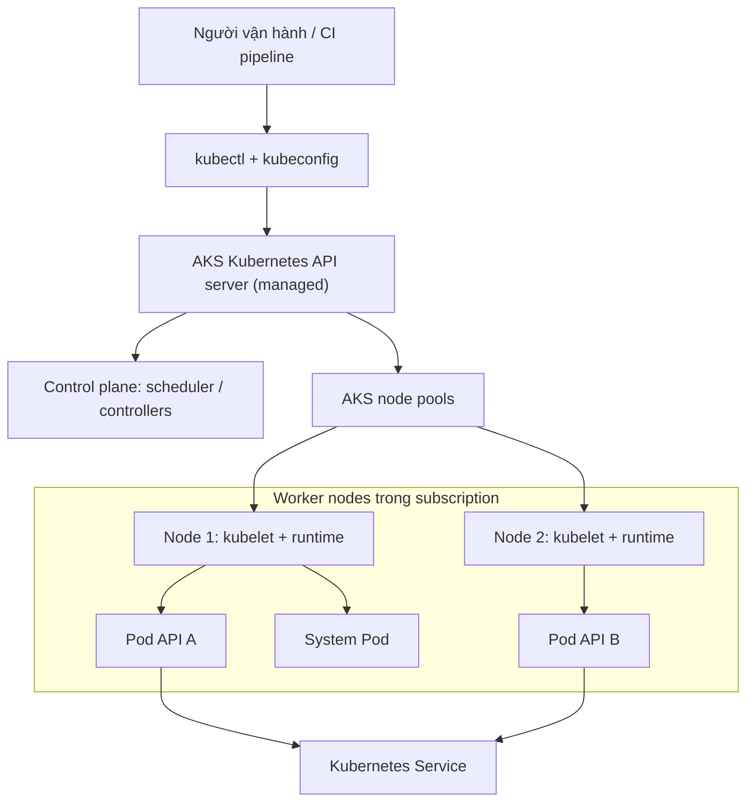
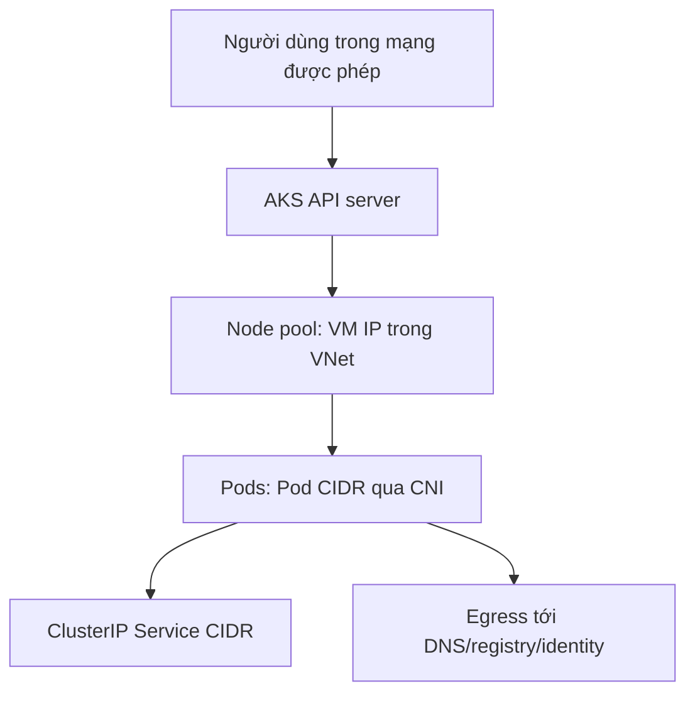
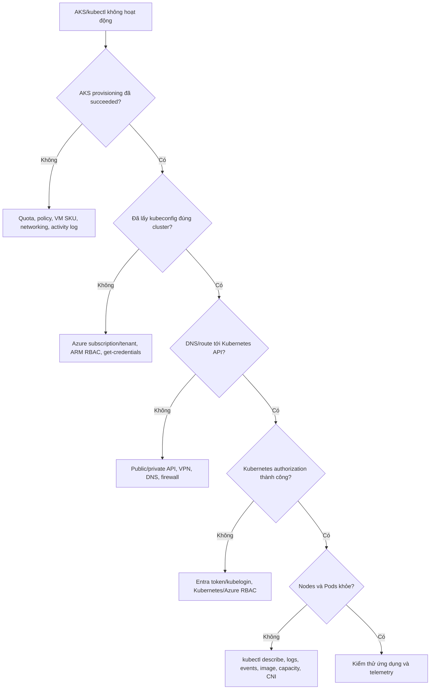

# Tạo AKS cluster và kết nối bằng kubectl

Giả sử một nhóm phát triển đã đóng gói API thành container và muốn triển khai nhiều bản sao, tự khôi phục Pod lỗi, cân bằng lưu lượng và cập nhật ứng dụng mà không tự vận hành toàn bộ Kubernetes control plane. **Azure Kubernetes Service (AKS)** là dịch vụ Kubernetes được quản lý của Microsoft Azure, phù hợp với loại bài toán này. Tuy nhiên, việc tạo cluster thành công trên Azure Portal chưa đủ để có thể vận hành ứng dụng: người quản trị còn phải thiết lập **mạng, danh tính, quyền Kubernetes, đường truy cập API server và công cụ `kubectl`**.

Bài học thuộc chương **Nền tảng Azure Kubernetes Service** trong module `CLOUD_PROVIDERS_AZURE`. Trong hành trình khám phá Azure từ subscription, resource group và Microsoft Entra ID tới mạng ảo, tính toán, lưu trữ, dữ liệu, triển khai, giám sát, bảo vệ và kiểm soát chi phí, bài này hướng dẫn **tạo một AKS cluster trong lab, kết nối từ máy quản trị hoặc Azure Cloud Shell bằng `kubectl`, kiểm tra cluster và triển khai thử ứng dụng**.

> **Phạm vi thực hành:** Các tên tài nguyên, dải IP và lệnh bên dưới chỉ là ví dụ. Việc chạy lệnh tạo AKS thực tế có thể phát sinh phí cho node VM, đĩa, mạng và dịch vụ liên quan. Hãy dùng subscription sandbox được phê duyệt; không tạo cluster ngoài phạm vi ngân sách/quyền hạn.

## Mục tiêu học tập

Sau bài học, bạn có thể:

1. Mô tả cấu trúc AKS gồm **managed control plane**, node pools, Kubernetes API server, Pods, Services và resource group của node.
2. Chuẩn bị subscription, region, quota, Azure CLI, `kubectl`, Azure RBAC và Kubernetes RBAC trước khi triển khai.
3. Hiểu các lựa chọn mạng quan trọng: **Azure CNI**, địa chỉ Pod/Service, API server public/private và đường egress của node.
4. Tạo AKS cluster cơ bản bằng **Azure Portal** hoặc **Azure CLI** với managed identity.
5. Lấy thông tin truy cập bằng `az aks get-credentials`, xác minh **kubeconfig/context** và kết nối bằng `kubectl`.
6. Phân biệt lỗi **không có quyền lấy credential**, **không có quyền Kubernetes**, và **không có đường mạng đến API server**.
7. Tạo Namespace, Deployment, Service kiểu ClusterIP và dùng `kubectl port-forward` để thử ứng dụng không cần mở public Load Balancer.
8. Kiểm tra trạng thái Pod/Node, log/event, giám sát, chi phí, cập nhật phiên bản và dọn dẹp tài nguyên lab đúng cách.

## 1. AKS là gì và Azure quản lý phần nào?

Kubernetes là hệ thống điều phối container. AKS cung cấp cụm Kubernetes được quản lý trên Azure để nhóm ứng dụng tập trung vào container và workload hơn là tự xây/control/duy trì toàn bộ control plane.

Trong mô hình AKS thông dụng:

- **Managed control plane**: Azure cung cấp và vận hành những thành phần điều khiển Kubernetes như API server và các thành phần control plane liên quan theo trách nhiệm của dịch vụ.
- **Node pools**: các máy ảo thực thi Pod nằm trên hạ tầng tính toán trong subscription của khách hàng, thường dùng Azure Virtual Machine Scale Sets theo mô hình được hỗ trợ.
- **System node pool**: chứa những system Pods quan trọng, ví dụ các thành phần cần thiết để cụm hoạt động.
- **User node pool**: lựa chọn phù hợp để tách workload ứng dụng khỏi workload hệ thống khi thiết kế production.
- **Azure networking, identities và storage**: được tích hợp để Pod truy cập mạng, kéo image, gắn volume và gọi tài nguyên Azure theo quyền được cấp.



### Ai chịu trách nhiệm về phần nào?

| Phần hệ thống | Trách nhiệm chính của Azure | Trách nhiệm chính của đội sử dụng |
|---|---|---|
| Control plane do AKS quản lý | Cung cấp/vận hành theo đặc tính dịch vụ | Chọn tier/SLA phù hợp, cấu hình API access, nâng phiên bản theo vòng đời hỗ trợ |
| Worker nodes | Tài nguyên VM/node được dịch vụ điều phối theo cấu hình | Chọn VM size, số node, pool, nâng cấp, autoscaling, theo dõi capacity và chi phí |
| Container application | Nền tảng scheduling/execution | Docker image, config, resource requests/limits, health probes, secrets, logging |
| Networking | Tích hợp các thành phần Azure hỗ trợ | CIDR, subnet, NSG, DNS, network policy, egress, ingress, public/private exposure |
| Identity và quyền | Tích hợp Azure IAM/Entra theo tính năng | Cấp Azure RBAC/Kubernetes RBAC tối thiểu, workload identity, quyền dữ liệu |
| Dữ liệu và DR | Các dịch vụ lưu trữ/dữ liệu riêng được hỗ trợ | Thiết kế lưu trữ bền vững, backup, recovery, RPO/RTO và kiểm thử |

**AKS được quản lý không đồng nghĩa không phải vận hành.** Ví dụ, nếu ứng dụng trong Pod bị lỗi cấu hình hoặc một PVC chứa dữ liệu bị xóa, AKS không tự biết cách khôi phục nghiệp vụ.

## 2. Các khái niệm Kubernetes tối thiểu trước khi tạo cluster

| Khái niệm | Giải thích | Ví dụ thực tế |
|---|---|---|
| **Cluster** | Một môi trường Kubernetes gồm control plane và worker nodes | `aks-lab-vn` |
| **Node** | Máy chủ chạy Pods, có kubelet và container runtime | `aks-nodepool1-...` |
| **Node pool** | Nhóm node có cấu hình VM/image/tình trạng tương đồng theo tính năng AKS | Pool `system`, pool `apps` |
| **Pod** | Đơn vị chạy nhỏ nhất của Kubernetes, chứa một hay nhiều container liên quan | Một instance của HTTP API |
| **Deployment** | Khai báo số Pod replica và phương pháp rollout cho workload stateless | `hello-nginx` với 2 replicas |
| **ReplicaSet** | Controller duy trì số Pod replica do Deployment quản lý | Replicas của `hello-nginx` |
| **Service** | Tên/địa chỉ ổn định để truy cập nhóm Pods theo selector | `hello-nginx` kiểu ClusterIP |
| **Namespace** | Phạm vi logic cho các Kubernetes resources | `aks-demo` |
| **Ingress / Gateway API** | Định tuyến HTTP(S) vào dịch vụ qua controller phù hợp | Domain `api.example.com` tới Service |
| **ConfigMap/Secret** | Cấu hình không nhạy cảm / dữ liệu cần bảo vệ | Config runtime, credential |
| **kubectl** | Công cụ CLI làm việc với Kubernetes API | `kubectl get nodes` |
| **kubeconfig** | Cấu hình cluster/credentials/context cho client | `~/.kube/config` |

### Hiểu luồng triển khai

Khi chạy:

```bash
kubectl create deployment hello-nginx --image=nginx:stable --replicas=2
```

`kubectl` gửi yêu cầu đến **Kubernetes API server**. Các controller/scheduler đưa trạng thái cluster về gần cấu hình mong muốn: tạo Pod objects, đặt Pod lên node đủ capacity và tải image phù hợp. **Lệnh CLI trả thành công không bảo đảm container đã chạy sẵn sàng**, nên phải kiểm tra rollout và Pod status.

## 3. AKS cluster là resource Azure, Pods là resource Kubernetes

Có hai lớp quản trị riêng:

**Azure control plane (ARM):**

```text
Subscription
  └── Resource group: rg-aks-lab
       └── Microsoft.ContainerService/managedClusters: aks-lab-vn
            ├── Cluster configuration
            ├── Node pools
            ├── Identity và networking settings
            └── Resource group chứa node/resources được AKS quản lý
```

**Kubernetes API:**

```text
Cluster aks-lab-vn
  ├── Nodes
  ├── Namespace: kube-system
  │    └── System Pods
  └── Namespace: aks-demo
       ├── Deployment: hello-nginx
       ├── ReplicaSet / Pods
       └── Service: hello-nginx
```

Azure thường tạo một **node resource group** có tên dạng `MC_<resource-group>_<cluster>_<region>` cho các tài nguyên VMSS, disks, NIC, load balancer và những thành phần do AKS quản lý. Tên và cấu trúc thực tế có thể khác theo cấu hình/tính năng; hãy đọc thuộc tính `nodeResourceGroup` thay vì tự suy từ tên.

**Không chỉnh sửa thủ công tài nguyên trong node resource group** nếu thay đổi đó không được AKS hỗ trợ. Những thay đổi trực tiếp có thể bị AKS ghi đè, gây drift hoặc hỏng vòng đời cụm.

## 4. Preflight: điều kiện trước khi tạo cluster

### 4.1 Subscription, tenant và quyền

Trước khi triển khai, cần:

- Có **Azure subscription** hoạt động, được phép tạo resource group, AKS và tài nguyên compute/network liên quan.
- Có quyền RBAC tương ứng ở scope quản trị, không mặc định dùng `Owner` nếu chỉ cần quyền cụ thể.
- Đúng **Microsoft Entra tenant**, subscription và region; một tài khoản có thể nhìn thấy nhiều môi trường.
- Đảm bảo resource provider cần thiết, đặc biệt `Microsoft.ContainerService`, được đăng ký theo chính sách subscription.
- Xác nhận **Azure Policy** của tổ chức có yêu cầu cụ thể về region, private cluster, allowed VM SKU, image, egress, tags hoặc identity không.
- Có ngân sách phù hợp; tạo cluster sẽ cấp phát worker VMs, managed disks và có thể cả load balancer/public IP.

### 4.2 Azure CLI, kubectl và công cụ xác thực

Có thể dùng **Azure Cloud Shell** hoặc terminal đã cài Azure CLI. Trong những môi trường phù hợp, Cloud Shell có sẵn `az` và `kubectl`, nhưng vẫn cần xác nhận phiên bản và quyền. Ở máy cá nhân cần cài:

```bash
az version
az login

kubectl version --client
```

Nếu thiếu `kubectl`, Azure CLI cung cấp khả năng cài công cụ:

```bash
az aks install-cli
```

Một số môi trường cần quyền cài đặt, tùy chọn đường dẫn hoặc cài từ hệ thống quản lý package. Đối với cluster tích hợp Microsoft Entra ID, có thể cần **kubelogin** tương ứng để hỗ trợ cơ chế xác thực hiện hành. `az aks install-cli` có khả năng cài kubectl/kubelogin trong những phiên bản phù hợp; kiểm tra trợ giúp:

```bash
az aks install-cli -h
kubelogin --version
```

Giữ `kubectl` nằm trong độ lệch phiên bản được Kubernetes hỗ trợ so với API server. Không nên sử dụng bản client quá cũ hoặc tự tải binary từ nguồn không đáng tin cậy.

### 4.3 Region, quota, VM size và số node

Chọn region theo vị trí ứng dụng, dữ liệu, độ trễ, availability, chính sách lưu trú dữ liệu và hỗ trợ tính năng. Ví dụ:

| Thuộc tính | Giá trị lab minh họa |
|---|---|
| Resource group | `rg-aks-lab` |
| Cluster | `aks-lab-vn` |
| Region | `southeastasia` |
| Node count | `2` |
| Node size | `Standard_D2s_v5` (nếu khả dụng) |
| OS của node pool | Linux |
| Authentication | Managed identity cho cluster |
| API endpoint | Public API cho lab có kiểm soát hoặc Private API nếu có đường quản trị |
| Namespace thực hành | `aks-demo` |

Giá trị `Standard_D2s_v5` chỉ là ví dụ: tùy subscription/region có thể không đủ vCPU quota, thiếu capacity hoặc bị policy chặn. Có thể dùng một SKU được hỗ trợ khác theo ngân sách và yêu cầu Pod resources.

Một cluster production cần xem **system pool** và **user pool** riêng, số node theo availability zones và capacity, autoscale và **PodDisruptionBudget**. Hai node của lab không phải thiết kế high availability toàn diện.

### 4.4 Kubernetes version

AKS có chính sách hỗ trợ các phiên bản Kubernetes cụ thể. Trước khi tạo, tra cứu danh sách thực tế của region:

```bash
az aks get-versions \
  --location southeastasia \
  --output table
```

Không hardcode một Kubernetes version cũ chỉ vì được dùng trong bài hướng dẫn. Nếu cần tính tái lập, chọn phiên bản **đang được AKS hỗ trợ** và ghi rõ chính sách nâng cấp; nếu không chỉ định, phải xem version mặc định mà lệnh tạo chọn và xác nhận nó phù hợp với tổ chức.

## 5. Kiến trúc mạng AKS: ba loại địa chỉ không nên nhầm

Trong AKS, ứng dụng Kubernetes sử dụng nhiều phạm vi IP:

1. **Node IP:** IP của VM node trong VNet/subnet Azure.
2. **Pod IP:** IP dùng giữa Pods theo mô hình CNI; không nhất thiết là IP cấp trực tiếp từ subnet VNet.
3. **Service IP (ClusterIP):** IP ảo cho dịch vụ Kubernetes trong dải Service CIDR, không phải địa chỉ VM trong VNet.



Sơ đồ thể hiện các phạm vi khái niệm, **không mô tả chiều gói tin dữ liệu của mọi CNI**. Trong thực tế, Service proxy/routing chuyển lưu lượng đến Pod endpoints theo cấu hình.

### Azure CNI và Azure CNI Overlay

Các lựa chọn mạng AKS có phạm vi hỗ trợ và giới hạn khác nhau theo phiên bản. Với **Azure CNI Overlay**:

- Node có IP thuộc subnet Azure.
- Pod nhận IP từ một **Pod CIDR overlay** riêng và được định tuyến theo cơ chế của CNI.
- Service nhận ClusterIP từ **Service CIDR**.
- Pod CIDR, Service CIDR, subnet VNet và các dải mạng doanh nghiệp cần được quy hoạch để **không trùng nhau**.

Ví dụ thiết kế chỉ để minh họa:

```text
VNet/node subnet: 10.50.0.0/16 (quy hoạch riêng)
Pod CIDR:         192.168.0.0/16
Service CIDR:     10.2.0.0/16
Kubernetes DNS:   10.2.0.10
```

Trước khi áp dụng thật, kiểm tra xung đột với **VNet peering, VPN/ExpressRoute, hub-spoke, mạng công ty và các cluster khác**. Dải `192.168.0.0/16` thường được dùng trong mạng nội bộ, nên không mặc định an toàn cho mọi doanh nghiệp.

### API server public và private

Kubernetes API server là nơi `kubectl` gửi các lệnh quản trị. **Public AKS API server** có endpoint có thể tiếp cận từ mạng ngoài theo cấu hình nhưng vẫn yêu cầu xác thực/quyền phù hợp. **Private AKS cluster** đặt API endpoint theo cơ chế mạng riêng để chỉ các client có đường kết nối và DNS thích hợp mới truy cập được.

| Chế độ | Phù hợp | Điều cần hiểu |
|---|---|---|
| **Public API endpoint** | Lab đơn giản hoặc môi trường có chính sách public management được phê duyệt | Cần Entra/RBAC, có thể dùng authorized IP ranges, không coi URL công khai là API không cần đăng nhập |
| **Private cluster** | Production hoặc môi trường quản trị bị hạn chế theo chính sách | `kubectl` cần đường mạng riêng, DNS private, VM/jump host/VPN hoặc runner phù hợp |

**Private cluster không có nghĩa** người dùng có thể đứng ở bất kỳ Internet laptop nào và chạy `kubectl` bằng kubeconfig là thành công. Có credential mà không có DNS/route đến private API server vẫn bị timeout hoặc lỗi phân giải tên.

### Ingress vào ứng dụng khác với API server

Đừng nhầm hai “đường vào”:

- **Kubernetes API server:** để triển khai/quản trị resources qua `kubectl`.
- **Application ingress:** để người dùng gọi Service, Ingress, Gateway API, Azure Load Balancer hoặc Application Gateway của workload.

Một AKS cluster có API server public **không tự công khai tất cả Pods**. Ngược lại, tạo Service kiểu `LoadBalancer` công khai có thể tạo frontend public IP và tính phí, ngay cả khi API server là private, tùy cấu hình.

## 6. Tạo AKS cluster bằng Azure Portal

### Bước 1. Chọn subscription và resource group

Mở **Azure Portal → Kubernetes services → Create → Azure Kubernetes Service (AKS)**. Chọn subscription sandbox, resource group `rg-aks-lab` và region `Southeast Asia` hoặc vùng đã phê duyệt.

Đặt **Kubernetes cluster name** là `aks-lab-vn` và chọn cluster pricing/tier theo nhu cầu. Với lab, chọn lựa kinh tế khả dụng theo giao diện, nhưng không suy ra “Free control plane” đồng nghĩa **mọi node và dịch vụ liên quan đều miễn phí**.

### Bước 2. Chọn Kubernetes version và node pools

Chọn phiên bản Kubernetes đang được hỗ trợ. Trong phần node pools:

- Đặt tên pool theo quy tắc của AKS, ví dụ `nodepool1`.
- Chọn Linux cho lab; node image và OS phải phù hợp container.
- Chọn VM size đủ vCPU/RAM và số node dự kiến, ví dụ 2.
- Kiểm tra availability zones và auto-scaling theo nhu cầu.
- Với production, cân nhắc **system pool** chứa system Pods và **user pool** phục vụ ứng dụng; lab có thể triển khai đơn giản hơn.

### Bước 3. Identity và bảo mật

Ưu tiên **managed identity** cho AKS khi được hỗ trợ. Nếu tổ chức dùng Microsoft Entra ID integration và Azure RBAC for Kubernetes Authorization, lựa chọn phải khớp với mô hình quyền đã triển khai.

Đừng tắt các yêu cầu auth hoặc bật local admin credentials chỉ để vượt lỗi kết nối. **Cluster admin credentials** có quyền rất cao, không phù hợp làm phương pháp kết nối thông thường của lập trình viên/CI.

### Bước 4. Networking

Chọn network plugin/mode và CIDR theo quy hoạch:

- Azure CNI / overlay hoặc lựa chọn mạng đang được AKS hỗ trợ theo SKU.
- Dải Pod/Service/DNS phù hợp, không trùng nhau.
- API server public/private theo chính sách.
- Outbound type (load balancer, NAT Gateway hoặc cấu hình khác được hỗ trợ) để node kéo image, gọi dependency và cập nhật.
- Network policy và ingress sẽ được thiết kế theo yêu cầu workload; không mở công khai ứng dụng chỉ để xác minh cluster.

### Bước 5. Integrations, Monitoring và Tags

Đánh giá Azure Monitor/Container insights, Azure Policy, Key Vault CSI driver, Microsoft Defender for Containers hoặc tích hợp Azure Container Registry (ACR) **theo nhu cầu và quyền hỗ trợ**. Những tính năng này có thể phát sinh chi phí hoặc yêu cầu role bổ sung.

Đặt tags chẳng hạn `environment=lab`, `owner=cloud-team` và ngày hết hạn để kiểm soát tài nguyên. Đọc chi phí dự kiến trước khi tạo.

### Bước 6. Review + create

Trước khi chọn **Create**:

1. Kiểm tra subnet, CIDR, zone và node size.
2. Kiểm tra quyền identity và cluster authorization.
3. Xem API exposure và authorized access theo chính sách.
4. Kiểm tra số node/tier/logging có phù hợp budget.
5. Ghi nhận tên resource group lab để dọn dẹp chính xác.

Sau khi Azure báo deployment thành công, mở **AKS resource → Overview** kiểm tra provisioning state, Kubernetes version, số node pool và node resource group. **Deployment thành công không đảm bảo Pods ứng dụng đã Ready**: bước tiếp theo là kết nối bằng `kubectl`.

## 7. Tạo AKS cluster bằng Azure CLI — lab có kiểm soát

Ví dụ dùng **Bash trong Azure Cloud Shell hoặc terminal Unix**. Nếu dùng Windows PowerShell, điều chỉnh cú pháp biến môi trường và nối dòng cho đúng; không copy nguyên cú pháp Bash vào PowerShell rồi suy ra lỗi do AKS.

Trong phần này, các thao tác thực sự tạo tài nguyên Azure và phát sinh chi phí khi chạy. Chỉ thực hiện trong subscription sandbox được cho phép.

### 7.1 Kiểm tra môi trường

```bash
az version
az aks create -h
kubectl version --client

az login --tenant "<tenant-id>"
az account set --subscription "<subscription-id>"
az account show \
  --query "{subscription:id,tenant:tenantId,name:name}" \
  --output json
```

Đảm bảo subscription đang chọn đúng với nơi được phép tạo VM/node pool. Nếu thiếu tài nguyên provider, lỗi Azure thường nêu provider cần đăng ký; xử lý theo quy trình của quản trị subscription, không tự cấp quyền cao hơn mức được phép.

### 7.2 Đặt tên và tạo resource group

```bash
RG="rg-aks-lab"
AKS="aks-lab-vn"
LOCATION="southeastasia"

az group create \
  --name "$RG" \
  --location "$LOCATION" \
  --tags environment=lab owner=cloud-team \
  --output json
```

**Chú ý:** tài nguyên trong resource group có thể bị xóa cùng nhau. Nếu group tên này đã tồn tại và thuộc đội khác, **không tiếp tục dùng chung**; chọn resource group sandbox riêng có tên duy nhất.

### 7.3 Kiểm tra versions và chọn SKU

```bash
az aks get-versions \
  --location "$LOCATION" \
  --output table

az vm list-skus \
  --location "$LOCATION" \
  --size "Standard_D2s_v5" \
  --output table
```

Danh sách SKU không tự xác nhận quota/capacity còn đủ. Nếu size `Standard_D2s_v5` bị hạn chế, chọn một size khác **đã được xác minh** phù hợp workload và chi phí. Dải địa chỉ, node count và Kubernetes version cần phù hợp chính sách tổ chức; không dùng mặc định của tài khoản nếu đang có xung đột mạng.

### 7.4 Tạo cluster

Ví dụ minh họa Azure CNI Overlay và managed identity:

```bash
az aks create \
  --resource-group "$RG" \
  --name "$AKS" \
  --location "$LOCATION" \
  --node-count 2 \
  --node-vm-size Standard_D2s_v5 \
  --enable-managed-identity \
  --generate-ssh-keys \
  --network-plugin azure \
  --network-plugin-mode overlay \
  --pod-cidr 192.168.0.0/16 \
  --service-cidr 10.2.0.0/16 \
  --dns-service-ip 10.2.0.10 \
  --output json
```

Ý nghĩa những option quan trọng:

| Option | Vai trò |
|---|---|
| `--node-count 2` | Số node ban đầu; không mặc định đủ HA production |
| `--node-vm-size` | VM size của node pool; ảnh hưởng capacity và phí |
| `--enable-managed-identity` | Dùng managed identity để AKS quản lý tích hợp Azure theo cơ chế hỗ trợ |
| `--generate-ssh-keys` | Chuẩn bị SSH key theo cách Azure CLI hỗ trợ; bảo vệ private key trên máy chạy CLI |
| `--network-plugin azure` | Lựa chọn Azure CNI |
| `--network-plugin-mode overlay` | Pod IP theo mô hình overlay được hỗ trợ |
| `--pod-cidr` | Dải địa chỉ Pod; không được xung đột với các mạng liên quan |
| `--service-cidr` | Dải ClusterIP của Kubernetes Services |
| `--dns-service-ip` | IP của Kubernetes DNS trong Service CIDR |

**Những điểm cần kiểm chứng trước khi chạy:**

- Azure CLI/AKS ở môi trường hiện tại có hỗ trợ đầy đủ flags và network mode này. Dùng `az aks create -h` và hướng dẫn phiên bản dịch vụ để xác nhận.
- Ví dụ để **Azure quản lý mạng node theo mặc định của cấu hình đã chọn**; chưa chỉ định VNet/subnet riêng của doanh nghiệp. Với production, phải thiết kế subnet, routing/UDR, firewall, IP address planning và quyền node identity một cách có chủ đích.
- Ví dụ không cấu hình private API server hoặc authorized IP ranges. **Không dùng nguyên mẫu tạo public API endpoint này như baseline bảo mật production.**
- Ví dụ không thiết lập riêng Application Gateway, ingress, ACR, workload identity, network policy hay backup; những phần này cần thiết kế bổ sung theo workload.
- Node có thể cần egress tới registry và các dịch vụ Azure cần thiết; nếu môi trường chặn outbound, cluster hoặc Pod kéo image có thể lỗi.

### 7.5 Xác minh AKS ở Azure control plane

```bash
az aks show \
  --resource-group "$RG" \
  --name "$AKS" \
  --query "{name:name,location:location,provisioningState:provisioningState,kubernetesVersion:kubernetesVersion,nodeResourceGroup:nodeResourceGroup,apiServerFqdn:fqdn}" \
  --output json

az aks nodepool list \
  --resource-group "$RG" \
  --cluster-name "$AKS" \
  --query "[].{name:name,mode:mode,count:count,vmSize:vmSize,osType:osType}" \
  --output table
```

Kết quả mong đợi là cluster có trạng thái cấp phát thành công và node pool hiển thị đúng số node dự kiến. Thuộc tính `fqdn` khác nhau giữa public/private configurations; không kết luận API có thể truy cập chỉ vì có hostname trong metadata.

## 8. kubectl, kubeconfig và context: ba khái niệm phải phân biệt

**`kubectl`** là công cụ gửi các yêu cầu đã xác thực đến Kubernetes API server. Nó không phải Azure CLI và không tự biết subscription/cluster nào cần quản trị.

**`kubeconfig`** là tệp cấu hình gồm:

- **clusters**: địa chỉ Kubernetes API server và CA/trust settings liên quan.
- **users**: cơ chế lấy credential/token cho client, có thể thông qua exec plugin.
- **contexts**: ghép một cluster với một user và namespace mặc định nếu được khai báo.
- **current-context**: context đang được dùng khi không chỉ định `--context` trong lệnh.

Ví dụ sơ đồ cấu hình:

```text
kubeconfig
  clusters: [aks-lab-vn, aks-staging, aks-prod]
  users:    [user-lab, user-staging, user-prod]
  contexts:
    aks-lab-vn  -> cluster aks-lab-vn + user-lab
    staging     -> cluster aks-staging + user-staging
    production  -> cluster aks-prod + user-prod
  current-context: aks-lab-vn
```

**Một lỗi nguy hiểm:** người vận hành đăng nhập Azure đúng subscription nhưng `kubectl` vẫn đang trỏ tới **context production từ lần trước**. Phải xem context trước khi áp dụng, xóa hoặc sửa Kubernetes resource.

## 9. Lấy credentials bằng `az aks get-credentials`

### Cách nhanh: gộp vào kubeconfig mặc định

Với cluster lab đã tạo:

```bash
az aks get-credentials \
  --resource-group "$RG" \
  --name "$AKS"

kubectl config get-contexts
kubectl config current-context
```

Mặc định, `az aks get-credentials` cập nhật/gộp thông tin trong kubeconfig hiện hành ở vị trí mặc định hoặc theo cấu hình môi trường. Nếu đã có context trùng tên, CLI có thể cảnh báo. **Đừng tự động bật `--overwrite-existing`** trong máy đang quản lý nhiều cluster trước khi hiểu nội dung sẽ bị thay thế.

### Cách an toàn cho bài lab: dùng kubeconfig riêng

Để không thay đổi tệp `~/.kube/config` đang dùng cho các cluster khác:

```bash
mkdir -p "$HOME/.kube"

az aks get-credentials \
  --resource-group "$RG" \
  --name "$AKS" \
  --file "$HOME/.kube/aks-lab-config"

export KUBECONFIG="$HOME/.kube/aks-lab-config"

kubectl config get-contexts
kubectl config current-context
```

Ví dụ là Bash. Trong PowerShell, khai báo biến môi trường bằng cú pháp tương ứng, chẳng hạn `$env:KUBECONFIG = "..."` với đường dẫn Windows thực tế. Kubeconfig có thể chứa thông tin nhạy cảm hoặc cơ chế truy cập có đặc quyền; lưu trong thư mục người dùng được bảo vệ, không commit vào Git hay gửi nguyên file cho người khác.

### Không dùng `--admin` làm lối tắt

`az aks get-credentials --admin` lấy loại credential quản trị đặc quyền nếu cluster và chính sách cho phép. Nó **không phải cách khắc phục chuẩn** cho người dùng bị từ chối quyền Kubernetes và có thể không khả dụng khi local accounts bị vô hiệu hóa.

Đối với tổ chức, ưu tiên **Microsoft Entra ID integration** và phân quyền đúng qua Azure RBAC/Kubernetes RBAC. Có credential user không mặc nhiên có quyền `cluster-admin`.

## 10. Xác minh kết nối đầu tiên bằng kubectl

Sau khi cấu hình đúng kubeconfig:

```bash
kubectl config current-context
kubectl cluster-info
kubectl get nodes -o wide
kubectl get namespaces
kubectl get pods --all-namespaces
```

### Đọc kết quả đúng

- `kubectl cluster-info` trả địa chỉ control plane: xác nhận một mức kết nối đến Kubernetes API và thông tin cluster, **không tự đảm bảo mọi component healthy**.
- `kubectl get nodes`: các node có thể ở trạng thái `Ready`, `NotReady` hoặc trạng thái khác. Với cluster lab vừa tạo, chờ provisioning/boot hoàn tất rồi kiểm tra lại.
- `kubectl get pods -A`: xem system Pods như DNS, network agents và các thành phần khác tùy phiên bản AKS. Tên/Pod count thay đổi theo tính năng.
- `kubectl get namespaces`: hiển thị namespace; chưa có `aks-demo` trước khi bạn tạo.

Ví dụ đầu ra minh họa rút gọn:

```text
$ kubectl get nodes
NAME                       STATUS   ROLES   AGE   VERSION
aks-nodepool1-xxxxxxxx-0   Ready    <none>  8m    v1.xx.x
aks-nodepool1-xxxxxxxx-1   Ready    <none>  8m    v1.xx.x
```

**Tên node, roles và phiên bản chỉ là minh họa**. Không dựa vào `v1.xx.x` như một version Kubernetes có thật để nhập vào lệnh triển khai.

### Kiểm tra quyền trước khi sửa tài nguyên

```bash
kubectl auth can-i get pods --all-namespaces
kubectl auth can-i create deployments -n default
```

Lệnh trả `yes` hoặc `no` theo quyền của identity/context đang dùng. Nếu `no`, đó có thể là **Kubernetes authorization** từ RBAC hoặc Azure RBAC for Kubernetes; không phải lỗi mạng nếu bạn đã nhận phản hồi từ API.

## 11. Microsoft Entra ID, Kubernetes RBAC và kubelogin

AKS có thể tích hợp Microsoft Entra ID để xác thực người dùng. Cần phân biệt ba câu hỏi:

1. **Ai có quyền đọc thông tin credential của AKS từ Azure Resource Manager?**
2. **Kubeconfig sẽ xác thực tới Kubernetes API server bằng cách nào?**
3. **Sau khi xác thực, user có quyền thực hiện verb/resource nào trong Kubernetes?**

| Thành phần | Vai trò | Ví dụ |
|---|---|---|
| Azure RBAC control plane | Cho phép thao tác ARM/get credentials theo role | `Azure Kubernetes Service Cluster User Role` phù hợp để lấy user credentials |
| Microsoft Entra authentication | Xác định danh tính của người dùng tới Kubernetes API theo cấu hình cluster | Đăng nhập Azure CLI hoặc cơ chế token được hỗ trợ |
| Kubernetes RBAC | Giới hạn verbs/resources/namespaces trong Kubernetes | `Role`, `RoleBinding`, `ClusterRoleBinding` |
| Azure RBAC for Kubernetes Authorization | Lựa chọn dùng Azure roles để phân quyền Kubernetes khi được cấu hình | Azure Kubernetes Service RBAC roles theo scope |
| kubelogin | Hỗ trợ quá trình lấy token Entra từ kubeconfig dạng exec plugin khi cần | `kubelogin convert-kubeconfig -l azurecli` |

**Được phép chạy `az aks get-credentials` không có nghĩa chạy được `kubectl delete deployment`.** Azure ARM credential retrieval và Kubernetes authorization là hai lớp riêng.

### Khi nào dùng kubelogin?

Với các cluster tích hợp Entra ID theo cơ chế kubeconfig hiện hành, công cụ `kubelogin` có thể được yêu cầu. Nếu đã cài đặt và cần chuyển kubeconfig sang chế độ dùng Azure CLI token:

```bash
kubelogin convert-kubeconfig -l azurecli

kubectl get nodes
```

Lệnh trên thay đổi cách kubeconfig gọi token helper. **Chỉ dùng khi đúng phương thức xác thực và phù hợp bản AKS/kubelogin hiện tại**, không chạy một cách mù quáng trên kubeconfig của production. Nếu tài khoản đang dùng `az login` ở tenant khác tenant của cluster, phải xác nhận lại subscription/tenant và phiên đăng nhập phù hợp.

### Kubernetes RBAC theo namespace

Một đội phát triển thường chỉ cần quyền đọc/triển khai trong namespace của họ, thay vì `cluster-admin` trên toàn cluster. Trong cấu hình Kubernetes RBAC truyền thống, `Role` và `RoleBinding` giới hạn phạm vi; trong Azure RBAC for Kubernetes Authorization, quyền Kubernetes có thể được quản lý qua Azure roles theo tính năng.

Quy trình đúng khi gặp `Forbidden` là **xác định identity, scope, verb, resource và binding**, sau đó cấp quyền tối thiểu được phê duyệt. Không dùng credential quản trị làm mặc định cho tất cả máy phát triển.

## 12. Triển khai ứng dụng thử bằng kubectl

Sau khi các node `Ready` và identity có quyền tạo tài nguyên ở namespace lab, ta triển khai **một ứng dụng web thử bằng image Nginx công khai**. Mục tiêu là hiểu luồng Kubernetes Deployment → Pod → Service, không phải cấu hình ingress công khai.

### 12.1 Tạo namespace riêng

```bash
kubectl create namespace aks-demo

kubectl get namespaces
```

Namespace giúp tổ chức resource theo nhóm logic, nhưng **không tự tạo ranh giới bảo mật tuyệt đối**. Để hạn chế quyền và lưu lượng giữa workloads, cần bổ sung Kubernetes RBAC, NetworkPolicy, quota và các cơ chế phù hợp.

### 12.2 Tạo Deployment

```bash
kubectl -n aks-demo create deployment hello-nginx \
  --image=nginx:stable \
  --replicas=2

kubectl -n aks-demo get deployments
kubectl -n aks-demo get pods -o wide
```

Lưu ý:

- `nginx:stable` là **tag có thể thay đổi**, chỉ phù hợp minh họa. Với CI/CD production, nên dùng **version cố định hoặc image digest** đã được kiểm thử và quét bảo mật.
- Hai replicas không đảm bảo hai Pods nằm ở hai nodes khác nhau nếu chưa cấu hình **pod anti-affinity/topology spread** hoặc scheduler constraints.
- Nếu node không có Internet/ACR egress hợp lệ, Pod có thể bị `ImagePullBackOff` dù Deployment tạo thành công.
- Nếu container không đủ CPU/RAM hoặc có vấn đề bảo mật, Pod vẫn có thể Pending/CrashLoopBackOff.

### 12.3 Kiểm tra rollout

```bash
kubectl -n aks-demo rollout status \
  deployment/hello-nginx \
  --timeout=180s

kubectl -n aks-demo get deployment hello-nginx
kubectl -n aks-demo get pods -o wide
```

Trong Deployment, phân biệt:

- **DESIRED**: số replicas mong muốn.
- **AVAILABLE/READY**: số replicas đáp ứng điều kiện availability/readiness theo Kubernetes.
- **UP-TO-DATE**: số Pods đang theo template phiên bản mới nhất.

`kubectl create deployment` có thể trả thành công nhưng `rollout status` timeout. Khi đó, xem Pod events/logs thay vì mặc định cluster đã hỏng.

### 12.4 Tạo Service ClusterIP

```bash
kubectl -n aks-demo expose deployment hello-nginx \
  --name hello-nginx \
  --port 80 \
  --target-port 80 \
  --type ClusterIP

kubectl -n aks-demo get services
kubectl -n aks-demo get endpointslices
```

Service kiểu **ClusterIP** có IP/danh tính dịch vụ dành cho truy cập **trong cluster** theo mạng Kubernetes; **không tạo public Azure Load Balancer**. Các EndpointSlices thể hiện các Pod endpoints được chọn theo labels/readiness theo cơ chế controller.

### 12.5 Thử bằng port-forward, không mở public IP

Trong một terminal đang dùng đúng kubeconfig:

```bash
kubectl -n aks-demo port-forward \
  service/hello-nginx 8080:80
```

Trong terminal **cùng máy chạy `kubectl`**:

```bash
curl -I http://127.0.0.1:8080/
```

Kết quả mong đợi là HTTP response từ Nginx, thường `200 OK` cho đường dẫn gốc nếu container đã sẵn sàng. **Port-forward chỉ hoạt động khi tiến trình lệnh còn chạy**. Nếu thực hiện trong Azure Cloud Shell, `127.0.0.1` thuộc môi trường Cloud Shell, không phải laptop của bạn. Không đổi bind address thành `0.0.0.0` chỉ để chia sẻ truy cập từ bên ngoài mà không có kiểm soát.

### 12.6 Xem log và mô tả tài nguyên

```bash
kubectl -n aks-demo get pods
kubectl -n aks-demo logs deployment/hello-nginx --tail=50
kubectl -n aks-demo describe deployment hello-nginx
kubectl -n aks-demo get events --sort-by=.lastTimestamp
```

Kết quả log và event chỉ phản ánh dữ liệu trong thời gian lưu trữ của Pod/cluster. Với production cần xuất log, metrics và traces ra hệ thống giám sát phù hợp, không dựa hoàn toàn vào log còn lưu trong container.

## 13. Tạo deployment bằng YAML để tái lập

Những lệnh `kubectl create` phù hợp cho lab, nhưng production nên khai báo resource dưới dạng **manifest có version control** và triển khai qua quy trình CI/CD được review.

Manifest minh họa:

```yaml
apiVersion: apps/v1
kind: Deployment
metadata:
  name: sample-api
  namespace: aks-demo
spec:
  replicas: 2
  selector:
    matchLabels:
      app: sample-api
  template:
    metadata:
      labels:
        app: sample-api
    spec:
      containers:
        - name: web
          image: nginx:stable
          ports:
            - containerPort: 80
          resources:
            requests:
              cpu: "100m"
              memory: "64Mi"
            limits:
              cpu: "250m"
              memory: "128Mi"
          readinessProbe:
            httpGet:
              path: /
              port: 80
            initialDelaySeconds: 2
            periodSeconds: 10
          livenessProbe:
            httpGet:
              path: /
              port: 80
            initialDelaySeconds: 10
            periodSeconds: 20
---
apiVersion: v1
kind: Service
metadata:
  name: sample-api
  namespace: aks-demo
spec:
  type: ClusterIP
  selector:
    app: sample-api
  ports:
    - port: 80
      targetPort: 80
```

Tệp YAML ở trên là **ví dụ nội dung**, không tự tạo tệp trên máy người học. Nếu người học lưu nó thành `sample-api.yml` trong sandbox và đã tạo namespace `aks-demo`, có thể triển khai:

```bash
kubectl apply -f sample-api.yml
kubectl -n aks-demo rollout status deployment/sample-api
kubectl -n aks-demo get all
```

### Vì sao cần resources và probes?

**Resource requests** giúp scheduler đặt Pod lên node có đủ tài nguyên dự kiến; **limits** giới hạn resource sử dụng theo cơ chế Kubernetes. **Readiness probe** xác định khi nào Pod nhận traffic qua Service; **liveness probe** hỗ trợ khởi động lại container khi phát hiện lỗi. Các con số mẫu cần điều chỉnh theo workload.

**Lưu ý production:** manifest minh họa chưa bao gồm đầy đủ security context, non-root image, network policy, PodDisruptionBudget, topology spread, image signing, admission policy và secrets management. `nginx:stable` vẫn là tag không pin digest. Đó là những yêu cầu cần bổ sung khi triển khai workload thật.

## 14. Phân biệt Azure RBAC, Kubernetes RBAC và quyền của Pod

Một cluster AKS có ít nhất ba nhóm identity liên quan:

| Nhóm | Tác vụ | Cấp quyền ở đâu? |
|---|---|---|
| **Người tạo/quản trị AKS** | Tạo cluster, scale nodepool, thay đổi cấu hình mạng | Azure RBAC đối với ARM resources |
| **Người chạy kubectl** | Xem Pods, triển khai Deployment, tạo Service | Kubernetes RBAC hoặc Azure RBAC for Kubernetes Authorization |
| **Ứng dụng chạy trong Pod** | Đọc Blob, Key Vault, queue, database | Workload identity/managed identity và quyền của tài nguyên đích |

Không nên đưa **kubeconfig admin**, Azure service principal secret hoặc storage account key vào container chỉ để ứng dụng “gọi được Azure”. Với workload trên AKS, ưu tiên **Microsoft Entra Workload ID** hoặc cơ chế identity được hỗ trợ, kết hợp Kubernetes ServiceAccount, OIDC issuer và federated credential theo thiết kế.

AKS cluster identity và kubelet identity có những mục đích quản lý Azure khác nhau. Ví dụ quyền kéo image từ **Azure Container Registry (ACR)** cần được cấp cho identity phù hợp theo mô hình tích hợp, không giải quyết bằng cách cho tất cả developers quyền Owner trên ACR/subscription.

## 15. Networking sau khi cluster đã tạo

### Service types

| Loại Service | Cách dùng | Mức công khai |
|---|---|---|
| **ClusterIP** | Tạo endpoint dùng trong cluster, kết nối giữa các Pods | Không tự công khai ra Internet |
| **NodePort** | Mở cổng trên nodes theo cơ chế Kubernetes | Phụ thuộc node network/firewall; không nên mặc định là public |
| **LoadBalancer** | Yêu cầu triển khai frontend load balancer qua cloud provider | Có thể tạo public hoặc internal frontend tùy annotation/cấu hình |
| **ExternalName** | DNS alias đến hostname khác | Không tự tạo proxy/load balancer |

Trong bài này, Service `hello-nginx` dùng ClusterIP và `port-forward` nhằm **tránh tạo thêm public frontend không cần thiết**. Với production HTTP(S), có thể dùng một ingress controller, Gateway API implementation hoặc Azure Application Gateway/Front Door theo mô hình được hỗ trợ; cần TLS, domain, WAF, route và health checks.

### Private AKS API server

Với private cluster, người quản trị có thể cần:

- VM/jump host trong VNet hoặc môi trường có kết nối mạng qua VPN/ExpressRoute.
- Private DNS resolution đến hostname API của cluster.
- NSG/route/firewall cho phép kết nối tới API server theo chính sách.
- Identity có quyền lấy credentials và sử dụng Kubernetes API.
- CI/CD agent có **network path** đến private control plane; hosted runner Internet có thể không thể kết nối trực tiếp.

`az aks get-credentials` thành công trong public Cloud Shell **không đảm bảo `kubectl get nodes` hoạt động** nếu API private không thể truy cập từ Cloud Shell. Lấy credential qua ARM và gọi API Kubernetes là hai đường mạng khác nhau.

### Pod egress và container image

Node/Pods thường cần truy cập container registry, DNS và các endpoint hệ thống. Nếu đặt cluster vào VNet có UDR/Firewall, cần thiết kế outbound allowlist hoặc private registry/mirror theo cơ chế hỗ trợ. Một cụm bị chặn egress có thể tạo được control plane nhưng Pods mới không kéo image, dẫn đến `ImagePullBackOff`.

Private API server không tự khiến mọi workload/Service cũng private. Mỗi luồng ingress và egress phải có chính sách riêng.

## 16. AKS scale, nâng cấp và hệ thống sẵn sàng cao

### Scale nodes khác scale Pods

**Scale nodes:** tăng/giảm số VM trong node pool, ví dụ từ 2 lên 3, theo thao tác thủ công hoặc cluster autoscaler.

**Scale Pods:** điều chỉnh số replicas của Deployment, chẳng hạn `kubectl scale deployment`, hoặc dùng Horizontal Pod Autoscaler khi có metrics.

```bash
# Ví dụ quan sát số node hiện tại; chỉ đọc
az aks nodepool list \
  --resource-group "$RG" \
  --cluster-name "$AKS" \
  --output table

# Ví dụ thay đổi replicas trong namespace lab
kubectl -n aks-demo scale deployment/hello-nginx --replicas=3
kubectl -n aks-demo rollout status deployment/hello-nginx
```

Tăng Pods không tự tạo thêm nodes nếu hết capacity và cluster autoscaler chưa được cấu hình. Tăng nodes cũng không tự mở rộng ứng dụng nếu replicas không thay đổi. Autoscaler, quota, PodDisruptionBudget, requests/limits và topology phải được xem cùng nhau.

### Nâng cấp phiên bản Kubernetes

AKS có lịch và chính sách hỗ trợ Kubernetes phiên bản cụ thể. Để xem các lựa chọn nâng cấp:

```bash
az aks get-upgrades \
  --resource-group "$RG" \
  --name "$AKS" \
  --output table
```

**Đừng nâng cấp cluster production theo lệnh ví dụ chưa được review.** Kubernetes upgrade có thể thay node images/những thành phần liên quan; trước đó cần backup manifests, kiểm tra deprecated APIs, PodDisruptionBudget, quota/capacity, maintenance window, app compatibility và kế hoạch rollback/recovery theo khả năng dịch vụ.

### Availability không chỉ là có hai nodes

Muốn giảm single point of failure, cân nhắc:

- Nhiều nodes trải trên các availability zones được region/SKU hỗ trợ.
- System pool riêng và user pools đủ capacity.
- Replicas, anti-affinity/topology spread, readiness/liveness probes và PodDisruptionBudget.
- Workload stateless hoặc stateful data có backup/DR phù hợp.
- Monitoring, cluster/node autoscaler và quy trình nâng cấp có kiểm soát.
- Đối với multi-region, phải thiết kế thêm DNS/global routing, dữ liệu đồng bộ và failover ứng dụng.

AKS quản lý control plane không tự tạo high availability cho ứng dụng chỉ có **một Pod**.

## 17. Chẩn đoán lỗi khi tạo AKS hoặc chạy kubectl

### Bước 1. Xác định lỗi ở lớp nào



### Bước 2. Đọc các thông báo thường gặp

| Triệu chứng | Nguyên nhân có thể | Kiểm tra nên thực hiện |
|---|---|---|
| `QuotaExceeded` khi tạo node pool | Thiếu vCPU quota theo region/VM family | Azure quotas, SKU/capacity và quyền request quota |
| `AllocationFailed` | Region/zone hoặc SKU tạm không cấp phát được | Kiểm tra VM size, zone, region, node count |
| `RequestDisallowedByPolicy` | Azure Policy của tổ chức không cho cấu hình | Xem policy assignment, dùng cấu hình được phê duyệt |
| `AuthorizationFailed` với `az aks create` | Azure RBAC không đủ ở scope tài nguyên | Xác nhận subscription/account và role được cấp |
| `az aks get-credentials` bị từ chối | Thiếu quyền ARM đọc user credential hoặc sai subscription | Kiểm tra AKS Cluster User Role và scope |
| `kubectl: command not found` | Máy chưa có `kubectl` hoặc PATH chưa đúng | Cài công cụ an toàn, kiểm tra `kubectl version --client` |
| `kubelogin not found` / exec plugin lỗi | Thiếu auth helper cho Entra-integrated cluster | Cài đúng `kubelogin` và cấu hình kubeconfig |
| `Unable to connect to the server` | API server không reachable hoặc kubeconfig sai | Current-context, endpoint, DNS, private route |
| `dial tcp ... i/o timeout` | Firewall/route/API private/authorized IP ranges | Kiểm tra mạng từ máy chạy kubectl |
| `no such host` | DNS không giải được hostname của API server | Resolver, Private DNS zone và VNet links |
| `Unauthorized` | Token/credential không hợp lệ hoặc hết hạn | Entra login/tenant, kubelogin, kubeconfig user |
| `Forbidden` | Đã xác thực nhưng thiếu Kubernetes RBAC | `kubectl auth can-i` và role/binding |
| Node `NotReady` | Kubelet, network plugin, disk pressure, bootstrap lỗi | `kubectl describe node`, node/extension logs |
| Pod `Pending` | Thiếu CPU/RAM, taints, affinity, PVC hoặc autoscaler | `kubectl describe pod` và events |
| Pod `ImagePullBackOff` | Registry auth, image/tag sai hoặc egress bị chặn | Image path, ACR roles, DNS/firewall/egress |
| Pod `CrashLoopBackOff` | App khởi động rồi lỗi liên tiếp | `kubectl logs --previous`, env/secret/limits |
| `kubectl port-forward` báo lỗi | Service không có ready endpoints, container không lắng nghe port, local port bận | EndpointSlice, Pod readiness, `--target-port`, local port |

### Bước 3. Bộ lệnh chẩn đoán an toàn

```bash
# Cluster/context hiện tại
kubectl config current-context
kubectl cluster-info

# Xem nodes và kube-system
kubectl get nodes -o wide
kubectl get pods -n kube-system

# Xem workload lab
kubectl -n aks-demo get deployments,pods,services -o wide
kubectl -n aks-demo get events --sort-by=.lastTimestamp
kubectl -n aks-demo describe deployment hello-nginx
kubectl -n aks-demo logs deployment/hello-nginx --tail=100
```

Nếu Pod cụ thể `CrashLoopBackOff`, đọc log của lần chạy trước sau khi lấy đúng tên Pod:

```bash
kubectl -n aks-demo logs "<pod-name>" --previous --tail=100
kubectl -n aks-demo describe pod "<pod-name>"
```

Đừng gửi nguyên log chứa token, connection strings, thông tin cá nhân hoặc dữ liệu nhạy cảm vào hệ thống ticket không được kiểm soát.

## 18. Kiểm soát bảo mật trước khi dùng AKS thật

### Bảo vệ Kubernetes API

- Sử dụng Microsoft Entra ID integration khi phù hợp chính sách.
- Giới hạn quyền ARM lấy credential và Kubernetes verbs bằng least privilege.
- Đối với private API, thiết kế private network/DNS/CI runner; đối với public API, đánh giá authorized IP ranges và các biện pháp bảo vệ được hỗ trợ.
- Ghi nhận audit logs và các thay đổi đặc quyền.
- Không lưu kubeconfig admin trong repository, image container hoặc laptop dùng chung.

### Bảo vệ workload

- Sử dụng container images từ registry tin cậy, quét lỗ hổng và pin version/digest cho release.
- Đặt CPU/memory requests và limits để tránh một Pod chiếm toàn node.
- Dùng readiness/liveness/startup probes với endpoint phù hợp và timeout hợp lý.
- Quản lý secrets bằng tích hợp phù hợp như **Secrets Store CSI Driver + Key Vault** hoặc giải pháp được tổ chức phê duyệt; không hardcode vào manifest.
- Sử dụng **Workload Identity** với Kubernetes ServiceAccount và Entra federation khi workload gọi tài nguyên Azure.
- Áp dụng Kubernetes RBAC, NetworkPolicy, admission/policy và phân tách namespace/pool theo mức rủi ro.
- Giám sát runtime, vulnerabilities, node images và patch/upgrade theo lịch.

### Bảo vệ dữ liệu

Một Deployment stateless có thể dễ tái tạo, nhưng PersistentVolume, database và object storage cần quản trị backup/restore riêng. Xóa Kubernetes namespace hoặc cluster có thể làm mất workload state hoặc dữ liệu nếu các volume được cấu hình xóa theo policy. **Không coi khả năng tạo lại node hoặc Pod là kế hoạch khôi phục dữ liệu.**

## 19. Giám sát và kiểm soát chi phí AKS

### Những tài nguyên có thể tính phí

| Thành phần | Điều cần dự toán |
|---|---|
| **AKS control plane tier** | Mô hình giá/SLA theo tier và cấu hình cụ thể |
| **Worker nodes** | vCPU/RAM, số lượng VM và giờ chạy |
| **Managed disks / storage** | OS disks, data disks, PersistentVolumes, snapshots |
| **Load Balancer / Public IP** | Dịch vụ frontend, data processing và IP theo SKU |
| **Egress/NAT/Firewall** | Đường đi traffic, NAT Gateway/Azure Firewall và truyền dữ liệu |
| **Azure Monitor / Container insights** | Thu thập metrics/logs, ingestion, retention và alerts |
| **Container Registry** | Lưu image, build/transfer và features được chọn |
| **Backup/DR và bảo mật** | Backup storage, Defender, Key Vault, policy/telemetry theo cấu hình |

**Quan trọng:** một AKS cluster chưa có workload user vẫn có **system nodes và disks**, nên có thể phát sinh phí liên tục. Số Pods ít không có nghĩa node VM tự ngừng tính phí.

### Quan sát tối thiểu

Trong production nên theo dõi:

1. **Node health:** Ready/NotReady, memory/disk pressure, CPU/memory usage.
2. **Pods và Deployments:** replicas desired/available, restarts, CrashLoopBackOff, Pending, scheduling delay.
3. **Application SLO:** HTTP 5xx, latency p95/p99, availability, throughput, queue backlog nếu có.
4. **Control plane access:** audit, auth failures, API latency theo khả năng được cung cấp.
5. **Capacity và autoscaler:** nodes hiện có/mong muốn, unschedulable Pods, quota và scale limits.
6. **Networking:** ingress errors, DNS, registry/image pulls, egress failures.
7. **Chi phí:** theo resource group/tags, node resource group và dịch vụ phụ trợ.

Đối với Azure Monitor, Container insights hoặc managed Prometheus, cần bật và cấu hình tính năng tương ứng; không giả định mọi guest/container log tự động được thu thập mà không tốn phí.

## 20. Lab kết thúc: kiểm chứng và dọn dẹp có kiểm soát

### Bước 1. Bảng tiêu chí đạt

| Hạng mục | Lệnh/bằng chứng | Kết quả mong đợi |
|---|---|---|
| Cluster ARM | `az aks show` | Provisioning thành công, đúng subscription/region |
| Node pool | `az aks nodepool list` | Pool/size/count đúng thiết kế |
| kubectl context | `kubectl config current-context` | Trỏ đúng cluster lab |
| API access | `kubectl cluster-info` | Không bị DNS/route/auth errors |
| Nodes | `kubectl get nodes` | Các nodes cần thiết `Ready` |
| Namespace | `kubectl get ns aks-demo` | Namespace lab tồn tại |
| Deployment | `kubectl -n aks-demo rollout status deployment/hello-nginx` | Deployment sẵn sàng |
| Service | `kubectl -n aks-demo get svc hello-nginx` | ClusterIP, không public IP |
| Test HTTP | `curl http://127.0.0.1:8080` trong lúc port-forward | HTTP response từ workload |
| Security | Review RBAC, ingress, egress, secrets | Không mở endpoint/quyền ngoài yêu cầu |
| Chi phí | Azure Cost Management và tài nguyên thực | Nắm được node VM/disks/network/logs |

### Bước 2. Xóa resources Kubernetes của lab

Sau khi chắc chắn đang ở **đúng kubeconfig/context** và namespace chỉ chứa workload thử nghiệm của bạn:

```bash
kubectl config current-context
kubectl -n aks-demo get all

kubectl delete namespace aks-demo
```

Xóa namespace có thể xóa cả resource khác thuộc namespace đó; không chạy trên namespace dùng chung. Thao tác này **chưa xóa AKS cluster, node VMs hoặc phí compute**.

### Bước 3. Kiểm kê tài nguyên Azure

```bash
az aks show \
  --resource-group "$RG" \
  --name "$AKS" \
  --query "{name:name,nodeResourceGroup:nodeResourceGroup}" \
  --output json

az resource list \
  --resource-group "$RG" \
  --query "[].{name:name,type:type}" \
  --output table
```

Đọc danh sách trước khi xóa; xác nhận `rg-aks-lab` **chỉ chứa tài nguyên sandbox do mình sở hữu**. Những resource group chứa dữ liệu dùng chung, App Gateway, registry hay workspace logs có thể không nên xóa theo AKS.

### Bước 4. Xóa AKS cluster khi không còn cần

Trong sandbox đã được duyệt:

```bash
az aks delete \
  --resource-group "$RG" \
  --name "$AKS" \
  --yes
```

Xóa cluster sẽ khiến workload/Pods và nhiều tài nguyên node do AKS quản lý bị giải phóng theo cơ chế dịch vụ; không nên xem đây là cách backup hoặc là thao tác hoàn nguyên đơn giản.

Nếu resource group là **lab riêng** đã được kiểm kê và không có dữ liệu cần giữ:

```bash
az group delete \
  --name "$RG" \
  --yes
```

**Không dùng lệnh xóa resource group nếu có tài nguyên của người khác.** Kiểm tra sau khi xóa: các managed disks, public IP, load balancer, network resources, Log Analytics/ACR/Key Vault và PersistentVolumes nằm ngoài phạm vi bị xóa có còn tồn tại không. Đối chiếu Azure Cost Management để tránh chi phí dư.

### Bước 5. Làm sạch kubeconfig

Sau khi xóa cluster, không tiếp tục sử dụng context trỏ tới cluster đã mất. Nếu dùng tệp `$HOME/.kube/aks-lab-config` riêng theo bài này, bạn có thể loại bỏ nó sau khi xác minh không chứa config của cluster khác và không còn nhu cầu sử dụng. Nếu đã gộp vào kubeconfig mặc định, **chỉ xóa context/cluster/user đúng tên AKS lab**, không xóa toàn bộ `~/.kube/config`.

## 21. Những hiểu nhầm phổ biến

**“AKS chạy container nên không cần VM.”** Sai. AKS worker nodes thường là máy ảo trong node pools và có chi phí/giới hạn capacity riêng, ngay cả khi control plane được quản lý.

**“Tạo cluster thành công là kubectl sẽ dùng được từ mọi nơi.”** Sai. Cần đúng kubeconfig, credentials, quyền Kubernetes và đường mạng/DNS đến API server; private cluster còn có yêu cầu kết nối riêng.

**“Azure Contributor trên resource group đồng nghĩa Kubernetes cluster-admin.”** Sai. Azure RBAC control plane và Kubernetes authorization là hai lớp độc lập.

**“Có quyền chạy get-credentials thì chắc chắn tạo Deployment được.”** Sai. User credential retrieval không tự cấp `create deployments` trong Kubernetes.

**“Dùng --admin là cách sửa tốt nhất mọi lỗi RBAC.”** Không. Đó là credential đặc quyền, có thể bị cấm theo policy và không được dùng làm phương án thường nhật.

**“Nếu cluster private thì mọi HTTP service cũng tự private.”** Sai. Kubernetes API access và application ingress được cấu hình riêng. Một Service kiểu LoadBalancer có thể tạo IP công khai tùy cấu hình.

**“Tạo 2 replicas là chắc chắn có 2 node khỏe ở 2 zones.”** Sai. Scheduler constraints, node pool topology và zone support quyết định phân bố; replicas không tự cam kết tính sẵn sàng đa zone.

**“Pod đã tạo nghĩa là container đã chạy đúng.”** Sai. Kiểm tra `Ready`, rollout, logs, events, image pull và endpoint.

**“Kubeconfig chỉ là file cấu hình, có thể chia sẻ công khai.”** Sai. Nó có thể chứa credential hoặc quyền gọi token helper và thông tin quản trị cluster; cần bảo vệ như artifact bảo mật.

**“Xóa namespace đồng nghĩa ngừng toàn bộ phí AKS.”** Sai. Nodes, disks, networking và dịch vụ phụ trợ vẫn tồn tại cho đến khi được xử lý đúng vòng đời.

## 22. Câu hỏi tự kiểm tra

**Câu 1.** Control plane và node pool khác nhau thế nào trong AKS?

**Đáp án:** Control plane Kubernetes do Azure quản lý theo trách nhiệm dịch vụ; node pools chứa các VM chạy Pods trong môi trường khách hàng và cần được chọn size/count/chi phí.

**Câu 2.** Tại sao `az aks get-credentials` thành công nhưng `kubectl get nodes` vẫn timeout?

**Đáp án:** Lệnh đầu làm việc với Azure Resource Manager để lấy kubeconfig; `kubectl` phải đi tới Kubernetes API server. Private API/DNS/firewall/route có thể khiến mạng không thông.

**Câu 3.** Lệnh nào kiểm tra cluster mà `kubectl` đang sử dụng?

**Đáp án:** `kubectl config current-context`, kết hợp `kubectl config get-contexts` và thông tin cluster đã xác minh.

**Câu 4.** Vì sao nên dùng tệp kubeconfig riêng trong lab?

**Đáp án:** Giảm nguy cơ ghi đè hoặc trỏ nhầm context của staging/production; dễ quản lý và dọn dẹp credential lab.

**Câu 5.** `Azure Kubernetes Service Cluster User Role` có tự cấp mọi quyền trong namespace không?

**Đáp án:** Không. Role này liên quan quyền lấy user credentials ở Azure control plane; Kubernetes RBAC hoặc Azure RBAC for Kubernetes Authorization quyết định thao tác thực tế.

**Câu 6.** Pod `ImagePullBackOff` thường nên kiểm tra những gì?

**Đáp án:** Tên image/tag, quyền pull từ ACR/registry, DNS, egress, firewall và các thông báo Pod event.

**Câu 7.** Tạo Service kiểu `ClusterIP` có cấp public IP không?

**Đáp án:** Không tự tạo public Load Balancer; Service có địa chỉ nội bộ của Kubernetes và có thể được thử qua `kubectl port-forward`.

**Câu 8.** Hãy phân biệt Node IP, Pod CIDR và Service CIDR.

**Đáp án:** Node IP thuộc mạng các VM node; Pod CIDR cấp địa chỉ cho Pods theo CNI; Service CIDR chứa các ClusterIP ảo của Kubernetes Services. Các dải cần quy hoạch không trùng nhau.

**Câu 9.** Khi nào cần `kubelogin`?

**Đáp án:** Khi kubeconfig/AKS dùng cơ chế xác thực Microsoft Entra ID yêu cầu exec plugin phù hợp; phải có công cụ và cách lấy token đúng phiên bản/chính sách.

**Câu 10.** Vì sao Deployment có 2 replicas nhưng chưa phục vụ request?

**Đáp án:** Pods có thể Pending/NotReady do thiếu resources, image pull lỗi, ứng dụng crash hoặc chưa đạt readiness; kiểm tra rollout, Pod events và logs.

**Câu 11.** Public AKS API server có làm mọi Pod tự truy cập được từ Internet không?

**Đáp án:** Không. API server dùng cho quản trị cluster; ứng dụng chỉ public khi networking/Service/Ingress được cấu hình để công bố.

**Câu 12.** Vì sao cluster mới tạo có thể phát sinh phí dù chưa có ứng dụng?

**Đáp án:** Worker nodes, OS disks, network resources, monitoring hoặc control plane tier theo SKU vẫn có thể tính phí.

**Câu 13.** Nếu ứng dụng cần đọc Blob mà không muốn lưu account key, nên xem xét gì?

**Đáp án:** Microsoft Entra Workload ID với Kubernetes ServiceAccount/federation và Azure RBAC dữ liệu phù hợp cho Blob, kèm networking và DNS đúng.

**Câu 14.** Xóa namespace `aks-demo` có xóa luôn AKS cluster không?

**Đáp án:** Không. Nó chỉ xóa tài nguyên Kubernetes trong namespace đó theo cơ chế Kubernetes; cluster/nodes vẫn tồn tại.

**Câu 15.** Tại sao không nên sửa trực tiếp VMSS trong node resource group?

**Đáp án:** Đây là tài nguyên do AKS quản lý. Chỉnh sửa bên ngoài các API được hỗ trợ có thể bị ghi đè hoặc gây xung đột và hỏng hoạt động cụm.

**Câu 16.** Những kiểm tra nào cần làm trước khi nâng cấp Kubernetes production?

**Đáp án:** Phiên bản được hỗ trợ, deprecated API, capacity/quota, availability, PodDisruptionBudget, backup/DR, ứng dụng/extension tương thích, maintenance window và phương án recovery.

## Tổng kết

Để **tạo AKS cluster và kết nối bằng kubectl**, cần đi qua hai lớp rõ ràng: **Azure** cung cấp managed Kubernetes cluster, node pools và cấu hình mạng/danh tính; **Kubernetes** quản lý Nodes, Pods, Deployments, Services và phân quyền API. Quy trình thực tế bắt đầu từ subscription, region, quota, network CIDR và managed identity; tiếp theo tạo cluster bằng Portal hoặc `az aks create`, lấy kubeconfig với `az aks get-credentials`, kiểm tra context và xác minh `kubectl get nodes`.

Một cluster được xem là sẵn sàng cho ứng dụng khi **đúng quyền, đúng network path đến API server, nodes Ready, Pods triển khai thành công và workload được kiểm thử**. Khi bước sang production, bổ sung thiết kế private/public ingress, egress, workload identity, Kubernetes RBAC, security policies, giám sát, backup, capacity, upgrade và kiểm soát chi phí. Luôn dọn dẹp tài nguyên lab theo đúng scope để tránh chi phí và rủi ro bảo mật không cần thiết.
