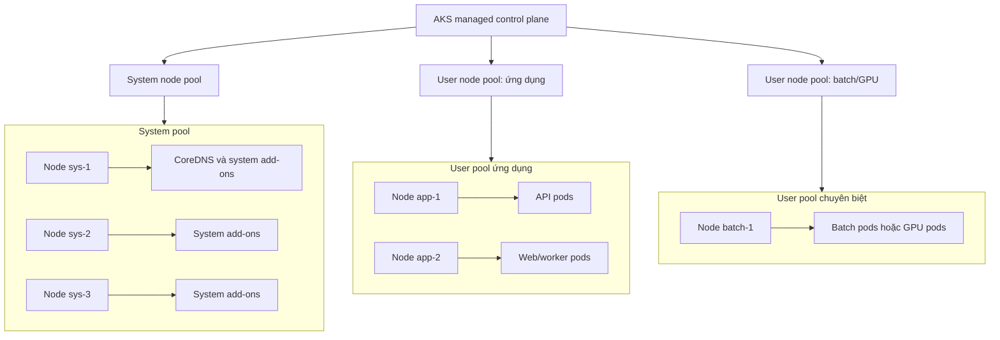
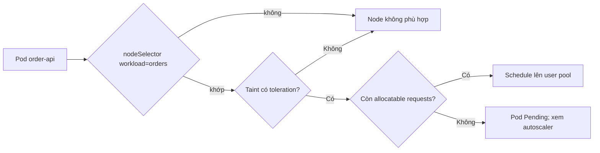
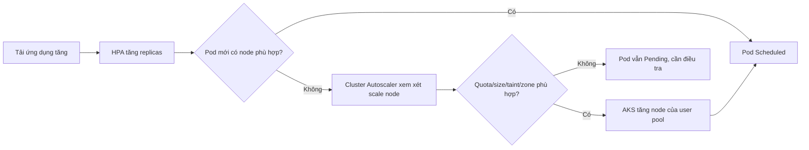

# System node pool, user node pool và lựa chọn kích cỡ node

**Azure Kubernetes Service (AKS)** là dịch vụ Kubernetes được Microsoft Azure quản lý ở lớp điều khiển (*control plane*), còn ứng dụng và nhiều thành phần hệ thống chạy trên các **worker node** thuộc những **node pool**. Khi xây dựng một cluster thật, một trong những quyết định quan trọng nhất là: **dành bao nhiêu node cho hệ thống, bao nhiêu node cho workload, chọn loại máy ảo nào và khi nào cần mở rộng hoặc thu hẹp?**

Một cluster có thể tạo thành công nhưng vẫn hoạt động kém: CoreDNS thiếu tài nguyên, ứng dụng tranh CPU với thành phần hệ thống, pod không được xếp lịch vì thiếu bộ nhớ, node pool không chịu nổi sự cố một node, hoặc hóa đơn tăng mạnh vì kích cỡ VM không phù hợp. Bài học này hướng dẫn phân biệt **system node pool** và **user node pool**, lập kế hoạch tài nguyên node theo **CPU, RAM, pod density, lưu trữ, mạng, khả năng sẵn sàng và chi phí**, rồi áp dụng bằng công cụ Azure và Kubernetes.

Nội dung thuộc chương **Nền tảng Azure Kubernetes Service** trong module Microsoft Azure. Kiến thức liên hệ tới subscription, resource group, Microsoft Entra ID, VNet/subnet, dịch vụ tính toán, lưu trữ, bảo mật, giám sát và quản trị chi phí một hệ thống ứng dụng. Các lệnh có tác động đến tài nguyên chỉ là ví dụ cho môi trường lab được cấp quyền; không có thay đổi Azure thực tế nào được thực hiện trong bài học.

## Mục tiêu học tập

Sau bài học, bạn có thể:

1. Giải thích quan hệ giữa AKS cluster, control plane, node pool, node, pod và container.
2. Phân biệt **system node pool** với **user node pool** và biết vì sao tách hai nhóm.
3. Hiểu vai trò của node labels, taints/tolerations, nodeSelector, affinity và topology spread.
4. Ước tính số lượng/kích cỡ node từ **resource requests, allocatable resources và mức dự phòng khi lỗi**.
5. So sánh các họ VM phổ biến theo CPU, RAM, I/O, GPU và chi phí.
6. Lựa chọn node pool cho ứng dụng Java, worker batch, workload dùng nhiều RAM hoặc GPU.
7. Phân biệt Cluster Autoscaler, Horizontal Pod Autoscaler (HPA) và Vertical Pod Autoscaler (VPA).
8. Dùng Azure CLI và `kubectl` kiểm tra, thêm, mở rộng và theo dõi node pool.
9. Lập kế hoạch availability zones, upgrade, drain, disruption budget, bảo mật và networking.
10. Chẩn đoán các trường hợp `Pending`, `NotReady`, autoscaler không scale và node thiếu tài nguyên.

## 1. Bức tranh tổng thể của AKS

Một cluster AKS có thể nhìn qua hai lớp:

- **Control plane do Azure quản lý:** API server, scheduler, controller manager, cơ chế lưu trạng thái Kubernetes và những thành phần quản lý tương ứng. Người dùng không cần tự vận hành các VM control plane như một cluster Kubernetes tự dựng.
- **Worker nodes trong node pools:** VM chạy kubelet, container runtime và các pod hệ thống/ứng dụng. Node pool của AKS thường được triển khai trên hạ tầng **Virtual Machine Scale Sets (VMSS)** do AKS quản lý.



**System node pool không phải là control plane.** Nó chạy trên những worker VM thuộc cluster và có nhiệm vụ cung cấp tài nguyên cho các pod quan trọng của hạ tầng Kubernetes. Không nên nhầm việc tăng số node system pool với tăng số control plane instance.

### Các thuật ngữ chính

| Thuật ngữ | Ý nghĩa |
|---|---|
| **AKS cluster** | Đơn vị quản lý Kubernetes và các node pool |
| **Node pool** | Nhóm node có cấu hình chung: VM size, OS, mode, nhãn, taint, scale… |
| **Node** | Worker VM nhận pod do scheduler sắp xếp |
| **Pod** | Đơn vị chạy một hoặc nhiều container cùng network/storage context |
| **System add-on** | Thành phần phục vụ hoạt động cluster như DNS hoặc dịch vụ hệ thống |
| **Workload** | Ứng dụng nghiệp vụ: API, web, batch, data processor… |
| **Node allocatable** | CPU, RAM và tài nguyên có thể cấp cho pod sau phần dự trữ |
| **Node pool mode** | `System` hoặc `User` do AKS quản lý |

## 2. System node pool là gì?

**System node pool** là node pool có **mode = System**, được dùng làm nơi ưu tiên chạy các pod quan trọng để cluster hoạt động bình thường. Ví dụ thường gặp:

- CoreDNS phục vụ phân giải tên dịch vụ trong Kubernetes.
- Những pod thuộc `kube-system` hoặc add-on nền tảng tùy cấu hình.
- Các pod hạ tầng mà cluster cần duy trì ổn định để có thể triển khai và vận hành ứng dụng.

### Vì sao cần bảo vệ tài nguyên hệ thống?

Giả sử một ứng dụng Java có memory leak và sử dụng gần hết RAM trên các node đang chạy CoreDNS. Khi node bị áp lực bộ nhớ, các pod hệ thống có thể bị ảnh hưởng, dẫn đến lỗi DNS hoặc tác động lan rộng tới nhiều ứng dụng trong cluster.

Phân riêng system pool giúp giảm rủi ro cạnh tranh tài nguyên, dễ quan sát và lập kế hoạch nâng cấp node. Trong môi trường production, thường cần **nhiều node system** để tránh một sự cố VM làm mất toàn bộ năng lực hệ thống; số lượng cụ thể phải theo giới hạn AKS, topology và yêu cầu sẵn sàng.

### Các đặc tính quan trọng

- System pool phải đáp ứng những **ràng buộc do AKS đặt ra** về OS, loại VM, số lượng node và các tính năng liên quan. Với các cấu hình AKS phổ biến, system pool dùng **Linux**; hãy kiểm tra yêu cầu hiện hành của cluster/SKU.
- Cluster phải duy trì ít nhất một **system node pool hợp lệ**. Không được chuyển hoặc xóa system pool cuối cùng khi chưa chuẩn bị pool system thay thế theo quy trình hỗ trợ.
- Tên gọi `System` giúp AKS quản lý/policy các workload hệ thống nhưng **không tự đồng nghĩa tất cả pod ứng dụng đều bị cấm chạy ở pool này**.
- Việc xếp lịch thực tế còn phụ thuộc **taints, tolerations, selectors, affinity và yêu cầu tài nguyên**.
- Những DaemonSet quản lý mạng, giám sát hoặc bảo mật có thể chạy trên nhiều loại node, kể cả node user, nếu cấu hình cho phép.

### System pool có nên chạy ứng dụng nghiệp vụ?

Với cluster lab nhỏ, ứng dụng đôi khi chạy chung trên node hệ thống để tiết kiệm. Nhưng với production, nên có **user node pool riêng** để:

- Giảm tranh tài nguyên giữa app và system add-ons.
- Nâng cấp, scale hoặc thay VM size cho workload mà ít ảnh hưởng phần hệ thống.
- Áp chính sách taint/label khác nhau cho app, batch và GPU.
- Đo chi phí theo nhóm workload rõ hơn.

Tách system và user pool là **lựa chọn thiết kế để quản lý rủi ro**, không phải lời bảo đảm rằng mọi pod sẽ tự đến đúng pool nếu chưa có scheduling policy.

## 3. User node pool là gì?

**User node pool** có **mode = User**, là nơi được thiết kế để chạy workload ứng dụng. Một cluster có thể có nhiều user pool, ví dụ:

- `webapps`: ứng dụng web hoặc API phục vụ request.
- `batch`: worker xử lý dữ liệu theo lô, có thể thay đổi số lượng node theo giờ.
- `memory`: workload cần RAM lớn, cache hoặc Java heap lớn.
- `gpu`: machine learning/inference dùng GPU với driver và image phù hợp.
- `spotjobs`: công việc chịu được gián đoạn, có checkpoint.
- `windows`: workload Windows container khi phiên bản AKS và node pool đáp ứng điều kiện.

### So sánh System và User

| Tiêu chí | System node pool | User node pool |
|---|---|---|
| **Mode** | `System` | `User` |
| **Mục tiêu** | Duy trì các pod hạ tầng quan trọng | Chạy workload nghiệp vụ |
| **Điều kiện tồn tại** | Cluster cần system pool hợp lệ | Có thể thêm nhiều pool theo nhu cầu |
| **Tính linh hoạt VM size/OS** | Bị giới hạn theo yêu cầu hệ thống AKS | Linh hoạt hơn tùy OS, SKU, region và tính năng |
| **Scale** | Ưu tiên ổn định, dự phòng cho system add-ons | Điều chỉnh theo workload, cluster autoscaler, batch |
| **Spot node** | Không nên sử dụng cho thành phần hệ thống quan trọng; phải tuân thủ giới hạn sản phẩm | Phù hợp với workload có thể bị ngắt nếu dùng Spot |
| **Kiểm soát scheduling** | Labels/taints giúp hạn chế app đi vào pool system | Labels/taints/affinity hướng pod tới pool tương ứng |
| **Quản lý chi phí** | Chi phí nền tảng bắt buộc cần tính | Có thể right-size, autoscale, chia theo nhóm ứng dụng |

Không phải cứ chọn mode User thì mọi pod Kubernetes sẽ lập tức tránh system pool. Taint/selector và phân bố hiện trạng mới là những tín hiệu quyết định lịch chạy pod.

## 4. Scheduler chọn node theo nguyên tắc nào?

Kubernetes Scheduler không chỉ nhìn vào CPU đang sử dụng thực tế. Nó đánh giá nhiều ràng buộc:

1. Pod có `nodeSelector` hoặc `nodeAffinity` không?
2. Node có **taint** mà pod không có **toleration** không?
3. Node còn đủ **allocatable CPU/memory** so với tổng **requests** đã đặt không?
4. Có giới hạn số pod, port, volume, topology hoặc ràng buộc khác không?
5. Có node đáp ứng yêu cầu OS/architecture, GPU, zone và storage topology không?
6. Khi nhiều node đều hợp lệ, scheduler áp dụng các tiêu chí tối ưu/phân bố theo cấu hình.

### Node labels

Label là cặp key/value gắn với node, ví dụ:

```text
workload=orders
environment=production
kubernetes.azure.com/mode=system
```

Một pod có thể dùng `nodeSelector` hoặc affinity để **chỉ chạy trên node mang label tương ứng**. Label không phải ranh giới bảo mật độc lập: người có quyền quản trị node hoặc cluster có thể thay đổi cấu hình.

### Taints và tolerations

**Taint** trên node mang thông điệp: “pod không có toleration phù hợp thì không được xếp vào đây” khi dùng effect như `NoSchedule`.

Ví dụ taint:

```text
workload=orders:NoSchedule
```

Một pod muốn chạy trên node bị taint đó cần toleration phù hợp. Nhưng **có toleration không đảm bảo pod được xếp đúng pool**: nếu muốn ép pod chỉ vào pool `orders`, cần thêm `nodeSelector` hoặc node affinity.

### Label và taint phối hợp

| Cấu hình | Tác dụng |
|---|---|
| Label `workload=orders` trên user pool | Đánh dấu node thuộc nhóm ứng dụng |
| Taint `workload=orders:NoSchedule` trên user pool | Ngăn pod không có toleration phù hợp vào pool |
| Pod `nodeSelector: workload=orders` | Bắt pod chọn node có label |
| Pod toleration cho `workload=orders` | Cho phép pod vượt taint |
| Requests/limits của pod | Giúp scheduler đánh giá tài nguyên; hạn chế mức dùng theo cơ chế container |

Trong production, nên dùng label/taint được quản lý bằng cấu hình node pool/IaC. Những thay đổi trực tiếp trên node có thể không tồn tại sau khi node được thay thế/upgrade; phải đối chiếu với trạng thái AKS quản lý.

## 5. Tách workload khỏi system pool bằng scheduling

Một kiến trúc thường áp dụng:

- Pool `sysnode` (mode System): node dành cho system add-ons, áp taint phù hợp nếu được khuyến nghị/hỗ trợ.
- Pool `orders` (mode User): có label `workload=orders` và taint `workload=orders:NoSchedule`.
- Pod của ứng dụng đặt nodeSelector + toleration tương ứng.



Không gắn một taint tùy tiện lên system pool production mà chưa đọc danh sách pod hệ thống và toleration hiện có. Một số DaemonSet hoặc add-on cần chạy trên mọi node; nếu taint mới chặn chúng, bạn có thể gây lỗi mạng/giám sát.

**Lưu ý:** AKS có thể dùng label đặc trưng để biểu thị mode pool; hãy kiểm tra bằng `kubectl get nodes --show-labels` hoặc Azure CLI. Đừng sửa label hệ thống thành nhãn workload thủ công để né ràng buộc của nền tảng.

## 6. CPU, RAM và allocatable: không lấy kích cỡ VM làm tài nguyên pod

Khi Azure công bố một VM có 4 vCPU và 16 GiB RAM, Kubernetes **không cung cấp toàn bộ 4 vCPU và 16 GiB cho pod ứng dụng**.

Một phần tài nguyên được dùng cho:

- Hệ điều hành, kubelet và container runtime.
- System services và DaemonSet như agent mạng/giám sát.
- Phần dự trữ kube/system và eviction thresholds.
- Tiến trình của node ngoài pod.
- Mức dự phòng để tránh memory pressure hoặc CPU throttling kéo dài.

### Capacity và Allocatable

- **Capacity:** lượng tài nguyên node báo đang có.
- **Allocatable:** lượng CPU/memory/ephemeral-storage có thể phân cho pod sau khi dự trữ theo cách Kubernetes/AKS quản lý.
- **Requests:** lượng tài nguyên pod yêu cầu để scheduler quyết định vị trí.
- **Limits:** ngưỡng tiêu thụ container có thể bị áp dụng lúc chạy; CPU có thể bị throttle, vượt giới hạn memory có thể dẫn tới OOM kill.

```text
VM capacity
  - OS / kubelet / hệ thống được dự trữ
  = Node allocatable (dành cho pods)
  - DaemonSet requests và pods đang được xếp lịch
  = Headroom còn lại cho pods mới
```

**Không ước tính bằng công thức “VM 16 GiB ⇒ chạy được 16 pod 1 GiB”**. Pod có thể cần memory request hơn 1 GiB, DaemonSet chiếm tài nguyên, JVM heap khác RSS, và node còn có giới hạn số pod/network.

### Xem tài nguyên thực tế

```bash
kubectl describe node "<NODE_NAME>"
```

Quan sát các mục `Capacity`, `Allocatable` và `Allocated resources`. Để xem node theo dạng JSON:

```bash
kubectl get node "<NODE_NAME>" \
  -o jsonpath='{.status.capacity.cpu}{"\n"}{.status.allocatable.cpu}{"\n"}{.status.allocatable.memory}{"\n"}'
```

Số liệu từ cluster thật chính xác hơn dùng số dự trữ giả định. Điều kiện OS image, AKS version, maxPods và add-on có thể làm allocatable thay đổi.

## 7. Cách tính kích cỡ node từ pod requests

Giả sử một ứng dụng Java có:

- **12 replica** của API.
- Mỗi replica có request **500m CPU** (0,5 vCPU) và **1 GiB RAM**.
- Mỗi replica có limit **1000m CPU** và **2 GiB RAM**.
- Một user node pool dự kiến dùng VM cỡ danh nghĩa **4 vCPU, 16 GiB RAM**.
- Để minh họa, giả sử sau các khoản dự trữ và DaemonSet, **CPU còn khả dụng cho app mỗi node là khoảng 3,4 vCPU**, RAM khoảng **13 GiB**. Đây là số giả định, không phải cam kết của bất kỳ SKU nào.

### Tính tổng requests

```text
Tổng CPU requests = 12 × 0,5 = 6 vCPU
Tổng RAM requests = 12 × 1 GiB = 12 GiB
```

Nếu chia đều:

- Giới hạn theo CPU: `floor(3,4 / 0,5) = 6` pod/node.
- Giới hạn theo RAM: `floor(13 / 1) = 13` pod/node.
- CPU là giới hạn chính, nên một node có thể xếp tối đa khoảng **6 pod** trong giả định, chưa xét topology/pod density và chi tiết phát sinh.

Nếu chỉ có **2 node**, lý thuyết có thể xếp đủ 12 pod; nhưng khi mất một node, node còn lại không thể chứa tất cả replica theo requests. Nếu cần **chịu được mất một node**, phải có ít nhất **3 node trong giả định này**, vì sau khi một node hỏng còn 2 node × 6 pod = 12 pod.

### Công thức sizing ban đầu

```text
CPU nodes = ceil(Tổng CPU requests / CPU allocatable mục tiêu mỗi node)
RAM nodes = ceil(Tổng RAM requests / RAM allocatable mục tiêu mỗi node)
Node count cơ sở = max(CPU nodes, RAM nodes, ràng buộc topology, pod density)
Node count HA = số node cần thêm để thỏa N-1 hoặc mục tiêu chịu lỗi
```

Cần **để headroom thực tế** cho spike, rollout, DaemonSet tăng trưởng, eviction và upgrade. Bài toán thật còn liên quan giới hạn `maxPods`, zone, pod topology, PDB, quota, disk và network.

### Requests không phải usage

Nếu ứng dụng request 500m nhưng thường xuyên sử dụng gần 1 vCPU, scheduler vẫn tính 500m khi xếp lịch; CPU limit có thể dẫn tới throttling khi vượt ngưỡng. Nếu memory request quá thấp so với sử dụng thật, node dễ gặp memory pressure/OOM dù scheduler thấy vẫn còn chỗ.

Với Java, cần đo:

- JVM heap và non-heap.
- Metaspace, thread stacks, direct buffers và native memory.
- Memory peak khi chạy GC, load lớn hoặc batch.
- CPU throttling, GC pause, request latency.
- Lượng pod sidecar nếu có service mesh, logging hoặc agent.

Chọn requests/limits từ **load test, đo telemetry và SLO**, không sao chép một giá trị cho mọi service.

## 8. Lựa chọn họ VM theo đặc điểm workload

Azure có nhiều họ VM. Tên SKU và khả năng hỗ trợ tùy region, quota, kiến trúc CPU và phiên bản AKS. Bảng sau mô tả định hướng chứ không phải bảng giá hoặc danh sách SKU hiện hành.

| Nhóm VM | Đặc điểm tương đối | Workload phù hợp | Điểm cần lưu ý |
|---|---|---|---|
| **D-series** (general purpose) | Cân bằng CPU và RAM | API, web, worker thông thường, system pool khi đáp ứng điều kiện | Điểm xuất phát hay gặp để right-size |
| **E-series** (memory optimized) | RAM lớn hơn so với CPU | Java service cần heap lớn, cache, dữ liệu trong RAM | Đừng chọn chỉ vì heap không được tối ưu |
| **F-series** (compute optimized) | CPU cao tương đối so với RAM | Compute-intensive stateless workload | Có thể thiếu RAM nếu Java cần heap lớn |
| **B-series** (burstable) | CPU credit/baseline, chi phí phù hợp một số workload nhẹ | Lab hoặc tải nhỏ có tính burst được phép | Không nên mặc định phù hợp thành phần hệ thống quan trọng hoặc tải CPU liên tục |
| **N-series** (GPU) | GPU hoặc tăng tốc đặc biệt | AI/ML, rendering, GPU compute | Cần GPU drivers, operator, quota và node pool riêng |
| **Storage/IO optimized** | Đĩa, IOPS hoặc băng thông cao theo SKU | Xử lý tệp lớn, workload dùng disk chuyên sâu | Phân biệt managed disk/ephemeral disk và băng thông mạng |

### Các tiêu chí phải kiểm tra ngoài vCPU và RAM

1. **CPU architecture:** amd64 hay arm64; image container và mọi native dependency phải tương thích.
2. **Ephemeral OS disk:** có được SKU/OS/AKS hỗ trợ và có đủ cache/temp storage hay không.
3. **Local ephemeral storage:** đủ cho image layers, logs, tệp tạm, unpack và runtime không.
4. **Disk IOPS/throughput:** cần lưu ý workload có volume, local file hoặc PersistentVolume.
5. **Network bandwidth:** ứng dụng gọi API/Storage nhiều có thể bị giới hạn bởi NIC và hạ tầng.
6. **Accelerated networking:** khả năng hỗ trợ theo VM size/OS và yêu cầu tính năng.
7. **Max pods per node:** ảnh hưởng IP allocation, network plugin và mật độ workload.
8. **Availability zones và quota:** SKU có đủ capacity ở zone/region được chọn không.
9. **Giá compute thực tế:** theo region, loại VM, hệ điều hành, reservation/savings options và lịch chạy.
10. **Yêu cầu hệ thống AKS:** không phải mọi VM SKU được phép dùng cho mọi mode/OS hoặc tính năng.

Không nên thiết kế một pool quá nhiều VM nhỏ chỉ vì giá mỗi VM thấp, vì **mỗi node đều có OS/kubelet/DaemonSet overhead**. Ngược lại, VM quá lớn làm tăng “blast radius” khi một node hỏng và có thể tạo lãng phí nếu workload quá ít.

## 9. MaxPods, CNI và kế hoạch IP

Một giới hạn thường bị bỏ qua là **số pod tối đa trên mỗi node** (`maxPods`). Dù CPU/RAM còn đủ, scheduler vẫn không thể thêm pod nếu node đã đạt giới hạn hoặc mạng không đủ địa chỉ theo cấu hình.

### Network plugin có ảnh hưởng ra sao?

AKS có nhiều lựa chọn networking, ví dụ:

- **Azure CNI** với các mô hình cấp địa chỉ pod khác nhau.
- **Azure CNI Overlay** theo kiến trúc overlay pod CIDR.
- Các cấu hình khác phù hợp phiên bản AKS và chính sách tổ chức.

Tùy mô hình, pod có thể tiêu thụ địa chỉ IP từ subnet VNet hoặc dùng không gian pod riêng. Vì vậy **số node và maxPods ảnh hưởng capacity của subnet và pod CIDR theo các cách khác nhau**.

Không lấy một công thức IP từ cluster dùng một CNI đem áp cho cluster dùng CNI khác. Trước khi tạo node pool, phải xác định:

- Node subnet, pod network model và dải IP không trùng VPN/peered VNet.
- Số node tối đa khi autoscaler tăng.
- `maxPods` thực tế theo pool/kiểu mạng và giới hạn hiện hành.
- Khả năng cấp địa chỉ cho pod khi scale nhanh.
- Quy tắc NSG, UDR, DNS và outbound connectivity dành cho node.

**Node pool cùng cluster có thể có cấu hình riêng**, nhưng những lựa chọn nền tảng về network plugin thường ràng buộc cấp cluster. Kiểm tra tính năng và giới hạn cụ thể trước khi quyết định.

## 10. Availability zones và thiết kế chịu lỗi

Nếu ứng dụng có SLO cao, cần tránh đặt mọi replica trên cùng một VM hoặc một vùng lỗi.

### Nhiều node chưa chắc đã chịu được lỗi zone

Một pool ba node có thể vẫn nằm trong cùng một availability zone nếu node pool được cấu hình như vậy hoặc region không hỗ trợ zone. Với region có zone support, cần xác định node pool trải trên zone nào và VM SKU có capacity phù hợp.

### Pod spread

Có thể dùng:

- **Pod anti-affinity:** tránh đặt nhiều pod cùng vai trò lên cùng node.
- **Topology spread constraints:** trải pod giữa các node/zone theo label và topology key.
- **PodDisruptionBudget (PDB):** giới hạn số pod bị gián đoạn bởi các voluntary disruptions, ví dụ drain khi bảo trì.
- **Deployment replicas:** có đủ số replica để tiếp tục phục vụ khi một node không khỏe.
- **Readiness probes:** chỉ nhận traffic khi pod thật sự sẵn sàng.

### Ví dụ ràng buộc trải pod

```yaml
topologySpreadConstraints:
  - maxSkew: 1
    topologyKey: kubernetes.io/hostname
    whenUnsatisfiable: ScheduleAnyway
    labelSelector:
      matchLabels:
        app: orders-api
```

Ràng buộc này giúp scheduler **ưu tiên** trải pod giữa các node. `ScheduleAnyway` không đảm bảo phân bố tuyệt đối; nếu cần bắt buộc thì dùng `DoNotSchedule` nhưng sẽ tăng rủi ro pod Pending khi thiếu node hoặc thiếu zone.

Với topology theo zone, có thể dùng key `topology.kubernetes.io/zone` khi nodes có label đúng. Cần kiểm tra số zone/node còn khả dụng; một Deployment 3 replica không tự đảm bảo mỗi replica nằm ở một zone khác nhau nếu topology không đủ.

## 11. Cluster Autoscaler, HPA và VPA khác nhau thế nào?

### Cluster Autoscaler (CA)

**Cluster Autoscaler** điều chỉnh số node trong node pool nằm trong phạm vi min/max được cấu hình, chủ yếu dựa trên nhu cầu scheduling của pod. Nếu một pod Pending do không đủ tài nguyên và việc thêm node có thể giải quyết, CA có thể scale out. Khi node ít sử dụng và có thể di chuyển pod an toàn, CA có thể scale in theo thuật toán/điều kiện áp dụng.

Điều này **không đồng nghĩa CA tự tăng size vCPU/RAM của từng VM**. Nếu chọn VM size không phù hợp, cần thiết kế thêm pool hoặc chuyển workload sang node size khác.

### Horizontal Pod Autoscaler (HPA)

**HPA** tăng/giảm số replica pod theo CPU, memory hoặc custom/external metrics được hỗ trợ. Ví dụ, khi API tải cao HPA tăng từ 4 lên 10 pod.

Nếu user pool chỉ có đủ chỗ cho 6 pod, 4 pod còn lại có thể Pending; CA có thể bổ sung node nếu cấu hình và quota/điều kiện đáp ứng.

### Vertical Pod Autoscaler (VPA)

**VPA** hỗ trợ đề xuất hoặc điều chỉnh resource requests/limits cho workload theo khả năng và chế độ triển khai. Tác động có thể liên quan tới việc tái tạo pod và cần kiểm tra tương tác với HPA, đặc biệt nếu chúng cùng điều chỉnh CPU/memory theo cơ chế xung đột.

### Ví dụ luồng autoscale



**Scale không tức thời**: tạo VM, join cluster, tải image, start container và đạt readiness đều cần thời gian. Với ứng dụng có đỉnh traffic nhanh, nên giữ headroom hoặc cân nhắc tính năng dự trữ tài nguyên theo kiến trúc và ngân sách.

## 12. Quản lý node pool bằng Azure CLI

Phần thực hành dùng **Bash** trong Azure Cloud Shell hoặc terminal đã có Azure CLI, với một subscription lab được phê duyệt.

### Bước 1: xác nhận subscription và cluster

```bash
az account show --output table
az account set --subscription "<SUBSCRIPTION_ID>"

RG="<RESOURCE_GROUP>"
AKS="<AKS_CLUSTER_NAME>"
```

Trước khi chỉnh cấu hình, xác nhận đúng cluster, region và quyền quản trị:

```bash
az aks show \
  --resource-group "$RG" \
  --name "$AKS" \
  --query "{name:name,location:location,kubernetesVersion:kubernetesVersion,nodeResourceGroup:nodeResourceGroup}" \
  --output json
```

### Bước 2: liệt kê các node pool

```bash
az aks nodepool list \
  --resource-group "$RG" \
  --cluster-name "$AKS" \
  --output table
```

Kiểm tra chi tiết một pool:

```bash
az aks nodepool show \
  --resource-group "$RG" \
  --cluster-name "$AKS" \
  --name "<NODE_POOL_NAME>" \
  --query "{name:name,mode:mode,vmSize:vmSize,count:count,osType:osType,maxPods:maxPods,autoScale:enableAutoScaling,min:minCount,max:maxCount,labels:nodeLabels,taints:nodeTaints}" \
  --output json
```

Điểm cần đọc: mode System/User, VM size, số node hiện có, min/max, labels/taints, OS và maxPods. Đừng suy luận chỉ từ tên pool rằng nó là system hay user; thuộc tính `mode` mới là thông tin có ý nghĩa quản trị AKS.

### Bước 3: xem node và pod thực tế

Lấy Kubernetes credentials bằng danh tính được phép:

```bash
az aks get-credentials \
  --resource-group "$RG" \
  --name "$AKS"
```

Sau đó kiểm tra **current context** để không chạy `kubectl` nhầm cluster:

```bash
kubectl config current-context

kubectl get nodes -o wide

kubectl get nodes \
  -L kubernetes.azure.com/mode,agentpool,workload

kubectl get pods -A -o wide
```

Liệt kê pods ở namespace `kube-system` và xem chúng đang nằm ở node nào. Đừng mặc định mọi pod trong namespace đó đều phải chạy trên system pool hoặc không có pod hệ thống trên user pool.

### Bước 4: kiểm tra allocatable và tình trạng tài nguyên

```bash
kubectl describe nodes

kubectl top nodes
kubectl top pods -A
```

`kubectl top` chỉ có dữ liệu khi **metrics-server/metrics pipeline** tương ứng đã hoạt động và được cấp quyền. Không có metrics không có nghĩa node không dùng CPU; hãy kiểm tra metrics pipeline hoặc Azure Monitor.

## 13. Tạo ví dụ AKS có System và User pool

Để hiểu trình tự, có thể tạo cluster lab với một system pool rồi thêm user pool. Đây là **lệnh làm phát sinh chi phí**; chỉ chạy khi được phê duyệt và có đủ quota.

### Bước 1: tạo resource group lab

```bash
RG="rg-aks-pools-lab"
LOCATION="southeastasia"
AKS="aks-pools-lab"

az group create \
  --name "$RG" \
  --location "$LOCATION"
```

### Bước 2: tạo cluster với node pool ban đầu

```bash
az aks create \
  --resource-group "$RG" \
  --name "$AKS" \
  --location "$LOCATION" \
  --nodepool-name system \
  --node-count 3 \
  --node-vm-size Standard_D4s_v5 \
  --enable-managed-identity \
  --generate-ssh-keys
```

Các giá trị `Standard_D4s_v5` và 3 node là **ví dụ sizing**, không bảo đảm khả dụng ở mọi subscription/region hoặc thỏa mọi yêu cầu của tổ chức. Nên kiểm tra chính sách AKS, quota, default network mode, bản Kubernetes, danh sách VM SKU và giá trước khi tạo.

**Lưu ý networking:** câu lệnh dùng lựa chọn mạng mặc định của CLI tại thời điểm chạy. Trong production cần cấu hình rõ Azure CNI/CNI Overlay, node subnet, pod CIDR, network policy, private cluster/public API access và outbound theo thiết kế. Không sao chép lệnh tối giản này vào production như một bản kiến trúc mạng hoàn chỉnh.

### Bước 3: thêm user pool cho workload

```bash
az aks nodepool add \
  --resource-group "$RG" \
  --cluster-name "$AKS" \
  --name orders \
  --mode User \
  --node-vm-size Standard_D4s_v5 \
  --node-count 2 \
  --labels workload=orders \
  --node-taints workload=orders:NoSchedule
```

Hai node `orders` trong lab chưa được cấu hình autoscaler. Taint `workload=orders:NoSchedule` giúp ngăn những pod không được thiết kế cho pool này. Một pod muốn chạy trên `orders` cần **toleration**, và nếu muốn bắt buộc chạy ở đó còn cần **nodeSelector**.

Nếu lệnh gặp lỗi về quota, SKU, subnet IP hoặc chính sách tổ chức, không tự chuyển sang một VM size lớn hơn mà chưa kiểm tra chi phí và yêu cầu kỹ thuật.

### Bước 4: bật Cluster Autoscaler cho user pool

Sau khi kiểm tra workload có thể chạy, ví dụ:

```bash
az aks nodepool update \
  --resource-group "$RG" \
  --cluster-name "$AKS" \
  --name orders \
  --enable-cluster-autoscaler \
  --min-count 2 \
  --max-count 6
```

Mức min/max chỉ minh họa. Khi autoscaler được bật, tránh chỉnh số instance trực tiếp trên VMSS do AKS quản lý hoặc chạy các thao tác scale xung đột với autoscaler. Sử dụng lệnh AKS node pool/cluster autoscaler phù hợp.

**Vì sao min = 2?** Đây là lựa chọn nhằm giữ ít nhất hai node user trong lab minh họa. Với workload production chịu lỗi node, số node tối thiểu còn phụ thuộc CPU/RAM requests, số replica, PDB, zone và kế hoạch N-1.

### Bước 5: xác minh node pool

```bash
az aks nodepool list \
  --resource-group "$RG" \
  --cluster-name "$AKS" \
  --output table

az aks get-credentials \
  --resource-group "$RG" \
  --name "$AKS"

kubectl get nodes -L kubernetes.azure.com/mode,agentpool,workload
```

Kỳ vọng có node thuộc system pool và user pool, với label/taint cần thiết ở user nodes. Kiểm tra thêm:

```bash
kubectl describe node "<USER_NODE_NAME>"
```

Xem `Taints` và `Labels` thay vì chỉ tin kết quả lệnh tạo pool trả thành công.

## 14. Triển khai ứng dụng vào user pool bằng YAML

Giả sử một ứng dụng API Java được đóng gói thành container image từ registry của tổ chức. Manifest sau có **2 replica**, resource requests/limits và scheduling chỉ tới pool `orders`.

```yaml
apiVersion: apps/v1
kind: Deployment
metadata:
  name: orders-api
  namespace: default
spec:
  replicas: 2
  selector:
    matchLabels:
      app: orders-api
  template:
    metadata:
      labels:
        app: orders-api
    spec:
      nodeSelector:
        workload: orders
      tolerations:
        - key: workload
          operator: Equal
          value: orders
          effect: NoSchedule
      topologySpreadConstraints:
        - maxSkew: 1
          topologyKey: kubernetes.io/hostname
          whenUnsatisfiable: ScheduleAnyway
          labelSelector:
            matchLabels:
              app: orders-api
      containers:
        - name: orders-api
          image: <REGISTRY_NAME>.azurecr.io/orders-api:1.0.0
          ports:
            - containerPort: 8080
          resources:
            requests:
              cpu: "250m"
              memory: "512Mi"
            limits:
              cpu: "1000m"
              memory: "1Gi"
          readinessProbe:
            httpGet:
              path: /health/ready
              port: 8080
            initialDelaySeconds: 10
            periodSeconds: 10
          livenessProbe:
            httpGet:
              path: /health/live
              port: 8080
            initialDelaySeconds: 30
            periodSeconds: 20
```

Trước khi lưu và áp dụng:

- Thay `<REGISTRY_NAME>` bằng registry thật, đảm bảo image tồn tại và AKS kubelet identity có quyền kéo image phù hợp.
- Endpoint `/health/ready` và `/health/live` phải được ứng dụng triển khai thật.
- `namespace: default` chỉ để lab; production nên phân namespace theo quyền và workload.
- Phải có quyền Kubernetes RBAC để tạo Deployment.
- Nếu node có những taint khác, manifest có thể cần toleration bổ sung hoặc thay thiết kế pool.

### Thử áp dụng manifest

Giả sử đã lưu manifest trong `orders-api.yaml` ở một môi trường lab:

```bash
kubectl config current-context

kubectl apply \
  --dry-run=client \
  -f orders-api.yaml

kubectl apply -f orders-api.yaml

kubectl get deployment orders-api
kubectl get pods -l app=orders-api -o wide
```

Chạy `--dry-run=client` chỉ giúp kiểm tra phần manifest mà client có thể xác minh; **không thay thế** admission policies và scheduler thực tế. Nếu pod còn Pending, dùng `kubectl describe pod` xem sự kiện chi tiết.

### Verify rằng pod vào đúng pool

```bash
kubectl get pods -l app=orders-api -o wide

kubectl describe pod "<ORDERS_POD_NAME>"

kubectl get nodes -L workload,agentpool
```

Đối chiếu tên node mà pod được gán với label của user pool. Cần kiểm tra actual placement sau rollout, không chỉ nhìn manifest.

## 15. Có nên đặt taint lên system pool?

Một mục tiêu thường gặp là ngăn pod ứng dụng tranh CPU/RAM với system add-ons. AKS và Kubernetes cung cấp taint như:

```text
CriticalAddonsOnly=true:NoSchedule
```

Đây là ví dụ taint dùng để ưu tiên node cho critical add-ons trong những cấu hình phù hợp. **Không tự suy luận mọi system pool đều có taint này mặc định** và không thêm vào pool thật mà chưa kiểm tra toleration của add-on đang chạy.

### Quy trình an toàn

1. Liệt kê system nodes và pod thực tế.
2. Xem labels/taints của pool trong Azure CLI và Kubernetes.
3. Xác định chính sách workload nào cần được phép chạy ở system pool.
4. Xem khả năng xếp lịch của CoreDNS, metrics, networking và DaemonSets.
5. Thử chính sách taint ở cluster lab hoặc staging tương đương.
6. Áp dụng cấu hình qua cơ chế AKS hỗ trợ, không chỉnh VMSS thủ công.
7. Quan sát `Pending`, `NotReady`, DNS và metrics sau thay đổi.

**Taint không phải access control network hoặc quyền dữ liệu.** Dù pod được ngăn chạy trong pool nào đó, nó vẫn cần Kubernetes RBAC, network policy, identity và bảo vệ secrets ở các lớp khác.

## 16. Nâng cấp, thay VM size và dịch chuyển workload

Node pool là tập VM có đặc tính chung. Một số thuộc tính có thể cập nhật; những thay đổi lớn như **chuyển sang VM size khác** thường nên được thực hiện bằng cách tạo **node pool mới** rồi dịch chuyển workload theo quy trình hỗ trợ, thay vì sửa trực tiếp VMSS do AKS quản lý.

### Vì sao không sửa VMSS thủ công?

- AKS quản lý lifecycle của node pool và hạ tầng liên quan.
- Thay đổi ngoài AKS có thể gây drift, mất tính tương thích hoặc bị ghi đè trong upgrade.
- Scheduler và autoscaler cần nhìn thấy capacity/labels/taints chính xác.
- Cần quản trị quota, zone và network khi tạo node mới.

### Chiến lược đổi từ pool cũ sang pool mới

1. **Đánh giá:** xem requests/usage, nhu cầu VM size mới, region, zone và quota.
2. **Tạo user pool mới** có OS, CNI/network, labels/taints, maxPods thích hợp.
3. **Kiểm tra node Ready:** DNS, CNI, storage CSI, image pull, metrics và DaemonSet.
4. **Điều chỉnh workload placement** để scheduler có thể đưa replica mới vào pool mới.
5. **Tạo/cập nhật replicas** theo chiến lược rollout; chờ readiness đạt.
6. **Cordon/drain** node cũ có kiểm soát, tôn trọng PDB và workload stateful.
7. **Quan sát:** tỷ lệ lỗi, latency, memory, CPU và trạng thái ứng dụng.
8. **Hạ/cắt pool cũ** chỉ khi không còn workload phụ thuộc và có phương án rollback.

### Vì sao drain quan trọng?

`kubectl drain` chuẩn bị đưa node ra khỏi lịch chạy và evict các pod có thể di chuyển theo cơ chế Kubernetes. Không nên drain ồ ạt khi:

- Chỉ có một replica phục vụ production.
- PDB không cho phép evict đủ số pod.
- Stateful workload dùng local disk không có chiến lược dữ liệu.
- Pod có affinity/topology ràng buộc chặt.
- Cluster không đủ allocatable trên các node còn lại.

Với system pool, thay thế/upgrade cần đặc biệt thận trọng để CoreDNS và add-on khác còn đủ capacity.

## 17. Upgrade và bảo trì node pool an toàn

AKS cần duy trì bản Kubernetes, node OS image và cấu hình trong phạm vi hỗ trợ. Khi node được upgrade/reimage, pod có thể bị di chuyển hoặc khởi động lại.

Các yếu tố quan trọng:

- **Surge capacity:** khả năng tạo thêm node tạm trong upgrade theo cấu hình hỗ trợ.
- **Drain timeout / eviction:** thời gian chờ pod thoát và PDB cho phép.
- **PDB:** giới hạn voluntary disruptions nhưng không ngăn sự cố VM ngoài ý muốn.
- **Pod replicas:** nếu chỉ có một replica, một đợt drain có thể khiến dịch vụ ngừng phục vụ.
- **Availability zones:** cân nhắc phân bố để nâng cấp hoặc lỗi zone không đánh gục tất cả replica.
- **Quota/subnet IP:** surge có thể cần thêm VM/IP tạm; thiếu quota làm upgrade khó hoàn thành.
- **System pool:** giữ đủ capacity cho DNS, networking và add-on trong suốt upgrade.

Không đổi VM size, network plugin và Kubernetes version trong cùng một đợt thay đổi phức tạp nếu có thể tách giai đoạn; như vậy sẽ dễ xác định nguyên nhân khi gặp lỗi.

## 18. Workload dùng Spot, GPU, Windows và ARM

Một số workload có yêu cầu khác với ứng dụng web bình thường.

### Spot user pool

Spot VM có thể tiết kiệm chi phí cho công việc **chịu được gián đoạn**, ví dụ batch có checkpoint hoặc rendering có thể chạy lại. Nhưng Azure có thể thu hồi Spot capacity theo điều kiện dịch vụ, vì vậy:

- Không đặt thành phần hệ thống quan trọng vào Spot.
- Không dùng Spot làm capacity duy nhất cho workload có SLO availability nghiêm ngặt.
- Dùng taint/label để chỉ gửi workload phù hợp vào pool.
- Thiết kế retry, idempotency, checkpoint và output bền vững.
- Quan sát eviction và khả năng thiếu capacity khi scale out.

### GPU pool

Khi workload dùng GPU:

- Chọn VM GPU SKU được AKS/region hỗ trợ.
- Đảm bảo driver/operator/device plugin tương thích.
- Khai báo GPU resource requests/limits theo resource name được expose, ví dụ `nvidia.com/gpu` khi phù hợp.
- Dùng dedicated pool, taints và labels tránh xếp pod web thông thường vào GPU node đắt tiền.
- Tính thêm VRAM, GPU sharing/MIG nếu sản phẩm hỗ trợ và yêu cầu.
- Theo dõi GPU utilization để tránh trả chi phí cho node không có công việc.

### Windows user pool

Nếu ứng dụng cần Windows containers, chọn Windows user pool được AKS hỗ trợ và xác minh tính tương thích của image, container runtime, host OS version, networking, storage và gMSA nếu cần. Một số DaemonSet/add-on được thiết kế cho Linux không thể chạy nguyên vẹn trên Windows.

### ARM64

Một số dòng VM dùng Arm64 có thể tối ưu chi phí/hiệu năng cho workload phù hợp. Trước khi đưa vào cluster, kiểm tra architecture của container image, Java runtime và dependency native. Dùng nodeSelector/affinity cho `kubernetes.io/arch` khi có nhiều kiến trúc trong một cluster.

## 19. Quyền quản trị, bảo mật và cô lập workload

**Node pool không phải ranh giới bảo mật hoàn chỉnh.** Một pod có thể có quyền truy cập network tới tài nguyên ở pool khác nếu không có network policy/firewall thích hợp. Tương tự, node label không chứng minh pod có quyền sử dụng Azure Storage hoặc Key Vault.

### Các lớp bảo vệ

| Lớp | Kiểm soát thường dùng |
|---|---|
| **Azure management plane** | Azure RBAC, Microsoft Entra ID, PIM, policy, activity logs |
| **Kubernetes control plane** | Kubernetes RBAC, namespaces, admission policies, audit khi được cấu hình |
| **Node placement** | System/user mode, labels, taints, affinity, topology spread |
| **Network** | Azure CNI, NSG/UDR, network policy, private cluster/API access, firewall |
| **Workload identity** | Microsoft Entra Workload ID hoặc cơ chế hỗ trợ; không phát tán node credentials |
| **Secrets** | Secret Store CSI/Key Vault và secret handling theo policy |
| **Image supply chain** | ACR permissions, image scanning, digest, signing/verification nếu áp dụng |
| **Runtime** | Requests/limits, securityContext, không chạy privileged nếu không cần |
| **Observability** | Azure Monitor, Container Insights, Prometheus metrics hoặc công cụ tương ứng |

### Vì sao không dùng node managed identity cho mọi pod?

Node/kubelet identity thường phục vụ quản lý tài nguyên và kéo image. Nếu nhiều ứng dụng cùng dùng một identity có quyền rộng, nguyên tắc **least privilege** bị phá vỡ. Với ứng dụng cần đọc Blob/Key Vault, nên dùng **workload identity** được hỗ trợ và gán vai trò data-plane tối thiểu.

### Dedicated node pool có đảm bảo cách ly tuyệt đối không?

Không. Dedicated user pool có thể giảm tranh tài nguyên và phục vụ policy vận hành, nhưng những yêu cầu cách ly mạnh có thể đòi hỏi:

- Namespace và RBAC riêng.
- Network policy chặn lưu lượng east-west.
- Pod security/admission control.
- Cluster/subscription riêng cho tenant hoặc vùng tin cậy khác nhau.
- Hệ thống giám sát và audit phù hợp.

## 20. Chi phí và lựa chọn capacity hiệu quả

Chi phí AKS liên quan đến các node VM, managed disks, IP/networking, load balancer, logging, storage và các tier/feature quản lý được chọn. **Không nên chỉ nhìn giá control plane để kết luận chi phí cluster thấp**: worker node chạy liên tục thường là phần lớn chi phí.

### Ví dụ so sánh thiết kế

Giả sử hai lựa chọn đều có tổng danh nghĩa 8 vCPU và 32 GiB RAM:

- **Phương án A:** 2 node × 4 vCPU/16 GiB.
- **Phương án B:** 4 node × 2 vCPU/8 GiB.

Cả hai có tổng capacity danh nghĩa tương tự, nhưng **allocatable thực** khác do OS/DaemonSet overhead trên từng node. Phương án B có thể phân tán lỗi node tốt hơn nếu pod/topology phù hợp, nhưng overhead nhiều hơn, thêm disk/IP và chi phí quản trị/networking có thể khác.

Ngược lại, một node rất lớn có thể thiếu khả năng phân tán lỗi và tăng số pod mất cùng lúc khi node hỏng.

### Những yếu tố tính chi phí

1. Giá VM theo SKU, region và thời gian hoạt động.
2. System pool tối thiểu luôn cần chạy để cluster hoạt động.
3. Node user pool tối thiểu, số node cao điểm và autoscaler min/max.
4. OS disk/ephemeral storage, PersistentVolume và backup.
5. Outbound NAT/Firewall, load balancer, public/private IP và inter-zone/region traffic.
6. Registry, image pull và dữ liệu logs/metrics.
7. Spot eviction và chi phí retry của batch.
8. Overprovisioning để đáp ứng SLO/upgrade hoặc scale nhanh.
9. Tài nguyên nằm ngoài cluster như SQL, Redis, Storage, Key Vault.

### Quy trình right-sizing

- **Đo:** requests, limits, usage CPU/RAM, pod pending, OOM, GC và latency.
- **So sánh:** requests có lệch xa usage không? Node có quá nhiều headroom hay thiếu memory?
- **Tách:** nhóm workload có đặc tính khác nhau vào pool phù hợp.
- **Thử:** tạo pool mới ở staging, chạy load test và kiểm tra allocatable thực.
- **Triển khai:** rollout có canary/rollback và giới hạn disruption.
- **Đánh giá:** so chi phí và SLO sau vài chu kỳ tải.

**Budget alert chỉ giúp cảnh báo**, không tự ngắt toàn bộ node khi vượt ngân sách. Phải có hạn mức autoscaler và quy trình điều hành để tránh scale không kiểm soát.

## 21. Chẩn đoán pod Pending, node NotReady và autoscaler không hoạt động

### Tình huống 1: pod Pending do không đủ CPU/memory

```bash
kubectl get pods -A --field-selector=status.phase=Pending

kubectl describe pod "<POD_NAME>" \
  -n "<NAMESPACE>"
```

Một thông điệp như `Insufficient cpu` hoặc `Insufficient memory` thường cho biết scheduler không thấy node đủ **requests**. Hãy kiểm tra:

- Pod requests đã đúng chưa?
- Node allocatable và DaemonSet overhead còn bao nhiêu?
- Có node pool khác đúng label/taint có capacity không?
- Autoscaler đang bật cho pool phù hợp và chưa chạm max-count chưa?

Không sửa bằng cách hạ requests về mức quá thấp mà không đo usage thật; có thể chuyển lỗi `Pending` thành OOM hoặc CPU throttling trong production.

### Tình huống 2: pod Pending vì taint/selector

Thông điệp có thể liên quan `untolerated taint` hoặc node không khớp `node affinity/selector`.

Kiểm tra:

```bash
kubectl get nodes --show-labels

kubectl describe node "<NODE_NAME>"

kubectl describe pod "<POD_NAME>" \
  -n "<NAMESPACE>"
```

Nếu deployment có `nodeSelector workload=orders` mà pool không mang label, pod không thể lên pool đó. Nếu node có taint và pod thiếu toleration, cũng không thể được xếp lịch. Cluster Autoscaler có thể không giúp khi **không có node group nào có thể thỏa ràng buộc**, dù cluster còn quota.

### Tình huống 3: node NotReady

```bash
kubectl get nodes

kubectl describe node "<NODE_NAME>"

kubectl get pods -n kube-system -o wide
```

Khả năng nguyên nhân:

- Kubelet/container runtime hoặc OS node lỗi.
- Mạng/DNS/CNI không hoạt động.
- VM bị thiếu disk, memory pressure hoặc image filesystem đầy.
- Upgrade/reimage hoặc platform operation.
- Network policy/route/firewall khiến node không kết nối được thành phần cần thiết.

Không tự xóa node production khi chưa đánh giá workload stateful, dữ liệu trên local disk và tình trạng VM/scale set. Dùng kênh quản trị AKS và runbook hỗ trợ để phục hồi.

### Tình huống 4: Cluster Autoscaler không scale

Kiểm tra:

1. CA có bật đúng **user node pool** không?
2. Số node đã chạm `max-count` chưa?
3. Node size/OS/architecture/taint/zone có đáp ứng pod không?
4. Subscription có quota VM và đủ capacity ở region/zone không?
5. IP/node subnet hoặc pod CIDR có đủ cho node mới không?
6. Pod có ràng buộc storage volume topology/affinity không thể đáp ứng không?
7. Có constraint policy, PDB hoặc tình trạng node khiến scale-in/scale-out bị cản không?

Sự kiện Kubernetes và các nguồn log autoscaler/AKS được hỗ trợ sẽ giúp phân biệt lỗi cấu hình với thiếu capacity. Việc scale thêm node không khắc phục image pull error, CrashLoopBackOff hoặc lỗi app config khi pod đã được schedule.

### Tình huống 5: Node có CPU idle nhưng pod Pending

Scheduler đánh giá **requests** và các ràng buộc, không chỉ CPU usage hiện tại. Nếu nhiều pod đã request hết CPU nhưng thực tế đang ít dùng, pod mới vẫn có thể Pending. Hãy xem `Allocated resources` và quy trình right-size requests.

### Tình huống 6: Pod bị OOMKilled

```bash
kubectl describe pod "<POD_NAME>" -n "<NAMESPACE>"

kubectl logs "<POD_NAME>" \
  -n "<NAMESPACE>" \
  --previous
```

Nếu container memory vượt limit hoặc node gặp áp lực bộ nhớ, pod có thể bị kill/restart. Với Java, kiểm tra heap, off-heap/direct buffer, thread stacks và sidecar; tăng node size chỉ là một hướng, không thay thế việc điều tra memory leak.

## 22. Bài thực hành tổng hợp: chọn node pool cho Java API và batch worker

**Bối cảnh:** một hệ thống Azure có Java API phục vụ người dùng và batch worker chạy ban đêm. Nhóm muốn:

- Giữ system add-ons ổn định.
- API chạy trên user pool có capacity dự phòng.
- Batch worker dùng pool riêng, có thể scale giảm khi hết việc.
- Đo được tác động CPU/RAM và chi phí.
- Không để job batch chiếm tài nguyên system pool.

### Bước 1: lập inventory workload

| Workload | Số replica thường | CPU request/pod | RAM request/pod | Tính chất |
|---|---:|---:|---:|---|
| Java API | 6 | 500m | 1 GiB | Phục vụ liên tục, cần HA |
| Batch worker | 0–12 | 1000m | 2 GiB | Theo giờ, retry được |
| System add-ons | Tùy cluster | Đo thực tế | Đo thực tế | Cần ổn định |

Đây là dữ liệu **giả định cho bài thực hành**. Production phải dùng số đo thực tế và thêm overhead DaemonSets.

### Bước 2: thiết kế pool

- **System pool:** Linux nodes đủ khả năng phục vụ CoreDNS/add-ons, dự phòng khi một node lỗi.
- **User API pool:** VM general-purpose hoặc memory-optimized dựa trên Java metrics; node count đáp ứng ít nhất các replica hiện tại và mục tiêu N-1.
- **User batch pool:** VM ưu tiên compute/RAM theo mỗi task, scale bằng CA hoặc pipeline; dùng taint riêng và cân nhắc Spot khi phù hợp.

### Bước 3: triển khai policy scheduling

Pool API có label `workload=api`, pool batch có label `workload=batch`, mỗi pool có taint riêng nếu muốn dedicated. API Deployment và batch Job có `nodeSelector`/toleration khớp.

Không chỉ gắn toleration vào batch rồi hy vọng scheduler luôn chọn batch pool; phải có selector/affinity phù hợp.

### Bước 4: kiểm tra tình huống mất một node API

Giả sử pool API đủ capacity để các replica còn được schedule sau một node hỏng. Dùng thử nghiệm staging có kiểm soát để tạo tình huống node không khả dụng và theo dõi:

- Pod Pending trong bao lâu?
- CA có scale ra khi cần không?
- Pod readiness mất bao lâu?
- Có request 5xx hoặc tăng latency không?
- PDB và topology có đang cản voluntary evictions không?

Không chủ động gây sự cố cho node production chỉ để hoàn thành bài lab.

### Bước 5: thử batch scale

Tạo batch workload thử nghiệm có CPU/memory requests phù hợp và số task tăng dần. Quan sát:

```bash
kubectl get pods -o wide

kubectl get nodes -L agentpool,workload

kubectl top nodes
```

Đảm bảo batch pods vào đúng user pool; sau khi công việc kết thúc, quan sát autoscaler scale-in theo điều kiện áp dụng. Cluster Autoscaler không bảo đảm thu hẹp tức thì ngay khi một job kết thúc.

### Bước 6: đánh giá

Lập báo cáo:

- Node size, số node min/max của từng pool.
- Tổng requests và usage peak.
- Pod Pending/NotReady/OOM và nguyên nhân.
- Khả năng duy trì API khi lỗi một node.
- Số node-hours và chi phí ước tính theo region.
- Quyết định right-size, thay VM size hoặc giữ headroom.

## 23. Checklist triển khai production

- [ ] Đã phân biệt AKS control plane với worker system node pool.
- [ ] Có ít nhất một system pool hợp lệ, đủ resource và khả năng chịu lỗi theo yêu cầu.
- [ ] Đã tách user workloads khỏi system add-ons theo policy scheduling.
- [ ] Đã kiểm tra node labels, taints và tolerations thực tế.
- [ ] Đã lập danh sách workload, requests/limits, sidecar, DaemonSet overhead và peak usage.
- [ ] Đã tính toán node allocatable, headroom và khả năng N-1 thay vì chỉ tổng VM capacity.
- [ ] Đã chọn VM series theo CPU/RAM/I/O/GPU và kiến trúc image tương thích.
- [ ] Đã kiểm tra SKU availability, quota, zone, OS image, pod density và maxPods.
- [ ] Đã thiết kế node subnet/pod IP và CNI phù hợp khi scale.
- [ ] Đã thiết lập autoscaler min/max, cân nhắc HPA/VPA và cách phối hợp.
- [ ] Có workload placement bằng nodeSelector/affinity, không chỉ toleration.
- [ ] Có replicas, readiness probes, topology spread và PDB khi cần HA.
- [ ] Có phương án nâng cấp node pool, surge/drain, rollback và quota tạm.
- [ ] Có chính sách cho Spot/GPU/Windows/ARM64 nếu sử dụng.
- [ ] Đã giới hạn Azure RBAC/Kubernetes RBAC, network policy và quyền workload identity.
- [ ] Có monitoring CPU/memory/pod Pending/NotReady/OOM và sự kiện autoscaler.
- [ ] Đã tính VM node-hours, disk, network, logging và capacity dự phòng trong ngân sách.
- [ ] Có runbook thay pool, xử lý node hỏng, pod Pending và sự cố scheduling.

## 24. Câu hỏi tự kiểm tra

1. AKS control plane và system node pool khác nhau ở điểm nào?
2. Vì sao production thường tách user node pool khỏi system node pool?
3. Mode `System` có tự động cấm mọi pod ứng dụng chạy trên pool đó không?
4. Node label, taint và toleration khác nhau thế nào? Vì sao toleration không thay nodeSelector?
5. Capacity và Allocatable của node khác nhau như thế nào?
6. Scheduler dựa vào CPU usage đang đo hay vào CPU requests khi xét pod?
7. Với 12 replica mỗi pod request 500m CPU, vì sao 2 node 4 vCPU có thể thiếu dự phòng?
8. VM general-purpose, memory-optimized và compute-optimized phù hợp với workload khác nhau như thế nào?
9. Vì sao `maxPods` và network plugin ảnh hưởng quyết định node size?
10. Vì sao có ba node nhưng chưa chắc đủ chịu lỗi một availability zone?
11. HPA tăng gì, Cluster Autoscaler tăng gì và VPA giúp điều chỉnh gì?
12. Vì sao Spot nên dùng cho batch chịu được gián đoạn hơn là system components?
13. Muốn chuyển workload từ VM size cũ sang size mới, vì sao nên tạo node pool mới?
14. Khi pod Pending với thông điệp `untolerated taint`, bạn sẽ kiểm tra gì?
15. Vì sao Cluster Autoscaler không sửa được lỗi image pull hoặc CrashLoopBackOff?
16. Khi một node CPU idle nhưng scheduler báo `Insufficient cpu`, nguyên nhân có thể là gì?
17. Khi Pod Java OOMKilled, cần điều tra những nguồn memory nào?
18. Một AKS user pool dedicated đã đủ để đảm bảo network/data isolation chưa?

## Kết luận

**System node pool** cung cấp worker capacity cho các thành phần Kubernetes quan trọng, còn **user node pool** mang workload nghiệp vụ như Java API, web, batch và GPU jobs. Tách hai loại pool giúp giảm tranh tài nguyên, quản lý lịch nâng cấp và áp chính sách scheduling phù hợp. Tuy nhiên, mode System/User tự thân không tạo cách ly hoàn chỉnh; cần kết hợp **labels, taints, tolerations, selectors, RBAC và network policy**.

Lựa chọn kích cỡ node phải bắt đầu từ **resource requests và allocatable thực**, sau đó xét khả năng chịu lỗi, zone, pod density, network, storage, autoscaler và chi phí. Một thiết kế AKS tốt không phải thiết kế có VM lớn nhất hoặc node nhiều nhất, mà là thiết kế **đủ tài nguyên cho workload quan trọng, mở rộng đúng lúc, phục hồi an toàn và đo lường được chi phí vận hành**.
