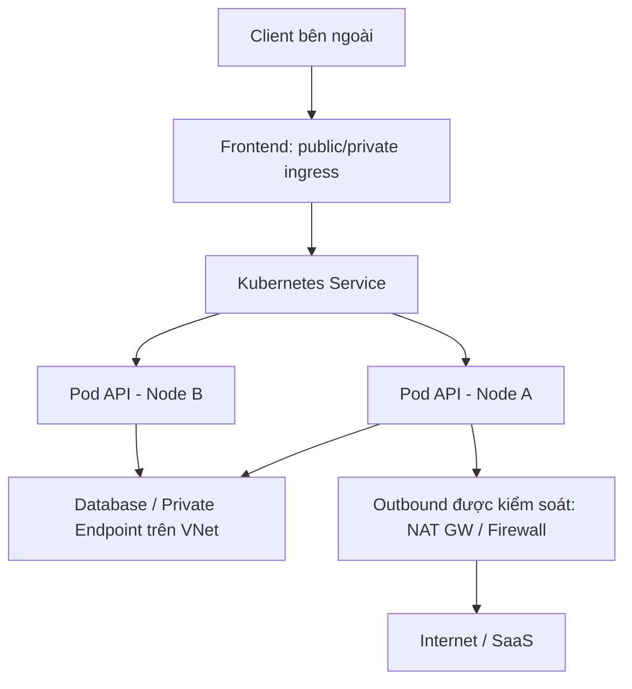

# Azure CNI và quy hoạch địa chỉ IP cho AKS

Một cụm **Azure Kubernetes Service (AKS)** có thể chạy hàng trăm node và hàng nghìn pod. Nếu chọn sai dải địa chỉ mạng từ đầu, cụm vẫn có thể hoạt động khi còn nhỏ nhưng gặp lỗi cấp phát IP khi scale-out, nâng cấp node pool hoặc kết nối tới hệ thống trong datacenter. Ngược lại, cấp một dải mạng quá lớn mà không tính tới các VNet và mạng on-premises sẽ gây xung đột CIDR, khó kết nối hybrid và tăng công sức vận hành.

**Azure Container Networking Interface (Azure CNI)** là thành phần tích hợp networking cho AKS, phối hợp Kubernetes với mạng ảo Azure để cấp địa chỉ và kết nối cho pod. Việc lập kế hoạch phải tính **node subnet, pod addresses, Kubernetes Service CIDR, DNS service IP, ingress, egress, peering, Private Endpoint, autoscaler và nâng cấp cluster**.

Bài học thuộc chương **Nền tảng Azure Kubernetes Service** của module **CLOUD_PROVIDERS_AZURE**. Mục tiêu là thiết kế địa chỉ IP đủ cho ứng dụng Azure hôm nay lẫn khi mở rộng, đồng thời giữ khả năng kiểm soát bảo mật, kết nối dữ liệu và chi phí.

> Lưu ý phạm vi: AKS và Azure CNI liên tục có tính năng mới. Tên tùy chọn CLI, mức hỗ trợ cho Cilium/IPv6/Windows, quota và khả năng di chuyển giữa các mode phụ thuộc phiên bản AKS, region, SKU và thời điểm triển khai. Các ví dụ dưới đây mô tả những mô hình phổ biến; trước khi triển khai thật, kiểm tra chính sách cluster và thông số đang được nền tảng hỗ trợ.

## 1. Mục tiêu học tập

Sau bài học, bạn có thể:

1. Phân biệt địa chỉ IP của **node**, **pod**, **Service** và endpoint ingress/egress.
2. Giải thích khác nhau giữa **Azure CNI Overlay**, **Azure CNI Pod Subnet** và **Azure CNI Node Subnet/traditional (flat)**.
3. Xây dựng bảng địa chỉ CIDR không chồng lấn giữa VNet, node subnet, pod subnet/pod CIDR, Service CIDR và mạng hybrid.
4. Ước lượng IP cho autoscaling, `maxPods`, daemonsets và node tăng thêm khi nâng cấp.
5. Cấu hình và kiểm tra Azure CNI trong quy trình tạo AKS bằng Azure CLI.
6. Hiểu ảnh hưởng của CNI tới đường đi pod-to-pod, pod-to-VNet, ingress, egress, DNS và network policies.
7. Điều tra các lỗi IP exhaustion, pod Pending, không phân giải DNS, không kết nối private endpoint hoặc thiếu egress.
8. Đánh giá các quyết định mạng ảnh hưởng tới khả năng mở rộng, bảo mật và chi phí.

## 2. Những địa chỉ IP tồn tại trong một cụm AKS

Trong Kubernetes, **node** là VM hoặc VMSS instance chạy kubelet và container runtime. **Pod** là đơn vị triển khai ứng dụng, thường có một địa chỉ IP dùng chung giữa các container trong pod. **Service** cung cấp một điểm truy cập ổn định để gọi một nhóm pod, không đồng nghĩa với một VM hoặc một network interface riêng.

| Đối tượng | IP dùng để làm gì? | Có được cấp từ VNet không? |
|---|---|---|
| Node | Kubelet, traffic hạ tầng, đường đi mạng của VM | Thường có private IP từ node subnet |
| Pod | Truy cập ứng dụng giữa các pod/workload | Tùy mode CNI: IP overlay hoặc IP từ VNet pod/node subnet |
| ClusterIP Service | Tên/địa chỉ logic ổn định cho service trong cluster | Lấy từ Service CIDR Kubernetes, không phải subnet VNet thông thường |
| CoreDNS Service | Phân giải tên dịch vụ trong cluster | IP được chọn bên trong Service CIDR |
| LoadBalancer Service | Điểm vào cho ứng dụng, internal hoặc public tùy cấu hình | Frontend IP theo Azure Load Balancer/VNet hoặc public IP |
| Ingress controller | Nhận HTTP/HTTPS rồi route tới các service | Endpoint tùy mô hình ingress: public/private LB, gateway hoặc service tương ứng |
| Egress IP | Địa chỉ nguồn khi workload gọi dịch vụ ngoài cluster | Phụ thuộc node SNAT, NAT Gateway, Azure Firewall, load balancer hoặc thiết kế khác |

Ví dụ các địa chỉ có vai trò khác nhau:

```text
Node:             10.50.0.12      (VNet node subnet)
Pod:              10.240.1.8      (Azure CNI Overlay)
Service:          172.20.4.15     (Kubernetes Service CIDR)
Cluster DNS:      172.20.0.10     (IP trong Service CIDR)
Private Endpoint: 10.50.5.25      (subnet riêng trong VNet)
Internet egress:  public IPv4 từ NAT Gateway / firewall / LB
```

Các địa chỉ ở đây chỉ là **kế hoạch minh họa**, không phải giá trị mặc định của mọi cluster. Nếu dùng Azure CNI Pod Subnet, Pod IP sẽ lấy từ một subnet VNet đã quy hoạch thay vì CIDR overlay như ví dụ.

## 3. Đường đi request trong AKS



Trong sơ đồ:

- Node và pod có địa chỉ riêng theo mode mạng.
- Service IP là một **virtual IP** được dataplane của cluster xử lý để chuyển request tới pod, không phải địa chỉ trên NIC VM riêng.
- Với Azure CNI Overlay, traffic pod ra mạng VNet thường được chuyển đổi nguồn thành địa chỉ IP node trước khi đi tới VNet resources.
- Với Azure CNI Pod Subnet, pod có địa chỉ IP thuộc VNet, nên có thể thiết kế định tuyến/truy cập trực tiếp hơn tới pod theo khả năng mạng và chính sách.
- Đường **ingress** và **egress** phải được thiết kế tách biệt; tạo pod thành công không chứng minh ứng dụng đã được expose an toàn ra Internet.

Không nên cố định Pod IP trong cấu hình nghiệp vụ: khi reschedule, restart hoặc thay node, pod mới có thể nhận địa chỉ khác. Trong cluster, ứng dụng nên gọi nhau qua **DNS của Kubernetes Service** hoặc cơ chế service discovery phù hợp.

## 4. Azure CNI là gì và không phải gì?

**CNI** là giao diện chuẩn giúp runtime của Kubernetes cấu hình mạng cho pod. Trong AKS, Azure CNI là lựa chọn networking tích hợp với Azure, quản lý các địa chỉ và kết nối theo mode được chọn.

Cần phân biệt ba lớp:

1. **IPAM / CNI:** cấp IP và cấu hình giao diện/đường đi mạng cho pod.
2. **Network dataplane:** chuyển tiếp gói tin, thực hiện quy tắc mạng và service forwarding tùy giải pháp.
3. **Network policy:** kiểm soát pod nào có thể kết nối pod/đích nào, khi được một policy engine hỗ trợ.

**Azure CNI không đồng nghĩa với Cilium.** Một triển khai Azure CNI có thể dùng dataplane truyền thống hoặc **Azure CNI powered by Cilium** khi cấu hình và phiên bản hỗ trợ. Bật Cilium không tự giải quyết thiếu IP hoặc chọn lại Service CIDR.

**Kubenet** là một mô hình mạng AKS cũ với cách cấp địa chỉ/định tuyến khác. Khi thiết kế mới, cần đánh giá các mode Azure CNI hiện được khuyến nghị và hỗ trợ; không áp dụng công thức IPAM của kubenet cho Azure CNI.

## 5. Các mô hình cấp Pod IP của Azure CNI

### 5.1 Azure CNI Overlay

Với **Azure CNI Overlay**:

- Node nhận private IP từ subnet Azure VNet.
- Pod nhận IP từ **pod CIDR riêng của cluster**, thường không được cấp trực tiếp từ subnet VNet.
- AKS cung cấp networking giữa các pod trong cluster; khi traffic rời không gian overlay tới mạng ngoài cluster, cơ chế chuyển địa chỉ/định tuyến của mode được áp dụng.
- Mạng VNet/on-premises không mặc nhiên có route trực tiếp tới từng Pod IP overlay.
- Mỗi node thường được phân bổ một block **/24** từ dải pod CIDR overlay theo thiết kế mạng của AKS; việc chọn `maxPods` thấp hơn không đồng nghĩa chỉ giữ lại đúng `maxPods` địa chỉ từ CIDR.

```text
VNet node subnet: 10.50.0.0/22

  Node A 10.50.0.10
    -> Pod CIDR block 10.240.0.0/24
    -> Pods 10.240.0.x

  Node B 10.50.0.11
    -> Pod CIDR block 10.240.1.0/24
    -> Pods 10.240.1.x

AKS Overlay Pod CIDR: 10.240.0.0/16
Kubernetes Service CIDR: 172.20.0.0/16
```

**Ưu điểm:** tránh tiêu thụ trực tiếp quá nhiều IP VNet cho mỗi pod; phù hợp khi số pod lớn và dải VNet phải chia sẻ với nhiều tài nguyên. **Đánh đổi:** Pod IP không phải địa chỉ routable trực tiếp từ các hệ thống bên ngoài cluster theo cách của flat pod networking. Các hệ thống ngoài cluster nên gọi pod qua Service/ingress hoặc endpoint đã thiết kế.

Overlay không biến toàn bộ mạng thành “không cần IP planning”: pod CIDR vẫn cần đủ **block theo số node tối đa**, service CIDR phải riêng và node subnet phải đủ cho autoscaling/upgrades.

### 5.2 Azure CNI Pod Subnet

Với **Azure CNI Pod Subnet**, node và pod được cấp IP từ **những subnet VNet riêng**:

```text
VNet 10.50.0.0/16
  |
  +-- Node subnet: 10.50.0.0/22
  |      Node A: 10.50.0.10
  |      Node B: 10.50.0.11
  |
  +-- Pod subnet: 10.50.64.0/17
         Pod A: 10.50.64.25
         Pod B: 10.50.64.26
         Pod C: 10.50.64.27
```

Các Pod IP thuộc không gian địa chỉ VNet, do đó có thể thuận tiện hơn khi thiết kế kết nối mạng riêng và chính sách yêu cầu Pod IP nhận diện được ở cấp VNet.

Các biến thể quản lý địa chỉ trong Azure CNI Pod Subnet bao gồm:

- **Dynamic IP allocation:** cấp IP cho node/pod từ pod subnet theo từng block/batch phù hợp, thay vì giữ trước toàn bộ `maxPods` cho mỗi node từ đầu.
- **Static block allocation:** trong những môi trường/tính năng hỗ trợ, cấp block địa chỉ theo mô hình khác để tối ưu mật độ và hiệu quả IP; ràng buộc CIDR, `maxPods`, Linux/Windows và dataplane phải được xác minh theo phiên bản AKS.

**Không dùng một công thức IP chung cho mọi biến thể Pod Subnet.** Dynamic allocation, static block và giới hạn pod per node có cơ chế cấp phát khác nhau. Phải lấy các thông số chính thức của mode đã chọn trước khi tính dung lượng mạng production.

### 5.3 Azure CNI Node Subnet / flat truyền thống

Trong mô hình **Azure CNI Node Subnet** truyền thống, pod và node dùng địa chỉ từ **cùng subnet VNet**. Đây là mô hình dễ hiểu về định tuyến Pod IP nhưng có thể tốn nhiều IP vì mỗi node cần dự trù địa chỉ cho pod.

Ví dụ:

```text
VNet app subnet: 10.50.16.0/20

  Node A: 10.50.16.10
  Pod A1: 10.50.16.11
  Pod A2: 10.50.16.12

  Node B: 10.50.16.40
  Pod B1: 10.50.16.41
```

Ở một số cấu hình flat truyền thống, IP được giữ theo khả năng pod tối đa trên node, kể cả khi chưa có đủ pod đang chạy. Vì vậy việc đặt `maxPods` quá cao làm tăng yêu cầu dải subnet. Khả năng cấp phát động hay theo block khác nhau theo mode; không suy ra từ tên plugin `azure` đơn thuần.

### So sánh nhanh

| Tiêu chí | CNI Overlay | CNI Pod Subnet | CNI Node Subnet truyền thống |
|---|---|---|---|
| Pod IP lấy từ | Dải overlay ngoài VNet | Subnet pod riêng trong VNet | Cùng subnet VNet với node |
| Tiêu thụ IP node subnet | Chủ yếu cho node và tài nguyên liên quan | Chủ yếu cho node | Node + Pod IP |
| Tiêu thụ IP VNet cho pod | Không trực tiếp | Có, qua pod subnet | Có, qua node subnet |
| Pod IP truy cập trực tiếp từ VNet | Không mặc định | Có thể định tuyến theo chính sách và kết nối | Có thể định tuyến theo chính sách và kết nối |
| Quy hoạch tăng trưởng | Pod CIDR theo block/node, node subnet | Node subnet + pod subnet + cách cấp phát | Max nodes × sức chứa pod/node + surge |
| Khi nên đánh giá | Nhiều pod, IP VNet hạn chế | Muốn Pod IP VNet nhưng tách subnet và quản lý linh hoạt | Workload legacy/yêu cầu flat đã có |

Không nên chọn mode chỉ dựa trên “mode nào nhanh nhất”. Hiệu năng thực tế còn phụ thuộc dataplane, VM size, MTU, dịch vụ mạng, network policy và pattern ứng dụng; phải benchmark khi có yêu cầu latency/throughput chặt chẽ.

## 6. Lập bảng CIDR trước khi tạo cluster

Tốt nhất, nhóm nền tảng lập sơ đồ IP trước, không chọn các dải IP khi đang chạy lệnh tạo AKS. Một bảng quy hoạch nên nêu:

| Phạm vi | Overlay example | Pod Subnet example | Vai trò |
|---|---|---|---|
| VNet | `10.50.0.0/16` | `10.50.0.0/16` | Không gian mạng Azure của workload |
| Node subnet | `10.50.0.0/22` | `10.50.0.0/22` | VM/VMSS nodes |
| Ingress subnet | `10.50.4.0/24` | `10.50.4.0/24` | Nếu thiết kế cần subnet riêng cho gateway |
| Private Endpoint subnet | `10.50.5.0/24` | `10.50.5.0/24` | Storage, database hoặc endpoint phù hợp |
| Pod IP | `10.240.0.0/16` (overlay CIDR) | `10.50.64.0/17` (VNet pod subnet) | Địa chỉ pod |
| Service CIDR | `172.20.0.0/16` | `172.20.0.0/16` | ClusterIP Kubernetes |
| DNS Service IP | `172.20.0.10` | `172.20.0.10` | CoreDNS Service |
| Peered VNet | `10.60.0.0/16` | `10.60.0.0/16` | Mạng ứng dụng/dịch vụ khác |
| Mạng on-premises | `192.168.0.0/16` | `192.168.0.0/16` | Hybrid qua VPN/ExpressRoute |

**Hai cột là hai phương án độc lập**, không phải cấu hình cùng lúc một cluster với hai kiểu Pod IP. Các CIDR minh họa không chồng lấn nhau và cần được điều chỉnh theo IPAM của doanh nghiệp.

### Vì sao các khoảng không được chồng lấn?

Nếu `Service CIDR` trùng với một subnet VNet hoặc network on-premises, khi một pod muốn gọi IP thuộc dải đó, Kubernetes có thể xử lý như Service IP thay vì tuyến ra ngoài. Trùng pod CIDR hoặc node subnet với mạng khác cũng gây ambiguity, route bất ngờ và khó chẩn đoán.

Đặc biệt cần rà soát:

- Toàn bộ VNet trong cùng tổ chức và các VNet có khả năng peering tương lai.
- VPN/ExpressRoute tới on-premises.
- Private endpoints, Application Gateway và các subnet dành riêng cho dịch vụ.
- Các cluster AKS khác có kết nối qua hub, service mesh hoặc gateway.
- CIDR mà đối tác dùng khi có kết nối mạng riêng.
- Các dải public/private đặc biệt và quy tắc định tuyến của tổ chức.

Nếu hai cụm overlay độc lập có dải Pod IP giống nhau, việc dùng các service/gateway giữa chúng đôi khi vẫn được thiết kế mà không cần route trực tiếp Pod IP. Tuy nhiên **không nên phụ thuộc vào khả năng tái sử dụng CIDR** khi kiến trúc tương lai cần pod-to-pod cross-cluster hoặc quảng bá trực tiếp route.

## 7. Tính dung lượng subnet cho node

Azure dành riêng **5 địa chỉ IPv4 trong mỗi subnet**. Ví dụ subnet `10.50.0.0/22` có 1.024 địa chỉ IPv4, khoảng **1.019 địa chỉ có thể cấp cho tài nguyên** theo quy tắc này.

Đừng suy luận “cluster có 40 node nên subnet /26 là đủ”: node pool mới, autoscaler và surge khi upgrade có thể cần thêm VM trước khi xóa VM cũ.

### Công thức lập kế hoạch node

```text
Node IP dự trù
    = số node lớn nhất của các node pool dùng subnet
    + số node tăng tạm thời cho nâng cấp/scale
    + headroom phục hồi/thay thế và vận hành
    + địa chỉ của tài nguyên khác nếu cùng subnet

IP khả dụng trong Azure subnet IPv4
    ≈ 2^(32 - prefix_length) - 5
```

Ví dụ:

- Node pool system tối đa 10 node.
- Node pool user tối đa 70 node.
- Nâng cấp cần dự phòng tối đa 20 node trong một giai đoạn.
- Headroom khôi phục/rollout: 20 địa chỉ.

Tổng kế hoạch: **120 địa chỉ cho nodes** (10 + 70 + 20 + 20). Một subnet /25 có 123 IP khả dụng về toán học nhưng quá sát, và có thể không đủ khi kế hoạch thay đổi. Một /23 hoặc /22 tạo thêm dư địa; lựa chọn cuối cùng cần xét khả năng chia VNet cho dịch vụ khác và quy mô tương lai.

**Lưu ý:** `maxSurge` có thể được cấu hình theo số tuyệt đối hoặc tỷ lệ; cần tính tăng tạm thời ở **từng node pool**, không chỉ tổng node trung bình. Autoscaler `maxCount` là giới hạn scale mà cần có địa chỉ dự phòng tương ứng.

### Node pool dùng nhiều subnet

Một cluster có thể có các node pool nằm ở những subnet khác nhau theo mô hình được hỗ trợ. Phải tính IP của **mỗi subnet riêng biệt**, vì dư thừa IP ở subnet A không tự cứu được node pool đang thiếu địa chỉ ở subnet B.

## 8. Tính Pod IP cho Azure CNI Overlay

Trong mô hình Azure CNI Overlay thường dùng một **block /24 cho mỗi node**. Một block /24 tương ứng 256 địa chỉ trong phép chia CIDR, nhưng không phải cả 256 địa chỉ đều dùng được tùy cách AKS quản lý pod. Hãy xem giới hạn `maxPods` của phiên bản cluster thay vì dùng 256 như một cam kết pod/node.

Ví dụ cần hỗ trợ **200 node** ở thời điểm tải cao nhất, bao gồm các node tạm thời trong upgrade. Dải `10.240.0.0/16` có thể chia thành:

```text
Số /24 trong /16 = 2^(24 - 16) = 256 block
Nhu cầu theo kế hoạch = 200 block cho 200 node
Khoảng còn lại = 56 block trước khi xét các ràng buộc khác
```

**Đừng tính:**

```text
200 node × 30 maxPods = 6.000 IP
=> suy ra /19 là đủ
```

Với Overlay dùng block /24/node, một /19 có 32 block /24, không đủ cho 200 node dù số pod mỗi node chỉ 30.

### Giữa maxPods và Pod CIDR

- `maxPods` hạn chế số pod tối đa được đặt trên mỗi node theo cấu hình kubelet/AKS.
- Pod CIDR dành cho toàn cluster và cấp các block theo cách hoạt động của Overlay.
- DaemonSet và system pods cũng sử dụng pod capacity.
- HPA tạo thêm pod, còn Cluster Autoscaler có thể tạo thêm node, khiến cả hai loại giới hạn cùng tăng.

Khi node được thay hoặc cluster được scale, các block IP có thể được quản lý/tái sử dụng bởi hệ thống; đừng viết IP tĩnh để dự đoán địa chỉ pod mới.

## 9. Tính Pod IP cho Azure CNI Pod Subnet

Với Pod Subnet, giới hạn chủ yếu đến từ dải địa chỉ của subnet pod **và cơ chế cấp IP đang sử dụng**. Ví dụ thiết kế:

- 150 node lúc peak bình thường.
- Tăng tạm thời 20 node khi upgrade/scale.
- Mục tiêu có thể chạy 60 pod/node.
- Trừ system pods/daemonsets và dự phòng theo chính sách.
- Tổng pod tối đa gần `170 × 60 = 10.200` theo cấu hình lý thuyết.

Subnet `10.50.64.0/17` có 32.768 địa chỉ, sau khi trừ 5 địa chỉ Azure giữ lại thì còn 32.763. Vì vậy dải này có headroom cho 10.200 pod về mặt đếm IP, nhưng **không phải cam kết bạn có thể dùng toàn bộ 32.763 địa chỉ cho pod**.

Lý do:

- Dynamic allocation có thể giữ các block IP theo đơn vị cấp phát, không sử dụng 100% ngay.
- Static block có cách gán và giới hạn riêng.
- Một số IP có thể dùng cho mục đích dịch vụ hoặc chính sách phụ thuộc chế độ triển khai.
- Sự dịch chuyển pod giữa node trong upgrade/scale có thể tạo nhu cầu IP đồng thời cao hơn số pod đang Ready.
- Những node pool chia pod subnet phải được tính gộp.

### Công thức làm việc với dynamic allocation

```text
Nhu cầu Pod IP ước tính
    = (tổng node tối đa + surge) × pod capacity dự kiến
    + dự phòng block cấp phát và dao động triển khai

IP subnet khả dụng
    ≈ 2^(32 - prefix_length) - 5
```

**Đây là công thức hoạch định khái quát**, không phải thuật toán nội bộ cấp IP của Azure CNI. Khi dự án yêu cầu sử dụng gần hết dải IP, cần tính theo block size và giới hạn được tài liệu của mode hiện hành công bố, rồi thử tải scale/redeploy thực tế.

### Node Subnet truyền thống cần gì khác?

Trong Azure CNI Node Subnet truyền thống, mỗi node có thể tiêu thụ địa chỉ cho chính nó và nhiều pod từ **cùng subnet**. Một phép tính bảo thủ thường dùng:

```text
Nhu cầu IP sơ bộ
    ≈ (max nodes + upgrade surge nodes)
       × (1 node IP + maxPods)
    + IP cho tài nguyên khác
    + headroom
```

Ví dụ 80 node + 20 node surge, `maxPods = 30`:

```text
100 × (1 + 30) = 3.100 IP sơ bộ
```

Subnet /20 có 4.091 địa chỉ sử dụng được theo quy tắc Azure IPv4, đủ hơn về mặt số học nhưng vẫn cần xét subnet khác và biến thể cấp IP. Không dùng phép tính này cho Overlay hoặc coi đây là yêu cầu chính xác của Dynamic Pod Subnet.

## 10. Kubernetes Service CIDR và DNS Service IP

**Service CIDR** chứa các địa chỉ ảo cho Kubernetes `ClusterIP` Services. Không phải các địa chỉ này được lấy từ subnet Azure VNet hoặc gắn vào NIC của node.

Ví dụ:

```text
Service CIDR: 172.20.0.0/16
DNS Service IP: 172.20.0.10
Service orders: 172.20.12.15
Service payments: 172.20.12.16
```

Từ pod, ứng dụng thường gọi `orders.default.svc.cluster.local` hoặc tên Service ngắn trong namespace tương ứng, thay vì địa chỉ `172.20.12.15`.

### Những điều bắt buộc kiểm tra

1. Service CIDR không chồng lấn với VNet, node subnet, Pod CIDR/pod subnet và các mạng cần kết nối.
2. `dns-service-ip` nằm bên trong Service CIDR và không dùng địa chỉ dành riêng/không hợp lệ theo yêu cầu AKS.
3. Service CIDR đủ cho số Service dự kiến, không phải số lượng pod.
4. Cấu hình được thống nhất trước khi tạo cluster; thay Service CIDR trên cluster đang vận hành có thể không được hỗ trợ trực tiếp hoặc yêu cầu quy trình migration có giới hạn.
5. Khi dùng custom DNS, pod vẫn phải phân giải được tên nội bộ Kubernetes và private DNS zone của dịch vụ Azure theo thiết kế.

**Cẩn trọng:** việc Service có IP trong Service CIDR không chứng minh đã có pod backend khỏe. Một Service có thể tồn tại nhưng không có endpoint nào do label selector sai hoặc workload chưa Ready.

## 11. Ingress, egress và IP public/private

### Ingress: lưu lượng vào ứng dụng

Các cách expose phổ biến:

- `ClusterIP`: chỉ dùng trong cluster theo đường đi mạng và policy phù hợp.
- `LoadBalancer` internal: frontend private IP trong VNet/subnet được hỗ trợ.
- `LoadBalancer` public: frontend Public IP do Azure quản lý/tài nguyên đã được cấu hình.
- Ingress controller/Application Gateway hoặc Front Door: HTTP/HTTPS routing và bảo vệ theo kiến trúc.

Ví dụ Kubernetes Service:

```yaml
apiVersion: v1
kind: Service
metadata:
  name: orders-api
  namespace: default
spec:
  type: ClusterIP
  selector:
    app: orders-api
  ports:
    - name: http
      port: 80
      targetPort: 8080
      protocol: TCP
```

Service trên tạo một địa chỉ ảo Kubernetes từ Service CIDR. Nó **không** tự tạo public IP và **không** mở API ra Internet. Để người dùng bên ngoài truy cập, phải thiết kế thêm ingress/frontend, route và authentication/WAF/NSG khi cần.

### Egress: lưu lượng ra ngoài

Một pod cần gọi API Internet hoặc tải image (thực tế image pull chủ yếu do node/runtime thực hiện) phải có đường outbound tương ứng.

Các lựa chọn phụ thuộc mô hình cluster, ví dụ:

- Outbound qua Azure Load Balancer theo loại AKS outbound cấu hình.
- NAT Gateway tại subnet phù hợp, khi mode và kiểu triển khai hỗ trợ.
- Azure Firewall hoặc NVA với user-defined routes theo chính sách bảo mật.
- Một số cluster hạn chế egress và dùng private connectivity đến ACR, Storage, Key Vault.

**CNI không thay thế NAT Gateway/Firewall.** Với Overlay, traffic ra ngoài cluster thường sử dụng nguồn node IP ở lớp VNet trước khi áp dụng cơ chế public SNAT. Với Pod Subnet, pod IP thuộc VNet nhưng public egress vẫn phải được thiết kế; địa chỉ nguồn mà SaaS nhìn thấy phụ thuộc tuyến và SNAT thực tế.

Nếu đối tác yêu cầu allowlist public IP, cần đo IP egress từ workload và đăng ký **đầy đủ các IP có thể được sử dụng**, không tự suy ra IP từ Pod CIDR hay node subnet.

## 12. Private Cluster, Private Endpoint và Azure CNI là các vấn đề khác nhau

Cụm **private AKS** là mô hình kiểm soát kết nối tới **Kubernetes API server/control plane**, không đồng nghĩa tự động làm mọi pod và Service trở thành private hoặc không có egress Internet.

**Private Endpoint** là cách tài nguyên hỗ trợ Azure Private Link được truy cập qua private IP trong mạng Azure; nó khác với Pod IP hoặc ClusterIP. Ví dụ:

```text
Pod orders-api
  -> DNS: ordersstorage.blob.core.windows.net
  -> Private DNS resolution: 10.50.5.25
  -> Private Endpoint của Storage
```

Muốn đường đi này hoạt động, phải thiết kế:

1. Private Endpoint của dịch vụ đích.
2. Private DNS zone và liên kết VNet/resolver phù hợp.
3. Route/NSG/firewall cho phép kết nối tới địa chỉ riêng.
4. Identity/RBAC hoặc SAS/credential của ứng dụng được cấu hình an toàn.
5. Mode Azure CNI và nguồn IP thực tế khi rời pod network.

Một ứng dụng có thể có DNS đúng và route đúng nhưng vẫn gặp HTTP 403 nếu không có quyền truy cập dữ liệu. Ngược lại, identity hợp lệ không khắc phục được DNS trả về public IP khi chính sách chỉ cho phép Private Endpoint.

## 13. Network policy và kiểm soát traffic giữa pod

Kubernetes **NetworkPolicy** là lớp kiểm soát lưu lượng ở mức pod, nhưng việc enforcement phụ thuộc một network policy engine/dataplane được hỗ trợ và đã bật trong cluster.

Ví dụ cho namespace `apps`: chỉ cho pod có nhãn `app=frontend` gọi pod `app=orders-api` trên TCP/8080.

```yaml
apiVersion: networking.k8s.io/v1
kind: NetworkPolicy
metadata:
  name: orders-only-from-frontend
  namespace: apps
spec:
  podSelector:
    matchLabels:
      app: orders-api
  policyTypes:
    - Ingress
  ingress:
    - from:
        - podSelector:
            matchLabels:
              app: frontend
      ports:
        - protocol: TCP
          port: 8080
```

Policy này chỉ tác động tới các pod được selector `app=orders-api` chọn trong namespace `apps` và **chỉ khi enforcement hỗ trợ**. Quy tắc không tự tạo Service/Deployment. Cần kiểm tra rule cho ingress/egress khác, DNS, telemetry và dependency trước khi triển khai default-deny.

**NSG và NetworkPolicy không thay thế nhau:**

- NSG là chính sách mạng Azure tại subnet/NIC và phạm vi được hỗ trợ.
- NetworkPolicy là chính sách ở mức pod/namespace theo dataplane.
- Azure Firewall/NAT Gateway xử lý các vấn đề đường đi egress và/hoặc bảo mật theo tính năng.
- RBAC, workload identity và quyền ứng dụng vẫn phải kiểm soát độc lập.

Với **Azure CNI powered by Cilium**, đánh giá khả năng hỗ trợ policy engine và dataplane phù hợp phiên bản AKS. Không tạo network policy trong YAML rồi mặc định nó đã được thực thi nếu cluster chưa có engine tương ứng.

## 14. Chuẩn bị cluster: checklist IPAM và quyền truy cập

Trước khi chạy `az aks create`, ghi nhận:

- Subscription, resource group, region, AKS version và loại cluster.
- Dải VNet cùng tất cả subnet đã dùng và dự kiến.
- Pod networking mode: Overlay, Pod Subnet hay mô hình khác được hỗ trợ.
- Node pool system/user, số node tối thiểu/tối đa, `maxPods` và `maxSurge`.
- Pod CIDR hoặc pod subnet đủ cho node growth.
- Service CIDR và DNS Service IP tách biệt.
- VNet peering, DNS, on-premises CIDR, VPN/ExpressRoute.
- Load balancer, ingress, egress, NAT Gateway/firewall và private endpoints.
- Network policies và yêu cầu bảo mật của ứng dụng.
- Quyền của AKS managed identity trên custom VNet/subnet, ví dụ role **Network Contributor** ở phạm vi cần thiết theo cấu hình.
- Quota VM, node size, IP availability, SKU/region và chi phí.

**Không chỉ kiểm tra mạng thông qua tên subnet.** AKS cần quyền đọc và thay đổi những thành phần mạng cần thiết; thiếu quyền trên subnet có thể khiến provisioning hoặc scale node/pod thất bại dù CIDR vẫn còn chỗ.

## 15. Thực hành: tạo AKS với Azure CNI Overlay

Ví dụ dành cho **Azure Cloud Shell (Bash)**. Các lệnh tạo tài nguyên có thể phát sinh chi phí; chỉ chạy trong subscription thử nghiệm được phép. Ví dụ giả định **resource group, VNet và node subnet đã tồn tại**, đồng thời danh tính AKS có quyền mạng cần thiết.

### Bước 1 — Xác nhận subscription

```bash
az account show \
  --query "{subscription:name,id:id,tenant:tenantId}" \
  -o table
```

Khai báo biến:

```bash
RG="rg-aks-network-lab"
AKS="aks-overlay-lab"
VNET="vnet-aks-lab"
SUBNET="snet-nodes"
```

Lấy resource ID của node subnet:

```bash
NODE_SUBNET_ID=$(az network vnet subnet show \
  --resource-group "$RG" \
  --vnet-name "$VNET" \
  --name "$SUBNET" \
  --query id -o tsv)

echo "$NODE_SUBNET_ID"
```

**Không dùng** `NODE_SUBNET_ID` từ subscription/region khác khi tạo cluster; hãy xác nhận VNet và region AKS phù hợp với cấu hình.

### Bước 2 — Kiểm tra subnet và space

```bash
az network vnet subnet show \
  --resource-group "$RG" \
  --vnet-name "$VNET" \
  --name "$SUBNET" \
  --query "{id:id,prefix:addressPrefix,prefixes:addressPrefixes}" \
  -o json
```

Xác nhận đây là subnet dự trù cho AKS nodes, không chứa địa chỉ được dùng bởi tài nguyên khác khiến kế hoạch scale bị thiếu. Nếu subnet đang dùng bởi hệ thống khác, không sửa CIDR hoặc xóa IP configuration để “dọn chỗ” khi chưa có phê duyệt.

### Bước 3 — Tạo cluster Overlay

```bash
az aks create \
  --resource-group "$RG" \
  --name "$AKS" \
  --node-count 3 \
  --node-vm-size Standard_D4s_v5 \
  --network-plugin azure \
  --network-plugin-mode overlay \
  --vnet-subnet-id "$NODE_SUBNET_ID" \
  --pod-cidr "10.240.0.0/16" \
  --service-cidr "172.20.0.0/16" \
  --dns-service-ip "172.20.0.10" \
  --max-pods 50 \
  --generate-ssh-keys
```

Đây là **cấu hình minh họa**, không phải mẫu bảo mật production hoàn chỉnh. Phải xác minh AKS version, tính năng plugin, quyền subnet, outbound, system node pool, network policy và quota tại thời điểm chạy. `--node-vm-size` có thể không khả dụng hoặc không đủ capacity tại region được chọn.

Sau khi tạo, không dựa vào một lệnh `az aks create` thành công để khẳng định toàn bộ pod networking hoạt động: hãy kiểm tra node Ready, pod scheduling, CoreDNS và các kết nối thực tế.

### Bước 4 — Xem network profile

```bash
az aks show \
  --resource-group "$RG" \
  --name "$AKS" \
  --query "{networkProfile:networkProfile}" \
  -o json
```

Các giá trị cần đối chiếu: `networkPlugin`, `networkPluginMode`, `podCidr` hoặc `podCidrs`, `serviceCidr`, `dnsServiceIP`, `networkDataplane` (nếu có), và `outboundType`.

Dữ liệu trả về khác nhau theo phiên bản API; nếu field không hiện, không tự kết luận tính năng đã bị vô hiệu hóa.

## 16. Tùy chọn: AKS dùng Azure CNI Pod Subnet

Nếu ứng dụng cần Pod IP thuộc VNet, có thể chọn Azure CNI Pod Subnet theo khả năng của AKS version. Ví dụ giả định **node subnet và pod subnet đã tồn tại**, có dung lượng và quyền phù hợp:

```bash
NODE_SUBNET_ID=$(az network vnet subnet show \
  -g "$RG" --vnet-name "$VNET" --name "snet-nodes" \
  --query id -o tsv)

POD_SUBNET_ID=$(az network vnet subnet show \
  -g "$RG" --vnet-name "$VNET" --name "snet-pods" \
  --query id -o tsv)
```

Ví dụ tạo cluster trong môi trường hỗ trợ cơ chế Pod Subnet dynamic:

```bash
az aks create \
  --resource-group "$RG" \
  --name "aks-podsubnet-lab" \
  --node-count 3 \
  --network-plugin azure \
  --vnet-subnet-id "$NODE_SUBNET_ID" \
  --pod-subnet-id "$POD_SUBNET_ID" \
  --service-cidr "172.20.0.0/16" \
  --dns-service-ip "172.20.0.10" \
  --max-pods 50 \
  --generate-ssh-keys
```

**Không chạy cả hai cluster nếu không có ngân sách và mục tiêu lab phù hợp.** Đây là phương án thay thế cho Overlay, không phải bước chuyển đổi tại chỗ từ cluster đã tạo. Nếu cần static block allocation hoặc Cilium dataplane, xác nhận cú pháp và tổ hợp hỗ trợ từ phiên bản CLI/AKS hiện tại; không tự thêm flag chưa kiểm chứng.

Với Pod Subnet, IP của pod sẽ xuất phát từ subnet pod được cấu hình. Mỗi node vẫn cần địa chỉ riêng từ node subnet. Hãy kiểm tra đồng thời cả hai nguồn IP khi autoscaling hoặc nâng cấp.

## 17. Kiểm tra từ Kubernetes sau khi tạo cluster

Sau khi xác nhận quyền truy cập tới API server:

```bash
az aks get-credentials \
  --resource-group "$RG" \
  --name "$AKS"
```

Đối với private cluster, máy/Cloud Shell phải có kết nối mạng và phân giải DNS tới API server hoặc dùng workflow quản trị được tổ chức cho phép. Nhận kubeconfig thành công không tự đảm bảo API server có thể được truy cập từ mọi vị trí.

Xem node và Pod IP:

```bash
kubectl get nodes -o wide
kubectl get pods --all-namespaces -o wide
kubectl get services --all-namespaces -o wide
```

Kiểm tra node capacity và địa chỉ:

```bash
kubectl describe node "<NODE_NAME>"
```

Các thông tin cần xem: `InternalIP`, `PodCIDR` khi có, `Allocatable pods`, tình trạng `Ready`, số pod đã đặt, điều kiện `NetworkUnavailable` nếu được báo và events.

Kiểm tra phân phối pod theo node:

```bash
kubectl get pods -A -o wide
kubectl get endpointslices -A
kubectl get networkpolicies -A
```

Nhớ rằng `kubectl get networkpolicies` chỉ hiển thị resource khai báo. Nó không xác nhận enforcement đang hoạt động hoặc policy đúng mục tiêu.

### Kiểm tra network profile và node pools

```bash
az aks nodepool list \
  --resource-group "$RG" \
  --cluster-name "$AKS" \
  --query "[].{name:name,count:count,maxPods:maxPods,subnet:vnetSubnetID,podSubnet:podSubnetID}" \
  -o json
```

Kiểm tra các node pool riêng: system pool, user pool và các pool mới có thể dùng subnet hoặc cấu hình khác nhau. Khi thay `maxPods` cho workload, không tự giả định có thể thay bất kỳ cấu hình mạng nào trên node pool đang chạy mà không tạo/redeploy pool.

## 18. Quy trình kiểm thử kết nối

Một bài test network nên kiểm tra từng đường đi, thay vì chỉ ping giữa hai địa chỉ.

| Đường đi | Mục tiêu | Cách xác minh |
|---|---|---|
| Pod → Pod cùng node | Pod networking local | Gọi HTTP tới pod được phép trong lab |
| Pod → Pod khác node | Cross-node connectivity | Gọi Service hoặc endpoint kiểm thử trên node khác |
| Pod → ClusterIP Service | Kubernetes service forwarding | DNS lookup và HTTP đến Service |
| Pod → CoreDNS | DNS nội bộ | Resolve tên `*.svc.cluster.local` |
| Pod → VNet private endpoint | Workload tới Storage/database | DNS trỏ private IP, TCP/TLS và ứng dụng xác thực thành công |
| Pod → Internet | Outbound path | Kiểm tra URL thử nghiệm được tổ chức cho phép và public egress IP |
| VNet client → app | Ingress private | Internal LB/ingress và health probe |
| Client Internet → app | Ingress public khi cần | Frontend public/WAF/TLS và auth |

Nếu sử dụng container debug, chỉ dùng image đã được tổ chức chấp thuận; tránh tải image không rõ nguồn vào cluster production. Ưu tiên thực hành trong namespace thử nghiệm, với RBAC/NetworkPolicy phù hợp và cleanup rõ ràng.

### Phân biệt DNS với đường mạng

Nếu `curl https://service.example` lỗi, kiểm tra theo trình tự:

1. Tên có được phân giải thành IP dự kiến không?
2. IP đó nằm trong VNet, private endpoint hay Internet?
3. Route đến IP đó là gì?
4. NetworkPolicy, NSG, firewall có cho phép TCP/port?
5. TLS certificate và hostname có khớp?
6. Ứng dụng đích có healthy và cho phép identity của caller?

Một lỗi `403` từ Storage thường không phải lỗi cấp phát Pod IP; có thể liên quan RBAC, credential hoặc firewall của Storage. Một lỗi DNS trả IP public khi yêu cầu Private Endpoint có thể là lỗi private DNS zone/resolver.

## 19. Lỗi thường gặp khi quy hoạch IP sai

| Triệu chứng | Nguyên nhân khả dĩ | Hướng kiểm tra |
|---|---|---|
| Scale-out node pool thất bại | Node subnet thiếu địa chỉ, quota VM hoặc capacity vùng | Kiểm tra available IP, quota, events, VMSS provisioning |
| Pod Pending khi node còn CPU/RAM | Giới hạn maxPods, không còn node phù hợp, taints/quotas hoặc IPAM | `kubectl describe pod`, `describe node`, CNI events |
| Pod network setup lỗi | CNI/IPAM chưa cấp được IP, thiếu subnet permission hoặc cấu hình mạng sai | Pod events, trạng thái CNI/AKS, quyền subnet |
| Cross-node pod traffic lỗi | Dataplane, route/NSG/firewall hoặc MTU không phù hợp | Kiểm tra path, CNI state và NetworkPolicy |
| Dịch vụ trong cluster không resolve | CoreDNS không healthy, Service CIDR/DNS config hoặc policy egress chặn DNS | CoreDNS pods, DNS Service, resolver config |
| Pod không gọi được private endpoint | Private DNS sai, route/NSG/firewall hoặc dịch vụ đích chặn | Phân giải FQDN, PE IP, network path và credential |
| VNet VM không gọi được Pod IP Overlay | Pod IP không được route trực tiếp từ VNet | Expose bằng Service/internal LB/ingress phù hợp |
| Pod IP hoặc Service IP trùng on-prem | CIDR bị chồng lấn | IPAM, effective routes, service CIDR và kế hoạch di chuyển |
| Ingress bị 502/503 | Service selector, readiness, backend endpoint, gateway route | Service, EndpointSlice, ingress/controller logs |
| Outbound IP khác allowlist đối tác | NAT/Firewall/Load Balancer đang dùng tập IP khác | Đo egress thực tế từ workload, xem outbound type |
| Node upgrade bị kẹt dù đang đủ node | Không đủ địa chỉ cho node surge, quota hoặc PodDisruptionBudget | maxSurge, subnet, cluster events và PDB |
| Đã tăng subnet nhưng vẫn lỗi | Pod CIDR overlay hoặc pod subnet riêng hết block | Kiểm tra cả hai lớp IPAM, không chỉ node subnet |

### Không nhầm thiếu IP với thiếu capacity tính toán

Một pod Pending có thể do tài nguyên CPU/memory, taints, affinity, PodDisruptionBudget hoặc PVC; không phải mọi pod Pending đều do thiếu IP. Tương tự, node scale thất bại có thể do quota VM hoặc node SKU thiếu capacity dù subnet còn IP.

Chẩn đoán dựa trên **Kubernetes events và lỗi cấp phát Azure**, không chỉ một dashboard.

## 20. Những quyết định khó thay đổi sau khi tạo cluster

Một số đặc tính mạng AKS có ràng buộc lớn và tùy mức hỗ trợ không thể cập nhật tùy ý sau khi cluster đã vận hành:

- **Service CIDR và DNS service IP** gắn với thiết kế Kubernetes; thay đổi có thể không được hỗ trợ trực tiếp.
- **Azure CNI plugin/mode**: việc di chuyển từ flat sang overlay hoặc giữa các biến thể phụ thuộc quy trình migration và phiên bản được hỗ trợ, không phải đổi một dòng YAML rồi hoàn tất.
- **Pod CIDR Overlay**: việc chọn dải quá nhỏ có thể giới hạn số node; thay đổi dải cluster không nhất thiết có đường in-place đơn giản.
- **Subnet size/placement**: mở rộng có thể bị cản trở bởi các subnet liền kề, tài nguyên đã được cấp IP, peering và quy tắc Azure.
- **maxPods và node pool networking**: nhiều thay đổi cần tạo pool mới hoặc quay vòng node thay vì sửa trực tiếp trên mọi node.
- **Private cluster và outbound routing**: thay đổi ảnh hưởng API server, image pull, bootstrap và DNS.

Với cluster quan trọng, hãy lập **migration plan**:

1. Kiểm kê current CIDR, pod count, nodes, services, DNS, peering và network policies.
2. Thiết kế CIDR mới cùng mô hình CNI được hỗ trợ.
3. Tạo môi trường thử nghiệm hoặc cluster mới, cấp quyền và kết nối mạng.
4. Kiểm thử deploy, ingress, egress, DNS, private endpoints và hiệu năng.
5. Di chuyển workload theo namespace/dịch vụ, kiểm tra DNS và state.
6. Chuyển traffic có kiểm soát, giữ rollback window.
7. Dọn cluster cũ khi bảo đảm dữ liệu/ứng dụng đã ổn định.

Không tự xóa subnet/pod CIDR của cluster đang chạy để tạo lại từ đầu nếu chưa có backup, kế hoạch cutover và phê duyệt.

## 21. Bảo mật, chi phí và khả năng vận hành

### Bảo mật

- Áp dụng Kubernetes RBAC và workload identity cho quyền truy cập Azure; IP address không phải danh tính đáng tin cậy của ứng dụng.
- Dùng NetworkPolicy nếu dataplane được hỗ trợ và thiết kế deny/allow theo namespace/service.
- NSG, Azure Firewall, private endpoint và egress policy bảo vệ những luồng ra/vào thích hợp.
- Hạn chế public endpoints; phân quyền ingress qua TLS/authentication/WAF khi cần.
- Ghi log kết nối, DNS và traffic theo cơ chế được tổ chức phê duyệt; tránh lưu token, cookie hoặc dữ liệu nhạy cảm trong log.
- Với custom VNet, cấp quyền subnet cho **cluster identity** tối thiểu đủ tác vụ; không cấp Owner toàn subscription chỉ để AKS cấp IP.

### Chi phí

Địa chỉ private IP trong pod CIDR không tự quyết định toàn bộ hóa đơn, nhưng **thiết kế IP ảnh hưởng khả năng scale và chi phí cơ sở hạ tầng**. Các hạng mục cần dự báo:

- VMSS nodes, disk và số node dự phòng khi upgrade.
- Azure Load Balancer, Public IP, NAT Gateway hoặc Azure Firewall.
- Data transfer trong/giữa zone, region và ra Internet khi phát sinh.
- Private Endpoint, DNS resolver, gateway và các kết nối hybrid.
- Network monitoring, Log Analytics và lưu lượng log.
- Việc mở rộng VNet/subnet, phải tạo cluster mới hoặc migration nếu thiết kế IP ban đầu thiếu.

Overlay giúp tiết kiệm không gian IP **trong VNet dành cho pod**, nhưng không có nghĩa loại bỏ mọi chi phí NAT/egress hay yêu cầu bảo mật.

### Quan sát và alert

Cần theo dõi:

1. Số node Ready và node pool actual vs desired.
2. Số pod theo node; tỷ lệ sử dụng so với `maxPods`.
3. Available IP ở node subnet, pod subnet hoặc số block overlay còn lại theo mode.
4. Cluster autoscaler events và thời gian scale-out.
5. Tỷ lệ pod Pending/network setup failures.
6. CoreDNS latency/errors và DNS cache behavior.
7. Network policy drops/firewall denies nếu có telemetry tương ứng.
8. Ingress error rate, backend readiness và outbound connectivity.
9. Thay đổi quota/scale/upgrade gây spike IP usage.

Nếu Azure Monitor không xuất sẵn một metric “free overlay /24 blocks”, cần tính toán từ Pod CIDR, số node hiện tại và số node tối đa theo topology. Không tự đặt tên metric tưởng tượng rồi kết luận cluster khỏe.

## 22. Case study: dịch vụ web tăng từ 20 lên 150 node

Một doanh nghiệp chạy ba workload trên AKS:

- **Web API:** 80% traffic, cần scale nhanh khi có chiến dịch.
- **Background workers:** theo queue, số pod có thể tăng mạnh.
- **System workloads:** DNS, monitoring và ingress controllers.

Hiện tại cluster có 20 node, nhưng nhóm dự báo có thể đạt 150 node ở thời điểm cao nhất; trong kỳ nâng cấp cần thêm 20 node tạm thời. Mạng Azure đã có:

```text
Application VNet: 10.50.0.0/16
On-premises:      192.168.0.0/16
Peered VNet:      10.60.0.0/16
```

### Phương án A: Overlay

- Node subnet: `10.50.0.0/22`.
- Pod CIDR: `10.240.0.0/16`.
- Service CIDR: `172.20.0.0/16`.
- DNS Service: `172.20.0.10`.
- Tổng node dự kiến: `150 + 20 = 170`, cộng headroom.
- Với cấp block /24/node, `/16` có 256 block /24 về mặt chia CIDR.

**Ưu điểm:** không cần cấp hàng chục nghìn địa chỉ VNet cho pod. **Điểm cần lưu ý:** các hệ thống VNet/on-prem không trực tiếp route tới Pod IP overlay; dùng Service/internal LB/ingress cho ứng dụng.

### Phương án B: Pod Subnet

- Node subnet: `10.50.0.0/22`.
- Pod subnet: `10.50.64.0/17`.
- Service CIDR: `172.20.0.0/16`.
- Tính IP pod theo số pod/node, node surge và mode dynamic/static block được hỗ trợ.

**Ưu điểm:** Pod IP lấy từ VNet, thuận tiện trong những kiến trúc cần xử lý trực tiếp Pod IP. **Điểm cần lưu ý:** pod subnet có thể hết địa chỉ nếu workload tăng mạnh; phải có headroom cho block cấp phát, nâng cấp và các node pool cùng chia subnet.

### Quyết định thiết kế

Nếu không có yêu cầu bắt buộc định tuyến Pod IP trực tiếp từ VNet, Overlay có thể giảm áp lực IPAM. Nếu cần Pod IP routable trên mạng Azure/hybrid theo chính sách cụ thể, Pod Subnet đáng đánh giá. Cả hai vẫn cần kiểm thử kết nối private endpoint, DNS, ingress/egress, network policy, khả năng scale và SLO thực tế.

## 23. Bài thực hành và câu hỏi tự kiểm tra

### Bài thực hành A — Quy hoạch địa chỉ

Thiết kế một AKS cluster có hai node pool:

- System pool: tối đa 8 node.
- User pool: tối đa 64 node.
- Max surge dự kiến: 16 node thêm vào tổng cluster.
- Mỗi node dự kiến tối đa 50 pod.
- Cần VNet peering và truy cập database qua Private Endpoint.
- Có mạng on-premises `192.168.0.0/16`.

**Yêu cầu:**

1. Đề xuất VNet, node subnet và private endpoint subnet không chồng lấn.
2. Chọn Azure CNI Overlay hoặc Pod Subnet, giải thích bằng yêu cầu truy cập Pod IP.
3. Nếu dùng Overlay, tính số /24 blocks tối thiểu theo số node kế hoạch, cộng headroom.
4. Nếu dùng Pod Subnet, ước lượng số Pod IP theo số node/pod và mô hình cấp phát; đề xuất dải subnet có buffer.
5. Chọn Service CIDR và DNS Service IP hợp lệ, không chồng lấn.
6. Xác định nơi khai báo ingress private và cơ chế egress cho API đối tác.
7. Giải thích vì sao Pod IP không nên là endpoint cố định trong ứng dụng.

### Bài thực hành B — Kiểm tra cluster

Trên một cluster lab được phép quản trị:

1. Xem `az aks show` và ghi lại network plugin, mode, dataplane, pod CIDR, service CIDR, outbound type.
2. Liệt kê node pools, `maxPods` và subnet ID tương ứng.
3. Dùng `kubectl get nodes/pods/services -o wide` để so sánh Node IP, Pod IP và Service IP.
4. Kiểm tra số pod đã đặt trên node và số pod capacity còn lại.
5. Tạo một Service `ClusterIP` cho ứng dụng thử nghiệm được phép; xác minh DNS và truy cập qua Service name.
6. Từ một pod debug được phê duyệt, kiểm tra DNS private endpoint và kết nối TCP/TLS tới dịch vụ dữ liệu.
7. Kiểm tra outbound public IP bằng endpoint IP echo được tổ chức cho phép; so sánh với NAT/Firewall/LB.
8. Thử tăng số replica ở quy mô an toàn, quan sát Pod IP và sự thay đổi số node khi autoscaler hoạt động.
9. Mô tả quy trình điều tra nếu Pod Pending do thiếu IP so với do CPU/memory/taints.
10. Dọn tài nguyên lab và xem chi phí trước khi kết thúc.

### Câu hỏi tự kiểm tra

**Câu 1.** Node IP, Pod IP, Kubernetes Service IP và DNS Service IP khác nhau như thế nào?

**Câu 2.** Vì sao không thể lấy `nodes × maxPods` để tính chính xác dung lượng Pod CIDR của Azure CNI Overlay?

**Câu 3.** Với Azure CNI Pod Subnet, Pod IP được cấp từ đâu, và tại sao node subnet vẫn phải có đủ địa chỉ?

**Câu 4.** Service CIDR có thể trùng VNet CIDR hoặc mạng on-premises mà không gây rủi ro không?

**Câu 5.** Khi Cluster Autoscaler tăng node mà node subnet hết IP, bạn sẽ quan sát triệu chứng nào?

**Câu 6.** Cùng một ứng dụng, khi dùng Overlay thay vì Pod Subnet, cách VNet client truy cập Pod IP trực tiếp có giống nhau không?

**Câu 7.** Có thể coi Kubernetes NetworkPolicy đã hoạt động chỉ vì YAML `NetworkPolicy` được tạo thành công không?

**Câu 8.** Vì sao một private AKS cluster vẫn có thể cần outbound Internet hoặc egress đến các dịch vụ Azure?

**Câu 9.** Nếu ứng dụng cần scale 100 node nhưng Pod CIDR Overlay chỉ có 64 block /24, điều gì có thể xảy ra?

**Câu 10.** Khi chọn sai Pod CIDR/Service CIDR từ ban đầu, vì sao nhiều môi trường cần kế hoạch migration thay vì sửa trực tiếp một dòng cấu hình?

**Tiêu chí hoàn thành:** người học phân biệt được các mô hình Azure CNI, lập CIDR không trùng lấn, tính node/IP capacity kể cả upgrade surge, tạo/đọc network profile bằng CLI và chẩn đoán được các luồng mạng quan trọng của AKS.

## Kết luận

**Azure CNI và quy hoạch IP cho AKS** không chỉ là chọn một plugin mạng khi tạo cluster. Nó quyết định cách node và pod có địa chỉ, cách traffic đi giữa pod, VNet, Private Endpoint và Internet, cũng như khả năng scale và nâng cấp trong tương lai.

**Azure CNI Overlay** giúp tiết kiệm địa chỉ VNet cho pod bằng không gian overlay riêng, nhưng phải tính **/24 block theo node** và không giả định Pod IP routable từ bên ngoài. **Azure CNI Pod Subnet** cấp Pod IP từ subnet VNet riêng, hữu ích khi cần tích hợp mạng ở cấp Pod IP, song phải dự báo dung lượng và đặc điểm cấp IP theo mode. **Azure CNI Node Subnet** truyền thống có thể đòi nhiều địa chỉ VNet hơn do node và pod chia subnet.

Một thiết kế bền vững cần **CIDR không chồng lấn, headroom cho autoscaler/upgrade, DNS/Service CIDR đúng, subnet permissions, network policies, ingress/egress được kiểm soát và kế hoạch giám sát IP exhaustion**. Quy hoạch tốt từ ngày đầu giúp AKS mở rộng ổn định hơn, giảm gián đoạn workload và chi phí di chuyển mạng về sau.

