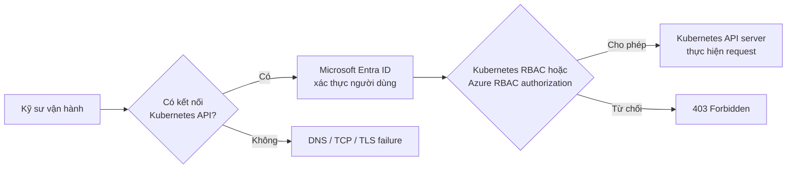
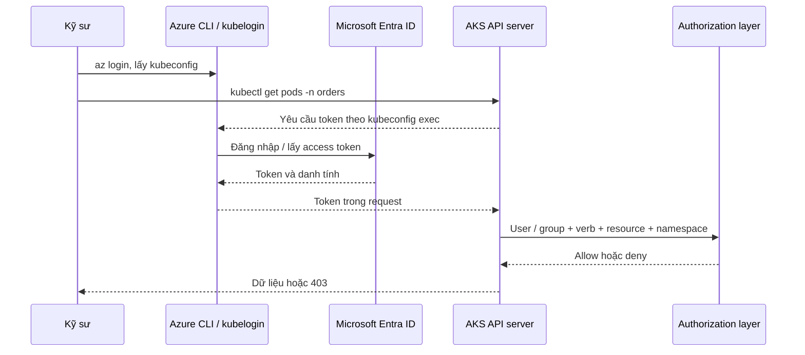
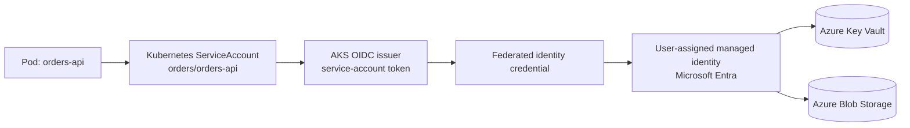
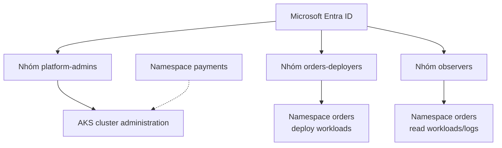

# Tích hợp Microsoft Entra ID và phân quyền AKS

Một doanh nghiệp có ba nhóm cùng vận hành **Azure Kubernetes Service (AKS)**: đội nền tảng quản trị cluster, đội phát triển chỉ triển khai ứng dụng trong namespace của mình và đội quan sát chỉ được đọc thông tin vận hành. Nếu mọi người đều dùng chung tài khoản `cluster-admin`, không thể áp dụng nguyên tắc quyền tối thiểu, khó truy vết thao tác và một thông tin xác thực bị lộ có thể ảnh hưởng toàn bộ cluster.

**Microsoft Entra ID** giúp xác thực con người hoặc nhóm người dùng khi họ truy cập Kubernetes API của AKS. Sau bước xác thực, hệ thống phải quyết định **người dùng được làm gì** bằng một mô hình phân quyền cụ thể: **Kubernetes RBAC** hoặc **Azure RBAC for Kubernetes Authorization**. Ngoài ra, ứng dụng chạy trong pod có danh tính và quyền riêng để gọi Azure Storage, Key Vault hoặc các dịch vụ khác.

Bài học thuộc chương **Nền tảng Azure Kubernetes Service** của module **CLOUD_PROVIDERS_AZURE**. Module giới thiệu Microsoft Azure từ subscription, resource group và Microsoft Entra ID đến mạng ảo, dịch vụ tính toán, lưu trữ và dữ liệu; đồng thời hướng dẫn triển khai, giám sát, bảo vệ và kiểm soát chi phí kiến trúc ứng dụng. Trong AKS, thiết kế Entra ID và RBAC là nền tảng để nhiều đội cùng khai thác cluster mà vẫn giữ được ranh giới trách nhiệm.

Sau bài học, bạn có thể:

- Phân biệt **authentication**, **authorization**, Azure resource management và Kubernetes API access.
- Giải thích luồng đăng nhập Entra ID qua `az aks get-credentials`, `kubelogin` và `kubectl`.
- So sánh Kubernetes RBAC với Azure RBAC for Kubernetes Authorization và chọn đúng mô hình.
- Thiết kế Role/RoleBinding hoặc Azure role assignment theo namespace và nhóm Entra.
- Phân biệt danh tính con người, **cluster managed identity**, **kubelet identity**, **Kubernetes service account** và **Microsoft Entra Workload ID**.
- Xác định tác động của `--admin`, local accounts, private cluster và quyền truy cập khẩn cấp.
- Kiểm tra quyền thực tế, chẩn đoán lỗi `401`/`403` và xây dựng runbook vận hành.

## 1. Ba câu hỏi độc lập: bạn là ai, được làm gì, có tới được API không?

Một yêu cầu như `kubectl get pods -n orders` chỉ thành công khi **cả ba lớp** phù hợp:

1. **Network reachability:** máy quản trị có thể kết nối tới AKS Kubernetes API server qua DNS, routing, firewall và TLS hay không?
2. **Authentication:** API server có xác định được danh tính người yêu cầu hay không? Với người dùng Entra, token đăng nhập phải hợp lệ và được chấp nhận.
3. **Authorization:** danh tính đã xác thực có quyền thực hiện động từ `list` trên tài nguyên `pods` trong namespace `orders` hay không?



**401 Unauthorized** thường gợi ý danh tính hoặc thông tin xác thực không hợp lệ/chưa được cung cấp. **403 Forbidden** thường cho biết người gọi đã được nhận diện nhưng không được cấp phép cho hành động cụ thể; dù vậy cần xem thông báo API và audit log trước khi kết luận. Lỗi timeout/TLS không nên được “sửa” bằng cách cấp quyền cluster-admin.

### 1.1. Hai control plane dễ bị nhầm

| Hoạt động | Thành phần nhận yêu cầu | Cơ chế quyền liên quan |
|---|---|---|
| Tạo/xóa AKS cluster | Azure Resource Manager (ARM) | **Azure RBAC** ở subscription/RG/resource scope |
| Xem tài nguyên AKS trên Portal | ARM | Azure RBAC phù hợp cho thao tác xem |
| Lấy user kubeconfig bằng Azure CLI | ARM/AKS resource provider | Quyền lấy credential, ví dụ Azure Kubernetes Service Cluster User Role |
| Liệt kê pods trong namespace | **Kubernetes API server** | Kubernetes RBAC hoặc Azure RBAC for Kubernetes Authorization |
| Tạo Deployment, sửa Service, đọc Secret | Kubernetes API server | Quyền Kubernetes API tương ứng |
| Pod đọc blob trong Azure Storage | Azure Storage data plane | Danh tính workload + quyền Azure Storage data plane |

**Quyền Owner hoặc Contributor trên resource group không nên được hiểu là “mọi lệnh kubectl đều được phép”.** Azure RBAC cấp quyền ARM và Kubernetes API authorization là các lớp khác nhau; một số quyền Azure có thể cho phép lấy **admin credentials** khi local accounts còn bật, tạo đường đi đặc quyền cần kiểm soát nghiêm ngặt.

## 2. Managed Microsoft Entra integration cho AKS

AKS hỗ trợ tích hợp **managed Microsoft Entra ID** để người dùng đăng nhập bằng danh tính Entra thay vì phải phát tán tài khoản quản trị Kubernetes dùng chung. Đây là lựa chọn nên đánh giá cho cluster do nhiều nhóm vận hành.

Các thành phần cơ bản:

- **Tenant Microsoft Entra ID:** nơi quản lý user, group, đăng nhập, MFA và Conditional Access theo khả năng chính sách.
- **AKS cluster** với Entra integration được bật: chấp nhận quy trình đăng nhập Entra cho người quản trị/khai thác cluster.
- **Azure CLI/kubelogin:** công cụ trên máy người dùng lấy token Entra và cung cấp cho `kubectl` theo phương thức được hỗ trợ.
- **Kubernetes API server:** xác thực token, nhận diện user/group rồi chuyển sang bước authorization.
- **Authorization model:** một trong hai mô hình cho quyền người dùng Entra: Kubernetes RBAC hoặc Azure RBAC for Kubernetes Authorization.



Sơ đồ tóm tắt tương tác logic; thực tế `kubectl` có thể gọi `kubelogin` qua kubeconfig **exec credential plugin**, và token có thể được cache. Quy trình đăng nhập, refresh token và yêu cầu MFA phụ thuộc chính sách Entra của tổ chức.

### 2.1. Dùng nhóm thay vì cấp quyền cho từng người

Thay vì tạo RBAC cho từng nhân viên, doanh nghiệp nên xác định các nhóm Entra như:

| Nhóm ví dụ | Mục tiêu |
|---|---|
| `aks-platform-admins` | Quản trị cluster và thay đổi tài nguyên phạm vi toàn cluster theo quy trình |
| `aks-orders-deployers` | Triển khai ứng dụng trong namespace `orders` |
| `aks-orders-observers` | Chỉ xem tài nguyên không nhạy cảm trong `orders` |
| `aks-security-auditors` | Xem hoạt động và audit theo phạm vi được duyệt |

Trong tài liệu cấu hình, lưu **Object ID của group** khi cơ chế binding yêu cầu, không dựa chỉ vào display name (có thể trùng hoặc đổi). Cần xác minh membership, token/group claims và cách Entra trả thông tin nhóm; thay đổi thành viên nhóm có thể không có hiệu lực ngay trên token đang được cache.

### 2.2. Managed Entra và legacy Entra integration

Khi tiếp nhận cluster lâu đời, có thể thấy cách tích hợp Entra trước đây dùng server/client app registration tự quản lý. Không tự áp dụng hướng dẫn kiểu legacy vào cluster đang dùng **managed Entra integration**. Cần kiểm tra cấu hình `aadProfile` thực tế và lên kế hoạch migration theo cơ chế AKS được hỗ trợ nếu cần.

## 3. Hai mô hình authorization cho người dùng Entra

Entra ID giải quyết **authentication**. Sau đó, AKS có thể sử dụng:

1. **Kubernetes RBAC:** các đối tượng Kubernetes `Role`, `ClusterRole`, `RoleBinding` và `ClusterRoleBinding`; quyền được xét theo user/group nhận từ cơ chế authentication.
2. **Azure RBAC for Kubernetes Authorization:** các Azure role assignments ở scope phù hợp quyết định quyền Kubernetes API của **người dùng Entra** theo tích hợp AKS; có các built-in roles chuyên dụng.

Không nên cấu hình cả hai rồi mặc định quyền của người dùng là phép cộng đơn giản. **Authorization mode của cluster quyết định mô hình đang xử lý request người dùng Entra.** Kubernetes service accounts vẫn có cơ chế Kubernetes RBAC của chúng; xem phần về workload identity ở dưới.

### 3.1. Bảng so sánh

| Tiêu chí | Kubernetes RBAC | Azure RBAC for Kubernetes Authorization |
|---|---|---|
| Nơi định nghĩa quyền cho người dùng Entra | Kubernetes API objects | Azure role definitions/assignments |
| Công cụ quản trị | `kubectl`, GitOps, Helm, Kubernetes manifests | Azure Portal/CLI/ARM/IaC |
| Scope điển hình | Namespace với Role/RoleBinding; cluster với ClusterRole/ClusterRoleBinding | AKS resource hoặc namespace scope được hỗ trợ |
| Danh tính Entra | User/group được ánh xạ vào Kubernetes RBAC bindings | User/group/service principal Entra theo cơ chế authorization được hỗ trợ |
| Audit/quản trị quyền | Kubernetes audit và GitOps review | Azure role assignment governance, kết hợp audit Kubernetes |
| Mức độ tùy biến | Rất chi tiết theo API groups/resources/verbs | Phụ thuộc built-in/custom role và giới hạn Azure RBAC authorization |
| Người có thể thay đổi quyền | Chủ thể có quyền quản trị Kubernetes RBAC | Chủ thể có quyền quản lý Azure role assignment ở scope tương ứng |
| Service accounts trong pod | Kubernetes RBAC | Kubernetes RBAC vẫn được dùng cho service accounts |

**Gợi ý chọn:** nếu đã có GitOps quản lý toàn bộ Kubernetes manifests và cần quyền rất chi tiết cho custom resources, Kubernetes RBAC thường dễ biểu đạt. Nếu tổ chức chuẩn hóa identity governance, access reviews và role assignments qua Azure, nên đánh giá Azure RBAC for Kubernetes Authorization. Trong cả hai trường hợp, cần kiểm tra giới hạn hỗ trợ của tính năng với phiên bản AKS, resource types và nghiệp vụ.

### 3.2. Chuyển authorization mode là thay đổi có rủi ro

Một cluster đã có RoleBindings cho Entra users/groups có thể bị thay đổi khả năng truy cập nếu bật **Azure RBAC for Kubernetes Authorization** mà chưa tạo Azure role assignments tương ứng. Ngược lại, khi đổi trở lại Kubernetes RBAC phải có bindings cần thiết.

Vì vậy:

- Kiểm kê mọi user/group, service account và workflow CI/CD hiện tại.
- Ghi lại quyền thực tế theo namespace và cluster scope.
- Chuẩn bị mapping sang role/assignment của mô hình đích.
- Kiểm thử bằng tài khoản có quyền thấp trước khi chuyển production.
- Dự phòng runbook khôi phục quyền quản trị hợp lệ, có phê duyệt.

Không xem `enableAzureRbac` là cờ cấu hình có thể bật/tắt tùy ý mà không có tác động.

## 4. Kubernetes RBAC: Role, ClusterRole và binding

Kubernetes RBAC gồm bốn đối tượng cơ bản:

| Đối tượng | Phạm vi định nghĩa/áp dụng | Ý nghĩa |
|---|---|---|
| **Role** | Một namespace | Tập quy tắc cho phép động từ trên tài nguyên ở namespace đó |
| **ClusterRole** | Cấp cluster | Quy tắc có thể áp dụng cho tài nguyên cluster-wide hoặc dùng lại trong namespace |
| **RoleBinding** | Một namespace | Gán Role hoặc ClusterRole cho chủ thể trong phạm vi namespace đó |
| **ClusterRoleBinding** | Toàn cluster | Gán ClusterRole cho chủ thể theo phạm vi cluster |

RBAC chuẩn của Kubernetes có các **allow rules** và không có cơ chế “deny” tổng quát trong Role/ClusterRole để vô hiệu một allow khác. Quyền hiệu lực của chủ thể thường là **hợp** các quyền được cấp qua bindings; nếu đã được cluster-admin ở một binding khác, một RoleBinding chỉ đọc không làm chủ thể bị giới hạn lại.

### 4.1. Quy tắc có những thành phần nào?

Một RBAC rule có thể mô tả:

- **apiGroups:** ví dụ `""` (core API group), `apps` hoặc nhóm custom resource.
- **resources:** ví dụ `pods`, `deployments`, `services`, `pods/log`.
- **verbs:** `get`, `list`, `watch`, `create`, `update`, `patch`, `delete`.
- **resourceNames** (khi phù hợp) để giới hạn một số thao tác ở tên tài nguyên cụ thể.

Không coi `get pods` là quyền `get secrets`. Nhưng quyền **tạo pod, exec vào pod, đọc secret, sửa role bindings hoặc dùng service account đặc quyền** có thể tạo đường leo thang quyền gián tiếp; cần xét cả tác động của quyền chứ không chỉ tên động từ.

### 4.2. Mẫu chỉ đọc trong namespace `orders`

Giả sử nhóm Entra `aks-orders-observers` có Object ID `<ENTRA_GROUP_OBJECT_ID>`. Trong cluster **dùng Kubernetes RBAC cho người dùng Entra**, ta có thể tạo Role và RoleBinding:

```yaml
apiVersion: rbac.authorization.k8s.io/v1
kind: Role
metadata:
  name: orders-observer
  namespace: orders
rules:
  - apiGroups: [""]
    resources: ["pods", "services"]
    verbs: ["get", "list", "watch"]
  - apiGroups: [""]
    resources: ["pods/log"]
    verbs: ["get"]
  - apiGroups: ["apps"]
    resources: ["deployments", "replicasets"]
    verbs: ["get", "list", "watch"]
---
apiVersion: rbac.authorization.k8s.io/v1
kind: RoleBinding
metadata:
  name: orders-observers-binding
  namespace: orders
subjects:
  - kind: Group
    name: "<ENTRA_GROUP_OBJECT_ID>"
    apiGroup: rbac.authorization.k8s.io
roleRef:
  kind: Role
  name: orders-observer
  apiGroup: rbac.authorization.k8s.io
```

**Giải thích:**

1. `Role` chỉ áp dụng ở namespace `orders` và không cho đọc `secrets`.
2. `RoleBinding` liên kết nhóm được AKS nhận diện sau Entra authentication với Role vừa định nghĩa.
3. `Group.name` phải được thay bằng **Object ID nhóm thật**, không phải tên hiển thị hoặc chuỗi placeholder.
4. Quyền này chỉ có ý nghĩa nếu request được xử lý bởi Kubernetes RBAC, và người dùng có nhóm đúng trong danh tính được AKS nhận diện.
5. Nếu nhóm đang có một `ClusterRoleBinding` mạnh hơn, quyền hiệu lực có thể lớn hơn mẫu này.

Để áp dụng YAML cần quyền sửa RBAC và namespace `orders` đã tồn tại. Đây là **thao tác ghi trên cluster**, phải review/approve, ưu tiên triển khai bằng GitOps/IaC theo quy trình tổ chức:

```bash
# Chỉ dùng trên cluster lab/đã phê duyệt, với file đã thay đúng group Object ID.
kubectl apply -f orders-observer-rbac.yaml
```

Không chạy manifest có Object ID placeholder trên production. Khi áp dụng thay đổi RBAC nên có review hai người, kiểm thử user thật và khả năng rollback.

### 4.3. RoleBinding với ClusterRole

Có thể dùng một `ClusterRole` định nghĩa quyền được sử dụng lại, sau đó gắn qua **RoleBinding** của từng namespace để giới hạn quyền namespaced. Ngược lại, **ClusterRoleBinding** có hiệu lực ở cấp cluster đối với các quyền phù hợp — không nên dùng chỉ vì “ngắn lệnh hơn”.

Không tự động cấp `cluster-admin` cho toàn bộ nhóm phát triển để họ có thể sửa Deployment. Hãy tạo Role cho tài nguyên thực sự cần vận hành, cân nhắc các quyền leo thang như `roles`, `rolebindings`, `secrets`, `serviceaccounts`, `pods/exec` và khả năng tạo workload chạy với danh tính cao hơn.

## 5. Azure RBAC for Kubernetes Authorization

Khi cluster bật **Azure RBAC for Kubernetes Authorization**, Azure role assignments cho những principal Entra được sử dụng để cho phép/từ chối thao tác Kubernetes API theo phạm vi hỗ trợ.

Các built-in roles thường gặp:

| Azure role | Ý nghĩa khái quát | Lưu ý |
|---|---|---|
| **Azure Kubernetes Service RBAC Reader** | Đọc nhiều tài nguyên Kubernetes theo scope được cấp | Không mặc định được đọc mọi Secret hoặc dữ liệu nhạy cảm |
| **Azure Kubernetes Service RBAC Writer** | Quản lý nhiều tài nguyên trong namespace/scope | Có thể có quyền nhạy cảm như tạo workload/đọc dữ liệu tùy role; phải review |
| **Azure Kubernetes Service RBAC Admin** | Quyền quản trị Kubernetes rộng hơn theo scope áp dụng | Không nên cấp đại trà, cần xét mức quyền RBAC |
| **Azure Kubernetes Service RBAC Cluster Admin** | Quyền quản trị Kubernetes ở cấp cluster | Dành cho ít principal, có kiểm soát chặt |

Đây là các vai trò **Kubernetes data-plane authorization** do Azure cung cấp, khác với:

| Azure role cho AKS control plane | Mục tiêu chủ yếu |
|---|---|
| **Azure Kubernetes Service Cluster User Role** | Quyền lấy user kubeconfig từ AKS khi đủ điều kiện |
| **Azure Kubernetes Service Cluster Admin Role** | Quyền lấy admin credential/kubeconfig trong mô hình AKS cho phép |
| **Azure Contributor/Owner** ở scope AKS/RG | Quản trị tài nguyên Azure theo role definition; có thể chứa quyền nhạy cảm về AKS, phải kiểm tra cụ thể |

**Phân biệt “Cluster Admin Role” và “RBAC Cluster Admin” bằng đầy đủ tên vai trò.** Vai trò cấp credential ở ARM không giống quyền thao tác Kubernetes API do Azure RBAC for Kubernetes Authorization quyết định. Quyền lấy admin credential có thể tạo đường bỏ qua mô hình Entra nếu local accounts còn cho phép.

### 5.1. Scope role assignment

Azure RBAC role assignment có **principal**, **role definition** và **scope**. Với AKS, scope có thể ở mức cluster hoặc namespace theo tính năng được hỗ trợ. Ví dụ tư duy:

```text
/subscriptions/<sub-id>
  /resourceGroups/<rg>
    /providers/Microsoft.ContainerService/managedClusters/<aks-name>
      /namespaces/orders
```

Khi cần quyền trong namespace `orders`, nên cân nhắc namespace-level scope được AKS hỗ trợ thay vì gán quyền toàn cluster. Không tự bịa ra scope hoặc dùng string này nguyên văn khi chưa thay các thành phần bằng **resource ID thật** và xác nhận định dạng assignment ở API/version hiện hành.

Quyền Azure RBAC có thể được thừa kế từ scope cao hơn như resource group/subscription. Khi kiểm tra quyền hiệu lực, phải rà soát cả assignments ở scope gốc, nhóm Entra và PIM, không chỉ những assignment trực tiếp tại AKS resource.

### 5.2. Ví dụ lập ma trận cấp quyền

| Nhóm | Scope khuyến nghị | Quyền |
|---|---|---|
| `aks-platform-admins` | Cluster theo nhu cầu thật | Azure Kubernetes Service RBAC Cluster Admin, có PIM/review nếu dùng |
| `aks-orders-deployers` | Namespace `orders` | Role phù hợp để deploy, không tự có quyền quản trị namespace khác |
| `aks-orders-observers` | Namespace `orders` | Azure Kubernetes Service RBAC Reader |
| `aks-security-auditors` | Scope audit đã phê duyệt | Role quan sát phù hợp, kết hợp quyền đọc Log Analytics nếu cần |

Trong thực tế, role `Writer` có thể mạnh hơn yêu cầu “chỉ cập nhật Deployment”. Với workload nhạy cảm, hãy đánh giá **custom Azure role** trong phạm vi AKS hỗ trợ hoặc sử dụng Kubernetes RBAC khi cần mức hạt quyền chi tiết hơn, đồng thời tránh vô tình cấp quyền đọc Secrets/exec hoặc thay service account.

### 5.3. Kiểm tra assignment bằng Azure CLI

Đây là các lệnh **chỉ đọc**:

```bash
RG="rg-aks-prod"
AKS="aks-orders-prod"

AKS_ID=$(az aks show \
  --resource-group "$RG" \
  --name "$AKS" \
  --query id -o tsv)

az role assignment list \
  --scope "$AKS_ID" \
  --include-inherited \
  -o table
```

Lệnh trên giúp xem những role assignments ở scope cluster và các scope cha được trả về. Nó **không tự liệt kê đầy đủ mọi assignment tại namespace con**. Khi kiểm tra một namespace, cần truy vấn đúng child scope được hỗ trợ hoặc kiểm tra Azure Portal/ARM tại scope tương ứng. Đồng thời đối chiếu principal/group membership thật thay vì chỉ dựa vào display name.

## 6. Kết nối kubectl bằng Entra ID và kubelogin

### 6.1. Công cụ chuẩn bị

Máy làm việc cần:

- Azure CLI đã đăng nhập đúng **tenant/subscription**.
- `kubectl` tương thích với AKS/Kubernetes version.
- `kubelogin` (công cụ exec authentication) phù hợp.
- Network/DNS đến API server, đặc biệt với private AKS cluster.
- Quyền Azure để lấy **user credential** và quyền Kubernetes API tương ứng.

`kubelogin` có thể được cài bằng cách được Microsoft hỗ trợ, ví dụ thông qua `az aks install-cli` trong môi trường đáp ứng điều kiện. Tránh lưu token Entra hoặc kubeconfig chứa credential nhạy cảm trong source control.

### 6.2. Quy trình người dùng thông thường

```bash
# Đăng nhập bằng danh tính người dùng theo chính sách doanh nghiệp.
az login
az account set --subscription "<subscription-id>"

# Lấy user kubeconfig (ghi vào kubeconfig trên máy cục bộ).
az aks get-credentials \
  --resource-group "rg-aks-prod" \
  --name "aks-orders-prod"

# Với kubeconfig cần exec plugin và kiểu đăng nhập Azure CLI:
kubelogin convert-kubeconfig -l azurecli

# Kiểm tra quyền trong namespace, sau khi đã xác thực đúng.
kubectl auth can-i list pods -n orders
kubectl get pods -n orders
```

**Lưu ý:** `az aks get-credentials` có thể **ghi/sửa kubeconfig cục bộ** dù không làm thay đổi cluster. Cần kiểm tra context để tránh thao tác vào cluster production ngoài ý muốn. `kubelogin convert-kubeconfig` cũng sửa cấu hình xác thực trong kubeconfig cục bộ; không cần chạy lại vô điều kiện nếu file đã có cấu hình exec đúng.

### 6.3. Kubeconfig không phải quyền truy cập

Kubeconfig chứa thông tin **cluster endpoint**, context và cách cung cấp credential. Nó không tự cấp quyền `create deployments`. Người dùng có thể tải kubeconfig thành công nhưng vẫn bị `403 Forbidden` khi gọi API nếu authorization chưa cho phép.

Ví dụ kiểm tra context cục bộ:

```bash
kubectl config current-context
kubectl config get-contexts
kubectl auth can-i get pods -n orders
kubectl auth can-i create deployments.apps -n orders
kubectl auth can-i get secrets -n orders
```

Kết quả `yes`/`no` phản ánh kiểm tra authorization theo danh tính và cluster hiện tại; phải đảm bảo context và user token đúng. Một số kiểm tra có thể bị giới hạn bởi cách authorization webhook/role được cấu hình; xác minh thêm bằng các lệnh chỉ đọc và audit khi cần.

Không in toàn bộ kubeconfig có tokens/certificates lên ticket/chat công khai. Nếu cần chia sẻ, chỉ trích những trường không nhạy cảm đã che tenant ID, endpoint nội bộ và credential theo chính sách.

## 7. Local accounts, admin credentials và break-glass

AKS có thể có đường truy cập thông qua **local admin/user credentials** của cluster, tùy cấu hình. Lệnh:

```bash
# Ví dụ nguy cơ quyền đặc biệt — KHÔNG chạy trong quy trình thông thường:
# az aks get-credentials -g rg-aks-prod -n aks-orders-prod --admin
```

`--admin` yêu cầu **admin credentials**, khác với đăng nhập Entra thông thường và có thể bỏ qua lớp xác thực/authorization Entra trong những cấu hình cho phép local accounts. Vì vậy:

- Hạn chế tối đa principal có thể lấy admin credentials.
- Xem xét **disable local accounts** cho cluster có Entra integration theo khả năng hỗ trợ.
- Kiểm tra tác động tới automation cũ trước khi tắt local accounts.
- Có quy trình **break-glass** được phê duyệt, dựa trên các cơ chế hỗ trợ thực tế; không tạo đường backdoor mặc định.
- Giám sát hoạt động lấy credentials, role assignments và thay đổi cluster cấu hình.

Khi **local accounts disabled**, không nên giả định `--admin` vẫn hoạt động. Nếu cần khắc phục sự cố, dùng con đường quyền Entra/Azure RBAC đã chuẩn bị thay vì cố tái bật một đường đặc quyền không kiểm soát.

### 7.1. PIM và Conditional Access

Khi tổ chức có **Microsoft Entra Privileged Identity Management (PIM)** và chính sách Conditional Access, có thể cân nhắc:

- Quyền admin được cấp **eligible** và kích hoạt theo thời hạn cần thiết.
- Xác thực mạnh/MFA cho thao tác có rủi ro.
- Approval, lý do kích hoạt và audit trail cho role cấp cluster.
- Access review định kỳ với các nhóm Entra có quyền AKS.

Cách PIM áp dụng cho **Azure role assignments** và **Entra group membership** có thể khác nhau. Cần kiểm chứng thực tế rằng activation/group claims/token đã được cập nhật trước khi sử dụng; không mặc định quyền mới lập tức xuất hiện trong một phiên kubelogin đang dùng token cache.

## 8. Danh tính pod không phải danh tính người vận hành

AKS có nhiều loại identity:

| Danh tính | Công dụng chính | Không nên nhầm với |
|---|---|---|
| **Entra user/group** | Người vận hành đăng nhập và được cấp quyền Kubernetes API | Danh tính của pod |
| **AKS cluster managed identity** | Control plane AKS thực hiện thao tác Azure hạ tầng theo quyền được cấp | Quyền `kubectl` của nhân viên |
| **Kubelet identity** | Node/kubelet tương tác với Azure resources như kéo image từ ACR theo mô hình hỗ trợ | Quyền đọc Secrets của mọi namespace |
| **Kubernetes service account** | Danh tính workload trong Kubernetes API, có token và Kubernetes RBAC | Entra user |
| **Microsoft Entra Workload ID** | Cho phép workload dùng Kubernetes service account được liên kết với danh tính Entra để gọi Azure APIs | Quyền quản trị AKS của con người |

**Một pod gọi Azure Key Vault thành công không chứng minh pod được quyền `kubectl delete nodes`.** Đó là hai authorization khác nhau. Tương tự, một người có Azure RBAC Contributor trên Storage Account chưa chắc có quyền thao tác Kubernetes resources.

### 8.1. Workload Identity: OIDC và federation

Microsoft Entra Workload ID cho AKS sử dụng cơ chế **OIDC issuer** và **federated identity credential** để liên kết một Kubernetes service account với danh tính Entra được cấu hình. Ứng dụng có thể nhận token Azure qua luồng credential hỗ trợ mà không cần giữ một client secret dài hạn.



Một quy trình triển khai hợp lệ thường cần:

1. Bật **OIDC issuer** và tính năng **workload identity** trên AKS theo cơ chế hỗ trợ.
2. Chuẩn bị user-assigned managed identity hoặc application identity phù hợp.
3. Tạo **federated identity credential** với issuer, audience và subject chính xác.
4. Tạo Kubernetes service account đúng namespace/name và annotation liên quan tới client ID.
5. Cấu hình workload/pod theo nhãn/annotation được webhook yêu cầu, ví dụ `azure.workload.identity/use: "true"` khi áp dụng.
6. Gán Azure data-plane roles cần thiết, chẳng hạn đọc secret cụ thể trong Key Vault hoặc Blob Data Reader ở scope phù hợp.
7. Kiểm thử SDK Azure Identity từ pod và giám sát lỗi token/permission.

Một service account có thể được biểu diễn:

```yaml
apiVersion: v1
kind: ServiceAccount
metadata:
  name: orders-api
  namespace: orders
  annotations:
    azure.workload.identity/client-id: "<MANAGED_IDENTITY_CLIENT_ID>"
```

Trong federated credential, subject theo cấu trúc minh họa:

```text
system:serviceaccount:orders:orders-api
```

**Đây chỉ là mảnh cấu hình**, chưa đủ để workload identity hoạt động. Cần pod labels, OIDC issuer, credential federation, scope RBAC Azure và phiên bản SDK/feature tương thích. Không lưu client secret trong manifest hoặc giả định annotation có thể thay thế toàn bộ cấu hình.

### 8.2. Kubernetes RBAC của service account

Một pod có service account `orders-api` chỉ nên có các quyền Kubernetes API thật sự cần. Nếu ứng dụng không bao giờ gọi Kubernetes API thì **không cần RoleBinding** để nó đọc pods hoặc secrets. Workload identity để đọc Blob/Key Vault **không tự cấp** Kubernetes cluster-admin.

Đặc biệt cẩn trọng với quyền tạo pod, chạy pod dưới service account khác, `pods/exec`, thay đổi RBAC và mount host paths. Kubernetes namespace không phải ranh giới bảo mật tuyệt đối khi các workload có quyền nhạy cảm ở tầng node.

## 9. Security hardening cho AKS đa nhóm

### 9.1. Least privilege theo namespace

Một chính sách tham khảo:

- Đội ứng dụng được **deploy và xem** workload chỉ trong namespace của mình.
- Đội support được **đọc trạng thái/log** không nhạy cảm, không đọc toàn bộ Secrets.
- Đội nền tảng chịu trách nhiệm cluster-wide CRDs, nodes, admission, network policies và system namespaces.
- CI/CD dùng danh tính riêng, scoped permission và audit; không dùng kubeconfig admin chia sẻ.
- Secret/data-plane credentials của ứng dụng sử dụng Key Vault hoặc cơ chế được hỗ trợ, không hard-code.

Nếu cần cô lập nghiêm ngặt giữa những đơn vị không cùng mức tin cậy, cân nhắc **nhiều AKS clusters** hoặc ranh giới hạ tầng khác thay vì giả định namespace + RBAC có thể bao trùm mọi tấn công ở tầng node/kernel/network.

### 9.2. Bảo vệ Kubernetes API server

Entra ID và RBAC là **lớp identity**, còn API server cũng cần bảo vệ mạng:

- **Private AKS cluster** có endpoint riêng và phụ thuộc DNS/routing tương ứng.
- **API server authorized IP ranges** khi sử dụng public endpoint và tính năng hỗ trợ.
- Bastion, VPN/ExpressRoute, private DNS và quản trị thiết bị đầu cuối khi cần.
- Giám sát hoạt động truy cập API, thất bại đăng nhập và thay đổi cấu hình.

Khi một cluster private không thể truy cập từ laptop vì DNS/route, không cấp thêm Azure Kubernetes Service RBAC Cluster Admin để “mở khóa” mạng. Ngược lại, IP nguồn được cho phép không đồng nghĩa người đó được phép gọi `kubectl get secrets`.

### 9.3. Bảo vệ CI/CD và supply chain

Tách riêng **quyền tạo Deployment** với **quyền push image, ký image hoặc thay đổi admission policy**. Một pipeline triển khai có thể cần quyền `patch deployments` trong namespace cụ thể, nhưng không cần quyền sửa ClusterRoleBindings hoặc kube-system.

Các rủi ro quan trọng:

- Pipeline dùng credential admin lâu hạn, bị lộ qua log/artifacts.
- Developer có quyền tạo Pod dùng service account đặc quyền hoặc đọc Secret.
- Image tag bị ghi đè, dẫn tới thay đổi mã không qua kiểm duyệt.
- GitOps controller được cấp quyền rộng hơn phạm vi ứng dụng cần quản lý.

Sử dụng workload federation/managed identity ở nơi phù hợp, review RBAC, pin image digest khi cần và ghi audit trail.

## 10. Thực hành: kiểm tra trạng thái Entra và authorization của cluster

Các lệnh Azure CLI dưới đây **chỉ đọc** cluster, không bật/tắt tích hợp Entra hoặc thay đổi quyền. Dùng tenant/subscription đúng và principal có quyền xem tài nguyên.

### 10.1. Kiểm tra AKS `aadProfile` và local accounts

```bash
RG="rg-aks-prod"
AKS="aks-orders-prod"

az account show \
  --query "{subscription:name,id:id,tenant:tenantId}" \
  -o table

az aks show \
  --resource-group "$RG" \
  --name "$AKS" \
  --query "{name:name,aadProfile:aadProfile,disableLocalAccounts:disableLocalAccounts,apiServerAccessProfile:apiServerAccessProfile}" \
  -o json
```

Hãy quan sát:

- `aadProfile.managed` hoặc các trường tương đương để xác định managed Entra integration.
- `aadProfile.adminGroupObjectIds` khi có, vì admin groups có thể là đường quyền rất rộng.
- `aadProfile.enableAzureRbac` để xem có bật Azure RBAC for Kubernetes Authorization hay không.
- `disableLocalAccounts` để xem local credentials được kiểm soát thế nào.
- `apiServerAccessProfile` để hiểu mạng/private cluster và authorized IP ranges khi có.

Tên/trạng thái field phụ thuộc phiên bản API và kiểu cluster; nên đọc JSON thực tế thay vì mặc định field không có nghĩa một khả năng đã bị tắt.

### 10.2. Xem quyền Azure ở scope cluster

```bash
AKS_ID=$(az aks show \
  --resource-group "$RG" \
  --name "$AKS" \
  --query id -o tsv)

az role assignment list \
  --scope "$AKS_ID" \
  --include-inherited \
  -o table
```

Với Azure RBAC authorization, kiểm tra cả namespace assignments ở scope phù hợp và group membership của người dùng. Một role assignment mới có thể cần thời gian truyền hiệu lực; nếu token chưa mang thông tin nhóm cần thiết, đăng nhập lại theo quy trình an toàn và kiểm tra token/cache.

### 10.3. Xác minh quyền kubectl (chỉ đọc)

```bash
kubectl config current-context
kubectl auth can-i list pods -n orders
kubectl auth can-i get secrets -n orders
kubectl auth can-i create deployments.apps -n orders
kubectl get pods -n orders
```

Những lệnh `can-i` là kiểm tra được Kubernetes API thực hiện cho danh tính hiệu lực và context hiện tại. Nếu người dùng không được phép liệt kê pods thì `kubectl get pods` có thể trả `Forbidden` — đây là kết quả đáng mong đợi cho tài khoản chưa được cấp quyền, không phải lý do tự động cấp admin.

### 10.4. Xem Kubernetes RBAC objects khi được phép

```bash
kubectl get roles,rolebindings -n orders
kubectl get clusterroles,clusterrolebindings
```

Các câu lệnh liệt kê này cũng yêu cầu quyền Kubernetes API; không thể dùng làm công cụ kiểm tra nếu chính người gọi chưa được phép đọc RBAC objects. Trong cluster dùng Azure RBAC for Kubernetes Authorization, danh sách RoleBindings chưa mô tả đầy đủ quyền của người dùng Entra: còn phải đối chiếu **Azure role assignments**.

## 11. Một ví dụ tổ chức: ba nhóm, ba cấp quyền

Một nền tảng AKS có hai namespace `orders` và `payments`:



### 11.1. Nếu chọn Kubernetes RBAC

Đội nền tảng quản lý namespace và các bindings bằng GitOps:

1. Tạo `Role` triển khai phù hợp cho đội `orders`, không cấp quyền quản trị cluster.
2. Tạo `RoleBinding` tới **Entra group Object ID** trong namespace `orders`.
3. Tạo Role chỉ đọc cho nhóm quan sát.
4. Tránh tạo `ClusterRoleBinding` mang quyền cluster-admin cho mọi thành viên đội phát triển.
5. Kiểm tra quyền bằng tài khoản thực của từng nhóm; thử `get secrets`, `create rolebindings` và thao tác ngoài namespace để chắc rằng chúng bị chặn khi không được phép.

### 11.2. Nếu chọn Azure RBAC for Kubernetes Authorization

Đội nền tảng và IAM phối hợp:

1. Gán quyền **Cluster User Role** hoặc quyền lấy user kubeconfig phù hợp khi cần.
2. Gán **Azure Kubernetes Service RBAC Reader/Writer** hoặc custom role phù hợp ở scope namespace được hỗ trợ.
3. Chỉ gán **RBAC Cluster Admin** cho nhóm có nhiệm vụ thật, dưới PIM/approval khi có.
4. Kiểm tra kế thừa quyền ở subscription/RG/cluster và nhóm Entra.
5. Dùng `kubectl auth can-i` để xác minh quyền thực, không kết luận chỉ từ trang Azure role assignments.

Trong cả hai mô hình, nhóm `payments` phải được bảo vệ khỏi các quyền không cần thiết của `orders`, kể cả những quyền leo thang gián tiếp qua secrets, pod execution, service accounts và admission configurations.

## 12. Troubleshooting: đăng nhập được nhưng kubectl không hoạt động

| Triệu chứng | Nguyên nhân có thể | Hướng xác minh |
|---|---|---|
| `az aks get-credentials` báo thiếu quyền | Principal chưa có quyền lấy user credential trên resource AKS | Kiểm tra Cluster User Role hoặc quyền ARM tương ứng |
| `kubectl` timeout khi kết nối API server | Private cluster DNS, VPN/peering/NSG/firewall hoặc endpoint không tới được | Kiểm tra DNS, TCP/TLS, route và private API endpoint |
| `kubelogin` không chạy hoặc exec plugin lỗi | Chưa cài/phiên bản plugin không phù hợp, kubeconfig exec sai | Kiểm tra cài đặt và chuyển kubeconfig sang login mode hỗ trợ |
| Entra login thất bại/MFA không hoàn tất | Sai tenant, Conditional Access, token cache, account chưa được phép | Kiểm tra `az account show`, sign-in logs, policy |
| `kubectl` trả `401 Unauthorized` | Token sai/hết hạn/audience không phù hợp, authn không nhận | Kiểm tra kubeconfig, kubelogin và Entra sign-in |
| `kubectl` trả `403 Forbidden` | Chưa có quyền authorization cho verb/resource/namespace | Kiểm tra model RBAC, bindings hoặc Azure assignments |
| Người dùng vào được cluster nhưng không đọc namespace khác | RBAC được giới hạn theo namespace | Xác nhận đây có phải thiết kế least privilege mong muốn |
| `kubectl auth can-i` vẫn `no` sau khi gán role | Chưa đúng scope/principal, nhóm Entra khác ID, propagation/token cache | Xem Object ID, inherited roles, namespace và đăng nhập lại phù hợp |
| RoleBinding tồn tại nhưng user vẫn bị từ chối | Cluster dùng Azure RBAC authorization hoặc group không khớp | Kiểm tra `aadProfile.enableAzureRbac` và nhóm trong danh tính |
| Người dùng có `Contributor` nhưng không xem được pods | Azure control-plane role không tương đương Kubernetes authorization | Gán đúng role data-plane theo mode |
| Dùng `--admin` có quyền quá rộng | Local admin credentials đang được phép, bypass cần kiểm soát | Xem local accounts, role lấy credentials và audit |
| Pod không đọc được Key Vault | Workload identity federation/managed identity/data-plane RBAC hoặc network sai | Kiểm tra service account subject, OIDC, token, scope Key Vault |
| Pull image ACR lỗi | Kubelet/managed identity thiếu pull role hoặc ACR network/DNS sai | Xem image pull logs, identity, role và private endpoint |
| CI/CD đôi lúc được đôi lúc không | Credential/token rotation, group propagation, context hoặc pipeline identity khác | Ghi rõ principal/token, namespace, timestamp và pipeline |

### 12.1. Quy trình xử lý có bằng chứng

1. **Ghi lại request chính xác:** `kubectl get pods -n orders`, user principal, context, namespace và thời gian.
2. **Kiểm tra network:** API server resolve ra IP nào, route/TLS có tới được không?
3. **Kiểm tra authentication:** đúng tenant, kubelogin, token, Entra policy và phiên đăng nhập?
4. **Đọc authorization mode:** `aadProfile.enableAzureRbac`, local accounts và admin groups.
5. **Tìm quyền hiệu lực:** Azure assignments (gồm scope cha/namespace) hoặc Kubernetes RoleBindings/ClusterRoleBindings theo model.
6. **Kiểm tra quyền nhạy cảm:** get secrets, exec pods, create rolebindings và quyền ngoài namespace; xác minh các quyền này bị từ chối khi không cần.
7. **Thu thập audit:** Kubernetes API audit logs, Azure Activity Log, Entra sign-in logs và PIM history khi đã cấu hình.
8. **Chỉnh đúng một lớp**, thử lại với cùng danh tính và request, ghi kết quả vào incident.

Không dùng `cluster-admin` làm phép thử đầu tiên. Điều đó có thể khiến triệu chứng biến mất nhưng che giấu nguyên nhân quyền thiếu và tạo thêm rủi ro.

## 13. Giám sát, kiểm soát thay đổi và khôi phục quyền

### 13.1. Audit và quan sát

Khi vận hành AKS nhiều đội, nên có:

- **Azure Activity Log** cho thay đổi AKS resource, role assignments và control-plane operations.
- **Microsoft Entra sign-in logs** cho hành vi đăng nhập, MFA hoặc chính sách Conditional Access theo quyền truy cập tương ứng.
- **Kubernetes API audit logs** được bật và thu thập qua diagnostic settings/Log Analytics hoặc giải pháp quan sát được duyệt.
- Cảnh báo khi có thay đổi `ClusterRoleBinding`, admin group hoặc Azure role assignment đặc quyền.
- Quy trình lưu log đáp ứng bảo mật và chi phí; tránh ghi credential/token vào ticket hoặc log.

Các nguồn log phản ánh **những lớp khác nhau**; không mong một log duy nhất trả lời mọi câu hỏi ai tạo pod, ai cấp quyền và người đó đã xác thực bằng chính sách nào.

### 13.2. Quản trị quyền theo vòng đời nhân viên

- Cấp quyền qua nhóm có chủ sở hữu, mô tả mục đích và ngày review.
- Thu hồi membership khi chuyển nhóm/nghỉ việc; kiểm tra các direct assignments còn sót.
- Thay thế credential kỹ thuật dùng chung bằng managed identity/workload federation khi được hỗ trợ.
- Review định kỳ ai có khả năng lấy admin credentials hoặc sửa role assignments.
- Tách trách nhiệm: người cấp quyền cluster không nên là người duy nhất tự phê duyệt quyền của mình.

### 13.3. Runbook thay đổi authorization model

Trước khi bật/tắt Azure RBAC for Kubernetes Authorization trên cluster đang vận hành:

1. Chụp danh sách Entra groups, Azure role assignments, Kubernetes Roles/Bindings và CI/CD identities liên quan.
2. Xác nhận cách giữ lại quyền cho ít nhất một đường quản trị hợp lệ, theo chính sách tổ chức.
3. Tạo mapping quyền tương đương; kiểm tra các tài nguyên như CRD, Secrets và cluster-scoped resources.
4. Thử trên cluster lab với phiên bản/feature tương đương.
5. Thực hiện change window có approval và giám sát.
6. Kiểm thử nhiều nhóm thật: admin, deployer, observer, service account/pod và pipeline.
7. Nếu lỗi, áp dụng rollback đã thiết kế thay vì cấp admin tràn lan.

Việc **disable local accounts** cũng cần runbook riêng: kiểm kê tác vụ tự động phụ thuộc kubeconfig admin, chuẩn bị phương án Entra và xác minh đường khôi phục hợp lệ trước khi bật.

## 14. Checklist thiết kế AKS trước production

- [ ] Đã xác định tenant Entra và dùng kiểu managed integration được AKS hỗ trợ.
- [ ] Đã phân biệt control plane ARM với Kubernetes API authorization.
- [ ] Đã chọn Kubernetes RBAC hoặc Azure RBAC for Kubernetes Authorization cho người dùng Entra, có lý do rõ ràng.
- [ ] Đã thiết kế nhóm Entra theo vai trò; binding/assignment dùng Object ID và scope đúng.
- [ ] Mỗi nhóm có quyền namespace/cluster tối thiểu; tránh cấp cluster-admin mặc định.
- [ ] Đã kiểm tra các quyền leo thang gián tiếp qua pods, serviceaccounts, secrets, exec và RBAC management.
- [ ] Tài khoản vận hành dùng `kubelogin`/kubeconfig theo quy trình; không chia sẻ credential admin.
- [ ] Đã đánh giá `disableLocalAccounts` và quy trình break-glass.
- [ ] Private API/authorized IP ranges, DNS, VPN và firewall được thiết kế phù hợp.
- [ ] Cluster managed identity, kubelet identity và workload identity được cấp quyền đúng mục đích.
- [ ] Workload dùng OIDC federation/managed identity khi gọi Azure data plane thay cho secret tĩnh nếu phù hợp.
- [ ] CI/CD có danh tính riêng, quyền tối thiểu và audit trail.
- [ ] Đã kiểm thử `kubectl auth can-i` với tài khoản thật và tình huống bị từ chối đúng.
- [ ] Có logging/audit, access review, PIM nếu dùng và owner cho role assignments.
- [ ] Có runbook thay đổi authorization mode, phục hồi quyền và thu hồi quyền cũ.

## 15. Câu hỏi tự kiểm tra

1. Vì sao `az aks get-credentials` thành công nhưng `kubectl get pods` vẫn có thể trả `403 Forbidden`?
2. Microsoft Entra ID giải quyết authentication hay authorization? Thành phần nào quyết định có được `delete deployments`?
3. Nêu điểm khác nhau giữa Azure Kubernetes Service **Cluster User Role**, **Cluster Admin Role** và **RBAC Cluster Admin**.
4. Trong Kubernetes RBAC, vì sao RoleBinding theo namespace an toàn hơn ClusterRoleBinding khi chỉ cần quyền đọc pods tại `orders`?
5. Một nhóm Entra có RoleBinding chỉ đọc nhưng đồng thời được cluster-admin qua binding khác. Quyền hiệu lực sẽ ra sao?
6. Với Azure RBAC for Kubernetes Authorization, tại sao phải kiểm tra role assignments ở scope cha và namespace thay vì chỉ resource AKS?
7. Nếu bật Azure RBAC for Kubernetes Authorization, Kubernetes RoleBinding cũ có tự tiếp tục quyết định quyền của mọi Entra user không?
8. Một pod dùng Microsoft Entra Workload ID đọc được Azure Blob. Điều đó có chứng minh nó có quyền `kubectl get secrets` không?
9. Phân biệt cluster managed identity, kubelet identity và Kubernetes service account theo trách nhiệm.
10. Vì sao `--admin` và local accounts cần được kiểm soát chặt, nhất là khi AKS đã tích hợp Entra?
11. Laptop không vào được private AKS API vì DNS sai. Thay Azure RBAC role có giải quyết được không?
12. Hãy thiết kế ba nhóm Entra có quyền khác nhau cho đội nền tảng, deployer và observer trên hai namespaces.
13. Khi quyền vừa cấp vẫn chưa có hiệu lực, ngoài RBAC manifest cần kiểm tra những gì về group Object ID, scope và token cache?
14. Khi chuyển từ Kubernetes RBAC sang Azure RBAC authorization, vì sao phải lên kế hoạch trước cho pipeline và service accounts?

## Kết luận

Tích hợp **Microsoft Entra ID** với AKS giúp xác thực người dùng tập trung, nhưng một kiến trúc an toàn còn cần lựa chọn **mô hình authorization rõ ràng**. **Kubernetes RBAC** dùng Role/ClusterRole và bindings để cấp quyền chi tiết, trong khi **Azure RBAC for Kubernetes Authorization** dùng Azure role assignments chuyên dụng cho người dùng Entra. Cả hai phải được phân biệt với quyền quản trị AKS qua Azure Resource Manager, quyền lấy kubeconfig và danh tính pod. Hãy cấp quyền theo **nhóm, namespace và nguyên tắc least privilege**; kiểm soát local admin credentials, bảo vệ network API server, dùng Workload ID cho truy cập Azure data plane và xác minh quyền bằng tài khoản thật. Audit, access review và runbook thay đổi sẽ giúp AKS vừa linh hoạt cho nhiều đội triển khai vừa giữ được ranh giới bảo mật trong hệ sinh thái Azure.
