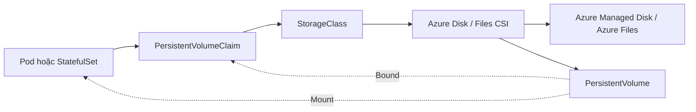
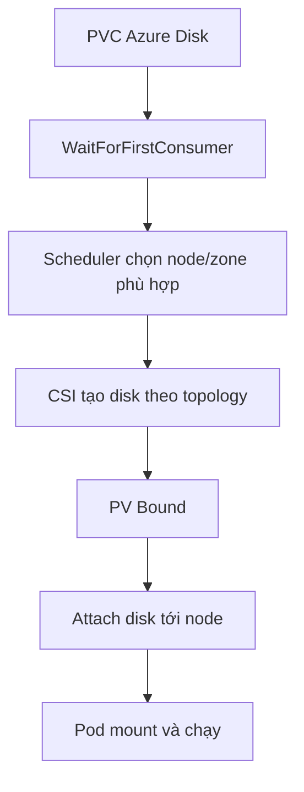

# Azure Disk CSI và Azure Files CSI cho persistent volume

Một pod chạy trong **Azure Kubernetes Service (AKS)** có thể bị xóa, được tạo lại hoặc chuyển sang node khác khi ứng dụng scale, node nâng cấp hay xảy ra sự cố. Nếu dữ liệu chỉ nằm trong lớp filesystem ghi được của container, dữ liệu đó không được bảo đảm tồn tại qua các thay đổi. Với database, file upload, tài liệu chia sẻ hoặc trạng thái nghiệp vụ, ta cần **persistent storage** có vòng đời độc lập với pod.

Kubernetes cung cấp các đối tượng **PersistentVolume (PV)**, **PersistentVolumeClaim (PVC)** và **StorageClass**. Azure tích hợp hạ tầng lưu trữ qua **Container Storage Interface (CSI)**, trong đó hai driver thường gặp là:

- **Azure Disk CSI** với provisioner `disk.csi.azure.com`: cấp phát Azure Managed Disk, phù hợp với block storage, thường là một node ghi tại một thời điểm.
- **Azure Files CSI** với provisioner `file.csi.azure.com`: sử dụng Azure Files share qua giao thức được hỗ trợ, phù hợp khi nhiều pod/node cần cùng truy cập một filesystem.

Bài học thuộc chương **Nền tảng Azure Kubernetes Service**, trong module Microsoft Azure. Nội dung liên hệ tới subscription, resource group, Microsoft Entra ID, VNet/subnet, node pool, lưu trữ, dữ liệu, giám sát, bảo mật và kiểm soát chi phí. Các lệnh được trình bày để **thực hành trên cluster được cấp phép**, không phải thao tác đã được thực hiện trên một cluster thực tế.

## Mục tiêu học tập

Sau bài học, bạn có thể:

1. Giải thích sự khác biệt giữa dữ liệu tạm thời trong container với persistent volume.
2. Mô tả quan hệ giữa PV, PVC, StorageClass và CSI driver trong AKS.
3. Chọn Azure Disk CSI hay Azure Files CSI theo access mode, throughput, latency và nhu cầu chia sẻ.
4. Tạo StorageClass/PVC và mount volume vào pod hoặc Deployment.
5. Hiểu **ReadWriteOnce (RWO)**, **ReadWriteMany (RWX)**, **ReadOnlyMany (ROX)** và **ReadWriteOncePod (RWOP)**.
6. Phân biệt dynamic provisioning với static provisioning và kiểm soát reclaim policy.
7. Kiểm tra volume binding, attach, mount, expansion, zone và scheduling.
8. Thiết kế Azure Files SMB/NFS với mạng riêng, DNS và thông tin xác thực đúng.
9. Giám sát, chẩn đoán lỗi PVC Pending, Multi-Attach, FailedMount và hiệu năng I/O.
10. Xây dựng checklist backup/restore và quản lý chi phí cho dữ liệu AKS production.

## 1. Vì sao container cần persistent volume?

Giả sử ứng dụng Java ghi file vào `/app/data/report.csv`. Nếu `/app/data` chỉ thuộc filesystem của container, file có thể không còn khi container bị tái tạo từ image. Một pod mới có thể chạy trên node khác, nên không thể dựa vào filesystem trên node cũ.

Các lựa chọn lưu trữ có vòng đời khác nhau:

| Kiểu lưu trữ | Gắn với vòng đời nào? | Sử dụng |
|---|---|---|
| Writable layer của container | Container | File tạm, không cần giữ |
| `emptyDir` | Pod trên node hiện tại | Scratch/cache giữa các container trong cùng pod |
| HostPath hoặc local volume | Node cụ thể | Trường hợp đặc biệt cần quản trị node/topology rất chặt |
| PVC dùng Azure Disk CSI | Managed Disk được gắn vào node | Ứng dụng stateful, database với volume riêng |
| PVC dùng Azure Files CSI | File share được truy cập qua mạng | Các pod cần filesystem dùng chung |
| Azure Blob Storage qua SDK | Object storage độc lập với pod | Tệp lớn, ảnh, log, object theo API |

**PersistentVolume không phải backup.** Nếu PVC có chính sách xóa backend, người vận hành có thể làm mất dữ liệu khi xóa PVC. Nếu ứng dụng ghi nhầm, dữ liệu trên disk/share vẫn có thể bị hỏng. Phải có snapshot/backup và kiểm thử khôi phục riêng.

### Nguyên tắc lựa chọn

Dữ liệu có thể tạo lại nhanh thường không cần PV. Dữ liệu nghiệp vụ phải được bảo vệ cần storage có lifecycle và quyền rõ ràng. Khi file thực chất là object (ví dụ ảnh người dùng), **Blob Storage qua SDK** có thể phù hợp hơn việc mount một filesystem chia sẻ.

## 2. PV, PVC, StorageClass và CSI phối hợp thế nào?

- **PersistentVolume (PV):** tài nguyên Kubernetes cấp cluster đại diện cho một volume thực tế hoặc một volume được provision. PV lưu thông tin capacity, access modes, reclaim policy, CSI driver và backend identifier.
- **PersistentVolumeClaim (PVC):** yêu cầu dung lượng và access mode của ứng dụng trong một **namespace**. Pod tham chiếu tới PVC, không cần biết Azure Disk hay Azure Files được tạo thế nào.
- **StorageClass:** chỉ định provisioner, SKU/tham số của backend, khi nào binding, khả năng expansion và reclaim policy mặc định.
- **CSI driver:** plugin cho phép Kubernetes yêu cầu tạo/xóa, attach/detach và mount/unmount volume qua hạ tầng Azure, tùy tính năng driver.
- **Pod:** khai báo `volumes.persistentVolumeClaim.claimName` và `volumeMounts.mountPath` để thấy dữ liệu ở một thư mục.



### Luồng dynamic provisioning

1. Người phát triển tạo PVC có `storageClassName`.
2. Kubernetes tìm StorageClass, CSI provisioner chuẩn bị backend nếu điều kiện thỏa.
3. PV được tạo và gắn với PVC, thường thể hiện trạng thái `Bound`.
4. Khi pod được xếp lịch, CSI hỗ trợ attach/mount đúng node.
5. Container đọc/ghi qua mount path; dữ liệu nằm trên Azure backend.
6. Khi pod bị xóa, PVC/PV/backend vẫn có thể tồn tại nếu không bị xóa theo lifecycle.

**PVC Bound chưa chắc Pod Running.** Volume có thể bind thành công nhưng mount thất bại vì network, secret, zone hoặc node plugin. Cần phân tích từng bước: provisioning, binding, scheduling, attachment và mount.

## 3. So sánh Azure Disk CSI và Azure Files CSI

| Tiêu chí | Azure Disk CSI | Azure Files CSI |
|---|---|---|
| Provisioner | `disk.csi.azure.com` | `file.csi.azure.com` |
| Backend | Azure Managed Disk | Azure Files share |
| Mô hình I/O | Block storage + filesystem | Network file share |
| Access mode điển hình | `ReadWriteOnce` | `ReadWriteMany` |
| Dùng chung nhiều node | Không theo mô hình PVC RWO thông thường | Có thể, theo SMB/NFS và điều kiện kết nối |
| Trường hợp phù hợp | Stateful database, filesystem riêng cho instance | Shared upload, file dùng chung giữa replica |
| Ràng buộc node | Disk attach, VM size và zone | Đường mạng, DNS, protocol và quyền mount |
| Nút thắt hiệu năng | Disk IOPS/throughput, giới hạn VM | Network latency, share/account throughput và locking |
| Lỗi tiêu biểu | Multi-Attach, zone mismatch | TCP 445/2049, DNS, credentials |
| Chi phí | Disk size/tier và snapshot | Share tier/provisioning, usage/throughput và snapshot |

### Azure Disk có chia sẻ được không?

Một số tính năng Azure Managed Disks hỗ trợ shared disk trong điều kiện riêng, nhưng **không được xem đó là cách biến một PVC RWO thường thành RWX an toàn**. Chia sẻ block device giữa nhiều node có thể đòi hỏi clustered filesystem và cơ chế điều phối phức tạp.

### Azure Files có thay thế database disk không?

Azure Files cung cấp filesystem qua mạng. Nhiều database cần đặc tính I/O, locking, latency và semantics đặc thù; **không chọn RWX share để nhiều database replica ghi chung tệp dữ liệu** khi engine không hỗ trợ. Database replica nên có volume riêng và cơ chế replication của chính database.

## 4. Access modes và ý nghĩa thật sự

| Access mode | Ý nghĩa Kubernetes | Chọn khi |
|---|---|---|
| `ReadWriteOnce` (RWO) | Mount đọc/ghi tại một **node** tại một thời điểm | Azure Disk thông thường |
| `ReadWriteMany` (RWX) | Mount đọc/ghi tại nhiều node | Azure Files shared access |
| `ReadOnlyMany` (ROX) | Mount chỉ đọc tại nhiều node | Backend/driver hỗ trợ và ứng dụng đọc chung |
| `ReadWriteOncePod` (RWOP) | Giới hạn sử dụng đọc/ghi cho một **pod** theo điều kiện hỗ trợ CSI | Muốn độc quyền ghi cấp pod |

**RWO không phải “chỉ duy nhất một pod”.** Hai pod cùng node đôi khi có thể dùng chung RWO volume; giới hạn chính là việc attach theo node. **RWX không tự giải quyết xung đột ghi**: nếu hai pod cùng sửa một file, ứng dụng phải xử lý lock và nhất quán nghiệp vụ.

Không chỉ nhìn accessModes của PVC để đánh giá bảo mật. Pod còn có Kubernetes RBAC, permissions trên filesystem, ServiceAccount và những network/security policy khác.

## 5. Xác nhận CSI và StorageClass trên cluster

Trước khi tạo volume, xác nhận bạn đang dùng đúng subscription/cluster:

```bash
az account show --output table
az aks get-credentials \
  --resource-group "<AKS_RESOURCE_GROUP>" \
  --name "<AKS_CLUSTER_NAME>"
kubectl config current-context
```

Kiểm tra CSI drivers và StorageClasses:

```bash
kubectl get csidrivers
kubectl get storageclass -o wide
kubectl get nodes -o wide
```

Tìm các tên provisioner:

```text
disk.csi.azure.com
file.csi.azure.com
```

Các StorageClass tích hợp thường thấy trên nhiều cluster AKS gồm `managed-csi`, `managed-csi-premium`, `azurefile-csi` và `azurefile-csi-premium`. **Không mặc định mọi cluster đều có chính xác các class này**, vì AKS version, cấu hình cluster hoặc tùy chỉnh quản trị có thể khác nhau.

Kiểm tra một class cụ thể:

```bash
kubectl describe storageclass "<STORAGE_CLASS_NAME>"
```

Kiểm tra Azure storage profile:

```bash
az aks show \
  --resource-group "<AKS_RESOURCE_GROUP>" \
  --name "<AKS_CLUSTER_NAME>" \
  --query "{name:name,kubernetesVersion:kubernetesVersion,storageProfile:storageProfile}" \
  --output json
```

Nếu driver không hiện diện, cần xác định trạng thái addon, phiên bản AKS và hướng nâng cấp/bật driver được hỗ trợ. Không tự triển khai một CSI plugin không rõ nguồn lên production.

## 6. StorageClass định nghĩa những gì?

Các trường quan trọng:

| Trường | Ý nghĩa |
|---|---|
| `provisioner` | CSI driver tạo backend |
| `parameters` | SKU, giao thức, tùy chọn backend |
| `reclaimPolicy` | `Delete` hay `Retain` mặc định cho PV được tạo |
| `volumeBindingMode` | `Immediate` hoặc `WaitForFirstConsumer` |
| `allowVolumeExpansion` | Cho phép yêu cầu tăng dung lượng PVC khi hỗ trợ |
| `mountOptions` | Cách mount file system/protocol theo driver |

### Immediate và WaitForFirstConsumer

- **Immediate:** cấp phát/bind volume sớm ngay khi PVC đủ điều kiện; thường phù hợp cho File share không gắn chặt một node cụ thể.
- **WaitForFirstConsumer:** đợi có pod dùng PVC để xét node và topology trước khi cấp phát; có ích cho **Azure Disk gắn zone**.

Một PVC dùng WaitForFirstConsumer có thể ở `Pending` khi **chưa có pod sử dụng** và đây là hành vi bình thường, không nhất thiết provisioning lỗi.

### Vì sao nên khai báo class cụ thể?

Nếu PVC không khai báo `storageClassName`, Kubernetes có thể chọn default StorageClass. Default class thay đổi có thể khiến môi trường khác tạo loại backend không đúng kỳ vọng. Với dữ liệu production, nên lưu StorageClass/PVC rõ ràng trong Infrastructure as Code.

## 7. Azure Disk CSI: StorageClass và PVC

Ví dụ dùng một StorageClass lab cho Azure Managed Disk nhóm Premium SSD thông thường.

**StorageClass:**

```yaml
apiVersion: storage.k8s.io/v1
kind: StorageClass
metadata:
  name: disk-premium-csi-lab
provisioner: disk.csi.azure.com
parameters:
  skuName: Premium_LRS
reclaimPolicy: Delete
volumeBindingMode: WaitForFirstConsumer
allowVolumeExpansion: true
```

**PVC trong namespace `csi-lab`:**

```yaml
apiVersion: v1
kind: PersistentVolumeClaim
metadata:
  name: orders-disk
  namespace: csi-lab
spec:
  storageClassName: disk-premium-csi-lab
  accessModes:
    - ReadWriteOnce
  resources:
    requests:
      storage: 20Gi
```

### Giải thích

- `disk.csi.azure.com` xác định driver.
- `skuName: Premium_LRS` là ví dụ SKU; cần kiểm tra region, giới hạn VM và chi phí.
- `WaitForFirstConsumer` giúp chọn topology khi có pod.
- `ReadWriteOnce` phù hợp cách gắn disk theo node.
- `20Gi` là dung lượng yêu cầu; số tiền thực tế có thể dựa trên tier/provisioning, không chỉ byte đã ghi.
- `Delete` nguy hiểm cho dữ liệu không thể mất: khi xóa PVC/PV theo lifecycle, disk có thể bị xóa theo chính sách.

Không nhầm `reclaimPolicy: Delete` với hành vi xóa pod: **xóa pod nhưng vẫn giữ PVC thường không làm xóa disk**.

## 8. Pod mount Azure Disk và kiểm thử dữ liệu tồn tại

Ví dụ pod viết thời gian vào file:

```yaml
apiVersion: v1
kind: Pod
metadata:
  name: disk-writer
  namespace: csi-lab
spec:
  containers:
    - name: writer
      image: busybox:1.36
      command: ["/bin/sh", "-c"]
      args:
        - |
          while true; do
            date -u >> /data/events.log
            sleep 30
          done
      volumeMounts:
        - name: data
          mountPath: /data
  volumes:
    - name: data
      persistentVolumeClaim:
        claimName: orders-disk
```

Khi pod Running:

```bash
kubectl get pvc -n csi-lab
kubectl get pod -n csi-lab disk-writer -o wide
kubectl exec -n csi-lab disk-writer -- cat /data/events.log
```

Để kiểm chứng persistence trong lab, chỉ xóa **pod**, không xóa claim:

```bash
kubectl delete pod disk-writer -n csi-lab
kubectl apply -f disk-pod.yaml
kubectl exec -n csi-lab disk-writer -- cat /data/events.log
```

Chờ pod mới Running trước khi `exec`. File cũ phải còn nếu backend/PVC không bị xóa, disk attach/mount thành công. Nếu pod chuyển node, CSI có thể cần thời gian detach khỏi node cũ trước khi attach vào node mới.

### RWO Multi-Attach

Nếu hai node cố gắng gắn cùng disk RWO, có thể xuất hiện `Multi-Attach error`. Kiểm tra node hiện tại, node cũ và volume attachment; **không xóa disk Azure đang giữ dữ liệu** chỉ vì quá trình chuyển pod chậm.

Với StatefulSet nhiều replica, thường cần **một PVC riêng cho mỗi replica** qua `volumeClaimTemplates`. Bản thân StatefulSet không tự thực hiện database replication.

## 9. Azure Files CSI: StorageClass và PVC RWX

Một ứng dụng nhiều replica cần cùng đọc/ghi file có thể dùng Azure Files share qua CSI.

**StorageClass SMB minh họa:**

```yaml
apiVersion: storage.k8s.io/v1
kind: StorageClass
metadata:
  name: files-premium-csi-lab
provisioner: file.csi.azure.com
parameters:
  skuName: Premium_LRS
  protocol: smb
reclaimPolicy: Delete
volumeBindingMode: Immediate
allowVolumeExpansion: true
mountOptions:
  - dir_mode=0770
  - file_mode=0660
  - uid=1000
  - gid=1000
  - mfsymlinks
```

Đây là ví dụ **Linux SMB**. Mount options phải phù hợp với user/group của container, phiên bản CSI, kernel và cơ chế bảo mật đang dùng. Những quyền hiển thị trên mount **không thay thế** quyền ở Azure Storage hay Kubernetes RBAC.

**PVC RWX:**

```yaml
apiVersion: v1
kind: PersistentVolumeClaim
metadata:
  name: team-files
  namespace: csi-lab
spec:
  storageClassName: files-premium-csi-lab
  accessModes:
    - ReadWriteMany
  resources:
    requests:
      storage: 100Gi
```

Ví dụ chọn `100Gi` để minh họa một Premium share; minimum/provisioned capacity và billing model có thể khác theo tier/account model. Phải xem giới hạn và biểu giá thực tế, không coi `100Gi` là ngưỡng bắt buộc cho mọi Azure Files share.

## 10. Nhiều pod chia sẻ một Azure Files PVC

Deployment có hai replicas dùng cùng PVC `team-files`. Mỗi replica ghi **file riêng theo hostname**, tránh hai replica cùng append vào một file trong ví dụ đơn giản:

```yaml
apiVersion: apps/v1
kind: Deployment
metadata:
  name: shared-writers
  namespace: csi-lab
spec:
  replicas: 2
  selector:
    matchLabels:
      app: shared-writers
  template:
    metadata:
      labels:
        app: shared-writers
    spec:
      containers:
        - name: writer
          image: busybox:1.36
          securityContext:
            runAsUser: 1000
            runAsGroup: 1000
          command: ["/bin/sh", "-c"]
          args:
            - |
              while true; do
                date -u >> "/shared/$(hostname).log"
                sleep 20
              done
          volumeMounts:
            - name: shared
              mountPath: /shared
      volumes:
        - name: shared
          persistentVolumeClaim:
            claimName: team-files
```

Sau khi tạo Deployment:

```bash
kubectl get pods -n csi-lab \
  -l app=shared-writers -o wide

kubectl exec -n csi-lab "<WRITER_POD_NAME>" \
  -- ls -l /shared
```

Kỳ vọng một pod có thể thấy file do replica khác tạo. Để chứng minh khả năng chia sẻ **giữa các node**, phải xác nhận hai pod thực sự đang chạy ở **hai node khác nhau**; nếu chúng cùng node, phép thử không chứng minh mount đa node.

### File sharing không tự đồng bộ nghiệp vụ

Nhiều pod RWX có thể cùng đọc/ghi, nhưng ứng dụng phải quản lý file locking, conflict resolution, atomic write, cache consistency và quyền file theo semantics của SMB/NFS. Không dùng một share như cơ chế phân tán dữ liệu database nếu database engine không hỗ trợ cách đó.

## 11. SMB và NFS trong Azure Files

Azure Files có giao thức **SMB** và **NFS** theo những cấu hình dịch vụ được hỗ trợ; không phải mọi Storage account, SKU, region và OS đều hỗ trợ cùng một cách.

| Tiêu chí | SMB | NFS |
|---|---|---|
| Giao thức | SMB 3.x theo tính năng hỗ trợ | NFS v4.1 theo tính năng hỗ trợ |
| Port mạng chủ yếu | TCP **445** | TCP **2049** |
| Hệ điều hành thường dùng | Linux/Windows theo driver/cấu hình | Chủ yếu Linux workloads |
| Phương thức bảo vệ | Network + credential hoặc identity theo chế độ SMB | Network access và UID/GID/POSIX semantics theo NFS |
| Mount options | SMB-specific như `uid`, `gid`, `file_mode` | NFS-specific, không sao chép nguyên từ SMB |
| Rủi ro phổ biến | Cổng 445 bị chặn, secret/key sai | Cổng 2049, tier/network/permission không hợp |

### Khi nào chọn NFS?

Khi workload Linux cần semantics NFS và Azure Files tier/network phù hợp. Một số cấu hình Azure Files NFS cần Premium share và truy cập qua mạng riêng theo quy định dịch vụ. Cần xác minh support matrix hiện hành trước khi cấu hình `protocol: nfs`.

**Không chỉ đổi `protocol: smb` thành `nfs` mà giữ nguyên mountOptions SMB.** Cách xác thực, file ownership, client capabilities và đường mạng khác nhau.

## 12. Static provisioning và dynamic provisioning

### Dynamic provisioning

Kubernetes dựa vào PVC và StorageClass để tạo volume mới. Ưu điểm là dễ tự động hóa và mỗi StatefulSet replica có thể nhận PVC riêng.

Rủi ro:

- Mỗi PVC có thể tạo Managed Disk hoặc File share và phát sinh chi phí.
- `Delete` có thể xóa backend khi PVC/PV bị xóa.
- Provisioning phụ thuộc quota, Azure RBAC, policy, region và network.
- Tài nguyên có thể xuất hiện trong **node resource group** hoặc resource group cấu hình riêng theo driver; không nhất thiết cùng resource group của ứng dụng.

### Static provisioning

Dùng **disk/share đã tồn tại** và tạo PV để liên kết vào Kubernetes. Thích hợp khi migration, phục hồi hoặc muốn quản lý vòng đời backend độc lập với PVC.

Ví dụ PV và PVC tĩnh cho Managed Disk tồn tại trước, **không chạy với disk production đang attach một VM khác**:

```yaml
apiVersion: v1
kind: PersistentVolume
metadata:
  name: existing-disk-pv
spec:
  capacity:
    storage: 20Gi
  accessModes:
    - ReadWriteOnce
  storageClassName: ""
  persistentVolumeReclaimPolicy: Retain
  csi:
    driver: disk.csi.azure.com
    volumeHandle: /subscriptions/<SUBSCRIPTION_ID>/resourceGroups/<DISK_RESOURCE_GROUP>/providers/Microsoft.Compute/disks/<DISK_NAME>
    fsType: ext4
---
apiVersion: v1
kind: PersistentVolumeClaim
metadata:
  name: existing-disk-claim
  namespace: csi-lab
spec:
  storageClassName: ""
  volumeName: existing-disk-pv
  accessModes:
    - ReadWriteOnce
  resources:
    requests:
      storage: 20Gi
```

Disk phải có capacity, SKU, filesystem, attachment mode, zone và permissions phù hợp. `storageClassName: ""` là cố ý để tránh default StorageClass tự tạo volume khác.

Static Azure Files cũng có thể cấu hình PV CSI tham chiếu share sẵn có, nhưng cần volume handle, secret/auth và network tương ứng đúng chế độ SMB/NFS. **Không ghi account key trực tiếp vào manifest công khai**.

## 13. Reclaim policy và vòng đời dữ liệu

| Thao tác | Hệ quả thông thường |
|---|---|
| Xóa riêng pod | Dữ liệu PVC/backend vẫn tồn tại nếu PVC được giữ |
| Xóa Deployment nhưng không xóa PVC | PVC thường vẫn tồn tại |
| Xóa PVC của PV có `Delete` | CSI có thể xóa disk/share backend theo lifecycle |
| Xóa PVC của PV có `Retain` | Backend được giữ để xử lý thủ công, PV có thể `Released` |
| Xóa Managed Disk/File share trực tiếp từ Azure | Có thể mất dữ liệu dù Kubernetes PV/PVC chưa được dọn |

StorageClass cung cấp reclaim policy **mặc định khi PV được tạo**, còn PV đã tồn tại có trường `persistentVolumeReclaimPolicy` riêng. Thay đổi StorageClass không có nghĩa tất cả PV cũ tự đổi chính sách.

### Nên dùng Retain khi nào?

- Production có dữ liệu cần kiểm duyệt trước khi xóa.
- Đang chuyển hệ thống/migration.
- Muốn giữ backend sau khi xóa namespace hoặc ứng dụng.

Tuy nhiên, **Retain không phải backup** và thường cần bước quản trị thủ công để bind lại volume đã được giải phóng. Phải có runbook, người sở hữu và kiểm tra quyền trước khi xóa tài nguyên.

## 14. Mở rộng PVC và giới hạn dung lượng

Với StorageClass có `allowVolumeExpansion: true`, PVC có thể được yêu cầu **tăng** size, nếu driver/backend/filesystem hỗ trợ.

Ví dụ tăng từ 20Gi lên 40Gi cho lab Disk PVC:

```bash
kubectl patch pvc orders-disk \
  -n csi-lab \
  -p '{"spec":{"resources":{"requests":{"storage":"40Gi"}}}}'

kubectl get pvc orders-disk -n csi-lab
kubectl describe pvc orders-disk -n csi-lab
```

Các điểm cần nhớ:

- **Không giảm size** bằng cách sửa `requests.storage` rồi mặc định volume đã được shrink an toàn.
- Azure backend resize và filesystem resize có thể hoàn tất ở những thời điểm khác nhau; phải kiểm tra dung lượng thực sự từ pod.
- Một số trường hợp cần remount/restart hoặc điều kiện driver/filesystem riêng.
- Tăng disk/file share có thể làm tăng chi phí, quota hoặc performance tier.
- Trước thay đổi quan trọng, phải xác minh backup/restore.

## 15. Topology của Azure Disk và node pool AKS

Managed Disk có thể bị ràng buộc theo **availability zone** hoặc loại redundancy. Một disk zonal không phải lúc nào attach được vào node khác zone.



**WaitForFirstConsumer** giúp việc provisioning cân nhắc node và zone thực tế. Ngược lại, nếu tạo PV/disk ở zone không khớp với node pool, pod có thể không schedule được.

### Các giới hạn cần tính

- **Disk attachment limit** phụ thuộc kích cỡ VM node.
- Khi node drain/upgrade, cần detach rồi attach disk theo điều kiện của driver.
- PV có thể có `nodeAffinity` theo zone.
- Pod có `nodeSelector`, affinity, taint/toleration và resource requests; tất cả cùng quyết định scheduling.
- Nếu node pool chỉ có một zone, khả năng chịu lỗi zone bị hạn chế.
- Với VMSS, không sửa attach disk trực tiếp ngoài AKS/CSI nếu đó là PV do cluster quản lý.

Ví dụ một database StatefulSet có 3 replica thường cần **3 PVC riêng**, đồng thời database phải có replication/leader election phù hợp. Kubernetes không tự biến ba disk thành một database cluster nhất quán.

## 16. Azure Files Private Endpoint, DNS và mạng

Azure Files CSI mount qua mạng, vì vậy cần kiểm tra đường từ **worker nodes tới File endpoint**.

Hostname File service thường có dạng:

```text
<STORAGE_ACCOUNT>.file.core.windows.net
```

Khi dùng Private Endpoint, private DNS zone thường có dạng:

```text
privatelink.file.core.windows.net
```

Không dùng nhầm `privatelink.blob.core.windows.net` của Blob Storage rồi kỳ vọng Azure Files SMB sẽ hoạt động.

### Ma trận kiểm tra mạng

| Thành phần | Kiểm tra |
|---|---|
| Node subnet | Có route tới endpoint không? |
| DNS | FQDN File service có resolve thành private IP đúng theo thiết kế không? |
| NSG / Azure Firewall | TCP 445 (SMB) hoặc 2049 (NFS) có được phép tới đúng đích không? |
| Storage firewall | Có cho phép đường private/public được thiết kế không? |
| Private Endpoint | Connection đã approved, đúng Storage account và File subresource chưa? |
| Credential | Mount có thể lấy key/identity hợp lệ không? |
| AKS nodes | Node thực sự chạy pod có đường mạng như mong đợi không? |

Một người mở Azure Portal từ laptop và xem được Storage account **không chứng minh AKS nodes mount được file share**. Đường quản lý Azure Resource Manager, data plane của Files và network của node là các lớp khác nhau.

Không mở TCP 445/2049 từ toàn Internet chỉ để giải quyết lỗi mount. Cần đúng đích, đúng subnet và phê duyệt mạng.

## 17. Identity, Secret và permission khi mount

Cần phân biệt ba cơ chế:

1. **AKS/CSI infrastructure identity:** có quyền Azure để tạo Managed Disk/File share hoặc gắn tài nguyên theo cấu hình hạ tầng.
2. **Workload identity của pod:** cho phép ứng dụng truy cập dịch vụ Azure như Blob/Key Vault qua SDK, theo role được cấp.
3. **Credential mount Azure Files SMB:** trong một số cấu hình mặc định sử dụng Storage account key thông qua Kubernetes Secret; các phương án identity-based chỉ áp dụng khi driver/Azure Files hỗ trợ và được cấu hình đúng.

**Workload identity truy cập Blob SDK không tự trở thành credential mount Azure Files SMB.** Nếu cần security model dựa trên identity, xác minh đúng tính năng, protocol, node OS và điều kiện của dịch vụ.

### Thực hành bảo mật

- Cấp role Azure RBAC tối thiểu cho CSI control plane identity và ứng dụng.
- Không đưa Storage account key vào Git, Dockerfile, ticket hay log.
- Bảo vệ Kubernetes Secrets bằng RBAC, encryption và quy trình rotation phù hợp.
- Phân namespace và quản lý quyền truy cập PVC/Secret chặt chẽ.
- Dùng Private Endpoint, firewall và TLS/encryption theo yêu cầu tuân thủ.
- Với container Linux, xem `runAsUser`, `fsGroup` và mount options.
- Không mặc định `chmod 777` mọi shared directory để sửa nhanh lỗi quyền.

Tùy giao thức, `uid`, `gid`, `file_mode` và `dir_mode` trên SMB chỉ ảnh hưởng cách quyền được trình bày tại client Linux, không thay thế security của Azure Storage.

## 18. Hiệu năng và lựa chọn backend theo workload

### Azure Disk CSI

Hiệu năng disk có thể phụ thuộc vào:

- SKU, size/tier, IOPS và throughput.
- Giới hạn I/O của VM node.
- Đặc tính random/sequential read/write, block size và queue depth.
- Cache và filesystem.
- Database fsync, transaction log và ứng dụng.
- Số disk attach trên node.

Disk nhanh hơn **không đảm bảo hệ thống nhanh hơn** nếu nút thắt là GC Java, database lock, CPU hoặc network.

### Azure Files CSI

Hiệu năng file share phụ thuộc:

- Tier, share/account quota, provisioned capacity và bandwidth.
- SMB/NFS latency, connection count, metadata operations và file locking.
- Số pod/node cùng truy cập một share.
- Mount options/cache và kích thước file.
- Network path và dịch vụ phụ thuộc.

Một RWX share có thể trở thành nút thắt chung khi scale nhiều replica. Cần load test và đo IOPS/latency/throughput thay vì suy từ tổng số pod.

### Bảng quyết định

| Workload | Hướng khởi đầu |
|---|---|
| PostgreSQL primary một instance | Azure Disk RWO, backup/database replication riêng |
| Mỗi StatefulSet replica có dữ liệu riêng | PVC riêng cho từng replica, thường Disk |
| Hai web replicas cần chung thư mục upload | Azure Files RWX hoặc Blob Storage SDK |
| Ảnh/file object dung lượng lớn | Cân nhắc Blob SDK nếu không cần POSIX filesystem |
| Temporary batch scratch | `emptyDir` hoặc ephemeral storage |
| Config bất biến | ConfigMap/Secret/image; thường không cần PVC |
| Shared model files read-heavy | Files hoặc object/cache theo latency và concurrency |

## 19. Snapshot, backup và khôi phục

PV tồn tại lâu dài vẫn có thể mất dữ liệu do xóa PVC, thao tác sai, lỗi phần mềm hoặc ransomware.

Cần cân nhắc:

- Azure Disk snapshot hoặc Kubernetes VolumeSnapshot qua CSI driver khi cluster/driver hỗ trợ.
- Azure Files snapshot/backup phù hợp với loại share/tier.
- Azure Backup for AKS hoặc giải pháp được tổ chức kiểm chứng, với phạm vi hỗ trợ dữ liệu cụ thể.
- Database-native backup để bảo đảm tính nhất quán ứng dụng.
- Copy dữ liệu sang vị trí được phép và thử restore định kỳ.

**Snapshot filesystem khi database đang ghi không tự đảm bảo application-consistent backup.** Cần quy trình transaction log/flush/quiesce hoặc database backup thích hợp.

### RPO và RTO

- **RPO:** mức mất dữ liệu tối đa được chấp nhận.
- **RTO:** thời gian khôi phục dịch vụ.

Đừng suy ra rằng có hai pod dùng cùng một file share là đã chịu được mất toàn bộ share. Replicas của ứng dụng, redundancy backend và lịch sử backup là các khía cạnh riêng.

## 20. Quan sát PV, PVC và xử lý sự cố

### Các lệnh kiểm tra

```bash
kubectl get storageclass
kubectl get pvc -A
kubectl get pv
kubectl get pods -A -o wide

kubectl describe pvc orders-disk -n csi-lab
kubectl get events -n csi-lab \
  --sort-by=.lastTimestamp
kubectl describe pod disk-writer -n csi-lab
```

Khi PVC đã Bound, tìm PV tương ứng và xem driver, reclaim policy, capacity và node affinity:

```bash
kubectl get pv "<PV_NAME>" -o yaml
```

Để xem trạng thái CSI system components khi có quyền:

```bash
kubectl get pods -n kube-system -o wide
```

Không tự sửa hoặc restart CSI DaemonSet/controller AKS-managed trên production mà chưa xác định nguyên nhân.

### Tra cứu tài nguyên Azure (read-only)

```bash
az disk list \
  --resource-group "<DISK_RESOURCE_GROUP>" \
  --output table

az storage account list \
  --resource-group "<STORAGE_RESOURCE_GROUP>" \
  --output table
```

Disk/share được CSI tạo động có thể nằm trong **node resource group** hoặc resource group được chỉ định ở StorageClass. Hãy đối chiếu metadata PV/driver, không phỏng đoán resource group từ tên ứng dụng.

### Những lỗi phổ biến

| Triệu chứng | Nguyên nhân có thể | Hướng kiểm tra |
|---|---|---|
| PVC Pending (Disk WaitForFirstConsumer) | Chưa có pod hoặc scheduler chưa chọn được node | StorageClass binding mode, pod events |
| StorageClass not found | `storageClassName` sai | `kubectl get sc` |
| ProvisioningFailed | Thiếu Azure RBAC, quota, SKU/zone không hỗ trợ | PVC events, AKS config, Azure logs |
| PVC Bound nhưng Pod Pending | Node selector, taints, resource requests hoặc volume topology | `kubectl describe pod`, PV nodeAffinity |
| Multi-Attach Azure Disk | Disk đang attach node khác | Node placement, volume attachment và CSI events |
| FailedMount Azure Files SMB | Port 445, DNS, firewall hoặc secret sai | Node network, Private Endpoint, credential |
| FailedMount Azure Files NFS | Port 2049, tier/network/permission sai | NFS support và network path |
| Pod đọc được nhưng không ghi được | UID/GID hoặc filesystem permission sai | `id` trong pod, mountOptions, securityContext |
| PVC xóa và disk/share mất | `reclaimPolicy: Delete` | PV policy và backup |
| Expansion chưa phản ánh trong pod | Filesystem resize/mount chưa hoàn tất | PVC conditions, CSI events và filesystem |
| Database chậm | Disk IOPS, node bandwidth hoặc engine lock/GC | Azure metrics và app traces |
| RWX share chậm khi scale | File share throughput/locking/metadata overhead | Azure Files metrics, concurrent workload |
| Pod chuyển zone và mất khả năng attach | Disk topology không khớp | PV affinity, zone node, scheduling |

### Phương pháp xử lý

1. Xác nhận đúng cluster, namespace, PVC, StorageClass và pod.
2. Phân loại lỗi ở bước **Provision → Bind → Schedule → Attach → Mount → App I/O**.
3. Với Disk, kiểm tra zone và trạng thái gắn disk.
4. Với Files, kiểm tra DNS/network/port/secret.
5. Nếu mount đã thành công, xem filesystem permission và dữ liệu thực.
6. Chỉ sửa một nguyên nhân mỗi lần và kiểm tra lại.
7. Không xóa backend khi còn dữ liệu chưa backup.

## 21. Bài thực hành tổng hợp trên AKS

Bài lab sử dụng namespace riêng, hai StorageClass riêng và những manifest đã trình bày. **Có thể phát sinh phí Azure Disk/Azure Files**, nên chỉ chạy trên cluster thử nghiệm được phê duyệt.

### Bước 1: kiểm tra preflight

```bash
az account show --output table

az aks get-credentials \
  --resource-group "<AKS_RESOURCE_GROUP>" \
  --name "<AKS_CLUSTER_NAME>"

kubectl config current-context
kubectl get csidrivers
kubectl get storageclass
```

### Bước 2: tạo namespace

```bash
kubectl create namespace csi-lab
```

Các StorageClass ở cấp cluster; PVC và pod thuộc namespace `csi-lab`. Nếu namespace đã tồn tại, phải xác minh trước khi sử dụng để không ảnh hưởng dữ liệu của nhóm khác.

### Bước 3: thử Azure Disk

Lưu StorageClass, PVC và Pod ở phần 7–8 thành:

- `disk-sc.yaml`
- `disk-pvc.yaml`
- `disk-pod.yaml`

Áp theo thứ tự:

```bash
kubectl apply -f disk-sc.yaml
kubectl apply -f disk-pvc.yaml
kubectl apply -f disk-pod.yaml

kubectl get pvc,pod -n csi-lab -o wide
```

Khi Pod Running, xem file rồi xóa riêng pod:

```bash
kubectl exec -n csi-lab disk-writer -- cat /data/events.log

kubectl delete pod disk-writer -n csi-lab

kubectl apply -f disk-pod.yaml
```

Chờ pod mới chạy, kiểm tra dữ liệu cũ còn nguyên. Nếu disk chuyển node, cần chờ detach/attach. **Không xóa PVC** khi đang thử persistence.

### Bước 4: thử Azure Files RWX

Lưu:

- `files-sc.yaml`
- `files-pvc.yaml`
- `files-deployment.yaml`

Áp:

```bash
kubectl apply -f files-sc.yaml
kubectl apply -f files-pvc.yaml
kubectl apply -f files-deployment.yaml

kubectl get pvc -n csi-lab

kubectl get pods -n csi-lab \
  -l app=shared-writers -o wide
```

Chọn pod thật để quan sát file:

```bash
kubectl exec -n csi-lab "<WRITER_POD_NAME>" \
  -- ls -l /shared
```

Nếu hai pod ở **hai node khác nhau** và vẫn đọc được file của nhau, đây là bằng chứng tốt hơn cho nhu cầu RWX đa node. Nếu chúng cùng node, xem như chưa kiểm thử được tình huống đa node.

### Bước 5: đọc log và events

```bash
kubectl describe pvc orders-disk -n csi-lab

kubectl describe pvc team-files -n csi-lab

kubectl get events -n csi-lab \
  --sort-by=.lastTimestamp
```

Ghi lại StorageClass, access mode, PV name, CSI driver, node, đường backend và kết quả đọc/ghi.

### Bước 6: dọn dẹp có kiểm soát

**Không xóa namespace hoặc PVC một cách tự động**. Khi đã xác minh dữ liệu chỉ thuộc lab và không cần giữ, dừng workload trước:

```bash
kubectl delete deployment shared-writers -n csi-lab
kubectl delete pod disk-writer -n csi-lab
kubectl get pvc -n csi-lab
kubectl get pv
```

Các lệnh trên **chưa xóa claim**. Xóa PVC với reclaim policy `Delete` có thể xóa Azure Managed Disk hoặc Azure Files share và mất dữ liệu. Cần xác định backup và phê duyệt trước khi xóa claim hoặc namespace.

## 22. Chi phí và vận hành production

| Yếu tố | Azure Disk | Azure Files |
|---|---|---|
| Phí dung lượng | Disk size/SKU/performance tier | Share tier/model và provisioned/used capacity |
| Hiệu năng | IOPS, throughput, VM limits | Share/account throughput, requests, protocol |
| Backup/snapshot | Theo loại backup và retention | Theo snapshots/backup và retention |
| Networking | Disk attachment/topology; vẫn chịu chi phí node/hạ tầng | Có thể thêm Private Endpoint và data transfer |
| Scale | Mỗi StatefulSet replica thường có disk riêng | Một share có thể phục vụ nhiều replicas |
| Lãng phí phổ biến | Disk còn tồn tại sau khi app bị xóa | File share/account provisioned không còn workload |

Một PVC tạo ra tài nguyên Azure có thể tiếp tục tính phí dù ứng dụng không hoạt động. Với `Retain`, phải có inventory và owner để dọn tài nguyên mồ côi có kiểm soát. Với Azure Files, kiểm tra cả private endpoint, snapshot, account provisioning và dữ liệu truyền qua mạng.

### Checklist production

- [ ] Phân loại dữ liệu: ephemeral, block stateful, shared filesystem hoặc object.
- [ ] Xác định RWO/RWX/RWOP và semantics ứng dụng.
- [ ] Kiểm tra StorageClass/CSI driver/AKS version/VM SKU hỗ trợ.
- [ ] Xác định sizing, IOPS, throughput, latency, file concurrency và billing tier.
- [ ] Thiết kế node pool và disk zone/topology, giới hạn số disk attach.
- [ ] Với Files, xác minh SMB/NFS, port 445/2049, DNS và Private Endpoint.
- [ ] Thiết kế identity/secret, Key Vault hoặc cơ chế auth phù hợp.
- [ ] Không ghi secret vào manifest công khai và tránh quyền mount quá rộng.
- [ ] Chọn reclaimPolicy theo yêu cầu giữ/xóa dữ liệu.
- [ ] Có backup/snapshot phù hợp và thực hành restore.
- [ ] Kiểm tra volume expansion trên staging.
- [ ] Thử restart pod, node drain và phục hồi theo phạm vi được phép.
- [ ] Có giám sát PVC/PV/CSI events và backend metrics.
- [ ] Có ngân sách, tag, owner và quy trình dọn tài nguyên orphan.
- [ ] Có runbook xử lý Multi-Attach/FailedMount/Pending và phê duyệt xóa PVC.

## 23. Câu hỏi tự kiểm tra

1. Vì sao ghi file trong container không bảo đảm dữ liệu tồn tại sau khi pod bị thay thế?
2. PV, PVC, StorageClass và CSI driver khác nhau ở vai trò nào?
3. Khi nào chọn Azure Disk CSI thay vì Azure Files CSI?
4. Vì sao `ReadWriteOnce` không đồng nghĩa luôn chỉ một pod?
5. `ReadWriteMany` hỗ trợ multi-node nhưng có tự bảo vệ concurrent writes không?
6. Vì sao PVC dùng `WaitForFirstConsumer` có thể Pending khi chưa có pod?
7. Khi xóa PVC có PV `Delete`, chuyện gì có thể xảy ra với Managed Disk?
8. `Retain` có phải cơ chế backup không?
9. Vì sao Azure Disk pod chuyển sang node ở zone khác có thể không chạy?
10. Tại sao StatefulSet nhiều database replicas thường cần PVC riêng cho từng replica?
11. Azure Files SMB và NFS thường cần port nào?
12. Private DNS zone nào thường dùng cho Azure Files Private Endpoint?
13. Vì sao có quyền Azure Portal vẫn có thể mount SMB lỗi trên node?
14. Workload identity của ứng dụng khác credential CSI mount Azure Files thế nào?
15. Khi thấy `Multi-Attach error` nên kiểm tra gì?
16. PVC Bound nhưng pod `ContainerCreating`: những khả năng lỗi nào còn tồn tại?
17. Tại sao sau khi resize PVC filesystem chưa chắc có size mới ngay?
18. Những nguyên nhân nào làm RWX share chậm khi tăng replicas?
19. Vì sao snapshot disk của một database đang ghi chưa chắc là backup nhất quán?
20. Bạn cần kiểm tra gì để chứng minh hai pod trên hai node khác nhau đang chia sẻ cùng Azure Files volume?

## Kết luận

**Azure Disk CSI** cung cấp block storage bền vững, thường phù hợp với workload stateful sử dụng **ReadWriteOnce**, cần quan tâm disk attachment và zone của node. **Azure Files CSI** cung cấp file share qua SMB/NFS theo cấu hình được hỗ trợ, thường phù hợp với **ReadWriteMany** để nhiều pod/node dùng chung dữ liệu. Cả hai được tích hợp qua **StorageClass, PVC, PV và CSI driver** để tách cấu hình ứng dụng khỏi chi tiết cấp phát tài nguyên Azure.

Thiết kế production phải tính cả quyền truy cập, topology, performance, networking, `Delete`/`Retain`, backup/restore và chi phí. Một PVC `Bound` mới chỉ xác nhận bước liên kết volume; thành công thực sự là **ứng dụng đọc/ghi đúng dữ liệu, dữ liệu vẫn an toàn sau khi pod/node gặp sự cố và có thể khôi phục khi cần**.
