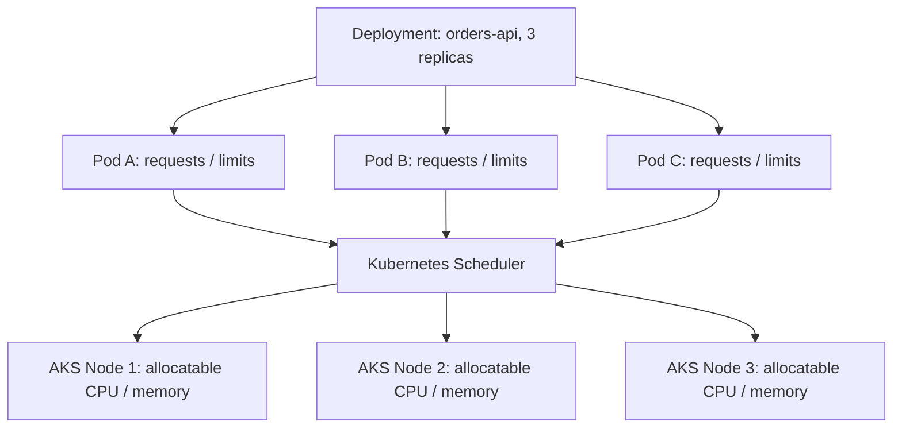
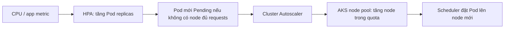

# Đặt resource request, limit và phân bổ tài nguyên

Một ứng dụng chạy trên **Azure Kubernetes Service (AKS)** có thể triển khai thành nhiều Pod trên các node thuộc một hoặc nhiều node pool. Nếu một Pod được cấp quá ít bộ nhớ, tiến trình có thể bị hệ điều hành kết thúc; nếu CPU limit quá thấp, ứng dụng có thể chậm bất thường ngay cả khi node chưa dùng hết CPU. Ngược lại, nếu mọi Pod khai báo CPU/memory request quá lớn so với nhu cầu thật, Kubernetes có thể báo **Pending** và cần mở rộng node pool trong khi tài nguyên vật lý đang sử dụng thấp. Vì thế, thiết lập `requests`, `limits` và chính sách phân bổ là một phần cốt lõi của vận hành AKS.

Bài học thuộc chương **Vận hành AKS** của mô-đun hạ tầng Microsoft Azure. Chúng ta sẽ phân biệt tài nguyên khai báo với tài nguyên đang tiêu thụ; tìm hiểu Kubernetes scheduler, Linux cgroups, chất lượng dịch vụ của Pod, ResourceQuota, LimitRange và mối liên hệ giữa HPA, Cluster Autoscaler, tính sẵn sàng và chi phí. Các ví dụ dùng YAML Kubernetes và `kubectl` trên một cluster AKS đã tồn tại, không tạo hạ tầng Azure mới.

## Mục tiêu học tập

Sau bài học, bạn có thể:

1. Diễn giải `requests.cpu`, `limits.cpu`, `requests.memory` và `limits.memory` theo đơn vị Kubernetes.
2. Giải thích sự khác biệt giữa **lập lịch dựa trên requests** và **giới hạn tiêu thụ tài nguyên lúc chạy**.
3. Nhận biết CPU throttling, `OOMKilled`, Pod eviction, `Pending` và các nguyên nhân khiến node không thể nhận thêm Pod.
4. Đặt resource requests/limits cho Deployment có nhiều container và hiểu QoS classes: `Guaranteed`, `Burstable`, `BestEffort`.
5. Dùng **LimitRange** và **ResourceQuota** để quản lý tài nguyên ở namespace.
6. Đọc metric và sự kiện bằng `kubectl top`, `kubectl describe`, HPA và công cụ giám sát AKS.
7. Thiết kế phân bổ tài nguyên phù hợp với HPA, node pool, Cluster Autoscaler, khả năng chịu lỗi và ngân sách.

## 1. Bức tranh tổng thể: Pod, container, node và node pool

Kubernetes chạy ứng dụng dưới dạng **Pod**, mỗi Pod gồm một hoặc nhiều container cùng chia sẻ một số tài nguyên mạng và vòng đời. Pod được **scheduler** gán tới một **node** có đủ tài nguyên có thể cấp phát và thỏa các ràng buộc khác. Trong AKS, node thường là VM thuộc node pool được Azure quản lý theo mô hình AKS; node pool sử dụng VM SKU, availability zone, cấu hình disk, networking và chính sách cluster.



Sơ đồ minh họa luồng logic: scheduler không nhất thiết đặt ba Pod lên ba node khác nhau. Quyết định còn phụ thuộc tài nguyên, affinity, taints/tolerations, topology spread constraints, priority, volume và những chính sách khác. Đặt requests/limits đúng **không tự bảo đảm** phân bố đều giữa availability zones.

### 1.1. Request và limit trả lời hai câu hỏi khác nhau

| Thuộc tính | Câu hỏi | Tác động chính |
|---|---|---|
| `resources.requests.cpu` | Container cần mức CPU nào để scheduler tính chỗ? | Lập lịch, một số autoscalers và cơ chế chia sẻ CPU khi tranh chấp. |
| `resources.limits.cpu` | Container được phép tiêu thụ CPU tối đa đến đâu? | Trên Linux phù hợp, CPU quota/cgroup có thể gây **throttling** khi vượt mức. |
| `resources.requests.memory` | Scheduler phải tính trước bao nhiêu memory? | Lập lịch và mức sử dụng được xem xét khi node thiếu tài nguyên. |
| `resources.limits.memory` | Container được dùng tối đa bao nhiêu bộ nhớ? | Khi vượt giới hạn và không thu hồi được memory, container có thể bị **OOM kill**. |

**Request không phải một vùng RAM vật lý được cấp phát cứng và tách biệt**, còn limit không có nghĩa ứng dụng chắc chắn đạt được hiệu năng tương ứng. Node chia sẻ CPU/memory theo cơ chế runtime/kernel và chịu tác động của workload thực tế.

### 1.2. Hai ví dụ trực giác

Pod A khai báo `requests.cpu: 250m`, `limits.cpu: 1000m`. Scheduler tính **0,25 CPU** khi chọn node; khi node còn rảnh, container có thể sử dụng nhiều CPU hơn request nhưng sẽ bị giới hạn ở CPU limit theo cơ chế runtime. Các Pod cùng node vẫn tranh chấp CPU khi tải tăng.

Pod B khai báo `requests.memory: 256Mi`, `limits.memory: 512Mi`. Scheduler tính **256 MiB** vào yêu cầu tài nguyên, còn tiến trình có thể dùng memory nhiều hơn request. Nếu sử dụng vượt limit và cgroup không thể giải phóng memory phù hợp, container có thể bị `OOMKilled` dù node vật lý còn RAM trống.

## 2. Đơn vị CPU và memory trong YAML

Kubernetes dùng **resource quantities**. Các giá trị không chỉ là chuỗi ký tự tùy ý: nhập sai đơn vị có thể tạo yêu cầu lớn hơn nhiều lần mong đợi.

### 2.1. CPU: core và millicore

| Giá trị | Diễn giải | Khi dùng |
|---|---|---|
| `100m` | 0,1 CPU core. | Dịch vụ nhẹ, thử nghiệm sau khi đo. |
| `250m` | 0,25 core. | Web API tiêu thụ CPU vừa phải. |
| `500m` | 0,5 core. | Worker xử lý vừa phải. |
| `1` | 1 core. | Ứng dụng có yêu cầu CPU lớn hơn. |
| `2` | 2 cores. | Batch hoặc xử lý tính toán song song phù hợp. |

`m` là **milli** (1/1000 core): `1000m = 1 CPU`, `500m = 0.5 CPU`. Đừng nhầm `100m` CPU với 100 MB memory. CPU core là đơn vị lập lịch Kubernetes; hiệu năng thực còn phụ thuộc VM SKU, kiến trúc CPU, nền tảng và kiểu tải.

### 2.2. Memory: MiB/GiB và đơn vị thập phân

| Giá trị | Quy mô | Lưu ý |
|---|---|---|
| `128Mi` | 128 × 2²⁰ bytes. | 128 mebibytes. |
| `512Mi` | 512 × 2²⁰ bytes. | Một nửa GiB. |
| `1Gi` | 1 × 2³⁰ bytes = 1024 MiB. | Đơn vị nhị phân thường dùng cho RAM. |
| `1G` | 1 × 10⁹ bytes. | Khác với `1Gi`. |
| `500M` | 500 × 10⁶ bytes. | Đơn vị thập phân, khác `500Mi`. |

Kubernetes phân biệt chữ hoa/chữ thường trong suffix. **`400m` ở memory là 0,4 byte theo ký hiệu milli**, không phải 400 MB. Trong YAML production, ưu tiên `Mi` hoặc `Gi` cho memory để tránh nhầm; `m` được dùng phổ biến cho CPU.

### 2.3. Ví dụ cấu hình cho một container

```yaml
resources:
  requests:
    cpu: "250m"
    memory: "256Mi"
  limits:
    cpu: "750m"
    memory: "512Mi"
```

Scheduler tính **250 millicores và 256 MiB**; container có thể tăng sử dụng CPU lên tới mức limit 750m theo cơ chế giới hạn và memory limit là 512 MiB. Đây là **số minh họa**, không phải cấu hình mặc định nên sao chép cho mọi ứng dụng Java/.NET/Node.js.

## 3. Scheduler sử dụng requests để phân bổ tài nguyên

### 3.1. Node capacity khác node allocatable

Một node 4 vCPU/16 GiB RAM về mặt VM SKU **không có nghĩa** Kubernetes dùng toàn bộ các tài nguyên đó cho workload Pods. Một phần phục vụ OS, kubelet, các thành phần hệ thống và ngưỡng eviction. Kubernetes công bố **Capacity** và **Allocatable** để phân biệt tài nguyên tổng với tài nguyên có thể cấp cho Pods.

```text
Azure VM node (ví dụ lý thuyết): 4 vCPU / 16 GiB
 ├─ OS, kubelet, system/kube reserved, eviction thresholds
 └─ Node Allocatable: nhỏ hơn capacity VM
      ├─ Pod hệ thống và DaemonSet
      ├─ Pod ứng dụng A: request 500m
      ├─ Pod ứng dụng B: request 1000m
      └─ Phần còn có thể đặt Pod khác
```

Allocatable thực tế phụ thuộc node pool, OS, kubelet và phiên bản AKS. **Không hard-code phần trăm overhead cố định** cho mọi VM size. Dùng `kubectl describe node` hoặc Node API để đọc số liệu thật.

### 3.2. Quyết định lịch dựa trên tổng requests

Giả sử sau khi trừ requests của các Pods đã chạy, node còn **1600m CPU** và **3Gi memory**. Một Pod mới yêu cầu `1000m` và `2Gi` có thể vượt qua bước kiểm tra tài nguyên nếu các điều kiện khác cũng thỏa. Pod yêu cầu `1800m` sẽ không được đặt vào node đó dù CPU đang sử dụng thực tế thấp.

- Scheduler chủ yếu dựa trên **requests**, không dùng tổng `limits` làm chỗ dự trữ để quyết định node.
- Tổng CPU limits có thể vượt số core trên node; khi tất cả cùng tăng tải sẽ có cạnh tranh và có thể throttling.
- Tổng memory limits cũng có thể vượt allocatable; khi sử dụng đồng thời cao, node có thể memory pressure, OOM hoặc eviction.
- Scheduler còn kiểm tra `nodeSelector`, affinity, taints, topology, volumes, Pod count và tài nguyên mở rộng.

**Request quá cao gây lãng phí ở bước lập lịch; request quá thấp gây cạnh tranh lúc chạy.** Chọn dựa trên đo đạc và tầm quan trọng workload.

### 3.3. Pod có nhiều containers

Một Pod có container `api` request `500m` CPU và `512Mi` memory, `sidecar` request `100m` và `128Mi`. Tổng request hai app containers là:

\[
CPU_{pod}=500m+100m=600m,\qquad Memory_{pod}=512Mi+128Mi=640Mi
\]

Scheduler tính **tổng các container liên quan** cùng những quy tắc dành cho init containers và Pod overhead khi áp dụng. Với init containers truyền thống **không chạy đồng thời với app containers**, yêu cầu hiệu dụng theo mỗi loại tài nguyên thường là giá trị lớn hơn giữa **tổng app containers** và **yêu cầu lớn nhất trong các init containers**. Những restartable init containers đóng vai trò sidecar có quy tắc khác; cần kiểm tra Pod spec/phiên bản Kubernetes.

Không quên memory của service mesh proxy, log collector hay sidecars. Chỉ đo container chính rồi request CPU/memory cho toàn Pod sẽ đánh giá thiếu nhu cầu.

## 4. CPU limit và hiện tượng throttling

Trên Linux và Kubernetes runtime tương ứng, CPU limit thường được thực thi bằng **cgroup CPU quota**. Khi container đã dùng hết quota của chu kỳ, kernel có thể trì hoãn việc chạy tiến trình đến chu kỳ kế tiếp: **CPU throttling**.

Ví dụ worker request 250m, limit 500m, nhưng khi xử lý file nó muốn dùng 1,5 core liên tục. Kernel có thể giới hạn ở mức 0,5 core. Thời gian xử lý tăng, p95 latency xấu hoặc task timeout dù node còn CPU rảnh.

### 4.1. CPU request không phải CPU limit

Nếu container request `250m` nhưng **không đặt CPU limit**, nó có thể tận dụng CPU dư khi node rảnh và vẫn chịu cơ chế chia sẻ CPU khi tranh chấp. Một số đội ngũ dùng cách này cho API nhạy cảm với tail latency để tránh quota throttling, nhưng cần capacity planning, requests hợp lý và quan sát contention.

**Không có khuyến nghị duy nhất “luôn bỏ” hoặc “luôn đặt” CPU limit.** Môi trường nhiều tenant có thể cần limit để chống noisy neighbor; ứng dụng nhạy cảm latency có thể không đặt limit nếu chính sách cho phép. Hãy kiểm thử với tải thật.

### 4.2. Nhận diện CPU throttling

- Latency cao dù `kubectl top` cho thấy CPU node chưa đầy.
- CPU usage container thường xuyên chạm CPU limit.
- Metrics cgroup/Prometheus như **`container_cpu_cfs_throttled_periods_total`** tăng khi được thu thập.
- Thay đổi CPU limit có kiểm soát làm cải thiện p95/p99 latency trong A/B load test.

`kubectl top` hiển thị usage từ metrics pipeline, **không trực tiếp cho biết mọi throttling events**. Kết hợp CPU/cgroup metrics, runtime telemetry, application traces và load test khi kết luận.

## 5. Memory limit, OOMKilled và eviction

Memory khác CPU: kernel không thể đơn giản “làm chậm RAM” khi ứng dụng cấp phát thêm mà không còn bộ nhớ. Nếu container vượt `limits.memory`, cgroup có thể kích hoạt **out-of-memory (OOM) kill**. Kubernetes có thể báo container kết thúc `OOMKilled` rồi được restart theo policy/controller tương ứng.

### 5.1. OOMKilled do memory limit

Ví dụ Java API có heap tối đa 700Mi, cộng metaspace, thread stacks, direct buffers và native memory. Đặt container `limits.memory=768Mi` có thể dẫn tới OOM kill dù heap chưa đầy, bởi vì **JVM heap size không bằng tổng RAM tiến trình**.

```text
Memory limit cần cân nhắc
  >= heap max thực tế
     + native/direct/metaspace/thread stack
     + overhead runtime/thư viện
     + dự phòng theo peak, p95/p99 đáng tin cậy
```

Đo working set/RSS, GC và native memory; tránh áp tỷ lệ heap/container cố định cho mọi Java version/GC.

### 5.2. Memory request thấp và node memory pressure

Pod request `128Mi` nhưng thường tiêu thụ `1Gi` khiến scheduler có thể đặt quá nhiều Pods trên node. Khi nhiều Pods tăng sử dụng cùng lúc, **node memory pressure** xuất hiện; kubelet có thể **evict** Pod để bảo vệ node, khác với container OOMKilled do vượt giới hạn của chính nó.

| Hiện tượng | Tín hiệu | Hướng điều tra |
|---|---|---|
| **Container OOMKilled** | `Last State: Terminated`, `Reason: OOMKilled`, thường exit code 137. | Limit, usage peak, heap/native memory, logs trước restart. |
| **Pod Evicted** | Pod `Failed` với `Reason: Evicted`, mô tả memory/disk pressure. | Node Conditions, requests, mức pressure và Pods cùng node. |
| **Pending: Insufficient memory** | Scheduler event báo node thiếu memory. | Allocatable, tổng requests và node pools. |
| **Ứng dụng OutOfMemoryError** | Runtime báo lỗi heap/native memory. | Phân biệt heap OOM với cgroup OOM. |

Tăng limit có thể tạm xử lý triệu chứng nhưng che memory leak. Kiểm tra memory growth, cache, batch size, GC và spikes trước khi tăng vô hạn.

### 5.3. Giới hạn RAM là hàng rào, không phải bảo đảm hiệu năng

Memory limit giảm rủi ro một container chiếm toàn bộ node. Nhưng nếu mọi container có limit rất cao và request thấp, **overcommit memory** dẫn đến node pressure khi sử dụng tăng đồng thời. Đặt limit dựa trên peak và độ ổn định, đồng thời thiết kế số Pod/node để tránh cùng lúc sử dụng vượt allocatable.

## 6. Quality of Service (QoS) của Pod

Kubernetes thường phân loại QoS dựa trên CPU/memory requests và limits theo các quy tắc tương ứng:

| QoS class | Điều kiện điển hình | Ý nghĩa vận hành |
|---|---|---|
| **Guaranteed** | Mọi container liên quan có request và limit cho CPU, memory; mỗi cặp request = limit. | Khai báo chặt chẽ, thường được bảo vệ tương đối hơn khi có memory pressure. |
| **Burstable** | Có ít nhất một request/limit CPU hoặc memory nhưng chưa thỏa Guaranteed. | Có mức nền và dư địa sử dụng thêm trong giới hạn cấu hình. |
| **BestEffort** | Không khai báo request/limit CPU, memory và không bị admission default thêm. | Dễ chịu ảnh hưởng khi node thiếu tài nguyên. |

```yaml
# Ví dụ Guaranteed nếu tất cả containers đều theo mô hình này:
resources:
  requests: {cpu: "500m", memory: "512Mi"}
  limits:   {cpu: "500m", memory: "512Mi"}

# Ví dụ Burstable:
# resources:
#   requests: {cpu: "250m", memory: "256Mi"}
#   limits:   {cpu: "1000m", memory: "768Mi"}

# BestEffort: bỏ toàn bộ resources ở tất cả containers liên quan.
```

**QoS không phải thang đo tầm quan trọng nghiệp vụ.** Guaranteed Pod vẫn có thể OOMKilled nếu vượt memory limit; priority, mức usage vượt request và tín hiệu pressure cũng ảnh hưởng tới eviction. Cần kết hợp Pod Priority, replicas, topology và readiness thay vì chỉ dựa vào QoS.

### 6.1. Mặc định request khi chỉ khai báo limit

Nếu container chỉ có limit của một resource mà không khai báo request và không có admission rule khác, hệ thống có thể **sao chép limit thành request** cho resource đó. **LimitRange** cũng có thể thêm default requests/limits. Vì vậy, “không ghi requests” không luôn đồng nghĩa scheduler coi bằng 0.

```bash
kubectl get pod <pod-name> -n <namespace> -o yaml
```

Kiểm tra spec Pod **sau admission** thay vì chỉ nhìn Deployment YAML trước khi apply. Mutating webhooks, LimitRange và sidecar injection có thể khiến tài nguyên của Pod khác manifest ban đầu.

## 7. Định cỡ requests/limits từ quan sát

Một quy trình thực tế:

1. Đo CPU/memory từng container theo ngày thường, giờ cao điểm, batch, deployment và sự cố downstream.
2. Xác định SLO như p95 response latency, error rate, thời gian xử lý queue.
3. Đặt requests phản ánh mức cần cho hoạt động bình thường và đỉnh tải đáng tin cậy, có biên dự phòng.
4. Đặt memory limit đủ headroom; quyết định CPU limit dựa vào chính sách cách ly và kết quả throttling.
5. Load test kiểm soát để đo Pod restarts, OOM, CPU throttling, latency, HPA, node resource pressure.
6. Điều chỉnh theo số liệu thực tế nhiều chu kỳ, tránh tăng limit mãi khi có memory leak.

### 7.1. Ví dụ sizing API

| Chỉ số | Mức quan sát minh họa |
|---|---|
| CPU trung bình tải thường | 120–180m/container. |
| CPU p95 khi cao điểm | 260m. |
| CPU spike ngắn | 500–650m. |
| Memory working set thường | 220–280Mi. |
| Memory p99 khi cao điểm | 380Mi. |
| SLO | p95 latency dưới 400ms. |

Một thử nghiệm ban đầu có thể đặt `requests: 300m/384Mi` và `limits: 800m/512Mi`, rồi đo lại p95/p99 và OOM/throttling. Đây **không phải** ngưỡng production đã xác thực. Nếu CPU limit gây throttling, cân nhắc tăng/bỏ theo chính sách; nếu memory gần giới hạn, phân tích peak và native allocation trước.

### 7.2. Chú ý cách hiểu metric

Dashboard có thể hiển thị memory working set, RSS, cache hoặc tỷ lệ phần trăm theo node. Chúng khác nhau và không nhất thiết bằng đúng số memory kernel tính vào cgroup limit. Metrics lấy mẫu 5 phút có thể bỏ lỡ spike OOM chỉ kéo dài vài giây. Với Pod gồm API Java và sidecar, cần đo **từng container**, không chỉ Pod tổng.

## 8. Thực hành: Deployment với resource requests/limits rõ ràng

Giả sử đã có một AKS cluster, `kubectl` có đúng context và bạn được phép thao tác namespace thử nghiệm. **Không triển khai vào production hoặc thay đổi workload dùng chung trước khi xác nhận owner.** Image trong YAML là placeholder: phải thay bằng image chạy thật và cung cấp các endpoint sức khỏe như khai báo.

### 8.1. Kiểm tra context và tạo namespace lab

```bash
kubectl config current-context
kubectl get nodes -o wide
kubectl create namespace sizing-lab
```

Lệnh tạo namespace sẽ báo lỗi nếu namespace đã tồn tại; khi đó kiểm tra tài nguyên/quyền sở hữu trước khi sử dụng. Nếu bạn chưa kết nối AKS, một quy trình bên ngoài phạm vi bài lab là đăng nhập đúng subscription và lấy kubeconfig được cho phép (ví dụ với `az aks get-credentials`), rồi **kiểm tra lại context trước mọi lệnh ghi**.

### 8.2. Deployment YAML mẫu

Lưu đoạn sau thành `orders-api.yaml` trong môi trường thực hành của người học (bài học này không tạo bất kỳ tệp ví dụ nào ngoài Markdown được giao):

```yaml
apiVersion: apps/v1
kind: Deployment
metadata:
  name: orders-api
  namespace: sizing-lab
  labels:
    app: orders-api
spec:
  replicas: 3
  selector:
    matchLabels:
      app: orders-api
  template:
    metadata:
      labels:
        app: orders-api
    spec:
      containers:
        - name: api
          image: myregistry.azurecr.io/orders-api:1.4.2
          ports:
            - name: http
              containerPort: 8080
          resources:
            requests:
              cpu: "250m"
              memory: "256Mi"
            limits:
              cpu: "750m"
              memory: "512Mi"
          readinessProbe:
            httpGet:
              path: /readyz
              port: http
            initialDelaySeconds: 5
            periodSeconds: 10
          livenessProbe:
            httpGet:
              path: /livez
              port: http
            initialDelaySeconds: 20
            periodSeconds: 20
```

`readinessProbe` xác định khi nào Pod có thể nhận traffic; `livenessProbe` giúp phát hiện container lỗi cần restart. **Chỉ dùng `/readyz` và `/livez` nếu ứng dụng thật sự cung cấp endpoint tương ứng.** Probe sai có thể khiến rollout thất bại dù requests/limits đúng. Với image riêng trên Azure Container Registry, AKS còn cần quyền pull image và kết nối registry phù hợp.

### 8.3. Áp dụng và đọc kết quả

```bash
kubectl apply -f orders-api.yaml
kubectl rollout status deployment/orders-api -n sizing-lab
kubectl get pods -n sizing-lab -l app=orders-api -o wide
kubectl describe deployment orders-api -n sizing-lab
```

Nếu image không tồn tại, ACR credential thiếu hoặc ứng dụng chưa hoạt động, Pod có thể `ImagePullBackOff` hoặc `CrashLoopBackOff`. Không kết luận cấu hình resources sai chỉ vì rollout thất bại. Xác định lỗi ở **image, registry, auth, probes, resource capacity hay application** trước.

### 8.4. Xem resources của Pod sau admission

```bash
kubectl get pods -n sizing-lab -l app=orders-api \
  -o custom-columns='NAME:.metadata.name,CPU_REQUEST:.spec.containers[0].resources.requests.cpu,CPU_LIMIT:.spec.containers[0].resources.limits.cpu,MEM_REQUEST:.spec.containers[0].resources.requests.memory,MEM_LIMIT:.spec.containers[0].resources.limits.memory'

kubectl describe pod <pod-name> -n sizing-lab
```

Lệnh custom-columns chỉ đọc container đầu tiên trong ví dụ một container; với Pod nhiều containers cần xem từng container. `describe pod` thường có requests, limits, QoS, node và events. Cách này phát hiện LimitRange hoặc mutating webhook đã thay đổi resources so với manifest hay không.

## 9. Quan sát usage: kubectl top, Node Allocatable và Events

### 9.1. kubectl top cần metrics pipeline

```bash
kubectl top nodes
kubectl top pods -n sizing-lab
kubectl top pods -n sizing-lab --containers
```

`kubectl top` dùng **Metrics API** do pipeline metrics của cluster cung cấp, thường thông qua metrics-server hoặc thành phần tương thích. Nếu gặp `Metrics API not available`, cần xác minh pipeline trên **chính cluster AKS đó**. Không tự kết luận Pod không sử dụng CPU/memory chỉ vì lệnh top chưa chạy được.

`kubectl top` hiển thị usage quan sát được, **không phải request/limit**. Kết hợp với Azure Monitor/Container Insights, Managed Prometheus hoặc hệ thống giám sát thực tế của tổ chức để đọc lịch sử, xu hướng, p95/p99 và cảnh báo.

### 9.2. Node capacity và allocatable

```bash
kubectl get nodes \
  -o custom-columns='NAME:.metadata.name,CPU_CAP:.status.capacity.cpu,CPU_ALLOC:.status.allocatable.cpu,MEM_CAP:.status.capacity.memory,MEM_ALLOC:.status.allocatable.memory'

kubectl describe node <node-name>
```

Mục **Allocated resources** ở cuối `describe node` cho thấy tổng requests và limits theo resource, thường dưới dạng tỷ lệ so với allocatable. Nó **không phải mức sử dụng đang đo**. Tổng CPU limits trên một node có thể vượt 100% dù requests vẫn vừa với allocatable; hiện tượng overcommit chỉ nguy hiểm khi tải đồng thời vượt khả năng thực và làm xấu SLO.

### 9.3. Kiểm tra Pending, OOMKilled và Evicted

```bash
kubectl get pods -n sizing-lab -o wide
kubectl describe pod <pod-name> -n sizing-lab
kubectl get events -n sizing-lab --sort-by=.lastTimestamp
kubectl logs <pod-name> -n sizing-lab --previous
```

`--previous` lấy log container instance trước khi restart nếu còn tồn tại; với Pod nhiều containers cần thêm `-c <container-name>`. Sự kiện `FailedScheduling` có thể báo thiếu CPU/memory hoặc vướng node constraints; `OOMKilled` phản ánh cgroup/runtime; `Evicted` thường liên quan node pressure. Luôn đọc **message cụ thể**, không suy diễn chỉ từ tên trạng thái.

## 10. LimitRange: đặt mặc định và giới hạn cho namespace

**LimitRange** là chính sách Kubernetes đặt default requests/limits, min/max hoặc tỷ lệ giới hạn/request cho những container/Pod/PVC trong namespace tùy loại resource được cấu hình. Nó hữu ích khi nhiều nhóm cùng triển khai và có nguy cơ bỏ trống resources. Quy tắc được xử lý tại **admission** đối với resource mới hoặc được cập nhật theo cơ chế liên quan, không tự retroactively sửa tất cả Pods đang chạy.

### 10.1. Manifest LimitRange

Ví dụ cho namespace `sizing-lab`:

```yaml
apiVersion: v1
kind: LimitRange
metadata:
  name: default-container-resources
  namespace: sizing-lab
spec:
  limits:
    - type: Container
      min:
        cpu: "50m"
        memory: "64Mi"
      max:
        cpu: "2"
        memory: "4Gi"
      defaultRequest:
        cpu: "125m"
        memory: "128Mi"
      default:
        cpu: "500m"
        memory: "512Mi"
      maxLimitRequestRatio:
        cpu: "4"
        memory: "4"
```

Trong ví dụ, một container không khai báo requests/limits có thể được gán default theo chính sách, rồi được kiểm tra min/max và tỷ lệ. `defaultRequest` khác `default`: trường thứ nhất liên quan **requests**, trường thứ hai liên quan **limits**. Hãy kiểm tra tính nhất quán giữa các giá trị; nếu default limit thấp hơn mức phần mềm thực cần, Pod có thể thường xuyên OOM/throttle ngay cả khi developer chưa khai báo tài nguyên.

**Chú ý:** LimitRange không có nghĩa mọi container đang tồn tại sẽ tự bị thay limit ngay khi bạn tạo policy. Khi rollout tạo Pod mới, nó mới được admission theo cấu hình hiệu lực. Một số workload có thể bị từ chối admission nếu requests/limits không đáp ứng `min`, `max` hoặc tỷ lệ.

### 10.2. Áp dụng và xác minh

```bash
# Sau khi lưu YAML mẫu thành limitrange.yaml
kubectl apply -f limitrange.yaml
kubectl describe limitrange default-container-resources -n sizing-lab
kubectl get limitrange -n sizing-lab -o yaml
```

Không nên áp LimitRange mặc định của bài lab lên toàn bộ namespace production có nhiều ứng dụng chưa được đo. Trước khi triển khai policy, kiểm kê requests/limits hiện hành, sidecars, init containers và tài nguyên runtime như Java heap để tránh gây lỗi sau rolling deployment.

## 11. ResourceQuota: giới hạn tổng tài nguyên theo namespace

**ResourceQuota** đặt giới hạn tổng requests/limits hoặc số lượng đối tượng trong một namespace. Nó ngăn một nhóm tự tạo quá nhiều Pods hoặc đặt quá nhiều yêu cầu CPU/RAM so với ngân sách phân bổ. Đây là công cụ governance ở **admission**, không phải một cơ chế tự động giảm CPU usage của những Pod đang chạy.

### 11.1. Ví dụ quota cho nhóm ứng dụng

```yaml
apiVersion: v1
kind: ResourceQuota
metadata:
  name: team-compute-budget
  namespace: sizing-lab
spec:
  hard:
    requests.cpu: "4"
    requests.memory: "8Gi"
    limits.cpu: "8"
    limits.memory: "16Gi"
    pods: "20"
```

Nghĩa là namespace này có thể khai báo tổng **requests tối đa 4 CPU cores và 8Gi memory**, tổng limits tối đa **8 CPU cores và 16Gi**, đồng thời giới hạn số Pods thuộc phạm vi đếm tương ứng theo Kubernetes. Giới hạn quota là ranh giới khai báo ở namespace: **không tương đương một node có 4 CPU hoặc 8Gi**, không đảm bảo cluster sẽ luôn có đủ năng lực để đặt Pods.

Nếu một Deployment muốn tạo thêm Pods khiến tổng requests/limits vượt quota, API server/admission có thể từ chối việc tạo Pod, ReplicaSet sẽ báo lỗi trong events. Kubernetes không tự xóa Pod khác để “nhường quota” cho Deployment mới, trừ khi có cơ chế vận hành riêng.

### 11.2. Áp dụng và theo dõi quota

```bash
# Sau khi lưu YAML mẫu thành resourcequota.yaml
kubectl apply -f resourcequota.yaml
kubectl get resourcequota -n sizing-lab
kubectl describe resourcequota team-compute-budget -n sizing-lab
kubectl get events -n sizing-lab --sort-by=.lastTimestamp
```

Theo dõi các trường **Used** và **Hard**. Một namespace có `Used requests.cpu = 4` trên `Hard requests.cpu = 4` không thể tạo thêm Pods cần CPU request mới nếu không giải phóng/quản lý lại quota. Thay đổi usage/requests ở workload khác không tự đảm bảo Pod đang Pending lập tức chạy được nếu còn vướng node capacity hoặc scheduling constraints.

### 11.3. Quan hệ giữa LimitRange và ResourceQuota

| Thành phần | Quy mô | Cơ chế |
|---|---|---|
| **Container resources** | Một container trong Pod. | Khai báo request/limit thực tế cần thiết. |
| **LimitRange** | Các đối tượng phù hợp trong namespace. | Default, min/max, tỷ lệ limit/request; admission validation. |
| **ResourceQuota** | Tổng mức sử dụng tài nguyên khai báo/số đối tượng trong namespace. | Chặn tạo/sửa resource khi vượt giới hạn namespace. |
| **Scheduler + Node Allocatable** | Node và những Pod chưa được đặt. | Chọn node đủ requests và thỏa constraints. |
| **cgroups/kubelet** | Container/Pod lúc chạy. | Thực thi CPU/memory restrictions và xử lý pressure theo cấu hình. |

Một namespace có quota đối với `requests.cpu`/`limits.cpu` thường cần các container được khai báo tương ứng, hoặc phải có **LimitRange cấp default** phù hợp. Nếu chỉ tạo ResourceQuota mà quên chính sách defaults, một số Pod không có requests/limits có thể bị admission từ chối thay vì được gán tài nguyên tự động.

**Giới hạn namespace không phải ranh giới an ninh tuyệt đối.** Quota không thay thế NetworkPolicy, Azure RBAC/Kubernetes RBAC, Azure Policy/Gatekeeper/Kyverno khi được sử dụng, cũng không giới hạn toàn bộ chi phí của cluster ngoài CPU/memory Pods.

## 12. HPA và CPU requests: vì sao đặt request ảnh hưởng autoscale?

**Horizontal Pod Autoscaler (HPA)** tăng/giảm số Pod replicas dựa trên CPU, memory hoặc custom/external metrics theo cấu hình. Khi sử dụng loại metric **CPU utilization theo phần trăm**, Kubernetes so sánh CPU usage đo được với **CPU request của container/Pod** làm mẫu số. Nếu request khai báo sai, quyết định autoscale cũng có thể sai.

### 12.1. CPU utilization liên quan CPU request

Giả sử một container có:

```text
CPU request  = 250m
CPU usage    = 200m
CPU HPA utilization = 200m / 250m × 100% = 80%
```

Nếu HPA đặt target **60%**, nó có thể xem đây là mức tải vượt mục tiêu, dù container còn chưa chạm CPU limit `750m`. Nếu developer nâng request từ 250m lên 500m mà ứng dụng vẫn dùng 200m CPU, HPA utilization theo request giảm từ 80% xuống 40% mà **tải thật không đổi**. Vì vậy không tăng request tùy tiện chỉ để giảm HPA metric.

### 12.2. Công thức ước tính số replicas

HPA thường sử dụng nguyên tắc tỷ lệ:

\[
desiredReplicas\approx\left\lceil currentReplicas\times\frac{currentMetric}{targetMetric}\right\rceil
\]

Ví dụ có 3 replicas, CPU utilization trung bình 80%, target 60%:

\[
\left\lceil 3\times\frac{80}{60}\right\rceil=4\text{ replicas}
\]

Đây là mô hình **giải thích**, không phải cam kết HPA ngay lập tức tạo đúng 4 Pods. Bộ điều khiển còn dùng tolerance, stabilization windows, xử lý Pod chưa sẵn sàng/metric thiếu, min/maxReplicas và các chính sách scaling. Nếu usage thấp do lỗi downstream, HPA có thể giảm replicas dù yêu cầu ứng dụng chưa được xử lý tốt; cần dùng metric thích hợp với workload.

### 12.3. HPA YAML ví dụ

```yaml
apiVersion: autoscaling/v2
kind: HorizontalPodAutoscaler
metadata:
  name: orders-api-hpa
  namespace: sizing-lab
spec:
  scaleTargetRef:
    apiVersion: apps/v1
    kind: Deployment
    name: orders-api
  minReplicas: 2
  maxReplicas: 8
  metrics:
    - type: Resource
      resource:
        name: cpu
        target:
          type: Utilization
          averageUtilization: 60
  behavior:
    scaleDown:
      stabilizationWindowSeconds: 300
```

Sau khi lưu thành `orders-api-hpa.yaml`, áp dụng trong môi trường lab và quan sát:

```bash
kubectl apply -f orders-api-hpa.yaml
kubectl get hpa -n sizing-lab
kubectl describe hpa orders-api-hpa -n sizing-lab
kubectl get hpa orders-api-hpa -n sizing-lab --watch
```

HPA CPU cần metrics pipeline và các CPU requests thích hợp. Nếu thiếu CPU request ở những containers liên quan, việc tính utilization cho metric đó có thể thất bại hoặc không xác định. Khi HPA quản lý replicas, đừng cố định lại Deployment `spec.replicas` bằng một công cụ GitOps/release khác mỗi vài giây, tạo vòng lặp **hai controllers tranh quyền thay đổi số replicas**.

### 12.4. HPA và VPA

**Vertical Pod Autoscaler (VPA)** có thể đưa ra gợi ý hoặc thay đổi requests/limits theo chế độ cấu hình, còn HPA thường thay đổi **số replicas**. Nếu HPA dùng CPU utilization theo request và VPA đồng thời tự sửa CPU request, hai bộ điều khiển có thể tương tác khó dự đoán hoặc xung đột. Một cách an toàn là dùng VPA ở **recommendation/off mode** khi muốn tham khảo sizing mà HPA vẫn scale theo CPU, hoặc thiết kế metric/cơ chế tương thích được tài liệu nền tảng hỗ trợ. Không bật cả hai chế độ tự điều chỉnh cùng một CPU resource mà chưa thử nghiệm.

## 13. Cluster Autoscaler và AKS node pools

HPA tăng replicas, nhưng không phải cluster lúc nào cũng có node đủ CPU/memory để đặt Pods mới. **Cluster Autoscaler** có thể tăng số node trong các AKS node pool được cấu hình hỗ trợ khi có Pod **unschedulable** do thiếu capacity và các điều kiện scaling phù hợp, trong phạm vi min/max node count và quotas. HPA và Cluster Autoscaler giải quyết hai cấp độ khác nhau.



| Bộ điều khiển | Tài nguyên thay đổi | Tín hiệu/chính sách |
|---|---|---|
| **HPA** | Số replicas của Deployment/target hỗ trợ. | CPU/memory/custom/external metric và HPA behavior. |
| **Cluster Autoscaler** | Số VM nodes trong node pool. | Pod unschedulable và cấu hình autoscaler/node pool. |
| **VPA** | Requests và đôi khi limits theo khả năng/khuyến nghị. | Quan sát usage và chế độ áp dụng. |

**Cluster Autoscaler không bắt buộc khắc phục mọi Pending Pod.** Ví dụ `nodeSelector` trỏ tới pool không tồn tại, thiếu vùng khả dụng, quota vCPU bị giới hạn, Pod có request lớn hơn allocatable của mọi node SKU, max node count đã đạt hoặc volume/taint không thỏa. Khi đó thêm node cùng loại cũng không giải quyết được nguyên nhân.

### 13.1. Tính toán sơ bộ node density

Giả sử một node có allocatable 3600m CPU, 14Gi memory; các Pods hệ thống/DaemonSets đã dùng 600m và 2Gi requests. Còn 3000m và 12Gi. Nếu mỗi Pod ứng dụng request 600m CPU và 1Gi memory thì **CPU giới hạn số Pod lý thuyết ở 5**; memory cho phép tới 12. Nhưng số thật còn chịu max pods per node, IP availability, node affinity, topology, ephemeral storage, volume và DaemonSet khác.

Nếu request mỗi Pod là 1000m thay vì 600m mà usage thực không đổi, một node chỉ đặt được khoảng 3 Pods theo CPU, có thể cần nhiều VM AKS hơn. Tối ưu requests hợp lý giúp giảm chi phí nhưng không nên giảm thấp hơn tải thực tế chỉ để nhồi thêm Pod.

### 13.2. Node pool chuyên biệt cho workload

AKS có thể dùng nhiều **user node pools** để phân tách workload theo VM SKU, zone, GPU và yêu cầu hệ điều hành. Những công cụ như `nodeSelector`, `nodeAffinity`, taints/tolerations và topology spread constraints giúp hướng Pod đến nơi phù hợp. Chúng **không thay thế requests/limits**: một Pod được phép vào node pool vẫn cần đủ allocatable resources.

Ví dụ nền tảng có pool `general` cho web API và `batch` cho xử lý ảnh. Web API ưu tiên đủ replicas ở nhiều zones; batch có thể chạy trong các khung giờ riêng, yêu cầu CPU cao và chịu restart/retry. Tách pool có thể giảm noisy neighbor, nhưng vẫn phải tính tổng node quota, ngân sách và khả năng cấp phát.

## 14. Phân bổ hiệu quả nhưng vẫn bảo đảm availability

### 14.1. Bin packing và topology spread

**Bin packing** cố gắng đặt Pods hiệu quả lên số node phù hợp để hạn chế VM nhàn rỗi. **Topology spreading** lại hướng tới phân bố replicas giữa các node/zone để giảm tác động khi một node/zone lỗi. Hai mục tiêu có thể đánh đổi nhau: gom mọi replicas vào một node giúp tiết kiệm nhưng gây điểm lỗi tập trung.

Một ứng dụng cần HA có thể kết hợp:

- Tối thiểu 2 hoặc 3 replicas tùy SLO và khả năng chịu lỗi thực tế.
- `topologySpreadConstraints` hoặc anti-affinity theo hostname/zone khi phù hợp.
- `readinessProbe` và xử lý graceful termination.
- `PodDisruptionBudget` (PDB) để hạn chế một số **voluntary disruptions** đồng thời, không phải bảo đảm tuyệt đối trước node failure hay OOM.
- Node pool có đủ capacity dư để rollout và chịu một node/zone lỗi khi mục tiêu yêu cầu.

### 14.2. Ví dụ topology spread và PDB

Đây là hai cấu hình độc lập, cần đưa `topologySpreadConstraints` vào **Pod template** của Deployment và tạo PDB cùng namespace:

```yaml
# Đoạn thuộc spec.template.spec của Deployment
topologySpreadConstraints:
  - maxSkew: 1
    topologyKey: kubernetes.io/hostname
    whenUnsatisfiable: ScheduleAnyway
    labelSelector:
      matchLabels:
        app: orders-api
```

```yaml
apiVersion: policy/v1
kind: PodDisruptionBudget
metadata:
  name: orders-api-pdb
  namespace: sizing-lab
spec:
  minAvailable: 2
  selector:
    matchLabels:
      app: orders-api
```

`ScheduleAnyway` là ưu tiên mềm nhằm tránh chặn schedule chỉ vì chưa phân bố tối ưu. Nếu dùng `DoNotSchedule`, thiếu node ở một zone/topology có thể khiến Pod Pending dù nơi khác còn capacity. PDB `minAvailable: 2` là ví dụ cho Deployment bình thường có ít nhất 3 replicas; hãy cân nhắc trong các thời điểm HPA giảm về 2, rollout, drain và bảo trì node. PDB không có khả năng cứu Pod bị kill bởi memory limit.

### 14.3. Resource headroom cho rolling update

Một Deployment `replicas: 10` có thể tạm thời tạo thêm Pods khi rolling update theo `maxSurge`. Nếu node pool chỉ đủ requests của đúng 10 Pods, Pod phiên bản mới có thể **Pending** dù tổng capacity đủ cho trạng thái bình thường. Cần dự toán surge/headroom và PodDisruptionBudget cùng chiến lược rollout; không giảm requests xuống mức không thực tế chỉ để rollout tạm thời thành công.

## 15. CPU/memory không phải các tài nguyên duy nhất

Kubernetes còn quản lý một số resource khác và ràng buộc node:

| Resource/ràng buộc | Vì sao quan trọng? | Cách đánh giá |
|---|---|---|
| **ephemeral-storage** | Writable layer, một số logs, volume `emptyDir` trên disk node có thể dùng hết dung lượng tạm. | Requests/limits và node disk pressure, eviction. |
| **GPU/extended resources** | AI/ML workload yêu cầu GPU, không thể coi GPU như CPU chia sẻ thông thường. | Node pool GPU, device plugin, resource name/quantities được hỗ trợ. |
| **Pod count/IP availability** | Node có thể hết số Pods/IP trước khi hết CPU/RAM. | AKS networking, `maxPods`, cấp phát IP và subnet. |
| **Persistent volumes / zone** | PVC có thể buộc Pod tới zone/node tương thích. | StorageClass, volume topology, access modes. |
| **Network throughput/IOPS** | CPU thấp nhưng ứng dụng chậm do mạng hoặc disk. | VM SKU, storage metrics và tracing. |

### 15.1. Ephemeral storage

Ví dụ container batch tải file về `emptyDir` rồi giải nén; CPU chỉ 20% nhưng dung lượng disk node có thể hết. Kubernetes cho phép khai báo requests/limits cho `ephemeral-storage` trong môi trường hỗ trợ:

```yaml
resources:
  requests:
    cpu: "250m"
    memory: "256Mi"
    ephemeral-storage: "1Gi"
  limits:
    cpu: "1"
    memory: "1Gi"
    ephemeral-storage: "3Gi"
```

Mức sử dụng `emptyDir` với `medium: Memory` lại sử dụng RAM/tmpfs và được tính theo cơ chế memory, **không đơn giản là disk-based ephemeral-storage**. Kubelet có thể evict Pods khi disk pressure hoặc vượt một số giới hạn lưu trữ tạm theo cơ chế hỗ trợ. Với output quan trọng, hãy ghi vào Azure Blob Storage, Azure Files hoặc persistent storage tương ứng, không lưu mãi trong writable layer của container.

### 15.2. CPU/memory limits không bảo vệ được mọi dependency

Ngay cả khi mọi Pod có limits chính xác, cơ sở dữ liệu có thể hết connection slots, queue bị backlog, Redis bị eviction, hoặc outbound SNAT bị cạn. Tối ưu tài nguyên cần xem **request → application → database/cache/storage/network**. Không sửa sự cố latency chỉ bằng tăng CPU limit khi nguyên nhân là query chậm.

## 16. Troubleshooting theo triệu chứng

| Triệu chứng | Giả thuyết ban đầu | Kiểm tra và xử lý |
|---|---|---|
| Pod `Pending`, `Insufficient cpu` | Tổng CPU requests không còn chỗ trên node phù hợp. | `kubectl describe pod`, `describe node`; cân nhắc sizing hoặc Cluster Autoscaler. |
| Pod `Pending`, `Insufficient memory` | Không đủ allocatable requests.memory. | So requests thực, sidecars/init containers và node pool capacity. |
| Pod bị từ chối tạo do `exceeded quota` | Tổng resource requests/limits hoặc số Pods vượt ResourceQuota. | `kubectl describe resourcequota`, events; điều chỉnh workload/quota có phê duyệt. |
| Admission báo min/max hoặc tỷ lệ | Không thỏa LimitRange. | `kubectl describe limitrange`, đối chiếu từng container. |
| Container `OOMKilled` | Memory limit thiếu, spike, leak hoặc runtime overhead. | `describe pod`, logs `--previous`, memory trends, heap/native analysis. |
| Pod `Evicted` | Node bị memory/disk/ephemeral pressure. | Node Conditions, kubelet events, request/usage toàn node. |
| API chậm dù CPU node thấp | CPU throttling tại container, network/disk/database bottleneck. | Cgroup throttling metrics, tracing, load test. |
| HPA CPU hiển thị `<unknown>` | CPU requests hoặc Metrics API thiếu, metric không đọc được. | `describe hpa`, Pod requests, metrics pipeline. |
| HPA tạo thêm replicas nhưng Pods Pending | Không đủ node, quota, node constraints hoặc autoscaler max. | Cluster Autoscaler events/logs, max node count, quota vCPU. |
| Deployment rollout đứng | Không đủ surge capacity, probe lỗi hoặc thiếu image pull. | `rollout status`, `describe pod`, `describe deployment`. |
| Một node đầy khi node khác rảnh | Affinity, taints, topology, PVC/zone hoặc Pod distribution. | `describe pod/node`, scheduler events, labels/taints. |

### 16.1. Luồng chẩn đoán an toàn

```text
Ứng dụng chậm hoặc Pod không sẵn sàng
 |
 +-- Pod đã được schedule?
 |    +-- Không: đọc FailedScheduling, requests, quota, node selectors
 |
 +-- Container có chạy?
 |    +-- Không: image pull, probes, crash logs, OOMKilled
 |
 +-- CPU/memory usage có sát limit?
 |    +-- CPU: kiểm tra throttling + p95 latency
 |    +-- Memory: kiểm tra OOM/GC/cache/leak
 |
 +-- Node có pressure?
 |    +-- Có: allocatable, Pods khác, system overhead, autoscaler
 |
 +-- Downstream có nghẽn?
      +-- DB, disk, queue, network, external API
```

Quy tắc thực hành: **đọc thông tin trước khi thay đổi**. Không tăng quota, limit hoặc VM count vô hạn chỉ để che lỗi. Nếu ứng dụng xử lý dữ liệu quan trọng, mọi chỉnh sửa resource nên đi qua rollout có thể rollback, theo dõi SLO và bảo toàn trạng thái.

## 17. Quản trị multi-tenant và kiểm soát chi phí AKS

Khi nhiều nhóm dùng chung một AKS cluster, requests/limits trở thành cơ chế phân bổ và dự toán capacity. Một phương án governance có thể gồm:

1. **Namespace theo nhóm/môi trường**, có owner và nhãn quản trị phù hợp.
2. **LimitRange** làm mặc định an toàn, tránh container không khai báo resources.
3. **ResourceQuota** quy định tổng ngân sách requests/limits và Pod count theo nhóm.
4. **Kubernetes RBAC/Azure RBAC** để giới hạn ai được triển khai, sửa quota hoặc node pools.
5. **Azure Policy/admission controls** khi tổ chức cần bắt buộc khai báo tài nguyên và các quy tắc triển khai.
6. **Monitoring** theo namespace, workload, node pool, cluster và chi phí Azure Cost Management.

### 17.1. Requests tác động tới hóa đơn như thế nào?

AKS thường có chi phí lớn từ **VM nodes, disks, mạng, observability và các dịch vụ Azure phụ trợ**, cộng với phí quản lý cluster theo tier/cấu hình khi áp dụng. Kubernetes không nhất thiết tính hóa đơn VM trực tiếp dựa trên từng request CPU/Memory của Pod, nhưng requests quyết định **bao nhiêu Pods có thể đặt lên node**, từ đó ảnh hưởng số VM phải duy trì và hành vi Cluster Autoscaler.

Ví dụ: 30 Pods mỗi Pod request 1 CPU có thể yêu cầu số node lớn hơn đáng kể so với 30 Pods request 300m, ngay cả khi CPU usage thật trung bình chỉ 100m. Nhưng giảm requests về 100m mà peak thực 900m trên mọi Pod có thể gây tranh chấp và SLO kém. Mục tiêu là **rightsizing có bằng chứng**, không phải làm nhỏ số request để có báo cáo hiệu quả giả.

### 17.2. Không ép tất cả workload cùng một chính sách

| Workload | Hướng cấu hình cần đánh giá |
|---|---|
| API nhạy cảm p99 latency | Requests đủ headroom, thận trọng CPU limit, nhiều replicas và phân bố node/zone. |
| Batch có thể retry | Requests theo throughput, CPU limits tùy sharing, memory limit và checkpoint rõ ràng. |
| Java service nhiều native memory | Memory limit tính cả heap/native overhead, theo dõi GC và OOM. |
| AI/GPU workload | GPU device plugin, VRAM, node pool phù hợp và quotas chuyên biệt. |
| Monitoring/sidecar | Đặt resources cho container phụ, tránh chúng cản trở Pod chính hoặc hết quota. |

Mọi lựa chọn cần được kiểm thử; các hướng trên **không phải một bộ số chuẩn cho tất cả ứng dụng**.

## 18. Tình huống phân tích: API đơn hàng bị Pending và OOMKilled

Một ứng dụng có 6 replicas trên AKS, mỗi Pod gồm API Java và sidecar:

- API request `cpu=1000m`, `memory=256Mi`; limits `cpu=1000m`, `memory=512Mi`.
- Sidecar request `cpu=100m`, `memory=64Mi`; limits `cpu=200m`, `memory=128Mi`.
- Mỗi Pod request tổng **1100m CPU, 320Mi memory** theo các app containers thông thường.
- Monitoring cho thấy API dùng trung bình 250m CPU nhưng memory working set peak khoảng 600Mi.
- Hai Pods mới Pending vì `Insufficient cpu`; một số Pod chạy có `OOMKilled`.

### 18.1. Phân tích nguyên nhân

**Lỗi Pending:** scheduler phải tính mỗi Pod cần 1100m CPU, mặc dù API thực dùng trung bình 250m. Nếu node pools không còn allocatable CPU đáp ứng yêu cầu, Pod không được schedule. Giảm CPU request **có căn cứ dựa trên peak và SLO** có thể làm tăng khả năng xếp Pod; nếu không đủ tài nguyên thực, cần mở rộng node pool.

**Lỗi OOMKilled:** API memory limit 512Mi nhưng peak working set khoảng 600Mi. Đây là dấu hiệu memory limit quá thấp hoặc phần mềm có memory growth bất thường. Cần phân tích heap/native memory, memory leak và kích thước batch rồi chọn limit an toàn hơn. Tăng CPU nodes không tự sửa một container bị cgroup OOM do limit 512Mi.

**Rủi ro khi chỉ tăng max HPA:** HPA tạo nhiều Pods hơn trong khi mỗi Pod vẫn request 1100m và giới hạn memory 512Mi, dẫn đến nhiều Pending/OOMKilled hơn nếu node capacity không được xử lý.

### 18.2. Quy trình cải thiện đề xuất

1. Đọc `describe pod` và events để xác nhận Pending do CPU requests, OOM do memory limit.
2. Đo API/sidecar CPU peak, latency và native/heap memory trong một load test đại diện.
3. Thử giảm CPU request API về mức phù hợp có headroom, ví dụ 400–500m chỉ **nếu kết quả đo hỗ trợ**; không giảm mù quáng.
4. Thử memory limit lớn hơn mức peak đáng tin cậy (ví dụ 768Mi hoặc cao hơn theo số liệu), đồng thời kiểm tra memory leak.
5. Xác nhận ResourceQuota/LimitRange cho phép cấu hình mới và node pool đủ capacity kể cả rolling update surge.
6. Triển khai canary/rolling update, theo dõi OOM/throttling, p95/p99 latency, HPA, node utilization và chi phí.
7. Nếu vẫn thiếu nodes, đánh giá Cluster Autoscaler, quotas Azure, VM SKU và phân bố node pools thay vì chỉ tăng Pod count.

### 18.3. Câu hỏi tự kiểm tra

1. Vì sao scheduler có thể báo `Insufficient cpu` khi `kubectl top nodes` cho thấy CPU usage thấp?
2. Container `requests.memory=256Mi`, `limits.memory=512Mi`: nếu sử dụng thực 600Mi thì điều gì có thể xảy ra?
3. Nếu tăng request CPU từ 250m lên 500m nhưng usage vẫn 200m, HPA CPU utilization thay đổi thế nào?
4. Vì sao QoS Guaranteed không có nghĩa Pod không bao giờ OOMKilled?
5. ResourceQuota có thể tự tăng node pool để phục vụ Pod mới không?
6. Có thể áp LimitRange mới và kỳ vọng toàn bộ Pods hiện tại tự đổi limits ngay không?
7. Nếu HPA tăng replicas nhưng tất cả Pods mới Pending, thành phần AKS nào cần điều tra tiếp?
8. Vì sao API có thể chậm do CPU throttling dù node có nhiều CPU rảnh?

**Gợi ý đáp án:** scheduler dùng requests, không dùng CPU usage tức thời; memory vượt limit có thể dẫn tới OOMKilled; HPA utilization giảm từ 80% xuống 40%; Guaranteed vẫn bị giới hạn cgroup; ResourceQuota là admission governance, không thêm node; LimitRange áp dụng khi admission mới, không sửa Pods cũ; cần kiểm tra Cluster Autoscaler/node pools/quota và constraints; CPU limit áp dụng quota tại container, độc lập tổng CPU rảnh của node.

## 19. Checklist trước khi triển khai production

- [ ] Đã xác định CPU/memory requests và limits cho **từng container**, gồm sidecar và init containers liên quan.
- [ ] Đã đo CPU peak, memory working set/RSS, runtime overhead, p95/p99 latency, error rate theo workload thật.
- [ ] Biết CPU limit có thể gây throttling và memory limit có thể gây `OOMKilled`; đã thử nghiệm thay đổi.
- [ ] Đã so requests với **Node Allocatable**, không chỉ VM SKU capacity.
- [ ] Đã kiểm tra Pod QoS, admission defaults, LimitRange và ResourceQuota theo namespace.
- [ ] HPA có metric hợp lệ và CPU requests cần thiết; đã thử scale-out/scale-in có kiểm soát.
- [ ] AKS node pools/Cluster Autoscaler có min/max, quota vCPU và cấu hình zone/VM SKU phù hợp.
- [ ] Có capacity dư cho rolling update, system/DaemonSet Pods và sự cố một node/zone nếu SLO yêu cầu.
- [ ] Node affinity, taints, topology, maxPods, PVC/zone và IP availability không chặn scheduling bất ngờ.
- [ ] Đã cấu hình readiness/liveness/startup probes phù hợp với thời gian khởi động ứng dụng.
- [ ] Đã đánh giá ephemeral storage, volume, network bandwidth, disk IOPS và downstream bottlenecks.
- [ ] Azure Monitor/Prometheus/Container Insights có logs, metrics, alerts cho OOM, eviction, Pending, throttling và quota.
- [ ] Có quyền RBAC tối thiểu, GitOps/change review, quy trình rollout/rollback và nhãn owner/cost center.
- [ ] Đã kiểm thử hiệu năng khi peak, node pressure, rollout, thiếu node capacity và HPA chạm max replicas.
- [ ] Đã đối chiếu tác động requests tới số node và chi phí bằng Capacity Planning/Azure Cost Management.

## Kết luận

**Resource requests** cho Kubernetes scheduler và autoscalers biết mức tài nguyên Pod cần để được đặt hợp lý, trong khi **resource limits** điều chỉnh mức sử dụng tối đa lúc chạy và có thể gây CPU throttling hoặc memory OOM nếu đặt sai. Trên **Azure Kubernetes Service (AKS)**, cần hiểu rõ **Node Allocatable, QoS, LimitRange, ResourceQuota, HPA và Cluster Autoscaler** để tránh hai cực đoan: lãng phí nhiều node do requests quá cao hoặc ứng dụng thiếu ổn định do requests/limits quá thấp. Quy trình bền vững là **đo đạc → định cỡ theo SLO → triển khai có kiểm soát → quan sát và hiệu chỉnh**, kết hợp phân bố Pod qua node/zone, bảo vệ workload, bảo mật và quản lý chi phí trên Azure.
