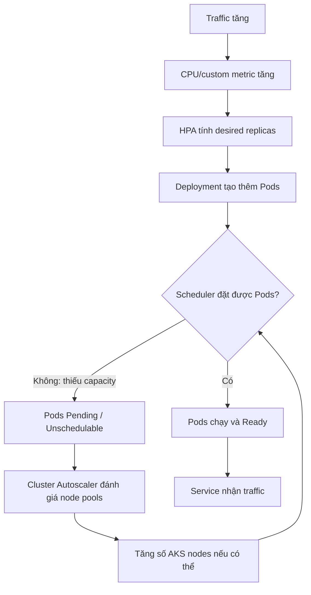
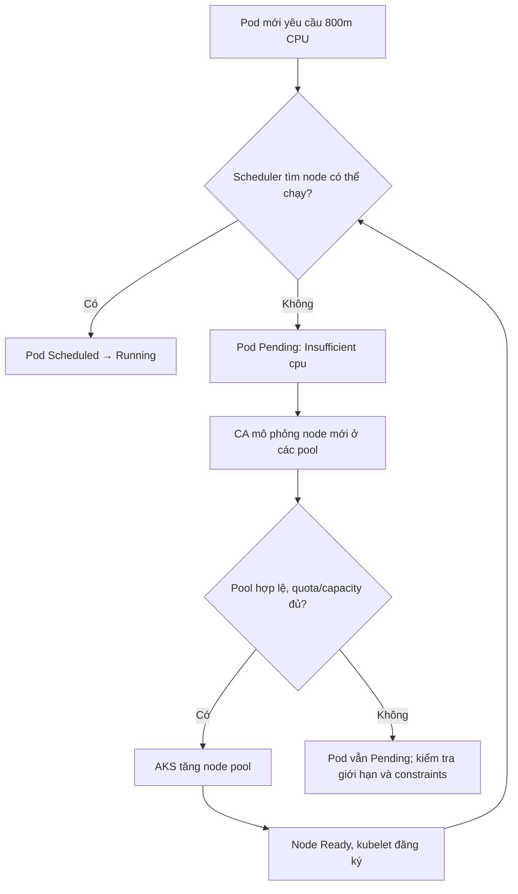
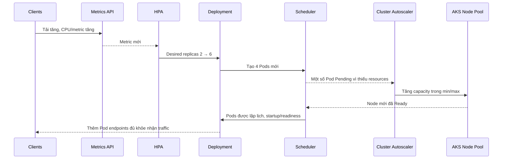
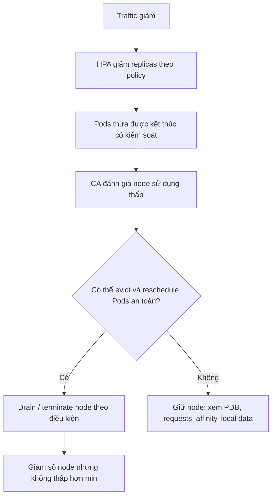
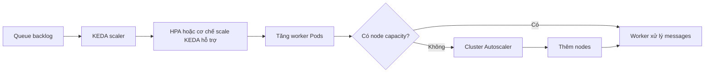
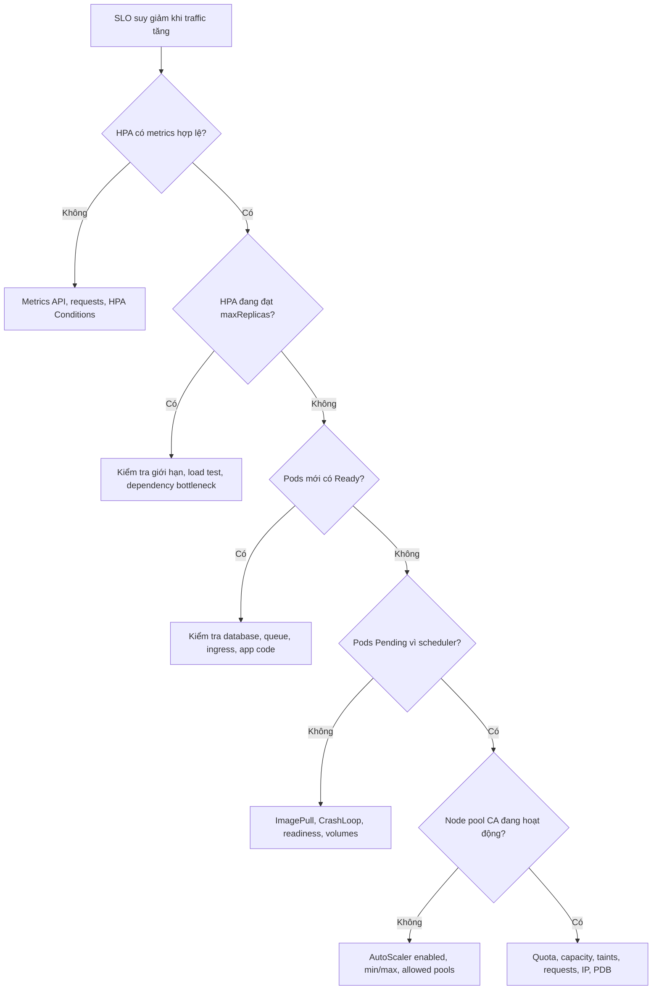

# Horizontal Pod Autoscaler và Cluster Autoscaler

Một ứng dụng bán hàng trên **Azure Kubernetes Service (AKS)** có thể chạy tốt với hai Pod vào ban đêm nhưng cần mười Pod khi bắt đầu chiến dịch khuyến mãi. Khi tăng số Pod, cụm Kubernetes có thể hết CPU hoặc RAM trên các node hiện tại. Lúc đó, chỉ tăng số Pod chưa giải quyết được vấn đề: một số Pod sẽ nằm ở trạng thái `Pending` vì không có node đủ tài nguyên để chạy. Ngược lại, chỉ thêm nhiều máy ảo mà không điều chỉnh số bản sao ứng dụng có thể gây lãng phí.

Hai bộ điều khiển phổ biến giải quyết hai phần khác nhau:

- **Horizontal Pod Autoscaler (HPA):** tăng hoặc giảm **số Pod replicas** của workload theo metric.
- **Cluster Autoscaler (CA):** tăng hoặc giảm **số node** trong những node pool được cấu hình autoscale, dựa trên nhu cầu lập lịch Pod và khả năng giải phóng node.

Bài học thuộc chương **Vận hành AKS** trong module `CLOUD_PROVIDERS_AZURE`. Đây là một phần của hành trình làm chủ Microsoft Azure: từ subscription, resource group, Microsoft Entra ID, mạng ảo đến compute, lưu trữ, dữ liệu, triển khai, giám sát, bảo mật và chi phí. Mục tiêu là không chỉ biết bật hai tính năng autoscale, mà còn hiểu rõ tín hiệu điều khiển, sự tương tác, giới hạn và quy trình vận hành production an toàn.

## Mục tiêu học tập

Sau bài học, bạn có thể:

1. Phân biệt HPA với Cluster Autoscaler về **đối tượng thay đổi**, **metric/tín hiệu**, **độ trễ** và **hành động khi scale**.
2. Giải thích vì sao HPA CPU theo tỷ lệ sử dụng cần khai báo **CPU requests**, không phải chỉ `limits`.
3. Đọc công thức tính số replicas mong muốn và giải thích các thuộc tính của resource `HorizontalPodAutoscaler` trong API `autoscaling/v2`.
4. Cấu hình HPA theo CPU hoặc memory và hiểu điều kiện cần để dùng custom/external metrics.
5. Kích hoạt Cluster Autoscaler trên AKS node pool với `min-count` và `max-count`, đồng thời kiểm tra trạng thái.
6. Mô tả trình tự **tăng traffic → tăng Pod → Pending → thêm node → Pod Ready**, và trình tự thu hẹp sau khi hết tải.
7. Phân tích những tình huống CA không thể thêm node hoặc không thể scale down do quota, affinity, taints, PodDisruptionBudget, local storage hay policy.
8. Thiết kế khả năng sẵn sàng, giới hạn chi phí, quyền quản trị, giám sát, lab có kiểm soát và runbook khôi phục.

## 1. Hai vòng autoscale, hai bài toán khác nhau

Trong Kubernetes, “mở rộng” không phải một hành động duy nhất. HPA quản lý số bản sao của một workload. Cluster Autoscaler quản lý năng lực chạy Pods bằng cách thay đổi số worker nodes.

| Tiêu chí | Horizontal Pod Autoscaler | Cluster Autoscaler trên AKS |
|---|---|---|
| Đơn vị thay đổi | **Replicas** của Deployment/StatefulSet hoặc workload có `scale` subresource được hỗ trợ | **VM nodes** của AKS node pools được bật autoscaler |
| Tín hiệu chính | Resource metrics, custom metrics, external metrics theo cấu hình | Pods không lập lịch được; node có thể thu hồi sau khi cân nhắc khả năng di dời Pods |
| Đối tượng đặt giới hạn | `minReplicas`, `maxReplicas` | `min-count`, `max-count` của từng node pool |
| Điều kiện quan trọng | Metrics pipeline hoạt động; CPU requests nếu scale theo CPU utilization | Scheduler constraints, node pool phù hợp, đủ quota/capacity |
| Độ trễ | Chu kỳ metric/controller, Pod startup và readiness | Phân tích Pending Pods, cấp phát VM node, bootstrap và Pod scheduling |
| Có tạo node mới? | **Không** | **Có**, trong node pool được phép |
| Có thay đổi replicas ứng dụng? | **Có** | **Không trực tiếp** |
| Có tăng năng lực CPU của từng Pod? | Không; tạo thêm replicas | Không trực tiếp; bổ sung node đủ tài nguyên cho Pods |
| Khái niệm liên quan | KEDA, custom/external metrics, `behavior` | AKS node pool, VM quota, taints, topology, drain, PDB |

### Sơ đồ hợp tác



**Quy tắc ghi nhớ:** HPA hỏi *“Ứng dụng cần bao nhiêu bản sao?”*; CA hỏi *“Cụm cần bao nhiêu máy để có chỗ chạy các Pod?”*. CA **không tự tăng node chỉ vì CPU đang 95%** nếu không có những Pod có thể được lập lịch bằng cách thêm capacity. HPA cũng **không tự xin VM mới** khi Pod bị Pending.

## 2. AKS node pool, Pod và resource requests

Trong AKS:

- **Node pool** là tập node VM theo cấu hình được AKS hỗ trợ, có VM size, OS, labels, taints, autoscaler bounds và các thuộc tính khác.
- **Node** có tài nguyên `capacity` và `allocatable`. Scheduler chủ yếu xét **allocatable resources** còn khả dụng cho Pods, không lấy toàn bộ CPU/RAM vật lý của VM làm ngân sách Pod.
- **Pod** có thể khai báo `resources.requests` và `resources.limits` riêng cho mỗi container.
- **Scheduler** đặt Pod lên node theo yêu cầu CPU/RAM, node selector/affinity, taints/tolerations, topology, volume và các điều kiện khác.

Ví dụ một container khai báo:

```yaml
resources:
  requests:
    cpu: "250m"
    memory: "256Mi"
  limits:
    cpu: "750m"
    memory: "512Mi"
```

Diễn giải:

- `cpu: 250m` tương đương **0,25 CPU core**; scheduler dùng request để đánh giá khả năng đặt Pod và đây là cơ sở tính CPU utilization cho HPA.
- `memory: 256Mi` là memory request để lập lịch; nếu sử dụng thực tế vượt giới hạn bộ nhớ được áp dụng, container có thể bị OOMKilled.
- `limits.cpu: 750m` là giới hạn CPU theo cơ chế runtime/cgroup, không phải “CPU mà Pod yêu cầu để scheduler giữ chỗ”. CPU vượt limit thường bị throttling.
- Request thấp hơn nhu cầu thực khiến scheduler nhét nhiều Pods lên node và có thể gây CPU contention hoặc memory pressure.
- Request quá cao khiến Pods Pending và làm CA tăng node sớm hơn, tạo chi phí không cần thiết.

### Requests là cầu nối giữa HPA và Cluster Autoscaler

HPA CPU utilization dựa trên tỷ lệ:

\[
\text{CPU utilization (\%)} =
\frac{\text{CPU usage đo được}}{\text{CPU request}}\times 100
\]

Nếu một Pod được request `200m` và dùng `150m`, mức sử dụng tương đối bằng:

\[
\frac{150m}{200m}\times 100 = 75\%.
\]

Trong khi đó scheduler tính Pod cần **200m CPU request** để tìm node phù hợp. Nếu HPA tăng từ 2 lên 8 Pods, nhu cầu đặt chỗ CPU theo request có thể tăng từ `400m` lên `1600m` (chưa tính container khác); CA nhìn thấy nhu cầu đó thông qua những Pod không thể được lập lịch.

**Nếu container không có CPU request phù hợp**, HPA dựa trên CPU utilization có thể không tính được chỉ số cần thiết. Đừng chỉ thêm CPU limit rồi chờ HPA hoạt động.

## 3. HPA hoạt động thế nào?

HPA là một Kubernetes controller định kỳ lấy metric và tính số replicas mong muốn cho target có hỗ trợ `scale` subresource, phổ biến nhất là `Deployment`.

Chu trình cơ bản:

1. Thu thập metric từ API được hỗ trợ, ví dụ `metrics.k8s.io` cho CPU/memory.
2. So sánh metric hiện tại với mục tiêu của HPA.
3. Tính số replicas mục tiêu theo công thức điều khiển và các ngưỡng/tolerance/stabilization.
4. Áp dụng giới hạn `minReplicas`/`maxReplicas` và `behavior`.
5. Cập nhật `spec.replicas` của target theo cơ chế `scale`.
6. Deployment controller tạo/xóa Pods; scheduler và kubelet xử lý phần còn lại.

### Công thức trực giác

Với một metric:

\[
\text{desiredReplicas} =
\left\lceil
\text{currentReplicas}
\times
\frac{\text{currentMetricValue}}{\text{desiredMetricValue}}
\right\rceil.
\]

Ví dụ có **3 Pod**, mỗi Pod request `200m`, CPU trung bình đo được `150m`, tương đương **75%**. HPA target là **50%** CPU utilization:

\[
\text{desiredReplicas} = \left\lceil3\times\frac{75}{50}\right\rceil
= \lceil4.5\rceil = 5.
\]

HPA có thể đề xuất tăng từ 3 lên 5 replicas. Trên thực tế, kết quả bị ảnh hưởng bởi metric thiếu, Pod chưa Ready, tolerance, stabilization, policies và giới hạn cấu hình; công thức trên mô tả nguyên tắc chứ **không phải cam kết mỗi chu kỳ sẽ tăng đúng con số đó**.

### HPA dựa trên metric gì?

| Loại metric | Ví dụ | Yêu cầu |
|---|---|---|
| **Resource metric** | CPU utilization, memory utilization | Metrics API và requests tương ứng khi dùng Utilization |
| **Pods custom metric** | Requests/second trên mỗi Pod | Metrics adapter cung cấp custom metrics API |
| **Object custom metric** | Số request tại một Ingress/đối tượng | Custom metrics adapter và định nghĩa metric đúng |
| **External metric** | Queue depth, số job đang chờ, business event rate | External metrics adapter hoặc bộ điều khiển tích hợp |

AKS có thể cung cấp nền tảng thu thập CPU/memory qua Metrics Server được hỗ trợ, nhưng phải **kiểm tra thực tế** thay vì mặc định `kubectl top` luôn hoạt động. HPA **không tự đọc** Application Insights, Azure Monitor hoặc queue nếu chưa có adapter/integration thích hợp.

## 4. Tạo HPA bằng Kubernetes API `autoscaling/v2`

Ví dụ workload `sample-web` trong namespace `aks-scale-lab` có CPU request cho từng container. HPA muốn duy trì CPU utilization trung bình **60%**, với tối thiểu 2 và tối đa 8 replicas.

```yaml
apiVersion: autoscaling/v2
kind: HorizontalPodAutoscaler
metadata:
  name: sample-web-hpa
  namespace: aks-scale-lab
spec:
  scaleTargetRef:
    apiVersion: apps/v1
    kind: Deployment
    name: sample-web
  minReplicas: 2
  maxReplicas: 8
  metrics:
    - type: Resource
      resource:
        name: cpu
        target:
          type: Utilization
          averageUtilization: 60
  behavior:
    scaleUp:
      stabilizationWindowSeconds: 0
      selectPolicy: Max
      policies:
        - type: Pods
          value: 2
          periodSeconds: 60
        - type: Percent
          value: 100
          periodSeconds: 60
    scaleDown:
      stabilizationWindowSeconds: 300
      selectPolicy: Min
      policies:
        - type: Percent
          value: 50
          periodSeconds: 60
        - type: Pods
          value: 1
          periodSeconds: 60
```

Đây là **manifest minh họa cho Kubernetes API**. Trước khi sử dụng production, cần kiểm chứng phiên bản Kubernetes/AKS, logic scaling policy và yêu cầu SLO của ứng dụng.

### Giải thích manifest

- `scaleTargetRef`: target cần scale; tên phải trùng Deployment hiện có.
- `minReplicas: 2`: giới hạn thấp của autoscaler. Đây **không** bảo đảm hai Pod nằm trên hai node/zone khác nhau.
- `maxReplicas: 8`: giới hạn cao của autoscaler; dù tải cao hơn, HPA không vượt 8 nếu policy không được thay đổi.
- `Resource/cpu/Utilization`: dùng CPU theo **% requests**, không theo tỷ lệ CPU limit.
- `scaleUp`: cho phép tăng theo tốc độ được mô tả, với `selectPolicy: Max` chọn chính sách cho phép biến động lớn hơn trong các policy.
- `scaleDown`: giữ lịch sử đề xuất trong khoảng stabilization để tránh giảm replica quá nhanh; `selectPolicy: Min` chọn chính sách giảm chậm hơn trong các policy.

**Không nên copy ngưỡng 60%, batch 2 Pods/60 giây hoặc downscale 300 giây vào mọi workload.** API nhận những giá trị cấu hình, nhưng cấu hình vận hành tốt phải được đo bằng throughput, p95/p99 latency, request duration, startup time, burstiness và giới hạn nguồn lực.

### Vì sao cần behavior?

Khi traffic tăng giảm liên tục:

```text
Lúc 09:00: 2 replicas, CPU tăng
Lúc 09:01: 4 replicas, CPU hạ vì thêm capacity
Lúc 09:02: request mới đến, CPU lại tăng
Lúc 09:03: nếu giảm replica quá nhanh, cụm lại thiếu năng lực
```

HPA có thể **flap**: tăng, giảm rồi lại tăng. `behavior.scaleDown.stabilizationWindowSeconds` giúp trì hoãn quyết định thu hẹp dựa trên lịch sử đề xuất; không nên hiểu là “chờ chính xác 300 giây kể từ khi hết một request rồi xóa Pod”.

Các tham số mặc định hoặc cấu hình controller có thể khác theo phiên bản Kubernetes/AKS. Khi cần giá trị chính xác cho một cluster, kiểm tra HPA object và hệ thống thực tế.

## 5. HPA với nhiều metric

Một ứng dụng có thể bị quá tải do CPU hoặc queue backlog. Với nhiều metric, HPA tính đề xuất số replicas cho từng metric và sử dụng **đề xuất lớn nhất** trong những điều kiện được hỗ trợ.

Ví dụ ý tưởng:

| Metric | Số replicas đề xuất |
|---|---|
| CPU trung bình vượt target | 5 |
| RPS cao hơn target | 7 |
| Memory utilization gần target | 3 |
| Kết quả HPA cân nhắc | 7, sau khi áp dụng policy/giới hạn |

Nếu một metric không lấy được, hành vi không đơn giản luôn bỏ qua nó: **một lỗi metric có thể ngăn scale-down trong một số tình huống**, trong khi scale-up theo metric còn hợp lệ có thể vẫn được thực hiện theo cơ chế HPA. Vì vậy cần theo dõi `Conditions` và `Events`, không chỉ cột `TARGETS`.

### CPU không phải metric tốt cho mọi ứng dụng

- **Web/API CPU-bound:** CPU utilization có thể phản ánh tương đối đúng nhu cầu scale.
- **Web/API I/O-bound:** request chờ database/network, CPU thấp nhưng latency và queue cao; CPU-only HPA có thể không tăng replicas.
- **Worker queue:** queue length, message age hoặc số job chờ có thể phù hợp hơn.
- **Ứng dụng dùng connection pool giới hạn:** tăng Pod không chắc tăng throughput nếu database hết connections.
- **Memory-heavy workload:** memory utilization có thể tăng nhưng không giảm ngay khi tải hạ, dễ giữ replicas cao; cần đánh giá đặc tính GC/cache.

Metric tốt là metric **có quan hệ nhân quả với khả năng đáp ứng SLO**, chứ không phải metric dễ lấy nhất.

## 6. Metrics Server và đường thu thập HPA

HPA resource CPU/memory cần Kubernetes **Resource Metrics API** có dữ liệu. Trên một AKS cluster đã hỗ trợ metrics phù hợp, kiểm tra bằng:

```bash
kubectl get apiservices | grep metrics.k8s.io
kubectl top nodes
kubectl top pods -A
```

Trên Windows PowerShell, thay `grep` bằng bộ lọc phù hợp hoặc dùng `kubectl get apiservices` nguyên vẹn.

### Đọc kết quả

- `kubectl top nodes` hiển thị CPU/memory hiện tại theo pipeline metrics đang hoạt động.
- `kubectl top pods` hiển thị mức sử dụng Pod.
- Những chỉ số này có thể **trễ một khoảng thời gian** và không nhằm thay thế monitoring dài hạn.
- Nếu trả lỗi `Metrics API not available`, kiểm tra Metrics Server/APIService, AKS version, trạng thái hệ thống và quyền, không khắc phục bằng cách xóa namespace `kube-system` hoặc cài thêm bản Metrics Server chồng lấn.

**Lỗi rất thường gặp:** không có `resources.requests.cpu` ở container của Pod target. Khi đó `kubectl top` có thể hiển thị CPU usage, nhưng HPA vẫn không tính được CPU utilization theo % request cho Pods liên quan.

### Kiểm tra HPA hiện có

```bash
kubectl -n aks-scale-lab get hpa
kubectl -n aks-scale-lab describe hpa sample-web-hpa
kubectl -n aks-scale-lab get hpa sample-web-hpa -o yaml
```

Trong `describe`, chú ý `Metrics`, `Conditions`, `Events`, `AbleToScale`, `ScalingActive` và `ScalingLimited`. Các trạng thái có thể cho biết metric lỗi, target không đủ điều kiện hoặc replicas bị giới hạn.

## 7. Cluster Autoscaler trong AKS: mở rộng node pools

**Cluster Autoscaler** quan sát những Pod không được lập lịch và đánh giá liệu tăng node ở một trong các **node pools có autoscaler bật** có giúp đặt được Pod không. Khi thu hẹp, nó cân nhắc node ít sử dụng, khả năng di chuyển/evict các Pods còn chạy và các ràng buộc an toàn.



### CA không dùng CPU trung bình như tín hiệu chính để scale up

Giả sử hai node đều dùng 95% CPU thực tế, nhưng mọi Pod đã được scheduler gán lên node và không có Pod Pending vì thiếu requests. **CA có thể không tăng node**, dù CPU đang cao.

HPA có thể tăng `replicas`, khiến Pod mới yêu cầu thêm CPU. Nếu scheduler không đặt được những Pod này, CA mới có tín hiệu để cân nhắc scale-out.

### Khi nào CA có thể scale down?

CA định kỳ đánh giá node có thể thu hồi mà vẫn duy trì các Pods trên những node khác theo ràng buộc:

- Có thể di dời Pods mà không vi phạm những điều kiện an toàn và lịch trình.
- Các Pod còn lại tìm được node đích với tài nguyên request thích hợp.
- PodDisruptionBudget (PDB) và các cơ chế bảo vệ/eviction được tôn trọng theo tính năng.
- Điều kiện về node utilization, thời gian chờ và giới hạn node pool cho phép scale-down.

Không nên coi `CPU usage thấp` là tiêu chí duy nhất để kết luận một node sẽ bị xóa. Node có thể có Pod request lớn, system Pods, local data hoặc ràng buộc topology ngăn việc thu hồi.

## 8. Node pool min/max và các loại pool

Trong AKS, **Cluster Autoscaler có thể được bật theo node pool**. Mỗi pool có giới hạn `min-count` và `max-count`. Các giá trị cần phù hợp quota, workload và chiến lược chi phí.

Ví dụ:

| Node pool | Loại workload | Số node tối thiểu | Số node tối đa | Ý nghĩa |
|---|---|---:|---:|---|
| `sysnode` | Kubernetes system components | 2 | 3 | Giữ năng lực hệ thống cơ bản |
| `webnode` | Web/API dùng HPA | 2 | 8 | Tăng capacity khi Pod mới cần tài nguyên |
| `jobsnode` | Worker/ETL | 0 hoặc 1 nếu khả năng hỗ trợ và policy cho phép | 10 | Co giãn theo nhu cầu tác vụ; cần xem khởi động từ 0 |

Các giá trị trong bảng chỉ là **ví dụ thiết kế**, không phải mọi loại pool/SKU đều hỗ trợ cùng giới hạn. Đối với **system pool**, luôn kiểm tra số node tối thiểu, khả năng hỗ trợ và mức sẵn sàng được AKS khuyến nghị. **Không dùng min-count 0 cho system pool chỉ để tiết kiệm tiền.**

### Vì sao nên tách system và user pools?

- System pool bảo đảm tài nguyên cho các dịch vụ hệ thống cần thiết.
- User pool có thể chọn VM size/OS/taints/autoscaler bounds phù hợp ứng dụng.
- Các workload GPU, CPU-intensive hoặc batch có thể có pool riêng để quản lý quota/chi phí.
- Bảo vệ workload quan trọng khi các workload khác scale mạnh.

Điều kiện scheduling phải tương thích: node taints, Pod tolerations, node affinity/selector, topology spread và supported VM sizes. **Thêm node ở pool không phù hợp sẽ không giúp Pod Pending chạy được.**

## 9. Bật Cluster Autoscaler trên AKS node pool

Ví dụ dùng resource group `rg-aks-scale-lab`, cluster `aks-scale-lab` và user node pool `webnode`. Chỉ áp dụng lệnh ghi cấu hình với cluster sandbox đã được phép.

### Kiểm tra cluster và node pool trước

```bash
az login --tenant "<tenant-id>"
az account set --subscription "<subscription-id>"

az aks show \
  --resource-group "rg-aks-scale-lab" \
  --name "aks-scale-lab" \
  --query "{name:name,state:provisioningState,version:kubernetesVersion}" \
  --output json

az aks nodepool list \
  --resource-group "rg-aks-scale-lab" \
  --cluster-name "aks-scale-lab" \
  --query "[].{name:name,mode:mode,count:count,vmSize:vmSize,autoscale:enableAutoScaling,min:minCount,max:maxCount}" \
  --output table
```

Nếu AKS CLI trả trường khác hoặc `null` theo API/version, xem JSON đầy đủ. Cần xác nhận orchestration/tính năng, ownership, quota và VM SKU trước khi bật.

### Bật trên pool hiện có

```bash
az aks nodepool update \
  --resource-group "rg-aks-scale-lab" \
  --cluster-name "aks-scale-lab" \
  --name "webnode" \
  --enable-cluster-autoscaler \
  --min-count 2 \
  --max-count 5
```

Lệnh này **thay đổi node pool**. Trong môi trường thật, cần review tác động tới capacity và billing; nếu pool `webnode` chưa tồn tại, lệnh sẽ thất bại. Đừng tự chọn pool production khác chỉ để lệnh chạy.

### Tạo user pool mới có autoscaler

Nếu lab được phép thêm pool:

```bash
az aks nodepool add \
  --resource-group "rg-aks-scale-lab" \
  --cluster-name "aks-scale-lab" \
  --name "webnode" \
  --mode User \
  --node-vm-size "Standard_D2s_v5" \
  --enable-cluster-autoscaler \
  --min-count 2 \
  --max-count 5
```

Ví dụ chỉ chạy **một trong hai cách**: cập nhật pool hiện có **hoặc** thêm pool mới. Tên node pool phải tuân thủ giới hạn của AKS; VM SKU phải còn quota/capacity và phù hợp region. Cần lưu ý giới hạn số node, tài nguyên địa chỉ IP và outbound path khi mở rộng.

### Kiểm tra sau khi bật

```bash
az aks nodepool show \
  --resource-group "rg-aks-scale-lab" \
  --cluster-name "aks-scale-lab" \
  --name "webnode" \
  --query "{name:name,count:count,autoscale:enableAutoScaling,min:minCount,max:maxCount}" \
  --output json

kubectl get nodes -o wide
```

**Khi CA đang quản lý số node**, không nên thường xuyên điều chỉnh thủ công `node-count` trên cùng pool. Thay đổi capacity qua bounds và các API tương ứng theo quy trình hỗ trợ; thao tác scale thủ công và autoscaler có thể tạo xung đột về desired capacity.

### Cấu hình cluster autoscaler profile

AKS có các thiết lập **cluster autoscaler profile** để điều chỉnh hành vi như thời gian scan, tốc độ scale-down, cân bằng node groups và chính sách lựa chọn pool theo khả năng được hỗ trợ.

Đọc cấu hình hiện tại:

```bash
az aks show \
  --resource-group "rg-aks-scale-lab" \
  --name "aks-scale-lab" \
  --query "autoScalerProfile" \
  --output json
```

Các tên tùy chọn có thể gồm `scan-interval`, `scale-down-delay-after-add`, `scale-down-unneeded-time` hoặc `scale-down-utilization-threshold`. **Giá trị, phạm vi và cách cập nhật phụ thuộc phiên bản AKS/CLI**. Khi cần tinh chỉnh, kiểm tra `az aks update -h` và tài liệu cho AKS version thực tế; không tự bịa một lệnh ghi cấu hình khi chưa xác minh schema. Profile thường ảnh hưởng hành vi autoscaler trong cluster, cần xét tác động lên mọi pool.

## 10. Chuỗi HPA + CA trong một đợt tăng tải

Giả sử:

- Deployment `checkout-api` bắt đầu với **2 Pods**, HPA min=2, max=12.
- Mỗi Pod request `500m` CPU và có thể phục vụ khoảng một mức tải đã đo.
- User node pool có **2 nodes** và được phép tăng lên **5 nodes**.
- Các nodes còn ít CPU allocatable; một số Pod mới không được đặt ngay.



### Độ trễ tổng thể

Từ lúc traffic tăng đến khi người dùng có thêm capacity có thể gồm:

\[
T_{\text{scale-out}} \approx
T_{\text{metrics}} +
T_{\text{HPA}} +
T_{\text{scheduler}} +
T_{\text{node provision}} +
T_{\text{image pull}} +
T_{\text{app ready}}.
\]

Đây là **mô hình phân rã độ trễ**, không phải công thức SLA với các số cộng cố định. Một số bước có thể song song, và một Pod có thể được đặt lên node đang có mà không cần chờ node mới.

Điểm vận hành quan trọng: **HPA không loại bỏ độ trễ khởi động node**. Nếu ứng dụng phải đáp ứng spike trong vài giây nhưng cấp node mới mất lâu hơn, cần duy trì **headroom** ở node pool hoặc pre-scale theo lịch/dự báo và dùng chiến lược queue/backpressure.

## 11. Chiều ngược lại: HPA giảm Pod, CA giảm node

Khi chiến dịch kết thúc, metrics giảm và HPA có thể đề xuất thu hẹp replicas trong phạm vi `behavior.scaleDown`. Sau khi ít Pod hơn, một số node có thể trở nên thừa. CA đánh giá khả năng dồn Pods về các node còn lại rồi thu hồi node phù hợp.



CA thường **chậm hơn HPA ở giai đoạn scale-down** do cần thời gian quan sát và di chuyển workload an toàn. Đây là chủ ý để tránh node flapping hoặc làm gián đoạn các ứng dụng đang chạy.

### Tại sao node có thể không được xóa dù CPU rất thấp?

- Một Pod có **CPU request lớn** khiến node không thể được thay thế bằng node khác.
- Pod có **node affinity hoặc selector** buộc chạy trên một nhóm node cụ thể.
- Pod bị **taint/toleration constraints** khi di dời.
- **PodDisruptionBudget** không cho phép thêm một Pod bị gián đoạn.
- Pod có volume/local storage hoặc điều kiện eviction không được hỗ trợ an toàn.
- Pool đã ở `min-count`.
- Node đang nằm trong khoảng thời gian CA tránh scale-down sau khi mở rộng/sự kiện khác.
- Có system Pods hoặc priority/critical workloads làm việc di dời không phù hợp.

**Không xóa thủ công node VM trong node resource group** để “ép” scale-down. Dùng AKS API và quy trình node pool được hỗ trợ, tránh gây drift hoặc mất dữ liệu.

## 12. Bảo vệ ứng dụng khi autoscaler thay đổi Pod và node

### Readiness, liveness, startup probes

- **Readiness:** Pod chỉ nhận traffic khi có khả năng phục vụ; đặc biệt quan trọng với Pod vừa được HPA tạo.
- **Liveness:** phát hiện tình trạng process không thể tiếp tục hoạt động để Kubernetes xử lý theo cấu hình.
- **Startup:** hữu ích khi ứng dụng cần nhiều thời gian boot để không bị liveness probe kết thúc sớm.

HPA có thể tăng replicas rất nhanh, nhưng nếu app khởi động mất ba phút và readiness còn false, người dùng **chưa có thêm usable capacity**. Cần đo số **Available Pods**, không chỉ số Pod objects đã tạo.

### Graceful termination

Khi HPA giảm replicas hoặc CA thu hồi node:

1. Controller thay đổi số replicas hoặc node được lên kế hoạch drain.
2. Pod nhận termination signal theo cơ chế Kubernetes.
3. Ứng dụng nên ngừng nhận request/job mới và hoàn thành request đang xử lý hoặc checkpoint.
4. EndpointSlices/Service membership thay đổi theo trạng thái sẵn sàng/kết thúc.
5. Kubelet thực thi termination grace period và buộc dừng nếu vượt giới hạn.

Với API có yêu cầu dài, cần thiết lập `terminationGracePeriodSeconds`, `preStop` khi phù hợp, timeout của load balancer/ingress và graceful shutdown trong code. Không coi HPA/CA là công cụ tự giải quyết kết nối dài hoặc giao dịch chưa commit.

### PodDisruptionBudget (PDB)

PDB đặt ràng buộc cho **voluntary disruptions**, ví dụ một số hành động drain/eviction; nó không ngăn được mọi sự cố bất ngờ như mất máy vật lý hoặc container crash.

Ví dụ có 3 replicas và muốn ít nhất 2 Pod khỏe khi thực hiện các gián đoạn tự nguyện:

```yaml
apiVersion: policy/v1
kind: PodDisruptionBudget
metadata:
  name: checkout-api-pdb
  namespace: aks-scale-lab
spec:
  minAvailable: 2
  selector:
    matchLabels:
      app: checkout-api
```

Nếu tạo PDB quá chặt (chẳng hạn `minAvailable: 3` trên Deployment chỉ có 3 replicas), có thể gây trở ngại cho node drain, rolling upgrades hoặc CA scale-down. Phải cân bằng availability với khả năng bảo trì.

**PDB không thay cho HPA minReplicas.** Cả hai có tác dụng khác nhau và cần được thiết kế cùng Deployment strategy, topology/zone và rollout process.

### Phân bố trên node và zone

Để tránh HPA tạo 5 replicas nhưng tất cả nằm cùng một node/zone, cần xem xét:

- `topologySpreadConstraints`.
- Pod anti-affinity khi phù hợp.
- Availability zones và topology labels thực tế của AKS node pools.
- Resource requests và capacity từng zone.
- PodDisruptionBudget và số replicas tối thiểu.

Đừng mặc định hai replicas của Deployment tự bảo đảm chịu lỗi một availability zone.

## 13. Bài lab HPA: tạo Deployment và HPA CPU

**Mục tiêu:** quan sát HPA tăng/giảm replicas bằng một workload thử nghiệm trên AKS đã được tạo, đồng thời hiểu vì sao metrics và requests quan trọng. Phần này không bắt buộc thêm node nếu cluster còn đủ capacity.

### Điều kiện trước lab

1. Có AKS sandbox với quyền `kubectl` trong namespace test và quyền đọc HPA/metrics.
2. Đã xác nhận `kubectl config current-context` chỉ tới đúng cluster lab.
3. Metrics API hoạt động (`kubectl top nodes` và `kubectl top pods` không lỗi).
4. Node pool đủ quota/capacity để chạy ít nhất hai Pods test.
5. Có ngân sách và thời hạn dọn dẹp; workload không chứa dữ liệu thật.
6. Registry egress từ AKS cho image thử được hỗ trợ.

### Bước A. Chọn context và tạo namespace

```bash
kubectl config current-context
kubectl cluster-info
kubectl get nodes -o wide
kubectl top nodes

kubectl create namespace aks-scale-lab
```

Không tạo namespace nếu nó đã tồn tại và được nhóm khác dùng: dùng namespace riêng theo quy tắc tổ chức.

### Bước B. Khai báo Deployment/Service và HPA

Manifest minh họa sau sử dụng container thử CPU thuộc ví dụ Kubernetes HPA. Image public có thể thay đổi về khả dụng; kiểm tra registry, chính sách image và khả năng kéo image trước khi áp dụng. **Không dùng image/demo này làm ứng dụng production.**

```yaml
apiVersion: apps/v1
kind: Deployment
metadata:
  name: sample-web
  namespace: aks-scale-lab
spec:
  replicas: 2
  selector:
    matchLabels:
      app: sample-web
  template:
    metadata:
      labels:
        app: sample-web
    spec:
      containers:
        - name: web
          image: registry.k8s.io/hpa-example
          ports:
            - containerPort: 80
          resources:
            requests:
              cpu: "200m"
              memory: "64Mi"
            limits:
              cpu: "500m"
              memory: "128Mi"
          readinessProbe:
            httpGet:
              path: /
              port: 80
            periodSeconds: 10
          livenessProbe:
            httpGet:
              path: /
              port: 80
            initialDelaySeconds: 15
            periodSeconds: 20
---
apiVersion: v1
kind: Service
metadata:
  name: sample-web
  namespace: aks-scale-lab
spec:
  type: ClusterIP
  selector:
    app: sample-web
  ports:
    - port: 80
      targetPort: 80
---
apiVersion: autoscaling/v2
kind: HorizontalPodAutoscaler
metadata:
  name: sample-web-hpa
  namespace: aks-scale-lab
spec:
  scaleTargetRef:
    apiVersion: apps/v1
    kind: Deployment
    name: sample-web
  minReplicas: 2
  maxReplicas: 8
  metrics:
    - type: Resource
      resource:
        name: cpu
        target:
          type: Utilization
          averageUtilization: 60
  behavior:
    scaleUp:
      stabilizationWindowSeconds: 0
    scaleDown:
      stabilizationWindowSeconds: 300
```

Lưu phần nội dung này thành `aks-hpa-lab.yml` **trong môi trường học tập của bạn** nếu được phép. Bài học chỉ minh họa lệnh, không tạo tệp đó trong workspace dự án. Sau đó áp dụng:

```bash
kubectl apply -f aks-hpa-lab.yml

kubectl -n aks-scale-lab rollout status deployment/sample-web
kubectl -n aks-scale-lab get deploy,svc,hpa,pods -o wide
kubectl -n aks-scale-lab describe hpa sample-web-hpa
```

### Bước C. Quan sát metric baseline

```bash
kubectl -n aks-scale-lab top pods
kubectl -n aks-scale-lab get hpa
kubectl -n aks-scale-lab get pods -o wide
```

Khi workload chưa có nhiều traffic, HPA thường giữ gần `minReplicas`. Các metric có thể cần thời gian mới xuất hiện; `TARGETS` tạm hiển thị `<unknown>` không có nghĩa phải tăng replicas bằng tay.

### Bước D. Tạo tải có kiểm soát

Chỉ trong **namespace sandbox**, có thể tạo Pod phát request liên tục tới ClusterIP Service:

```bash
kubectl -n aks-scale-lab run load-generator \
  --image=busybox:1.36 \
  --restart=Never \
  -- /bin/sh -c 'while true; do wget -q -O- http://sample-web >/dev/null; done'
```

Lệnh trên tạo traffic đến ứng dụng test, **không** gọi endpoint production. Lượng CPU thực tế phụ thuộc image, số node, networking và capacity. Nếu một load-generator chưa đủ tăng CPU, đừng tự ý mở hàng trăm Pods; chỉ tăng tải theo ngân sách và giới hạn sandbox đã được phê duyệt.

Quan sát:

```bash
kubectl -n aks-scale-lab get hpa -w
```

Trong terminal khác:

```bash
kubectl -n aks-scale-lab get pods -o wide
kubectl -n aks-scale-lab top pods
kubectl -n aks-scale-lab describe hpa sample-web-hpa
```

**Kỳ vọng học thuật:** nếu CPU utilization vượt ngưỡng đủ lâu và metrics hợp lệ, HPA có thể tăng replicas tới giới hạn, tùy chính sách và khả năng cluster. **Không cam kết** HPA sẽ tăng đúng đến 8 replicas với đúng một Pod tạo tải; hãy đo thay vì suy đoán.

### Bước E. Dừng tải và quan sát scale-down

```bash
kubectl -n aks-scale-lab delete pod load-generator \
  --ignore-not-found

kubectl -n aks-scale-lab get hpa
kubectl -n aks-scale-lab get pods
```

Sau khi tải ngừng, đợi chu kỳ metrics và `scaleDown.stabilizationWindowSeconds`; số replicas có thể không giảm ngay. Ghi lại thời gian, CPU, current/desired replicas và lý do thay đổi từ `kubectl describe hpa`.

### Bước F. Thu dọn namespace

Khi namespace chỉ có tài nguyên lab bạn tạo, và đã kiểm tra đúng context:

```bash
kubectl config current-context
kubectl -n aks-scale-lab get all
kubectl delete namespace aks-scale-lab
```

Không xóa namespace dùng chung hoặc có workload của người khác. Xóa namespace **không dừng AKS node VMs** và không tự xóa phí cluster.

## 14. Bài lab Cluster Autoscaler: quan sát trước, tạo Pending Pod sau

**Mục tiêu:** hiểu CA dùng tín hiệu `Unschedulable` và giới hạn node pool; không cần cố tình làm quá tải production để nhìn thấy node tăng.

### Phần A — Preflight không thay đổi tài nguyên

```bash
kubectl config current-context
kubectl get nodes -o wide
kubectl get pods -A --field-selector=status.phase=Pending

az aks nodepool list \
  --resource-group "rg-aks-scale-lab" \
  --cluster-name "aks-scale-lab" \
  --query "[].{name:name,count:count,autoscaler:enableAutoScaling,min:minCount,max:maxCount}" \
  --output table
```

Đối chiếu số nodes trên Kubernetes với node pool count trên Azure. Số liệu có thể lệch trong một khoảng thời gian khi đang bootstrap, drain hoặc upgrade; không kết luận lỗi từ một snapshot.

### Phần B — Tìm nguyên nhân Pod Pending

Giả sử có Pod `cpu-demand-0` báo:

```text
Warning  FailedScheduling  0/2 nodes are available:
2 Insufficient cpu.
```

Kiểm tra:

```bash
kubectl -n aks-scale-lab describe pod cpu-demand-0
kubectl get nodes
kubectl describe node "<node-name>"
```

Nếu Pod request có thể đáp ứng trên loại node của một pool và pool chưa chạm `max-count`, CA có thể thêm node. Nhưng nếu Pod request **16 CPU** trong khi mọi pool chỉ sử dụng loại VM có ít CPU hơn, thêm nhiều node cùng loại cũng không giúp **một Pod đơn** có đủ 16 CPU; scheduler không chia một Pod qua nhiều node.

### Phần C — Thử scale-out (tùy chọn trong sandbox được phê duyệt)

Nếu cần chứng kiến CA hoạt động:

1. Chọn một **user pool** đã bật CA, giới hạn `max-count` trong ngân sách đã duyệt.
2. Ghi mức `allocatable` và tổng `requests` hiện tại của node.
3. Tạo workload **test riêng** với CPU/memory requests đủ lớn để một số Pod không lập lịch được, nhưng từng Pod vẫn **có thể vừa** với một node loại được phép tăng.
4. Xác nhận event `FailedScheduling: Insufficient cpu/memory`, không phải lỗi taints/affinity/PVC.
5. Quan sát `az aks nodepool show`, `kubectl get nodes` và event đến khi node mới `Ready`.
6. Giảm/xóa workload test, chờ CA scale-down theo điều kiện an toàn và ghi nhận thời gian.

**Không chạy một script tạo rất nhiều Pods hoặc nâng `max-count` lên hàng chục node chỉ để thử.** Mục tiêu là hiểu chuỗi điều khiển, không phát sinh chi phí VM ngoài kiểm soát.

Để tránh xung đột với HPA, nên dùng **Deployment test riêng không gắn HPA** cho thử nghiệm capacity. Nếu bạn tự chạy `kubectl scale deployment/sample-web` trong khi HPA đang quản lý Deployment đó, HPA có thể ghi đè số replicas vừa chỉnh.

### Phần D — Kết quả cần ghi lại

```text
Cluster: aks-scale-lab
Node pool: webnode
VM size: <SKU được hỗ trợ>
Autoscaler enabled: true/false
Node min/max: <giới hạn>
Nodes trước thử: <số>
Pod requests: <CPU/RAM>
Scheduling event: <lý do Pending>
Nodes sau thử: <số>
Node provision time: <thời gian đo>
Pod Ready time: <thời gian đo>
Scale-down delay/time: <thời gian đo>
Vấn đề gặp phải: <taints/affinity/quota/PDB/...>
Chi phí ước tính/ghi nhận: <giá trị>
```

## 15. Những giới hạn khiến CA không tăng node

Không phải mọi Pod `Pending` đều là tín hiệu hợp lệ để tăng node.

| Tình huống | Vì sao thêm node có thể không giúp | Hướng xử lý |
|---|---|---|
| Pod yêu cầu CPU/RAM lớn hơn allocatable của mọi VM size hiện có | Một Pod phải vừa trên một node | Chọn pool VM size lớn hơn hoặc giảm request/chia workload |
| Pool đã đạt `max-count` | Autoscaler không được vượt giới hạn | Đánh giá bounds/quota/budget rồi thay đổi có phê duyệt |
| Subscription hết vCPU quota | Azure không cấp phát thêm VM | Xem quota theo region/family, chọn vùng/SKU hoặc yêu cầu quota |
| Region/zone thiếu capacity cho SKU | Node không được tạo đúng zone/SKU | Đánh giá zone và SKU thay thế theo kiến trúc |
| Pod có `nodeSelector` không khớp pool | Node mới vẫn không có label cần | Kiểm tra labels/affinity và thiết kế pool |
| Node pool có taint Pod không tolerates | Pod không thể được scheduler chấp nhận | Xem `taints` và `tolerations` |
| Pod bắt buộc một zone không có node pool phù hợp | Mô phỏng node ở pool khác không đáp ứng | Tạo/điều chỉnh zone-capacity được hỗ trợ |
| PVC/PV ràng buộc vùng hoặc loại lưu trữ không phù hợp | Pod không thể attach volume ở node mới | Kiểm tra storage class, PV node affinity, zone |
| IP/subnet/network resources không đủ | AKS không cấp node/Pod networking cần thiết | Quy hoạch IP/CNI, subnet, NAT/UDR theo mode |
| Pod Pending vì image/initialization sau khi đã scheduled | Không nhất thiết là vấn đề scheduler capacity | `describe pod`, registry auth, image pull, startup logs |
| Node pool autoscaler bị tắt | CA không quản lý pool | Bật theo đúng pool và giới hạn |

### Cách điều tra nhanh

```bash
kubectl -n "<namespace>" describe pod "<pending-pod>"
kubectl get nodes --show-labels
kubectl describe node "<node-name>"

az aks nodepool show \
  --resource-group "rg-aks-scale-lab" \
  --cluster-name "aks-scale-lab" \
  --name "webnode" \
  --output json
```

Hãy đọc dòng **Events** của Pod. `FailedScheduling: Insufficient cpu` khác với `FailedScheduling: untolerated taint` hoặc `pod has unbound immediate PersistentVolumeClaims`. Tăng `max-count` sẽ không giải quyết những lỗi không liên quan capacity.

## 16. Những giới hạn khiến HPA không tăng hoặc không giảm Pod

| Triệu chứng | Nguyên nhân có thể | Kiểm tra |
|---|---|---|
| HPA `TARGETS: <unknown>/60%` | Metrics API lỗi hoặc thiếu CPU request | `kubectl top`, `describe hpa`, `resources.requests` |
| HPA muốn thêm replicas nhưng Deployment không tăng | `ScalingLimited`, quyền API, controller/target sai hoặc maxReplicas | `kubectl get hpa -o yaml`, `describe`, target name |
| Replicas tăng nhưng Pods Pending | Cluster thiếu node capacity hoặc scheduling constraints | `describe pod`, node allocatable, CA node pool |
| CPU rất cao nhưng HPA chưa scale | Metrics delay, tolerance, policy, missing metrics, đã đạt max | Xem HPA Conditions và metric hiện tại |
| CPU thấp nhưng latency cao | Ứng dụng I/O-bound hoặc dependency nghẽn | RPS, queue, database metrics và custom metrics |
| Pod mới bị `CrashLoopBackOff` | App/image/config lỗi, probe quá chặt, resources không phù hợp | Pod logs/events, readiness/startup |
| Load giảm nhưng HPA vẫn giữ nhiều replicas | Scale-down stabilization window hoặc metric khác vẫn cao | `behavior`, các metrics, HPA history |
| Replicas nhảy tăng/giảm liên tục | Metric nhiễu, thiếu stabilization, requests không đúng | HPA behavior, SLO, load test |
| HPA và manual `kubectl scale` đánh nhau | Hai bộ điều khiển cùng cập nhật `spec.replicas` | Ngừng chỉnh replicas thủ công hoặc bỏ HPA theo quy trình |
| HPA giảm nhưng request đang chạy bị rớt | Graceful shutdown, readiness, drain/timeout chưa đúng | App termination logs, ingress/LB timeout, PDB |

### Một điểm đặc biệt về HPA khi deployment mới

Khi Pod mới chưa Ready hoặc metrics tạm thiếu, HPA không nhất thiết tính giống như tất cả Pod đều có metric bình thường. Kubernetes có cơ chế xét Pod chưa sẵn sàng, metric bị thiếu và các ngưỡng bảo vệ để tránh scaling quá nhạy. Vì thế:

- Không dùng một lần `kubectl top` làm bằng chứng HPA “tính sai”.
- Kiểm tra trạng thái Pod readiness và thời gian từ lúc tạo Pod.
- Kiểm tra `describe hpa`, event, controller logs khi có thể truy cập theo quyền.
- So sánh trạng thái qua nhiều chu kỳ, nhất là sau deployment mới/cluster upgrade.

## 17. KEDA, event-driven scaling và giới hạn của CPU-based HPA

**Kubernetes Event-driven Autoscaling (KEDA)** là một dự án/giải pháp hỗ trợ scale workload dựa trên các sự kiện hoặc external metrics như queue length, Kafka lag, Azure Service Bus messages và những nguồn được hỗ trợ.

KEDA thường phối hợp với HPA để điều khiển replicas của Deployment theo external metrics. Một số mô hình KEDA còn hỗ trợ scale-to-zero hoặc tạo **ScaledJob** dành cho tác vụ độc lập.

### Vì sao worker queue có thể cần KEDA?

Một ứng dụng worker:

```text
Queue có 1000 messages
→ cần tăng số worker
→ mỗi worker đang chờ I/O nên CPU chỉ 20%
→ HPA chỉ dùng CPU có thể không tăng
```

Với metric queue backlog, có thể định nghĩa tỷ lệ mong muốn như khoảng N messages/worker, tùy workload và thời gian xử lý. Không tự kết luận KEDA có thể scale đến 0 mà không có điều kiện: cần xem loại trigger, scale target, activation threshold, cooldown và tính năng tích hợp.

### HPA + KEDA + Cluster Autoscaler



Để sử dụng an toàn:

- Không để **hai HPA độc lập** cùng điều khiển `scaleTargetRef` của một Deployment nếu không có mô hình phối hợp được hỗ trợ.
- Quy định ai sở hữu min/max replicas và metric source, tránh GitOps/CI/KEDA liên tục ghi đè.
- Đặt giới hạn worker concurrency, queue retry và database connection pool.
- Với task có tác động bên ngoài, cần idempotency/checkpoints để chịu được scale-in hoặc node failure.
- KEDA không thay thế Cluster Autoscaler: sau khi tăng Pods, vẫn cần đủ nodes.

### Node Auto-Provisioning (NAP) là gì?

AKS có những lựa chọn quản lý capacity nâng cao như **Node Auto-Provisioning**, sử dụng mô hình lựa chọn/cấp phát node khác so với việc tự định nghĩa và bật CA cho từng pool. Hỗ trợ, giới hạn và khả năng cùng tồn tại với các cơ chế autoscaling thay đổi theo phiên bản AKS và cấu hình cluster.

**Không tự bật NAP cùng CA trên một mô hình không tương thích** hoặc coi NAP là tên gọi khác của HPA. Bài học này tập trung vào **HPA + Cluster Autoscaler trên node pools được cấu hình rõ ràng**.

## 18. Tuning theo SLO, availability và workload

### Không tối ưu chỉ bằng CPU target

Một web API có SLO `p95 latency dưới 200 ms`. Khi scale HPA:

- Nếu target CPU quá cao, ứng dụng có thể vượt SLO trước khi HPA thêm Pods.
- Nếu target CPU quá thấp, workload có thể giữ quá nhiều replicas và tốn chi phí.
- Nếu nodes đang đầy, HPA có thể tạo Pending Pods, nhưng capacity thực chỉ tăng sau khi CA cấp node và app Ready.
- Nếu app khởi động lâu, nên duy trì một số replicas/nodes dự phòng.

**Cách chọn target:** chạy load test ở từng mức request rate, đo CPU/RAM, p95/p99 latency, error rate và startup time; chọn target vẫn còn headroom để tránh trễ quá lâu khi traffic đột biến.

### Ví dụ tính capacity

Giả sử:

- Một Pod request **500m CPU**, memory **512Mi**.
- Mỗi node có thể cấp cho user workloads khoảng **1500m CPU** sau khi trừ hệ thống và overhead.
- HPA có thể tăng tối đa **12 Pods**.

Về CPU request, 12 Pods cần:

\[
12\times 500m = 6000m = 6\ \text{CPU cores}.
\]

Nếu bỏ qua các ràng buộc khác, số node tối thiểu xét riêng CPU là:

\[
\left\lceil\frac{6000m}{1500m}\right\rceil = 4\ \text{nodes}.
\]

**Đây là phép tính capacity sơ bộ, không phải thuật toán scheduler/CA.** Thực tế còn phải xét memory allocatable, CPU requests của system Pods, node selector, topology, DaemonSets, Pod overhead, headroom và các workload khác.

Nếu node pool max=3 thì HPA max=12 có thể cao hơn capacity cluster dự kiến: một số Pod sẽ không bao giờ chạy ở điều kiện sizing này. Phải **thiết kế HPA maxReplicas và CA max-count cùng nhau**, không xem chúng là hai con số độc lập.

### Giữ headroom hay tiết kiệm tối đa?

| Chiến lược | Ưu điểm | Đánh đổi |
|---|---|---|
| Min nodes cao và min Pods vừa phải | Có năng lực nhận burst nhanh, bớt chờ VM boot | Chi phí nền cao |
| Min nodes thấp, scale theo tải | Tiết kiệm lúc nhàn rỗi | Burst phải chờ Pod/Node khởi động |
| Lịch pre-scale trước sự kiện dự kiến | Giảm độ trễ cho khuyến mãi/lịch batch | Cần dự báo và tự động hóa có giới hạn |
| Queue buffering/backpressure | Hấp thụ spike và điều tiết worker | Tăng queue latency, cần retry/idempotency |
| Pool chuyên biệt (CPU/GPU/batch) | Dùng tài nguyên đúng workload, cô lập rủi ro | Phức tạp vận hành, chi phí capacity phân mảnh |

Với dịch vụ tương tác thời gian thực, **headroom phù hợp với SLO** thường quan trọng hơn tối ưu chi phí tuyệt đối. Với xử lý batch có deadline linh hoạt, có thể chấp nhận scale-out chậm hơn để giảm chi phí.

## 19. Monitoring và runbook autoscaling production

### Dashboard cần có

| Phạm vi | Metric hoặc tín hiệu |
|---|---|
| HPA | Current/desired replicas, current/target metrics, scaling conditions/events |
| Deployments | Desired/Ready/Available replicas, rollout state, Pod restarts |
| Scheduler | Pending Pods, `FailedScheduling` reasons, scheduling latency |
| Nodes | Ready/NotReady, allocatable vs requests, CPU/memory actual usage |
| Cluster Autoscaler | Node count mỗi pool, min/max, scale-up/down events, provisioning failures |
| Application | RPS, latency p95/p99, HTTP 5xx, transaction failures |
| Queue | Pending jobs, oldest message age, retries/dead-letter |
| Azure | VM quota, SKU capacity, VNet IP utilization, node pool events/Activity Log |
| Costs | Node VM-hours, disks, LB/egress, NAT/Firewall, logs |

Azure Monitor/Container insights, managed Prometheus/Grafana hoặc hệ thống quan sát tương đương có thể thu thập tín hiệu tùy triển khai. **Không mặc định mọi metric autoscaler xuất hiện sẵn hoặc có cùng tên ở mọi AKS version**; xác minh data source và quyền truy cập.

### Những cảnh báo nên triển khai

1. `HPA desiredReplicas == maxReplicas` kéo dài và application SLO suy giảm.
2. HPA không đọc được metric hoặc `ScalingActive=False`.
3. Pods `Pending/Unschedulable` vượt ngưỡng thời gian.
4. Node pool chạm `max-count` hoặc Azure báo quota/capacity errors.
5. Node thường xuyên `NotReady`, node provisioning/scale-up timeout.
6. Thay đổi số node hoặc số Pods liên tục bất thường (flapping).
7. PDB chặn node drain hoặc nâng cấp quá lâu.
8. HTTP error rate/latency tăng dù replicas đã tăng.
9. Queue age tăng dù worker capacity đang được scale.
10. Chi phí VM nodes tăng vượt ngân sách/forecast.

### Runbook khi traffic tăng mà ứng dụng vẫn chậm



Không sửa sự cố bằng cách tăng cả `maxReplicas` và `max-count` lên cực lớn không giới hạn. Điều đó có thể che nguyên nhân database bottleneck và tạo chi phí không kiểm soát.

### Runbook khi tải giảm nhưng node không giảm

1. Kiểm tra HPA có giảm số Pods chưa hay stabilization window chưa kết thúc.
2. Kiểm tra Pod requests và khả năng dồn Pods lên node khác.
3. Xem PDB, taints, affinity, local storage và system workloads.
4. Xác nhận node pool chưa chạm `min-count` và scale-down profile hợp lệ.
5. Kiểm tra các deployment/DaemonSets/Jobs có đang giữ node bận không.
6. Quan sát thêm nhiều chu kỳ, đọc các sự kiện/diagnostics được AKS hỗ trợ.
7. Chỉ tinh chỉnh autoscaler profile sau khi có bằng chứng, tránh cưỡng bức xóa node.

## 20. Autoscale, cập nhật ứng dụng và GitOps

### Rolling upgrade có thể tương tác với HPA

Khi triển khai image mới, Deployment tạo Pod bản mới và giảm Pod bản cũ theo `strategy.rollingUpdate`. Đồng thời HPA có thể cập nhật replicas. Cần chuẩn bị:

- `maxSurge` và `maxUnavailable` phù hợp với capacity hiện tại.
- HPA `minReplicas` đủ giữ availability tối thiểu.
- Node pool có headroom cho **surge Pods** hoặc CA có thể thêm nodes kịp.
- Readiness/startup probes ổn định, tránh scale dựa trên metric chưa đầy đủ.
- PDB hợp lý, không khóa mọi eviction/drain.
- Monitoring theo phiên bản để phát hiện regression và rollback.

Một image mới tăng CPU request từ `200m` lên `800m` có thể tạo ra nhiều Pending Pods ngay trong rollout dù traffic không đổi. Vì vậy, phải review **requests/limits và HPA metric target** cùng image release.

### GitOps và field ownership

Một GitOps controller hoặc deployment pipeline có thể thường xuyên áp dụng manifest:

```yaml
spec:
  replicas: 2
```

Trong khi HPA cũng thay đổi `spec.replicas`. Nếu công cụ GitOps ép trạng thái replicas về 2, HPA có thể bị “đánh nhau” với GitOps và ứng dụng không scale ổn định.

Giải pháp thực hành: xác định **HPA sở hữu replica count** cho workload đó; cấu hình GitOps/IaC để không liên tục ghi đè `spec.replicas` theo cơ chế công cụ hỗ trợ. Vẫn cần quản lý HPA min/max, Deployment template, image và resources trong source of truth đã review.

### CA và cập nhật node pool

Nâng cấp node images/Kubernetes có thể tạo drain/eviction và thay đổi số node khả dụng. Trước maintenance:

- Kiểm tra quota/capacity cho node surge.
- Bảo đảm PDB và app readiness cho phép gián đoạn tự nguyện.
- Xem bounds CA, topology/zone và nhu cầu capacity.
- Theo dõi `Pending`, `NotReady`, các lỗi image pull và disruption.
- Có kế hoạch khôi phục phù hợp nếu node pool upgrade không thành công.

HPA/CA không thay thế kế hoạch nâng cấp hoặc backup/DR của cluster.

## 21. Bảo mật, quyền và chính sách chi phí

### Quyền quản trị

Để quản lý autoscaling an toàn, phân biệt:

| Vai trò | Cần tác vụ gì? | Phạm vi nên áp dụng |
|---|---|---|
| Nhóm ứng dụng | Cấu hình HPA, requests/limits, Deployment trong namespace | Kubernetes RBAC phù hợp namespace |
| Nhóm platform | Bật CA và điều chỉnh bounds node pool | Azure RBAC tại AKS/node pool theo chức năng |
| Nhóm vận hành | Đọc metrics/logs, theo dõi trạng thái, xử lý sự cố | Quyền đọc và thao tác có kiểm soát |
| CI/CD/GitOps | Áp manifest được duyệt | Danh tính ngắn hạn và quyền tối thiểu |
| Nhóm tài chính | Xem chi phí, ngân sách, alerts và quy hoạch capacity | Read-only ở scope Cost Management |

**Kubernetes RBAC và Azure RBAC là hai lớp quyền khác nhau.** Quyền tạo HPA trong namespace không tự cho phép tăng `max-count` của AKS node pool; ngược lại, quyền sửa node pool không tự cấp quyền thao tác Deployment.

### Bảo vệ workloads

- Dùng image tin cậy, pin version/digest, quét lỗ hổng và vá node images theo kế hoạch.
- Không dùng `cluster-admin` hoặc kubeconfig admin cho script autoscaling thông thường.
- Dùng managed identity/Workload Identity cho ứng dụng truy cập Azure resources.
- Bảo vệ metrics adapter và external metrics; một metric bị thao túng có thể làm scale bất thường.
- Giới hạn namespace bằng `ResourceQuota`, `LimitRange` và admission/policy thích hợp.
- Không lưu credential trong HPA/Deployment manifest, args hoặc load generator.
- Kiểm soát RBAC đối với điều chỉnh min/max vì đây là tham số ảnh hưởng chi phí và availability.

### Chi phí

| Thành phần | Ảnh hưởng đến bill |
|---|---|
| Node pool min-count | Năng lực compute tối thiểu thường xuyên được giữ |
| Node pool max-count | Mức chi phí cao nhất về số node *trong pool*, chưa tính dịch vụ khác |
| VM size và zone | Giá compute/khả năng cấp phát |
| Managed disks | OS/data disks và lưu trữ có thể còn bị tính phí theo vòng đời |
| Network egress/Load Balancer/NAT | Phí lưu lượng hoặc dịch vụ mạng theo bảng giá |
| Monitoring/logging | Data ingestion, retention, metrics/alert theo dịch vụ |
| Pod replicas | Không tạo bill VM trực tiếp nếu còn chỗ nhưng có thể kích hoạt CA thêm node |
| KEDA/metrics pipeline | Chi phí vận hành adapter, cluster resources và hệ thống monitoring |

**Giới hạn `maxReplicas` không phải giới hạn ngân sách Azure.** Một Pod có CPU request quá lớn có thể buộc thêm một node đắt tiền; nhiều node pools hoặc dịch vụ khác cũng tiếp tục tính phí. Cần dùng **Azure Cost Management budgets/alerts**, quota, admission policies và capacity planning cùng lúc.

## 22. Checklist triển khai HPA + CA vào production

### Trước khi bật

1. [ ] Đã xác nhận cluster, subscription, region, node pool ownership và quyền.
2. [ ] Đã đo CPU/RAM usage, resource requests và throughput của Pod dưới tải thực.
3. [ ] HPA target metric có dữ liệu hợp lệ và tương quan với SLO.
4. [ ] `minReplicas` đủ availability, `maxReplicas` có ý nghĩa với capacity/budget.
5. [ ] App có readiness/startup/liveness probes và graceful shutdown.
6. [ ] Service, ingress và database hỗ trợ mức concurrency dự kiến.
7. [ ] Các user node pools được bật CA với min/max theo VM size/quota.
8. [ ] Network, IP space, subnet, registry egress và DNS hỗ trợ node scale-out.
9. [ ] Node taints/Pod tolerations/affinity/topology đủ để scheduler đặt Pods.
10. [ ] PDB không cản node drain/upgrade một cách không cần thiết.
11. [ ] Đã có cảnh báo Pending Pods, scale limit, SLO và cost anomalies.
12. [ ] Có phương án rollback HPA/nodepool config và đã thử trong sandbox.

### Sau khi bật

1. [ ] Quan sát một đợt tăng tải có kiểm soát và đo độ trễ end-to-end.
2. [ ] Xác nhận HPA tạo Pod mới và scheduler đặt chúng đúng node/pool.
3. [ ] Xác nhận CA thêm node **khi Pod Pending do thiếu capacity được hỗ trợ**.
4. [ ] Thử hạ tải, quan sát HPA stabilization và node scale-down an toàn.
5. [ ] Đối chiếu request rate, latency, errors, queue và database health.
6. [ ] Kiểm tra chi phí node/đĩa/monitoring phát sinh, cập nhật budget.
7. [ ] Ghi runbook, owner, phiên bản cấu hình và kết quả thử vào quy trình vận hành.

## 23. Tình huống thực tế: API giờ cao điểm và queue worker ban đêm

Một hệ thống đặt hàng có hai workload trên AKS:

**Web/API:** khách truy cập website chủ yếu từ 8:00 tới 22:00. SLO yêu cầu `p95 latency < 250 ms` và tỷ lệ HTTP 5xx rất thấp. CPU của API tăng cùng RPS, mỗi Pod có request `400m` và phục vụ ổn định ở một mức tải đã đo.

**Queue worker:** ban đêm có 20.000 messages cần xử lý, mỗi message mất 1–3 giây; worker thường đợi I/O hơn là CPU. Không muốn giữ hàng chục worker Pod lúc queue rỗng.

### Thiết kế đề xuất

| Workload | Autoscale ứng dụng | Autoscale node | Giải thích |
|---|---|---|---|
| Web/API | HPA CPU (hoặc RPS/custom metric đã kiểm chứng), min đủ giữ SLO | User pool `webnode` bật CA | CPU/RPS tăng → HPA thêm Pods; CA cấp node nếu thiếu |
| Worker queue | KEDA/external metrics theo queue depth/age, có giới hạn concurrency | User pool `jobsnode` với CA phù hợp | CPU thấp chưa chắc queue đang nhẹ; cần metric của hàng đợi |
| System services | Không xử lý như ứng dụng user tùy ý | System pool min đủ capacity/HA | Bảo vệ Kubernetes system workloads |

### Các kịch bản cần diễn tập

1. **Đột biến web:** HPA tăng replicas; xác minh số Pod Ready có tăng đủ trước khi latency vượt SLO.
2. **Hết node pool capacity:** HPA chạm `maxReplicas` hoặc Pods Pending; kiểm tra CA bounds/quota thay vì tiếp tục tăng replica vô hạn.
3. **Mất một node:** Pod được tái tạo, Service loại backend unhealthy, PDB/affinity giúp giảm gián đoạn theo giới hạn thiết kế.
4. **Database chậm:** CPU Pod có thể tăng hoặc không; tăng Pods chưa chắc giải quyết. Kiểm tra DB pool/transactions.
5. **Queue backlog lớn:** worker tăng theo external metric, không tạo message processing trùng khi scale-in.
6. **Kết thúc đợt batch:** HPA/KEDA giảm Pods; CA giảm node theo điều kiện mà không mất checkpoint.

### Bản ghi quyết định vận hành

```text
Workload: checkout-api
HPA metric: CPU utilization + kiểm tra RPS/SLO
CPU request per Pod: 400m
HPA min/max: <đo theo load test>
HPA behavior: <scale-up, scale-down stabilization>
AKS node pool: webnode
Node VM size: <SKU>
CA min/max: <budget, quota, availability>
Topology: <zones, anti-affinity/spread>
PDB: <minAvailable hoặc maxUnavailable theo nhu cầu>
SLO: <latency p95, HTTP 5xx, availability>
Capacity headroom: <giá trị>
Scale-out delay measured: <thời gian>
Scale-down delay measured: <thời gian>
Alerts: <metric failures, Pending, node max, cost>
Owner / rollback plan: <người quản lý / quy trình>
```

## 24. Những hiểu nhầm dễ gặp

**“HPA tăng số node khi CPU cao.”** Sai. HPA tăng số **Pod replicas**; CA mới chịu trách nhiệm thêm **nodes** khi thiếu khả năng lập lịch.

**“Cluster Autoscaler thêm node ngay khi node CPU lên 90%.”** Không theo tín hiệu cơ bản của CA. Nó chủ yếu quan sát **unschedulable Pods**, mô phỏng khả năng node mới giúp đặt Pod, và thu hồi node phù hợp khi dư.

**“Chỉ cần khai báo CPU limits là HPA CPU utilization chạy.”** Sai. CPU utilization dựa trên CPU **requests** và cần metrics pipeline hoạt động.

**“Pods Pending nghĩa là luôn cần thêm node.”** Sai. Pod có thể Pending vì affinity/taint/PVC/config mà thêm node bình thường không giải quyết được.

**“Tăng max-count thì tất cả Pod sẽ chạy.”** Sai. Node pool còn bị giới hạn quota, SKU, network/IP và Pod scheduling constraints.

**“HPA maxReplicas 10 nghĩa là node pool phải có 10 nodes.”** Sai. Mỗi node có thể chạy nhiều Pods tùy resource requests và scheduling; một Pod cũng không thể chia ngang qua nhiều nodes.

**“Pod replicas tăng là traffic đã có thêm capacity.”** Sai. Pod còn phải scheduled, tải image, khởi động, pass readiness và tham gia Service endpoints.

**“Scale down ngay khi CPU thấp là tối ưu.”** Chưa chắc. Downscale quá nhanh gây flapping, mất kết nối hoặc tăng latency khi traffic hồi lại.

**“Một PodDisruptionBudget thật nghiêm ngặt luôn tốt.”** Sai. PDB quá chặt có thể chặn voluntary disruptions, node scale-down và upgrades.

**“Cluster Autoscaler tự sửa database bottleneck.”** Sai. Thêm Pod/node không tăng throughput nếu điểm nghẽn là DB/queue/connection pool cố định.

**“KEDA và HPA CPU không liên quan.”** KEDA có thể phối hợp hoặc tạo HPA điều khiển scale target dựa trên external metrics. Phải tránh hai bộ điều khiển cùng viết replicas trái ngược.

**“Thêm nhiều replicas qua kubectl scale để thử CA là luôn an toàn.”** Không nếu Deployment đang chịu HPA hoặc không có budget. Dùng workload test riêng, giới hạn node max và theo dõi chi phí.

**“Scale-in node không ảnh hưởng job dài.”** Sai. Nếu worker không checkpoint/idempotent, drain/eviction có thể làm mất tiến độ hoặc xử lý trùng.

**“Node Auto-Provisioning và Cluster Autoscaler là một tính năng với hai tên.”** Không. Đây là những cơ chế quản lý capacity liên quan nhưng có mô hình hỗ trợ khác nhau cần đánh giá riêng.

## 25. Câu hỏi tự kiểm tra

**Câu 1.** HPA và Cluster Autoscaler khác nhau ở đơn vị mở rộng nào?

**Đáp án:** HPA thay đổi Pod replicas của workload; CA thay đổi số AKS worker nodes trong node pools được bật autoscale.

**Câu 2.** HPA CPU utilization có thể hoạt động chuẩn nếu mọi container không khai báo CPU requests không?

**Đáp án:** Không. HPA cần dữ liệu CPU và requests tương ứng để tính tỷ lệ utilization; chỉ có CPU limits không thay thế requests.

**Câu 3.** Ba Pods, mỗi Pod dùng 150m CPU trên request 200m, HPA target CPU 50%. Theo công thức cơ bản, desired replicas là bao nhiêu?

**Đáp án:** CPU utilization 75%; `ceil(3 × 75/50) = 5` replicas trước khi áp dụng policy, tolerance, metric readiness và giới hạn.

**Câu 4.** Vì sao CA không tăng node khi CPU node 95% nhưng không có Pod Pending?

**Đáp án:** CA scale-up chủ yếu dựa trên Pod không được scheduler đặt do thiếu capacity phù hợp, không chỉ dựa CPU usage cao.

**Câu 5.** HPA muốn 8 Pods, cluster chỉ đặt được 5, ba Pods còn Pending vì `Insufficient cpu`. Cơ chế nào có thể thêm nodes?

**Đáp án:** Cluster Autoscaler nếu node pool phù hợp đã bật, còn dưới max-count và còn quota/capacity; nếu không, phải xử lý các giới hạn.

**Câu 6.** Một Pod request 16 CPUs nhưng mọi node trong pool chỉ có 4 CPUs allocatable. Thêm bốn node có giúp một Pod đó chạy không?

**Đáp án:** Không. Một Pod phải vừa trên một node; cần pool VM size lớn hơn hoặc thay đổi cấu trúc workload/requests.

**Câu 7.** Khi HPA có nhiều metric, metric nào chi phối số replicas được đề xuất?

**Đáp án:** Theo cơ chế HPA, đề xuất lớn nhất từ các metrics hợp lệ được cân nhắc, cùng xử lý lỗi metrics, scaling behaviors và min/max bounds.

**Câu 8.** Vì sao nên có `scaleDown.stabilizationWindowSeconds`?

**Đáp án:** Để giảm replica chậm và ổn định hơn khi metrics dao động, tránh scale lên/xuống liên tục và ảnh hưởng SLO.

**Câu 9.** Khi nào CA có thể không scale-down dù CPU thực tế thấp?

**Đáp án:** Do node ở min-count, Pod requests/placement, PDB, affinity/taints, local data, system Pods hoặc các điều kiện/timers an toàn.

**Câu 10.** Nếu một người dùng `kubectl scale` để đổi replicas trên Deployment đang có HPA, chuyện gì có thể xảy ra?

**Đáp án:** HPA có thể ghi đè `spec.replicas` theo metric; cần tránh nhiều controller/operator cùng sở hữu replica count.

**Câu 11.** Vì sao Pod `Ready` quan trọng hơn Pod `Running` khi đo hiệu quả scale-out?

**Đáp án:** Pod Running có thể còn warm-up hoặc chưa sẵn sàng nhận traffic; readiness quyết định có tham gia Service endpoints theo cơ chế Kubernetes.

**Câu 12.** Queue worker chờ I/O, CPU thấp nhưng backlog tăng. Nên xem xét kiểu metric nào?

**Đáp án:** Queue depth/message age hoặc external metric phù hợp; có thể dùng KEDA hay HPA external metrics, đồng thời CA cấp nodes nếu Pods Pending.

**Câu 13.** Tại sao cần PDB khi CA scale-down?

**Đáp án:** PDB hạn chế voluntary disruptions để duy trì số Pod khỏe tối thiểu khi node drain/evict theo cơ chế; phải chọn đủ linh hoạt cho vận hành.

**Câu 14.** HPA tạo thêm 6 Pods nhưng không có VM mới sau nhiều chu kỳ. Hai hướng điều tra quan trọng là gì?

**Đáp án:** (1) Pods có thực sự Pending do thiếu tài nguyên scheduler không? (2) Pool có bật CA, còn min/max, quota/capacity và phù hợp taints/affinity/VM size không?

**Câu 15.** Vì sao không nên tối đa hóa CA `max-count` khi muốn bảo đảm availability?

**Đáp án:** Max lớn có thể tạo chi phí không kiểm soát và không giải quyết bottleneck ngoài compute; cần sizing theo SLO, quotas, limits và budget.

**Câu 16.** Scale pods lên gấp đôi có chắc xử lý được gấp đôi request không?

**Đáp án:** Không. Throughput còn phụ thuộc database, queues, caches, load balancing, network, locks/serial sections, startup và overhead.

**Câu 17.** Pod worker đang xử lý job dài bị thu hồi khi CA giảm node. Cần những cơ chế nào?

**Đáp án:** Graceful shutdown, checkpoints bền vững, idempotency, queue visibility/lock management, retry và dead-letter để không mất hoặc nhân đôi nghiệp vụ.

**Câu 18.** Muốn chứng minh autoscale hiệu quả production, cần đo những gì?

**Đáp án:** Current/desired replicas, Pod Ready, Pending duration, node count/min/max, thời gian cấp node, application latency/errors/throughput, backlog, scale-down behavior và chi phí.

## Tổng kết

**Horizontal Pod Autoscaler** và **Cluster Autoscaler** cùng tham gia mở rộng AKS nhưng **không làm cùng một việc**. HPA điều khiển số replicas của ứng dụng dựa trên metrics và những giới hạn của `autoscaling/v2`; Cluster Autoscaler điều chỉnh số node trong node pools khi scheduler thiếu capacity phù hợp hoặc khi node có thể được thu hồi an toàn. Giữa chúng, **resource requests**, Pod scheduling và readiness là các mắt xích quyết định.

Một thiết kế AKS co giãn tốt phải chọn metric thực sự phản ánh SLO, khai báo CPU/memory requests đúng, đặt HPA min/max phù hợp node pool capacity, bật CA với bounds theo quota/ngân sách, bảo vệ Pod bằng readiness, graceful termination và PDB, đồng thời theo dõi toàn bộ chuỗi từ **traffic → replicas → nodes → application success**. Khi kết hợp với identity, network, logging, rollback và kiểm soát chi phí, autoscaling giúp ứng dụng đáp ứng tải thay đổi mà vẫn ổn định, an toàn và có thể vận hành lâu dài.
