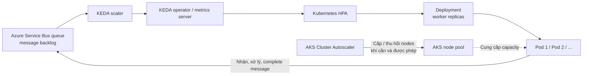
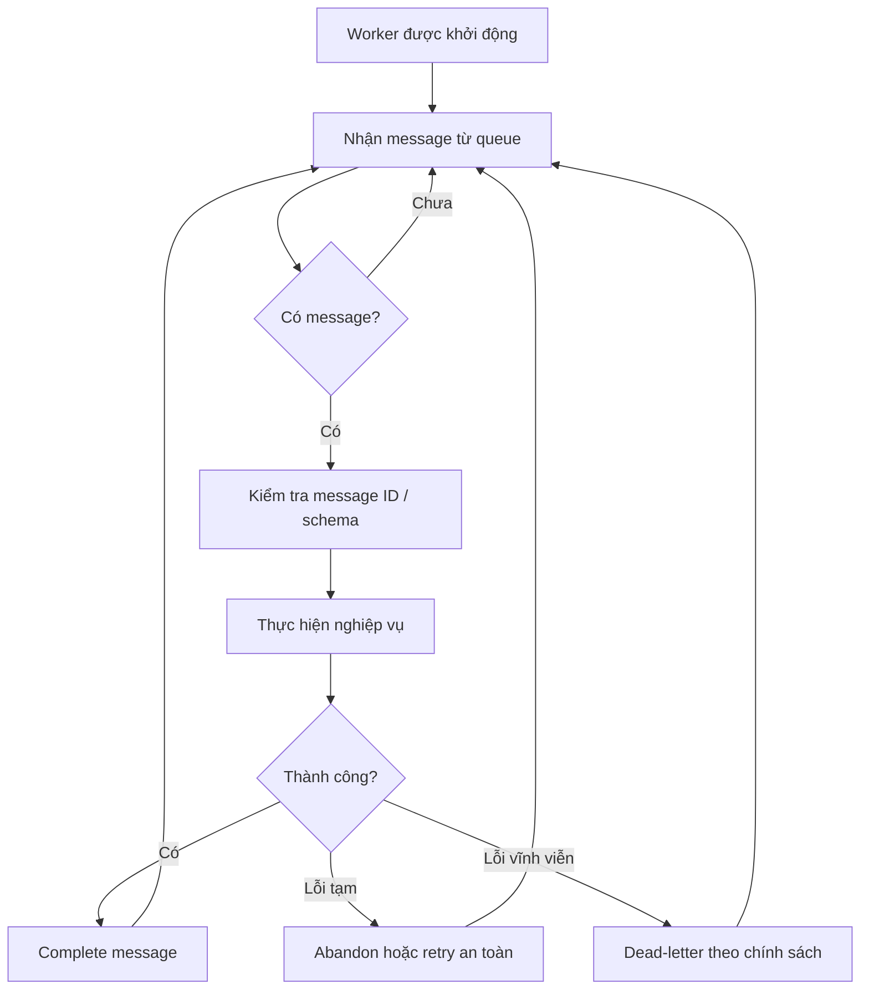
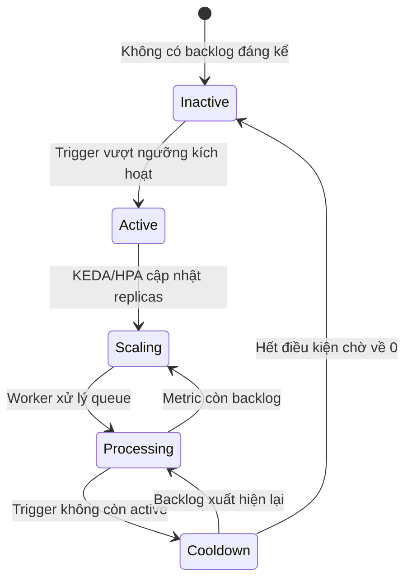
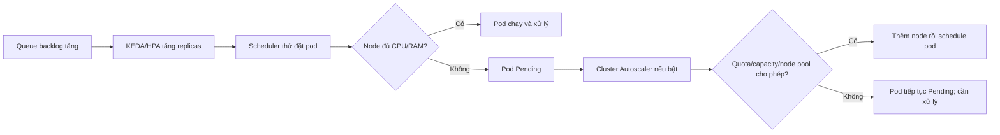

# Scale workload AKS theo sự kiện bằng KEDA

Một dịch vụ xử lý đơn hàng chạy trên Azure Kubernetes Service (AKS) có thể không nhận message nào trong nhiều giờ nhưng đột nhiên phải giải quyết hàng nghìn message trong vài phút. Nếu luôn duy trì 20 pod để chờ công việc, doanh nghiệp trả tiền cho năng lực ít dùng. Ngược lại, nếu chỉ có một pod cố định, hàng đợi tăng nhanh vào giờ cao điểm, dẫn tới chậm xử lý hoặc vượt thời hạn nghiệp vụ. **KEDA (Kubernetes Event-driven Autoscaling)** giúp điều chỉnh số lượng bản sao của workload theo các nguồn sự kiện như độ dài queue, message backlog hay những metric khác.

Trong module **CLOUD_PROVIDERS_AZURE**, bạn khám phá Azure từ subscription, resource group và Microsoft Entra ID đến mạng ảo, compute, lưu trữ, dữ liệu, giám sát, bảo vệ và kiểm soát chi phí kiến trúc ứng dụng. Bài thuộc chương **Vận hành AKS**, tập trung vào cách tích hợp KEDA với AKS, tạo **ScaledObject** để scale Deployment theo backlog, sử dụng **ScaledJob** khi phù hợp, bảo mật kết nối đến nguồn sự kiện và theo dõi hành vi scale trong production.

## 1. Mục tiêu học tập

Sau bài học, bạn có thể:

- Giải thích nhu cầu **event-driven autoscaling** và các thành phần KEDA trong AKS.
- Phân biệt **KEDA**, **Horizontal Pod Autoscaler (HPA)** và **Cluster Autoscaler**.
- Nhận biết các đối tượng `ScaledObject`, `ScaledJob`, `TriggerAuthentication` và scaler.
- Bật hoặc kiểm tra KEDA add-on trên AKS và xác nhận Custom Resource Definitions (CRDs).
- Triển khai workload xử lý Azure Service Bus queue với `ScaledObject` và ngưỡng `messageCount`.
- Giải thích cách scale từ 0 lên N replica, polling interval, cooldown và giới hạn replica.
- Lựa chọn cách xác thực cho scaler, ưu tiên Microsoft Entra Workload Identity khi được hỗ trợ.
- Chẩn đoán trường hợp queue tăng nhưng pod không scale, pod scale nhưng chưa có node, hoặc worker xử lý message trùng.
- Đo backlog, thời gian chờ, throughput, tài nguyên và chi phí để điều chỉnh chính sách scale.

## 2. Khi nào nên scale theo sự kiện?

Kubernetes HPA thường tăng/giảm replica theo CPU, memory hoặc custom/external metrics. Nhưng **CPU thấp không đồng nghĩa ứng dụng đã hết việc**: một worker có thể đang chờ hàng đợi mà chưa có pod nào chạy; trong trường hợp đó không có CPU usage có ý nghĩa để kích hoạt pod đầu tiên.

KEDA đặc biệt hữu ích cho workload có **backlog bên ngoài** và khả năng chia công việc cho nhiều worker độc lập:

| Workload | Nguồn tín hiệu | Mục tiêu scale |
|---|---|---|
| Worker xử lý đơn hàng | Số message trong Azure Service Bus queue | Thêm worker khi backlog lớn |
| Pipeline xử lý ảnh | RabbitMQ hoặc queue tương thích | Nâng số worker xử lý ảnh |
| Consumer đọc event | Kafka lag hoặc scaler phù hợp | Thu hẹp độ trễ giữa producer và consumer |
| Job xử lý theo lô | Queue/nguồn sự kiện có công việc độc lập | Tạo Kubernetes Jobs theo nhu cầu |
| Workload có yêu cầu tùy chỉnh | Prometheus hoặc scaler được hỗ trợ | Scale dựa trên metric nghiệp vụ |

**Không phải workload nào cũng nên về 0 replica.** API phục vụ request trực tiếp có SLO độ trễ thấp có thể cần ít nhất một pod hoặc cơ chế activation được thiết kế riêng. Với worker queue, scale-to-zero thường hợp lý nếu backlog được broker giữ bền vững và độ trễ khởi động chấp nhận được.

## 3. KEDA là gì? Vai trò của scaler, operator và metrics server

**KEDA** là một thành phần autoscaling cho Kubernetes. Nó đọc tín hiệu từ một **event source** thông qua **scaler**, rồi điều phối số replica của workload hoặc số lượng job được tạo. Trên AKS, có thể dùng **KEDA add-on do AKS quản lý** trong những cluster/phiên bản được hỗ trợ, thay vì tự cài toàn bộ thành phần bằng tay.

Các thành phần logic:

1. **Event source:** Azure Service Bus, Kafka, Redis, Prometheus hoặc dịch vụ khác mà scaler hỗ trợ.
2. **Scaler:** bộ tích hợp biết lấy metric từ nguồn, ví dụ số message trong queue.
3. **KEDA operator:** theo dõi `ScaledObject`/`ScaledJob`, quản lý trạng thái active/inactive và resource scaling tương ứng.
4. **KEDA metrics server:** cung cấp external metrics cho Kubernetes HPA theo cơ chế KEDA hỗ trợ.
5. **HPA:** điều chỉnh replica từ mức đang hoạt động đến mục tiêu mong muốn khi dùng `ScaledObject`.
6. **Kubernetes scheduler và AKS nodes:** thực sự đặt các pod lên những node có đủ tài nguyên.



Sơ đồ rút gọn. KEDA trực tiếp điều phối hành vi **0 ↔ 1** theo activation/cooldown của `ScaledObject`; khi số replica đã lớn hơn 0, KEDA thường dùng HPA cùng external metrics để scale trong khoảng được cấu hình. **KEDA không tự tạo VM/node**: nếu cluster thiếu capacity, cần chiến lược node pool và Cluster Autoscaler phù hợp.

### So sánh ba cơ chế

| Thành phần | Đối tượng được scale | Dữ liệu ra quyết định | Điểm cần nhớ |
|---|---|---|---|
| **KEDA** | Deployment hoặc các workload được hỗ trợ, và Kubernetes Jobs qua `ScaledJob` | Queue backlog, broker metric, Prometheus, v.v. | Hỗ trợ activation và scale về 0 trong mô hình thích hợp |
| **HPA** | Replica count của workload Kubernetes hỗ trợ scale | CPU, memory, custom/external metrics | Không trực tiếp tạo AKS node mới |
| **Cluster Autoscaler** | Số VM/node trong node pool | Pod pending do không đủ tài nguyên và khả năng scale down | Có thể mất thời gian cấp VM; bị giới hạn quota, max nodes, capacity |

Không nên nhầm **nhiều pod** với **nhiều node**. Ví dụ KEDA muốn tăng từ 2 lên 12 pod, nhưng node pool không còn CPU/memory, những pod mới có thể nằm ở trạng thái `Pending` cho đến khi có node hoặc điều chỉnh tài nguyên.

## 4. ScaledObject, ScaledJob và TriggerAuthentication

### ScaledObject

`ScaledObject` là Custom Resource quản lý việc scale một workload đã tồn tại, thường là **Deployment**. Nó trỏ tới workload bằng `scaleTargetRef`, chỉ rõ các **triggers** và quy tắc min/max replicas, polling/cooldown.

Ví dụ ý tưởng:

```yaml
apiVersion: keda.sh/v1alpha1
kind: ScaledObject
metadata:
  name: queue-worker-scaler
spec:
  scaleTargetRef:
    name: queue-worker
  minReplicaCount: 0
  maxReplicaCount: 10
  pollingInterval: 30
  cooldownPeriod: 300
  triggers:
    - type: azure-servicebus
      metadata:
        queueName: jobs
        messageCount: "5"
      authenticationRef:
        name: queue-trigger-auth
```

Đây là mẫu **chưa đầy đủ** vì cần Deployment, nguồn queue, cấu hình authentication và broker thật. Phần thực hành phía sau trình bày các tài nguyên kết hợp.

### ScaledJob

`ScaledJob` được dùng khi mỗi đơn vị xử lý phù hợp với **Kubernetes Job chạy xong rồi kết thúc**. Khác với `ScaledObject` điều chỉnh số replica của Deployment chạy lâu dài, ScaledJob tạo các Job theo nguồn sự kiện và những chiến lược được hỗ trợ. Phải kiểm soát số job đồng thời, thời gian xử lý, TTL/cleanup và xử lý message trùng.

### TriggerAuthentication và ClusterTriggerAuthentication

`TriggerAuthentication` định nghĩa cách scaler nhận credential hoặc identity để đọc metric từ event source, thông thường áp dụng trong namespace có ScaledObject/ScaledJob. `ClusterTriggerAuthentication` có phạm vi cluster, chỉ nên dùng khi việc chia sẻ quyền rộng hơn đã được xem xét.

Một số lựa chọn:

- Tham chiếu Kubernetes Secret (phù hợp minh họa nhưng cần quản lý vòng đời key và phân quyền).
- Microsoft Entra Workload Identity hoặc phương thức identity được KEDA scaler/phiên bản hỗ trợ.
- Tham chiếu các hệ thống secret khác theo tính năng và kiến trúc phù hợp.

**TriggerAuthentication chỉ cấp thông tin để KEDA đọc metric**; worker nhận message thường cần quyền/xác thực **riêng** để thực hiện nghiệp vụ trên queue. Tránh cho scaler quyền gửi/xóa message nếu chỉ cần quyền đọc số lượng backlog.

## 5. Những tham số scaling phải hiểu trước khi triển khai

| Tham số | Ý nghĩa | Lưu ý |
|---|---|---|
| `scaleTargetRef.name` | Tên Deployment hoặc workload đích hỗ trợ scale | Cần đúng tên và namespace |
| `pollingInterval` | Khoảng thời gian KEDA thăm dò nguồn trigger, tính bằng giây | Giá trị thấp tăng tần suất gọi broker |
| `cooldownPeriod` | Khoảng trì hoãn trước khi KEDA giảm về 0 trong mô hình hỗ trợ | Không quyết định mọi hành vi giảm replica của HPA ở mức trên 0 |
| `minReplicaCount` | Số replica tối thiểu | `0` phù hợp khi muốn scale-to-zero |
| `maxReplicaCount` | Giới hạn replica của workload | Phải khớp node capacity và giới hạn backend |
| `messageCount` | Ngưỡng backlog mục tiêu trên một replica cho Azure Service Bus scaler | Không phải số message tối đa được phép tồn tại |
| `triggers` | Một hoặc nhiều nguồn metric kích hoạt scale | KEDA/HPA kết hợp metrics theo cơ chế scaler |
| `authenticationRef` | Tham chiếu cấu hình xác thực cho trigger | Kiểm tra namespace, secret và principal |

### Từ queue length đến replica count

Giả sử mỗi pod nên nhận lượng backlog tương ứng **5 message**, và queue đang có **42 message**. Một ước lượng đơn giản khi hệ thống ở trạng thái active:

\[
\text{Replica mục tiêu} \approx
\min(\text{maxReplicaCount}, \lceil 42/5\rceil)
= \min(10,9)=9
\]

Đây là **ước lượng định hướng**, không phải lời hứa rằng Kubernetes sẽ lập tức tạo đúng 9 pod: HPA còn xét lịch lấy mẫu, metric, stabilization, scaling policies, min/max replica và tình trạng pod.

Một bất cập quan trọng: **queue length là số việc đang chờ, không phải thời gian xử lý**. Nếu một message mất 30 giây ở workload A nhưng mất 20 phút ở workload B, cùng ngưỡng `messageCount=5` không đồng nghĩa cùng thời gian xả queue.

Với những worker xử lý lâu hoặc có yêu cầu deadline, nên ước lượng:

\[
\text{Số worker sơ bộ} \approx
\left\lceil
\frac{\text{Backlog}\times\text{Thời gian xử lý trung bình}}
{\text{Thời hạn xả backlog}}
\right\rceil
\]

Ví dụ 120 message, trung bình 2 phút/message, muốn xả trong 20 phút: cần khoảng **12 worker** lý tưởng khi mỗi worker xử lý tuần tự, chưa kể thời gian scale, retry, tải không đều và số lần xử lý đồng thời bên trong từng worker. Hãy benchmark trước khi chốt threshold.

## 6. Chuẩn bị AKS và bật KEDA add-on

Thực hành giả định cluster AKS đã chạy với ít nhất một node pool, có quyền `kubectl` và có Azure Service Bus queue để thử nghiệm. Không tạo tài nguyên production chỉ để thực hành; các lệnh thay đổi AKS cần sự cho phép của người quản trị.

| Thành phần | Giá trị minh họa | Vai trò |
|---|---|---|
| Resource group | `rg-aks-lab` | Chứa AKS |
| AKS cluster | `aks-processing-lab` | Chạy workloads |
| Kubernetes namespace | `batch-demo` | Cô lập tài nguyên thực hành |
| Azure Service Bus namespace | `sb-processing-lab` | Nguồn queue |
| Queue | `work-items` | Hàng đợi tác vụ |
| Deployment | `queue-worker` | Worker lấy và xử lý message |
| ScaledObject | `queue-worker-scaler` | Điều khiển số replica |

### Bước 1. Kết nối đúng subscription/cluster

```bash
az login
az account set --subscription "<subscription-id>"

az aks get-credentials \
  --resource-group "rg-aks-lab" \
  --name "aks-processing-lab"

kubectl config current-context
kubectl get nodes
```

Trước khi chạy thao tác ghi, kiểm tra kubeconfig context để tránh vô tình thay đổi cluster production. Việc có Azure RBAC quyền xem AKS không tự đảm bảo bạn được `kubectl apply` trong Kubernetes; cần quyền Kubernetes RBAC hoặc Azure RBAC for Kubernetes Authorization tương ứng với cấu hình cluster.

### Bước 2. Kiểm tra và bật managed KEDA add-on

Khi khả năng hỗ trợ AKS/region/phiên bản cho phép, Azure CLI có thể bật KEDA add-on:

```bash
# Kiểm tra cấu hình KEDA add-on hiện tại
az aks show \
  --resource-group "rg-aks-lab" \
  --name "aks-processing-lab" \
  --query "workloadAutoScalerProfile.keda.enabled" \
  --output tsv

# Lệnh sau cập nhật cluster; chỉ thực hiện khi được phê duyệt
az aks update \
  --resource-group "rg-aks-lab" \
  --name "aks-processing-lab" \
  --enable-keda
```

Không cài chồng nhiều bản KEDA operator/metrics server lên cùng cluster nếu không có thiết kế rõ ràng. Nếu cluster đã tự cài KEDA bằng Helm hoặc GitOps, cần đánh giá đường nâng cấp/chuyển đổi trước khi bật managed add-on.

### Bước 3. Kiểm tra CRDs và thành phần runtime

```bash
kubectl get crds | grep keda.sh
kubectl get crd scaledobjects.keda.sh
kubectl get crd scaledjobs.keda.sh
kubectl get crd triggerauthentications.keda.sh

# Tìm các deployment liên quan KEDA, không giả định namespace cố định
kubectl get deployments --all-namespaces | grep keda
```

Lệnh `grep` dùng trong shell Linux/macOS hoặc Azure Cloud Shell; trên PowerShell có thể dùng `Select-String`. Khi triển khai KEDA thành công, các loại resource như ScaledObject và TriggerAuthentication phải có trong API Kubernetes. Tên deployment hoặc namespace của operator có thể khác theo cách cài KEDA và phiên bản add-on.

## 7. Chuẩn bị Azure Service Bus queue và danh tính truy cập

KEDA Azure Service Bus scaler đọc trạng thái queue để tính số replica. **Worker trong pod mới là chương trình nhận, xử lý và hoàn tất message**. Hai hoạt động này cần được cấp quyền phù hợp.

Trước thực hành, bảo đảm Azure Service Bus namespace và queue `work-items` đã tồn tại, được cấu hình retention/lock timeout/dead-letter theo nhu cầu. Với môi trường lab được phê duyệt, có thể tạo từ CLI:

```bash
# Chỉ chạy khi namespace đã tồn tại; thay tên thật
az servicebus queue create \
  --resource-group "rg-messaging-lab" \
  --namespace-name "sb-processing-lab" \
  --name "work-items"

# Đọc thông tin của queue để đối chiếu
az servicebus queue show \
  --resource-group "rg-messaging-lab" \
  --namespace-name "sb-processing-lab" \
  --name "work-items" \
  --output json
```

Thông tin queue cần được kiểm tra với ứng dụng thực tế: tên queue, connection string hoặc identity, cấu hình khóa message, retry và dead-letter. Các lệnh CLI quản lý Azure Service Bus yêu cầu quyền management plane; quyền tạo queue khác với quyền **Data Receiver** để nhận message trong worker.

### Chọn mô hình xác thực

| Phương án | Ưu điểm | Cân nhắc |
|---|---|---|
| **Microsoft Entra Workload Identity** | Không cần đưa shared secret dài hạn cho scaler nếu tích hợp được | Cần AKS OIDC/workload identity, role backend, cấu hình TriggerAuthentication và phiên bản scaler tương thích |
| **Secret chứa Service Bus connection string** | Dễ kiểm thử trong lab | Có rủi ro lộ credential; cần lưu, rotation và phân quyền Secret nghiêm ngặt |
| **Key Vault/secret integration được hỗ trợ** | Giảm việc quản lý credential thủ công | Cần kiểm tra cách KEDA/AKS và ứng dụng lấy credential thực tế |

Trong production, ưu tiên **Microsoft Entra Workload Identity** khi phiên bản KEDA và scaler đang sử dụng hỗ trợ. Phải xác định identity thực sự dùng để KEDA truy vấn metric và cấp role cần thiết ở Service Bus scope phù hợp, không mặc định identity của worker pod được dùng cho scaler. Worker có thể dùng identity khác để đọc/complete message; dùng quyền tối thiểu ở từng phía.

**Ví dụ manifest phía sau sử dụng Secret chỉ để giải thích luồng tích hợp.** Không commit connection string thật vào Git. Với môi trường dùng Workload Identity, thay cấu hình `TriggerAuthentication` bằng cơ chế `podIdentity`/identity được KEDA hỗ trợ và kiểm tra quy tắc sở hữu identity/ServiceAccount ở phiên bản đang dùng.

## 8. Deployment worker: ứng dụng phải thực sự xử lý message

Một ScaledObject không tạo nội dung xử lý nghiệp vụ. Bạn cần một container worker có vòng lặp nhận message, xử lý, xác nhận hoặc bỏ message theo chính sách broker.

Luồng đơn giản:



Phần mềm worker phải có:

- Consumer Azure Service Bus thực sự, sử dụng SDK được hỗ trợ hoặc code tương đương.
- Connection/identity đúng, endpoint mạng thông suốt, xử lý exception và backoff hợp lý.
- **Idempotency** khi nhận trùng message.
- Giới hạn số message xử lý đồng thời theo CPU/RAM và backend.
- **Graceful shutdown** để hoàn tất công việc hoặc giải phóng khóa message khi Kubernetes gửi SIGTERM.

Không sử dụng container chỉ chạy `sleep infinity` để đánh giá throughput thực tế: pod có thể scale nhưng backlog không được xử lý, khiến hệ thống tăng replica mà không giải quyết công việc.

### Deployment mẫu

Mẫu dưới đây giả định bạn có image worker thực sự xử lý Service Bus qua biến môi trường `SERVICEBUS_CONNECTION` và `SERVICEBUS_QUEUE`. Tên image chỉ là **placeholder**, phải thay bằng image có thể kéo từ registry được phép.

```yaml
apiVersion: apps/v1
kind: Deployment
metadata:
  name: queue-worker
  namespace: batch-demo
spec:
  replicas: 0
  selector:
    matchLabels:
      app: queue-worker
  template:
    metadata:
      labels:
        app: queue-worker
    spec:
      terminationGracePeriodSeconds: 60
      containers:
        - name: worker
          image: "<your-registry>/queue-worker:1.0.0"
          env:
            - name: SERVICEBUS_QUEUE
              value: "work-items"
            - name: SERVICEBUS_CONNECTION
              valueFrom:
                secretKeyRef:
                  name: servicebus-auth
                  key: connectionString
          resources:
            requests:
              cpu: "250m"
              memory: "256Mi"
            limits:
              cpu: "1000m"
              memory: "512Mi"
```

`replicas: 0` chỉ là trạng thái khởi đầu; sau khi ScaledObject được gắn, **đừng dùng nhiều bộ điều khiển cùng quản lý số replica**. Không cấu hình một HPA riêng ghi đè lên cùng Deployment khi KEDA đã quản lý HPA của ScaledObject.

Các giá trị requests/limits là điểm khởi đầu để đo kiểm. Giới hạn RAM quá nhỏ có thể gây OOMKilled; giới hạn CPU quá thấp có thể khiến backlog không được xử lý dù pod tăng nhiều. Worker vẫn phải có log, metrics, health handling và cơ chế shutdown phù hợp.

## 9. Secret và TriggerAuthentication cho lab

**Không đặt connection string thật trong YAML đã commit.** Trong một lab được cho phép, có thể tạo Kubernetes Secret từ file được lưu an toàn trên máy quản trị. File chỉ chứa **một connection string hợp lệ** cấp quyền tối thiểu cho queue:

```bash
kubectl create namespace batch-demo

# Placeholder: file này do hệ thống quản lý secret được phép cung cấp.
# Không ghi connection string trực tiếp vào shell history.
kubectl create secret generic servicebus-auth \
  --namespace batch-demo \
  --from-file=connectionString="/secure/path/servicebus-connection-string.txt"
```

Đường dẫn trên chỉ là placeholder; không tự tạo file chứa key nếu chính sách của tổ chức cấm. Kubernetes Secret không tự động được mã hóa hoặc bảo vệ hoàn toàn theo mọi cấu hình cluster; cần Kubernetes RBAC, encryption at rest phù hợp và kiểm soát quyền người có thể xem Secret hoặc chạy pod sử dụng Secret. Credential có quyền đọc trạng thái queue không cần là key toàn namespace với quyền Manage.

`TriggerAuthentication` để KEDA dùng Secret:

```yaml
apiVersion: keda.sh/v1alpha1
kind: TriggerAuthentication
metadata:
  name: servicebus-trigger-auth
  namespace: batch-demo
spec:
  secretTargetRef:
    - parameter: connection
      name: servicebus-auth
      key: connectionString
```

Đoạn YAML này chỉ cấp cấu hình cho **scaler**. Deployment worker trong ví dụ cũng đọc Secret để nhận message, nhưng trong production có thể tách hai identity/credential khác nhau theo quyền tối thiểu và chính sách bảo mật.

## 10. Tạo ScaledObject theo backlog Azure Service Bus

Với queue `work-items`, muốn duy trì khoảng 5 message backlog cho mỗi replica và tối đa 10 replica, tạo ScaledObject sau:

```yaml
apiVersion: keda.sh/v1alpha1
kind: ScaledObject
metadata:
  name: queue-worker-scaler
  namespace: batch-demo
spec:
  scaleTargetRef:
    name: queue-worker
  pollingInterval: 30
  cooldownPeriod: 300
  minReplicaCount: 0
  maxReplicaCount: 10
  triggers:
    - type: azure-servicebus
      metadata:
        queueName: work-items
        messageCount: "5"
      authenticationRef:
        name: servicebus-trigger-auth
```

**Cần hiểu đúng từng dòng:**

1. `scaleTargetRef.name` liên kết KEDA tới Deployment `queue-worker` **trong cùng namespace**.
2. `pollingInterval: 30` yêu cầu KEDA thăm dò metric theo khoảng 30 giây trong những tình huống thích hợp. Nó không bảo đảm mỗi đúng 30 giây hệ thống tăng replica.
3. `cooldownPeriod: 300` được KEDA sử dụng khi cân nhắc giảm về mức inactive/0, không phải toàn bộ thuật toán scale down của HPA ở mức 1 đến N.
4. `minReplicaCount: 0` cho phép scale-to-zero nếu trigger, ScaledObject và các điều kiện khác hỗ trợ.
5. `maxReplicaCount: 10` ngăn KEDA/HPA tạo hơn 10 replica cho workload, trừ khi một bộ điều khiển khác được cấu hình trái với giả định.
6. `messageCount: "5"` là backlog target dùng bởi **Azure Service Bus scaler**; không có nghĩa cứ mỗi message sẽ sinh đúng một pod.
7. `authenticationRef` trỏ tới TriggerAuthentication đã được tạo và có thể đọc metric của queue.

**Nếu namespace sử dụng Workload Identity**, không áp dụng nguyên xi Secret manifest này. Thay cơ chế TriggerAuthentication, ServiceAccount/identity và Azure role assignment theo tài liệu phiên bản KEDA/AKS đang triển khai; sau đó thử bằng một queue lab.

### Apply và xác minh

Lưu các manifest riêng với tên `worker.yaml`, `trigger-auth.yaml` và `scaledobject.yaml` trên máy của bạn, rồi dùng:

```bash
kubectl apply -f worker.yaml
kubectl apply -f trigger-auth.yaml
kubectl apply -f scaledobject.yaml

kubectl get deployment queue-worker -n batch-demo
kubectl get scaledobject queue-worker-scaler -n batch-demo
kubectl describe scaledobject queue-worker-scaler -n batch-demo
kubectl get hpa -n batch-demo
```

Tài nguyên ScaledObject cần hiển thị điều kiện như **Ready/Active** phù hợp với trạng thái nguồn sự kiện. Nếu ScaledObject không Ready, kiểm tra `kubectl describe`, Kubernetes events và log operator trước khi tạo thêm pod hoặc chỉnh max replicas.

### Thử có tải và không tải

1. Khi queue trống, quan sát `queue-worker` có thể giảm về 0 sau khoảng cooldown và các điều kiện HPA/KEDA áp dụng.
2. Đưa một số **message kiểm thử** vào queue bằng công cụ/ứng dụng được phép sử dụng; mỗi message có ID riêng và không chứa dữ liệu cá nhân.
3. Theo dõi queue backlog từ Azure portal/metrics của Service Bus, đồng thời xem HPA, ScaledObject và số replica của Deployment.
4. Quan sát pod mới ở trạng thái Pending/ContainerCreating/Running; kiểm tra node pool có đủ tài nguyên không.
5. Đợi worker xử lý và complete message; quan sát backlog giảm.
6. Sau khi queue trở lại trạng thái inactive, xem workload giảm replica theo chính sách và xác nhận không còn message bị kẹt.

Các lệnh quan sát:

```bash
kubectl get scaledobjects -n batch-demo
kubectl get hpa -n batch-demo
kubectl get deployment queue-worker -n batch-demo
kubectl get pods -n batch-demo -l app=queue-worker
kubectl describe deployment queue-worker -n batch-demo

# Kiểm tra log worker nếu có pod đang chạy
kubectl logs deployment/queue-worker -n batch-demo --tail=100
```

**Không kết luận scale thất bại chỉ vì Deployment chưa tăng ngay trong vài giây.** KEDA cần polling/activation; HPA có chu kỳ đồng bộ và stabilization; Kubernetes scheduler có thể còn chờ node từ Cluster Autoscaler; image pull và khởi tạo SDK cũng mất thời gian.

## 11. Scale từ 0 và sự khác biệt với HPA

Trạng thái **0 replica** là đặc tính quan trọng của KEDA cho queue worker. Trong một hệ thống HPA thông thường dựa vào CPU, không có pod thì không có metric CPU hữu ích để tạo lại pod. KEDA có thể thăm dò **nguồn sự kiện bên ngoài** rồi kích hoạt workload từ 0.

Luồng logic:



Trong thực tế, các khái niệm:

- **Activation threshold** quyết định khi nào nguồn được xem là active; một số scaler hỗ trợ tham số activation riêng.
- **Scaling target** như `messageCount` điều khiển số replica mong muốn ở trạng thái active.
- **Polling interval** ảnh hưởng độ trễ phát hiện công việc khi workload chưa active.
- **HPA policies/stabilization** ảnh hưởng tốc độ tăng/giảm replica trong khoảng 1 đến N.
- **Cooldown** ảnh hưởng thời điểm KEDA hạ xuống 0 sau khi không còn trigger active.

Không nên gộp tất cả thành một biến “thời gian scale”. Khi SLO yêu cầu xử lý queue rất nhanh, thử nghiệm tổng thời gian từ **message vào queue → metric cập nhật → pod ready → message được nhận** mới là thước đo thực tế.

### Cân nhắc minReplicaCount

| Chế độ | Ưu điểm | Điểm đánh đổi |
|---|---|---|
| `minReplicaCount: 0` | Có thể giảm compute nhàn rỗi; phù hợp queue có thể chờ | Cold start, polling delay, phụ thuộc node capacity |
| `minReplicaCount: 1` | Luôn có ít nhất một replica theo chính sách | Trả phí compute nền, nhưng có worker sẵn sàng |
| Min lớn hơn 1 | Giảm độ trễ khi có burst, duy trì capacity dự phòng | Chi phí nhàn rỗi cao hơn |

Nếu AKS node pool vẫn phải duy trì số node tối thiểu, giảm pod về 0 **không đồng nghĩa hóa đơn compute AKS về 0**. Nguồn chi phí còn gồm node pool, system nodes, disk, mạng, broker và monitoring.

## 12. Kết hợp với Cluster Autoscaler và node pool

Giả sử KEDA yêu cầu 10 worker pods, mỗi pod có request **250m CPU và 256Mi memory**. Trên lý thuyết, chỉ riêng requests của 10 worker đã cần 2,5 vCPU và 2.560 MiB RAM, chưa tính system pods, kubelet, DaemonSets, overhead runtime và các workload khác. Nếu node pool hiện tại chỉ còn 1 vCPU trống, vài pod có thể Pending.

**Cluster Autoscaler** (nếu được AKS cấu hình phù hợp) có thể tăng node trong giới hạn min/max, quota và capacity. Tuy nhiên, hoạt động đó thường chậm hơn việc HPA tăng số replica vì phải cấp máy ảo, khởi động node, đăng ký vào cluster rồi kéo image.



Để vận hành ổn định:

1. Cấp **requests/limits** cho worker dựa trên benchmark; requests là dữ liệu scheduler và autoscaler dùng để đặt pod.
2. Bật/chỉnh Cluster Autoscaler theo chính sách AKS nếu cần node tăng/giảm; hiểu giới hạn min/max của node pool.
3. Kiểm tra quota vCPU theo region/SKU và khả năng cấp VM, availability zone, image pull, network.
4. Tối ưu thời gian khởi động: image nhỏ, startup probe phù hợp, cache/registry gần cluster khi khả thi.
5. Đặt `maxReplicaCount` tương thích với giới hạn CPU/memory, số kết nối database và tốc độ backend.
6. Theo dõi **Pending pods**, thời gian cấp node, số worker ready và queue age thay vì chỉ xem HPA desired replicas.

### Các lệnh quan sát hạ tầng

```bash
kubectl get nodes -o wide
kubectl get pods -n batch-demo -l app=queue-worker -o wide
kubectl get events -n batch-demo --sort-by=.metadata.creationTimestamp
kubectl describe pod "<pending-pod-name>" -n batch-demo

# Xem trạng thái node pool ở mức Azure
az aks nodepool list \
  --resource-group "rg-aks-lab" \
  --cluster-name "aks-processing-lab" \
  --output table
```

Thông báo `Insufficient cpu` hoặc `Insufficient memory` chỉ ra vấn đề scheduling, **không nhất thiết lỗi KEDA**. Nếu thiếu capacity ngoài giới hạn autoscaler, cần thay đổi requests, node pool hoặc quota theo quy trình được phép.

## 13. Khi nào dùng ScaledJob thay ScaledObject?

Với **Deployment + ScaledObject**, một pod worker thường tồn tại lâu và xử lý **nhiều message** trong vòng lặp. Với **ScaledJob**, KEDA tạo **Kubernetes Jobs** để xử lý những đơn vị công việc hữu hạn, mỗi Job kết thúc sau khi chạy xong.

| Tiêu chí | ScaledObject | ScaledJob |
|---|---|---|
| Workload | Deployment / workload scale subresource được hỗ trợ | Kubernetes Jobs |
| Vòng đời | Worker pod có thể liên tục nhận nhiều message | Pod/Job chạy đến khi hoàn tất |
| Đơn vị scale | Số replica của workload | Số Job được tạo dựa trên trigger/chiến lược |
| Quan sát | HPA, Deployment replicas, logs | Job status, succeeded/failed, lịch sử và cleanup |
| Phù hợp | Consumer queue lâu dài, xử lý liên tục | Công việc hữu hạn có logic bắt đầu–kết thúc riêng |

### ScaledJob tối giản để đọc cấu trúc

```yaml
apiVersion: keda.sh/v1alpha1
kind: ScaledJob
metadata:
  name: report-scaledjob
  namespace: batch-demo
spec:
  jobTargetRef:
    parallelism: 1
    completions: 1
    backoffLimit: 2
    template:
      spec:
        restartPolicy: Never
        containers:
          - name: worker
            image: "<your-registry>/one-shot-worker:1.0.0"
            resources:
              requests:
                cpu: "250m"
                memory: "256Mi"
  pollingInterval: 30
  maxReplicaCount: 10
  triggers:
    - type: azure-servicebus
      metadata:
        queueName: work-items
        messageCount: "1"
      authenticationRef:
        name: servicebus-trigger-auth
```

**Ví dụ mang tính cấu trúc, không thể chạy nếu image/worker chưa triển khai.** Chỉ dùng ScaledJob khi tiến trình thật sự tự nhận và hoàn tất một đơn vị công việc, thoát với exit code thích hợp. ScaledJob không tự inject nội dung message vào chương trình của bạn. Nếu job không consume message nhưng vẫn thoát thành công, backlog không giảm và KEDA có thể tiếp tục tạo job.

Quan sát bằng:

```bash
kubectl get scaledjobs -n batch-demo
kubectl get jobs -n batch-demo
kubectl get pods -n batch-demo
kubectl describe scaledjob report-scaledjob -n batch-demo
```

Để tránh chi phí và lưu log/job quá lớn, hãy thiết kế số Job đồng thời, `backoffLimit`, thời gian hoàn thành, `ttlSecondsAfterFinished` khi phù hợp, và quy tắc xử lý thất bại/dead-letter. Không chạy **ScaledObject và ScaledJob cùng consume một queue** trong lab chỉ để thử mà không có chủ đích: hai nhóm consumer có thể cạnh tranh và khiến phép đo khó hiểu.

## 14. Bảo mật: Workload Identity, RBAC và Secret

KEDA có thể cần xác thực với Azure Service Bus chỉ để đọc backlog. Worker cần xác thực để nhận và hoàn tất message. **Hai luồng quyền này không nên bị nhập làm một cách vô điều kiện**.

### Workload Identity trong AKS

**Microsoft Entra Workload Identity** cho phép Kubernetes workload sử dụng OIDC/federated identity để lấy token cho dịch vụ Azure mà không nhúng client secret dài hạn. Để áp dụng với KEDA cần đối chiếu:

1. AKS đã bật **OIDC issuer** và **workload identity** theo cấu hình được hỗ trợ.
2. Có managed identity hoặc application principal được gán quyền Azure Service Bus thích hợp.
3. Có **federated identity credential** cho ServiceAccount sẽ sử dụng identity đó.
4. `TriggerAuthentication`/scaler được cấu hình **đúng kiểu pod identity** mà phiên bản KEDA đang hỗ trợ.
5. KEDA operator, metrics path và worker có thể sử dụng identity theo mô hình sở hữu được hỗ trợ của add-on.
6. Network của pod/sidecar/operator truy cập được endpoint Microsoft Entra và Service Bus theo kiến trúc đã chọn.

Không sao chép nguyên xi identity của một Deployment và cho rằng KEDA operator sẽ dùng cùng identity khi đọc metric. Cơ chế identity sở hữu bởi operator hay workload và các tham số liên quan phụ thuộc **phiên bản KEDA, AKS managed add-on và scaler**; cần thử thực tế.

### Quyền Azure và Kubernetes

| Chủ thể | Quyền cần thiết | Tránh cấp thừa |
|---|---|---|
| KEDA scaler identity | Đọc thông tin queue/metric theo yêu cầu scaler; thường cần quyền truy cập dữ liệu broker thích hợp | Không cần quyền quản trị toàn subscription |
| Worker identity | Nhận, complete/abandon/dead-letter message đúng phạm vi queue | Không cấp toàn quyền namespace Service Bus khi không cần |
| Producer identity | Gửi message tới queue | Không cần quyền nhận/xóa message |
| Người áp dụng manifest | Kubernetes RBAC tạo Deployment, ScaledObject, TriggerAuthentication và Secret đúng namespace | Không dùng cluster-admin cho mọi pipeline |
| Người vận hành AKS | Quyền đọc logs/events và thao tác quản trị khi được phê duyệt | Không chia sẻ kubeconfig admin rộng rãi |

Với Azure Service Bus, các role như **Azure Service Bus Data Sender** và **Azure Service Bus Data Receiver** có ý nghĩa khác nhau. Quyền xem runtime properties của queue qua scaler cũng cần xác minh theo backend/SDK và principal cụ thể. Hãy cấp quyền ở scope nhỏ nhất mà integration hỗ trợ và **kiểm thử đủ thao tác** thay vì chỉ kiểm tra role name.

### Secrets và phân quyền

- Không commit connection string Service Bus vào YAML, Docker image hoặc CI logs.
- Dùng Azure Key Vault/Secret Store CSI hoặc công cụ quản lý secret được phê duyệt khi phù hợp.
- Giới hạn người có quyền đọc Kubernetes Secret hoặc tạo pod mount Secret đó.
- Bật encryption at rest thích hợp cho Kubernetes secrets/etcd theo kiến trúc cluster.
- Có lịch rotation; thử worker/scaler khi credential thay đổi, tránh đứt autoscaling.
- Kiểm tra NetworkPolicy, Azure networking, private endpoint và DNS nếu có yêu cầu cô lập luồng dữ liệu.

**Kubernetes namespace không phải ranh giới bảo mật tuyệt đối** nếu cluster role hoặc permission cho phép truy cập xuyên namespace. Khi chia sẻ AKS giữa nhiều đội, phải đánh giá Kubernetes RBAC, Azure RBAC, identity và network theo mô hình tenant thực tế.

## 15. Reliability: message lock, retry và idempotency

KEDA có thể tăng đúng số pod nhưng **không đảm bảo tất cả message được xử lý đúng một lần**. Độ tin cậy cần thiết kế ở worker và broker.

### Ít nhất một lần xử lý

Với Azure Service Bus **Peek-Lock**, worker nhận message và giữ lock trong thời hạn nhất định. Nếu worker crash, bị Kubernetes terminate hoặc không hoàn tất message đúng hạn, lock có thể hết và message được giao lại.

Một quy trình xử lý tốt:

1. Đọc **MessageId** và mã nghiệp vụ; kiểm tra schema, kiểm tra đã xử lý trước đó chưa.
2. Thực hiện tác vụ với idempotency key ổn định, tránh tạo bản ghi hoặc thanh toán hai lần.
3. Commit kết quả nghiệp vụ bền vững trước khi complete message.
4. Complete message nếu thành công; abandon/defer/dead-letter theo chính sách khi thất bại.
5. Nếu xử lý dài, sử dụng cơ chế **renew lock** phù hợp với SDK và giới hạn broker.

### Scale-in và graceful termination

Khi backlog giảm, KEDA/HPA có thể giảm số pod. Kubernetes gửi tín hiệu dừng cho container; nếu worker bị kill giữa chừng, message có thể được giao lại.

- Bắt SIGTERM và dừng **nhận message mới** trước khi shutdown.
- Hoàn tất công việc đang xử lý nếu có thể trong `terminationGracePeriodSeconds`.
- Nếu không kịp, release/abandon theo thiết kế, giữ checkpoint và cho lần chạy lại an toàn.
- Không giả định Kubernetes sẽ chờ vô hạn cho một message xử lý 30 phút.
- Đối với batch nặng, cân nhắc chia nhỏ message hoặc dùng ScaledJob có logic checkpoint phù hợp.

### Scale nhanh nhưng backend quá tải

Nếu worker gọi một database có tối đa 50 kết nối, tạo 100 pod với mỗi pod 10 connections có thể làm database quá tải. Ngoài `maxReplicaCount`, phải giới hạn concurrency trong mỗi worker, connection pool, giới hạn API bên ngoài, retry/backoff và số message khóa đồng thời.

**Tối ưu đúng là tăng throughput nghiệp vụ, không phải tăng số pod bằng mọi giá.** Hãy đo thông lượng hoàn tất message, thời gian chờ và tỷ lệ lỗi để điều chỉnh số replica.

## 16. Giám sát KEDA và các chỉ số vận hành

Một dashboard cần bao quát **queue**, **KEDA/HPA**, **pod/node** và **kết quả nghiệp vụ**.

| Lớp | Metrics/log nên theo dõi | Ý nghĩa |
|---|---|---|
| Azure Service Bus | Active message count, dead-letter count, age/độ trễ xử lý nếu có telemetry | Backlog thật và lỗi nghiệp vụ |
| KEDA ScaledObject | Ready, Active, scaler errors, polling/metric failures | KEDA có nhìn được queue không |
| Kubernetes HPA | Current/desired replicas, external metric, conditions | Quyết định scale có được tính không |
| Deployment/pods | Available replicas, Pending, CrashLoopBackOff, OOMKilled, restart count | Worker có thực sự chạy không |
| AKS node pool | Node count, allocatable CPU/memory, autoscaler events | Cluster có đủ capacity không |
| Ứng dụng | Messages completed/s, p95 processing time, error/retry rate, lock lost | Hiệu quả xử lý thực tế |
| Chi phí | Node-hours, broker usage, monitoring ingestion, egress | Giá của một message hoàn tất |

### Lệnh quan sát nhanh

```bash
# Đối tượng KEDA và điều kiện kích hoạt
kubectl get scaledobjects -n batch-demo
kubectl describe scaledobject queue-worker-scaler -n batch-demo

# HPA và Deployment
kubectl get hpa -n batch-demo -o wide
kubectl describe hpa -n batch-demo
kubectl get deployment queue-worker -n batch-demo

# Pod, node và events
kubectl get pods -n batch-demo -o wide
kubectl get nodes
kubectl get events -n batch-demo --sort-by=.metadata.creationTimestamp

# Tìm operator/metrics server của KEDA ở cluster này
kubectl get deployments --all-namespaces | grep keda
```

Đọc logs từ đúng deployment/namespace phát hiện ở bước cuối thay vì đoán tên:

```bash
kubectl logs deployment/<keda-operator-deployment> \
  --namespace <keda-namespace> \
  --tail=100
```

Các tên trong dấu `<...>` là placeholder, không chạy nguyên xi. KEDA add-on có thể ghi log/metric theo cơ chế của AKS và Azure Monitor khác nhau theo cấu hình; cần bật diagnostics và retention phù hợp. Tránh đưa connection string hoặc payload nhạy cảm vào log troubleshooting.

### Alert nên có

- Queue backlog hoặc message age vượt ngưỡng SLO liên tục.
- ScaledObject không Ready hoặc scaler lỗi xác thực/metric.
- HPA desired replicas chạm max nhưng backlog vẫn tăng.
- Pending pods do thiếu node quota/capacity, image pull hoặc resources.
- Worker restart, OOMKilled, tỷ lệ retry hoặc dead-letter tăng.
- Thời gian xả queue thực tế vượt kế hoạch kinh doanh.

## 17. Bảng lỗi thường gặp và cách khắc phục

| Triệu chứng | Nguyên nhân có thể | Kiểm tra |
|---|---|---|
| `kubectl get scaledobjects` báo không nhận diện resource | KEDA CRD chưa cài/add-on lỗi | Kiểm tra `az aks show`, CRDs, operator và phiên bản AKS |
| ScaledObject không Ready | Trigger metadata sai, thiếu TriggerAuthentication, Secret/identity không hợp lệ | `kubectl describe scaledobject`, operator logs, namespace/scopes |
| Queue có message nhưng Deployment vẫn 0 replica | Scaler không thấy backlog, sai queueName, permission, polling/activation hoặc component lỗi | Xem queue metric, connection, scaler errors và điều kiện Active |
| HPA desired replicas tăng nhưng pod không chạy | Node pool hết tài nguyên, quota, taint/affinity, image pull | `kubectl describe pod`, events, Cluster Autoscaler, requests |
| Replica tăng nhưng backlog không giảm | Worker không consume/complete, lỗi downstream, lock timeout | Worker logs, Service Bus active/dead-letter count, xử lý nghiệp vụ |
| Queue trống nhưng pod không về 0 ngay | Cooldown, HPA stabilization, metric còn active hoặc min replicas | `cooldownPeriod`, HPA behavior, ScaledObject status |
| Worker liên tục restart | OOMKilled, crash, thiếu secret, probe sai | `kubectl describe pod`, `kubectl logs --previous` |
| Scaler trước đây hoạt động, giờ lỗi 401/403 | Credential hết hạn/rotation, identity mất role, private endpoint/DNS lỗi | TriggerAuth, Service Bus RBAC, operator logs, network |
| Message được xử lý hai lần | Lock expired, pod scale-in, retry hoặc complete message thất bại | MessageId, idempotency store, lock renewal và shutdown |
| CPU node cao, message xử lý chậm hơn | Quá nhiều pod/concurrency, backend rate limit | CPU throttling, requests/limits, DB/API latency |
| Scale-out chậm | Polling, HPA, cold image pull, Cluster Autoscaler cấp node chậm | Phân đoạn thời gian activation → pod ready → message complete |
| HPA không phản hồi đúng khi nhiều ScaledObjects | Nhiều controller/metrics xung đột hoặc target trùng | Kiểm tra HPA owner, target ref và các scaling controllers |

### Quy trình điều tra đề xuất

1. **Có việc thật không?** Xem queue name và active message count tại Service Bus.
2. **KEDA nhìn thấy tín hiệu chưa?** Xem `ScaledObject Ready/Active`, TriggerAuthentication và log scaler.
3. **HPA muốn bao nhiêu replica?** Đọc desired/current replicas và conditions.
4. **Kubernetes có chạy được pod không?** Kiểm tra scheduling, image pull, requests/limits và node availability.
5. **Worker có xử lý được không?** Đọc application logs, kết quả complete/dead-letter, exception.
6. **Scaling có đáp ứng SLO không?** Đo thời gian xả queue, tối ưu threshold/concurrency và node capacity.

Đừng vội sửa bằng cách đặt `maxReplicaCount: 1000` hoặc cấp Owner toàn subscription. Một scaler không có quyền đọc queue, worker lỗi mã hoặc node pool hết quota sẽ không được khắc phục bằng cách nâng giới hạn replica.

## 18. Bài toán thực tế: xử lý ảnh theo tải đột biến

Một nền tảng thương mại điện tử đưa mỗi ảnh sản phẩm mới vào Service Bus queue. Mỗi worker tải ảnh từ Azure Blob Storage, resize thành ba độ phân giải, lưu output và complete message. Bình thường có 0–5 message/phút; đầu đợt sale có thể nhận 2.000 message trong vài phút.

**Thiết kế đề xuất:**

1. Producer ghi ảnh vào Blob, sau đó gửi message chứa **blob ID** và **job ID**, không đưa cả ảnh vào payload queue.
2. AKS Deployment `image-worker` sử dụng identity có quyền đọc input Blob, ghi output Blob và nhận/complete Service Bus message.
3. ScaledObject dùng Azure Service Bus scaler, có `minReplicaCount: 0` nếu độ trễ cold start chấp nhận được và `maxReplicaCount` theo ngân sách.
4. Worker xử lý với concurrency đã benchmark; database/Blob/backend không bị vượt giới hạn kết nối.
5. Cluster Autoscaler có node pool phù hợp để bổ sung CPU/RAM khi pod Pending.
6. Mọi message có ID ổn định, output dùng tên có version hoặc điều kiện ghi để tránh trùng.
7. Theo dõi backlog, age, processing time, completed/s, dead-letter và cost per image.
8. Sau đợt sale, khi queue trở lại trạng thái inactive và cooldown kết thúc, số worker giảm; kiểm tra node pool có giảm tương ứng theo chính sách không.

### Tính năng lực sơ bộ

Giả sử mỗi worker xử lý trung bình **4 ảnh/phút**, backlog đột ngột **1.200 ảnh** và muốn xả trong **30 phút**:

\[
\text{Worker cần thiết}\approx \left\lceil
\frac{1200}{4\times30}\right\rceil=10
\]

Mức 10 worker chỉ đủ ở điều kiện lý tưởng; cần cộng headroom cho thời gian cấp pod/node, retry, file lớn và độ lệch thời gian xử lý. Nếu mỗi worker tăng concurrency lên 4 mà hiệu năng thực không tăng vì disk/CPU bão hòa, đừng nhân máy móc thông lượng kỳ vọng.

**So sánh hai phương án:** giữ 2 worker thường trực để giảm thời gian phản hồi hoặc scale về 0 để giảm chi phí nền. Quyết định phụ thuộc SLO thời gian xử lý ảnh đầu tiên, tần suất burst, chi phí node pool và thời gian khởi động đo thực tế.

## 19. Tối ưu chi phí khi dùng KEDA

KEDA có thể giảm số pod, nhưng **chi phí không chỉ là số replica**:

| Thành phần | Dạng chi phí/capacity | Cách tối ưu |
|---|---|---|
| AKS node pools | VM-hours, disk, hạ tầng, khả năng tính phí control plane theo tier | Right-size nodes, autoscaler, max/min nodes và lịch sử tải |
| KEDA add-on/runtime | Tài nguyên CPU/RAM của operator, metrics server và overhead | Không scale vô hạn; theo dõi tài nguyên hệ thống |
| Azure Service Bus | Broker tier, requests/message operations, quota và throughput | Chọn tier, batch và retention phù hợp |
| Worker I/O | Blob reads/writes, egress, database calls | Đặt compute gần nguồn dữ liệu, dùng caching/stream phù hợp |
| Monitoring | Logs, metrics, traces và retention | Thu thập đủ để điều tra, tránh log payload lớn |
| Retry | Xử lý lại message, I/O và thời gian CPU | Idempotency, backoff, dead-letter |

Một thước đo thực dụng:

\[
\text{Chi phí mỗi công việc hợp lệ} =
\frac{\text{Tổng chi phí compute + broker + storage + network + monitoring}}
{\text{Số công việc hoàn tất hợp lệ}}
\]

Nếu min replicas bằng 0 mà node pool vẫn duy trì system nodes, hóa đơn vẫn có compute nền. Nếu max replicas quá cao, áp lực tăng trên Service Bus/database có thể làm chi phí tăng nhưng công việc hoàn tất ít hơn do lỗi/throttling. KEDA không thay thế **Cost Management**, ngân sách và capacity planning.

## 20. Bài tập và câu hỏi tự kiểm tra

### Bài tập A: Chọn KEDA, HPA hay Cluster Autoscaler

Một worker Deployment có 0 pod, queue đang có 100 message. Bạn cần cơ chế nào để phát hiện queue và kích hoạt pod đầu tiên? Khi 20 pod được tạo nhưng nhiều pod Pending vì thiếu CPU node thì cơ chế nào có thể bổ sung node?

**Gợi ý:** KEDA/ScaledObject kích hoạt theo sự kiện; HPA tham gia điều chỉnh replica khi active; Cluster Autoscaler xử lý thiếu capacity node khi được bật và có quota.

### Bài tập B: Tính replica mục tiêu

Queue có **73 message**, target `messageCount=8` và `maxReplicaCount=12`. Ước lượng số replica theo tỷ lệ backlog.

**Gợi ý:** `ceil(73/8)=10`; giá trị thực tế còn phụ thuộc KEDA/HPA policies và trạng thái metric.

### Bài tập C: Xử lý scaler không Ready

Scoped Kubernetes Secret `servicebus-auth` đã được tạo ở namespace `batch-demo` nhưng ScaledObject đang tham chiếu TriggerAuthentication `auth-prod` không tồn tại. Tại sao queue không làm worker tăng replica?

**Gợi ý:** phải có TriggerAuthentication đúng tên/namespace và secret/identity hợp lệ để KEDA truy vấn broker. Đọc `kubectl describe scaledobject`.

### Bài tập D: Worker bị dừng giữa chừng

Worker đã ghi dữ liệu database nhưng bị SIGTERM trước khi complete Service Bus message. Message được giao lại cho pod khác. Làm sao tránh ghi dữ liệu hai lần?

**Gợi ý:** dùng MessageId/job ID ổn định, kiểm tra idempotency record/ràng buộc unique và xử lý transaction thích hợp trước khi complete message.

### Bài tập E: Thử trên môi trường lab

1. Kiểm tra KEDA add-on/CRDs ở cluster AKS lab.
2. Tạo namespace, queue riêng và worker có thể xử lý message thực.
3. Cấu hình TriggerAuthentication theo identity/secret được phép và tạo ScaledObject.
4. Với queue trống, ghi lại replica count và trạng thái ScaledObject.
5. Gửi lượng message mẫu đủ để vượt ngưỡng, theo dõi Activation → HPA desired replicas → Pods Ready.
6. Theo dõi worker hoàn tất message, dead-letter, queue age và lượng CPU/RAM.
7. Chờ đến khi backlog hết và quan sát scale down, ghi thời gian.
8. Dọn **chỉ tài nguyên lab do mình tạo**, kiểm tra có người khác dùng chung broker/cluster không.

## 21. Checklist trước khi đưa KEDA vào production

### Cấu hình scaling

- [ ] Workload có nguồn tín hiệu đo được và phù hợp event-driven scaling.
- [ ] Managed KEDA add-on hoặc bản KEDA do tổ chức quản trị có phiên bản/tính năng được hỗ trợ.
- [ ] ScaledObject/ScaledJob đúng namespace, target, trigger và threshold.
- [ ] Có giới hạn min/max replicas, polling/cooldown phù hợp SLO.
- [ ] Không có nhiều HPA/ScaledObjects tranh quyền điều khiển cùng workload.
- [ ] Đã benchmark message throughput, concurrency, CPU/RAM và backend rate limit.

### Bảo mật và dữ liệu

- [ ] KEDA scaler và worker có danh tính/quyền cần thiết ở scope tối thiểu.
- [ ] Ưu tiên Workload Identity khi hỗ trợ; secret không lưu trong Git/log.
- [ ] Service Bus, private endpoint, DNS và network cho phép luồng metric/consume.
- [ ] Worker xử lý message idempotently, có lock renewal và graceful shutdown phù hợp.
- [ ] Có dead-letter, giới hạn retry và quy trình khôi phục message lỗi.

### Vận hành và chi phí

- [ ] Node pool/Cluster Autoscaler có quota, max nodes và capacity cần thiết.
- [ ] Có cảnh báo backlog/age, scaler failures, desired/current replicas, Pending pods.
- [ ] Đã thử load test và mô phỏng node eviction, broker outage, credential rotation.
- [ ] Có dashboard throughput, lỗi, CPU/RAM và chi phí mỗi job/message hợp lệ.
- [ ] Có quy trình rollback ScaledObject và bảo đảm worker không mất dữ liệu khi scale in.
- [ ] Có lịch rà soát threshold, quota và ngân sách sau khi workload thay đổi.

## Kết luận

**KEDA** giúp AKS điều chỉnh workload theo **sự kiện thực tế** thay vì chỉ dựa vào CPU. Với `ScaledObject`, scaler đọc backlog từ Azure Service Bus và điều phối replica qua KEDA/HPA, kể cả kích hoạt từ 0 khi điều kiện hỗ trợ; với `ScaledJob`, KEDA tạo Kubernetes Jobs cho công việc hữu hạn. Để vận hành đáng tin cậy, cần kiểm soát identity và quyền của scaler/worker, cấu hình requests/limits và Cluster Autoscaler đúng, thiết kế **retry, idempotency và graceful shutdown** rồi giám sát cả queue, pod lẫn node. Mục tiêu cuối cùng không phải số pod tăng nhanh nhất, mà là **xử lý công việc đúng hạn, an toàn và với chi phí hợp lý**.
