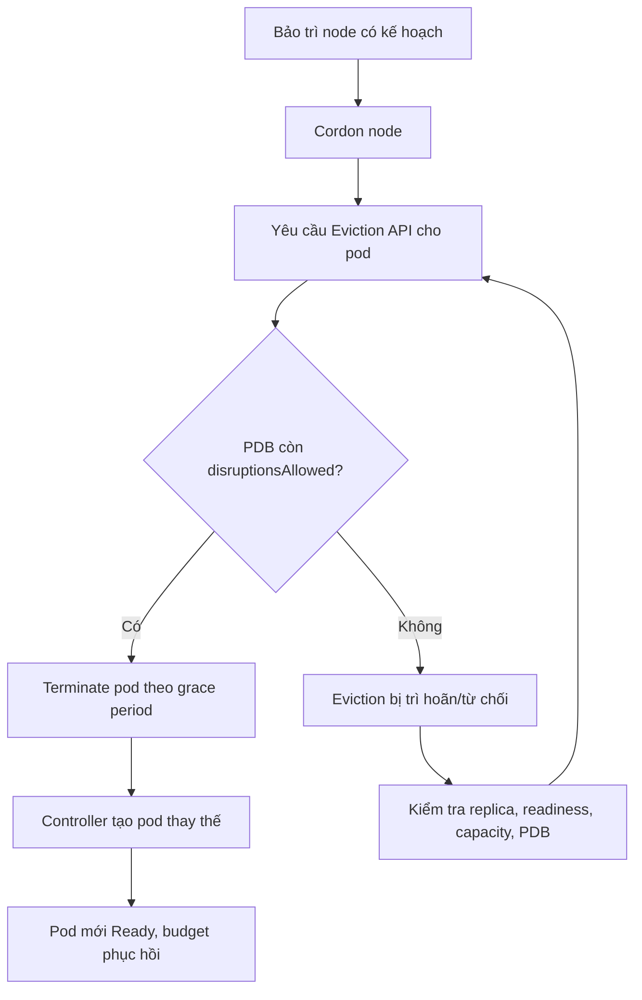

# Pod Disruption Budget và bảo đảm khi bảo trì node

Một ứng dụng chạy trên Azure Kubernetes Service (AKS) có ba replica, được đặt trên ba node khác nhau và phục vụ người dùng qua Kubernetes Service. Khi một node cần bảo trì, hệ thống có thể di chuyển pod sang node khác. Nhưng nếu nhiều pod bị dừng cùng lúc, ứng dụng vẫn có thể mất khả năng phục vụ dù cuối cùng Kubernetes tạo đủ replica trở lại.

**Pod Disruption Budget (PDB)** là tài nguyên Kubernetes dùng để khai báo số pod của một workload cần giữ ở trạng thái khỏe khi có **disruption tự nguyện** (voluntary disruption), chẳng hạn thao tác `kubectl drain` sử dụng Eviction API để di chuyển pod khỏi node trước bảo trì. PDB giúp những thao tác bảo trì có kiểm soát diễn ra theo ngân sách gián đoạn, nhưng **không tự đảm bảo zero downtime** và không thể ngăn một máy chủ vật lý đột ngột hỏng.

Bài học thuộc chương **Vận hành AKS** của module **CLOUD_PROVIDERS_AZURE**. Nội dung kết nối kiến thức về node pool, networking, VM Scale Sets, Availability Zones, Azure Monitor, triển khai ứng dụng và chi phí vận hành một hệ thống Kubernetes trên Microsoft Azure.

> Nguyên tắc quan trọng: PDB giới hạn số pod có thể bị **evict theo Eviction API** trong điều kiện cho phép; nó không phải bộ cân bằng tải, không thay thế readiness probe, không buộc Kubernetes tạo node mới và không phải một cam kết tuyệt đối về số replica khi xảy ra sự cố ngoài ý muốn.

## 1. Mục tiêu học tập

Sau khi hoàn thành, bạn có thể:

1. Phân biệt **voluntary disruption**, **involuntary disruption**, Eviction API, cordon và drain.
2. Tạo PDB bằng `minAvailable` hoặc `maxUnavailable` và tính ngân sách gián đoạn từ số replica.
3. Giải thích cách PDB sử dụng trạng thái **Ready** của pod và các field `currentHealthy`, `desiredHealthy`, `disruptionsAllowed`.
4. Hiểu khi nào PDB bảo vệ một thao tác bảo trì AKS và trường hợp nào PDB không bảo vệ.
5. Kết hợp PDB với Deployment/StatefulSet, health probes, topology spread, autoscaler và tài nguyên dự phòng.
6. Đọc thông tin PDB bằng `kubectl`, thực hiện quy trình drain an toàn ở môi trường lab và phân tích khi eviction bị chặn.
7. Lập kế hoạch nâng cấp node pool AKS với surge capacity, quota/IP headroom, phân tán zone và phương án rollback.
8. Giám sát tình trạng gián đoạn cùng chất lượng phục vụ ứng dụng, thay vì chỉ nhìn số pod Running.

## 2. Các loại gián đoạn trong Kubernetes

Một pod có thể dừng vì nhiều nguyên nhân. PDB chỉ can thiệp vào một tập hợp cụ thể của các tình huống đó.

| Loại gián đoạn | Ví dụ | PDB có thể ngăn việc dừng pod? |
|---|---|---|
| **Voluntary, qua Eviction API** | `kubectl drain` trong bảo trì, thành phần quản trị sử dụng Eviction API | **Có thể** trì hoãn/từ chối eviction khi sẽ vượt ngân sách |
| Voluntary nhưng không sử dụng Eviction API | Người dùng `kubectl delete pod`, xóa Deployment, một số hành động rollout controller | **Không** được PDB trực tiếp chặn |
| **Involuntary** | Node hỏng, mất nguồn, máy ảo gặp lỗi, lỗi vùng, network partition | **Không** thể ngăn sự cố đã xảy ra |
| Lỗi trong ứng dụng | Container crash, OOM, readiness probe thất bại | PDB không sửa được lỗi; số pod healthy giảm và có thể chặn các eviction kế tiếp |
| Thay đổi replica | Scale xuống do người dùng hoặc controller | Không xem PDB là bộ giới hạn tuyệt đối đối với mọi thay đổi mong muốn của controller |

### Voluntary disruption là gì?

Đó là trường hợp một thành phần **chủ động** khiến pod rời node hoặc không còn phục vụ, thường nhằm mục đích bảo trì hoặc tái bố trí. Khi thực hiện qua Kubernetes Eviction API, bộ điều khiển disruption sẽ kiểm tra PDB trước khi cho eviction tiếp tục.

### Involuntary disruption là gì?

Đó là sự cố không thể yêu cầu node chờ ngân sách, chẳng hạn node đột ngột không còn hoạt động. Pod bị ảnh hưởng có thể mất Ready ngay lập tức hoặc được Kubernetes đánh dấu theo thời gian phát hiện lỗi. **PDB không giữ một node hỏng ở trạng thái Running**; nếu số pod khỏe bị giảm, PDB có thể ngăn việc bảo trì thêm những pod còn khỏe.

Sự phân biệt này giúp tránh hiểu lầm: PDB rất hữu ích khi AKS chủ động drain node cho một quy trình được hỗ trợ, nhưng muốn chịu sự cố node/zone còn phải có **nhiều replica, phân tán vị trí, capacity dự phòng và kiến trúc dữ liệu có HA**.

## 3. Eviction API, cordon và drain hoạt động thế nào?

**Eviction API** là API của Kubernetes cho phép yêu cầu chấm dứt một pod theo cơ chế có xét đến PDB. Nếu eviction khiến ngân sách bị vi phạm, API có thể từ chối tạm thời, thường thể hiện trạng thái **HTTP 429 Too Many Requests**. Client hoặc công cụ drain có thể chờ và thử lại theo cơ chế phù hợp.

Ba thao tác dễ bị nhầm:

- **Cordon**: đánh dấu node không nhận thêm pod mới theo scheduler; không xóa những pod hiện tại.
- **Drain**: đánh dấu node không schedulable và yêu cầu evict những pod phù hợp khỏi node. Nó xử lý riêng các DaemonSet và các trường hợp pod đặc biệt.
- **Uncordon**: cho phép scheduler đặt pod mới lên node trở lại sau bảo trì.

Sơ đồ là mô hình logic, không mô tả chính xác mọi trường hợp controller nội bộ. Thứ tự tạo pod mới, thời gian cập nhật endpoint và diễn biến PDB còn phụ thuộc workload, số replica, năng lực scheduler, probes và cấu hình drain.

**Không dùng `--disable-eviction` hoặc xóa pod trực tiếp để vượt PDB trong thao tác bảo trì thường lệ.** Các lựa chọn bỏ qua Eviction API có thể làm gián đoạn vượt mức ứng dụng chịu được.

## 4. Cấu trúc một Pod Disruption Budget

PDB là Kubernetes resource thuộc API `policy/v1`, **có namespace**. Một manifest cơ bản:

~~~yaml
apiVersion: policy/v1
kind: PodDisruptionBudget
metadata:
  name: api-pdb
  namespace: apps
spec:
  minAvailable: 3
  selector:
    matchLabels:
      app: api
~~~

Ý nghĩa:

- **`minAvailable: 3`**: khi có eviction tự nguyện qua API, cố gắng giữ tối thiểu ba pod healthy thuộc workload được chọn.
- **`selector.matchLabels`**: chọn những pod có nhãn `app=api` **trong namespace `apps`**.
- PDB **không tạo pod**, không tự đặt replica count và không đặt rule cho network traffic.

Bạn phải chọn **một trong hai** trường `minAvailable` hoặc `maxUnavailable` cho một PDB, không đặt đồng thời cả hai.

### minAvailable

`minAvailable` biểu thị **mức tối thiểu pod healthy** phải được giữ lại trong điều kiện eviction phù hợp. Có thể đặt số nguyên hoặc phần trăm dưới dạng chuỗi.

~~~yaml
spec:
  minAvailable: "75%"
  selector:
    matchLabels:
      app: api
~~~

### maxUnavailable

`maxUnavailable` biểu thị **mức pod có thể không khả dụng tối đa** theo cách tính PDB cho workload có controller phù hợp. Cũng có thể dùng số nguyên hoặc phần trăm.

~~~yaml
spec:
  maxUnavailable: 1
  selector:
    matchLabels:
      app: api
~~~

**Lưu ý:** `maxUnavailable` dựa trên số pod mong muốn của controller có hỗ trợ scale subresource; không nên áp dụng tùy tiện cho một tập bare pods không được controller quản lý. Đối với workload độc lập/khác thường, cần chọn biểu thức ngân sách và kiến trúc controller phù hợp.

## 5. Cách tính disruptionsAllowed

Kubernetes tính toán ngân sách từ số pod dự kiến và số pod đang healthy. PDB status hiển thị một số trường quan trọng:

| Trường status | Nghĩa thực hành |
|---|---|
| `expectedPods` | Tổng số pod được dự kiến theo controller phù hợp |
| `desiredHealthy` | Số pod healthy cần giữ theo chính sách PDB |
| `currentHealthy` | Số pod phù hợp hiện được coi là healthy, thường dựa trên trạng thái Ready |
| `disruptionsAllowed` | Số eviction bổ sung hiện có thể được chấp nhận trong ngân sách |
| `disruptedPods` | Những pod đã được phép eviction và đang được controller disruption theo dõi |

Ví dụ một Deployment có **4 replica** và PDB `minAvailable: 3`:

~~~text
Expected pods:       4
Desired healthy:     3
Current healthy:     4
Disruptions allowed: 1
~~~

Khi một pod bị evict và chưa có pod thay thế Ready:

~~~text
Expected pods:       4
Desired healthy:     3
Current healthy:     3
Disruptions allowed: 0
~~~

Nếu một pod khác chuyển sang NotReady vì lỗi ứng dụng, PDB không thể đảo ngược lỗi đó; `disruptionsAllowed` vẫn bằng 0 và quá trình drain có thể bị chặn cho tới khi ứng dụng phục hồi.

### Công thức tư duy

Ở tình huống đơn giản, chưa tính các pod đang trong quá trình disruption và các chi tiết cập nhật trạng thái:

~~~text
disruptionsAllowed xấp xỉ
  max(0, currentHealthy - desiredHealthy)
~~~

Kết quả thực tế do Kubernetes PDB controller tính và công bố; không thay thế field `status.disruptionsAllowed` bằng một công thức tự viết khi quyết định có drain node production.

### Phần trăm được làm tròn ra sao?

Kubernetes làm tròn **lên** khi chuyển tỷ lệ PDB sang số pod nguyên, nên đôi khi kết quả khác trực giác:

| Replica mong muốn | PDB | Mức tương ứng |
|---:|---|---|
| 4 | `minAvailable: 75%` | Cần ít nhất 3 healthy |
| 5 | `minAvailable: 60%` | Cần ít nhất 3 healthy |
| 3 | `minAvailable: 50%` | Cần ít nhất 2 healthy |
| 7 | `maxUnavailable: 30%` | Có thể cho phép tới 3 pod unavailable theo cách làm tròn |
| 1 | `maxUnavailable: 30%` | Có thể cho phép 1 pod unavailable — tức toàn bộ workload! |

Với ứng dụng chỉ có một replica, `maxUnavailable` theo phần trăm khác 0 có thể cho phép eviction của replica duy nhất. **Đừng giả định “30%” luôn có nghĩa ít hơn một pod và sẽ được làm tròn xuống.**

Ngược lại, `minAvailable: 100%` trên workload có đủ replica khỏe thường tạo `disruptionsAllowed: 0`, khiến maintenance drain không tiến hành được theo ngân sách.

## 6. Tạo Deployment có thể bảo trì: ví dụ đầy đủ

Một PDB chỉ hữu ích khi ứng dụng có đủ replica và có thể thay thế một instance mà vẫn phục vụ. Ví dụ tối giản dưới đây gồm Deployment 4 replica và PDB trong namespace `apps`. Namespace phải tồn tại hoặc được tạo trước trong lab.

~~~yaml
apiVersion: apps/v1
kind: Deployment
metadata:
  name: orders-api
  namespace: apps
spec:
  replicas: 4
  selector:
    matchLabels:
      app: orders-api
  template:
    metadata:
      labels:
        app: orders-api
    spec:
      terminationGracePeriodSeconds: 45
      containers:
        - name: orders-api
          image: registry.example.com/orders-api:1.0.0
          ports:
            - name: http
              containerPort: 8080
          resources:
            requests:
              cpu: "250m"
              memory: "256Mi"
            limits:
              cpu: "1"
              memory: "1Gi"
          readinessProbe:
            httpGet:
              path: /health/ready
              port: http
            periodSeconds: 5
            failureThreshold: 3
          livenessProbe:
            httpGet:
              path: /health/live
              port: http
            periodSeconds: 10
            failureThreshold: 3
---
apiVersion: policy/v1
kind: PodDisruptionBudget
metadata:
  name: orders-api-pdb
  namespace: apps
spec:
  minAvailable: 3
  selector:
    matchLabels:
      app: orders-api
~~~

**Giải thích các giả định:** `registry.example.com` là tên minh họa, phải thay bằng image thật mà cluster có quyền pull. Ứng dụng phải thực sự cung cấp các endpoint `/health/ready` và `/health/live`. Manifest trên chưa tạo Kubernetes Service, ingress hoặc cơ chế authentication. Trong môi trường production còn cần securityContext, quyền identity, logging, autoscaling và chính sách bảo mật.

Với bốn pod đều Ready, PDB có thể cho phép một eviction. Sau khi một pod bị evict, controller phải tạo pod thay thế và pod đó phải qua readiness trước khi ngân sách có thể được phục hồi đầy đủ.

**Chưa bảo đảm các pod nằm trên node khác nhau:** Deployment ở trên không có anti-affinity hoặc topology spread. Nếu cả bốn pod cùng nằm trên một node, drain node đó có thể vướng PDB. Bài sẽ bổ sung nguyên tắc phân tán ở phần sau.

## 7. Chọn PDB cho các kiểu workload

### Web/API stateless: tối thiểu một tỷ lệ healthy

Với bốn replica web độc lập và có đủ công suất dự phòng, `minAvailable: 3` là một cách giữ ba backend khỏe trong thao tác có kiểm soát.

Nếu traffic cao đến mức ba backend không chịu nổi tải, PDB này **chưa đủ về mặt SLO**. Cần đo năng lực backend và có autoscaling/headroom trước khi bảo trì.

### Worker theo hàng đợi: kiểm soát số worker có thể mất

Một worker xử lý job được cấp lease, có checkpoint và idempotency thường có thể chịu nhiều eviction hơn API đồng bộ. Dùng `maxUnavailable: 1` hoặc một tỷ lệ phù hợp với tốc độ hoàn thành công việc.

Dù PDB cho phép eviction, ứng dụng vẫn phải **hoàn tất, đưa lại queue hoặc checkpoint** phần đang xử lý theo termination grace period. PDB không tự xác nhận job hay giải phóng message lease.

### StatefulSet có quorum: bảo vệ số thành viên tối thiểu

Ví dụ một hệ thống phân tán có ba thành viên, ứng dụng yêu cầu ít nhất hai thành viên hoạt động để tiếp tục xử lý:

~~~yaml
apiVersion: policy/v1
kind: PodDisruptionBudget
metadata:
  name: consensus-pdb
  namespace: databases
spec:
  minAvailable: 2
  selector:
    matchLabels:
      app: consensus
~~~

**Điều kiện bắt buộc:** ba pod phải thực sự đại diện cho ba thành viên có dữ liệu/role tương thích; readiness phải phản ánh trạng thái dùng được của cluster và lớp lưu trữ phải chịu được sự cố tương ứng. Không tự suy rằng ba replica của bất kỳ database nào đều có quorum 2/3 hoặc rằng việc di chuyển PV giữa zone luôn thực hiện được.

### Một replica: chọn giữa khả dụng và khả năng bảo trì

Nếu Deployment chỉ có một replica và PDB `minAvailable: 1`, budget thường bằng 0. Điều này bảo vệ tránh việc evict pod duy nhất khi drain, nhưng có thể khiến node upgrade **bị treo/chặn**.

Giải pháp đúng cho dịch vụ cần uptime là triển khai nhiều replica với kiến trúc dữ liệu phù hợp. Nếu bắt buộc chỉ một replica, phải chấp nhận cửa sổ downtime và quy trình thao tác có phê duyệt, không sử dụng PDB như phép màu vừa ngăn downtime vừa cho phép drain.

## 8. Selector, namespace và các lỗi cấu hình nguy hiểm

Một PDB có hiệu lực đối với **tập pod được selector chọn trong cùng namespace**. Hai lỗi phổ biến:

1. PDB không chọn được pod vì nhãn không khớp: chính sách tồn tại nhưng không bảo vệ workload mong muốn.
2. PDB chọn quá nhiều pod khác nhau: ngân sách bị chia sẻ sai hoặc nhiều controller bị ghép chung một chính sách.

### Chọn nhãn ổn định, riêng cho workload

Nên dùng tổ hợp nhãn phù hợp, chẳng hạn `app.kubernetes.io/name` và `app.kubernetes.io/instance`, nếu hệ thống đặt nhãn nhất quán. Quan trọng là selector PDB phải khớp chính xác các pod của workload bạn muốn bảo vệ.

~~~yaml
spec:
  minAvailable: 2
  selector:
    matchLabels:
      app.kubernetes.io/name: orders-api
      app.kubernetes.io/instance: production
~~~

### Cảnh báo selector rỗng

Trong API **`policy/v1`**, một selector `{}` được hiểu là **chọn tất cả pod trong namespace**. Selector không được khai báo có ý nghĩa khác với một selector rỗng. Tránh sao chép mẫu PDB có `selector: {}` khi ý định chỉ bảo vệ một Deployment.

Không tạo các PDB có selector **chồng lấn** cho cùng pod: việc eviction với nhiều PDB áp lên một pod có thể không được chấp nhận, gây khó khăn cho bảo trì. Mỗi workload nên có ngân sách rõ ràng và không bị chính sách khác bắt nhầm.

### Kiểm tra selector trước khi áp dụng

~~~bash
kubectl get deployment -n apps orders-api --show-labels
kubectl get pods -n apps -l app=orders-api -o wide
kubectl get pdb -n apps
kubectl describe pdb orders-api-pdb -n apps
~~~

Nếu kết quả `get pods -l` trả về rỗng hoặc một tập pod khác dự kiến, hãy kiểm tra nhãn và selector **trước khi bảo trì**, không đoán rằng PDB đã đúng chỉ vì lệnh `kubectl apply` trả thành công.

## 9. Readiness quyết định khi nào PDB có headroom

PDB thường tính **currentHealthy** dựa trên pod có điều kiện Ready. Kubernetes Pod phase `Running` không đồng nghĩa `Ready`, và một process đã chạy không đồng nghĩa phục vụ request thành công.

| Pod status | Tình trạng | Tác động tới PDB |
|---|---|---|
| Running và Ready | Backend được coi là có thể phục vụ | Thường góp vào currentHealthy |
| Running nhưng NotReady | Process tồn tại nhưng chưa sẵn sàng | Thường không góp vào currentHealthy |
| Pending | Pod chưa được schedulable/khởi chạy | Không tạo thêm healthy capacity |
| Terminating | Pod đang rời workload | Không nên coi như công suất phục vụ mới |
| CrashLoopBackOff | App khởi động lỗi | Giảm ngân sách khỏe của workload |

### Thiết kế readiness probe

Một readiness endpoint nên trả thành công khi instance **có thể nhận request theo trách nhiệm của nó**. Nó có thể xét những dependency thiết yếu, nhưng không nên làm tất cả replica cùng NotReady vì một hệ thống phụ không liên quan.

Ví dụ một API chỉ dùng cache như tối ưu hóa, có thể không cần trở thành NotReady chỉ vì cache gián đoạn ngắn. Ngược lại, API thanh toán không thể xác nhận giao dịch nếu storage bắt buộc hỏng thì readiness luôn trả 200 sẽ khiến PDB và load balancer quan sát sai tình trạng.

### Startup và shutdown

- **Startup probe** phù hợp cho ứng dụng có thời gian khởi động dài, giúp tránh liveness restart quá sớm.
- **Readiness probe** kiểm soát thời điểm pod nhận traffic.
- **Liveness probe** xác định khi nào cần restart container không còn hoạt động tốt.
- **Termination grace period** cho ứng dụng cơ hội dừng nhận request và hoàn thành/hoàn trả công việc đang làm.

Nếu readiness mất 3 phút sau khi pod mới được tạo, drain node có thể chờ lâu dù image pull và scheduling đã xong. Khi đó, cần điều tra ứng dụng hoặc cấu hình probe; không nên xóa PDB ngay.

## 10. unhealthyPodEvictionPolicy: khi pod NotReady chặn drain

Trong những Kubernetes version hỗ trợ, PDB có field **`unhealthyPodEvictionPolicy`** giúp quy định eviction của pod đang Running nhưng không Ready.

Hai giá trị cần phân biệt:

- **`IfHealthyBudget`**: hành vi mặc định; eviction pod unhealthy có điều kiện phụ thuộc trạng thái/ngân sách khỏe, để tránh thêm gián đoạn khi ứng dụng đã không còn đạt ngưỡng an toàn.
- **`AlwaysAllow`**: cho phép eviction pod Running nhưng NotReady, ngay cả khi budget healthy không cho phép eviction thêm; điều này có thể giúp drain node khỏi một pod kẹt ở trạng thái unhealthy.

Ví dụ có chủ đích cho môi trường thích hợp:

~~~yaml
apiVersion: policy/v1
kind: PodDisruptionBudget
metadata:
  name: orders-api-pdb
  namespace: apps
spec:
  minAvailable: 3
  unhealthyPodEvictionPolicy: AlwaysAllow
  selector:
    matchLabels:
      app: orders-api
~~~

### Khi nào dùng AlwaysAllow?

Nếu pod không Ready do một trạng thái khó phục hồi trên node cũ và chỉ có thể trở lại khỏe khi được khởi chạy ở node mới, chính sách có thể giúp maintenance không bế tắc.

**Không hiểu AlwaysAllow là cho phép bỏ qua PDB cho tất cả pod.** Những pod đang healthy vẫn cần tuân theo ngân sách. Một pod NotReady bị evict có thể gây mất công việc đang chạy trong ứng dụng dù Kubernetes coi nó không healthy; với workload stateful/worker cần đánh giá trạng thái, graceful termination và checkpoint.

Hãy xác minh tính năng được hỗ trợ trong phiên bản Kubernetes/AKS đang vận hành và thử trong staging trước khi áp dụng production.

## 11. PDB không thay thế chiến lược rolling update

PDB được thiết kế cho **eviction tự nguyện qua Eviction API**. Nó không phải chính sách trực tiếp điều khiển cách **Deployment controller** thực hiện rolling update.

Khi cập nhật Deployment, các tham số quan trọng thường là:

~~~yaml
apiVersion: apps/v1
kind: Deployment
metadata:
  name: orders-api
  namespace: apps
spec:
  replicas: 4
  strategy:
    type: RollingUpdate
    rollingUpdate:
      maxSurge: 1
      maxUnavailable: 0
  selector:
    matchLabels:
      app: orders-api
  template:
    metadata:
      labels:
        app: orders-api
    spec:
      containers:
        - name: orders-api
          image: registry.example.com/orders-api:1.0.1
~~~

Đây là manifest **minh họa chiến lược rollout**, không phải cấu hình ứng dụng đầy đủ (còn thiếu probes, resources, ports và các tùy chọn runtime). Deployment `maxSurge: 1` cho phép thêm tối đa một replica trong rollout theo quy tắc controller, còn `maxUnavailable: 0` yêu cầu không chủ động làm giảm availability dưới desired count trong phạm vi cơ chế rollout.

**Không được nhầm:**

| Cấu hình | Điều khiển |
|---|---|
| PDB `maxUnavailable` / `minAvailable` | Eviction theo Eviction API, thường dùng khi drain/bảo trì |
| Deployment `strategy.rollingUpdate.maxUnavailable` | Số replica có thể không sẵn sàng trong quá trình rollout do Deployment controller điều khiển |
| Deployment `strategy.rollingUpdate.maxSurge` | Số replica bổ sung tạm thời khi rollout |
| AKS node pool `maxSurge` | Số node tăng tạm thời khi upgrade node pool theo cơ chế AKS |

Ba nhóm tham số này **khác phạm vi**. Một Deployment có chiến lược rollout tốt vẫn cần PDB nếu node được drain trong lúc bảo trì. Một PDB tốt không thay thế chiến lược rollout của ứng dụng.

## 12. Phân tán pod theo node và Availability Zone

Nếu một Deployment có bốn replica nhưng tất cả tập trung trên một node, drain node đó có thể bị kẹt vì PDB chỉ cho phép một eviction. Nếu tất cả nằm trong một zone, sự cố zone có thể khiến PDB bất lực.

Cần thiết kế **topology spread constraints** hoặc pod anti-affinity phù hợp.

Ví dụ khối pod spec bổ sung vào Deployment, yêu cầu scheduler cố phân bố pod theo zone và node:

~~~yaml
spec:
  topologySpreadConstraints:
    - maxSkew: 1
      topologyKey: topology.kubernetes.io/zone
      whenUnsatisfiable: DoNotSchedule
      labelSelector:
        matchLabels:
          app: orders-api
    - maxSkew: 1
      topologyKey: kubernetes.io/hostname
      whenUnsatisfiable: ScheduleAnyway
      labelSelector:
        matchLabels:
          app: orders-api
~~~

Giải thích:

- `topology.kubernetes.io/zone`: ưu tiên/ép phân bố giữa các zone đủ điều kiện theo cách scheduler áp dụng.
- `kubernetes.io/hostname`: phân bố giữa các node.
- `maxSkew: 1`: mục tiêu chênh lệch số pod giữa domain đủ điều kiện tối đa một trong các điều kiện áp dụng.
- `DoNotSchedule`: không đặt thêm pod nếu không thỏa ràng buộc bắt buộc; có thể khiến pod Pending nếu không đủ zone/capacity.
- `ScheduleAnyway`: ưu tiên cân bằng nhưng vẫn có thể đặt pod khi không thỏa hoàn toàn.

Đây là **một đoạn pod spec**, không phải manifest độc lập; cần đặt dưới `spec.template.spec` của Deployment. Tên label phải khớp pod thật và topology labels do node cung cấp.

**PDB + topology spread + node capacity** mới tạo thành thiết kế thực tế: PDB giới hạn disruption có kế hoạch, spread giảm lỗi tương quan, còn capacity cho phép pod thay thế được schedule. Nếu node pool chỉ ở một zone hoặc zone khác không còn VM capacity, yêu cầu spread cứng có thể khiến pod Pending.

## 13. AKS bảo trì node diễn ra như thế nào?

AKS quản lý các node pool dựa trên VM Scale Sets và cung cấp các quy trình bảo trì, nâng cấp Kubernetes/node image theo tính năng và cấu hình hiện hành.

Trong một đợt **node pool upgrade** điển hình, AKS có thể:

1. Chuẩn bị tài nguyên/node bổ sung theo chiến lược surge được cấu hình.
2. Đánh dấu node chuẩn bị thay thế không schedulable.
3. Drain pod bằng những cơ chế phù hợp, có xét đến PDB khi dùng Eviction API.
4. Tạo/đưa pod thay thế lên node còn khả dụng.
5. Chờ node/pod đáp ứng các điều kiện upgrade.
6. Tiếp tục với những node khác khi có đủ điều kiện.
7. Xử lý lỗi upgrade hoặc giới hạn thời gian theo khả năng dịch vụ.

Trình tự cụ thể phụ thuộc loại upgrade, AKS version, cấu hình node pool, surge/unavailable policy, drain timeout và các trạng thái đặc biệt. Không giả định mọi hoạt động bảo trì hạ tầng đều dùng cùng một con đường eviction hoặc PDB có thể bảo vệ trước mọi sự cố cấp node.

### Vì sao PDB có thể làm upgrade bị chặn?

Nếu có Deployment hai replica với `minAvailable: 2`, cả hai đều Ready thì `disruptionsAllowed=0`. AKS sẽ không thể evict một pod khỏe qua API theo ngân sách này. Kể cả khi vừa tạo node surge mới, node đó **không tạo thêm replica** nếu Deployment vẫn chỉ mong muốn hai replica.

Biện pháp có thể là **tăng replica trước bảo trì** (nếu ứng dụng cho phép), cấu hình PDB phù hợp với SLO và cung cấp node capacity để pod thay thế khởi động. Đừng tăng `maxSurge` của node pool rồi kỳ vọng tự động làm PDB từ 0 thành 1 khi Deployment không có headroom.

### Maintenance windows không đảm bảo zero downtime

Lịch bảo trì/upgrade được cấu hình trong AKS giúp điều phối thời gian thay đổi theo tính năng, nhưng không loại bỏ mọi maintenance ngoài ý muốn hoặc lỗi node. Cần thêm PDB, readiness, replication, HA network/data và giám sát.

## 14. Dự toán surge capacity cho node pool

Khi nâng cấp, AKS có thể cần node tăng tạm thời (surge) trước khi dọn node cũ. Những node này tiêu thụ:

- VM vCPU quota, vùng/zone capacity và VM SKU tương ứng.
- IP trên node subnet và đôi khi địa chỉ pod theo mode Azure CNI.
- Managed disks, thông lượng mạng và tài nguyên hạ tầng liên quan.
- Chi phí VM/disk trong thời gian chạy tăng tạm.

Một ví dụ kế hoạch:

~~~text
System node pool:  3 node
User node pool:    12 node
Surge dự kiến:     2 node cho system + 3 node cho user
Headroom thêm:     3 node

Nhu cầu địa chỉ node sơ bộ = 3 + 12 + 2 + 3 + 3 = 23 IP
~~~

Đây là một kịch bản minh họa, không phải công thức AKS áp dụng nguyên xi cho mọi loại node pool. Phải tính theo **cấu hình surge từng pool**, thời điểm nâng cấp đồng thời hay tuần tự, khả năng zone và số IP của các tài nguyên khác trong subnet.

Với Azure CNI:

- **Overlay:** node subnet cần đủ IP cho VM; pod CIDR overlay còn đủ block cấp cho số node cực đại, kể cả surge.
- **Pod Subnet:** vừa cần IP node subnet vừa cần đủ địa chỉ trong pod subnet theo cơ chế cấp phát.
- **Node Subnet truyền thống:** pod và node có thể cùng sử dụng nhiều IP từ node subnet; cần tính cả `maxPods` và surge.

Nếu không còn IP, quota hoặc capacity, pod thay thế không được schedule và PDB có thể tiếp tục chặn drain dù ứng dụng đúng.

## 15. HPA, Cluster Autoscaler và PDB

Ba bộ điều khiển giải quyết ba bài toán khác nhau:

| Thành phần | Vai trò |
|---|---|
| **HPA (Horizontal Pod Autoscaler)** | Thay đổi số replica theo metric/tải khi cấu hình |
| **Cluster Autoscaler** | Điều chỉnh số node dựa trên pod không thể schedule và điều kiện scale |
| **PDB** | Hạn chế eviction có kế hoạch để giữ số pod healthy theo ngân sách |

Ví dụ một API ban đầu có hai replica, PDB `minAvailable: 2`, cho phép 0 eviction. Khi HPA tăng lên bốn replica và tất cả pod Ready, trạng thái PDB có thể cho phép hai eviction theo cùng `minAvailable: 2`.

Tuy nhiên, khi traffic giảm, HPA có thể scale xuống, khiến ngân sách thay đổi. **Không thiết kế HA chỉ dựa trên hy vọng HPA luôn tăng replica trước khi maintenance diễn ra.** Cần đặt `minReplicas` và PDB phù hợp với mức phục vụ tối thiểu.

Cluster Autoscaler không tự sửa PDB quá chặt. Nếu cả workload và node pool không có capacity, việc đợi autoscaler không đảm bảo drain hoàn tất. Ngoài ra, các cơ chế scale-down/drain của autoscaler cần được kiểm tra theo khả năng hỗ trợ và chính sách eviction của môi trường.

### Resource requests quan trọng

Nếu một pod cần 1 CPU/2 GiB RAM nhưng cluster không có node đủ `allocatable`, pod thay thế sẽ Pending dù tổng số VM nhìn có vẻ nhiều. Phải đặt requests thực tế và dự trù **capacity khi mất một node hoặc một zone**.

## 16. Quy trình kiểm tra trước bảo trì AKS

Các lệnh dưới đây dùng `kubectl` và Azure CLI với quyền đọc phù hợp. Thực hiện trong môi trường đã được tổ chức cho phép.

### Xác minh cluster và node pool

~~~bash
RG="rg-aks-prod"
AKS="aks-app-prod"
POOL="userpool"

az account show --query "{subscription:name,id:id}" -o table

az aks show -g "$RG" -n "$AKS" \
  --query "{name:name,kubernetesVersion:kubernetesVersion,powerState:powerState.code}" \
  -o json

az aks nodepool show \
  --resource-group "$RG" \
  --cluster-name "$AKS" \
  --name "$POOL" \
  --output json
~~~

Các tên là **placeholder**, không dùng nguyên xi trên subscription bất kỳ. Lệnh trên đọc trạng thái; khi xem JSON node pool, chú ý node count, autoscaling, zones, upgrade settings và giới hạn phù hợp.

### Kiểm tra Kubernetes và budget

~~~bash
kubectl get nodes -o wide
kubectl get pods -A -o wide
kubectl get pdb -A
kubectl describe pdb orders-api-pdb -n apps
~~~

Lọc nhanh một PDB:

~~~bash
kubectl get pdb orders-api-pdb -n apps \
  -o jsonpath='{.status.currentHealthy}{" healthy; desired="}{.status.desiredHealthy}{"; allowed="}{.status.disruptionsAllowed}{"\n"}'
~~~

Quan sát `currentHealthy`, `desiredHealthy`, `disruptionsAllowed` cùng selector và pod/controller thực. **Giá trị PDB là một ảnh chụp trạng thái**, có thể thay đổi ngay khi có rollout, autoscaling hoặc readiness thay đổi.

### Kiểm tra số pod trên node định bảo trì

~~~bash
NODE="<NODE_NAME>"

kubectl get pods -A \
  --field-selector spec.nodeName="$NODE" \
  -o wide
~~~

Đánh giá pod đang được bảo vệ bởi PDB nào, DaemonSet nào chạy trên node, có pod lưu dữ liệu vào `emptyDir` hay có ứng dụng stateful cần quy trình riêng.

### Kiểm tra các rollout đang diễn ra

~~~bash
kubectl get deployments,statefulsets -A
kubectl get events -A --sort-by=.lastTimestamp
~~~

Tránh chủ động drain trong khi có rollout lớn, autoscaler bất ổn hoặc một replica quan trọng đang NotReady. Đừng giả định chỉ vì PDB cho phép 1 eviction thì tất cả các ứng dụng khác trên node đều đủ ngân sách.

## 17. Thực hành cordon, drain và uncordon an toàn

**Chỉ áp dụng trên một node lab được phép can thiệp.** Lệnh drain có thể làm dừng pod, di chuyển workload và ảnh hưởng dịch vụ; không chạy thử trên node production mà không có kế hoạch bảo trì, dự phòng và phê duyệt.

### Bước 1 — Xác minh budget trước

~~~bash
kubectl get pdb -A
kubectl get nodes -o wide
kubectl get pods -A --field-selector spec.nodeName="<LAB_NODE>"
~~~

Nếu `disruptionsAllowed=0` của workload chạy trên node đó, cần tìm nguyên nhân trước: quá ít replica, pod NotReady, selector sai, cluster không đủ capacity hoặc một eviction khác đang diễn ra.

### Bước 2 — Cordon

~~~bash
kubectl cordon "<LAB_NODE>"
~~~

Node mới được đánh dấu không schedulable đối với scheduling thông thường. Pod hiện có chưa tự bị xóa chỉ vì cordon.

### Bước 3 — Drain dùng Eviction API

~~~bash
kubectl drain "<LAB_NODE>" \
  --ignore-daemonsets \
  --timeout=10m
~~~

Mặc định, drain tìm cách sử dụng Eviction API khi được hỗ trợ. `--ignore-daemonsets` cho phép tiếp tục trong tình huống có DaemonSet pods mà Kubernetes quản lý riêng; không có nghĩa force delete DaemonSet.

Nếu trên node có pod dùng `emptyDir`, drain có thể yêu cầu xác nhận về dữ liệu local. Flag `--delete-emptydir-data` **cho phép mất dữ liệu trong emptyDir**; chỉ cân nhắc ở lab sau khi xác minh không có dữ liệu quan trọng. Tránh dùng `--force` để lách các giới hạn hoặc xóa pod không có controller khi chưa đánh giá tác động.

Nếu lệnh chờ hết timeout vì PDB, đó là tín hiệu để **phân tích readiness, replica và capacity**, không tự gỡ PDB bằng mọi giá.

### Bước 4 — Xác nhận workload còn phục vụ

~~~bash
kubectl get pdb -A
kubectl get pods -A -o wide
kubectl get nodes -o wide
~~~

Kiểm tra Service endpoints, ingress, error rate và response của ứng dụng. Một pod được tạo lại nhưng vẫn NotReady chưa tạo ra công suất phục vụ.

### Bước 5 — Khôi phục node

Sau khi xác minh bảo trì lab đã hoàn tất:

~~~bash
kubectl uncordon "<LAB_NODE>"
~~~

Sau đó theo dõi pod placement và readiness. **Uncordon không tự di chuyển tất cả pod về node cũ**: scheduler quyết định vị trí của những pod được tạo sau đó, theo constraints và capacity.

## 18. Quy trình nâng cấp node pool AKS

Trước một đợt nâng cấp production, cần xác định phiên bản mục tiêu được hỗ trợ và tình trạng node pool. Ví dụ lệnh chỉ đọc:

~~~bash
az aks get-upgrades \
  --resource-group "$RG" \
  --name "$AKS" \
  --output table

az aks nodepool list \
  --resource-group "$RG" \
  --cluster-name "$AKS" \
  --output table
~~~

Nếu quy trình được phê duyệt và cluster/node pool hỗ trợ phiên bản mục tiêu, một lệnh nâng cấp node pool thường có dạng:

~~~bash
az aks nodepool upgrade \
  --resource-group "$RG" \
  --cluster-name "$AKS" \
  --name "$POOL" \
  --kubernetes-version "<SUPPORTED_TARGET_VERSION>"
~~~

Đây là **ví dụ lệnh thay đổi có tác động thật**, không phải hướng dẫn chạy ngay trên production. Phải kiểm tra trạng thái control plane, compatibility, phiên bản target, AKS CLI và lựa chọn upgrade đang được hỗ trợ. Một số workflow là node image upgrade thay vì Kubernetes version upgrade, có tham số khác; không thay thế tùy tiện.

### Kế hoạch nâng cấp đề xuất

1. Kiểm kê workloads, PDB, số replica, resource requests và PodDisruptionBudget status.
2. Kiểm tra AKS/Kubernetes release compatibility, add-ons, CSI/CNI và admission webhooks.
3. Kiểm tra quota VM, dung lượng subnet/CNI, zone capacity và cấu hình surge/unavailable được hỗ trợ.
4. Dự báo đủ capacity cho pod thay thế khi một node bị cordon/drain.
5. Dừng/điều phối các rollout khác để tránh cùng tiêu thụ budget.
6. Nâng cấp thử trên staging hoặc node pool ít quan trọng trước.
7. Chạy nâng cấp theo cửa sổ bảo trì được phê duyệt, theo dõi trạng thái từng node pool.
8. Cảnh báo nếu pod chưa Ready, `disruptionsAllowed=0` kéo dài hoặc workload không còn đạt SLO.
9. Xác minh ingress, job processing, dữ liệu, DNS, private endpoints và mạng sau khi nâng cấp.
10. Ghi kết quả/incident và cập nhật runbook cho lần sau.

**Một đợt upgrade có thể thất bại hoặc bị chặn để bảo vệ PDB**. Không hứa rằng đặt PDB sẽ khiến nâng cấp luôn hoàn tất đúng thời gian; đặt quá chặt có thể khiến hệ thống không thể bảo trì được.

## 19. Khi PDB chặn drain: điều tra và khắc phục

Tình huống: node pool upgrade chờ rất lâu, pod chưa chuyển khỏi node. Bạn thấy PDB:

~~~text
NAME             MIN AVAILABLE   MAX UNAVAILABLE   ALLOWED DISRUPTIONS
orders-api-pdb   3               N/A               0
~~~

Các bước theo thứ tự ưu tiên:

1. **Xác định PDB nào đang chặn:** `kubectl describe pdb`, pod selector và events.
2. **Đối chiếu replica mong muốn và pod Ready:** `kubectl get deployment -n apps orders-api` và `kubectl get pods -n apps -l app=orders-api -o wide`.
3. **Tìm pod NotReady:** image pull, startup, liveness/readiness, resource limit, kết nối database, PVC, quota, PodScheduling và network policy.
4. **Kiểm tra pod thay thế có nơi chạy:** CPU/memory, taints/tolerations, node affinity, topology spread, availability zone, autoscaler và subnet IP.
5. **Khôi phục capacity hoặc readiness:** sửa lỗi ứng dụng, cung cấp node mới, tăng replica nếu workload cho phép.
6. **Đánh giá lại ngưỡng PDB:** chỉ điều chỉnh khi yêu cầu SLO vẫn được đảm bảo và có phê duyệt.
7. **Thử lại quy trình drain có kiểm soát:** quan sát budget, pod readiness và client error rate.
8. **Không bỏ qua PDB** để ép upgrade production nếu chưa chấp nhận rõ rủi ro downtime.

### Ví dụ mở rộng đúng mục tiêu

Deployment có 3 replica, PDB `minAvailable: 3`, không còn headroom. Nếu ứng dụng stateless và backend/data layer hỗ trợ, có thể scale lên 4 replica trong maintenance window, chờ cả 4 Ready rồi mới drain:

~~~bash
kubectl scale deployment/orders-api \
  --namespace apps \
  --replicas=4

kubectl rollout status deployment/orders-api -n apps
kubectl get pdb orders-api-pdb -n apps
~~~

**Lưu ý:** thao tác scale là thay đổi workload thật, chỉ dùng khi đã được cấp phép. Nếu HPA đang điều khiển replica count, cần phối hợp với HPA; nếu node pool không đủ capacity, pod thứ tư Pending và budget không tăng. Sau bảo trì, chỉ scale về mức cũ nếu không làm PDB lại chặn những lần maintenance kế tiếp và vẫn đáp ứng SLO.

### Pod bị kẹt NotReady

Nếu một pod Running nhưng NotReady lâu ngày, kiểm tra `unhealthyPodEvictionPolicy` và điều kiện ứng dụng. `AlwaysAllow` có thể giúp evict pod unhealthy trong một số tình huống, nhưng không khắc phục nguyên nhân khiến pod mới tiếp tục NotReady.

## 20. Cân bằng giữa tính sẵn sàng và khả năng bảo trì

Một ngân sách càng chặt có thể giảm số pod được chủ động evict, nhưng cũng khiến bảo trì khó thực hiện. Vì vậy PDB cần được chọn theo **năng lực phục vụ tối thiểu** và **phương án thay thế pod**, không theo một quy tắc cứng cho mọi Deployment.

Ví dụ:

| Workload | Replica | PDB gợi ý để đánh giá | Điều kiện |
|---|---:|---|---|
| Web API stateless | 4 | `minAvailable: 3` | 3 replica đủ chịu tải, phân bố node tốt |
| Worker queue idempotent | 6 | `maxUnavailable: 2` | Checkpoint/lease và job retry an toàn |
| Quorum service | 3 | `minAvailable: 2` | App thật sự cần 2 healthy, PV và zone placement phù hợp |
| Job không có replica dài hạn | Thay đổi theo job | Không mặc định PDB là giải pháp | Cần xét Job controller, restart/backoff và checkpoint |
| API singleton | 1 | `minAvailable: 1` chặn eviction | Chấp nhận upgrade bị chặn hoặc thiết kế lại HA |

Các giá trị là **ví dụ quyết định kiến trúc**, không phải số mặc định Azure khuyến nghị cho mọi hệ thống. Với HPA, phải đánh giá cả mức `minReplicas`; với application stateful, phải xem quorum, leader election, storage và read/write semantics.

### Quản trị PDB như một chính sách sản phẩm

Mỗi PDB production nên có:

- Chủ sở hữu và workload được bảo vệ.
- Lý do chọn minAvailable/maxUnavailable theo SLO.
- Replica tối thiểu và mức tải tối đa trên phần còn lại.
- Thời gian readiness/cold start điển hình.
- Kỳ vọng khi mất node/zone.
- Quy trình tạm thay đổi PDB hoặc replica trước maintenance, người phê duyệt và rollback.
- Alert khi `disruptionsAllowed=0` kéo dài trong thời gian đã lên lịch bảo trì.

Không nên tạo PDB “cho có” rồi không ai chịu trách nhiệm về những lần drain bị chặn.

## 21. Giám sát PDB trong Azure Monitor và Kubernetes

Mục tiêu quan sát không chỉ là “PDB có tồn tại hay không” mà là **workload còn đủ instance phục vụ khi node được thay hay không**.

### Tín hiệu nên thu thập

| Tầng | Dữ liệu cần xem |
|---|---|
| Kubernetes PDB | `currentHealthy`, `desiredHealthy`, `disruptionsAllowed`, conditions |
| Controller | `desiredReplicas`, `readyReplicas`, `availableReplicas`, rollout status |
| Node | Ready/NotReady, cordoned, pod count, CPU/memory allocatable, disk pressure |
| Scheduler | Pod Pending, FailedScheduling, topology spread/affinity/taint |
| AKS | Node pool upgrade trạng thái, surge/scale failures, node image updates |
| Ingress/app | Request rate, HTTP 5xx, p95/p99 latency, health probe status |
| Data layer | Connection failures, replication/quorum health, persistent volume attachment |
| Hạ tầng Azure | Quota/VM capacity, subnet IP headroom, Service Health/Resource Health |

Có thể xem nhanh:

~~~bash
kubectl get pdb -A
kubectl get deployments -A
kubectl get nodes
kubectl get events -A --sort-by=.lastTimestamp
~~~

### Prometheus/kube-state-metrics

Nếu AKS đã có hệ thống Prometheus phù hợp và **kube-state-metrics** xuất các metric đó, có thể giám sát những chuỗi như:

~~~promql
kube_poddisruptionbudget_status_pod_disruptions_allowed
~~~

Để tìm PDB không còn budget trong namespace cần theo dõi:

~~~promql
kube_poddisruptionbudget_status_pod_disruptions_allowed{
  namespace="apps"
} == 0
~~~

Đây là ví dụ **PromQL**, chỉ hoạt động nếu cluster có exporter và collector tương ứng. PDB bằng 0 khi ứng dụng vốn có đúng ngưỡng healthy không nhất thiết là sự cố khẩn cấp; alert nên xét maintenance window, thời gian kéo dài, số replica Ready và mức ảnh hưởng ứng dụng.

Với Azure Monitor/Managed Prometheus/Container Insights, kiểm tra loại metric/log nào thực tế đã được thu thập; không giả định cài AKS là tự có toàn bộ các metric này.

### Đo SLO sau bảo trì

Sau mỗi đợt drain, cần so sánh:

1. Thời gian pod mất Ready và thời gian pod thay thế Ready.
2. Số lỗi người dùng và latency của API.
3. Job timeout/retry hoặc queue backlog nếu là worker.
4. Thời gian node pool upgrade hoàn thành.
5. Những PDB nào thường xuyên chặn drain.
6. Chi phí tăng do surge nodes, replica dự phòng và monitoring.

Một lần bảo trì thành công về mặt Kubernetes nhưng làm người dùng gặp lỗi liên tục vẫn cần được coi là vấn đề vận hành.

## 22. Bảo mật, dữ liệu và giới hạn của PDB

PDB không thay thế những lớp bảo vệ sau:

- **Kubernetes RBAC:** ai được tạo/sửa PDB, drain node, delete pod hoặc scale Deployment?
- **Azure RBAC:** ai được nâng cấp AKS/node pool và thay đổi subscription/resource group?
- **NetworkPolicy, NSG và Firewall:** pod nào được phép kết nối, mạng nào được phép truy cập ứng dụng?
- **Managed identity / workload identity:** ứng dụng có quyền truy cập Storage, Key Vault, database theo mức tối thiểu hay không?
- **Backup và replication:** dữ liệu có thể phục hồi sau hỏng node, hỏng disk, xóa nhầm hoặc lỗi toàn region?
- **Container security:** pod chạy non-root, không có đặc quyền không cần thiết, có image được kiểm tra và secrets tách khỏi image.

Một pod có PVC gắn Azure Disk theo zone có thể không được schedule ngay sang zone khác nếu loại disk và topology không tương thích. PDB chỉ có thể trì hoãn eviction; **không di chuyển hoặc nhân bản dữ liệu**, không sửa được lỗi CSI và không làm một singleton database tự có quorum.

Đối với workload dữ liệu stateful, phải kiểm tra quy trình leader handoff, replication, backup và khả năng attach/mount PV trước khi bảo trì.

## 23. Chi phí và đánh đổi khi tăng khả năng bảo trì

Để PDB có headroom, doanh nghiệp có thể cần nhiều replica/node hơn so với mức tải trung bình. Điều này tăng chi phí nhưng giảm rủi ro downtime trong maintenance window.

Các thành phần chi phí cần xem:

- VM/VMSS node pool đang chạy và **surge nodes** tạm thời.
- Managed disks, data replication và storage của pod stateful.
- Load Balancer, NAT Gateway, Azure Firewall, Private Endpoint khi dùng.
- Lưu lượng giữa các Availability Zones hoặc region tùy thiết kế.
- Azure Monitor, Prometheus, Log Analytics và retention.
- Thời gian vận hành, kiểm thử upgrade và cơ chế fallback.

Không giảm ngân sách PDB hoặc số replica chỉ để tiết kiệm VM mà không đo khả năng phục vụ khi một node mất đi. Ngược lại, đặt `minAvailable: 100%` trên mọi workload có thể làm một đợt bảo trì cần thiết bị kéo dài, làm tăng rủi ro vận hành.

**Chi phí đúng cần được cân đối với SLO, deadline bảo trì, RTO/RPO và khả năng phục hồi ứng dụng**, không chỉ số VM trung bình.

## 24. Bảng chẩn đoán sự cố bảo trì node

| Triệu chứng | Khả năng thường gặp | Cách tiếp cận |
|---|---|---|
| `kubectl drain` chờ rất lâu | PDB `disruptionsAllowed=0` | `describe pdb`, xác minh Ready replicas và selector |
| Eviction API trả 429 | Ngân sách disruption không cho phép | Đợi pod thay thế Ready hoặc khôi phục capacity; không force xóa |
| PDB không chọn pod | Selector/namespace sai | Kiểm tra pod labels và PDB selector |
| PDB bảo vệ nhiều app ngoài dự kiến | Selector quá rộng, `selector: {}` | Thu hẹp selector, xem lại namespace |
| Pod mới Pending | CPU/memory không đủ, affinity/taint, quota, node surge/zone capacity | `describe pod`, scheduler events và node pool |
| Pod mới ContainerCreating mãi | Image pull, volume attach/mount, CNI hoặc registry | Pod events, registry auth, PVC/CSI, subnet |
| Pod Running nhưng NotReady | Probe sai, dependency lỗi, startup lâu | Pod logs, readiness endpoint, application telemetry |
| Drain bị kẹt vì unhealthy pod | PDB default policy và pod NotReady | Xác minh `unhealthyPodEvictionPolicy`, sửa nguyên nhân |
| Drain từ chối do DaemonSet | DaemonSet pod không được drain như pod thường | Dùng `--ignore-daemonsets` khi phù hợp |
| Drain cảnh báo `emptyDir` | Có local ephemeral data | Xác minh dữ liệu trước khi dùng `--delete-emptydir-data` |
| Upgrade AKS thất bại khi scale surge | Hết IP subnet, quota VM, SKU/zone thiếu capacity | Kiểm tra pool, IPAM, quota và lỗi cấp phát |
| Nhiều pod cùng mất sau lỗi node | Replica tập trung trên cùng node/zone | Topology spread, capacity và multi-zone |
| API lỗi dù PDB vẫn thỏa | Readiness không phản ánh hoạt động thật hoặc capacity còn lại quá yếu | Test end-to-end, đo p95, sửa probes và sizing |
| Workload không phục hồi do PVC | Volume topology/quorum/CSI không cho chuyển | Xem storage class, PV zone, app failover plan |

### Khi nào cần dừng maintenance?

Dừng hoặc tạm hoãn thay đổi nếu:

1. Một workload quan trọng còn ít healthy hơn mức SLO yêu cầu.
2. Pod thay thế liên tục Pending/NotReady và chưa rõ nguyên nhân.
3. Cụm đang gặp thiếu IP/quota/capacity.
4. Ingress/API có tỷ lệ lỗi bất thường sau những node đầu tiên.
5. Dữ liệu stateful không có phương án failover/restore đã được xác minh.
6. Có hành động bypass PDB được đề xuất nhưng chưa được đánh giá và phê duyệt.

Không tiếp tục đổi tất cả node vì “đã đến lịch” khi bằng chứng cho thấy khả dụng ứng dụng đang giảm.

## 25. Bài thực hành tổng hợp

### Bối cảnh

Một dịch vụ API chạy trong AKS với bốn replica qua hai hoặc ba node. Nhóm nền tảng cần nâng cấp node pool mà vẫn giữ ít nhất ba backend healthy. Các pod có readiness endpoint và được đặt trong namespace `apps`.

**Thực hiện trên cluster lab**, không dùng production cho thử nghiệm drain/scale.

### Phần A — Thiết kế và khai báo

1. Vẽ sơ đồ ít nhất hai node, một Kubernetes Service và bốn pod API.
2. Tạo Deployment bốn replica với readiness/liveness phù hợp.
3. Viết PDB `minAvailable: 3` có selector đúng nhãn của Deployment.
4. Giải thích tại sao nếu một pod NotReady thì `disruptionsAllowed` có thể bằng 0.
5. Bổ sung topology spread constraints hoặc anti-affinity để giảm khả năng mọi replica cùng trên một node.
6. Tính budget khi cả 4 Ready, khi chỉ 3 Ready và khi chỉ 2 Ready.
7. Nêu vì sao PDB không thể ngăn mất một node vật lý đột ngột.
8. Đánh giá cách thay đổi PDB nếu backend chỉ có 2 replica và SLO không cho phép downtime.

### Phần B — Quan sát và bảo trì lab

1. Áp dụng manifest trong namespace lab, chờ Deployment Available.
2. Dùng `kubectl get pdb -n apps` và `describe pdb` kiểm tra budget.
3. Xác minh nhãn pod, số replica, topology và health endpoints.
4. Chọn node lab được phép bảo trì; kiểm tra tất cả pod trên node đó.
5. Chạy `kubectl cordon`, sau đó `kubectl drain --ignore-daemonsets` khi dữ liệu và PDB cho phép.
6. Quan sát pod mới được tạo và chuyển sang Ready trước khi eviction tiếp theo thành công.
7. Kiểm tra endpoint API qua Service/ingress trong toàn bộ quá trình.
8. Thực hiện `kubectl uncordon` sau khi hoàn tất và ghi lại thời gian phục hồi.
9. Nếu drain bị chặn, điều tra PDB, readiness, capacity trước khi thay đổi chính sách.
10. Dọn các manifest lab và trả node về trạng thái được phép scheduling theo quy trình.

### Phần C — Kịch bản node pool upgrade

Giả định có:

- System pool 3 node.
- User pool 10 node.
- Cấu hình upgrade cho phép thêm 2 node tạm thời.
- API có 4 replica và PDB `minAvailable: 3`.
- Database chạy trên volume có ràng buộc zone.

Hãy trả lời:

1. Node subnet và quota có đủ cho 2 surge nodes và pod thay thế không?
2. Nếu cả bốn API replica trên cùng node, drain sẽ gặp rủi ro gì?
3. Nếu pod mới chỉ Ready sau 3 phút, PDB ảnh hưởng thời gian upgrade thế nào?
4. Database cần giải quyết gì để chịu được sự cố zone, ngoài PDB?
5. Nên theo dõi metric/alert nào khi upgrade chạy?
6. Khi nào chấp nhận tạm dừng upgrade thay vì nới PDB?
7. Có nên dùng `--disable-eviction` chỉ để đạt deadline không? Vì sao?

### Câu hỏi tự kiểm tra

**Câu 1.** PDB bảo vệ voluntary disruption và involuntary disruption khác nhau ra sao?

**Câu 2.** `minAvailable` và `maxUnavailable` có thể được khai báo cùng lúc trong một PDB không?

**Câu 3.** Với 7 replica và `maxUnavailable: "30%"`, ngân sách tương ứng có thể cho phép tối đa bao nhiêu pod unavailable do làm tròn?

**Câu 4.** Tại sao PDB `minAvailable: 1` trên Deployment 1 replica có thể chặn drain mãi?

**Câu 5.** Một pod ở phase Running nhưng readiness thất bại có được tính vào `currentHealthy` không?

**Câu 6.** Trong `policy/v1`, `selector: {}` có ý nghĩa gì?

**Câu 7.** Khác biệt giữa PDB `maxUnavailable`, Deployment `rollingUpdate.maxUnavailable` và AKS node pool `maxSurge` là gì?

**Câu 8.** Tại sao tăng số node surge chưa chắc tạo thêm `disruptionsAllowed`?

**Câu 9.** Trong trường hợp nào `unhealthyPodEvictionPolicy: AlwaysAllow` hữu ích và cần cân nhắc rủi ro nào?

**Câu 10.** PDB có bảo đảm ứng dụng zero downtime khi tất cả replica phụ thuộc một database không có HA không?

**Tiêu chí hoàn thành:** người học phân biệt đúng PDB/Eviction API, tính ngân sách gián đoạn, khai báo selector và health probes, thực hành cordon/drain/uncordon trên lab, lập checklist upgrade AKS với surge/IP/quota và nhận biết khi nào phải hoãn bảo trì để bảo vệ SLO.

## Kết luận

**Pod Disruption Budget** là một cơ chế quan trọng để phối hợp bảo trì node AKS với yêu cầu sẵn sàng của ứng dụng. PDB đặt giới hạn về số pod khỏe có thể bị **evict tự nguyện qua Kubernetes Eviction API**, cho phép hoạt động drain/upgrade được trì hoãn khi nguy cơ vượt ngân sách. Nó không ngăn node hỏng đột ngột, không trực tiếp kiểm soát mọi thao tác xóa pod hoặc deployment rollout, và không tự biến một ứng dụng singleton thành HA.

Để bảo trì node an toàn, phải kết hợp **PDB đúng ngưỡng, nhiều replica có readiness thật, phân tán pod giữa node/zone, capacity dự phòng cho node pool surge, đủ IP/quota, dữ liệu có HA, giám sát liên tục và runbook xử lý khi eviction bị chặn**. Khi thiết kế theo các nguyên tắc đó, AKS có thể thực hiện thay đổi hạ tầng có kiểm soát với rủi ro gián đoạn thấp hơn, đồng thời duy trì khả năng nâng cấp, bảo mật và chi phí vận hành hợp lý.

