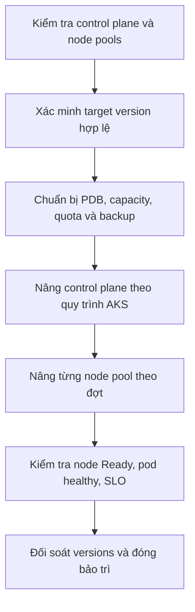
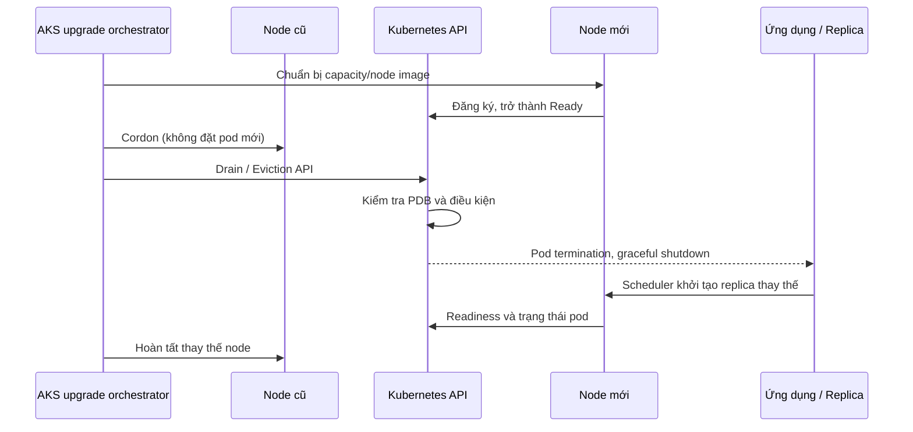
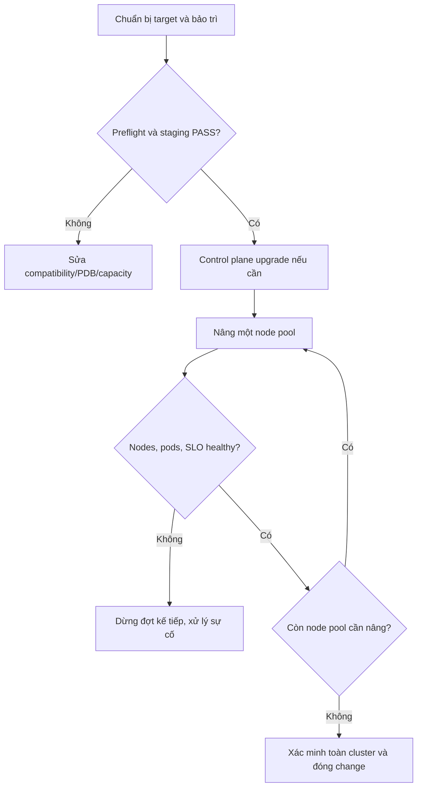

# Nâng cấp Kubernetes, node image và điều phối bảo trì

Một cụm **Azure Kubernetes Service (AKS)** có thể chạy ổn định hôm nay nhưng dần đối mặt với rủi ro: phiên bản Kubernetes hết vòng đời hỗ trợ, hệ điều hành trên node thiếu bản vá, tiện ích mạng chưa tương thích với phiên bản mới, hoặc quá trình thay node làm gián đoạn ứng dụng đang phục vụ người dùng. Vì vậy, vận hành AKS không chỉ là chạy một lệnh `upgrade`; đó là quá trình **quản lý phiên bản, chuẩn bị năng lực dự phòng, phối hợp các nhóm và xác minh ứng dụng sau khi bảo trì**.

Bài học thuộc chương **Vận hành AKS** của module **CLOUD_PROVIDERS_AZURE**. Module khám phá hệ sinh thái Microsoft Azure từ subscription, resource group và Microsoft Entra ID đến mạng ảo, dịch vụ tính toán, lưu trữ, dữ liệu; đồng thời hướng dẫn triển khai, giám sát, bảo vệ và kiểm soát chi phí kiến trúc ứng dụng Azure. Trọng tâm bài học là sự khác biệt giữa **nâng cấp Kubernetes** và **cập nhật node image**, cách AKS điều phối node pool trong lúc bảo trì, cùng những điều kiện để ứng dụng tiếp tục đáp ứng yêu cầu sẵn sàng.

Sau bài học, bạn có thể:

- Phân biệt nâng cấp **control plane**, nâng cấp **Kubernetes version của node pool**, cập nhật **node OS image** và thay đổi **container image** của ứng dụng.
- Kiểm tra phiên bản hiện tại, các đích nâng cấp được AKS hỗ trợ và trạng thái từng node pool.
- Giải thích quy trình cordon, drain, eviction, surge, tạo/thay node và đưa workload trở lại trạng thái healthy.
- Thiết kế **PodDisruptionBudget (PDB)**, replicas, probes và phân bố theo availability zone để hạn chế gián đoạn.
- Lựa chọn nâng cấp thủ công, kênh tự động và **planned maintenance window** theo chính sách tổ chức.
- Viết runbook gồm preflight, triển khai theo đợt, xác minh, xử lý lỗi và phương án phục hồi.
- Giám sát rủi ro, chi phí capacity tạm thời, quota và trạng thái an toàn sau bảo trì.

## 1. Bốn loại thay đổi thường bị nhầm

| Hạng mục | Cái gì thay đổi? | Phạm vi tác động điển hình | Cách kiểm soát |
|---|---|---|---|
| **Kubernetes control plane upgrade** | Phiên bản các thành phần Kubernetes do AKS quản lý ở control plane | API server và các hành vi/tính năng phiên bản Kubernetes | Chọn đích nâng cấp AKS được hỗ trợ, kiểm tra tương thích |
| **Node pool Kubernetes upgrade** | Phiên bản kubelet/các thành phần Kubernetes trên worker nodes và node runtime theo triển khai | Node được nâng cấp/thay thế, pod có thể bị evict và lên lịch lại | Điều phối từng pool, surge, drain, PDB, health checks |
| **Node OS image upgrade** | Image hệ điều hành node, các bản vá và thành phần nền tảng đi kèm | Thường phải thay/reimage node, làm pod dịch chuyển | Node image channel, maintenance và kế hoạch drain |
| **Application container image release** | Image của Deployment/StatefulSet/Job do đội ứng dụng quản lý | Revision/pod của ứng dụng | Rolling update/canary, readiness, rollback của ứng dụng |

**Không đánh đồng:** cập nhật `image: my-api:v2` trong Deployment không nâng phiên bản Kubernetes; ngược lại, cập nhật node image không tự thay version container image ứng dụng.

Ví dụ:

```text
AKS control plane:       Kubernetes v1.X
System node pool:        Kubernetes v1.X, node image build A
User node pool:          Kubernetes v1.X, node image build B
Application Deployment:  registry.example/api:2026.11
```

Đây là mô hình minh họa: các ký hiệu `v1.X`, `A`, `B` không phải phiên bản có thể nhập nguyên văn. Trong môi trường thật, phải lấy **version/image hiện tại và target được hỗ trợ** từ chính cluster và danh sách nâng cấp của AKS.

### 1.1. Vì sao node image cần cập nhật dù Kubernetes version chưa đổi?

Một bản Kubernetes patch không đồng nghĩa mọi bản vá OS, kernel, container runtime hoặc agent trên worker nodes đều đã được áp dụng. **Node image upgrade** giúp AKS triển khai image node được duy trì theo kênh hỗ trợ; có thể bao gồm bản vá hệ điều hành, thay đổi gói nền và cấu hình/hạ tầng node.

Ngược lại, nâng cấp Kubernetes có thể đồng thời kéo theo thay node image trong quá trình nâng node pool, nhưng không nên dùng điều đó để bỏ qua chính sách cập nhật node OS theo vòng đời riêng.

### 1.2. Node pool: system và user

AKS thường phân biệt:

- **System node pool:** phục vụ những pod hệ thống quan trọng của cluster, thường có yêu cầu capacity/taints/labels riêng.
- **User node pool:** chạy workload của đội ứng dụng, có thể chia theo VM size, vùng lỗi, hệ điều hành hoặc nhu cầu scale.

Mỗi pool có vòng đời nâng cấp node và khả năng điều phối khác nhau. Đừng chỉ kiểm tra một node pool rồi kết luận cả cluster đã được vá. Khi một system pool không đủ capacity, việc nâng cấp có thể ảnh hưởng CoreDNS, metrics hoặc thành phần điều phối nền tảng.

## 2. Vòng đời phiên bản Kubernetes trên AKS

AKS hỗ trợ một tập phiên bản Kubernetes trong từng region theo lịch phát hành và chính sách hỗ trợ của dịch vụ. Phiên bản mới đem lại tính năng, sửa lỗi và thay đổi API; phiên bản quá cũ có thể ngừng được hỗ trợ bảo mật hay các thao tác nâng cấp thông thường.

Trước mỗi đợt nâng cấp:

1. Xem **phiên bản hiện tại của control plane và từng node pool**.
2. Xem **đích nâng cấp mà AKS trả về cho cluster** ở region hiện tại.
3. Kiểm tra tài liệu vòng đời hỗ trợ, đặc biệt nếu có quy định long-term support hoặc yêu cầu version cụ thể.
4. Kiểm kê Kubernetes API bị deprecate/removed và các add-on có ràng buộc phiên bản.
5. Đọc release notes và thông báo thay đổi của các thành phần quan trọng.

### 2.1. Không tùy ý bỏ qua phiên bản minor

Việc nâng trực tiếp từ một minor rất cũ tới một minor cách xa có thể **không được hỗ trợ** bởi AKS. Hãy lấy tập **`upgrades` hợp lệ** từ `az aks get-upgrades` và thực hiện theo lộ trình được dịch vụ chấp nhận; nếu cluster ngoài support hoặc bị chặn, tuân thủ hướng phục hồi/migration phù hợp.

Đừng tự điền phiên bản target dựa trên một bài viết cũ hoặc giả định “phiên bản mới nhất của Kubernetes upstream” là phiên bản AKS đã hỗ trợ ở mọi Azure region.

### 2.2. Control plane và node pool không phải một khối

Về mặt kiến trúc, control plane và worker nodes là các lớp có thể có phiên bản trong giới hạn **version skew được AKS/Kubernetes hỗ trợ**. Khi nâng cấp, thứ tự thông thường là **đưa control plane lên phiên bản phù hợp trước**, rồi nâng các node pools theo kế hoạch.



AKS có thể cung cấp lựa chọn nâng cấp toàn cluster hoặc **control-plane-only** theo lệnh/cấu hình được hỗ trợ. **Không để các node pool lệch phiên bản quá giới hạn** hoặc dừng kế hoạch ở tình trạng một nửa cluster kéo dài nếu không có phương án được duyệt.

## 3. Kiểm tra những phụ thuộc trước khi nâng cấp

Một Kubernetes minor version có thể ảnh hưởng:

- **API resources:** các API group/version bị loại bỏ hoặc thay đổi schema.
- **Admission webhooks:** operator/policy engine, cert-manager hoặc custom admission có thể từ chối pod/Deployment mới.
- **Ingress/network plugins:** Azure CNI, ingress controller, Gateway API/Ingress controller và các CNI integrations có giới hạn tương thích.
- **CSI drivers/storage:** Azure Disk CSI, Azure Files CSI, snapshot classes và volume attachment khi drain.
- **Monitoring/security agents:** DaemonSets, log collectors, OpenTelemetry, Defender/agent và sidecars.
- **Service mesh:** mTLS, sidecar injection và version compatibility.
- **Workload controllers:** Helm charts, KEDA/HPA, CRDs, operators và GitOps controllers.
- **Operating system:** Windows vs Linux node pools, node image SKU/OS phiên bản hỗ trợ và kernel features.

### 3.1. Kiểm kê API trước khi đổi phiên bản

Ví dụ, manifest còn dùng một API Kubernetes đã bị loại bỏ sẽ không hoạt động sau upgrade; GitOps/Helm có thể liên tục cố tạo tài nguyên cũ và bị API server từ chối. Phải:

1. Kiểm kê Git repositories, Helm chart templates và CRDs.
2. Xem cảnh báo API deprecation của AKS/Kubernetes khi có.
3. Thử deploy với API version đích trên cluster lab.
4. Nâng cấp add-on/operator theo ma trận hỗ trợ vendor.
5. Dùng linter/policy và CI validation trước production.

**Nâng cấp cluster không tự chuyển đổi tất cả manifests cũ thành API mới.** Nếu môi trường có admission webhooks hoặc CRDs bị lỗi, thay đổi có thể ảnh hưởng tạo pod mới trong lúc drain, kéo dài downtime.

### 3.2. Dữ liệu và trạng thái ứng dụng

Nâng cấp node không nhằm xóa dữ liệu bền vững đã lưu đúng trong Azure Disk, Azure Files, database hoặc object storage. Nhưng các ứng dụng lưu trạng thái trên **local disk, emptyDir hoặc bộ nhớ pod** có thể mất dữ liệu khi node bị thay.

Hãy xác nhận:

- Deployment có thể tái tạo pod ở node khác không?
- StatefulSet có cơ chế **quorum/replication** và volume attachment an toàn không?
- Các job dài có checkpoint hoặc idempotent retry không?
- Database có backup/restore đã kiểm thử không?
- Pod termination grace period đủ để dừng transaction/flush dữ liệu không?

Sao lưu/khôi phục phải theo mô hình ứng dụng; một snapshot disk đơn lẻ chưa chắc đạt application consistency.

## 4. AKS điều phối thay node như thế nào?

Trong quá trình nâng cấp node pool, AKS có thể tạo node tạm (*surge nodes*) và di chuyển workloads bằng cơ chế Kubernetes. Luồng khái quát:



Sơ đồ trình bày một đợt nâng cấp điển hình; thứ tự chi tiết và số node xử lý đồng thời phụ thuộc SKU, mode, upgrade settings và điều kiện AKS thực tế.

### 4.1. Cordon, drain và eviction

- **Cordon:** đánh dấu node không nhận những pod được scheduler đặt mới theo đường thông thường.
- **Drain:** yêu cầu chuyển những pod có thể di dời sang nơi khác, tôn trọng những cơ chế Kubernetes liên quan.
- **Eviction API:** đường yêu cầu gián đoạn có kiểm soát, xem xét **PodDisruptionBudget** khi áp dụng.
- **Termination grace period:** cho ứng dụng thời gian hoàn tất request, flush state hoặc phát tín hiệu dừng.
- **Readiness probe:** ngăn traffic đi đến pod mới trước khi nó sẵn sàng.

**Drain thành công không đồng nghĩa người dùng không thấy gián đoạn.** Một service chỉ có một replica hoặc có readiness chậm vẫn có thể gặp khoảng trống phục vụ.

### 4.2. Pod nào có thể cản drain?

Những trường hợp cần kiểm tra:

- PDB yêu cầu mức sẵn sàng không thể đạt được.
- Pod bị lỗi/crash hoặc không thể tạo replica thay thế vì thiếu CPU/RAM/IP.
- Pod có local storage hoặc workload controller đặc biệt.
- Stateful application đang chờ volume detach/attach.
- Admission webhook từ chối tạo pod mới.
- Taints/tolerations, node affinity, topology spread constraints hoặc quota khiến pod Pending.
- DaemonSets hoặc static pods có semantics riêng với drain.

Không áp dụng thói quen **force delete pods** hoặc tắt PDB để “cho xong upgrade” khi chưa biết dữ liệu và tác động nghiệp vụ. Cần phân loại nguyên nhân và chọn cách xử lý an toàn.

## 5. PodDisruptionBudget: thiết kế mức gián đoạn tự nguyện

**PodDisruptionBudget (PDB)** cho biết Kubernetes cần duy trì tối thiểu bao nhiêu pod healthy hoặc cho phép tối đa bao nhiêu pod bị gián đoạn **tự nguyện** trong một nhóm được selector chọn. PDB giúp hạn chế gián đoạn từ drain/eviction, nhưng **không ngăn mọi sự cố** như node mất điện hoặc lỗi ứng dụng bất ngờ.

Ví dụ một Deployment có 3 replicas:

```yaml
apiVersion: apps/v1
kind: Deployment
metadata:
  name: orders-api
  namespace: orders
spec:
  replicas: 3
  selector:
    matchLabels:
      app: orders-api
  template:
    metadata:
      labels:
        app: orders-api
    spec:
      containers:
        - name: api
          image: example.azurecr.io/orders-api:1.0.0
          ports:
            - containerPort: 8080
          readinessProbe:
            httpGet:
              path: /ready
              port: 8080
            initialDelaySeconds: 5
            periodSeconds: 5
          resources:
            requests:
              cpu: "250m"
              memory: "256Mi"
---
apiVersion: policy/v1
kind: PodDisruptionBudget
metadata:
  name: orders-api-pdb
  namespace: orders
spec:
  minAvailable: 2
  selector:
    matchLabels:
      app: orders-api
```

Trong trạng thái lý tưởng, cả 3 pods đều healthy và `minAvailable: 2` cho phép **1 pod** bị evict trong một thời điểm. Nếu chỉ còn 2 pod healthy, một eviction khác có thể bị chặn cho tới khi pod thay thế trở nên healthy.

| Tổng replica dự kiến | Pod healthy hiện tại | `minAvailable` | Disruption còn cho phép (minh họa) |
|---:|---:|---:|---:|
| 3 | 3 | 2 | 1 |
| 3 | 2 | 2 | 0 |
| 3 | 1 | 2 | 0 |

Đây là ví dụ đơn giản; cách Kubernetes tính `disruptionsAllowed` còn phụ thuộc selector, desired count và trạng thái controller. Xem trực tiếp `kubectl get pdb -A` thay vì chỉ trừ tay khi cluster có nhiều controller hoặc pod không healthy.

### 5.1. Cạm bẫy PDB đặt quá chặt

Nếu ứng dụng chỉ có **1 replica** nhưng PDB yêu cầu `minAvailable: 1`, quá trình drain có thể bị chặn mãi cho đến khi thay đổi capacity hoặc chính sách. Nếu một hệ thống 3 replicas nhưng cả ba cùng nằm trên một node vì placement sai, một đợt drain cũng có thể gây rủi ro lớn hơn dự kiến.

Để vận hành an toàn:

1. Dùng tối thiểu nhiều replicas nếu yêu cầu không gián đoạn.
2. Đặt PDB phản ánh **quorum/thực tế sẵn sàng**, không chỉ công thức chung.
3. Bổ sung readiness/liveness/startup probes đúng với hành vi ứng dụng.
4. Phân bố pods qua nodes/zones phù hợp.
5. Đảm bảo **surge capacity** để tạo pod thay thế.
6. Kiểm thử drain trên lab/staging và đo mức ảnh hưởng thực tế.

### 5.2. PDB khác với rolling update policy

`Deployment.spec.strategy.rollingUpdate.maxUnavailable` và `maxSurge` điều khiển **rolling update của Deployment**. PDB điều khiển **voluntary disruption qua Eviction API**. Hai cơ chế không thay thế nhau.

Tương tự, `AKS node pool maxSurge` là capacity node bổ sung trong quá trình nâng node. Nó không giống `Deployment maxSurge` (số pod tăng tạm khi rollout application). Những giới hạn này cần được thiết kế phối hợp, không gọi chung là “surge 25%” mà thiếu đối tượng.

## 6. Max surge, drain timeout và node soak

AKS hỗ trợ các thiết lập điều phối nâng cấp node pool, tùy tính năng/API như **`maxSurge`**, **drain timeout** và **node soak duration**. Chúng ảnh hưởng tới tốc độ, mức rủi ro và chi phí bảo trì.

### 6.1. `maxSurge`

`maxSurge` mô tả số lượng hoặc tỷ lệ node bổ sung mà AKS có thể cấp phát trong quá trình upgrade một node pool. Ví dụ tư duy:

```text
Node pool hiện tại:  6 nodes
Max surge giả định: 2 nodes
Capacity tạm thời:  có thể lên tới khoảng 8 nodes trong đợt nâng cấp
```

Kết quả thực tế phụ thuộc kích thước pool, cách làm tròn tỷ lệ, quota, availability zone, khả năng cấp phát SKU và thời điểm Azure thực hiện các bước. Surge lớn có thể rút ngắn thời gian tổng nhưng:

- Đòi hỏi thêm **vCPU quota và VM capacity**.
- Dùng thêm **địa chỉ IP** theo cấu hình CNI.
- Có thể làm tăng chi phí compute/disk/network tạm thời.
- Có thể gặp lỗi nếu region/zone không cấp phát được VM size yêu cầu.
- Không giải quyết việc PDB hoặc ứng dụng không cho phép drain.

Một giá trị surge nhỏ hơn có thể giảm áp lực quota nhưng khiến bảo trì kéo dài. Hãy chọn theo số replicas, mức SLO và capacity còn trống thực tế.

### 6.2. Drain timeout

Drain timeout cho phép AKS chờ các pod được evict/thoát theo giới hạn cấu hình. Nếu có PDB không cho eviction hoặc pod không thể chuyển, AKS có thể dừng/chờ/báo lỗi theo cơ chế điều phối và giới hạn thời gian tương ứng.

**Tăng timeout không phải cách sửa một PDB bất khả thi.** Trước khi tăng, kiểm tra:

- Pod đang Healthy hay CrashLoopBackOff?
- Replica thay thế có Pending vì thiếu resources hay node affinity?
- Pod có termination grace period quá dài so với SLA?
- StatefulSet/volume có đang thực hiện failover, detach hoặc replication?

### 6.3. Node soak duration

Một số cấu hình nâng cấp hỗ trợ khoảng **soak** giữa các đợt thay node để có thời gian quan sát sức khỏe trước khi tiếp tục. Nếu workload nhạy cảm hoặc cần phát hiện memory leak/latency sau chuyển node, soak có thể hữu ích. Đổi lại, tổng thời gian bảo trì có thể tăng.

**Lưu ý:** các tham số và giới hạn hợp lệ của max surge, drain timeout, soak, max unavailable hoặc các chiến lược thay node tùy phiên bản AKS, loại node pool và thời điểm dịch vụ. Không sao chép cú pháp từ một tài liệu cũ vào production mà không xem khả năng của Azure CLI/API đang dùng.

## 7. Availability zone và bài toán đặt pod

Để bảo trì một node mà ứng dụng vẫn phục vụ được, không chỉ cần PDB; các pod còn lại phải nằm ở những failure domains độc lập tương đối.

### 7.1. Cùng node, cùng zone, khác zone

| Bố trí | Rủi ro |
|---|---|
| Ba replicas trên cùng một node | Drain một node có thể ảnh hưởng cả ba |
| Ba replicas trên ba nodes nhưng cùng zone | Chịu được lỗi node riêng lẻ nhưng có rủi ro khi zone lỗi |
| Replicas phân bố trên nhiều nodes/zones được hỗ trợ | Tăng khả năng chịu lỗi node và zone, nếu dependency cũng resilient |

Một VM/node pool trải availability zones không tự bảo đảm scheduler đặt từng replica ở các zone khác nhau; cần kiểm tra topology spread, anti-affinity hoặc cơ chế placement phù hợp và giới hạn khả dụng của nodes.

### 7.2. Ví dụ topology spread constraints

Một phần `Pod.spec` có thể dùng:

```yaml
topologySpreadConstraints:
  - maxSkew: 1
    topologyKey: topology.kubernetes.io/zone
    whenUnsatisfiable: DoNotSchedule
    labelSelector:
      matchLabels:
        app: orders-api
```

Đây chỉ là **trích đoạn cấu hình**, cần đặt đúng trong `spec.template.spec` của Deployment và bảo đảm nodes có labels zone phù hợp. Nếu chỉ còn một zone hoặc thiếu capacity ở zone khác, `DoNotSchedule` có thể khiến pods Pending. Phải cân bằng khả năng phân tán và tính sẵn sàng khi capacity bị hạn chế.

### 7.3. Không bỏ qua hệ thống phụ thuộc

Ngay cả khi pods API còn chạy ở zone khác, ứng dụng vẫn có thể lỗi nếu:

- Azure SQL/Storage/Redis chỉ có một điểm phục vụ không dự phòng tương thích.
- Load Balancer/Ingress chưa health-check đúng.
- Secret provider hoặc admission webhook không sẵn sàng trong đợt nâng cấp.
- Azure Disk volume bị ràng buộc availability zone, khiến StatefulSet không attach được trên node ở zone khác.

Với storage stateful, phải thiết kế **zone-aware placement** và failover data layer; không cố ép pod chuyển sang zone mà volume không hỗ trợ.

## 8. Nâng cấp node image: khác nâng cấp Kubernetes

**Node image** là image hệ điều hành worker node mà AKS sử dụng; có thể gồm OS patches, container runtime/agents và cấu hình phù hợp với phiên bản nền tảng. Khi node image mới được áp dụng, quá trình thường phải thay hoặc reimage node, vì vậy **pod disruption và drain vẫn cần được quản lý**.

### 8.1. Trường hợp nên kiểm tra node image trước

- Có advisory bảo mật về kernel/OS của node.
- Node image đang quá cũ so với mức được duy trì.
- Cần sửa lỗi container runtime, network hoặc storage driver.
- Kubernetes version đang được hỗ trợ nhưng vẫn có patch OS chưa áp dụng.
- Doanh nghiệp có lịch vá định kỳ khác với lịch nâng cấp minor Kubernetes.

### 8.2. Phân biệt image build và application image

```text
Node image:         AKS OS/runtime image build do nền tảng quản lý
Container image:    example.azurecr.io/orders-api:2026-11
Kubernetes version: v1.X.Y
```

Ba đối tượng có lịch phát hành và khả năng rollback riêng. Việc đổi container tag không làm kernel node an toàn hơn; việc thay node image không tự sửa một ứng dụng có dependency lỗi thời.

### 8.3. Windows và Linux node pools

AKS có node pools Linux và Windows theo phiên bản và SKU được hỗ trợ. **Node OS/image channels, reboot behavior và compatibility** có thể khác nhau giữa hai hệ điều hành. Các giới hạn Windows container/HostProcess/antivirus hoặc workload Linux dùng kernel capabilities phải được kiểm tra riêng.

Trong cluster nhiều OS, báo cáo “all nodes Ready” chưa đủ; phải xác minh node image build đúng của **từng pool** và thử workload tương ứng sau nâng cấp.

## 9. Nâng cấp tự động và node OS upgrade channels

AKS có các cơ chế tự động hóa nâng cấp control plane/Kubernetes và cập nhật node OS image. Những kênh phổ biến có thể bao gồm:

- **Kubernetes cluster auto-upgrade channel**: lựa chọn mức độ tự động theo chính sách như `none`, `patch`, `stable` hoặc `rapid` trong tập giá trị mà AKS phiên bản hiện hành hỗ trợ.
- **Node OS upgrade channel**: điều khiển chiến lược cập nhật node OS, ví dụ `None`, `Unmanaged`, `SecurityPatch` hoặc `NodeImage` theo điều kiện hỗ trợ.

**Không nhầm hai cơ chế:** Kubernetes auto-upgrade quyết định lộ trình nâng **Kubernetes version**; node OS channel quyết định cách cập nhật **hệ điều hành/image node**. Chúng có thể tương tác, nhưng không dùng một kênh để thay thế toàn bộ trách nhiệm của kênh kia.

### 9.1. So sánh chiến lược vận hành

| Chiến lược | Ưu điểm | Rủi ro / yêu cầu |
|---|---|---|
| **Manual upgrades** | Kiểm soát đích và thời điểm từng đợt | Dễ bị chậm vá nếu thiếu quy trình/owner |
| **Auto-upgrade patch** | Hỗ trợ duy trì các bản sửa trong nhánh phiên bản theo kênh hỗ trợ | Vẫn cần PDB, capacity, kiểm tra regression |
| **Auto-upgrade stable/rapid** | Giảm công theo dõi nâng minor theo chiến lược hỗ trợ | Cần chuẩn bị tương thích API/add-ons và change governance |
| **NodeImage channel** | Duy trì node image theo kênh tự động được hỗ trợ | Có thể phải thay node/drain nhiều lần theo lịch phát hành |
| **SecurityPatch channel** | Tập trung cập nhật bảo mật OS theo cơ chế hỗ trợ | Không đồng nghĩa luôn thay toàn bộ image theo mỗi lần cập nhật |
| **Unmanaged/None** | Tổ chức tự điều phối theo yêu cầu đặc biệt | Cần chịu trách nhiệm vá, giám sát và chính sách compliance riêng |

Không xem tên kênh là SLA về ngày/giờ áp dụng chính xác, cũng không mặc định mọi kênh hợp lệ ở mọi region/OS/cluster mode. Khi chọn channel cần kiểm tra cách Azure hiện hành mô tả hỗ trợ, chi phí và tương tác với planned maintenance.

### 9.2. Cần một lịch phiên bản đã được duyệt

Ví dụ một chính sách nội bộ:

```text
Mỗi tuần:
  - Kiểm tra security advisories, node image availability, health.

Mỗi tháng:
  - Rà soát minor/patch version, add-on compatibility, PDB violations.

Trước đợt bảo trì:
  - Staging upgrade, đo SLO, xác nhận quota và backup.

Trong đợt:
  - Nâng theo node pool, theo dõi rollout, dừng nếu vượt error budget.

Sau đợt:
  - Xác minh versions/images, pods, SLO và hoàn thiện change record.
```

Đây là cadence ví dụ; doanh nghiệp có thể cần vá khẩn cấp ngoài chu kỳ và phải đáp ứng chính sách vòng đời hỗ trợ của AKS.

## 10. Planned maintenance window: điều phối thời gian

**Planned maintenance configuration** của AKS cho phép khai báo những khoảng thời gian ưu tiên/cho phép cho một số hoạt động bảo trì và nâng cấp được hỗ trợ. Các loại cấu hình có thể liên quan tới:

- Lịch bảo trì mặc định cho những tác vụ nền tảng được áp dụng.
- Lịch **managed Kubernetes auto-upgrade**.
- Lịch **managed node OS upgrade**.

Tên cấu hình được Azure CLI/API hỗ trợ có thể gồm `default`, `aksManagedAutoUpgradeSchedule` và `aksManagedNodeOSUpgradeSchedule`. Cần kiểm tra đúng tên/tính năng tại cluster hiện tại; không cho rằng chỉ cần khai báo một lịch `default` thì mọi loại nâng cấp đều tự động tuân theo lịch đó.

### 10.1. Maintenance window làm được và không làm được gì?

| Điều có thể hỗ trợ | Điều không nên giả định |
|---|---|
| Định nghĩa ngày/giờ, lặp lại, thời gian cho phép theo cơ chế dịch vụ | Mọi nâng cấp sẽ **kết thúc** trong vài phút chính xác của window |
| Phối hợp các đợt tự động với lịch doanh nghiệp | Một sự cố hay bản vá an toàn khẩn cấp sẽ không bao giờ xảy ra ngoài window |
| Giảm nguy cơ đụng giờ cao điểm nếu quy hoạch đúng | Ứng dụng chắc chắn không gián đoạn khi node drain |
| Có lịch rõ ràng cho hệ thống alert, on-call và change process | Tự kiểm tra PDB, capacity hoặc version compatibility thay cho operator |

Trong các hệ thống quan trọng, chọn window ở thời điểm tải thấp **nhưng vẫn có người trực**; không đặt một lịch vào ban đêm rồi thiếu khả năng xử lý lỗi kéo dài sang giờ làm việc.

### 10.2. Múi giờ và thời lượng

Khi cấu hình lịch lặp, cần xác định Azure API/CLI yêu cầu **UTC hay định dạng offset/time zone nào** trong thuộc tính hiện hành. Ví dụ tổ chức ở Việt Nam dự kiến bắt đầu **01:00 giờ địa phương UTC+7** thì tương ứng **18:00 UTC ngày trước**. Đây là phép đổi thời gian minh họa; phải xác minh cấu hình và ngày cụ thể trước khi tạo maintenance configuration.

Tránh nhầm giữa:

1. **Maintenance window**: cửa sổ cho phép dịch vụ khởi chạy/tổ chức bảo trì.
2. **Drain timeout**: thời gian chờ pod eviction/termination ở từng node.
3. **Node soak**: thời gian theo dõi giữa các đợt nâng.
4. **RTO/error budget**: mức gián đoạn nghiệp vụ được chấp nhận.

Các thời gian này liên quan nhưng không thay thế nhau. Một upgrade lớn có thể kéo dài vì quota hoặc PDB, nên luôn có runbook khi vượt thời lượng dự kiến.

## 11. Runbook nâng cấp AKS có kiểm soát

### Giai đoạn A — Chuẩn bị trước thay đổi

1. **Xác định mục tiêu:** nâng Kubernetes minor/patch, chỉ nâng node image, hay cả hai? Nêu lý do security/support.
2. **Kiểm tra target:** dùng thông tin `get-upgrades`, lifecycle support và node image availability.
3. **Kiểm tra sức khỏe:** nodes Ready, pods healthy, không có Pending/CrashLoopBackOff bất thường.
4. **Kiểm tra PDB:** `disruptionsAllowed` thực tế, replicas và khả năng thay pod.
5. **Kiểm tra capacity:** quota vCPU, khả năng cấp phát ở zone, địa chỉ IP, disk limits, cluster autoscaler và surge.
6. **Kiểm tra version compatibility:** API removals, CNI/CSI, admission, ingress, operators, CRDs, service mesh.
7. **Kiểm tra dữ liệu:** backup, recovery points, StatefulSet, volume zone, database HA và kiểm thử restore.
8. **Xác định rollback/recovery:** ứng dụng, workload placement, mở pool mới hoặc restore; không giả định Kubernetes downgrade được hỗ trợ.
9. **Thông báo change:** owner, giờ UTC/local, runbook, dashboard, ngưỡng dừng và kênh liên lạc.
10. **Kiểm thử staging:** tương tự production về workload/quan hệ dữ liệu đủ để phát hiện lỗi.

### Giai đoạn B — Triển khai theo đợt

1. Xác nhận **đúng subscription, cluster và context**.
2. Nếu nâng Kubernetes, bắt đầu theo lộ trình control plane/node pool được AKS hỗ trợ.
3. Theo dõi trạng thái một node pool; tránh nâng nhiều pool nhạy cảm cùng lúc khi chưa có lý do rõ.
4. Quan sát nodes mới Ready, pod replacements Ready, metrics ứng dụng và errors.
5. Chờ ổn định theo soak/validation window rồi mới chuyển sang pool tiếp theo.
6. Nếu lỗi vượt ngưỡng, **dừng mở rộng phạm vi thay đổi** và chuyển xử lý sự cố.

### Giai đoạn C — Xác minh và đóng bảo trì

1. Kiểm tra **control plane version, từng pool version và nodeImageVersion**.
2. Kiểm tra pod Pending, Restart, PDB disruption, event và HPA/cluster autoscaler.
3. Thử synthetic transactions: đăng nhập, tạo đơn hàng, thanh toán thử, truy vấn dữ liệu theo quy trình an toàn.
4. Kiểm tra ingress, DNS, TLS, network policies, Storage/SQL/Key Vault và log collectors.
5. Đối chiếu SLO, p95/p99 latency, error rate, queue backlog và chi phí capacity.
6. Ghi lại những ngoại lệ, node vẫn đang phiên bản cũ, việc cần theo dõi và phê duyệt đóng change.



## 12. Thực hành Azure CLI: kiểm tra trạng thái trước khi nâng

Các lệnh trong mục này **chỉ đọc** tài nguyên và trạng thái Kubernetes. Đăng nhập Azure CLI bằng principal có quyền xem AKS; dùng `kubectl` với danh tính/context đã được tổ chức cấp quyền.

### 12.1. Xem subscription và Kubernetes version

```bash
RG="rg-aks-prod"
AKS="aks-orders-prod"

az account show \
  --query "{subscription:name,id:id,tenant:tenantId}" \
  -o table

az aks show \
  --resource-group "$RG" \
  --name "$AKS" \
  --query "{name:name,kubernetesVersion:kubernetesVersion,currentKubernetesVersion:currentKubernetesVersion,provisioningState:provisioningState,autoUpgradeProfile:autoUpgradeProfile}" \
  -o json
```

Kiểm tra trường version thực tế trả về; có thể có khác biệt giữa version đã yêu cầu và version đang hoạt động trong một số trạng thái triển khai. **Không** dùng mỗi version của kubeconfig/client `kubectl` để kết luận cluster đang ở phiên bản nào.

### 12.2. Liệt kê node pool, image và trạng thái

```bash
az aks nodepool list \
  --resource-group "$RG" \
  --cluster-name "$AKS" \
  --query "[].{name:name,mode:mode,osType:osType,osSKU:osSKU,kubernetesVersion:orchestratorVersion,nodeImageVersion:nodeImageVersion,count:count,provisioningState:provisioningState}" \
  -o table
```

Với cluster nhiều pool, lấy snapshot thông số **từng pool**: system/user, Linux/Windows, node image build, AZ và scale settings. Giá trị trống trong một trường của query có thể do API version/CLI hoặc cấu hình, không tự chứng minh pool đã được nâng.

### 12.3. Xem đích nâng cấp được hỗ trợ

```bash
az aks get-upgrades \
  --resource-group "$RG" \
  --name "$AKS" \
  -o table
```

Chọn `TARGET_VERSION` từ kết quả và chính sách tổ chức; không nhập một version Kubernetes upstream không nằm trong các nâng cấp hỗ trợ của AKS. Với cluster đang ngoài support hoặc chuyển minor lớn, có thể cần nhiều giai đoạn.

### 12.4. Xem maintenance configurations

```bash
az aks maintenanceconfiguration list \
  --resource-group "$RG" \
  --cluster-name "$AKS" \
  -o json
```

Đối chiếu những configuration được trả về với loại auto-upgrade/node OS channel thực tế. Nếu chưa có lịch, lệnh có thể trả danh sách rỗng; không suy điều đó đồng nghĩa không có bảo trì nền tảng hoặc Azure không áp dụng bất kỳ cập nhật nào.

### 12.5. Kiểm tra sức khỏe Kubernetes

```bash
kubectl config current-context
kubectl get nodes -o wide
kubectl get pods -A -o wide
kubectl get pdb -A
kubectl get deployments,statefulsets,daemonsets -A
kubectl get events -A --sort-by=.lastTimestamp
```

Trong thực tế, `kubectl get events -A` có thể trả nhiều dữ liệu; có thể giới hạn theo namespace/time để tập trung điều tra. Kiểm tra các node `NotReady` hoặc `SchedulingDisabled`, pod `Pending` và những PDB có `ALLOWED DISRUPTIONS = 0` đối với workload sẽ bị drain.

### 12.6. Kiểm tra node/PodDisruptionBudget cụ thể

```bash
kubectl describe node <node-name>
kubectl describe pdb orders-api-pdb -n orders
kubectl get pods -n orders -l app=orders-api -o wide
```

Các lệnh này giúp xem resource requests, taints, events, số replicas, PDB selector và phân bố pods theo node. Một PDB chọn sai nhãn có thể không bảo vệ các pod mà người quản trị nghĩ nó đang bảo vệ.

## 13. Ví dụ lệnh nâng cấp — chỉ dùng khi được phê duyệt

Những lệnh trong mục này **thay đổi trạng thái AKS**, có thể dẫn tới drain/restart/reimage node và chi phí capacity tạm thời. Chúng được cung cấp để minh họa **sự khác nhau giữa các thao tác**, **không được thực thi** trong quá trình học hoặc trực tiếp trên production khi chưa hoàn tất runbook.

### 13.1. Nâng phiên bản Kubernetes control plane

Ví dụ thao tác control-plane-only khi AKS và phiên bản CLI hỗ trợ:

```bash
TARGET_VERSION="<supported-target-version>"

az aks upgrade \
  --resource-group "$RG" \
  --name "$AKS" \
  --kubernetes-version "$TARGET_VERSION" \
  --control-plane-only
```

Sau bước này, node pools có thể vẫn dùng phiên bản Kubernetes cũ trong giới hạn tương thích được phép. **Phải tiếp tục** kế hoạch nâng từng pool; không chỉ dừng khi control plane đã báo thành công.

### 13.2. Nâng một node pool theo target Kubernetes

```bash
POOL="userpool1"

az aks nodepool upgrade \
  --resource-group "$RG" \
  --cluster-name "$AKS" \
  --name "$POOL" \
  --kubernetes-version "$TARGET_VERSION"
```

Trước khi chạy, xem `get-upgrades`, khả năng tương thích, max surge/PDB và capacity. Một pool có thể không nâng được vì quota, node không Ready hoặc workload không drain được.

### 13.3. Chỉ cập nhật node image, không yêu cầu đổi Kubernetes version

```bash
az aks nodepool upgrade \
  --resource-group "$RG" \
  --cluster-name "$AKS" \
  --name "$POOL" \
  --node-image-only
```

`--node-image-only` phục vụ mục tiêu đưa node pool lên node image được AKS cung cấp trong phạm vi hỗ trợ, **không có nghĩa node không bị thay và pod sẽ không gián đoạn**. Phải dùng các biện pháp drain/PDB/surge tương tự khi phù hợp.

### 13.4. Cấu hình tự động nâng cấp có chủ đích

Ví dụ ý tưởng khi tổ chức đã duyệt kênh:

```bash
# LỆNH GHI — xác minh cú pháp/khả năng hỗ trợ trước khi áp dụng.
az aks update \
  --resource-group "$RG" \
  --name "$AKS" \
  --auto-upgrade-channel patch \
  --node-os-upgrade-channel NodeImage
```

Việc bật kênh tự động **không thay thế** kiểm thử ứng dụng, bảo trì, khả năng giám sát hoặc kiểm soát thay đổi. Nếu tổ chức cần dừng rollout theo error budget, phải có cơ chế theo dõi và quy trình phê duyệt tương ứng.

### 13.5. Điều chỉnh max surge sau khi sizing

Một ví dụ cú pháp có thể được CLI hỗ trợ:

```bash
# LỆNH GHI — chỉ áp dụng khi đã tính quota, IP, zone và SLO.
az aks nodepool update \
  --resource-group "$RG" \
  --cluster-name "$AKS" \
  --name "$POOL" \
  --max-surge "33%"
```

Phần trăm và giới hạn hiệu lực phụ thuộc quy tắc làm tròn, giới hạn của AKS và pool size. Không sao chép `33%` cho mọi pool; với pool nhỏ hoặc chỉ một replica, giá trị này không bảo đảm không gián đoạn.

**Không thay đổi maintenance windows bằng một script chưa được review**; nên xác minh tên cấu hình, timezone và recurrence trên bản CLI/API thực tế hoặc qua Azure Portal rồi mới áp dụng.

## 14. Giám sát quá trình bảo trì và tiêu chí dừng

### 14.1. Theo dõi ở bốn lớp

| Lớp | Số liệu/tín hiệu | Câu hỏi |
|---|---|---|
| Azure/AKS | Provisioning state, upgrade events, node pool version/image, Azure Activity Log | Nâng cấp đang đến bước nào, có lỗi provisioning không? |
| Kubernetes | Nodes Ready, pod Pending/Restarts, PDB allowed disruptions, events, scheduling | Pod có được di chuyển an toàn không? |
| Ứng dụng | HTTP 5xx, p95 latency, throughput, queue backlog, success rate | Người dùng có bị gián đoạn không? |
| Phụ thuộc | Database/Storage connection, DNS, ingress, Key Vault, ACR, telemetry | Node mới có đủ network/identity/driver không? |

Đừng chỉ theo dõi `az aks show provisioningState = Succeeded`. Một nâng cấp thành công ở tầng tài nguyên vẫn có thể để lại ứng dụng lỗi vì readiness, network policy, CSI mount hoặc API deprecated.

### 14.2. Điều kiện tạm dừng mở rộng thay đổi

Các ngưỡng dưới đây là **ví dụ**, không phải tiêu chuẩn Azure:

```text
Tạm dừng nâng pool kế tiếp khi:
  - Có node NotReady kéo dài vượt ngưỡng nội bộ.
  - Có pod của dịch vụ trọng yếu Pending/CrashLoopBackOff.
  - PDB cản drain và chưa tìm được nguyên nhân.
  - HTTP 5xx hoặc latency vượt error budget đã duyệt.
  - Có dấu hiệu mất consistency hoặc lỗi volume attach.
  - Không còn surge quota/capacity cần thiết.
```

Tùy mức độ ảnh hưởng, có thể cần dừng change, giảm traffic, mở rộng capacity, sửa PDB/placement hoặc phục hồi ứng dụng từ image/manifests cũ.

### 14.3. Rollback cần hiểu đúng phạm vi

**Kubernetes cluster downgrade thường không được hỗ trợ như thao tác rollback trực tiếp thông thường trong AKS.** Khi một nâng cấp Kubernetes gây lỗi, không nên lập kế hoạch “chạy lệnh downgrade” như phương án chính.

Những lựa chọn thực tế cần chuẩn bị trước gồm:

- Rollback **application image/manifests/Helm release** nếu lỗi thuộc ứng dụng.
- Khôi phục tương thích add-on/CRD/operator khi hỗ trợ.
- Sử dụng node pool mới hoặc phương án thay thế được AKS hỗ trợ nếu cần cô lập workload, thay vì ép downgrade node.
- Khôi phục từ backup/DR hoặc chuyển traffic sang cluster khác đã chuẩn bị khi sự cố nghiêm trọng.
- Làm việc với quy trình hỗ trợ dịch vụ khi cluster ở trạng thái nâng cấp lỗi.

Một kế hoạch rollback chỉ có ý nghĩa nếu đã kiểm thử đường về, dữ liệu và năng lực của môi trường dự phòng.

## 15. Tình huống A: nâng minor Kubernetes cho API nhiều replica

**Bối cảnh:** cluster có system pool và user pool; `orders-api` có 6 replicas, PDB `minAvailable: 4`, hai availability zones và có pod anti-affinity phù hợp. Đội muốn nâng một minor Kubernetes mà vẫn duy trì chức năng đặt hàng.

### 15.1. Kế hoạch

1. Kiểm tra target version AKS hỗ trợ và tính tương thích của ingress, CSI, autoscaler, admission webhooks.
2. Chạy các kiểm thử tương đương trên staging.
3. Kiểm tra PDB hiện có: khi 6 pods healthy, số disruptions được phép có thể là 2 theo mô hình đơn giản.
4. Đảm bảo node pool có surge quota và địa chỉ IP; trong giai đoạn node drain vẫn đủ 4 replicas đáp ứng.
5. Nâng control plane, sau đó từng node pool theo kế hoạch hỗ trợ.
6. Kiểm tra orders API, ingress, Azure SQL/Storage, metrics, error rate và dữ liệu.
7. Chỉ tiếp tục khi SLO giữ ổn định; lưu báo cáo sau thay đổi.

### 15.2. Rủi ro chưa được PDB giải quyết

Nếu cả 6 replicas đều kết nối một database không sẵn sàng, API vẫn lỗi dù PDB hoàn hảo. Nếu pod mới không lấy được secret hoặc image, việc node cũ bị evict có thể làm số healthy pods giảm. Vì vậy, **PDB không thay thế dependency health, capacity, configuration và application readiness**.

## 16. Tình huống B: node image bảo mật và worker xử lý batch

**Bối cảnh:** một user node pool phục vụ worker đọc Service Bus Queue; mỗi job có thể chạy 20 phút. Có node image mới để vá bảo mật nhưng Kubernetes version chưa cần thay.

**Sai lầm cần tránh:** chạy `--node-image-only` và tin rằng job trên pod cũ luôn hoàn tất tự nhiên trước khi VM bị thay. Nếu worker bị terminate, job có thể dở dang và thông điệp bị xử lý lại.

Phương án:

1. Xác định job có hỗ trợ **idempotency**, lease/visibility timeout, checkpoint và retry chưa.
2. Dùng graceful shutdown/termination signal để worker dừng nhận việc mới trước khi thoát.
3. Thiết kế termination grace period và thời gian drain phù hợp với kiểu công việc.
4. Bảo đảm backlog có thể được tiêu hóa bởi workers còn lại trong maintenance.
5. Nâng theo đợt, quan sát duplicate processing, dead-letter queue và data consistency.
6. Sau thay node, xác minh nodeImageVersion mới của toàn pool và không có workload pending.

Nếu yêu cầu nghiệp vụ không thể cho job bị gián đoạn, cân nhắc chuyển sang mô hình job scheduling có kiểm soát, tạm ngừng nhận việc trước khi bảo trì hoặc các giải pháp thích hợp khác; không dựa vào PDB như bảo đảm job sẽ chạy vô hạn.

## 17. Tình huống C: bảo trì bị chặn vì StatefulSet và PodDisruptionBudget

**Bối cảnh:** database operator chạy 3 replicas, PDB yêu cầu `minAvailable: 3`. AKS drain một node chứa replica nhưng eviction bị chặn.

**Phân tích:** tất cả 3 replicas phải healthy liên tục theo PDB, nên không còn ngân sách gián đoạn tự nguyện. Nếu cluster operator cần di chuyển một replica, drain có thể bị chặn. Tuy vậy, tự hạ `minAvailable` xuống 2 **chưa chắc an toàn** nếu database có quorum hoặc replication chưa đồng bộ.

Quy trình xử lý:

1. Xác định **quorum và cơ chế failover thật** của database.
2. Kiểm tra member health và replica lag.
3. Đọc PDB selector, status và những pod đang bị evict.
4. Xác minh có đủ capacity, volume attach/zone compatibility và network.
5. Theo runbook của database vendor để chuyển leadership/replica hoặc điều chỉnh PDB sau phê duyệt.
6. Kiểm tra data integrity trước khi tiếp tục drain.

Không dùng force eviction/`kubectl delete pod --force` để ép một database member ra khỏi cluster nếu chưa kiểm soát nguy cơ split-brain và mất dữ liệu.

## 18. Troubleshooting nâng cấp AKS

| Triệu chứng | Nguyên nhân có thể | Bằng chứng và hướng xử lý |
|---|---|---|
| Không thấy target Kubernetes version | Region/cluster không hỗ trợ, upgrade path hoặc lifecycle policy | Kiểm tra `az aks get-upgrades` và hỗ trợ phiên bản |
| Nâng control plane xong, nodes vẫn version cũ | Chỉ chạy control-plane-only hoặc node pools chưa hoàn thành | Kiểm tra từng pool và tiếp tục kế hoạch trong giới hạn skew |
| Node pool bị kẹt ở drain | PDB, pod unhealthy, volume, termination, DaemonSet/constraint | `kubectl get pdb`, events, logs và pod placement |
| Pods Pending sau khi thêm surge | Quota CPU/RAM/IP, node affinity, taints, topology spread | Node allocatable, requests, subnet free IP và scheduler events |
| Upgrade không cấp phát được VM mới | Azure vCPU quota, zone capacity, VM SKU/cấp phát | Activity Log, VMSS/node pool events, quota và region/zone |
| Workload mất traffic trong khi node thay | Một replica, readiness/termination sai, LB drain chậm | Kiểm tra SLO, probes, replicas và ingress/LB |
| Sau nâng, CSI attach volume lỗi | Storage driver compatibility hoặc zone volume không phù hợp | CSI logs, PersistentVolume, VolumeAttachment, node zone |
| Node mới không kéo được image | ACR permissions, DNS/egress, image architecture | Pod events, kubelet/image pull errors và private endpoint |
| API/Helm deploy thất bại sau minor upgrade | API removed/deprecated, CRD/webhook không tương thích | API errors, admission logs, manifest versions |
| Node image version không đổi | Chưa thực hiện job, không có image mới hoặc upgrade thất bại | Xem pool nodeImageVersion và provisioning state |
| Thay node nhưng metrics biến mất | Monitoring agent DaemonSet/permissions/config không tương thích | Agent status, Log Analytics/OTel pipeline |
| Maintenance chạy ngoài dự kiến | Nhầm channel, timezone, loại maintenance configuration, cơ chế platform khác | Kiểm tra lịch, Activity Log và channel |
| Chi phí tăng đột biến lúc bảo trì | Surge VMs, pool chạy song song, logs hoặc overprovisioning | Cost Management, node count/quota, thời gian chạy |
| Tắt PDB rồi lỗi dữ liệu | Drain đã làm gián đoạn workload stateful không được chuẩn bị | Dừng thay đổi, bảo toàn bằng chứng, chạy vendor recovery |

### 18.1. Quy trình điều tra ngắn

```text
1. Lấy timestamp và thao tác thay đổi cụ thể
2. Xác định control plane / pool / node image / application release
3. Đọc trạng thái AKS và Activity Log
4. Đọc nodes, pods, PDB, events, scheduler/CSI logs
5. So sánh quota, subnet IP, capacity và placement
6. Kiểm tra metrics ứng dụng và dữ liệu
7. Sửa đúng nguyên nhân và kiểm thử lại trên phạm vi nhỏ
8. Ghi lại RCA, thay đổi runbook và ngăn lặp
```

## 19. Chi phí, bảo mật và kiểm soát vận hành

### 19.1. Những thành phần chi phí tăng khi nâng cấp

- **Surge nodes:** VM và managed disks tạm thời trong quá trình nâng cấp.
- **Cluster chạy song song:** staging, blue-green hoặc cluster DR được tạo để giảm rủi ro.
- **Network/IP:** subnet IP, load balancer/NAT, egress, capacity ở từng zone.
- **Observability:** logs/events/metrics tăng trong thời gian bảo trì.
- **Năng lực nhân sự:** trực sự cố, kiểm thử ứng dụng và đánh giá tương thích.

Việc chọn surge lớn hoặc thêm cluster dự phòng có chi phí, nhưng cũng có thể giảm rủi ro downtime. Quyết định nên dựa trên **SLO, yêu cầu khôi phục và TCO**, không chỉ giá VM/giờ.

### 19.2. Quyền nâng cấp

Nâng cấp AKS là thay đổi hạ tầng có quyền cao. Cần phân biệt:

- Quyền **Azure RBAC control plane** cho phép cập nhật AKS/node pool resources.
- Quyền **Kubernetes API** để kiểm tra pods, PDB và events.
- Quyền truy cập **Log Analytics/Monitor** và tài nguyên network/storage khi điều tra.
- Quyền thay **application manifests/GitOps** thuộc nhóm phát triển.

Áp dụng least privilege, phê duyệt change, Azure Activity Log, PIM khi tổ chức sử dụng và hạn chế shared admin credentials. Người chạy bảo trì không cần được cấp mọi quyền data plane tới database/secret store.

### 19.3. Giữ hỗ trợ bảo mật liên tục

Quản lý Kubernetes patch/minor, node OS images và ứng dụng bằng các lịch tương đối độc lập nhưng phối hợp. Không trì hoãn bản vá an ninh nghiêm trọng chỉ vì “chưa đến đợt nâng Kubernetes minor”; ngược lại, không đẩy một minor chưa thử nghiệm vào production chỉ vì có node image mới.

Theo dõi support lifecycle của AKS, base OS image, Windows/Linux worker, add-ons và vendor database/ingress. Cần có owner và cảnh báo để không vận hành mãi trên phiên bản đã hết hỗ trợ.

## 20. Checklist trước, trong và sau bảo trì

### Trước bảo trì

- [ ] Đã xác định đúng cluster, subscription, environment và các node pools.
- [ ] Target Kubernetes version được AKS hỗ trợ; node image target đã được xác minh.
- [ ] Đã kiểm tra deprecations và tương thích add-ons, admission, network, storage, operators.
- [ ] Nodes/pods healthy; các PDB có disruptions budget phù hợp.
- [ ] Đã xác nhận replicas, readiness, termination grace và pod topology.
- [ ] Có đủ VM quota, IP/subnet capacity và khả năng cấp phát surge ở từng zone.
- [ ] Có backup/restore phù hợp cho stateful workloads và kế hoạch xử lý job.
- [ ] Có staging test, phương án dừng/khôi phục và người phê duyệt.
- [ ] Planned maintenance window, timezone, channels và thông báo đội ngũ đã rõ.

### Trong bảo trì

- [ ] Giữ bản ghi thao tác/timestamp, theo dõi pool upgrade và activity logs.
- [ ] Kiểm tra node Ready, pods Pending/Restarting và PDB.
- [ ] Theo dõi SLO, error rate, latency, queue backlog và dependency health.
- [ ] Nâng theo từng pool/đợt, không tiếp tục nếu vượt ngưỡng dừng.
- [ ] Không force delete workload stateful hoặc tắt PDB chỉ để vượt drain.

### Sau bảo trì

- [ ] Control plane và từng node pool đúng phiên bản dự kiến.
- [ ] Node image versions đúng theo kế hoạch; không còn node cũ ngoài dự kiến.
- [ ] Không có Pending/CrashLoopBackOff/NotReady kéo dài.
- [ ] Synthetic tests và business transactions PASS.
- [ ] Ingress, DNS, storage, Azure SQL/Key Vault/ACR, telemetry hoạt động.
- [ ] Đối soát dữ liệu, kiểm tra chi phí surge và đóng thay đổi có bằng chứng.

## 21. Câu hỏi tự kiểm tra

1. Khác biệt giữa nâng Kubernetes control plane, nâng node pool Kubernetes version và node image upgrade là gì?
2. Vì sao nâng minor Kubernetes cần xem API deprecations dù mọi pod vẫn đang chạy ở phiên bản cũ?
3. `az aks get-upgrades` giúp xác định điều gì? Tại sao không tự nhập version theo Kubernetes upstream?
4. Với Deployment 3 replicas và PDB `minAvailable: 2`, có thể cho phép bao nhiêu eviction tự nguyện khi cả 3 pods healthy?
5. Vì sao PDB `minAvailable: 1` trên ứng dụng chỉ có 1 replica có thể khiến drain bị kẹt?
6. Phân biệt `AKS node pool maxSurge` với `Deployment rollingUpdate.maxSurge`.
7. Surge nodes làm tăng những yêu cầu nào về VM quota, IP và chi phí?
8. Một pool trải ba availability zones có tự bảo đảm ba pods API nằm ở ba zones khác nhau không?
9. Khi node image update, vì sao workload batch vẫn phải có checkpoint và cơ chế retry?
10. Vì sao `--node-image-only` không đồng nghĩa ứng dụng không bị gián đoạn?
11. Phân biệt Kubernetes auto-upgrade channel và node OS upgrade channel.
12. Maintenance window có bảo đảm mọi đợt upgrade kết thúc đúng trong window hoặc không có pod downtime không?
13. Sau control-plane-only upgrade, bạn cần làm gì với node pools?
14. Một StatefulSet có PDB `minAvailable: 3` trên 3 replicas. Tại sao phải tham khảo cơ chế quorum/vendor thay vì ép drain?
15. AKS upgrade báo Succeeded nhưng API tăng HTTP 5xx. Cần xác minh những thành phần nào?
16. Vì sao “downgrade Kubernetes” không nên được coi là phương án rollback mặc định?

## Kết luận

Vận hành AKS an toàn cần quản lý **ba vòng đời thay đổi độc lập nhưng liên quan**: phiên bản Kubernetes của control plane, Kubernetes/node pool, và **node OS image**, bên cạnh các bản phát hành ứng dụng. Quá trình nâng cấp có thể phải thay node và evict pods, vì vậy **PDB, replicas, readiness, graceful shutdown, surge capacity, zone placement và dữ liệu bền vững** là điều kiện thực tế để giữ dịch vụ sẵn sàng. Auto-upgrade channels và planned maintenance windows giúp phối hợp lịch bảo trì, nhưng không thay thế kiểm tra phiên bản, kiểm thử compatibility hay giám sát SLO. Hãy chuẩn hóa runbook **preflight → nâng từng đợt → quan sát → xác minh → đối soát**, chuẩn bị phương án khôi phục thay vì tin vào downgrade, và dùng số liệu ứng dụng cùng trạng thái Azure/Kubernetes để quyết định khi nào tiếp tục hoặc tạm dừng bảo trì.
