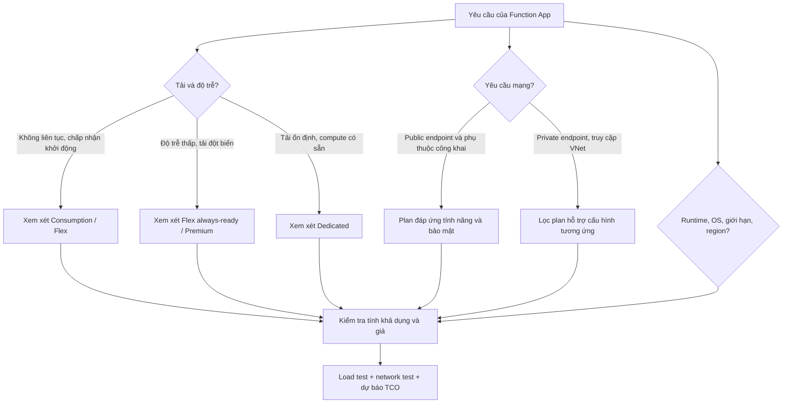
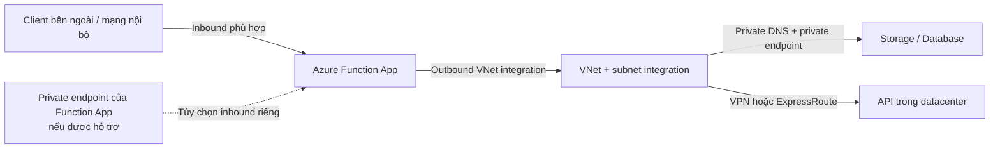
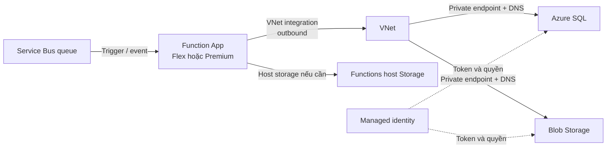

# Lựa chọn hosting plan theo tải và yêu cầu mạng

Một Azure Function có thể được kích hoạt vài lần mỗi ngày để gửi thông báo, nhưng cũng có thể phải xử lý hàng trăm nghìn sự kiện trong giờ cao điểm. Có Function phục vụ HTTP API cần phản hồi nhanh, trong khi Function khác chỉ chạy batch ban đêm và chấp nhận khởi động chậm. Một số hệ thống được phép gọi dịch vụ qua Internet, số khác phải kết nối Azure SQL, Storage hoặc API nội bộ qua mạng riêng. **Chọn hosting plan của Azure Functions là quyết định về hiệu năng, độ trễ, khả năng scale, mạng, vận hành và chi phí**, không đơn thuần là chọn đơn giá rẻ nhất.

Trong module **CLOUD_PROVIDERS_AZURE**, bạn khám phá hệ sinh thái Microsoft Azure từ subscription, resource group và Microsoft Entra ID đến mạng ảo, tính toán, lưu trữ, dữ liệu, triển khai, giám sát, bảo vệ và kiểm soát chi phí một kiến trúc ứng dụng. Bài thuộc chương **Serverless với Azure Functions**, hướng dẫn cách chọn hosting plan dựa trên **đặc tính tải** và **yêu cầu kết nối mạng**, kèm các tình huống thực hành và checklist vận hành.

## 1. Mục tiêu học tập

Sau bài học, bạn có thể:

- Giải thích hosting plan ảnh hưởng thế nào đến số instance, cold start, thời gian chạy và billing.
- Phân biệt **Flex Consumption**, **Consumption truyền thống**, **Elastic Premium**, **Dedicated (App Service Plan)** và lựa chọn chạy Functions trên **Azure Container Apps**.
- Phân tích tải theo HTTP latency, số event, độ đồng thời, thời gian xử lý, bộ nhớ và nhu cầu duy trì instance.
- Phân biệt **inbound private endpoint** với **outbound VNet integration**; thiết kế truy cập Storage, database và API riêng tư.
- Xác định nhu cầu cấu hình **AzureWebJobsStorage**, dịch vụ phụ thuộc, DNS, firewall và managed identity.
- Tính chi phí tương đối theo lưu lượng và tài nguyên duy trì, không dùng bảng giá cũ làm quyết định cuối cùng.
- Kiểm tra hosting plan bằng Azure portal và Azure CLI, lập ma trận lựa chọn và thực hiện kiểm thử trước production.

## 2. Hosting plan là gì?

**Function App** là tài nguyên chứa một hoặc nhiều hàm cùng runtime, cấu hình, identity và những thành phần triển khai có liên quan. **Hosting plan** xác định tài nguyên tính toán, mô hình co giãn và các đặc tính hạ tầng dành cho Function App.

Tùy loại plan, Function App có thể:

- Tăng/giảm số instance theo trigger và quy tắc scale do nền tảng điều phối.
- Có hoặc không có năng lực tính toán luôn sẵn sàng để hạn chế cold start.
- Dùng CPU/bộ nhớ và mức đồng thời khác nhau.
- Hỗ trợ những khả năng kết nối mạng, triển khai và bảo vệ khác nhau.
- Được tính tiền theo số lần thực thi/tài nguyên tiêu thụ hoặc theo năng lực được cấp phát.

**Trigger** như HTTP, Timer, Azure Queue Storage hoặc Service Bus quyết định *khi nào hàm được gọi*. **Hosting plan** quyết định *hàm có những tài nguyên nào và được scale thế nào*. Hai yếu tố liên quan nhưng không thay thế nhau: đặt một Queue-triggered Function lên Premium không tự sửa lỗi logic nhận message hoặc quyền truy cập queue.

### Sơ đồ các yếu tố ra quyết định



Đây là sơ đồ lọc **ứng viên**, không phải công thức tự động chọn plan. Một plan có vẻ hợp tải vẫn phải bị loại nếu không hỗ trợ phiên bản runtime, môi trường triển khai, yêu cầu mạng hoặc giới hạn vận hành.

## 3. Các lựa chọn hosting Azure Functions thường gặp

| Lựa chọn | Mô hình sử dụng | Đặc điểm chính | Workload thường cân nhắc |
|---|---|---|---|
| **Flex Consumption** | Serverless, scale theo sự kiện, có lựa chọn always-ready | Thiết kế cho ứng dụng Functions mới trên Linux ở các region/runtime được hỗ trợ; có VNet integration và điều chỉnh concurrency/instance theo khả năng | Queue/event bursty, HTTP API, xử lý theo sự kiện cần mạng riêng |
| **Consumption truyền thống** | Serverless theo sự kiện, trả theo mức tiêu thụ | Có thể scale từ 0, khả năng mạng và giới hạn khác với Flex/Premium; cần chú ý cold start và giới hạn thời gian chạy | Workflow nhỏ, event không liên tục, ứng dụng hiện hữu tương thích |
| **Elastic Premium** | Năng lực tối thiểu được duy trì, scale co giãn | Prewarmed/always-ready capacity, VNet integration, cấu hình và tính năng cao hơn Consumption theo điều kiện plan | API quan trọng cần latency ổn định, event bursty, kết nối private |
| **Dedicated / App Service Plan** | Trả tiền cho compute provisioned, có thể chia sẻ plan | Chạy trên các instance App Service được cấp; scale theo quy tắc plan và ứng dụng; không mặc định là scale theo event | Tải tương đối ổn định, đã có App Service capacity, cần quản lý sizing |
| **Functions trên Azure Container Apps** | Chạy Functions trong môi trường Container Apps | Container hóa, tận dụng mô hình environment, revision, scaling và networking của Container Apps | Kiến trúc microservices/container có nhu cầu orchestration/tùy chỉnh |

Ngoài ra, những nhu cầu cách ly mạng hoặc tuân thủ rất cao có thể dẫn tới các lựa chọn **App Service Environment** khi cấu hình/plan phù hợp. Không xem đây là một plan serverless mặc định: phạm vi triển khai, quản lý và chi phí của môi trường chuyên dụng khác đáng kể.

**Quan trọng:** tên SKU, runtime được hỗ trợ, giới hạn scale, thời gian chạy, vùng khả dụng và tính năng mạng có thể thay đổi. Hãy tra cứu tính năng hiện hành cho **đúng plan, region, OS và ngôn ngữ runtime** trước khi quyết định; không sao chép một bảng hỗ trợ từ năm cũ sang mọi subscription.

## 4. Flex Consumption: ưu tiên xem xét cho nhiều workload mới

**Flex Consumption** cung cấp mô hình Azure Functions serverless với các tùy chọn cấu hình tài nguyên/scale và hỗ trợ tích hợp mạng ảo theo khả năng hiện hành. Đây thường là ứng viên đầu tiên cho Function App **mới** cần event-driven scaling và kết nối tới các dịch vụ riêng tư, nếu runtime/region tương thích.

Đặc tính cần hiểu:

1. **Scale theo sự kiện:** nền tảng tăng hoặc giảm instance từ hoạt động trigger, trong giới hạn và cách nhóm scale của từng loại trigger.
2. **Instance memory size:** lựa chọn cấu hình bộ nhớ/CPU theo các mức mà plan hỗ trợ; không xem memory size là RAM heap duy nhất của code.
3. **Per-instance concurrency:** số request/event đang xử lý trên một instance ảnh hưởng throughput và nhu cầu scale; khả năng điều chỉnh tùy trigger/runtime.
4. **Always-ready instances:** có thể duy trì năng lực tối thiểu để giảm ảnh hưởng cold start cho những function/nhóm function được hỗ trợ, đổi lại phát sinh phần chi phí luôn sẵn sàng.
5. **VNet integration:** cho phép Function App đi ra mạng ảo theo điều kiện plan, giúp kết nối tới dịch vụ có private endpoint hoặc mạng nội bộ.
6. **Quy tắc đóng gói/deployment:** có khác biệt so với Consumption/Premium truyền thống; cần theo mô hình triển khai mà Flex hỗ trợ.

### Flex không có nghĩa là không thể cold start

Nếu workload đang scale về 0 và nhận một sự kiện mới, nền tảng có thể cần cấp instance hoặc khởi tạo runtime. Nếu phải tải nhiều thư viện, Java runtime hoặc container khởi động chậm, thời gian đầu tiên có thể tăng. **Always-ready** giúp giảm độ trễ với phạm vi được cấu hình, nhưng không phải bảo đảm latency bằng 0 hay xóa mọi thời gian khởi tạo ứng dụng.

### Khi nào Flex có thể chưa phù hợp?

- Runtime, kiến trúc triển khai hoặc region chưa hỗ trợ điều kiện bạn cần.
- Một tính năng vận hành có trên Premium/Dedicated nhưng chưa khả dụng trên Flex cho cấu hình cụ thể.
- Workload có nhu cầu tài nguyên đặc biệt, giới hạn thời gian hoặc kết nối không tương thích.
- Đã có môi trường Dedicated với compute rảnh và chi phí tăng thêm nhỏ hơn phương án Flex.

Với ứng dụng đang dùng Consumption truyền thống hoặc Premium, hãy đánh giá **di chuyển workload** theo tài liệu tương thích, không mặc định chỉ cần đổi SKU tại chỗ là hoàn tất chuyển plan.

## 5. Consumption truyền thống: tối giản cho tải không liên tục

**Consumption** truyền thống phù hợp những kịch bản được hỗ trợ cần scale dựa trên sự kiện với chi phí theo mức sử dụng. Khi không có lời gọi, compute dành riêng cho ứng dụng có thể giảm; các giới hạn thực thi và tính năng mạng cần kiểm tra riêng.

**Ưu điểm:** không phải tự duy trì một số VM cố định, thuận tiện với các tác vụ ngắn và lưu lượng nhỏ/khó dự đoán.

**Hạn chế cần đánh giá:**

- **Cold start:** ứng dụng có thể cần thời gian khởi động khi lâu không có request.
- **Execution timeout:** giới hạn tối đa thời gian chạy hàm theo cấu hình và loại trigger, không phù hợp để suy ra có thể chạy vô hạn.
- **Network:** những khả năng VNet/private endpoint không ngang với Flex và Premium; không nên chọn plan này nếu kiến trúc bắt buộc kết nối private mà tính năng tương ứng không được hỗ trợ.
- **Runtime/OS/support lifecycle:** cần rà soát trạng thái hỗ trợ của nền tảng cụ thể, nhất là khi triển khai ứng dụng Linux mới.
- **Concurrency/resource ceilings:** scale nhiều instance không có nghĩa một invocation được sử dụng tài nguyên vượt giới hạn của instance.

Với workflow chạy lâu, hãy cân nhắc chia thành nhiều bước, dùng **Durable Functions** trong những điều kiện phù hợp hoặc một giải pháp batch/queue khác. Durable Functions giúp điều phối trạng thái, nhưng vẫn chịu các ràng buộc hosting, storage và khả năng khôi phục theo mô hình runtime.

## 6. Elastic Premium: độ trễ thấp, scale linh hoạt và kết nối mạng riêng

**Elastic Premium** là lựa chọn quan trọng cho Function App có yêu cầu **warm capacity** và thường dùng với các kiến trúc cần tích hợp mạng ảo. Khác với Consumption, plan duy trì một mức compute tối thiểu mà bạn phải tính trong dự toán ngay cả khi ít request.

Các lợi ích cần đối chiếu:

- Năng lực **always-ready/minimum instances** nhằm giảm cold start.
- Scale theo tải/trigger trong giới hạn Premium và cấu hình ứng dụng.
- Kết nối outbound qua **VNet integration**; các tính năng inbound/private endpoint được hỗ trợ theo cấu hình áp dụng.
- Cấu hình hiệu năng, thời gian chạy, deployment slots hoặc những tính năng vận hành khác theo điều kiện SKU/OS/runtime.
- Có thể chia sẻ một Premium plan cho những Function Apps phù hợp, nhưng các ứng dụng dùng chung capacity sẽ ảnh hưởng lẫn nhau và phải được đo đạc.

**Không đồng nhất Premium Functions với một VM không giới hạn.** Instance vẫn có tài nguyên hữu hạn; app cần chú ý CPU/RAM, giới hạn số instance, concurrency, network egress và khả năng kết nối database. Nếu dependency chỉ cho phép 100 DB connections, tăng Functions lên hàng trăm instance có thể làm hệ thống chậm hơn.

### Vì sao Premium có chi phí nền?

Nếu kế hoạch giữ ít nhất một instance sẵn sàng, đơn vị compute đó vẫn tiêu thụ tài nguyên khi ứng dụng không nhận lời gọi. Tối ưu Premium bằng **right-sizing instance size**, số instance tối thiểu và phân phối workload hợp lý, không chỉ nhìn số invocation/tháng.

## 7. Dedicated / App Service Plan: dùng compute có sẵn

**Dedicated** chạy Azure Functions trên một **App Service Plan** với năng lực đã cấp. Đây là lựa chọn đáng xem khi tổ chức đã vận hành App Service instances và có đủ headroom, hoặc workload sử dụng tài nguyên ổn định khiến mô hình compute provisioned hợp lý.

### Điểm cần biết

- Bạn chi trả cho năng lực của plan trong thời gian được cấp phát, không phải chỉ khi Function thực thi.
- Các Function Apps và web apps được đặt chung plan có thể **cạnh tranh CPU, RAM, disk và network**.
- Việc scale số instance theo **App Service autoscale/manual scale** khác với mô hình event-driven automatic scaling của các plan Functions chuyên dụng.
- Cấu hình **Always On** thường quan trọng để tránh Functions bị idle khi dùng Dedicated theo điều kiện plan; nếu ứng dụng không hoạt động thường trực, một số trigger có thể vận hành không như kỳ vọng.
- Khả năng VNet integration, inbound private endpoint và các tính năng nâng cao phụ thuộc **tier của App Service Plan, OS, vùng triển khai và cấu hình**.

**Dedicated không đồng nghĩa rẻ vì không có phí theo invocation.** Nó thường hợp khi compute đã được thanh toán hoặc load ổn định, nhưng sẽ lãng phí nếu bạn tạo plan riêng cho Function chạy vài lần mỗi tháng.

### Khi nào cần cân nhắc App Service Environment?

Nếu có yêu cầu mức cô lập hạ tầng, inbound/outbound network đặc biệt hoặc chính sách doanh nghiệp khắt khe, đánh giá Azure Functions trên App Service Environment được hỗ trợ. Đây là một **quyết định kiến trúc riêng**, cần kiểm tra tính tương thích, capacity và chi phí môi trường; không nên dùng chỉ để giải quyết một connection string cần truy cập database riêng tư.

## 8. Chạy Azure Functions trên Azure Container Apps

Azure Functions có thể được triển khai trong môi trường **Azure Container Apps** theo các cách/tính năng được hỗ trợ. Lựa chọn này phù hợp khi doanh nghiệp đã dùng Container Apps cho nhiều microservices, cần đóng gói container cùng thư viện riêng hoặc muốn tận dụng khả năng networking và revision của môi trường đó.

Khác biệt cần cân nhắc:

- **Container image** và quy trình CI/CD/registry trở thành một phần của vòng đời ứng dụng.
- Khả năng scale phụ thuộc **trigger, event source và cơ chế scaling** được tích hợp/hỗ trợ; không giả định mọi Function trigger đều hoạt động giống Flex/Premium.
- Networking dựa trên **Container Apps environment**, ingress, VNet và các ràng buộc ứng dụng liên quan.
- Bảo mật image, patch runtime, network routing và observability cần kế hoạch vận hành của kiến trúc container.

Đừng chọn Container Apps chỉ vì tên gọi có “serverless”. Nếu đơn giản cần HTTP/Queue Functions, Flex hoặc Premium có thể giảm đáng kể công việc cấu hình; nếu cần một môi trường microservices nhất quán, Container Apps đáng để benchmark.

## 9. Chọn plan theo tải: đặc tính nào thực sự quan trọng?

Trước khi so sánh SKU, mô tả **một ngày hoạt động thực tế** và **tình huống tải cao nhất** của ứng dụng. Những chỉ số cần có:

| Câu hỏi | Chỉ số hoặc kết quả cần biết | Tác động đến plan |
|---|---|---|
| Lời gọi đến từ đâu? | HTTP, Timer, Storage Queue, Service Bus, Event Hubs... | Cơ chế scale và hỗ trợ trigger |
| Có thường xuyên nhận tải không? | Request/event mỗi giây hoặc giờ, khoảng không có tải | Ưu tiên scale-to-zero hay capacity luôn sẵn |
| Độ trễ cho phép? | p95/p99 latency, cold-start budget | Always-ready, Premium, dedicated capacity |
| Mỗi lần chạy bao lâu? | p50/p95 runtime, số tác vụ chạy dài, nguy cơ timeout | Execution limits, Durable Functions hoặc kiến trúc khác |
| Mỗi lần chạy tốn gì? | CPU, memory, I/O, số network connections | Instance memory, concurrency và SKU |
| Mức đồng thời cao nhất? | Số invocation cùng chạy, backlog, tốc độ arrival | Max instances, per-instance concurrency, downstream quota |
| Khả năng xử lý khi lỗi? | Retry, idempotency, queue TTL, dead-letter, RPO/RTO | Mức độ ưu tiên resilience và warm capacity |
| Có phải kết nối private? | Storage/SQL/Key Vault qua private endpoint, VPN/ExpressRoute | Loại plan và mạng outbound |
| Ai được gọi HTTP endpoint? | Internet, APIM nội bộ, VNet, private endpoint | Inbound access và kiểm soát mạng |

### 9.1. API có yêu cầu độ trễ thấp

Ví dụ endpoint tra cứu giá cần p95 nhỏ hơn 200 ms. Nếu ứng dụng Java phải tải runtime và thư viện trong vài giây khi cold start, một request đầu tiên sau thời gian rảnh có thể vượt SLO.

**Ứng viên:** Flex với always-ready phù hợp, Elastic Premium hoặc Dedicated đang có capacity. Hãy load test **sau thời gian idle**, trong đợt tăng tải, khi deploy revision mới và khi instance bị thay; không chỉ đo lúc runtime đã warm.

### 9.2. Queue worker nhận tải đột biến

Một Function được kích hoạt bởi Service Bus nhận 10 message/phút vào giờ bình thường, nhưng tăng lên 10.000 message/phút khi chạy chiến dịch. Nếu lưu lượng phần lớn thời gian thấp, mô hình event-driven scale của Flex/Consumption/Premium có thể phù hợp.

Đánh giá:

- Message xử lý được trên mỗi instance/phút và concurrency của trigger.
- Ngưỡng backlog/queue age tối đa chấp nhận được.
- Thời gian scale out, max instances và quota broker.
- Khả năng database chịu số kết nối khi nhiều instance cùng hoạt động.
- Idempotency, Service Bus message lock, retry và dead-letter.

**Scale out không phải nhân vô hạn tốc độ xử lý.** Nếu downstream chỉ xử lý 500 message/giây, tăng instance lên gấp 10 có thể gây throttling và retry dồn dập.

### 9.3. Batch dài và xử lý nặng

Một Function phải tạo báo cáo lớn trong 45 phút, tiêu tốn RAM và mở nhiều file tạm. Hãy kiểm tra giới hạn thời gian/lượng memory của plan và trigger. Nếu việc xử lý dài dễ chia thành bước, dùng **queue + các task nhỏ**, Durable Functions hoặc dịch vụ batch thích hợp sẽ tin cậy hơn một HTTP request giữ kết nối mở 45 phút.

**Execution timeout không giống HTTP timeout.** Cho phép một Function chạy lâu hơn không đảm bảo client HTTP, load balancer hoặc cổng kết nối chấp nhận chờ cùng khoảng thời gian. Nên trả job ID và xử lý bất đồng bộ nếu một tác vụ dài.

## 10. Cold start, concurrency và scale-out

### Cold start gồm những bước nào?

Tùy plan, khi một Function App không có sẵn worker phù hợp, nền tảng có thể cần cấp compute, khởi động Functions host, nạp runtime/ngôn ngữ, khởi tạo dependency injection, tải cấu hình/secrets và kết nối backend. Tất cả ảnh hưởng đến thời gian hoàn thành yêu cầu đầu tiên.


**Tối ưu code vẫn cần thiết ở mọi plan.** Premium/always-ready giảm một số nguyên nhân cold start nhưng không sửa được startup code mở hàng trăm kết nối hoặc tải model rất lớn không cần thiết.

### Số instance và concurrency trong một instance

Giả sử một instance xử lý được 20 event/giây ở mức latency chấp nhận được. Nhu cầu đỉnh khoảng 140 event/giây:

\[
\text{Instance lý tưởng} =
\left\lceil \frac{140}{20}\right\rceil = 7
\]

Đây là phép tính **capacity planning**, không phải số instance Azure đảm bảo cấp ngay. Concurrency của mỗi instance, sampling/scale decisions, thời gian startup và giới hạn tài nguyên làm kết quả biến động. Nếu app dùng 2 GiB RAM nhưng cấu hình instance nhỏ hơn mức cần thiết, thêm instance có thể vẫn không chạy ổn định.

**Không ghép “số invocation/tháng” với “mỗi instance xử lý bao nhiêu request đồng thời” thành một chỉ số.** Một triệu lời gọi ngắn chỉ 30 ms có thể rẻ và ít tài nguyên hơn nhiều so với một trăm nghìn lời gọi chạy 2 phút, tùy CPU/memory và plan.

### Luôn giữ một số instance sẵn sàng?

| Mức yêu cầu | Gợi ý |
|---|---|
| Event có thể chờ khi mới đến | Scale-to-zero; đo cold start và queue age |
| HTTP phục vụ người dùng cần latency ổn định | Flex always-ready hoặc Premium, có thể Dedicated nếu hợp chi phí |
| Tải 24/7 tương đối đều, cần capacity cố định | So sánh Dedicated/Premium với Flex qua benchmark và giá |
| Tăng đột biến theo giờ nhưng ít tải phần lớn ngày | Serverless elastic scaling và các giới hạn max instances |

Trên Flex/Premium, cách cấu hình số instance sẵn sàng và cách tính tiền có khác biệt; không dùng tham số hay giả định billing của một plan cho plan kia.

## 11. Yêu cầu mạng: phân biệt inbound và outbound

Đây là phần dễ nhầm khi chọn hosting plan. Một Function App có thể **gọi được database private** nhưng **HTTP endpoint của nó vẫn được công bố công khai**, hoặc ngược lại.

### 11.1. Inbound: client đi vào Function App

**Inbound access** quyết định ai có thể gọi HTTP-triggered Function hoặc endpoint quản lý được mở qua mạng.

- **Public endpoint:** địa chỉ `https://<function-app>.azurewebsites.net` có thể được định tuyến qua Internet, sau đó quyền truy cập phụ thuộc access restrictions, App Service Authentication, function keys hoặc các cơ chế kiểm soát khác.
- **Private endpoint của Function App:** khi plan và cấu hình hỗ trợ, client trong mạng được phép có thể đi vào ứng dụng qua private IP; cần DNS private và quy tắc public network access phù hợp.
- **API Management / Application Gateway / Front Door:** có thể đứng trước Function App để áp chính sách API, WAF hoặc routing. Hình thức upstream kết nối tới Function App phải được hỗ trợ; không giả định một dịch vụ front-end public luôn truy cập được backend chỉ có private IP.

**VNet integration không tự biến HTTP endpoint thành private.** Nếu yêu cầu “chỉ API nội bộ được gọi”, phải thiết kế **inbound** riêng: private endpoint/network restriction, gateway hoặc một thành phần truy cập phù hợp.

### 11.2. Outbound: Function App gọi dịch vụ khác

**VNet integration** là tính năng để traffic **đi ra từ Function App** có thể đi vào VNet theo khả năng của hosting plan. Từ đó ứng dụng có thể truy cập:

- Azure SQL/PostgreSQL hoặc Storage qua **private endpoints**.
- Một API đặt trong VNet, qua route phù hợp.
- Dịch vụ tại datacenter qua VPN/ExpressRoute khi routing và DNS đã thiết kế đúng.

VNet integration **không tự tạo** Storage private endpoint, không tự cấp quyền trên database và không tự sửa DNS. Có private endpoint cho một database nhưng tên miền vẫn resolve ra public IP có thể khiến kết nối không theo đường mong muốn.

### Sơ đồ hai chiều kết nối



### 11.3. Những thành phần mạng phải phối hợp

| Thành phần | Nó giải quyết gì? | Nó không tự giải quyết gì? |
|---|---|---|
| **VNet integration** | Đường outbound từ Function App đến mạng ảo | Không tự khóa HTTP inbound |
| **Private endpoint của dịch vụ đích** | Địa chỉ private cho Storage/SQL/Key Vault | Không thay thế identity/RBAC |
| **Private endpoint của Function App** | Inbound qua private IP khi plan hỗ trợ | Không tự cấu hình outbound tới database |
| **Private DNS zone** | Resolve hostname dịch vụ về IP phù hợp | Không mở NSG/firewall hay cấp quyền |
| **NAT Gateway** | Cung cấp mô hình outbound public IP ổn định khi tích hợp network/routing hỗ trợ | Không giúp truy cập private endpoint nếu route/DNS sai |
| **NSG/UDR/Azure Firewall** | Kiểm soát/định tuyến lưu lượng | Không thay thế xác thực ở ứng dụng |
| **Managed identity** | Cấp token cho service/role hỗ trợ | Không tạo đường truyền mạng |

**Yêu cầu một static outbound public IP** cũng khác với “private networking”. Khi đối tác bên ngoài chỉ allowlist một IP, cần kiểm tra kiểu NAT/routing và đặc điểm outbound của hosting plan; không dựa vào danh sách outbound IP mặc định rồi mặc định chúng không bao giờ thay đổi.

## 12. Mạng private của Azure Functions còn phụ thuộc Storage hệ thống

Đây là một điểm dễ bị bỏ sót: ngoài database/Storage nghiệp vụ, **Functions runtime thường cần host storage** để quản lý trạng thái, trigger, lease, checkpoint hoặc những nhu cầu nội bộ. Một Function có thể được VNet-integrated nhưng không khởi động nếu host storage của nó không truy cập được.

**`AzureWebJobsStorage`** là cấu hình host storage quan trọng với nhiều mô hình Functions. Khả năng dùng connection string hoặc **identity-based connection** phụ thuộc runtime/extension/plan. Nếu dùng Storage account chỉ cho private endpoint, phải đảm bảo **đường kết nối từ Functions host** và các endpoint Storage cần dùng đều khả dụng.

### Những endpoint phải rà soát

- **Blob:** dữ liệu package hoặc trạng thái, trigger và ứng dụng tùy cấu hình.
- **Queue:** một số hoạt động nội bộ/trigger cần Queue Storage.
- **Table:** tùy Functions runtime/extension và chức năng đang sử dụng.
- **File share/content storage:** một số cấu hình Premium/Dedicated truyền thống có Azure Files content share và yêu cầu network riêng; không suy rộng sang Flex deployment model.

### Checklist truy cập private host storage

1. Kiểm tra **hosting plan hỗ trợ VNet integration** theo OS và region.
2. Tạo subnet integration theo **đúng yêu cầu và delegation của plan**, dự trù đủ địa chỉ cho scaling; không mặc định Flex và Premium có cùng hướng dẫn subnet.
3. Tạo private endpoints và private DNS của **các dịch vụ Storage thật sự cần thiết**.
4. Kiểm tra DNS của Function App resolve endpoint tới private IP dự kiến.
5. Kiểm tra routing, NSG, firewall, network security policy và quyền truy cập dữ liệu.
6. Xác nhận cả **runtime startup**, trigger processing và **deployment** hoạt động; đường build/deploy có thể có yêu cầu kết nối riêng.
7. Ghi rõ cách xử lý khi storage hoặc DNS không khả dụng.

Với một số plan, **content share, package deployment và host storage** có cách cấu hình mạng khác nhau. Không áp dụng các app settings cũ như một công thức chung cho mọi Functions plan; sử dụng hướng dẫn ứng với plan và phiên bản runtime hiện tại.

## 13. Ma trận lựa chọn theo tải và yêu cầu mạng

Bảng dưới đây là **đề xuất bước đầu**, không thay thế việc kiểm tra SKU/runtime/region:

| Tình huống | Ứng viên nên đánh giá trước | Lý do và điều cần kiểm thử |
|---|---|---|
| Timer Function gửi báo cáo vài lần/ngày, không dùng mạng riêng | Flex Consumption; Consumption nếu ứng dụng hiện hữu và còn phù hợp | Scale-to-zero, trả theo mức dùng, chấp nhận cold start |
| Queue worker tăng đột biến, truy cập Azure SQL qua private endpoint | Flex Consumption, Elastic Premium | Event scaling cùng outbound VNet integration và private DNS |
| HTTP API Java cần p95 thấp, tải biến động mạnh | Flex với always-ready, Elastic Premium | Warm capacity, scale-out, cold-start test |
| HTTP API chạy 24/7 gần như không đổi, đã có App Service Plan | Dedicated hoặc Premium/Flex tùy số liệu | So sánh chi phí compute provisioned và mức sử dụng thực |
| Function cần giao tiếp mạng nội bộ và client cũng chỉ được vào qua private IP | Plan hỗ trợ cả outbound VNet integration lẫn inbound private endpoint | Không đánh đồng hai tính năng; xác minh OS/region/tier |
| Xử lý container với thư viện native đặc thù, đang dùng Container Apps | Azure Functions trên Container Apps hoặc nền tảng container phù hợp | Kiểm tra trigger/scaling và trách nhiệm quản lý image |
| Batch rất dài, cần GPU hoặc phân tán hàng nghìn task | Kiểm tra Azure Batch, AKS hoặc dịch vụ compute khác trước | Function timeout, memory, network và orchestration có thể không phù hợp |
| Tải cần cô lập môi trường cao và có yêu cầu mạng/tài nguyên chuyên biệt | Premium/Dedicated với kiến trúc được hỗ trợ, có thể App Service Environment | Kiểm tra cả mức độ cô lập, capacity, quản trị và TCO |

### Quy tắc loại trừ trước khi so giá

1. **Loại plan không hỗ trợ runtime, OS, region hoặc kiến trúc triển khai** của ứng dụng.
2. **Loại plan không đáp ứng network bắt buộc**: inbound private endpoint, outbound VNet integration, DNS hoặc route.
3. **Loại plan không đáp ứng timeout, memory, concurrency và khả năng scale** đã được kiểm thử.
4. Chỉ sau đó mới so sánh **TCO + reliability + vận hành** của những phương án còn lại.

Nguyên tắc này tránh lỗi phổ biến: chọn giá thấp trước rồi phát hiện Function không thể truy cập Storage private hoặc độ trễ cold start vượt SLO.

## 14. Ví dụ A: HTTP API cần phản hồi nhanh nhưng tải không đều

Một ứng dụng thương mại điện tử có Function App xử lý request báo giá. Trong giờ làm việc nhận 50–200 request/giây, buổi tối gần như không có request. Yêu cầu:

- p95 latency nhỏ và không được có nhiều request đầu tiên chậm sau giờ nghỉ.
- Được phép dùng HTTPS public thông qua API Management.
- Có database phía sau, cần giới hạn số kết nối.
- Dự kiến tăng tải mạnh vào ngày khuyến mãi.

**Ứng viên:** Flex Consumption với always-ready so với Elastic Premium. Dedicated cũng có thể là ứng viên nếu tổ chức đã có plan đủ capacity.

### Đánh giá theo từng bước

1. Đo **thời gian khởi động** của runtime và dependency, đặc biệt ứng dụng Java có nhiều thư viện.
2. Xác định số request xử lý được **trên mỗi instance** ở p95 latency cho phép.
3. Thử số instance luôn sẵn sàng tối thiểu để giảm cold start nhưng không trả chi phí quá cao khi nhàn rỗi.
4. Đặt giới hạn scale-out phù hợp với connection pool, throughput database và backend API.
5. Kiểm thử burst load, scale in/out, đổi phiên bản và lỗi một dependency.
6. So sánh tổng chi phí tháng của Flex always-ready với Premium minimum instances và Dedicated khi có compute chung.

**Không được kết luận Premium luôn nhanh hơn Flex** hoặc Flex luôn rẻ hơn Premium chỉ từ tên plan. Chi phí/độ trễ thực tế còn phụ thuộc tần suất lời gọi, kích thước bộ nhớ, số instance ấm, đường mạng và khả năng cache.

## 15. Ví dụ B: Queue worker với Storage và SQL chỉ có private endpoint

Một hệ thống nhận event vào Service Bus queue. Function đọc message, truy vấn Azure SQL và ghi file kết quả lên Blob Storage. Chính sách bảo mật yêu cầu database/Storage không cho truy cập data plane qua public Internet.

**Yêu cầu:**

1. Function phải xử lý được queue theo tải, có retry và dead-letter.
2. Kết nối outbound từ Function đi qua VNet integration tới private endpoints.
3. DNS của SQL và Blob phải phân giải về private IP phù hợp.
4. Function host vẫn phải truy cập được host storage mà Functions runtime yêu cầu.
5. Danh tính Function dùng managed identity và các role dữ liệu tương ứng.

### Kiến trúc minh họa



**Điểm dễ sai:** tạo private endpoint cho Azure SQL rồi nghĩ rằng Function App sẽ tự đi vào VNet. Hoặc bật VNet integration thành công nhưng **AzureWebJobsStorage** vẫn bị Storage firewall chặn nên Functions host không khởi động và Service Bus trigger không hoạt động.

### Kế hoạch kiểm chứng

1. Tạo môi trường test cùng loại hosting plan/OS/region dự định dùng.
2. Kiểm tra subnet integration và DNS private của từng dependency.
3. Xác nhận runtime host started và Function trigger được đăng ký.
4. Gửi message thử nghiệm; xác minh Function nhận message, SQL query thành công, Blob upload thành công.
5. Cố ý tắt quyền hoặc chặn network trong lab để thấy thông báo lỗi và cơ chế khôi phục.
6. Tăng số message để đo scale-out, thời gian xả queue, queue age, retry và dead-letter.
7. Kiểm tra log không chứa token, account key, connection string hoặc dữ liệu nhạy cảm.

Nếu bắt buộc **HTTP inbound cũng phải private**, hãy thêm thiết kế inbound private endpoint/gateway tương ứng; Queue trigger tự nó không có nghĩa HTTP endpoint của Function App bị khóa.

## 16. Ví dụ C: tác vụ ban đêm chạy lâu và tiêu tốn RAM

Một Function tạo báo cáo tổng hợp cuối ngày. Trong thực tế mỗi job có 3 triệu bản ghi, thực thi 40–60 phút, memory peak cao; không có request từ người dùng trong thời gian xử lý.

**Quyết định không nên đưa ra ngay:** nâng từ Consumption sang Premium rồi để một invocation chạy nguyên một giờ.

Thay vào đó:

- Kiểm tra workload có thể tách theo khách hàng/ngày/phân vùng không.
- Đưa các phần việc vào queue rồi xử lý song song có giới hạn.
- Cân nhắc **Durable Functions** nếu cần orchestration nhiều bước và ghi trạng thái; kiểm tra giới hạn của hosting plan và backend lưu trạng thái.
- Nếu job đòi hỏi tài nguyên đặc thù hoặc thời gian chạy rất dài, so với **Azure Batch**, Container Apps jobs hoặc VM/AKS jobs thích hợp.
- Đặt timeout rõ ràng, checkpoint, ghi output bền vững và retry an toàn.
- Theo dõi **tổng thời gian hoàn thành batch** và **chi phí mỗi báo cáo hợp lệ** thay vì chỉ thời gian một invocation.

Nếu code phải giữ kết nối HTTP trong cả giờ, hãy chuyển sang API **submit job → trả job ID → kiểm tra status → tải kết quả**. Đây là quyết định kiến trúc độc lập với hosting plan.

## 17. Kiểm tra hosting plan từ Azure portal

Đối với Function App đang chạy:

1. Mở [Azure portal](https://portal.azure.com/) và xác nhận đúng **tenant/subscription**.
2. Mở **Function Apps**, chọn ứng dụng cần phân tích.
3. Xem mục **Overview / Properties / Hosting / Scale** tùy giao diện hiện hành để biết hosting plan, SKU, region, OS, instance configuration.
4. Mở **App Service plan** liên kết (nếu ứng dụng sử dụng plan hiển thị dạng tài nguyên riêng), kiểm tra tier và capacity.
5. Kiểm tra phần **Networking**: outbound VNet integration, inbound access restrictions, private endpoint connections, DNS/route liên quan.
6. Kiểm tra **Identity** và connection tới Storage/SQL/Service Bus; xác nhận principal và scope role.
7. Xem **Metrics / Application Insights** trong ít nhất một chu kỳ tải đại diện để xác định throughput, latency, memory, error rate và giới hạn scale.
8. Dùng **Pricing Calculator / Cost Management** để đối chiếu chi phí hiện tại và ứng viên.

Nếu portal không cho phép đổi plan trực tiếp, không coi đó là lỗi giao diện: một số chuyển đổi hosting model cần **tạo Function App mới và triển khai/migrate** theo quy trình được hỗ trợ. Sao lưu cấu hình, secrets/identity mapping và phương án chuyển lưu lượng trước khi thay đổi.

## 18. Azure CLI: tra cứu plan và cấu hình hiện tại

Ví dụ dùng Azure CLI trên Bash hoặc Azure Cloud Shell, **chỉ đọc thông tin**. Cần thay tên resource group, Function App và subscription bằng giá trị thật. Các lệnh không in toàn bộ app settings để tránh làm lộ connection string/secret.

```bash
az login
az account set --subscription "<subscription-id>"
az account show \
  --query "{subscription:id,tenant:tenantId,name:name}" \
  --output table

RG="rg-functions-lab"
APP="func-orders-lab"

# Xem Function Apps hiện có trong resource group
az functionapp list \
  --resource-group "$RG" \
  --query "[].{name:name,kind:kind,location:location,state:state}" \
  --output table

# Đọc kind, plan resource ID, region và public access của ứng dụng
az functionapp show \
  --resource-group "$RG" \
  --name "$APP" \
  --query "{name:name,kind:kind,location:location,plan:serverFarmId,publicAccess:publicNetworkAccess}" \
  --output json

# Lấy plan resource ID khi loại hosting plan có tài nguyên plan tương ứng
PLAN_ID=$(az functionapp show \
  --resource-group "$RG" \
  --name "$APP" \
  --query serverFarmId --output tsv)

# Đọc SKU/tier/capacity của App Service plan nếu PLAN_ID tồn tại
az appservice plan show \
  --ids "$PLAN_ID" \
  --query "{name:name,sku:sku.name,tier:sku.tier,capacity:sku.capacity,kind:kind}" \
  --output json
```

**Lưu ý:** kết quả `kind`/`sku` giúp nhận diện nhưng không thể hiện đầy đủ tính năng riêng như always-ready, scale configuration và mọi giới hạn thực tế. Với Flex/Consumption, loại metadata plan được trả về có thể khác theo API/CLI; nếu truy vấn plan không hoạt động, kiểm tra chính tài nguyên Function App bằng portal hoặc lệnh tương ứng với plan hiện hành.

### Kiểm tra kết nối VNet và metric có sẵn

```bash
# Kiểm tra cấu hình outbound VNet integration nếu lệnh/plan hỗ trợ
az functionapp vnet-integration list \
  --resource-group "$RG" \
  --name "$APP" \
  --output json

APP_ID=$(az functionapp show \
  --resource-group "$RG" \
  --name "$APP" \
  --query id --output tsv)

# Liệt kê các metric thực tế mà Azure Monitor cung cấp cho app
az monitor metrics list-definitions \
  --resource "$APP_ID" \
  --output table
```

Các lệnh có thể cần phiên bản Azure CLI/extension phù hợp và quyền đọc resource. Nếu một nhóm lệnh không hỗ trợ hosting plan đang dùng, kiểm tra `az functionapp --help` hoặc `az functionapp vnet-integration --help`. Không tạo tài nguyên hoặc sửa mạng production chỉ để thử một tham số.

### Khi tạo thử plan mới

Tạo một Function App cần các giá trị mà ví dụ tra cứu **không có**: Storage account, region có hỗ trợ, runtime/version, OS, network configuration và mô hình deployment. Cách tạo Flex Consumption khác Premium/Dedicated, và tham số Azure CLI có thể thay đổi theo phiên bản.

Trong lab, nên bắt đầu bằng **Create Function App** trong portal, chọn hosting plan mong muốn, xem các thuộc tính khả dụng theo runtime/region, sau đó ghi lại cấu hình để quản lý bằng **Bicep/ARM/Terraform** theo chuẩn dự án. Với CLI, xem `az functionapp create --help` và hướng dẫn plan tương ứng; đừng dùng lệnh tạo một plan kiểu Premium rồi chỉ sửa tên SKU và xem đó là Flex.

## 19. Dự toán chi phí: chỉ so sánh cùng một workload

Tùy plan, hóa đơn Azure Functions có thể phản ánh **số execution**, **memory/CPU consumption**, **thời gian compute**, **instance luôn sẵn sàng** hoặc **App Service capacity provisioned**. Bên cạnh đó còn có Storage, network, logs, database, broker và dịch vụ kết nối riêng tư.

### Khung tính toán tương đối

Với mô hình consumption billing, hãy ước lượng:

\[
\text{Compute usage} \approx
\text{Số executions}\times\text{Thời gian mỗi lần chạy}
\times\text{Memory hoặc tài nguyên được tính phí}
\]

Đây là **mô hình định hướng**, không phải cách tính tiền chính xác của mọi plan. Flex có thể có mức giá và các thành phần always-ready riêng; chi phí trigger, request, concurrency và đơn vị tính cần đối chiếu biểu giá Azure Functions đang áp dụng.

Với compute được cấp phát thường trực:

\[
\text{Chi phí compute provisioned} \approx
\text{Đơn giá instance/giờ}\times
\text{Số instance}\times\text{Số giờ cấp phát}
\]

Chi phí thực tế còn chịu ảnh hưởng tier, OS, license, zone/region, chương trình mua compute, chiết khấu và khả năng chia sẻ tài nguyên.

### Ví dụ hai workload khác nhau

**Workload A:** 2.000 executions/ngày, mỗi lần chạy 200 ms và dùng ít memory. Nếu không cần private network hoặc latency thấp ngay sau thời gian idle, mô hình serverless scale-to-zero thường có lợi thế vì compute nhàn rỗi ít phải duy trì.

**Workload B:** 200 requests/giây liên tục cả ngày, mỗi request cần nhiều memory, có p95 latency nghiêm ngặt. Chọn Flex có always-ready, Premium hay Dedicated phải dựa trên số instance cần duy trì và throughput thực tế; **không thể** kết luận consumption luôn rẻ hơn chỉ vì tên là consumption.

### Các chi phí thường bị quên

| Thành phần | Vì sao phát sinh |
|---|---|
| Host storage và storage nghiệp vụ | Functions runtime, Blob/Queue/Table, backup và retention |
| Azure Service Bus/Event Hubs | Message operations, tier, throughput và lưu giữ |
| Application Insights / Log Analytics | Telemetry ingestion, retention, truy vấn |
| VNet integration, private endpoints và network components | Private Link, NAT/Azure Firewall, IP, data processing tùy mô hình |
| Network egress | Truyền dữ liệu ra khỏi Azure/giữa region hoặc qua dịch vụ liên quan |
| Cold start và retry | Gây thêm thời gian, tài nguyên, số operations và tác động SLO |
| Warm/minimum capacity | Tính phí khi không có lời gọi ở những mô hình tương ứng |

**Chi phí mỗi giao dịch hợp lệ** thường hữu ích hơn giá theo một triệu invocation:

\[
\text{Cost per successful operation} =
\frac{\text{Tổng chi phí compute + phụ trợ}}
{\text{Số thao tác nghiệp vụ hoàn thành hợp lệ}}
\]

Nếu tỷ lệ lỗi hoặc số lần retry cao, tổng số invocation tăng nhưng nghiệp vụ không thành công tương ứng. Hãy đặt Azure Budget/Cost alerts, dùng dữ liệu Cost Management và benchmark thay vì tự gán giá cố định cho SKU.

## 20. Bảo mật và kiểm soát truy cập

**Hosting plan không thay thế xác thực và phân quyền**. Ngay cả khi Function chỉ được gọi qua private endpoint, vẫn nên xác thực danh tính người gọi và kiểm tra quyền theo nghiệp vụ.

### Danh tính ứng dụng

**Managed identity** giúp Function App nhận token để truy cập Azure Storage, Service Bus, Key Vault hoặc database khi dịch vụ hỗ trợ, thay vì đưa secret dài hạn vào repository. Cần phân biệt:

1. **Quyền quản lý tài nguyên:** Azure RBAC để tạo/sửa Function App, hosting plan hoặc networking.
2. **Quyền data plane:** role trên Blob/Queue/Service Bus/database tương ứng với thao tác thực sự.
3. **Quyền HTTP API của Function:** xác thực người gọi qua Microsoft Entra ID, App Service Authentication, API Management hoặc cách tương thích với ứng dụng.

Function key hữu ích cho một số cơ chế gọi HTTP, nhưng **không tương đương hệ thống phân quyền người dùng**. Với dữ liệu nhạy cảm, cần có xác thực và authorization thích hợp, bảo vệ khóa/token, rotation và audit.

### Kết nối qua mạng riêng

Tối thiểu, đánh giá:

- Storage firewall và private endpoints tương ứng.
- DNS private zone links và DNS resolver mà Function thực sự sử dụng.
- VNet integration subnet có đủ IP cho scale-out, được cấu hình theo đúng plan.
- NSG/UDR/Firewall/NAT phù hợp, không vô tình chặn identity endpoint hoặc backend.
- Public network access của Function App và các dịch vụ dữ liệu; cấm truy cập public khi chính sách yêu cầu.
- Authentication/authorization trên HTTP trigger độc lập với network restrictions.
- Secrets trong Azure Key Vault/app settings được bảo vệ; không in cấu hình đầy đủ ra log.

**Private networking không bảo đảm dữ liệu được sao lưu.** Vẫn phải áp dụng backup/PITR, retention, idempotency và kiểm soát thao tác xóa theo yêu cầu của từng dependency.

## 21. Quan sát hiệu năng và độ tin cậy

Trước khi thay đổi plan, phải biết hệ thống đang chậm ở đâu:

| Chỉ số | Nguồn đo có thể dùng | Câu hỏi giải đáp |
|---|---|---|
| HTTP p50/p95/p99 latency | Application Insights, distributed tracing | Request đầu tiên hoặc mọi request đều chậm? |
| Cold-start latency | Custom telemetry, đo sau idle, trace startup | Có cần always-ready? |
| Execution count/duration | Azure Functions metrics và app telemetry | Tải hiện tại và xu hướng tăng? |
| Failures/exception rate | Application Insights, logs | Retry làm tăng compute hay mất dữ liệu? |
| Queue backlog/oldest message age | Service Bus/Storage queue metrics | Có xử lý kịp sự kiện không? |
| CPU/memory, instance count | Plan/hosting metrics được hỗ trợ | Thiếu tài nguyên hay scale giới hạn? |
| Database throttling/connection failures | Database metrics, dependency traces | Tăng instance có làm nghẽn backend? |
| DNS/network/connectivity errors | App logs, dependency traces và network diagnostics | Sai private endpoint, route hay quyền? |
| Cost per successful operation | Cost Management + nghiệp vụ | Plan hiện tại có hiệu quả không? |

### Phân tích cold start đúng cách

Một phép thử có ý nghĩa cần so sánh:

1. Request đầu tiên sau khi Function idle một khoảng đủ dài.
2. Request tiếp theo khi instance đã sẵn sàng.
3. Tải tăng từ mức thấp lên đỉnh và thời gian xuất hiện thêm instance.
4. Thời gian hồi phục sau deploy hoặc instance restart.

Trên một số plan, dữ liệu startup/instance không được cung cấp đầy đủ mặc định; có thể cần bổ sung telemetry tại application code. Nếu p95 latency tăng vì SQL query, đổi sang Premium không thể thay thế tối ưu database.

### Thiết kế resilience ngoài hosting plan

- Retry với **exponential backoff** cho lỗi tạm thời; giới hạn số lần.
- Dùng **idempotency key** khi message có thể được giao lại hoặc client retry.
- Giữ công việc kéo dài trong queue/state store phù hợp; tránh phụ thuộc request HTTP mở mãi.
- Đặt timeout cho dependency, circuit breaker hoặc degrade gracefully khi cần.
- Ghi dữ liệu bền vững trước khi xác nhận thành công; có dead-letter/poison-message strategy.
- Kiểm tra behavior khi mất Storage, identity token không lấy được hoặc private DNS lỗi.

## 22. Xử lý sự cố thường gặp khi chọn sai plan hoặc cấu hình mạng

| Triệu chứng | Nguyên nhân có thể | Kiểm tra và xử lý |
|---|---|---|
| Request đầu tiên sau thời gian idle chậm | Cold start, startup runtime/Java nặng | Đo startup; cân nhắc always-ready/Premium và tối ưu code |
| Function HTTP bị timeout dù code đang chạy | Timeout của đường HTTP/client/gateway, không chỉ function timeout | Chuyển tác vụ dài sang queue/job; trả operation ID |
| Function không scale kịp backlog | Max instances, trigger concurrency, backend throttling | Kiểm tra metrics, scale rules, throughput mỗi instance |
| Function được cấp thêm instance nhưng SQL lỗi | Database connection limit hoặc rate limit | Giới hạn concurrency/pool, tối ưu SQL và mức scale |
| Function không truy cập được Storage private | Chưa VNet integration, DNS resolve public, route/firewall | Kiểm tra outbound network, Private DNS và Storage rules |
| Inbound HTTP còn công khai dù đã tích hợp VNet | VNet integration chỉ xử lý outbound | Thiết kế private endpoint/access restrictions cho inbound |
| Function host lỗi khởi động sau khi tắt public Storage | `AzureWebJobsStorage` hoặc content storage không tới được các endpoint cần thiết | Kiểm tra host storage, private endpoints, DNS và plan-specific settings |
| Plan không cho thêm private endpoint | SKU/region/OS không hỗ trợ hoặc cấu hình sai | Kiểm tra plan capabilities; chọn phương án hỗ trợ |
| Kết nối private lúc được lúc không khi scale | Subnet thiếu IP, DNS/route không ổn định, firewall/connection exhaustion | Dự trù IP, kiểm tra logs và network diagnostics |
| Tăng plan nhưng chi phí vượt dự toán | Always-ready/minimum instances, Storage/monitoring/network | Phân tích Cost Management theo từng thành phần |
| Chuyển app từ Consumption sang Flex không chạy | Khác biệt deployment/runtime/configuration | Migrate theo hướng dẫn riêng; kiểm tra storage/trigger/identity |
| HTTP API nhận 401/403 | App auth/function key, access restrictions hoặc RBAC backend | Tách lỗi inbound authorization và lỗi gọi dependency |

### Quy trình chẩn đoán sáu bước

1. **Xác định đúng plan, region và runtime** đang chạy; đừng suy từ tên Function App.
2. **Phân loại lỗi:** cold start, timeout, backlog/scale, memory, inbound auth hay outbound private network?
3. **Đọc metric và trace** tương ứng: invocation duration, p95, queue age, external dependency, instance/scale.
4. **Kiểm tra network theo chiều:** inbound endpoint/private access hay outbound VNet integration/DNS?
5. **Kiểm tra host storage, identity và dịch vụ phụ thuộc**, gồm Storage/Service Bus/SQL và quota/connection limits.
6. **Thử sửa trên staging/lab**, đo lại SLO và chi phí, sau đó triển khai có phương án rollback.

## 23. Bài tập thực hành

### Bài tập A: Chọn plan cho ba ứng dụng

Một công ty có:

- **Ứng dụng 1:** Timer Function chạy 10 lần/ngày, không có dữ liệu private, chấp nhận khởi động chậm.
- **Ứng dụng 2:** HTTP Function Java cần p95 thấp, lưu lượng thay đổi 20–500 request/giây và gọi Storage qua private endpoint.
- **Ứng dụng 3:** Function chạy liên tục trên Dedicated App Service Plan đang có đủ CPU/RAM dư, mức tải ổn định.

Hãy chọn 1–2 ứng viên cho từng ứng dụng và nêu điều kiện khiến bạn thay đổi đề xuất.

*Gợi ý:* (1) Flex hoặc Consumption tương thích; (2) Flex always-ready hoặc Premium có networking phù hợp; (3) đánh giá chi phí tăng thêm trên Dedicated đã có so với Flex/Premium, nhưng phải bảo đảm không tranh compute gây ảnh hưởng ứng dụng khác.

### Bài tập B: Hai câu hỏi về mạng

Một Function dùng Premium đã bật VNet integration, có thể gọi database private nhưng người dùng ngoài Internet vẫn truy cập được HTTP endpoint. Điều này có mâu thuẫn không?

*Gợi ý:* Không. Outbound VNet integration và inbound private access là hai khía cạnh riêng. Nếu yêu cầu inbound private, cần cấu hình endpoint/restriction phù hợp.

### Bài tập C: Ước lượng instance cần thiết

Ở tải thực, một instance xử lý tối đa 15 event/giây trong giới hạn latency. Giờ cao điểm đạt 110 event/giây. Bao nhiêu instance lý tưởng cần thiết nếu giả định throughput tuyến tính?

*Gợi ý:* `ceil(110/15) = 8` instance. Đây là cận ước lượng; phải thêm headroom và kiểm tra quota/scale latency.

### Bài tập D: Function host không khởi động

Sau khi bật firewall chặn public access trên Storage account, Function App ngừng xử lý Service Bus message và log báo không kết nối được host storage. Bạn sẽ kiểm tra gì?

*Gợi ý:* `AzureWebJobsStorage`, các endpoints Blob/Queue/Table cần dùng, VNet integration, private endpoints, private DNS, route và identity/connection. Không mở public Storage vô điều kiện như phương án production.

### Bài tập E: So sánh chi phí bằng đo đạc

Trong môi trường lab:

1. Chọn một HTTP Function và một Queue Function đại diện.
2. Chọn hai hosting plan **có sẵn, được hỗ trợ** với runtime/region cần dùng.
3. Tạo tải mô phỏng theo chu kỳ idle, burst và steady load; không gửi dữ liệu thật.
4. Đo p95/p99 latency, thời gian scale, số invocation, memory, error rate và queue age.
5. Tính chi phí compute và phụ trợ dự kiến ở cùng một lượng công việc hoàn thành.
6. Thử network riêng nếu ứng dụng đòi hỏi, ghi kết quả DNS/endpoint/identity.
7. Viết quyết định và cách rollback; dọn **chỉ** những tài nguyên lab do mình tạo.

## 24. Checklist trước khi quyết định hosting plan

### Tải và hiệu năng

- [ ] Đã xác định HTTP/Timer/Queue/Service Bus/trigger nào sẽ chạy.
- [ ] Có số liệu peak, idle, execution duration, concurrency và SLO p95/p99.
- [ ] Đã đo cold start, scale-out latency và memory/CPU mỗi invocation.
- [ ] Đã kiểm tra timeout, max instances, concurrency và hỗ trợ runtime/OS.
- [ ] Đã giới hạn số kết nối và tải lên downstream database/Storage/API.

### Mạng và bảo mật

- [ ] Đã làm rõ yêu cầu inbound public/private và outbound VNet integration.
- [ ] Plan được chọn hỗ trợ private endpoint/VNet integration đúng OS và region.
- [ ] Đã thiết kế subnet, IP capacity, private DNS, NSG/UDR và routing.
- [ ] `AzureWebJobsStorage` và content/package storage truy cập được qua mạng mong muốn.
- [ ] Dữ liệu nghiệp vụ và chức năng host có đủ RBAC/identity nhưng không thừa quyền.
- [ ] Public network access, HTTP auth và gateway tuân thủ chính sách tổ chức.

### Vận hành và chi phí

- [ ] Đã so sánh Flex, Consumption/Premium/Dedicated/Container Apps khi tương thích.
- [ ] Đã xem tính năng và support lifecycle hiện hành của plan, runtime và region.
- [ ] Đã dự báo compute, always-ready, Storage, broker, network, logging và backup.
- [ ] Có Azure Monitor/Application Insights, alerts và dashboard theo SLO.
- [ ] Đã thử lỗi cold start, Storage private không truy cập được, retry và scale burst.
- [ ] Có kế hoạch triển khai/migration, rollback, cost budget và người chịu trách nhiệm vận hành.

## Kết luận

Lựa chọn **Azure Functions hosting plan** phải bắt đầu từ **tải thực tế, độ trễ yêu cầu và mô hình mạng**, sau đó mới cân đối giá. **Flex Consumption** phù hợp nhiều workload serverless mới cần event scaling và VNet integration khi các tính năng tương thích; **Consumption truyền thống** đáp ứng những ứng dụng ngắn, ít tải trong giới hạn hỗ trợ; **Elastic Premium** hữu ích khi cần warm capacity và khả năng mạng nâng cao; **Dedicated** phù hợp khi đã có compute hoặc tải ổn định; **Container Apps** dành cho những kiến trúc muốn quản lý Functions theo môi trường container. Dù chọn plan nào, phải tách **inbound private access** khỏi **outbound VNet integration**, bảo đảm host storage và các dependencies có DNS/network/identity đúng, đồng thời kiểm thử cold start, scale-out và chi phí trên workload đại diện trước khi triển khai production.
