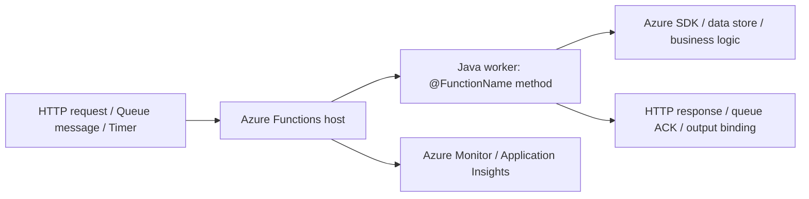
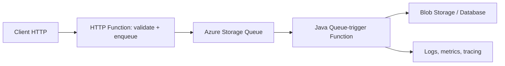
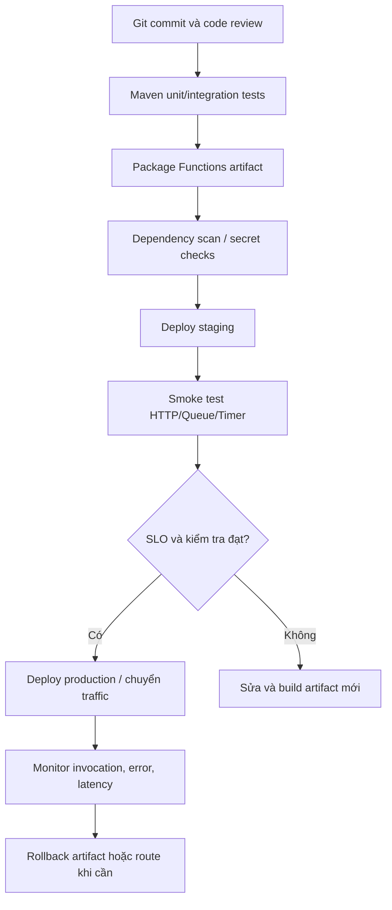

# Phát triển Azure Functions bằng Java

Một ứng dụng Java không phải lúc nào cũng cần máy ảo hoặc container chạy liên tục. Có những tác vụ chỉ xuất hiện khi người dùng gửi HTTP request, file được tải lên, thông điệp xuất hiện trong hàng đợi hoặc đến lịch xử lý định kỳ. **Azure Functions** là nền tảng *serverless/event-driven* của Microsoft Azure giúp bạn triển khai những hàm xử lý sự kiện như vậy mà không phải tự quản lý từng máy chủ ứng dụng.

Với **Java**, nhóm phát triển có thể dùng Maven/Gradle, thư viện Azure Functions dành cho Java, annotation như `@FunctionName`, `@HttpTrigger` và `@QueueTrigger`, rồi chạy thử bằng Azure Functions Core Tools trước khi triển khai lên Function App.

Bài học thuộc chương **Serverless với Azure Functions**, module **CLOUD_PROVIDERS_AZURE**. Nó kết nối kỹ năng Java với resource group, subscription, Microsoft Entra ID, Azure Storage, mạng riêng, giám sát, bảo mật và kiểm soát chi phí cho ứng dụng trên Azure.

> **Phạm vi:** ví dụ chính sử dụng Java 17 và Azure Functions runtime v4 để minh họa mô hình lập trình bằng annotation. Khi triển khai thật, phải đối chiếu phiên bản JDK/runtime, Azure Functions Maven plugin, binding extensions và lựa chọn hosting plan được hỗ trợ tại thời điểm, region và môi trường của bạn.

## 1. Mục tiêu học tập

Sau bài học, bạn có thể:

1. Giải thích Function App, function, trigger, input/output binding và execution context.
2. Khởi tạo dự án Azure Functions bằng Java/Maven và nhận biết cấu trúc file cần thiết.
3. Viết HTTP-trigger function có kiểu dữ liệu, response status và logging phù hợp.
4. Viết Queue-trigger hoặc Timer-trigger function và hiểu cách runtime kích hoạt.
5. Phân biệt cấu hình `host.json`, `local.settings.json`, application settings và secret.
6. Chạy thử bằng Azure Functions Core Tools, Maven và công cụ HTTP; thiết kế kiểm thử tự động.
7. Triển khai Function App, quản lý identity, Azure Storage, monitoring và các phụ thuộc mạng.
8. Giảm lỗi retry/trùng lặp thông qua idempotency, queue, timeout và xử lý ngoại lệ.
9. Chọn hosting plan và phương án scale dựa trên SLA, cold start, concurrency, hiệu năng Java và chi phí.

## 2. Azure Functions là gì?

Một **function** là một đơn vị mã được runtime gọi khi một sự kiện phù hợp xảy ra. Các function thuộc cùng một **Function App** có thể chia sẻ cấu hình runtime, gói triển khai, danh tính và một số tài nguyên hosting. Function App là tài nguyên Azure quản lý các function; nó không tương đương từng instance JVM.

Một số thành phần:

| Thành phần | Vai trò | Ví dụ |
|---|---|---|
| Function App | Đơn vị triển khai và quản lý nhiều function | `orders-functions-prod` |
| Function | Phương thức xử lý sự kiện được đăng ký | `submitOrder`, `processOrder` |
| Trigger | Quyết định khi nào function được gọi | HTTP, Queue, Timer |
| Input binding | Cấp dữ liệu đầu vào từ dịch vụ hỗ trợ | Blob/document được binding đọc |
| Output binding | Ghi dữ liệu tới dịch vụ hỗ trợ | Message gửi Queue, Blob output |
| Azure Functions host | Phát hiện function, nhận sự kiện, quản lý bindings, logging và thực thi | Functions runtime v4 |
| Java worker | Tiến trình thực thi mã Java cho host | JVM với các hàm Java |
| Application settings | Cấu hình ở môi trường chạy | Endpoint, tên tài nguyên, connection settings |

**Trigger** thường là thành phần bắt buộc của mỗi function; các bindings khác là tùy chọn. Không phải mọi thao tác Azure đều cần binding: trong Java, bạn cũng có thể dùng **Azure SDK** để gọi dịch vụ trực tiếp khi cần nhiều quyền điều khiển hoặc mô hình thao tác phức tạp.

### Sơ đồ vòng đời một sự kiện



Sơ đồ là mô hình logic: cách xác nhận xử lý thông điệp, retry, timeout và output phụ thuộc loại trigger, extension cùng hosting plan. Không phải mọi function đều có HTTP response.

### Serverless không có nghĩa máy chủ không tồn tại

Azure vẫn chạy ứng dụng trên hạ tầng tính toán; khác biệt là bạn quản lý **mã, cấu hình, kích thước tài nguyên, quyền truy cập và giới hạn** thay vì trực tiếp quản lý từng VM. Sự kiện tăng có thể làm platform tăng số instance theo khả năng của hosting plan, nhưng scale-out không đảm bảo tức thời hoặc vô hạn.

## 3. Khi nào Java Functions phù hợp?

| Nhu cầu | Vì sao Functions phù hợp | Điều kiện phải đánh giá |
|---|---|---|
| HTTP endpoint nhẹ | Triển khai API/handler nhỏ theo event | Auth, latency, cold start, timeout |
| Xử lý message theo hàng đợi | Tách request nhanh khỏi tác vụ tốn thời gian | Retry, poison queue, idempotency |
| Lịch chạy định kỳ | Timer trigger thay cron server | Múi giờ, trùng lặp, storage/coordination |
| Xử lý file khi có event | Trigger/Event Grid/Queue kích hoạt pipeline | File lớn, rate limit, duplicate events |
| Đồng bộ dữ liệu nhỏ | Gọi Azure SDK theo một sự kiện | Thời gian chạy, tài nguyên mạng và quota |
| Webhook tích hợp hệ thống | HTTP endpoint nhanh, chuyển job sang queue | Xác thực chữ ký/webhook, replay và throttling |

Không nên mặc định Functions tốt hơn các lựa chọn khác trong mọi trường hợp. Nếu dịch vụ phải giữ kết nối rất lâu, có latency cực thấp ổn định, cần runtime tùy chỉnh hoặc xử lý liên tục nhiều giờ, hãy so sánh với **Azure Container Apps, AKS, App Service, Azure Batch** hay một kiến trúc dùng queue.

### Một cách tổ chức ứng dụng

- **HTTP Function** nhận đơn đặt hàng, kiểm tra dữ liệu và gửi message vào queue.
- **Queue Function** xử lý đơn, gọi database hoặc API đối tác.
- **Timer Function** dọn dữ liệu hết hạn, đồng bộ báo cáo hoặc kiểm tra công việc bị kẹt.
- **Blob Storage/Database** giữ trạng thái bền vững; không phụ thuộc filesystem tạm của instance JVM.

Khi CPU/memory không đủ hoặc sự kiện đến dồn dập, hệ thống cần cơ chế **backpressure và scale** chứ không chỉ viết thêm thread trong function.

## 4. Mô hình Java và hệ sinh thái công cụ

Một dự án Azure Functions Java thường dùng:

1. **JDK** tương thích với runtime được chọn.
2. **Maven** hoặc Gradle theo plugin/toolchain được hỗ trợ.
3. **Azure Functions Java library**: annotation và các interface xử lý request, response, context.
4. **Azure Functions Maven plugin**: đóng gói và hỗ trợ triển khai các function.
5. **Azure Functions Core Tools**: chạy Functions host trên máy phát triển.
6. **Azure CLI**: đăng nhập, kiểm tra subscription, quản lý tài nguyên Azure.
7. **Azurite** hoặc Azure Storage account thử nghiệm nếu trigger/runtime cần Storage.
8. IDE như IntelliJ IDEA hoặc VS Code (không bắt buộc) và test framework.

### Phiên bản tương thích

Functions runtime v4 và Java worker có ma trận hỗ trợ JDK, hệ điều hành, hosting plan và thời điểm. **Đừng chọn Java 21 chỉ vì JDK local có bản đó** nếu Function App đích chưa hỗ trợ tổ hợp runtime/plan tương ứng. Với hệ thống hiện có, kiểm tra cấu hình của Function App trước khi nâng JDK.

Trong bài, Java 17 là **giả định minh họa**. Nếu môi trường hỗ trợ Java 21 hoặc một phiên bản khác, điều chỉnh Maven compiler, `JAVA_VERSION`/runtime và thử toàn bộ trigger, thư viện native, startup lẫn bộ thử nghiệm.

## 5. Cấu trúc dự án Maven

Một dự án tối giản có thể được tổ chức như sau:

```text
orders-functions/
  pom.xml
  host.json
  local.settings.json              # chỉ ở local, KHÔNG commit
  .gitignore
  src/
    main/
      java/
        com/example/functions/
          HelloFunction.java
          OrderQueueFunction.java
          CleanupTimerFunction.java
    test/
      java/
        com/example/functions/
          ...
  target/
    azure-functions/                # output khi package
```

Một số dự án sinh bởi Maven archetype có cấu trúc hơi khác. Điều quan trọng là **Maven package thành công, plugin phát hiện phương thức `@FunctionName` và tạo metadata binding tương ứng**. Không tự sửa thủ công các file function metadata được plugin sinh ra nếu chưa biết rõ lý do.

### Maven archetype

Azure cung cấp archetype hoặc project template giúp tạo cấu trúc sẵn có. Vì phiên bản plugin/archetype thay đổi theo thời gian, hãy lấy lệnh và version từ hướng dẫn chính thức của phiên bản toolchain được tổ chức chấp thuận. Một luồng thao tác thường là:

```text
Cài JDK + Maven + Functions Core Tools
    -> Tạo dự án bằng archetype/template phù hợp
    -> Mở pom.xml và xác nhận Java version, plugin versions
    -> Viết @FunctionName + trigger annotation
    -> mvn clean package
    -> mvn azure-functions:run
    -> Kiểm thử
    -> Deploy lên Function App
```

Bài này cũng đưa ví dụ `pom.xml` tối giản để bạn hiểu rõ thành phần thay vì chỉ làm theo wizard.

## 6. Ví dụ pom.xml cho Java Functions

Đây là mẫu cấu trúc học tập; các phiên bản cụ thể cần được đối chiếu với thư viện/plugin đang được nhóm sử dụng. Tên Function App phải **khả dụng và phù hợp quy tắc đặt tên của Azure**, không dùng trực tiếp tên ví dụ khi triển khai thật.

```xml
<project xmlns="http://maven.apache.org/POM/4.0.0"
         xmlns:xsi="http://www.w3.org/2001/XMLSchema-instance"
         xsi:schemaLocation="http://maven.apache.org/POM/4.0.0 https://maven.apache.org/xsd/maven-4.0.0.xsd">
  <modelVersion>4.0.0</modelVersion>

  <groupId>com.example</groupId>
  <artifactId>orders-functions</artifactId>
  <version>1.0.0</version>
  <packaging>jar</packaging>

  <properties>
    <project.build.sourceEncoding>UTF-8</project.build.sourceEncoding>
    <maven.compiler.release>17</maven.compiler.release>
    <functions.java.library.version>3.1.0</functions.java.library.version>
    <functions.maven.plugin.version>1.34.0</functions.maven.plugin.version>
    <functionAppName>orders-java-functions-lab</functionAppName>
    <functionResourceGroup>rg-functions-lab</functionResourceGroup>
    <functionRegion>southeastasia</functionRegion>
  </properties>

  <dependencies>
    <dependency>
      <groupId>com.microsoft.azure.functions</groupId>
      <artifactId>azure-functions-java-library</artifactId>
      <version>${functions.java.library.version}</version>
    </dependency>
  </dependencies>

  <build>
    <plugins>
      <plugin>
        <groupId>org.apache.maven.plugins</groupId>
        <artifactId>maven-compiler-plugin</artifactId>
        <version>3.13.0</version>
        <configuration>
          <release>${maven.compiler.release}</release>
        </configuration>
      </plugin>
      <plugin>
        <groupId>com.microsoft.azure</groupId>
        <artifactId>azure-functions-maven-plugin</artifactId>
        <version>${functions.maven.plugin.version}</version>
        <configuration>
          <appName>${functionAppName}</appName>
          <resourceGroup>${functionResourceGroup}</resourceGroup>
          <region>${functionRegion}</region>
          <runtime>
            <os>linux</os>
            <javaVersion>17</javaVersion>
          </runtime>
        </configuration>
        <executions>
          <execution>
            <id>package-functions</id>
            <goals>
              <goal>package</goal>
            </goals>
          </execution>
        </executions>
      </plugin>
    </plugins>
  </build>
</project>
```

### Tại sao cần hai plugin?

- `maven-compiler-plugin` biên dịch Java source phù hợp với target Java đã chọn.
- `azure-functions-maven-plugin` phát hiện annotation, đóng gói các thành phần cần cho Functions host và cung cấp goal như `azure-functions:run`, `azure-functions:deploy`.

**Điểm cần kiểm tra:** plugin có thể yêu cầu thêm cấu hình deployment (hosting plan, resource group, runtime, stagingDirectory, appSettings) tùy cách dự án được tạo. Tạo Function App bằng Azure Portal/IaC trước và triển khai tới tài nguyên đó thường dễ kiểm soát hơn cho production; không dựa vào plugin tự provision toàn bộ mà bỏ qua chính sách mạng, identity hoặc cost.

### Dependency quản lý theo Maven

Với project thực tế, nên dùng dependency management/BOM khi dùng nhiều Azure SDK, khóa phiên bản dependency và chạy scan. Tránh `LATEST`, version range không kiểm soát hoặc tải JAR động lúc startup.

## 7. HTTP Trigger: function Java đầu tiên

Tạo file `src/main/java/com/example/functions/HelloFunction.java`:

```java
package com.example.functions;

import java.util.Optional;

import com.microsoft.azure.functions.AuthorizationLevel;
import com.microsoft.azure.functions.ExecutionContext;
import com.microsoft.azure.functions.HttpMethod;
import com.microsoft.azure.functions.HttpRequestMessage;
import com.microsoft.azure.functions.HttpResponseMessage;
import com.microsoft.azure.functions.HttpStatus;
import com.microsoft.azure.functions.annotation.FunctionName;
import com.microsoft.azure.functions.annotation.HttpTrigger;

public class HelloFunction {

    @FunctionName("hello")
    public HttpResponseMessage hello(
        @HttpTrigger(
            name = "request",
            methods = {HttpMethod.GET},
            authLevel = AuthorizationLevel.ANONYMOUS,
            route = "hello"
        ) HttpRequestMessage<Optional<String>> request,
        final ExecutionContext context
    ) {
        String rawName = request.getQueryParameters()
            .getOrDefault("name", "world");
        String name = rawName.trim();

        if (name.isEmpty() || name.length() > 80) {
            return request.createResponseBuilder(HttpStatus.BAD_REQUEST)
                .body("name must contain 1-80 characters")
                .build();
        }

        context.getLogger().info("Handling hello request");

        return request.createResponseBuilder(HttpStatus.OK)
            .header("Content-Type", "text/plain; charset=utf-8")
            .body("Xin chào, " + name + "!")
            .build();
    }
}
```

### Giải thích

- `@FunctionName("hello")`: đăng ký function tên `hello` với Functions host.
- `@HttpTrigger`: yêu cầu runtime kích hoạt phương thức khi nhận HTTP GET tới route.
- `AuthorizationLevel.ANONYMOUS`: cho phép gọi endpoint mà không cần Functions key theo cơ chế auth level của trigger; **chỉ dùng cho lab hoặc endpoint công khai đã có lớp bảo vệ phù hợp**.
- `HttpRequestMessage<Optional<String>>`: request HTTP với body kiểu `Optional<String>` nếu ứng dụng cần đọc body; ví dụ này chỉ đọc query parameter.
- `ExecutionContext`: cung cấp logger và metadata invocation.
- `HttpResponseMessage`: cho phép đặt HTTP status, header và body.
- `trim` và giới hạn chiều dài: ví dụ kiểm tra đầu vào tối thiểu; production còn cần validation theo nghiệp vụ.

**Không log toàn bộ request, token, cookie hoặc thông tin cá nhân.** Log một chuỗi tĩnh như trên hữu ích để kiểm tra luồng mà không làm lộ dữ liệu.

### Function key không phải toàn bộ bảo mật

Trong môi trường production, cân nhắc Entra ID/App Service Authentication, Azure API Management, private networking hoặc gateway thích hợp. Nếu dùng `AuthorizationLevel.FUNCTION`, client cần function key theo cơ chế runtime; key phải được quản lý an toàn và không thay thế hoàn toàn authentication/authorization nghiệp vụ.

## 8. Chạy HTTP Function trên máy local

### host.json

Tạo file `host.json` tại thư mục gốc dự án:

```json
{
  "version": "2.0",
  "extensionBundle": {
    "id": "Microsoft.Azure.Functions.ExtensionBundle",
    "version": "[4.*, 5.0.0)"
  },
  "logging": {
    "logLevel": {
      "default": "Information"
    }
  }
}
```

`version: "2.0"` là schema của `host.json` cho Functions runtime v2 trở đi, **không có nghĩa runtime Java v2**. Extension bundle giúp runtime tải binding extensions được bundle hỗ trợ. Không cấu hình bundle version theo kiểu tưởng tượng; xác nhận tương thích với trigger/plan/Functions host hiện tại.

### local.settings.json

File local chỉ dành cho phát triển:

```json
{
  "IsEncrypted": false,
  "Values": {
    "FUNCTIONS_WORKER_RUNTIME": "java",
    "AzureWebJobsStorage": "UseDevelopmentStorage=true",
    "ORDERS_API_BASE_URL": "http://localhost:9000"
  }
}
```

`UseDevelopmentStorage=true` giả định **Azurite** hoặc emulator tương thích đang chạy đúng endpoint local. Trên một số trường hợp HTTP-only, host có thể chạy với yêu cầu cấu hình Storage khác, nhưng Queue/Timer và nhiều tính năng host thường cần storage hoạt động. Khi dùng `local.settings.json` này, hãy chuẩn bị Azurite trước khi chạy tất cả trigger.

**Không commit `local.settings.json` có credential** lên repository. Nên đưa file vào `.gitignore`, cung cấp file example không chứa secret và dùng môi trường dev riêng.

### Build và chạy

Tại thư mục project:

```bash
mvn clean package
mvn azure-functions:run
```

Nếu toolchain đã được cài phù hợp, Functions host sẽ in danh sách function và endpoint. Giá trị thường gặp cho HTTP trigger lab:

```text
http://localhost:7071/api/hello
```

`api` là route prefix mặc định khi chưa đổi cấu hình `host.json`; cổng và prefix thực tế có thể thay đổi.

Kiểm thử:

```bash
curl -i "http://localhost:7071/api/hello?name=Mai"

curl -i "http://localhost:7071/api/hello?name="
```

Kết quả mong đợi: request đầu trả HTTP 200 với lời chào; request thứ hai trả HTTP 400 do tên rỗng. Kiểm tra log local có invocation và không xuất secret.

### Lỗi thường gặp

- `mvn: command not found`: Maven chưa cài hoặc PATH sai.
- Java release không tương thích: JDK local và Maven compiler config không khớp.
- Không tìm thấy `func`: Functions Core Tools chưa cài hoặc không đúng PATH.
- Không kết nối Storage/Azurite: `AzureWebJobsStorage` trỏ đến emulator nhưng emulator chưa chạy.
- Không thấy function trong host log: annotation, Maven plugin packaging hoặc scan classes có lỗi.
- HTTP 404: route, prefix, function name hoặc đường dẫn sai.

## 9. Queue Trigger: tách HTTP nhanh khỏi xử lý lâu

Giả sử HTTP endpoint nhận yêu cầu tạo thumbnail; thay vì tải và xử lý ảnh ngay trong HTTP request, ứng dụng có thể gửi thông điệp tới Queue. Một function khác được kích hoạt khi có message và xử lý bất đồng bộ.



### Ví dụ Java Queue Trigger

Tạo `OrderQueueFunction.java`:

```java
package com.example.functions;

import com.microsoft.azure.functions.ExecutionContext;
import com.microsoft.azure.functions.annotation.FunctionName;
import com.microsoft.azure.functions.annotation.QueueTrigger;

public class OrderQueueFunction {

    @FunctionName("processOrder")
    public void processOrder(
        @QueueTrigger(
            name = "message",
            queueName = "orders",
            connection = "OrdersStorage"
        ) String message,
        final ExecutionContext context
    ) {
        if (message == null || message.isBlank()) {
            throw new IllegalArgumentException("Empty queue message");
        }

        // TODO: Deserialize, validate, use a stable orderId for idempotency.
        // TODO: Persist business result before marking processing successful.
        context.getLogger().info("Processing an order message");
    }
}
```

Đây là ví dụ tập trung vào **trigger và cấu trúc Java**, chưa phải một bộ xử lý đơn hàng production. Nếu function return bình thường, runtime có thể đánh dấu message đã xử lý theo cơ chế Queue extension. Nếu ném exception, hệ thống xử lý retry/dequeue/poison theo chính sách extension đang áp dụng.

### Connection setting

`connection = "OrdersStorage"` tham chiếu **tên tiền tố app setting**, không phải connection string được hard-code trong annotation. Với môi trường local lab, có thể dùng:

```json
{
  "IsEncrypted": false,
  "Values": {
    "FUNCTIONS_WORKER_RUNTIME": "java",
    "AzureWebJobsStorage": "UseDevelopmentStorage=true",
    "OrdersStorage": "UseDevelopmentStorage=true"
  }
}
```

Bản local này dùng emulator được hỗ trợ và cần tạo queue `orders` theo cách phù hợp nếu chưa có. Trong production, ưu tiên **identity-based connection** nếu Queue extension, runtime và hosting plan của môi trường hỗ trợ; khi đó app settings có thể dùng các khóa dạng `OrdersStorage__queueServiceUri` cùng RBAC phù hợp, thay vì một account key. Phải kiểm tra schema extension trước khi áp dụng.

### Vì sao Queue Function phải idempotent?

Message có thể được giao lại khi function timeout, worker khởi động lại hoặc runtime xử lý lỗi. Nếu một đơn hàng đã được ghi vào database nhưng function lỗi trước khi message được xác nhận, lần chạy sau có thể xử lý lại.

Một cơ chế an toàn:

1. Đọc và xác thực `orderId` từ message.
2. Tra cứu trạng thái xử lý theo `orderId`.
3. Nếu đã hoàn tất, kết thúc mà không tạo side effect mới.
4. Nếu chưa hoàn tất, thực hiện thao tác với transaction/conditional write hoặc idempotency key.
5. Ghi trạng thái hoàn tất trước khi để runtime xác nhận message.
6. Theo dõi message lỗi lặp lại và poison queue.

**Exactly-once business effect** không tự đến từ queue trigger. Nó cần thiết kế transaction/idempotency ở ứng dụng hoặc data store.

## 10. Timer Trigger: xử lý định kỳ

Azure Functions hỗ trợ **Timer trigger** bằng lịch biểu có định dạng tương thích NCRONTAB của Functions, thường gồm **sáu trường** với trường giây ở đầu.

Ví dụ function chạy mỗi 5 phút:

```java
package com.example.functions;

import com.microsoft.azure.functions.ExecutionContext;
import com.microsoft.azure.functions.annotation.FunctionName;
import com.microsoft.azure.functions.annotation.TimerTrigger;

public class CleanupTimerFunction {

    @FunctionName("cleanupExpiredOrders")
    public void cleanupExpiredOrders(
        @TimerTrigger(
            name = "timerInfo",
            schedule = "0 */5 * * * *"
        ) String timerInfo,
        final ExecutionContext context
    ) {
        context.getLogger().info("Running scheduled cleanup");

        // TODO: Load due records, use bounded batches and idempotent updates.
        // TODO: Persist checkpoint and report result to monitoring.
    }
}
```

### Tránh hiểu sai lịch biểu

Chuỗi `0 */5 * * * *` có nghĩa cứ 5 phút ở giây thứ 0 theo ngữ cảnh thời gian mà Functions runtime sử dụng. Lịch, múi giờ, thay đổi DST và khả năng cấu hình `WEBSITE_TIME_ZONE` phụ thuộc hệ điều hành/hosting plan; không giả định mọi Function App đều dùng timezone của máy phát triển.

Timer trigger có thể sử dụng Storage để phối hợp lịch và trạng thái, tránh việc scale-out tạo các lần chạy định kỳ trùng một cách đơn giản. Tuy nhiên **không coi đó là exactly-once guarantee** cho side effect: một invocation có thể thất bại, lặp hoặc chậm. Tác vụ cleanup vẫn cần idempotency, phân trang và checkpoint khi dữ liệu lớn.

### Tác vụ định kỳ kéo dài

Nếu cleanup mất vài giờ, đừng nhét tất cả vào một Timer invocation. Timer có thể chia dữ liệu thành nhiều batch và gửi message vào queue; Queue Functions xử lý song song. Điều này cho phép retry, quản lý tải và giới hạn thời gian chạy theo hosting plan.

## 11. Trigger, input binding và output binding

Azure Functions Java annotation giúp khai báo **cách runtime đưa dữ liệu vào function**. Khi cần, bạn có thể sử dụng output binding để ghi kết quả sang dịch vụ.

| Loại | Ví dụ | Cần lưu ý |
|---|---|---|
| HTTP trigger | Nhận GET/POST, trả status/body | Auth, input validation, timeout |
| Queue trigger | Nhận Storage Queue message | Retry, poison queue, idempotency |
| Timer trigger | Kích hoạt theo lịch | Timezone, lịch chậm, thời gian chạy |
| Blob trigger | Phản ứng với blob mới/được cập nhật theo cơ chế binding | Event model, file size, duplicate handling |
| Event Grid trigger | Xử lý sự kiện do Event Grid gửi | Subscription, validation, replay |
| Service Bus trigger | Xử lý queue/topic messages | Lock, dead-letter, concurrency, identity |
| Input binding | Runtime đưa dữ liệu nguồn vào parameter | Binding extension, serialization, quyền |
| Output binding | Runtime ghi dữ liệu từ kết quả/collector | Output semantics, error handling, transaction boundaries |

Một function có thể dùng **trigger + Azure SDK** thay cho nhiều binding nếu ứng dụng cần các thao tác conditional, transaction, metadata hoặc phân trang phức tạp.

### Không giả định binding tồn tại chỉ từ import Java

Annotation như `@QueueTrigger` cần Functions host có extension phù hợp và connection configuration hợp lệ. Maven biên dịch thành công nhưng Functions host không load được extension vẫn khiến function không chạy. Khi gặp lỗi binding, kiểm tra `host.json`, extension bundle, runtime version và app settings, không chỉ nhìn mã Java.

## 12. Azure SDK trong Java Function

Khi xử lý dữ liệu, dùng Azure SDK giống ứng dụng Java khác. Ví dụ muốn truy cập Blob Storage bằng Entra ID/managed identity thay vì account key.

Đoạn minh họa cần dependency `azure-identity` và `azure-storage-blob` với các phiên bản tương thích được quản lý trong Maven:

```java
import com.azure.identity.DefaultAzureCredentialBuilder;
import com.azure.storage.blob.BlobServiceClient;
import com.azure.storage.blob.BlobServiceClientBuilder;

public final class BlobClients {

    private BlobClients() {}

    public static BlobServiceClient create(String accountName) {
        String endpoint =
            "https://" + accountName + ".blob.core.windows.net";

        return new BlobServiceClientBuilder()
            .endpoint(endpoint)
            .credential(new DefaultAzureCredentialBuilder().build())
            .buildClient();
    }
}
```

`DefaultAzureCredential` có thể dùng danh tính developer trong môi trường local và managed identity hoặc một loại credential được hỗ trợ trên Azure. **Credential chain khác nhau theo môi trường**; phải xác nhận danh tính thực tế được dùng và tránh để production vô tình dựa vào developer credentials.

### Phân quyền tối thiểu

Nếu function chỉ đọc Blob, cấp role data-plane phù hợp như **Storage Blob Data Reader** tại phạm vi cần thiết. Quyền Contributor của resource group không tự cấp mọi quyền đọc dữ liệu ở Storage nếu data-plane authorization yêu cầu role riêng.

Khi dùng Queue, Service Bus hoặc Key Vault, mỗi dịch vụ có role và phạm vi riêng. Không cấp Owner ở subscription chỉ để một function có thể ghi một blob.

### Cấu hình endpoint và secrets

Tên storage account, endpoint API và các feature flags có thể đưa qua app settings. Account key, SAS token hoặc API key phải ở nguồn secret được quản lý, ưu tiên managed identity/Key Vault khi được hỗ trợ.

**Không truyền secrets bằng query parameter** trong HTTP logs hoặc in toàn bộ biến môi trường. Không gắn secret vào tên function hoặc route.

## 13. host.json, local.settings.json và cấu hình trên Azure

Ba phạm vi này thường gây nhầm:

| Cấu hình | Nơi lưu | Mục đích |
|---|---|---|
| `host.json` | Trong package source | Cấu hình chung Functions host, logging, extension, retry/concurrency theo khả năng |
| `local.settings.json` | Máy phát triển, không commit secret | Giá trị `Values` khi chạy local |
| Function App Application settings | Tài nguyên Azure | Các biến môi trường và connection settings khi deploy |

### Không tự động copy local.settings.json lên production

Với deploy thông thường, `local.settings.json` là file local và **không nên coi nó là nơi đồng bộ settings lên Azure**. Production settings phải được quản lý qua IaC, môi trường triển khai, Key Vault references hoặc workflow an toàn.

Một ví dụ setting runtime:

```text
FUNCTIONS_WORKER_RUNTIME = java
FUNCTIONS_EXTENSION_VERSION = ~4
ORDERS_API_BASE_URL = https://internal-api.example.com
```

Đây là thông số minh họa, không phải secret. Với storage host, tên và phương pháp identity-based settings phụ thuộc cấu hình được Functions runtime và extension hỗ trợ.

### host.json và retry

Một số trigger hỗ trợ điều chỉnh retry hoặc concurrency trong `host.json` hoặc theo thuộc tính/extension. **Không có một cấu hình retry chung áp dụng giống nhau cho HTTP, Queue, Service Bus và Timer.** Phải đọc khả năng của từng extension và xử lý idempotency ở ứng dụng.

## 14. Xử lý lỗi, timeout và retry

### HTTP Function

Đối với request đồng bộ, cần trả status phản ánh kết quả:

- `200 OK`: đọc/xử lý thành công.
- `201 Created`: tạo tài nguyên thành công, có tham chiếu phù hợp.
- `202 Accepted`: đã nhận yêu cầu và đưa vào pipeline bất đồng bộ.
- `400 Bad Request`: dữ liệu sai cú pháp/validation.
- `401/403`: yêu cầu xác thực/quyền không hợp lệ theo chính sách.
- `404 Not Found`: tài nguyên không tồn tại.
- `409 Conflict`: trùng lặp hoặc xung đột trạng thái.
- `429 Too Many Requests`: nên giảm/tạm dừng gửi theo rate limiting khi có.
- `500/503`: lỗi hệ thống hoặc dependency, cần log/correlation ID phù hợp.

Không trả HTTP 200 khi hệ thống thực sự chưa ghi dữ liệu cần thiết. Nếu đã gửi job vào Queue và chưa xử lý xong, `202 Accepted` cùng job ID/status endpoint có thể phù hợp hơn.

### Queue Function

Trigger theo queue có cơ chế dequeue, visibility, retry và poison message. Khi gặp lỗi tạm thời, có thể để runtime retry theo chính sách; khi gặp lỗi dữ liệu vĩnh viễn, cần phân luồng để tránh poison queue tăng vô hạn và tiêu tốn tài nguyên.

Bộ xử lý phải:

1. Phân loại lỗi transient và permanent.
2. Log error code, invocation ID, stable job ID; tránh dữ liệu nhạy cảm.
3. Retry có backoff/jitter nếu SDK hoặc extension không xử lý sẵn.
4. Không tạo side effect trùng lặp.
5. Xây quy trình xử lý message thất bại cuối cùng.
6. Cảnh báo khi backlog/poison queue hoặc tuổi message tăng.

### Timeout và quy trình dài

Thời gian tối đa của function invocation phụ thuộc hosting plan và cấu hình/runtime hiện hành. Với HTTP, ngoài timeout function còn có timeout ở gateway/client. **Đừng giữ một HTTP request mở để chờ xử lý hàng giờ**; dùng Queue/Service Bus và status polling hoặc orchestration như Durable Functions khi thích hợp.

Với Java, thời gian tạo JVM, tải classes, khởi động Spring framework (nếu dùng) và kết nối tới dependencies có thể ảnh hưởng cold start. Cần đo thực tế từ client và Application Insights.

## 15. Java cold start, concurrency và hiệu năng

### Cold start

Khi một instance chưa chạy ứng dụng, nền tảng cần cấp instance/worker, khởi động JVM, tải classes và tạo các client. Vì thế request đầu tiên sau một thời gian nhàn rỗi có thể chậm hơn request khi instance đã warm.

Nguyên nhân điển hình:

- File JAR/dependency quá lớn.
- Quá nhiều framework auto-configuration hoặc reflection.
- Khởi tạo SDK clients lặp lại mỗi invocation.
- Đọc secrets/network metadata quá nhiều ở startup.
- Dùng CPU/memory không phù hợp với workload.
- Kết nối database tạo mới cho từng request.

### Cải thiện

- Giữ startup logic tối thiểu.
- Tái sử dụng các client **thread-safe** phù hợp; không tạo HttpClient/BlobServiceClient mới cho mỗi request nếu không cần.
- Đặt connection pool và timeout rõ ràng.
- Không cache dữ liệu bí mật theo cách cản rotation hoặc làm lộ thông tin giữa tenants.
- Giới hạn dependency không sử dụng và cấu hình logging hợp lý.
- Đo cold/warm latency trong hosting plan thật, không chỉ chạy local.

### Concurrency

Một Function App có thể xử lý nhiều invocation đồng thời tùy trigger, worker process, cấu hình host và hosting plan. Đừng giữ trạng thái mutable per-request trong một static field dùng chung nếu không thread-safe.

Ví dụ **không an toàn**:

```java
public class UnsafeFunctionState {
    private static String currentOrderId;
    // Mỗi invocation ghi đè biến dùng chung, gây race condition.
}
```

Đặt dữ liệu yêu cầu trong biến local hoặc cấu trúc có concurrency control thích hợp. Static clients có thể được tái sử dụng khi thư viện hỗ trợ, nhưng phải quản lý lifecycle, connection pool và credential refresh.

### Memory

JVM heap không phải toàn bộ bộ nhớ process. Metaspace, direct buffers, JIT, thread stacks và native libraries vẫn dùng RAM. Kiểm thử workload với memory của instance thật để tránh out-of-memory và restart.

## 16. Chọn hosting plan phù hợp

Azure Functions có các mô hình hosting với cách tính phí, scaling, networking và cold-start khác nhau. Khi lập kiến trúc mới, cần đánh giá các lựa chọn hiện hành như **Flex Consumption**, **Premium** và **Dedicated/App Service plan** theo khả năng hỗ trợ Java/runtime/region; các môi trường cũ có thể dùng Consumption hoặc mô hình khác.

| Nhóm hosting | Khi nên đánh giá | Điểm cần xem |
|---|---|---|
| **Flex Consumption** | Serverless event-driven với khả năng scale theo kế hoạch được hỗ trợ | Mô hình billing, instance memory, scale/concurrency, networking, always-ready khi có |
| **Premium** | Workload cần pre-warmed capacity, mạng riêng hoặc scale với hiệu năng/độ ổn định cao hơn theo cấu hình | Chi phí công suất nền, instance size, VNet, deployment slots khi hỗ trợ |
| **Dedicated/App Service plan** | Có sẵn năng lực App Service hoặc yêu cầu vận hành công suất cố định | Always On khi cần, scaling, chia sẻ tài nguyên, chi phí plan |
| **Consumption (legacy trong một số tình huống)** | Hệ thống hiện hữu hoặc region/tính năng tương ứng | Giới hạn thời gian, scaling, networking và vòng đời hỗ trợ |

Không sử dụng một bảng giá hoặc số giây cold start cố định làm cam kết. Các giới hạn và chi phí thay đổi theo **runtime, region, plan, số instance, thời gian thực thi, memory, request và dịch vụ phụ trợ**.

### Câu hỏi lựa chọn

1. Độ trễ cold start có ảnh hưởng SLO không?
2. Workload chủ yếu là HTTP, Queue hay Timer?
3. Cần gọi Private Endpoint/database qua VNet không?
4. Số request/s và batch messages ở giờ cao điểm?
5. Mỗi invocation cần bao nhiêu CPU/memory và chạy bao lâu?
6. Có yêu cầu deployment slot, zero-downtime rollout hoặc công suất luôn sẵn sàng không?
7. Có thể queue hóa các tác vụ dài không?
8. Tổng chi phí compute + Storage + monitoring + network + dữ liệu ra Internet là bao nhiêu?

Chọn plan dựa trên **yêu cầu đã đo** thay vì cho rằng serverless luôn rẻ hơn VM/container trong mọi mức tải.

## 17. Triển khai Function App lên Azure

Có hai việc tách biệt:

1. **Provision hạ tầng:** Function App, hosting plan, storage phụ trợ, identity, Application Insights, networking và RBAC.
2. **Deploy mã Java:** build/package và phát hành artifact đến Function App đã được cấu hình.

Trong production, hạ tầng nên được quản lý bằng **Bicep/ARM/Terraform hoặc quy trình IaC tương đương**. Maven plugin là công cụ build/deploy, không thay thế review về network, subscription, security, budgets và production approvals.

### Chuẩn bị bằng Azure CLI

```bash
az login

az account show \
  --query "{name:name,subscriptionId:id,tenantId:tenantId}" \
  -o table
```

Đặt subscription được phép trước khi triển khai nếu cần:

```bash
az account set --subscription "<SUBSCRIPTION_ID>"
```

Sau khi Function App đã tồn tại, kiểm tra cấu hình cơ bản:

```bash
RG="rg-functions-lab"
APP="<EXISTING_FUNCTION_APP_NAME>"

az functionapp show \
  --resource-group "$RG" \
  --name "$APP" \
  --query "{name:name,kind:kind,state:state,location:location}" \
  -o json
```

**Không in toàn bộ application settings production** vì kết quả có thể chứa secret hoặc connection string. Nếu cần kiểm tra settings, chỉ xuất thông tin không nhạy cảm theo quyền và công cụ được phê duyệt.

### Deploy bằng Maven plugin

Sau khi `pom.xml` trỏ đến đúng Function App/plan đã chuẩn bị, chạy từ source:

```bash
mvn clean package
mvn azure-functions:deploy
```

**Điều kiện:** cấu hình app name, resource group, Java runtime, OS và hosting plan trong plugin phải phù hợp tài nguyên thực. Một số phiên bản plugin có thể cố tạo Function App nếu tài nguyên không tồn tại; trong tổ chức nên kiểm tra trước để tránh provision ngoài quy trình.

Sau deploy, xác minh:

- Function App ở trạng thái chạy và phát hiện các functions.
- Runtime/JDK và extensions load thành công.
- HTTP endpoint phản hồi đúng và được bảo vệ theo chính sách.
- Queue/Timer trigger kết nối được dịch vụ tương ứng.
- App settings/managed identity đúng ở environment đích.
- Logs, metrics và alerts hoạt động.
- Không có secrets trong source, package hoặc deployment logs.

### Không cấu hình production như local

Không dùng `UseDevelopmentStorage=true` trên Azure để kết nối Storage thật. Production phải có cấu hình Storage account/identity-based settings phù hợp. Nếu dùng connection string trong môi trường lab, quản lý bằng secret setting hoặc Key Vault thay vì commit vào repository.

## 18. Bảo mật Azure Functions Java

### Authentication và authorization

Với HTTP trigger, auth level quyết định cách runtime kiểm tra key trong tình huống tương ứng. Đối với API production, nên có lớp xác thực/danh tính thực sự như **Microsoft Entra ID** thông qua tính năng authentication của Function App, APIM hoặc gateway phù hợp. Sau xác thực, mã Java vẫn cần kiểm tra **quyền nghiệp vụ**: người dùng có được xem/chỉnh sửa đơn hàng này hay không?

`AuthorizationLevel.ANONYMOUS` không đồng nghĩa API production được phép công khai không bảo vệ. Chỉ dùng khi endpoint cố ý public và đã đánh giá abuse, rate limit và dữ liệu.

### Managed identity

Managed identity giúp Function App gọi các dịch vụ Azure hỗ trợ Entra authentication mà không giữ client secret dài hạn trong code. Cấu hình identity và cấp RBAC tại phạm vi nhỏ nhất:

- Đọc Blob: `Storage Blob Data Reader` hoặc role tương ứng.
- Ghi Blob: role ghi dữ liệu phù hợp.
- Queue/Service Bus: quyền nhận/gửi riêng theo dịch vụ.
- Key Vault: quyền đọc secret cụ thể theo mô hình phân quyền áp dụng.

Bật managed identity **không tự cấp** quyền cho Storage/Key Vault. Nên kiểm thử thật bằng identity của Function App, không chỉ credential của developer.

### Network

- VNet integration cho outbound/private dependencies cần được kiểm tra theo hosting plan và region.
- Private Endpoint cho inbound tới Function App hoặc outbound tới Storage/Database là những cấu hình và tuyến kết nối khác nhau.
- Nếu API đối tác allowlist IP, cần thiết kế outbound NAT/Firewall phù hợp; không lấy IP của máy local hoặc VM khác làm egress IP của Function App.
- Khi hạn chế public access, kiểm tra đường đi của deployment/pipeline và Functions runtime, DNS, routing, storage/registry endpoints.

### Secrets và dữ liệu nhạy cảm

- Không hard-code account key, SAS, JWT secret vào annotation hoặc class Java.
- Tránh log raw HTTP headers, request body, queue payload và token.
- Dùng application settings/Key Vault references hoặc identity-based connection theo khả năng hỗ trợ.
- Rotation và audit có chủ sở hữu.
- Không lưu dữ liệu khách hàng quan trọng trong temporary filesystem của Functions instance.

## 19. Monitoring, tracing và chẩn đoán

**Azure Monitor** và **Application Insights** có thể theo dõi request, dependency, exception, latency và invocation của Function App theo cấu hình. Đối với Java, việc thu thập logs/tracing phụ thuộc runtime, SDK/agent và cấu hình giám sát.

### Tín hiệu cần có

| Tín hiệu | Điều cần trả lời |
|---|---|
| Invocation count | Trigger có kích hoạt đúng số lượng mong đợi? |
| Success/failure | Function hoàn tất hay ném exception? |
| Duration | p50/p95/p99 thời gian thực thi có tăng? |
| Cold start | Instance mới khởi động mất bao lâu? |
| Queue backlog | Có message bị dồn hoặc tuổi message tăng? |
| Retry/poison | Có message thất bại lặp lại không? |
| Dependencies | Storage, database, HTTP APIs có timeout/throttling? |
| Memory/CPU | JVM có OOM hoặc GC pause dài không? |
| Cost | Số execution, compute, storage, logs, networking |

### Correlation và invocation ID

`ExecutionContext` có thông tin liên quan invocation, ví dụ `getInvocationId()`. Có thể ghi mã correlation/invocation trong log để nối request HTTP, queue message và dependency calls mà không tiết lộ dữ liệu nhạy cảm.

```java
context.getLogger().info(
    "Invocation ID: " + context.getInvocationId()
);
```

Không dùng invocation ID ngẫu nhiên làm idempotency key cho message nghiệp vụ: khi retry, invocation mới có thể có ID mới. Hãy dùng **orderId/jobId ổn định** trong dữ liệu nghiệp vụ.

### Quy trình chẩn đoán

1. Tác vụ chưa kích hoạt: kiểm tra trigger metadata, extension, app settings và kết nối dịch vụ.
2. Có invocation nhưng thất bại: xem exception, dependency và đầu vào được xử lý.
3. Function chạy chậm: so cold start, JDK startup, GC, network, SDK retries và database latency.
4. Nhiều invocation trùng: kiểm tra retry, queue lease, duplicate events và idempotency.
5. Tăng scale nhưng không tăng throughput: xem CPU/memory, concurrency, dịch vụ downstream và throttling.
6. Triển khai xong nhưng không thấy endpoint: kiểm tra app state, Java version, Maven package, function discovery và auth level.

### Alerts

Cảnh báo nên gắn với hành động: failure rate vượt baseline, p95 latency tăng, queue backlog vượt deadline, poison messages mới, số invocation bất thường, Storage/API bị throttling hoặc chi phí tăng ngoài dự báo.

Một lần retry thành công có thể là hành vi bình thường, nhưng **nhiều retry kéo dài** có thể làm backlog tăng và gây trùng side effect.

## 20. Kiểm thử tự động cho Azure Functions Java

Chia test thành ba lớp:

1. **Unit test nghiệp vụ:** tách logic Java ra khỏi annotation, test bằng JUnit/Mockito hoặc framework được chấp thuận.
2. **Integration test:** chạy Functions host local và emulator/dịch vụ test để xác minh trigger, bindings, serialization, status và retry.
3. **End-to-end test:** deploy lên môi trường staging rồi gọi HTTP/Queue/Timer phù hợp với identity, network và data store thật.

### Tách handler khỏi domain logic

Thay vì viết mọi phép tính và thao tác storage ngay trong method có `@HttpTrigger`, tạo một class xử lý độc lập:

```java
package com.example.functions;

public final class GreetingService {
    public String greet(String name) {
        if (name == null || name.isBlank()) {
            throw new IllegalArgumentException("name is required");
        }
        return "Xin chào, " + name.trim() + "!";
    }
}
```

Unit test JUnit 5 khi project đã có dependency test:

```java
package com.example.functions;

import static org.junit.jupiter.api.Assertions.assertEquals;
import static org.junit.jupiter.api.Assertions.assertThrows;

import org.junit.jupiter.api.Test;

class GreetingServiceTest {

    private final GreetingService service = new GreetingService();

    @Test
    void returnsGreeting() {
        assertEquals("Xin chào, Mai!", service.greet(" Mai "));
    }

    @Test
    void rejectsEmptyName() {
        assertThrows(
            IllegalArgumentException.class,
            () -> service.greet(" ")
        );
    }
}
```

Các ví dụ này là **hai class minh họa**, cần đặt đúng thư mục source/test và thêm dependency JUnit Jupiter + cấu hình Maven Surefire tương thích. HTTP handler có thể gọi `GreetingService` và chuyển exception validation thành HTTP 400.

### Integration tests nên kiểm tra

- Trigger được host phát hiện, đúng route.
- HTTP GET hợp lệ, invalid input, auth và status code.
- Queue message được gửi tới đúng queue, worker nhận và hoàn tất.
- Message lỗi được retry/poison đúng; output không trùng.
- Timer có lịch đúng timezone mong muốn và không tạo side effect trùng.
- Credential/managed identity và private network kết nối thật trong staging.
- Shutdown/scale-in không làm mất công việc đang xử lý.

Không dùng account hoặc queue production cho integration tests nếu không có quyền và quy trình sandboxing rõ ràng.

## 21. Triển khai có kiểm soát và rollback

Một pipeline triển khai Functions Java có thể đi theo trình tự:



### Những điểm cần chốt

- Cùng artifact được kiểm thử ở staging và triển khai production khi quy trình cho phép.
- App settings riêng theo environment, không build lại JAR chỉ để nhúng endpoint/secret.
- Quản lý schema database tương thích ngược để rollback function code không làm hỏng dữ liệu.
- Theo dõi trigger khi deploy: Queue/Timer có thể bắt đầu tiêu thụ sự kiện ngay khi app chạy.
- Cân nhắc deployment slots hoặc blue/green tùy hosting plan và tính năng được hỗ trợ; không giả định mọi plan đều hỗ trợ slot giống nhau.
- Có cách tắt/giảm traffic hoặc tạm ngừng trigger theo cơ chế quản trị khi phát hành lỗi.
- Giữ artifact/digest/version cũ đủ lâu để rollback.

**Rollback mã Java không tự đảo ngược các side effect** đã ghi vào database, queue, Blob hoặc hệ thống bên ngoài. Cần thiết kế transaction, versioning hoặc cơ chế bù trừ nghiệp vụ phù hợp.

## 22. Những lỗi phổ biến và cách xử lý

| Triệu chứng | Nguyên nhân thường gặp | Hướng điều tra |
|---|---|---|
| `mvn package` lỗi | Sai JDK, dependency/plugin version, lỗi biên dịch | Kiểm tra `java -version`, `mvn -version`, POM và stack trace |
| Functions host không tìm thấy function | Annotation sai, plugin package, metadata không được sinh | Xem output package, function discovery logs |
| `func` không được nhận | Chưa cài Core Tools/PATH | Kiểm tra công cụ và version |
| HTTP 404 sau khởi động | Sai route/prefix/function name | Xem host endpoints và `host.json` |
| HTTP 401/403 | Function key, Entra auth, network restrictions, policy | Kiểm tra auth level và gateway, không log secret |
| Queue trigger không kích hoạt | Sai queue name, connection setting, extension, quyền Storage | Kiểm tra binding, `OrdersStorage`, role và runtime logs |
| Timer không chạy đúng giờ | Lịch NCRONTAB sai, timezone/DST, Storage/host | Kiểm tra biểu thức sáu trường, timezone và runtime |
| Function lỗi với `UseDevelopmentStorage=true` | Azurite chưa chạy hoặc endpoint sai | Kiểm tra emulator, local settings và kết nối |
| Function timeout | Tác vụ quá dài, downstream chậm, plan/runtime limit | Tách sang queue, đặt deadline/retry |
| Java cold start cao | JVM/classloading/dependency nặng, plan scale behavior | Đo warm/cold duration, giảm startup work |
| OOM hoặc process exit | Giới hạn memory, heap/native buffers, concurrency | Giám sát memory/GC, giới hạn request |
| Message bị xử lý hai lần | Retry/redelivery, worker chết sau side effect | Idempotency, commit có điều kiện, stable job ID |
| Storage 403 dù identity bật | Chưa cấp data-plane role hoặc cấu hình firewall | RBAC, identity thực tế, private DNS/network |
| Deploy xong nhưng Function App lỗi | Java version/OS/plan mismatch hoặc app settings thiếu | Xem platform config, host logs, deployment logs |
| Không kết nối API private | VNet integration, private DNS, route, firewall | Kiểm tra DNS, network path, identity và port |
| Chi phí tăng dù request giảm | Premium/Dedicated baseline, log ingestion hoặc storage | Cost Management, plan capacity, retention |

### Thứ tự điều tra đề xuất

1. **Mã và package:** function được discover chưa?
2. **Runtime:** Functions host/JDK tương thích chưa?
3. **Trigger/binding:** extension và app settings hợp lệ chưa?
4. **Identity/network:** runtime có kết nối và quyền với dependency không?
5. **Business logic:** exception nào, payload có hợp lệ, có xử lý trùng không?
6. **Hiệu năng:** cold start, memory, CPU, concurrency và downstream latency.
7. **Vận hành:** alert, logs, deployment version và chi phí.

Không cùng lúc thay POM, app settings, role, firewall và hosting plan nếu chưa khoanh vùng nguyên nhân.

## 23. Chi phí và lựa chọn kiến trúc

Chi phí Azure Functions không chỉ là số lần gọi method Java. Tùy hosting plan và workload, chi phí có thể gồm:

- Số execution, thời gian chạy và mức bộ nhớ theo mô hình billing của plan.
- Công suất instance luôn sẵn sàng hoặc Premium/Dedicated baseline.
- Azure Storage cho Functions host, queues, checkpoints và business data.
- Application Insights/Log Analytics, số GB log và retention.
- Data transfer, NAT Gateway, Azure Firewall, Private Endpoints hoặc VNet integrations.
- Database, Service Bus, Event Grid và các dịch vụ phát sinh sự kiện.
- Chi phí retry, xử lý trùng, cold start và thời gian chờ do dependencies.

### Ví dụ so sánh

Một API nhận 100 request/ngày, mỗi request vài chục mili giây, không có yêu cầu độ trễ cực thấp, có thể phù hợp mô hình consumption-based. Nhưng một pipeline xử lý CPU liên tục 24/7 hoặc API yêu cầu luôn warm có thể cần so sánh Premium/Dedicated/Container Apps theo tổng chi phí.

**Đo cost per successful transaction/job**, không chỉ giá trên một triệu lần gọi, nhất là khi Queue retry thường xuyên hoặc có nhiều dependency calls.

### Quản trị ngân sách

1. Gắn tags owner/project/environment cho tài nguyên được hỗ trợ.
2. Đặt budget/alert trong Azure Cost Management.
3. Theo dõi log ingestion và loại bỏ debug logs không cần thiết.
4. Thiết kế timeout/retry hữu hạn, poison queue handling.
5. Dùng autoscaling/hosting plan phù hợp với yêu cầu thật.
6. Kiểm tra idle resources, staging apps và Storage accounts thử nghiệm.
7. Xem chi phí trước/sau tối ưu dựa trên thông lượng công việc đã hoàn tất.

## 24. Bài thực hành tổng hợp: xử lý đơn hàng Java Functions

### Tình huống

Một ứng dụng nhận đơn hàng từ client. Hệ thống cần:

- HTTP endpoint nhận yêu cầu và trả kết quả nhanh.
- Queue cho tác vụ xử lý bất đồng bộ.
- Function Java tiêu thụ queue message, ghi trạng thái bền vững.
- Timer chạy mỗi 5 phút để rà soát các job quá hạn.
- Secret và quyền truy cập được kiểm soát.
- Quan sát lỗi, retry, thời gian xử lý và chi phí.

### Phần A — Tạo project

1. Chuẩn bị JDK, Maven và Azure Functions Core Tools tương thích.
2. Tạo Java Functions project bằng archetype/template được hỗ trợ.
3. Xác nhận `pom.xml`, `host.json`, `local.settings.json`, plugin versions và Java release.
4. Tạo HTTP-trigger function `hello`; gọi local bằng `curl`.
5. Kiểm thử HTTP 200 và HTTP 400 cho input rỗng.
6. Chuyển logic validate/greeting sang service class để unit test riêng.

### Phần B — Bất đồng bộ và dữ liệu

1. Tạo Queue `orders` trên Azurite hoặc Storage account lab.
2. Thêm `OrderQueueFunction` với setting `OrdersStorage`.
3. Thiết kế một HTTP handler đưa thông điệp có `orderId` ổn định vào queue qua SDK/binding được hỗ trợ.
4. Viết quy trình idempotency khi cùng message được xử lý lại.
5. Thử gián đoạn worker sau khi đã ghi business output nhưng trước khi runtime xác nhận hoàn tất.
6. Quan sát retry, queue backlog và poison queue (nếu giả lập lỗi liên tục).
7. Thêm Timer function để rà soát job, bảo đảm logic cleanup có idempotency.

### Phần C — Azure và vận hành

1. Chuẩn bị resource group, Function App/hosting plan, Storage, Application Insights theo quyền cho phép.
2. Cấu hình managed identity và role tối thiểu để truy cập Storage theo cơ chế được hỗ trợ.
3. Triển khai qua Maven plugin/pipeline được phê duyệt.
4. Xác minh HTTP endpoint và auth configuration trước khi cho Internet truy cập.
5. Đưa message thử vào queue và quan sát Queue Function xử lý.
6. Kiểm tra App Insights logs, failure rate, duration, invocation ID và downstream latency.
7. Tạo alert khi queue message bị tồn đọng hoặc function failures vượt baseline.
8. Đánh giá cold start và lý do ứng dụng Java có thể khởi động lâu hơn test local.
9. Mô tả cách rollback artifact mà không làm trùng đơn hàng.
10. Dọn resource group hoặc các tài nguyên lab riêng theo quy trình, xác nhận không xóa tài nguyên dùng chung.

### Câu hỏi tự kiểm tra

**Câu 1.** Function App, Function, trigger và output binding khác nhau như thế nào?

**Câu 2.** Vì sao HTTP Function xử lý công việc vài giờ nên cân nhắc trả `202 Accepted` và đưa job vào Queue?

**Câu 3.** Annotation `@FunctionName` và `@HttpTrigger` đóng vai trò gì? Tại sao Maven build thành công chưa đủ chứng minh trigger hoạt động?

**Câu 4.** `local.settings.json` có nên commit lên Git hoặc dùng làm nguồn secret của production không?

**Câu 5.** Azure Functions Java dùng `ExecutionContext` để lấy những thông tin gì? Có nên log toàn bộ message hoặc JWT không?

**Câu 6.** Queue message bị xử lý lại sau timeout; làm thế nào ngăn ghi đơn hàng trùng?

**Câu 7.** Lịch `0 */5 * * * *` khác biểu thức cron năm trường thông thường như thế nào?

**Câu 8.** Nếu Function App bật managed identity nhưng vẫn bị Storage 403, bạn kiểm tra những lớp nào?

**Câu 9.** Cold start, memory limit và concurrency ảnh hưởng thế nào tới Java Functions?

**Câu 10.** Vì sao `AuthorizationLevel.ANONYMOUS` không phải lựa chọn mặc định cho API production nhạy cảm?

**Câu 11.** Hosting plan nào nên được đánh giá nếu cần kết nối private dependency, latency ổn định và có công suất nền? Vì sao không thể chọn chỉ theo số execution?

**Câu 12.** Tại sao rollback mã Function App không tự đảo ngược dữ liệu đã được xử lý?

**Tiêu chí hoàn thành:** người học giải thích được mô hình Azure Functions Java, đóng gói/running HTTP trigger, viết Queue/Timer triggers, tách config khỏi code, triển khai an toàn, giám sát lỗi và xây quy trình xử lý trùng lặp/timeout phù hợp môi trường Azure.

## Kết luận

**Azure Functions bằng Java** kết hợp cách viết mã quen thuộc của hệ sinh thái Java với mô hình **event-driven/serverless** của Azure. Với annotation cho trigger và binding, Maven, Functions Core Tools và Azure SDK, bạn có thể xây HTTP API nhỏ, queue worker, timer job và các xử lý dựa trên sự kiện mà không phải quản lý máy chủ từng instance.

Một ứng dụng production đáng tin cậy cần nhiều hơn việc function chạy thành công: **JDK/runtime tương thích, cấu hình môi trường an toàn, managed identity/RBAC, trigger retries có idempotency, dữ liệu bền vững, health/monitoring, lựa chọn hosting plan và tối ưu cold start/chi phí**. Thiết kế đúng những nền tảng đó giúp Java Functions tham gia hiệu quả vào kiến trúc Azure từ subscription, identity và networking đến storage, xử lý dữ liệu và giám sát vận hành.

