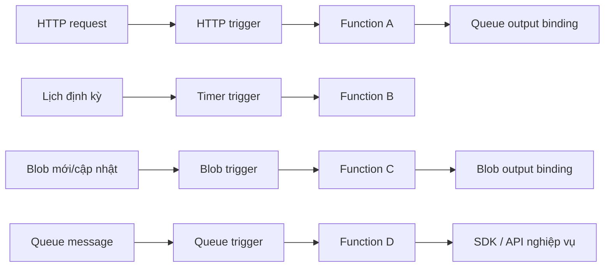
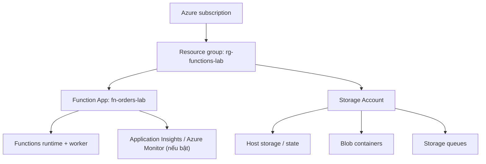
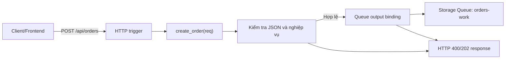
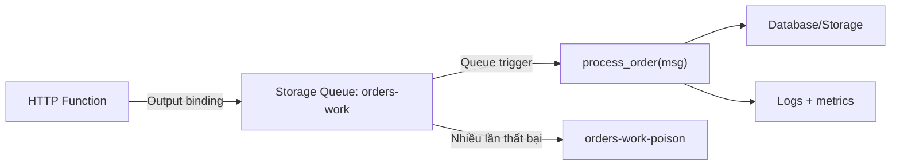
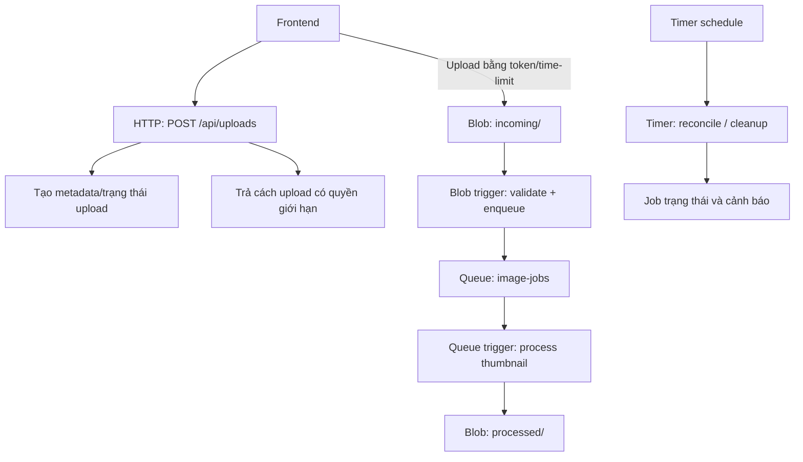
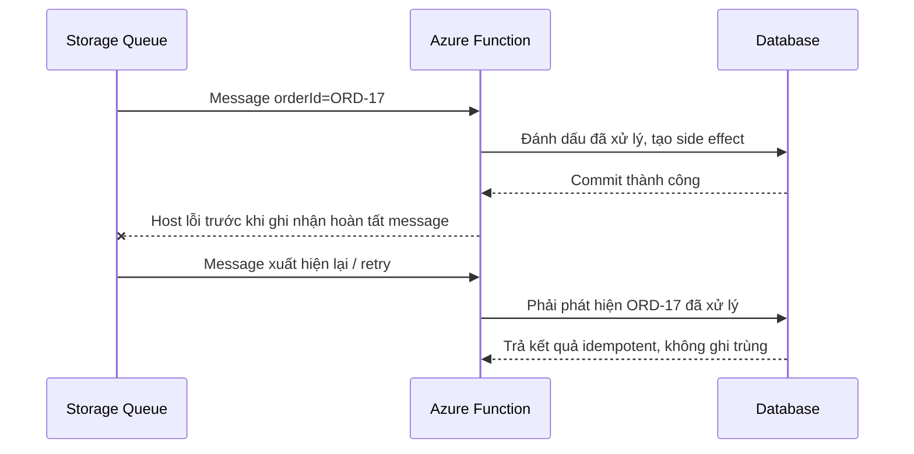
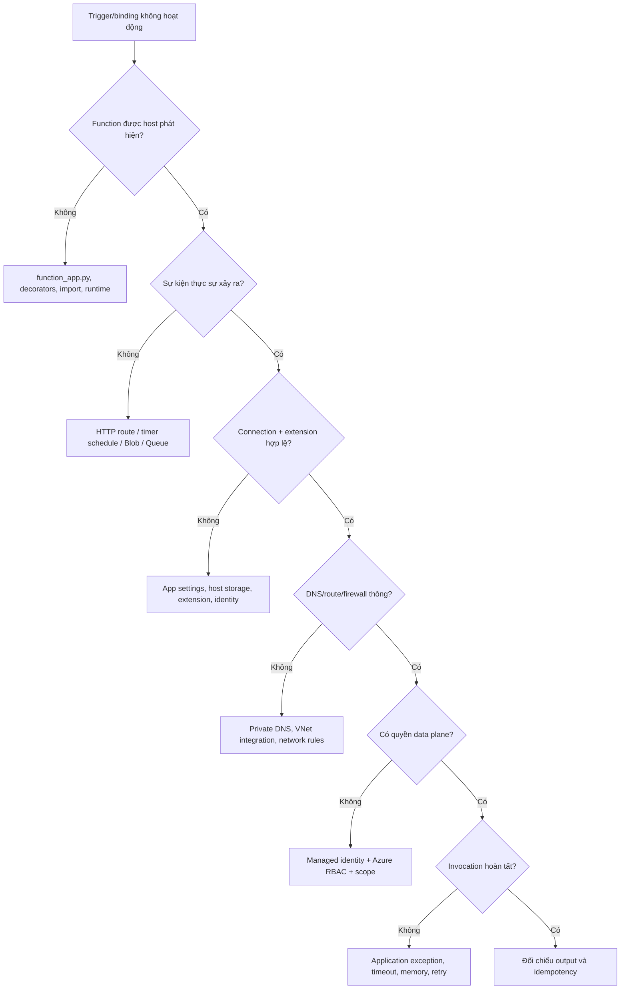

# Trigger và binding cho HTTP, timer và Storage

Một ứng dụng thương mại điện tử cần nhận đơn hàng qua API, chạy tác vụ tổng hợp số liệu hằng đêm và tự động xử lý tệp khi khách hàng tải ảnh lên Azure Storage. Nếu dựng máy chủ riêng để liên tục chờ ba loại sự kiện này, đội phát triển phải tự quản lý vòng đời máy, lịch chạy, lắng nghe hàng đợi và mở rộng tài nguyên. **Azure Functions** cung cấp mô hình tính toán hướng sự kiện (*event-driven serverless*) để tập trung vào mã xử lý; **trigger** xác định khi nào hàm chạy, còn **binding** giúp hàm nhận và gửi dữ liệu mà không phải tự viết toàn bộ mã kết nối dịch vụ.

Bài học thuộc chương **Serverless với Azure Functions** của module `CLOUD_PROVIDERS_AZURE`. Trong lộ trình khám phá Microsoft Azure từ subscription, resource group, Microsoft Entra ID đến mạng ảo, dịch vụ tính toán, lưu trữ, dữ liệu, triển khai, giám sát, bảo vệ và chi phí, bạn sẽ xây dựng được cách tư duy đúng về **HTTP trigger**, **timer trigger**, **Blob/Queue Storage trigger** và các **input/output bindings**.

Các ví dụ thực hành dùng **Python programming model v2** với decorators trên Azure Functions runtime thế hệ 4. Các ngôn ngữ khác như C#, Java, JavaScript/TypeScript có cú pháp khác nhưng tuân theo cùng các nguyên tắc trigger và binding. Mẫu cấu hình phải được kiểm tra với runtime, extension, hosting plan và SDK đang được môi trường thực tế hỗ trợ.

## Mục tiêu học tập

Sau bài này, bạn có thể:

1. Phân biệt **trigger**, **input binding** và **output binding**, cùng giới hạn của từng vai trò.
2. Giải thích một Function App có nhiều functions, nhưng **mỗi function chỉ có một trigger**.
3. Tạo **HTTP trigger** có route, methods, xác thực function key và HTTP response thích hợp.
4. Định nghĩa **timer trigger** bằng biểu thức NCRONTAB sáu trường, hiểu UTC, `is_past_due` và việc chạy theo lịch khi scale.
5. Xây dựng luồng **Blob trigger**, **Queue trigger**, **Blob/Queue input-output bindings** cho dữ liệu Azure Storage.
6. Quản lý `AzureWebJobsStorage`, app settings, `connection` và danh tính Microsoft Entra/managed identity mà không hardcode secrets.
7. Chạy thử Functions bằng Azure Functions Core Tools và Azurite, đọc log và xác minh dữ liệu trong Storage.
8. Thiết kế **idempotency, retry, poison messages, kiểm soát chi phí, an toàn và giám sát** cho hệ thống hướng sự kiện.

## 1. Khái niệm nền tảng: một function phản ứng với một sự kiện

Azure Functions có các thành phần:

| Thành phần | Ý nghĩa | Ví dụ |
|---|---|---|
| **Function App** | Đơn vị quản lý/triển khai, chứa một hoặc nhiều functions cùng runtime và cấu hình ứng dụng | `fn-orders-lab` |
| **Function** | Hàm xử lý một loại sự kiện | `create_order` |
| **Trigger** | Nguồn sự kiện khiến hàm được thực thi | HTTP request, timer schedule, queue message, blob change |
| **Input binding** | Đưa dữ liệu từ dịch vụ hỗ trợ vào hàm mà không cần tự truy xuất bằng SDK cho thao tác cơ bản | Đọc nội dung blob theo đường dẫn |
| **Output binding** | Ghi dữ liệu hàm tạo ra tới đích được hỗ trợ | Gửi message vào Storage Queue |
| **Binding extension** | Tích hợp runtime với loại dịch vụ/binding và schema tương ứng | Azure Storage Blob/Queue extension |
| **App settings** | Cấu hình tên kết nối, feature flags, thông tin endpoint, secret references | `AzureWebJobsStorage`, `JobsStorage` |
| **Host/runtime** | Tiếp nhận trigger, điều phối invocation, logging, extension, retry/scale theo khả năng hosting | Azure Functions runtime 4.x |

Một Function App có thể chứa **nhiều functions có trigger khác nhau**. Tuy nhiên, **một function chỉ có đúng một trigger**; có thể gắn thêm input/output bindings nếu mô hình và extension hỗ trợ.



Sơ đồ nhấn mạnh **hướng sự kiện**. Output binding **không kích hoạt hàm**; nó gửi dữ liệu khi invocation được xử lý. Ngược lại, trigger có thể đồng thời cung cấp payload của sự kiện vào hàm, ví dụ `HttpRequest` hoặc `QueueMessage`.

### Trigger khác input binding ở đâu?

Giả sử khách gọi `POST /api/orders` và hàm cần đọc mẫu JSON từ Blob:

- **HTTP trigger** là lý do hàm được gọi.
- **Blob input binding** có thể cung cấp nội dung blob được xác định từ route hoặc binding expression.
- **Queue output binding** ghi thông báo công việc đến hàng đợi sau khi hàm chấp nhận yêu cầu.

Không cần thêm Blob trigger vào cùng hàm. Nếu muốn xử lý mỗi khi có Blob mới, hãy tạo **một function khác dùng Blob trigger**.

### Binding có thay thế hoàn toàn Azure SDK không?

Không. Binding phù hợp cho trường hợp đọc/ghi một đối tượng hoặc message đơn giản. Khi cần:

- liệt kê nhiều blob có phân trang;
- xử lý nhiều container hoặc transaction/conditional updates;
- upload tệp lớn dạng streaming với yêu cầu tối ưu chi tiết;
- điều khiển batch, retry, lease, metadata, tags hoặc ETag;
- gọi nhiều Storage accounts động theo nghiệp vụ;

thì **Azure Storage SDK** thường phù hợp hơn. Trigger/binding và SDK có thể được dùng cùng nhau, nhưng phải quản lý rõ credential, permissions và thứ tự commit của các bước nghiệp vụ.

## 2. Chọn hosting plan và lập phạm vi triển khai

Azure Functions hỗ trợ nhiều lựa chọn hosting; khả năng scale, timeout, networking, chi phí và một số tính năng thay đổi theo plan.

| Lựa chọn | Cách suy nghĩ | Điểm cần đánh giá |
|---|---|---|
| **Flex Consumption** | Serverless với mô hình mở rộng và cấu hình được hỗ trợ riêng | Regional support, memory/instances, networking, trigger behavior và billing |
| **Consumption** (đời trước trong những trường hợp còn hỗ trợ) | Trả phí theo hoạt động với một số giới hạn runtime/timeout | Kế hoạch hỗ trợ, giới hạn scale và cold start |
| **Premium** | Có khả năng pre-warmed/always-ready và networking theo SKU | Chi phí nền, VNet, scale và hiệu năng |
| **Dedicated / App Service Plan** | Chia sẻ năng lực với App Service Plan | Số instance, cấu hình Always On khi cần, phí compute cố định |
| **Container-based / các mô hình được hỗ trợ khác** | Đóng gói worker theo yêu cầu triển khai | Networking, image, runtime/extension và ownership |

**Không phải trigger nào cũng có hành vi scale giống nhau trên mọi plan**. Ví dụ queue/blob triggers phụ thuộc vào extension và cơ chế scale của hosting; timer trigger hướng tới chạy theo lịch, không phải tự phân phối một timer invocation đồng thời tới từng instance.

Với ví dụ học tập, chọn một plan **hỗ trợ Python và Storage bindings** trong region mà subscription được phép sử dụng. Đừng tạo tài nguyên production dựa trên mô tả plan mà chưa xác nhận giá, phiên bản và chính sách hiện hành.

### Tài nguyên tối thiểu



**`AzureWebJobsStorage`** thường là kết nối tới storage mà Functions host dùng cho một số trạng thái quản lý, trigger receipts, coordination và các khả năng runtime. Kết nối ứng dụng như `JobsStorage` có thể trỏ tới Storage account khác để phân tách dữ liệu nghiệp vụ. Trong lab, cả hai có thể cùng trỏ đến Azurite; trong production cần phân quyền và cấu hình riêng theo mục tiêu bảo mật.

## 3. Chuẩn bị môi trường Python Functions

Các công cụ cần có:

- Python phiên bản được **Azure Functions runtime/worker** và hosting plan hỗ trợ.
- **Azure Functions Core Tools v4** để chạy host cục bộ.
- Azure CLI (`az`) nếu thao tác với Azure subscription.
- **Azurite** (hoặc Storage account lab được phê duyệt) để thử Blob/Queue Storage.
- Một IDE và Git; loại trừ tệp cấu hình chứa secrets khỏi source control.

Lệnh kiểm tra minh họa trong Bash:

```bash
python --version
func --version
az version

az login --tenant "<tenant-id>"
az account set --subscription "<subscription-id>"
az account show --query "{name:name,id:id,tenant:tenantId}" --output json
```

**Không chạy lệnh tạo tài nguyên Azure khi chưa kiểm tra subscription và budget**. Azure Functions Core Tools chạy local không nhất thiết phải đăng nhập Azure nếu chỉ dùng emulator và thử HTTP local.

### Tạo dự án cục bộ

Trong thư mục học tập riêng, người học có thể:

```bash
mkdir functions-trigger-lab
cd functions-trigger-lab

func init . --python
python -m venv .venv
```

Sau đó kích hoạt môi trường Python theo shell đang dùng:

```bash
# Bash hoặc zsh
source .venv/bin/activate

# Cài dependencies sau khi đã kích hoạt venv
python -m pip install azure-functions
```

Với PowerShell/Windows, đường dẫn kích hoạt có thể là `.venv\\Scripts\\Activate.ps1`. Nếu tổ chức dùng template tích hợp của Core Tools hoặc IDE, nên để tool sinh cấu trúc chuẩn rồi so sánh với phần minh họa; **không bắt buộc chạy `func new` cho mỗi ví dụ**.

### Cấu trúc dự án minh họa

```text
functions-trigger-lab/
├── function_app.py
├── host.json
├── local.settings.json        # local secrets, KHÔNG commit
├── requirements.txt
├── .funcignore
└── .venv/                     # local virtual environment
```

`requirements.txt` tối thiểu:

```text
azure-functions
```

Trong sản phẩm thực, pin dependency versions theo quy trình cập nhật của tổ chức và dùng lock/build pipeline thích hợp. Đoạn sau dùng mô hình decorator của Python v2 trong tệp `function_app.py`, với **một đối tượng FunctionApp duy nhất**:

```python
import azure.functions as func

app = func.FunctionApp(http_auth_level=func.AuthLevel.FUNCTION)
```

Những đoạn `@app.route`, `@app.timer_trigger`, `@app.blob_trigger` và `@app.queue_trigger` ở các mục sau là **các function định nghĩa tiếp vào cùng tệp**. Không tạo lại `app = func.FunctionApp()` giữa các function nếu muốn chúng cùng nằm trong một Function App.

## 4. Cấu hình `host.json` và `local.settings.json`

### `host.json`: hành vi host

Một cấu hình khởi đầu:

```json
{
  "version": "2.0",
  "logging": {
    "applicationInsights": {
      "samplingSettings": {
        "isEnabled": true,
        "excludedTypes": "Request"
      }
    }
  },
  "extensions": {
    "queues": {
      "maxDequeueCount": 5,
      "visibilityTimeout": "00:00:30",
      "batchSize": 4
    }
  }
}
```

`version: "2.0"` là định dạng schema host.json áp dụng cho các runtime Functions hiện đại, **không có nghĩa đang chạy Functions runtime v2**. Các trường `extensions.queues` liên quan Queue Storage extension; cần kiểm tra extension version và kế hoạch concurrency thực tế.

### `local.settings.json`: cấu hình máy phát triển

```json
{
  "IsEncrypted": false,
  "Values": {
    "AzureWebJobsStorage": "UseDevelopmentStorage=true",
    "JobsStorage": "UseDevelopmentStorage=true",
    "FUNCTIONS_WORKER_RUNTIME": "python"
  }
}
```

**Cảnh báo:** `UseDevelopmentStorage=true` chỉ dùng khi Azurite đang chạy và worker/extension hỗ trợ mô hình emulator. Nó **không phải connection string dùng trên Azure production**. Tệp `local.settings.json` có thể chứa bí mật khi kết nối cloud Storage thật; không commit vào Git và không gửi nội dung của nó trong log/ticket.

Các giá trị trong `Values` trở thành app settings khi host chạy local. Trên Azure, thiết lập tương đương trong **Function App → Environment variables / Configuration → Application settings** hoặc IaC/secret references.

### Tên kết nối trong decorator

Ví dụ:

```python
@app.queue_trigger(
    arg_name="msg",
    queue_name="orders-work",
    connection="JobsStorage"
)
```

`connection="JobsStorage"` là **tên cấu hình/prefix kết nối**, không phải mật khẩu và không phải tên storage account. Runtime tìm app settings phù hợp với kết nối này. Tránh ghi:

```python
# Sai về ý tưởng: không hardcode secret vào decorator
connection="DefaultEndpointsProtocol=https;AccountName=...;AccountKey=..."
```

Trong production, có thể dùng **identity-based connection settings** tương ứng với extensions hỗ trợ, thay vì lưu Shared Key. Quyền RBAC cần cấp cho danh tính Function App phải phù hợp với Blob/Queue và host storage.

## 5. HTTP trigger: nhận request từ client

HTTP trigger là mô hình phổ biến cho API/webhook. Nó tiếp nhận yêu cầu HTTP theo route, method và authorization level, gọi mã Python, sau đó trả HTTP response.



### Route và methods

Với Python v2 programming model:

```python
import json
import azure.functions as func

app = func.FunctionApp(http_auth_level=func.AuthLevel.FUNCTION)

@app.route(
    route="hello/{name}",
    methods=["GET"],
    auth_level=func.AuthLevel.FUNCTION
)
def hello(req: func.HttpRequest) -> func.HttpResponse:
    name = req.route_params.get("name", "").strip()
    if not name:
        return func.HttpResponse("Thiếu tên", status_code=400)

    return func.HttpResponse(
        json.dumps({"message": f"Xin chào, {name}!"}, ensure_ascii=False),
        status_code=200,
        mimetype="application/json"
    )
```

Trong ví dụ độc lập này, `app = ...` được khai báo để minh họa một **file hoàn chỉnh**. Khi ghép các ví dụ trong cùng `function_app.py`, chỉ khai báo `app` một lần rồi dùng các decorators trên đối tượng đó.

URL local có dạng:

```text
GET http://localhost:7071/api/hello/An
```

Prefix mặc định thường là `/api`, nhưng có thể thay đổi qua cấu hình HTTP extensions/host. Khi triển khai Azure, hostname thay bằng hostname Function App hoặc custom domain đã cấu hình.

### Auth level: anonymous, function và admin

| Giá trị | Ý nghĩa thực tế | Khuyến nghị |
|---|---|---|
| `ANONYMOUS` | HTTP trigger không yêu cầu function key từ runtime | Chỉ dùng khi endpoint thực sự được phép public; thêm auth ứng dụng/API gateway nếu cần |
| `FUNCTION` | Yêu cầu function/host key hợp lệ trong cấu hình được hỗ trợ | Phù hợp một số tích hợp machine-to-machine đơn giản; key vẫn là bí mật |
| `ADMIN` | Yêu cầu admin/master key có đặc quyền cao | Không dùng làm cơ chế bảo vệ HTTP endpoint nghiệp vụ thông thường |

Function key có thể truyền qua header `x-functions-key` hoặc cơ chế query được hỗ trợ. **Function key không phải user authentication hoàn chỉnh**: nó không cung cấp danh tính cá nhân, role nghiệp vụ hoặc vòng đời token như Microsoft Entra ID. Với API nhạy cảm, dùng **App Service Authentication / Microsoft Entra ID**, API Management và authorization trong ứng dụng theo mô hình phù hợp.

Trong local Core Tools, việc kiểm tra auth level có thể khác khi chạy trên Azure; **không suy ra vì request local không có key mà vẫn thành công thì endpoint Azure cũng public**.

### HTTP semantics và mã phản hồi

| Mã | Khi nào dùng | Ví dụ |
|---|---|---|
| `200 OK` | Xử lý đồng bộ thành công và có kết quả | GET thông tin |
| `201 Created` | Tạo resource thành công | Tạo đối tượng đã được lưu |
| `202 Accepted` | Đã chấp nhận yêu cầu để xử lý bất đồng bộ | Đưa job vào queue |
| `400 Bad Request` | JSON/schema/field không hợp lệ | Thiếu `orderId` |
| `401 Unauthorized` | Cần xác thực hoặc token không hợp lệ | API yêu cầu đăng nhập |
| `403 Forbidden` | Danh tính đã được nhận diện nhưng không có quyền hoặc bị policy chặn | Chưa có role nghiệp vụ |
| `429 Too Many Requests` | Quá ngưỡng/throttle theo thiết kế | Hạn chế client |
| `500/503` | Lỗi xử lý hoặc phụ thuộc chưa sẵn sàng | Storage unavailable |

Nếu function trả `202` sau khi gửi queue message, điều đó **không có nghĩa job đã xử lý xong**. Hãy trả ID/correlation ID để client hỏi trạng thái qua API hoặc nhận callback. Với tác vụ lâu, đánh giá **Durable Functions** hoặc queue/workflow thay vì giữ request HTTP mở đến khi hết thời gian chờ của frontend.

## 6. HTTP trigger kết hợp Queue output binding

Ví dụ thực tế: nhận một đơn hàng JSON, kiểm tra `orderId`, ghi thông báo vào Storage Queue và trả `202 Accepted`.

Đoạn sau bổ sung vào cùng `function_app.py` đã có `app = func.FunctionApp(...)`:

```python
import json
import logging
import azure.functions as func

@app.route(
    route="orders",
    methods=["POST"],
    auth_level=func.AuthLevel.FUNCTION
)
@app.queue_output(
    arg_name="order_message",
    queue_name="orders-work",
    connection="JobsStorage"
)
def create_order(
    req: func.HttpRequest,
    order_message: func.Out[str]
) -> func.HttpResponse:
    try:
        payload = req.get_json()
    except ValueError:
        return func.HttpResponse(
            '{"error":"JSON không hợp lệ"}',
            status_code=400,
            mimetype="application/json"
        )

    if not isinstance(payload, dict):
        return func.HttpResponse(
            '{"error":"Body phải là object JSON"}',
            status_code=400,
            mimetype="application/json"
        )

    order_id = str(payload.get("orderId", "")).strip()
    if not order_id:
        return func.HttpResponse(
            '{"error":"Thiếu orderId"}',
            status_code=400,
            mimetype="application/json"
        )

    message = json.dumps(
        {"orderId": order_id, "eventType": "OrderSubmitted"},
        ensure_ascii=False
    )
    order_message.set(message)
    logging.info("Đã tiếp nhận đơn hàng để xử lý bất đồng bộ")

    return func.HttpResponse(
        json.dumps(
            {"orderId": order_id, "status": "accepted"},
            ensure_ascii=False
        ),
        status_code=202,
        mimetype="application/json"
    )
```

**Tác động của decorator:**

- `@app.route` đăng ký **HTTP trigger** và đường phản hồi HTTP.
- `@app.queue_output` tạo **output binding** tới Queue Storage `orders-work`.
- `order_message.set(...)` cung cấp nội dung message cho runtime gửi sau khi function trả kết quả theo vòng đời binding.

**Ràng buộc cần lưu ý:** output binding được host xử lý khi invocation hoàn thành, vì vậy nếu ghi message thất bại, response và tình trạng xử lý của invocation phụ thuộc runtime/extension; **không dùng HTTP 202 như cam kết giao dịch phân tán giữa HTTP response và Storage Queue**. Với nghiệp vụ phải chống mất message, thiết kế idempotency/outbox hoặc giao dịch phù hợp, giám sát lỗi và có quy trình replay.

### Kiểm tra local

Sau khi chạy Functions host:

```bash
func start
```

Trong terminal khác:

```bash
curl -X POST "http://localhost:7071/api/orders" \
  -H "Content-Type: application/json" \
  -d '{"orderId":"ORD-1001"}'
```

Nếu local emulator đang chạy và queue đã được tạo theo cơ chế được phép, Function sẽ ghi message để bước Queue trigger xử lý. Không thử với dữ liệu thanh toán/khách hàng thực; ví dụ này chưa có xác thực người dùng nghiệp vụ, signature verification hay schema validation đầy đủ.

## 7. Timer trigger: chạy theo lịch

**Timer trigger** kích hoạt function theo lịch biểu thay vì đợi HTTP/Storage event. Các kịch bản phù hợp:

- Gom báo cáo mỗi đêm.
- Làm sạch những đối tượng hết hạn theo quy trình cho phép.
- Kiểm tra trạng thái batch pipeline định kỳ.
- Làm mới cache hoặc tổng hợp số liệu theo khung thời gian.

### Cú pháp NCRONTAB sáu trường

Azure Functions timer schedule thường dùng biểu thức **NCRONTAB** gồm **sáu trường**, có thêm trường **giây** phía đầu so với cron năm trường phổ biến:

```text
{second} {minute} {hour} {day} {month} {day-of-week}
```

Ví dụ:

| Expression | Ý nghĩa |
|---|---|
| `0 */5 * * * *` | Mỗi 5 phút, tại giây 0 |
| `0 0 * * * *` | Mỗi giờ tại phút 0, giây 0 |
| `0 0 2 * * *` | 02:00 hằng ngày theo timezone của runtime |
| `0 30 8 * * 1-5` | 08:30 các ngày làm việc theo cách đánh số thứ của lịch hỗ trợ |
| `0 0 0 1 * *` | 00:00 ngày đầu tiên mỗi tháng |

**Mặc định nên suy nghĩ theo UTC** trừ khi hosting plan và cấu hình timezone cho phép lịch chạy theo một múi giờ khác. Việt Nam dùng UTC+07:00 và không có daylight saving time, vì vậy **02:00 UTC tương đương 09:00 tại Việt Nam**. Đừng đưa biểu thức `0 0 9 * * *` vào Azure rồi mặc định nó sẽ chạy 09:00 giờ Việt Nam.

Một số tổ hợp plan/OS không hỗ trợ hoặc có hạn chế khi dùng `WEBSITE_TIME_ZONE`. Khi yêu cầu lịch chính xác theo giờ địa phương, kiểm tra plan/OS và quy tắc timezone; lựa chọn bền vững là **lưu lịch UTC** và chuyển đổi múi giờ ở biên ứng dụng.

### Ví dụ timer trigger Python

```python
import datetime
import logging
import azure.functions as func

@app.timer_trigger(
    schedule="0 0 2 * * *",
    arg_name="schedule_timer",
    run_on_startup=False,
    use_monitor=True
)
def summarize_daily(schedule_timer: func.TimerRequest) -> None:
    utc_now = datetime.datetime.now(datetime.timezone.utc)

    if schedule_timer.past_due:
        logging.warning("Timer invocation đang trễ lịch dự kiến")

    logging.info(
        "Bắt đầu tổng hợp theo lịch tại %s",
        utc_now.isoformat()
    )
    # TODO: gọi dịch vụ tổng hợp bằng API/SDK có kiểm soát
```

`run_on_startup=False` tránh chạy không chủ ý khi host start/restart hoặc scale event theo cơ chế cấu hình. `use_monitor=True` cho phép lưu trạng thái theo dõi lịch theo khả năng của runtime/host storage, giúp xử lý một số trường hợp host khởi động lại.

### Có chạy một lần duy nhất trên mọi instance không?

Runtime thường phối hợp timer schedule để tránh mỗi instance đang scale-out đồng loạt xử lý cùng một tick. **Tuy nhiên, timer trigger không phải bảo đảm exactly-once nghiệp vụ end-to-end**. Restart, timeout, lỗi mạng, retry từ mã gọi và những thay đổi trạng thái có thể khiến hệ thống phải xử lý lại hoặc bỏ lỡ thời điểm trong điều kiện cụ thể.

Với tác vụ tài chính/hóa đơn:

- Dùng **khóa nghiệp vụ** như `reportDate=2026-11-20`.
- Ghi trạng thái chạy và kiểm tra xem ngày đó đã tổng hợp thành công chưa.
- Dùng optimistic concurrency/lease/transaction ở nguồn dữ liệu thích hợp.
- Cho phép chạy lại an toàn mà không tạo báo cáo trùng hoặc ghi đè sai.
- Có thủ tục **backfill** cho ngày bị bỏ qua khi hệ thống ngừng lâu.

### Không dùng timer cho polling liên tục không cần thiết

Nếu yêu cầu là “xử lý ngay khi blob mới xuất hiện”, Blob trigger hoặc Event Grid phù hợp hơn một timer mỗi vài giây liệt kê hàng triệu blobs. Timer thích hợp cho **lịch định kỳ**; event trigger phù hợp cho **thay đổi dữ liệu**.

## 8. Azure Storage có những trigger/binding nào?

Trong phạm vi bài, **Azure Storage** gồm hai nhóm thường dùng nhất với Azure Functions:

- **Blob Storage:** lưu dữ liệu đối tượng như ảnh, PDF, log hoặc tệp JSON; Blob trigger/input/output bindings làm việc với nội dung blob.
- **Queue Storage:** lưu message điều phối tác vụ bất đồng bộ; Queue trigger/output binding làm việc với message.

| Thành phần | Trigger? | Input binding? | Output binding? | Tình huống |
|---|---|---|---|---|
| HTTP | Có | Payload request được trigger đưa vào | HTTP response | API, webhook |
| Timer | Có | Metadata timer được trigger đưa vào | Không có “timer output” thông dụng | Tổng hợp/lịch công việc |
| Blob Storage | Có | Có | Có | Xử lý tệp, đọc mẫu dữ liệu, ghi output |
| Queue Storage | Có | Nhiều SDK/API có thể đọc queue, nhưng binding thực tế chủ yếu trigger/output theo mô hình | Có | Worker background, kết nối tác vụ |

**Không nhầm Queue Storage với Azure Service Bus.** Hai dịch vụ có triggers/extensions, semantics, dead-letter/retry và tính năng messaging khác nhau. Các ví dụ dưới đây dùng **Azure Storage Queues**.

## 9. Blob trigger: phản ứng khi có Blob mới hoặc thay đổi

Ví dụ người dùng upload tệp:

```text
Storage account: stfunctionslab001
Container: incoming
Blob name: 2026/11/invoice-001.pdf
```

Ứng dụng muốn xử lý khi blob đủ điều kiện được phát hiện. Trong Python v2:

```python
import logging
import azure.functions as func

@app.blob_trigger(
    arg_name="incoming_blob",
    path="incoming/{name}",
    connection="JobsStorage"
)
def on_blob_uploaded(incoming_blob: func.InputStream) -> None:
    logging.info(
        "Blob trigger nhận %s; size=%s bytes",
        incoming_blob.name,
        incoming_blob.length
    )
    # Không đọc toàn bộ blob lớn vào RAM nếu không có nhu cầu.
    # Khi xử lý thực tế, dùng SDK/streaming và quy trình retry phù hợp.
```

### `path` và binding expressions

`incoming/{name}` gồm:

- `incoming`: tên **container**.
- `{name}`: binding expression bắt tên/path blob phù hợp để runtime cung cấp cho invocation.
- `connection="JobsStorage"`: tên connection setting tới Storage.

Không xem `{name}` là bảo vệ input khỏi path traversal hoặc tự động xác thực dữ liệu. Tên blob có thể chứa `/` và ký tự theo quy tắc của Blob; mã xử lý phải kiểm tra tên, type, kích thước, metadata và nội dung nếu dùng chúng để ghi dữ liệu sang hệ thống khác.

### Blob trigger sử dụng polling hay Event Grid?

Các phiên bản Azure Functions Storage Blob extension hỗ trợ những cơ chế nguồn trigger khác nhau, bao gồm mô hình **phát hiện qua Storage** và mô hình **Event Grid-based** trong cấu hình/hosting tương thích.

| Cơ chế | Đặc điểm khái quát | Điều cần kiểm tra |
|---|---|---|
| **Polling/log-scanning** theo cơ chế Blob extension | Host theo dõi thay đổi trong Storage và các trạng thái đã xử lý | Latency, storage operations, scale behavior, receipts |
| **Event-driven qua Event Grid** | Sự kiện Blob được gửi qua cơ chế sự kiện tới Functions | Extension/source setting, subscription/endpoint, hosting support, dead-letter/retry |

Không mặc định một decorator `blob_trigger` đơn giản trên mọi plan tự dùng Event Grid hoặc phản ứng tức thì. Nếu cần latency thấp hoặc workload có nhiều tệp, đánh giá mô hình trigger, extension version và giới hạn scaling hiện hành.

### Blob receipts và idempotency

Runtime có thể sử dụng trạng thái/receipt để tránh xử lý lại những thay đổi đã xử lý theo cơ chế trigger. Nhưng việc xử lý lỗi, thay đổi phiên bản blob, retry và lỗi một phần có thể tạo invocation lặp lại. **Receipt không phải transaction bảo đảm exactly-once cho hệ thống đích**.

Ví dụ xử lý hóa đơn: thay vì tạo một payment record mới mỗi lần Blob trigger chạy, dùng khóa idempotency theo **account/container/blob name + version/ETag/transaction ID phù hợp** rồi kiểm tra/ghi atomically tại kho nghiệp vụ.

### Blob lớn cần xử lý có kiểm soát

Blob binding kiểu `func.InputStream` có API thuận tiện, nhưng gọi `incoming_blob.read()` cho một video nhiều GB có thể gây áp lực bộ nhớ hoặc timeout theo plan. Khi xử lý dữ liệu lớn, cân nhắc SDK download chunks/streaming, batch jobs, chia công việc và lựa chọn memory/timeout phù hợp. Luôn ghi giới hạn kích thước/dung lượng ứng dụng chấp nhận.

## 10. Blob input binding: đọc dữ liệu khi function được gọi bởi trigger khác

Giả sử ứng dụng có API:

```text
GET /api/documents/guide
    └── đọc Blob documents/guide.txt
```

Function vẫn có **HTTP trigger**; Blob input binding chỉ đem nội dung blob vào hàm:

```python
import azure.functions as func

@app.route(
    route="documents/{id}",
    methods=["GET"],
    auth_level=func.AuthLevel.FUNCTION
)
@app.blob_input(
    arg_name="document",
    path="documents/{id}.txt",
    connection="JobsStorage"
)
def get_document(
    req: func.HttpRequest,
    document: func.InputStream
) -> func.HttpResponse:
    content = document.read()
    return func.HttpResponse(
        body=content,
        status_code=200,
        mimetype="text/plain"
    )
```

### Cần biết khi Blob không tồn tại

Nếu blob đích không tồn tại, **input binding có thể thất bại ngay trong giai đoạn binding** trước khi thân function chạy, nên `try/except` đặt trong hàm **không luôn bắt được lỗi để trả HTTP 404**. Với API production cần 404/conditional reads rõ ràng, dùng **Azure Blob SDK** trong thân hàm để kiểm soát exception và response.

### An toàn với route parameters

Đừng nối `id` từ URL vào đường dẫn nội bộ/đối tượng tùy tiện. Xác thực độ dài, định dạng, quyền sở hữu và phạm vi resource. Blob input binding không tự kiểm tra người dùng có được đọc tài liệu đó hay không; nó chạy với quyền của Function App connection.

## 11. Blob output binding: tạo đối tượng đích

Một Blob trigger có thể dùng thêm output binding để ghi bản sao/đối tượng xử lý sang container khác. Đây là function **riêng**, không được triển khai đồng thời với ví dụ `on_blob_uploaded` ở trên nếu không muốn hai triggers cùng xử lý một tập blob.

```python
import azure.functions as func

@app.blob_trigger(
    arg_name="source_blob",
    path="incoming/{name}",
    connection="JobsStorage"
)
@app.blob_output(
    arg_name="processed_blob",
    path="processed/{name}",
    connection="JobsStorage"
)
def copy_small_blob(
    source_blob: func.InputStream,
    processed_blob: func.Out[bytes]
) -> None:
    data = source_blob.read()
    processed_blob.set(data)
```

Mẫu này chỉ dành cho **blob nhỏ trong lab**. Nó đọc cả blob vào bộ nhớ và chưa có kiểm tra file type, virus scan, content transformation, giới hạn size, retention hoặc error-handling nghiệp vụ.

### Tránh tạo vòng lặp trigger

Nếu trigger lắng nghe container `incoming` nhưng output cũng ghi trở lại đúng tập blob mà trigger lắng nghe, một kết quả ghi mới có thể tạo sự kiện tiếp theo và gây **vòng lặp xử lý**. Cách đơn giản là tách container `incoming` và `processed`, kiểm tra idempotency và đặt ràng buộc trên output.

Không mặc định output binding tự quản lý business transaction. Khi cần ghi Blob rồi cập nhật database/Queue như một thao tác không được mất hoặc trùng, thiết kế **state machine/outbox/compensation** phù hợp.

## 12. Queue trigger: xử lý message bất đồng bộ

Queue trigger chạy function khi có message trong Azure Storage Queue tương ứng. Thích hợp cho việc xử lý không cần giữ HTTP request mở, ví dụ:

- Gửi email xác nhận đơn hàng.
- Tạo thumbnail sau khi upload tệp.
- Tính toán background không cần đáp ứng tức thì.
- Điều phối worker đọc dữ liệu từ Blob/SQL theo một event.



### Ví dụ Python v2

```python
import json
import logging
import azure.functions as func

@app.queue_trigger(
    arg_name="order_message",
    queue_name="orders-work",
    connection="JobsStorage"
)
def process_order(order_message: func.QueueMessage) -> None:
    raw = order_message.get_body().decode("utf-8")
    payload = json.loads(raw)

    order_id = payload.get("orderId")
    if not isinstance(order_id, str) or not order_id:
        raise ValueError("Queue message thiếu orderId hợp lệ")

    logging.info("Đang xử lý đơn hàng đã được xác thực định dạng")
    # TODO: gọi service nghiệp vụ theo idempotency key orderId.
    # Nếu xử lý thất bại, raise exception để runtime ghi nhận lỗi.
```

Để hàm chạy, queue `orders-work` phải có thật và connection phải có quyền đọc/nhận message theo mô hình hỗ trợ. Worker nên xác minh JSON schema, signature/auth ở nguồn phát và quyền nghiệp vụ, không chỉ kiểm tra một field.

### Queue visibility timeout và xử lý lặp

Khi worker nhận message, message có thể tạm thời không hiển thị cho các consumer khác theo cơ chế Queue Storage/extension. Nếu invocation lỗi hoặc host bị gián đoạn, message có thể **xuất hiện trở lại** và được xử lý lần nữa.

**Azure Storage Queue không bảo đảm đúng một lần xử lý nghiệp vụ.** Cần:

1. **Idempotency key** (ví dụ `orderId` + loại event).
2. Kiểm tra trạng thái ở kho dữ liệu có transaction/conditional write.
3. Retry có backoff, phân biệt lỗi tạm thời và lỗi dữ liệu vĩnh viễn.
4. Dead-letter/poison workflow và cảnh báo khi message không xử lý được.
5. Tránh side effect (gửi email/thu tiền) nhiều lần vì cùng message được nhận lại.

### Poison queue

Với Queue Storage trigger, các cấu hình host/extension thường hỗ trợ `maxDequeueCount`. Khi số lần dequeue thất bại vượt giới hạn theo cơ chế extension, message có thể được đưa đến queue tên dạng:

```text
<source-queue-name>-poison
```

Ví dụ `orders-work-poison`. **Poison queue không tự sửa message**. Cần owner đọc lý do, phân loại lỗi, sửa root cause và replay có kiểm soát. Trước khi replay, xác minh message chưa tạo một phần side effects để tránh ghi trùng.

### Message encoding

Message encoding khi dùng Azure Storage Queues SDK và Functions Queue extension có thể phụ thuộc version/default/configuration (ví dụ Base64 hoặc không Base64). Nếu producer dùng Python Azure Storage Queue SDK còn consumer dùng Functions binding, phải **đảm bảo hai bên thống nhất encoding**. Kiểm tra `host.json` option `messageEncoding` và SDK policy theo bản extension/SDK thực tế. Lỗi decode đôi khi là lỗi **encoding mismatch**, không phải dữ liệu JSON bị hỏng.

## 13. Queue output binding: đẩy công việc sang worker

HTTP `POST` tạo order rồi đặt message vào queue là một ví dụ. Timer function cũng có thể dùng Queue output binding để phát sinh công việc theo lịch:

```python
import datetime
import json
import azure.functions as func

@app.timer_trigger(
    schedule="0 0 2 * * *",
    arg_name="timer",
    run_on_startup=False,
    use_monitor=True
)
@app.queue_output(
    arg_name="job_out",
    queue_name="daily-jobs",
    connection="JobsStorage"
)
def enqueue_daily_job(
    timer: func.TimerRequest,
    job_out: func.Out[str]
) -> None:
    today_utc = datetime.datetime.now(
        datetime.timezone.utc
    ).date().isoformat()

    job_out.set(json.dumps({
        "jobType": "DailySummary",
        "businessDate": today_utc
    }))
```

Đây là **function timer riêng**, không nên triển khai song song với timer `summarize_daily` nếu cả hai đều thực hiện cùng việc tổng hợp mà không có điều phối. Một pattern hữu ích là **timer tạo message** rồi **queue trigger thực hiện công việc nặng**, giúp kiểm soát thời gian xử lý, retry và concurrency tách biệt.

**Điểm cần cải thiện cho production:** `today_utc` theo thời điểm thực thi không luôn đồng nghĩa với **ngày nghiệp vụ cần tổng hợp** nếu timer chạy trễ hoặc yêu cầu backfill. Hãy xác định ngày theo schedule occurrence/business calendar và lưu khóa idempotency chính xác.

## 14. Kiến trúc phối hợp HTTP, Timer, Blob và Queue

Một ứng dụng xử lý tệp có thể dùng bốn functions:



Trong mô hình này:

- **HTTP trigger** không phải nhận cả video nhiều GB vào memory. Nó có thể tạo metadata và cấp phương thức upload giới hạn theo quyền, chẳng hạn user delegation SAS cho Blob khi tính năng hỗ trợ.
- **Blob trigger** phát hiện blob được tải lên, xác minh loại tệp/dung lượng và tạo message theo cách được hỗ trợ.
- **Queue trigger** xử lý thumbnail hoặc metadata, ghi Blob ở `processed` và cập nhật trạng thái nghiệp vụ.
- **Timer trigger** định kỳ phát hiện job treo, dữ liệu orphaned hoặc cần backfill.

Không nên truyền **connection string, account key hoặc SAS dài hạn** trong Queue messages. Message chỉ nên chứa object ID, blob path đã được kiểm soát và correlation ID; worker dùng managed identity để lấy dữ liệu.

### Điều kiện đúng đắn của từng bước

| Bước | Hành vi mong muốn | Cách kiểm soát |
|---|---|---|
| HTTP tiếp nhận | Xác minh request và user | Entra/API auth, schema, rate limit, input validation |
| Upload Blob | Chỉ quyền tối thiểu cho container/blob và hạn dùng | Managed identity/user delegation SAS theo hỗ trợ |
| Blob trigger | Không xử lý file sai định dạng/quá lớn | Size/type/content validation, quarantine |
| Queue output | Không tạo job trùng vì trigger retry | Idempotency key và outbox |
| Queue worker | Xử lý lại an toàn | Dedup, retry, checkpoint, poison queue |
| Blob output | Không ghi đè sai bản đã xử lý | Version/ETag và conditional writes nếu cần SDK |
| Timer reconcile | Tìm các bước thất bại/treo | Query trạng thái, backfill và audit |

**Kết luận kiến trúc:** trigger/binding giúp giảm mã boilerplate nhưng **không tự giải quyết giao dịch xuyên nhiều dịch vụ**. Các bước nghiệp vụ cần trạng thái, idempotency, retries và quan sát riêng.

## 15. Kết nối Storage bằng managed identity thay vì account key

### Hai loại storage connection cần phân biệt

1. **Host storage** (`AzureWebJobsStorage`): thường được Functions runtime dùng để phối hợp hoạt động và lưu các trạng thái tùy trigger/extension, ví dụ khóa, receipts hoặc lịch timer.
2. **Application storage** (`JobsStorage`): connection mà các decorators `connection="JobsStorage"` dùng để đọc/ghi dữ liệu nghiệp vụ.

Trong bài lab, cả hai có thể trỏ cùng một Azurite endpoint. Trong production, doanh nghiệp có thể tách accounts và cấp quyền theo **least privilege** để tránh một identity của workload có quyền không cần thiết với dữ liệu khác.

### Identity-based connection settings

Với Storage extension hiện đại có hỗ trợ identity-based connections, thay vì:

```text
JobsStorage=<storage-account-connection-string-with-key>
```

ta có thể cấu hình các app settings theo **prefix của connection**, ví dụ:

```text
JobsStorage__blobServiceUri=https://stjobsprod001.blob.core.windows.net
JobsStorage__queueServiceUri=https://stjobsprod001.queue.core.windows.net
JobsStorage__credential=managedidentity
```

Giá trị là **mẫu cấu hình cần đối chiếu với extension version, identity type và hosting plan**, không phải tệp `local.settings.json` hoàn chỉnh. Với system-assigned managed identity, một số cấu hình có thể tự chọn danh tính mặc định; với user-assigned identity có thể cần chỉ định `clientId` hoặc resource ID theo contract của runtime.

Trong nhiều kịch bản, nếu connection có một **setting tên chính xác** trùng `JobsStorage` chứa connection string, runtime có thể ưu tiên nó hơn tập settings dạng prefix. Vì vậy khi chuyển sang identity, kiểm tra và loại bỏ connection string cũ một cách có kiểm soát, đồng thời xác minh toàn bộ triggers/bindings sau deployment.

**Đừng tự thay `AzureWebJobsStorage` bằng một chuỗi rỗng** chỉ vì application connection đã dùng managed identity. Host storage có những yêu cầu riêng, khác nhau theo plan, trigger và cách deploy. Cấu hình identity-based host storage phải đáp ứng tài liệu Functions host và extensions cụ thể.

### Phân quyền Blob và Queue

| Thao tác | Quyền dữ liệu điển hình cần xem xét | Ghi chú |
|---|---|---|
| Đọc Blob bằng SDK/binding | `Storage Blob Data Reader` hoặc cao hơn theo nhu cầu | Phụ thuộc cách binding/trigger dùng state và yêu cầu quyền bổ sung |
| Ghi Blob output | `Storage Blob Data Contributor` ở scope phù hợp | Có thể cần role cao hơn cho những thao tác leases/metadata đặc thù |
| Blob trigger với identity | Các role như `Storage Blob Data Owner` và `Storage Queue Data Contributor` có thể cần theo extension | Cần xác minh yêu cầu chính xác của Blob extension, receipts và poison handling |
| Queue output | `Storage Queue Data Contributor` theo phạm vi được hỗ trợ | Cấp ở scope tối thiểu |
| Queue trigger | Quyền nhận/xóa/cập nhật message và xử lý poison queue theo extension | Xác minh role mà extension yêu cầu, không chỉ xem quyền gửi message |
| `AzureWebJobsStorage` của host | Vai trò Blob/Queue/Table phù hợp với trigger và cơ chế host | Không suy ra quyền từ một kết nối nghiệp vụ |

**Role Azure RBAC `Reader` trên Storage account không tự cho phép đọc/ghi Blob/Queue data plane.** Phải cấp role dữ liệu và để role assignment có thời gian có hiệu lực. Với thiết kế có nhiều chức năng trong một Function App, tất cả có thể cùng dùng identity của app; nếu cần isolation mạnh, cân nhắc tách Function Apps.

### Kết hợp mạng riêng

Nếu Storage Account chỉ nhận private endpoint traffic:

- Function App phải có **outbound networking/VNet integration** được plan hỗ trợ.
- DNS của `stjobsprod001.blob.core.windows.net` và `stjobsprod001.queue.core.windows.net` phải được phân giải tới private IP tương ứng từ ngữ cảnh runtime.
- Nếu cả Blob và Queue được sử dụng, cần đánh giá **cả private endpoint `blob` và `queue`** cùng Private DNS zones tương ứng.
- NSG, route, firewall và outbound dependencies phải cho phép cả đường đến storage dữ liệu lẫn thành phần mà Functions host/scale cần.
- Managed identity giải quyết **authentication**, không tạo mạng kết nối. Private endpoint giải quyết **network path**, không tự cấp quyền Blob/Queue.

Một Blob trigger có thể không chạy dù Storage SDK từ laptop hoạt động, bởi vì trigger listener chạy **trong Function App** với DNS, identity và host storage khác laptop. Hãy kiểm tra trực tiếp từ môi trường host và theo cơ chế hỗ trợ của hosting plan.

## 16. Local execution: chạy Functions Core Tools và Azurite

### Bước 1 — Chuẩn bị môi trường

Tạo một thư mục lab riêng, kiểm tra phiên bản Python/Core Tools, cài dependencies và chuẩn bị `function_app.py` với các functions đã chọn. Không nên copy **mọi ví dụ cùng lúc** nếu chúng chứa triggers trùng lịch hoặc cùng đọc một container, vì dễ gây xử lý lặp và khó phân biệt log.

Một cấu hình lab phù hợp gồm:

- Một HTTP function `create_order` ghi message vào queue.
- Một Queue trigger `process_order` đọc từ queue đó.
- Một Timer trigger đơn giản ghi log định kỳ.
- Một Blob trigger khác quan sát container `incoming`.

**Khi chạy Python v2**, chỉ khai báo một `app = func.FunctionApp(...)` trong toàn bộ `function_app.py` rồi gắn decorators tương ứng.

### Bước 2 — Bật Azurite

Nếu đã cài và có quyền dùng Azurite trên máy:

```bash
azurite --silent
```

Azurite mô phỏng một số API Azure Blob/Queue/Table Storage cho mục đích phát triển. **Nó không mô phỏng mọi tính năng cloud**, private endpoint, RBAC managed identity, scaling behavior hoặc các ràng buộc SLA của Azure Storage. Kiểm tra phiên bản Azurite và cổng listener mặc định; tránh dùng cổng công khai để người khác truy cập emulator không được bảo vệ.

Trong một terminal khác:

```bash
func start
```

Nếu Core Tools không phát hiện functions, kiểm tra `function_app.py`, decorators, Python worker version, `requirements.txt` và lỗi import. Nếu trigger cần container/queue, hãy chuẩn bị đúng container/queue trong emulator bằng Azure Storage Explorer hoặc công cụ/SDK được phép dùng.

### Bước 3 — Thử HTTP

```bash
curl -i "http://localhost:7071/api/hello/Binh"

curl -i -X POST "http://localhost:7071/api/orders" \
  -H "Content-Type: application/json" \
  -d '{"orderId":"ORD-LOCAL-001"}'

curl -i -X POST "http://localhost:7071/api/orders" \
  -H "Content-Type: application/json" \
  -d '{"badField":"missing-order-id"}'
```

Kết quả mong đợi: hello trả `200`, order hợp lệ trả `202`, thiếu `orderId` trả `400`. Việc queue output thành công còn cần Storage emulator/kết nối/queue phù hợp.

### Bước 4 — Quan sát Queue trigger

Sử dụng Azure Storage Explorer/Azurite để xem:

- Queue `orders-work` có được tạo/được cấu hình không.
- Message đã được thêm và worker có nhận không.
- Log function `process_order` có invocation tương ứng không.
- Nếu gửi message sai JSON, invocation báo lỗi thế nào và message có được retry hay đưa vào poison queue không.

Với function xử lý nhanh, message có thể bị worker tiêu thụ gần như ngay sau khi được ghi. **Không thấy message tồn đọng trong queue không chứng minh output binding chưa ghi**; phải kết hợp log, metric và kết quả nghiệp vụ.

### Bước 5 — Thử Blob trigger

Trong emulator tạo container `incoming` và tải tệp nhỏ `sample.txt` lên. Quan sát tên, kích thước, thời điểm invocation trong log. Thử lại bằng cách cập nhật blob nếu mô hình trigger hỗ trợ và xem trạng thái xử lý. Đừng dùng file có nội dung nhạy cảm hoặc kích thước cực lớn cho lab.

### Bước 6 — Thử Timer trigger

Để dễ quan sát trong lab, có thể đổi schedule thành:

```python
@app.timer_trigger(
    schedule="0 */1 * * * *",
    arg_name="timer",
    run_on_startup=False,
    use_monitor=True
)
```

Đây là ví dụ **decorator rút gọn**, chỉ cần thay trên function timer thích hợp, không tạo thêm function trùng. Lịch này chạy theo phút, **không** dùng thường trực cho tác vụ thật có tác động lớn vì mỗi lần host hoạt động đều có thể tạo công việc/tính phí.

Kiểm tra log tại từng tick; khi đã xong lab, trả lại lịch dự kiến. Không cần gọi endpoint quản trị có master key chỉ để ép timer chạy.

## 17. Triển khai lên Azure Function App

### Các bước khái quát

1. Tạo Resource Group trong subscription được phê duyệt.
2. Tạo hoặc chọn Storage Account phù hợp cho host/trigger/data.
3. Tạo Function App với runtime Python và hosting plan hỗ trợ.
4. Cấu hình `AzureWebJobsStorage`, `FUNCTIONS_WORKER_RUNTIME`, `JobsStorage` và các app settings của production.
5. Bật system-assigned/user-assigned managed identity nếu dùng identity-based connections, cấp RBAC data-plane ở đúng scope.
6. Cấu hình networking, DNS, private endpoint và outbound path nếu Storage bị giới hạn mạng.
7. Cấu hình Application Insights hoặc Azure Monitor theo chính sách.
8. Publish code và xác minh các functions/trigger listeners đã được đăng ký.
9. Thử HTTP, timer và Storage bằng dữ liệu lab, giám sát log và tình trạng xử lý trước khi chuyển traffic thật.

### Lệnh đọc cấu hình an toàn

```bash
az account show \
  --query "{subscription:id,tenant:tenantId,name:name}" \
  --output json

az functionapp show \
  --resource-group "rg-functions-lab" \
  --name "<function-app-name>" \
  --query "{name:name,state:state,location:location,kind:kind,host:defaultHostName}" \
  --output json

az functionapp function list \
  --resource-group "rg-functions-lab" \
  --name "<function-app-name>" \
  --output table
```

Lệnh liệt kê functions chỉ cho biết các functions mà Azure đã nhận diện, **không chứng minh** từng trigger đã kết nối thành công đến Storage hay timer đang chạy đúng lịch.

### Publish code có kiểm soát

Khi Function App đã tồn tại, xác nhận đúng tên và subscription, người dùng có thể deploy từ thư mục dự án local:

```bash
func azure functionapp publish "<function-app-name>"
```

Lệnh này **thay đổi code đang chạy** và có thể khiến host restart, ảnh hưởng trigger; không chạy trên production ngoài CI/CD phê duyệt. Những plan/build modes khác nhau có thể yêu cầu remote build, zip deployment hoặc container deployment theo khả năng hỗ trợ.

**Không sao chép `local.settings.json` chứa secrets lên Azure bằng tay.** App settings production phải quản lý qua IaC, secret references/Key Vault hoặc quy trình cấu hình có kiểm soát. Kiểm tra build artifact và exclusion để không đưa `.venv`, cache hoặc file chứa credentials lên cloud.

### Không dựa vào chỉ số “Deployment succeeded”

Sau publish, phải xác minh:

- Host nhận diện đúng các functions với trigger tương ứng.
- `AzureWebJobsStorage` có kết nối/permission đúng.
- HTTP endpoint nhận request hợp lệ, trả status đúng.
- Timer log cho thấy tick dự kiến hoặc có cảnh báo past_due.
- Blob/Queue listeners không báo storage/extension binding errors.
- Storage data-plane có dữ liệu đầu ra đúng, không trùng hoặc thiếu.
- Application Insights/logs có correlation, latency, failures và khả năng truy vết.

## 18. Retry, idempotency và trạng thái công việc

**Event-driven không có nghĩa sự kiện được xử lý đúng một lần.** Sự kiện có thể lặp khi host restart, consumer xử lý lỗi, queue visibility hết hạn, SDK retry hoặc một hệ thống bên ngoài gửi lại webhook.

### Một kịch bản lỗi



Nếu bỏ qua bước kiểm tra idempotency, một sự kiện có thể gây gửi hai email, hai hóa đơn hoặc ghi cùng giao dịch hai lần.

### Idempotency key nên đặt ở đâu?

| Trigger | Khóa gợi ý | Điều cần kiểm soát |
|---|---|---|
| HTTP POST | `Idempotency-Key` do client gửi hoặc business request ID | Scope theo user/API và TTL; validate key |
| Timer | `jobName + scheduled business date/time` | Không lấy giờ thực thi thay thế giờ dự kiến một cách mù quáng |
| Blob | `account/container/blob + version/ETag` theo nghiệp vụ | Blob có thể cập nhật; phân biệt version cần xử lý |
| Queue | `eventId` hoặc `orderId + eventType` | Message ID của Queue chưa chắc biểu diễn duy nhất nghiệp vụ |

Idempotency cần được bảo đảm bằng **kho trạng thái với conditional write hoặc unique constraint/transaction**, không chỉ bằng một `set` lưu trong RAM của Function App (vì Functions có thể scale và restart).

### Retry không giống retry toàn bộ công việc nghiệp vụ

Với Storage Queue trigger, extension có các cơ chế visibility/dequeue/poison. Với những triggers khác, retry policies và khả năng được hỗ trợ khác nhau. **Không giả định cấu hình retry global ở một nơi sẽ áp dụng giống nhau cho HTTP, timer, Blob và Queue**.

- **Transient failures:** 429, 503, network glitch, tạm hết quota — dùng backoff và retry có giới hạn.
- **Permanent failures:** JSON sai schema, đối tượng không hợp lệ, thiếu quyền do cấu hình sai — đưa vào luồng xử lý lỗi/poison, tránh lặp vô hạn.
- **Partial side effects:** đã cập nhật DB nhưng chưa ghi queue — cần outbox/compensation.
- **Poison messages:** lưu nguyên nhân đã lọc secrets và replay có phê duyệt, tránh requeue tự động vô hạn.

Đặc biệt với Queue Storage, có thể có **delivery lặp** và thứ tự message không được đảm bảo như một transaction log tuần tự. Nếu nghiệp vụ cần thứ tự chặt, sessions hoặc nhiều tính năng messaging nâng cao, đánh giá **Azure Service Bus** thay vì mặc định Storage Queue đáp ứng.

## 19. Concurrency, scaling, timeout và cold start

### Trigger quyết định cách mở rộng workload

| Trigger | Tín hiệu mở rộng/điều phối thường gặp | Rủi ro |
|---|---|---|
| HTTP | Số request/concurrency, trigger scale behavior theo hosting plan | Cold start, timeout, burst, connection exhaustion |
| Timer | Lịch và phối hợp một invocation theo tick trong mô hình hỗ trợ | Không tăng concurrency theo số events; công việc dài chồng lịch |
| Blob | Nguồn/số sự kiện Blob, extension và plan | Latency, backlog, tệp lớn, memory pressure |
| Queue | Số messages đang chờ, batch/prefetch/visibility và scale controller | Xử lý trùng, bùng nổ kết nối backend |

**Tăng số instances Functions không đảm bảo throughput tỷ lệ tuyến tính.** Database connections, API rate limits, Storage throttling, DNS, NAT, khóa phân tán và các dịch vụ phía sau có thể là bottleneck.

### Queue batch và giới hạn backend

Trong `host.json`, những option như `batchSize`, `newBatchThreshold`, `visibilityTimeout` và `maxDequeueCount` điều chỉnh một phần concurrency/retry của Queue extension. Khi Functions host scale ra nhiều instances, **tổng concurrency** có thể cao hơn nhiều so với `batchSize` trên một host.

Ví dụ nếu mỗi invocation tạo tối đa một kết nối database và hệ thống scale ra nhiều instances, database có thể hết connections dù từng Function App instance trông vẫn ổn. Cần capacity planning, pool reuse, throttling, queue buffering và scaling bounds theo hosting plan.

### HTTP timeout

HTTP trigger phù hợp tác vụ ngắn và trả response rõ ràng. Dù function timeout được cấu hình khác nhau theo plan, frontend/network có thể có giới hạn chờ HTTP riêng. Đừng giữ HTTP request mở để xuất báo cáo kéo dài nhiều phút. Pattern tốt hơn:

```text
POST /api/reports
  -> 202 Accepted + jobId
  -> Queue trigger / Durable orchestration
  -> lưu trạng thái Completed/Failed

GET /api/reports/{jobId}
  -> trả trạng thái hoặc URL kết quả theo quyền
```

### Cold start và timer

Trên các plan scale-to-zero, invocation đầu sau khi idle có thể tốn thêm thời gian khởi tạo runtime và dependencies. Timer trigger không nên được dùng như một thủ thuật “ping mỗi phút giữ app ấm” nếu trái mục tiêu plan/chi phí. Khi latency quan trọng, chọn plan/always-ready/pre-warmed instances theo tính năng và ngân sách thay vì tăng invocation giả.

## 20. Bảo mật cho HTTP, timer và Storage

### Checklist bảo vệ HTTP

1. **Authentication:** dùng Entra ID/Easy Auth hoặc API gateway với cơ chế xác thực phù hợp; function key chỉ là một lớp bảo vệ thô.
2. **Authorization:** xác minh user/service principal có quyền với đơn hàng/tài liệu cụ thể.
3. **Input validation:** JSON schema, max payload size, content type, route/query constraints.
4. **Rate limiting:** hạn chế request/abuse ở API Management, WAF hoặc ứng dụng theo mô hình.
5. **Secrets:** không đưa function key vào URL chia sẻ công khai hoặc logs; rotate keys theo quy trình.
6. **Network:** private endpoints/access restrictions/VNet integration khi phù hợp plan và mục tiêu truy cập.
7. **Observability:** không log request body chứa thông tin nhạy cảm nếu không có lý do/phê duyệt.

### Checklist bảo vệ Timer

- Lịch theo UTC hoặc timezone đã kiểm tra rõ.
- Không dùng `run_on_startup=True` trong production nếu không thực sự cần.
- Công việc phải idempotent; hỗ trợ backfill khi bỏ lỡ kỳ.
- Có cơ chế tránh hai job cùng ghi một tập dữ liệu nếu nghiệp vụ cần.
- Có alert cho late/failed/missed runs.
- Không nhúng cron config thành mã không thể thay đổi; có thể dùng app setting được kiểm soát khi cần.

### Checklist bảo vệ Storage

- Tắt public anonymous access khi không có nhu cầu được phê duyệt.
- Dùng managed identity và Azure RBAC data-plane với scope tối thiểu khi hỗ trợ.
- Bảo vệ `AzureWebJobsStorage` và connections của triggers/bindings.
- Nếu Storage private, thiết kế DNS/route/private endpoints đúng cho host và app.
- Không cho người dùng gửi blob path tùy ý để worker đọc tài liệu không thuộc quyền.
- Quét tệp, kiểm tra type/size/virus hoặc nội dung không tin cậy trước xử lý.
- Giữ poison queue/failed records có owner, retention, replay và purge policy.
- Dùng soft delete/versioning/backup khi cần phục hồi, không xem output binding là backup.

## 21. Monitoring: biết trigger đã chạy và binding đã ghi thành công

### Mức quan sát tối thiểu

| Đối tượng | Tín hiệu | Hành động khi bất thường |
|---|---|---|
| HTTP trigger | Requests, status 2xx/4xx/5xx, latency, cold start | Xem lỗi API/auth, phụ thuộc downstream |
| Timer trigger | Scheduled vs actual invocation, `past_due`, duration | Kiểm tra host, timezone, host storage |
| Blob trigger | Blob backlog/processing lag, invocation success/failure | Kiểm tra listener, receipts, connection, blob type |
| Queue trigger | Queue length, oldest message age, dequeue/failure/poison count | Kiểm tra worker, concurrency, retry, schema |
| Output binding | Lỗi ghi destination, destination data count | Xác minh downstream và application correlation |
| Storage account | Availability, throttling, capacity, transaction metrics | Kiểm tra tier, quota, network và RBAC |
| Function App | CPU/memory, instances, failures, app restarts | Xem plan, dependencies, binding extension |
| Chi phí | Invocations, execution duration/memory, host instances, Storage transactions/logs | Tối ưu batching/retention và bounds |

### Correlation ID

Một thiết kế có HTTP → Queue → Blob nên gắn `correlationId` vào message/metadata. Mọi function log ID này (không log secret), giúp truy vết từ request đầu đến kết quả cuối.

Ví dụ message:

```json
{
  "eventId": "evt-8041",
  "correlationId": "trace-8041",
  "eventType": "ImageUploaded",
  "blobName": "incoming/2026/11/image-01.png"
}
```

Không dựa duy nhất vào Azure Activity Log để chẩn đoán data-plane invocation: Activity Log chủ yếu ghi **thay đổi tài nguyên ở control plane**. Function execution logs, Application Insights, Storage diagnostic logs và metrics mới là những nguồn bổ sung thích hợp.

### Log an toàn

Nên log tên function, trạng thái, thời lượng, event type và mã lỗi. Tránh log access token, SAS URL nguyên vẹn, Queue message chứa dữ liệu cá nhân, Blob content, connection string hoặc function key. Trước khi chia sẻ log để xử lý sự cố, loại bỏ secret/PII.

## 22. Troubleshooting: đọc lỗi đúng lớp

| Hiện tượng | Nguyên nhân có thể | Cách kiểm tra |
|---|---|---|
| `No job functions found` | Không phát hiện decorators/function_app.py, lỗi import, thiếu dependency | `func start` output, Python model, `requirements.txt` |
| HTTP local hoạt động nhưng Azure trả 401 | Auth level Function cần key hoặc auth gateway/Easy Auth | Kiểm tra auth level, identity/token, function keys đúng scope |
| HTTP trả `404` | Sai route, prefix, deployment chưa có function | Xem function list, `@app.route` và URL |
| HTTP trả `500` | Exception hoặc binding downstream lỗi | Function invocation logs, App Insights, Storage connection |
| Timer không chạy | Sai sáu trường NCRONTAB, timezone, host storage, app disabled | Timer schedule, runtime logs, app settings |
| Timer chạy lệch 7 giờ | Nhầm UTC với giờ Việt Nam | Chuyển đổi lịch/timezone theo plan |
| Timer chạy trễ | Host restart, cold start, schedule monitoring hoặc tác vụ dài | `past_due`, host logs, lịch sử invocation |
| Blob trigger không phát hiện file | Sai container/path/connection, extension, trigger source, host storage | Binding config, Storage path, listeners/receipts |
| Blob trigger xử lý lặp | Retry, blob version mới, trạng thái receipt hoặc lỗi một phần | Version/ETag, idempotency store, logs |
| Blob lớn làm function OOM | Đọc cả file vào RAM, memory plan nhỏ | Size, logs, streaming/SDK/chia job |
| Blob input của HTTP gây lỗi trước khi vào hàm | Blob không tồn tại hoặc binding resolve fail | Path binding; cân nhắc SDK cho 404 |
| Queue trigger không chạy | Không có queue/message, connection sai, RBAC/network, listener lỗi | Queue state, app settings, extension logs |
| Queue message đi vào poison | Xử lý exception lặp, schema sai, dependency lỗi | Số dequeue, exception, poison queue |
| Queue nhận nội dung không đọc được | Base64/UTF-8 encoding mismatch | Extension `messageEncoding` và SDK producer |
| Output binding ghi thất bại | Connection thiếu quyền, destination chưa sẵn sàng, quota | Invocation error, RBAC, network, Storage diagnostics |
| Trên máy cá nhân đọc Storage được, Azure Function không đọc được | Khác identity, DNS, firewall, VNet integration hoặc host storage | Thử từ runtime hosting context |
| Một số functions chạy, một số không | Mỗi extension/connection có điều kiện riêng | Function-specific logs và binding metadata |
| Scale mạnh nhưng queue không giảm | Backend throttle, lỗi retry, database bottleneck | Queue age, processing duration, downstream metrics |
| Chi phí tăng nhanh | Polling/retries liên tục, logs ingestion, Storage operations | Cost Management, execution/transaction counts |

### Lưu đồ điều tra



**Không “khắc phục nhanh” bằng cách bật Storage public access, cấp account key rộng rãi hoặc đặt toàn bộ HTTP functions ở mức Anonymous.** Những thay đổi đó làm mở rộng bề mặt tấn công nhưng có thể không giải quyết đúng root cause.

## 23. Chi phí và hiệu năng trong hệ thống hướng sự kiện

Một luồng 1 triệu yêu cầu HTTP có thể phát sinh thêm 1 triệu Queue messages, hàng loạt Blob operations và lượng logs đáng kể. Vì vậy cần nhìn toàn bộ kiến trúc, không chỉ giá mỗi invocation.

| Thành phần | Tác nhân chi phí | Biện pháp kiểm soát |
|---|---|---|
| Function execution | Số invocations, thời lượng và memory/capacity theo plan | Tối ưu mã, timeout, retry và plan |
| Always-ready/Premium/Dedicated capacity | Tài nguyên luôn cấp phát hoặc cấu hình base instances | Chọn theo latency/SLO, không bật dư |
| Queue Storage | Put/Get/Update/Delete transactions, storage | Batch theo mô hình phù hợp, tránh retry vô hạn |
| Blob Storage | Capacity, tier, read/write/list, replication, egress | Lifecycle và tránh polling không cần thiết |
| Logging/Monitoring | Số logs/traces, sampling/retention, ingestion | Sampling có chủ đích, không mất audit cần thiết |
| Networking | Private Link, NAT Gateway, Firewall, VPN, data transfer | Chỉ triển khai theo yêu cầu bảo mật |
| Event Grid / các dịch vụ liên quan | Sự kiện/operation delivery theo cấu hình | Lọc event, giới hạn subscriptions và xử lý trùng |
| Retry lỗi | Mỗi lần lặp có thể tốn compute/transactions | Dead-letter/poison và alert sớm |

Để lựa chọn hosting plan, cân nhắc **độ trễ cold start, burst concurrency, VNet requirements, số executions, thời lượng jobs và yêu cầu vận hành**. Không mặc định serverless luôn rẻ hơn một server được giữ chạy nếu tải liên tục và plan/monitoring có chi phí nền.

## 24. Bài thực hành tổng hợp: nhận đơn, xử lý queue, chạy lịch, quan sát blob

### Bối cảnh

Một nhóm xây hệ thống nội bộ `orders-demo`. API nhận yêu cầu tạo đơn hàng, Queue worker xử lý bất đồng bộ. Mỗi đêm timer kiểm tra job còn pending; các tệp biên nhận được lưu vào Blob Storage và một Blob trigger ghi nhận tệp mới.

**Môi trường:** Azure Functions Python v2 + Azurite chạy local hoặc Azure sandbox đã được phép. Không dùng dữ liệu đơn hàng thật.

### Bảng thiết kế

| Function | Trigger | Binding bổ sung | Kết quả |
|---|---|---|---|
| `create_order` | HTTP `POST /api/orders` | Queue output: `orders-work` | `202 Accepted` + message |
| `process_order` | Queue trigger: `orders-work` | Có thể dùng SDK để cập nhật trạng thái | Xử lý nghiệp vụ |
| `summarize_daily` | Timer `0 0 2 * * *` | Có thể Queue output đến `daily-jobs` | Tổng hợp theo lịch |
| `on_blob_uploaded` | Blob trigger: `incoming/{name}` | Không cần output cho lab | Log blob mới |

### Quy trình thực hiện

**Bước 1.** Tạo project bằng Core Tools, khai báo `requirements.txt` và `local.settings.json` dùng Azurite. Đảm bảo emulator đang chạy và có container `incoming`, queue `orders-work` theo cách emulator hỗ trợ.

**Bước 2.** Trong `function_app.py`, khai báo **một** `FunctionApp` rồi thêm đúng các functions được chọn. Nếu chọn `summarize_daily`, không đồng thời triển khai `enqueue_daily_job` cùng lịch mà không có mục đích riêng. Nếu chọn `on_blob_uploaded`, không đồng thời triển khai `copy_small_blob` cùng trigger path chỉ để thử một tệp.

**Bước 3.** Chạy `func start` và kiểm tra host liệt kê đúng functions. Gửi HTTP POST hợp lệ và không hợp lệ, ghi nhận mã phản hồi.

**Bước 4.** Quan sát Queue: kiểm tra message, invocation của `process_order` và log xử lý; thử một message JSON sai trong sandbox để thấy retry/poison behavior. Không tự động replay poison message.

**Bước 5.** Tải một blob nhỏ lên `incoming` bằng Storage Explorer, kiểm tra `on_blob_uploaded` được kích hoạt theo cơ chế extension.

**Bước 6.** Tạm đổi timer schedule cho lab, quan sát invocation trong log, sau đó khôi phục lịch chính. Ghi rõ timezone.

**Bước 7.** Nếu có Azure Function App sandbox, triển khai bằng phương thức được phê duyệt, cấp identity/RBAC thích hợp, chạy kiểm tra tương tự từ đúng cloud/runtime và dùng Application Insights.

**Bước 8.** Dừng local host và emulator khi kết thúc; không xóa dữ liệu/tài nguyên cloud đang dùng chung.

### Mẫu ghi nhận kết quả

```text
Function App: <tên môi trường lab>
Runtime/worker: Azure Functions 4.x / Python
Hosting plan: <plan>
Functions discovered: <danh sách>
HTTP valid request: <status / correlationId>
HTTP invalid request: <status>
Timer expression/timezone: <giá trị>
Timer past_due observed: <true/false>
Blob trigger input: <container/blob>
Blob processing status: <success/error>
Queue source: <queue>
Queue message processing: <success/retry/poison>
Connection model: <local emulator / managed identity>
Azure RBAC/network: <điều kiện đã kiểm tra>
Monitoring: <invocations/latency/errors>
Estimated cost: <compute/storage/network/logging>
Security concerns: <ghi chú>
Cleanup: <đã kiểm kê/dừng/xóa đúng scope>
```

### Tiêu chí chấp nhận

- HTTP hợp lệ trả response phù hợp và có bằng chứng công việc đã được enqueue/xử lý.
- HTTP sai trả lỗi có thông điệp rõ ràng, không tạo message sai.
- Timer chạy theo lịch đã xác định; không nhầm giờ UTC/Việt Nam.
- Blob trigger nhận được một blob hợp lệ và xử lý lỗi/blob size theo điều kiện.
- Queue worker kiểm tra idempotency và có chiến lược poison messages.
- Không hardcode account keys/function keys; secrets không được xuất ra log/source.
- Log/metric đủ để tìm lại một event qua correlation ID.
- Tài nguyên lab và chi phí còn lại đã được kiểm kê.

## 25. Những hiểu nhầm phổ biến

**“Một Azure Function có thể gắn HTTP và Blob trigger cùng lúc.”** Không. Một function chỉ có **một trigger**; có thể gắn các input/output bindings khác.

**“Output binding tự chạy function khi dữ liệu thay đổi.”** Không. Output binding gửi dữ liệu sau invocation; trigger mới quyết định khi function được gọi.

**“HTTP function level Function là đã có xác thực người dùng đầy đủ.”** Không. Function key là credential chia sẻ; hệ thống cần Entra ID/token và authorization nếu phải nhận diện người dùng/quyền nghiệp vụ.

**“HTTP 202 nghĩa job trong Queue đã hoàn thành.”** Không. Nó chỉ cho biết yêu cầu được chấp nhận để xử lý bất đồng bộ theo thiết kế.

**“Timer cron có năm trường như Linux.”** Azure Functions NCRONTAB thông dụng có **sáu trường**, bao gồm giây.

**“Lịch 02:00 sẽ chạy 02:00 ở Việt Nam.”** Không mặc định. Nếu runtime dùng UTC, 02:00 UTC là 09:00 Việt Nam.

**“Timer trigger chỉ chạy một lần nên không cần idempotency.”** Không nên suy ra exactly-once nghiệp vụ từ timer monitoring. Job có thể cần chạy lại/backfill.

**“Blob trigger luôn kích hoạt tức thì ở mọi plan.”** Không. Độ trễ và scale phụ thuộc trigger source, extension và hosting.

**“Chỉ cần có Blob input binding là API tự trả 404 nếu Blob mất.”** Không chắc; lỗi có thể xảy ra trước khi thân hàm chạy. Dùng SDK nếu cần response logic chính xác.

**“Bật Storage private endpoint nghĩa Function App tự truy cập được.”** Không. Cần outbound network path, Private DNS và identity/RBAC phù hợp.

**“Queue message chỉ xử lý đúng một lần.”** Không. Retry/visibility và host failures có thể dẫn đến xử lý lặp; cần idempotency.

**“Queue message mất sau vài lần lỗi là không còn dữ liệu.”** Có thể đã chuyển sang poison queue theo extension/config; phải kiểm tra và có quy trình replay.

**“Chỉ cần `AzureWebJobsStorage` là mọi binding đều đã đủ quyền.”** Không. Các binding có thể dùng connections riêng, còn host storage có quyền/tiền điều kiện khác.

**“Managed identity giải quyết mọi lỗi Storage.”** Không. Nó chỉ hỗ trợ xác thực; lỗi có thể là mạng, DNS, extension, permissions, blob path hoặc quota.

**“Đưa toàn bộ file lớn vào `InputStream.read()` là serverless tự lo RAM.”** Không. Memory và timeout giới hạn theo plan; cần streaming/chia công việc.

**“Mọi lỗi Queue trigger nên được retry mãi.”** Không. Lỗi dữ liệu vĩnh viễn cần poison/dead-letter, alert và xử lý có kiểm soát.

## 26. Câu hỏi tự kiểm tra

**Câu 1.** Một function được phép có mấy trigger?

**Đáp án:** Một trigger. Nó có thể có thêm input/output bindings nếu runtime và extension hỗ trợ.

**Câu 2.** HTTP trigger và Queue output binding phối hợp như thế nào?

**Đáp án:** HTTP request kích hoạt function; sau khi kiểm tra input, code đặt message vào output binding để runtime ghi vào Queue Storage, rồi trả phản hồi theo vòng đời invocation.

**Câu 3.** Vì sao `@app.queue_output` không phải là queue trigger?

**Đáp án:** Nó ghi message ra queue; chỉ `@app.queue_trigger` mới lắng nghe message và kích hoạt function tương ứng.

**Câu 4.** Để HTTP chỉ nhận POST tại `/api/orders`, cần cấu hình gì?

**Đáp án:** Dùng HTTP route decorator với `route="orders"` và `methods=["POST"]`; prefix `/api` là mặc định có thể cấu hình.

**Câu 5.** Function key có thay được Microsoft Entra ID và authorization không?

**Đáp án:** Không. Function key là bí mật cho endpoint, không tự cung cấp danh tính người dùng và quyền truy cập tài nguyên nghiệp vụ.

**Câu 6.** Biểu thức `0 */5 * * * *` có ý nghĩa gì?

**Đáp án:** Timer chạy mỗi 5 phút tại giây 0, theo timezone mà host dùng.

**Câu 7.** Nếu host dùng UTC, lịch `0 0 2 * * *` tương đương mấy giờ Việt Nam?

**Đáp án:** 09:00 hằng ngày ở múi giờ UTC+07:00.

**Câu 8.** Tại sao timer tổng hợp báo cáo theo ngày cần idempotency key?

**Đáp án:** Để việc chạy lại hoặc backfill không tạo báo cáo/giao dịch trùng; nên dùng khóa theo ngày nghiệp vụ và ghi trạng thái bền vững.

**Câu 9.** `path="incoming/{name}"` trong Blob trigger là gì?

**Đáp án:** `incoming` là container, còn `{name}` là binding expression nhận phần tên blob; Storage connection được chọn riêng qua `connection`.

**Câu 10.** Vì sao Blob trigger có thể xử lý một object nhiều lần?

**Đáp án:** Retry, host failure, cập nhật version và các điều kiện trigger/state có thể gây invocation lặp; cần idempotency.

**Câu 11.** Khi nào nên dùng Blob SDK thay cho input binding trong HTTP function?

**Đáp án:** Khi cần xử lý not found thành HTTP 404, conditional read/ETag, phân trang, streaming hoặc kiểm soát exception/permission cụ thể.

**Câu 12.** `maxDequeueCount` liên quan trigger nào?

**Đáp án:** Azure Storage Queue trigger; nó giới hạn số lần dequeue theo cơ chế extension trước khi message có thể đi vào poison workflow.

**Câu 13.** Nếu queue producer và consumer dùng encoding khác nhau, triệu chứng có thể là gì?

**Đáp án:** Nội dung message không decode/parse JSON được; kiểm tra SDK encoding policy và `host.json`/extension settings.

**Câu 14.** Tại sao một HTTP 202 có thể xuất hiện nhưng job chưa hoàn thành?

**Đáp án:** Vì công việc được thực hiện bất đồng bộ bởi Queue trigger, cần lưu và truy vấn job status/correlation ID.

**Câu 15.** `AzureWebJobsStorage` và `JobsStorage` khác nhau thế nào?

**Đáp án:** `AzureWebJobsStorage` thường phục vụ nhu cầu host/runtime; `JobsStorage` là tên app connection do các Blob/Queue bindings tham chiếu. Hai kết nối có thể trỏ tới những Storage accounts khác nhau.

**Câu 16.** Một Function App có managed identity và Blob Data Reader nhưng vẫn không đọc được Blob qua private endpoint. Cần kiểm tra gì?

**Đáp án:** Outbound VNet integration, Private DNS, route/firewall, blob endpoint, extension/binding requirements và RBAC scope. Identity không tạo network connectivity.

**Câu 17.** Vì sao Queue worker xử lý thanh toán không được chỉ dựa vào message ID mà không có business ID?

**Đáp án:** Một nghiệp vụ có thể phát sinh nhiều messages/retries; cần khóa idempotency có ý nghĩa nghiệp vụ, unique constraint/transaction và ghi nhận kết quả.

**Câu 18.** Khi một image blob rất lớn làm function thiếu bộ nhớ, cách xử lý là gì?

**Đáp án:** Giới hạn file size, dùng streaming/chunking hoặc SDK thích hợp, chia job thành bước nhỏ và chọn hosting plan/runtime phù hợp.

**Câu 19.** Tại sao không nên hardcode connection string trong decorator?

**Đáp án:** Dễ rò rỉ secret qua mã/log, khó rotate và sai mô hình binding; nên dùng app settings/secret references/identity-based connections.

**Câu 20.** Những nguồn nào giúp chứng minh toàn bộ HTTP → Queue → Blob đã hoạt động?

**Đáp án:** HTTP request log/status, Function invocation traces, queue message metrics/poison count, Blob destination và business state đối chiếu bằng correlation ID.

## Tổng kết

Trong Azure Functions, **trigger** quyết định **khi nào** một function chạy; **input binding** cung cấp dữ liệu cần đọc và **output binding** cung cấp đường ghi dữ liệu theo cấu hình runtime/extension. **HTTP trigger** thích hợp API/webhook, **timer trigger** dùng cho lịch định kỳ với NCRONTAB sáu trường, còn **Blob/Queue Storage triggers** hỗ trợ quy trình xử lý hướng sự kiện và tác vụ nền. Một function chỉ có **một trigger**, nhưng có thể kết hợp các bindings khác để xây dựng pipeline.

Để triển khai an toàn, hãy phân biệt `AzureWebJobsStorage` với connection nghiệp vụ, quản lý cấu hình bằng app settings và managed identity khi được hỗ trợ, thiết kế private networking/DNS/RBAC, dùng idempotency thay cho giả định exactly-once, kiểm soát retries/poison queues, giới hạn tệp/concurrency và ghi log có correlation. Khi làm chủ các nguyên tắc đó, bạn có thể kết hợp **HTTP → Queue → Blob** cùng **Timer reconciliation** thành một kiến trúc serverless linh hoạt, dễ quan sát, bảo vệ và kiểm soát chi phí trên Azure.
