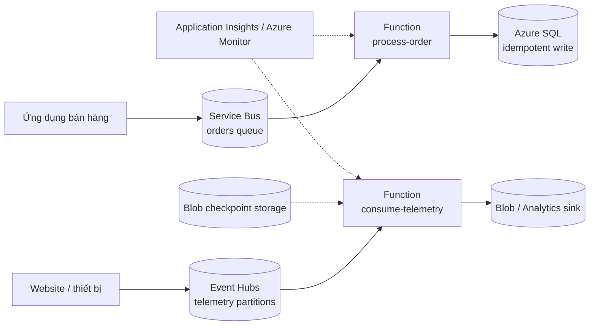
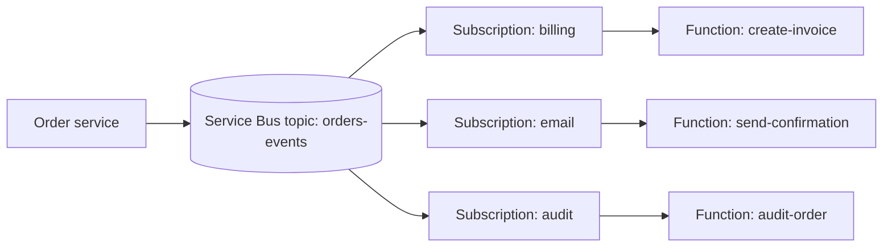
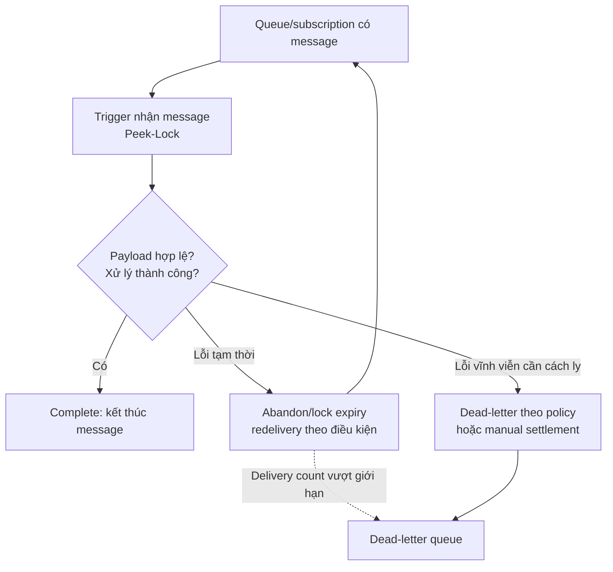
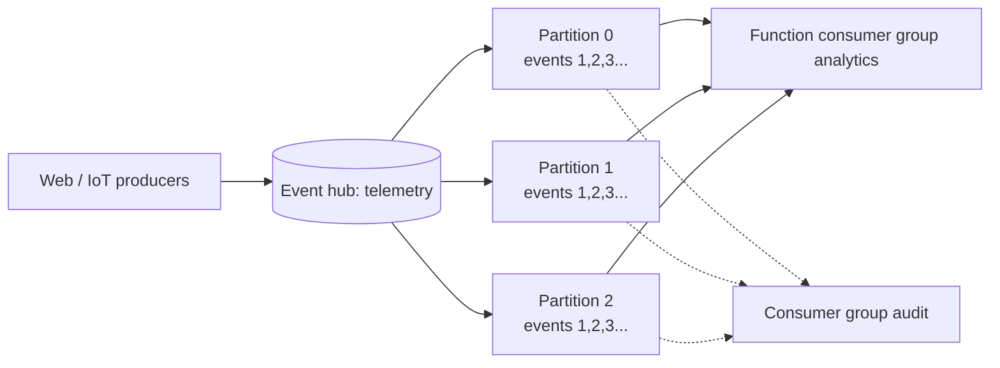
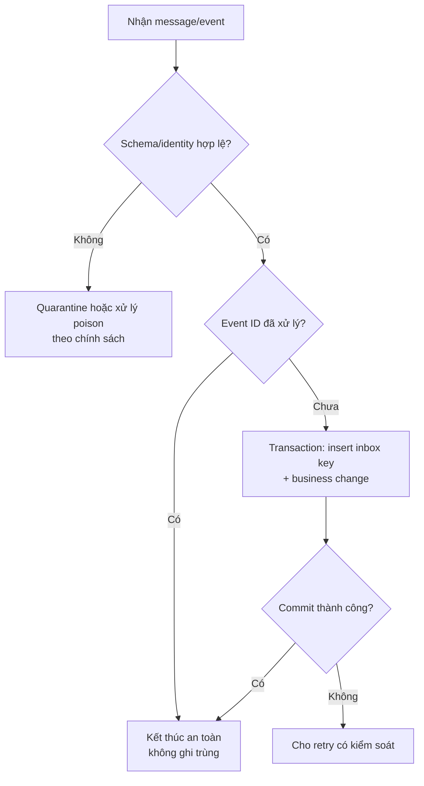
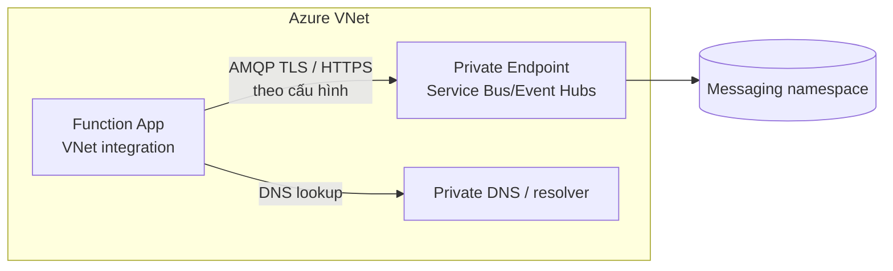
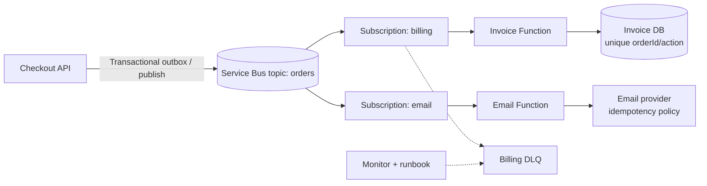
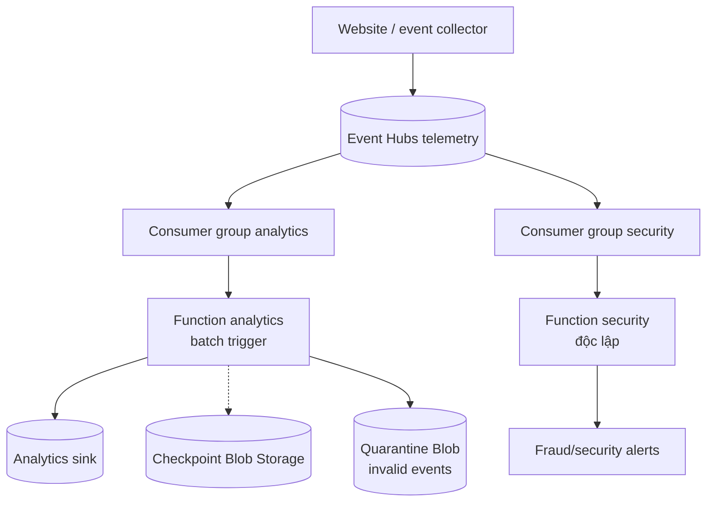

# Tích hợp Function với Service Bus và Event Hubs

Giả sử một nền tảng thương mại điện tử chạy trên Azure cần thực hiện hai công việc: **xử lý từng đơn hàng đáng tin cậy** sau khi khách thanh toán và **phân tích luồng hàng triệu sự kiện truy cập** được gửi liên tục từ website. Cả hai đều có thể kích hoạt **Azure Functions**, nhưng không nên dùng cùng một hệ thống truyền thông điệp chỉ vì chúng đều được gọi là “event”. Đơn hàng cần hàng đợi có cơ chế giao, khóa, thử lại và xử lý thông điệp lỗi; dữ liệu hành vi thường cần luồng có partition, offset, retention và khả năng nhiều nhóm consumer đọc độc lập.

Trong Azure, **Service Bus** thường giải quyết bài toán *enterprise messaging/commands*; **Event Hubs** giải quyết bài toán *event streaming/telemetry*. Azure Functions cung cấp **triggers và bindings** để thực thi mã khi thông điệp hoặc sự kiện xuất hiện, đồng thời mở rộng số phiên chạy theo tải trong những hosting plan được hỗ trợ.

Bài học thuộc chương **Serverless với Azure Functions** trong module **CLOUD_PROVIDERS_AZURE**. Module khám phá Azure từ subscription, resource group và Microsoft Entra ID đến mạng ảo, tính toán, lưu trữ, dữ liệu; đồng thời học cách triển khai, giám sát, bảo vệ và kiểm soát chi phí kiến trúc ứng dụng. Nội dung sau kết hợp thiết kế message/event, mã Python, identity, mạng, reliability và vận hành production thay vì chỉ trình bày cú pháp một trigger.

**Sau bài học, bạn có thể:**

- Phân biệt queue/topic/subscription của Service Bus với event hub/partition/consumer group của Event Hubs.
- Thiết kế luồng producer → Azure Functions → database/Storage an toàn khi có retry hoặc chạy song song.
- Cấu hình Service Bus trigger và Event Hubs trigger bằng mô hình Python v2 của Azure Functions.
- Giải thích **Peek-Lock, settlement, dead-letter queue (DLQ)** và **offset/checkpoint/retention**.
- Hiểu **at-least-once processing**, idempotency, khả năng xử lý theo thứ tự và poison messages/events.
- Dùng managed identity, Azure RBAC, Private Endpoint và DNS khi triển khai.
- Tối ưu scale, concurrency, batch và chi phí; theo dõi lỗi, độ trễ, backlog cùng tiến độ consumer.

## 1. Service Bus và Event Hubs giải quyết hai loại yêu cầu

| Khía cạnh | **Azure Service Bus** | **Azure Event Hubs** |
|---|---|---|
| Bản chất | Message broker cho command, nghiệp vụ, giao nhận đáng tin cậy | Nền tảng thu nhận và đọc lại luồng sự kiện dung lượng lớn |
| Đơn vị thường dùng | Queue; topic + subscription | Event hub; partitions; consumer groups |
| Cách đọc | Consumer nhận/khóa message, hoàn tất hoặc xử lý lỗi | Consumer đọc sự kiện theo offset/sequence trong partition |
| Sau khi xử lý thành công | Message được **complete** và không còn là message active trong queue/subscription | Event vẫn tồn tại tới khi hết **retention**; checkpoint chỉ lưu tiến độ |
| Thử lại | Retry/redelivery, lock, delivery count, DLQ | Đọc lại từ offset/checkpoint, retry ở consumer; không có DLQ từng event mặc định |
| Thứ tự | Có thể cần **sessions** để phối hợp xử lý theo khóa và thứ tự | Bảo toàn thứ tự **trong từng partition** ở mức log, không có thứ tự toàn hub |
| Đọc độc lập nhiều hệ | Topic subscriptions cung cấp các bản message logic riêng | Consumer groups theo dõi các vị trí đọc độc lập trên cùng event stream |
| Dữ liệu điển hình | Đơn hàng, lệnh gửi email, yêu cầu thanh toán, workflow | Telemetry, clickstream, IoT, log, analytics pipeline |
| Bài toán Function | Xử lý message và settlement đúng | Xử lý event/batch, checkpoint và kiểm soát lag |

**Quy tắc chọn nhanh:** nếu một nghiệp vụ cần xử lý **từng yêu cầu**, biết yêu cầu đã hoàn tất hay thất bại và có chỗ cách ly message lỗi, hãy ưu tiên đánh giá **Service Bus**. Nếu cần thu nhận/đọc lại **dòng sự kiện lớn** để nhiều ứng dụng phân tích độc lập, hãy ưu tiên đánh giá **Event Hubs**. Hai dịch vụ có thể cùng xuất hiện trong một kiến trúc.

### 1.1. Không nhầm Event Hubs với Event Grid

**Azure Event Grid** phục vụ định tuyến sự kiện thông báo theo mô hình publish/subscribe, còn Event Hubs phù hợp với **event streaming và retention theo partition**. Event Grid, Service Bus và Event Hubs có thể kết hợp, nhưng không thể thay thế cho nhau về bảo đảm giao nhận, lưu giữ, thứ tự và mô hình scale.

## 2. Kiến trúc tổng quát: hai luồng song song



Luồng đơn hàng và luồng telemetry có thể chạy trong hai Function Apps riêng. Tách ứng dụng giúp đặt **quy mô, timeout, network, identity và triển khai** theo nhu cầu khác nhau; không bắt buộc mọi trigger phải sống chung trong một Function App.

**Ba tầng trách nhiệm:**

1. **Broker/stream:** lưu message/event, phân phối và quản lý trạng thái giao nhận/tiến độ theo cơ chế sản phẩm.
2. **Functions runtime và extensions:** tạo listener, gọi hàm, scale và phối hợp checkpoint/settlement.
3. **Mã nghiệp vụ:** kiểm tra dữ liệu, ghi kết quả, thực hiện idempotency, phân biệt lỗi tạm thời/lỗi vĩnh viễn và cung cấp telemetry.

Đừng hiểu một trigger đã tự biến mọi thao tác ở database hoặc API bên ngoài thành **exactly-once transaction**.

## 3. Service Bus: queue, topic, subscription và session

### 3.1. Queue — phân phối công việc

Producer gửi message vào queue `orders`; một trong các consumer nhận message để xử lý. Với mô hình nhiều Function instances, các instance cùng cạnh tranh nhận công việc theo khả năng broker/trigger, thay vì tất cả đều thực hiện cùng một message như broadcast.

```text
Checkout API --> Queue: orders --> Function replicas --> Database
                      |                |
                      | retry khi lỗi  |
                      v                v
                    Active           Complete
                      |
                      +----> Dead-letter queue (khi cần cách ly)
```

Một message mẫu nên có **message ID**, correlation ID/trace context và payload đã version hóa. ID giúp hỗ trợ deduplication, điều tra và đối soát giữa các hệ thống.

### 3.2. Topic + subscription — nhiều nghiệp vụ nhận cùng sự kiện

Giả sử sau khi phát hành đơn hàng, ba nhóm cần làm việc độc lập:



Mỗi subscription có **dòng message và trạng thái giao nhận riêng**, có thể có filter/rule để nhận một tập message phù hợp. Nếu Function email lỗi, việc xử lý ở subscription billing không vì thế bị coi là chưa complete. Mỗi subscription có thể có DLQ của mình.

### 3.3. Sessions và thứ tự theo khóa

Queue thông thường không bảo đảm thứ tự **xử lý hoàn tất** khi nhiều worker chạy song song. Với chuỗi command của cùng `orderId` cần xử lý tuần tự, **Service Bus sessions** có thể hỗ trợ định tuyến/khóa xử lý cùng một session:

```text
SessionId = order-123
  1. OrderCreated
  2. PaymentAuthorized
  3. OrderPacked
```

Sessions phải được bật trên entity và consumer/trigger phải hỗ trợ chế độ session tương ứng. Chỉ thêm thuộc tính `SessionId` vào payload JSON không bật cơ chế session của broker. Thứ tự trong một session cũng **không thay thế logic phiên bản trạng thái** hoặc cơ chế bảo vệ khi redelivery, retry và thao tác bên ngoài xảy ra.

## 4. Service Bus trigger: nhận, khóa và hoàn tất message

Mô hình phổ biến là **Peek-Lock**:

1. Runtime nhận message và đặt **lock tạm thời**.
2. Hàm kiểm tra và xử lý nghiệp vụ.
3. Nếu thành công, runtime có thể **complete** message khi auto-completion được bật.
4. Nếu hàm lỗi hoặc lock hết hạn, message có thể được giao lại theo chính sách tương ứng.
5. Khi vượt `MaxDeliveryCount` hoặc theo các điều kiện broker khác, message có thể được chuyển vào **DLQ**.



**Lưu ý kỹ thuật:** khi dùng **auto-complete**, việc ném exception không đồng nghĩa runtime tự lập tức chuyển message vào DLQ; thường message được thử lại theo cơ chế lock/redelivery và `MaxDeliveryCount`. Nếu muốn **manual dead-letter** với lý do nghiệp vụ, phải dùng kiểu trigger/SDK hỗ trợ manual settlement và cấu hình rõ ràng. Đừng nói rằng chỉ `raise ValueError` là đủ để “dead-letter ngay”.

### 4.1. Lock không phải transaction phân tán

Nếu Function đã ghi database thành công nhưng bị crash **trước complete**, message có thể quay lại queue. Function thứ hai có thể xử lý lại cùng message. Đây là lý do cần **idempotency**:

```text
Receive message-id=abc
  -> INSERT business record thành công
  -> Process crash trước khi complete
  -> Message redelivered
  -> Kiểm tra message-id=abc đã commit
  -> Không tạo giao dịch trùng
  -> Complete message
```

Một distributed transaction xuyên Service Bus và database không được Azure Functions trigger tự tạo cho ứng dụng. Cần thiết kế transactional outbox/inbox, unique constraint hoặc thao tác idempotent của hệ đích nếu nghiệp vụ yêu cầu.

### 4.2. Thời gian khóa và tác vụ lâu

Lock duration thuộc cấu hình entity; auto-lock renewal của extension có giới hạn/thời gian cấu hình riêng. Nếu việc xử lý kéo dài hơn lock hoặc Functions timeout, message có thể bị giao lại trong lúc worker đầu vẫn đang thực hiện tác vụ ngoài.

Với công việc dài: tách thành các bước nhỏ, dùng Durable Functions/queue orchestration hoặc worker có checkpoint phù hợp. Không khắc phục bằng cách tăng thời gian lock vô hạn.

## 5. Event Hubs: partitions, consumer groups, offsets và retention

Một **event hub** chứa một dòng sự kiện được chia thành **partitions**. Producer gửi sự kiện với partition key phù hợp nếu cần nhóm các sự kiện liên quan. Mỗi event có vị trí trong partition, thường được biểu diễn bởi **sequence number/offset**.



**Partition key** giúp các sự kiện cùng khóa được đặt theo một partition trong phạm vi cơ chế broker. Thứ tự **trong partition** được xác định theo log; Event Hubs **không có thứ tự tổng toàn bộ partitions**. Nếu consumer xử lý song song không kiểm soát hoặc sink ghi bất đồng bộ, thứ tự kết quả trong database cũng có thể khác thứ tự sự kiện được đọc.

### 5.1. Consumer group

Một **consumer group** là góc nhìn đọc độc lập của event stream. Ví dụ:

- `analytics`: Function tính số lượt xem trang.
- `fraud-detection`: một ứng dụng khác tính tín hiệu bất thường.
- `audit`: pipeline lưu dữ liệu thô.

Mỗi group có tiến độ tiêu thụ riêng theo partition. Hai ứng dụng độc lập nên dùng **consumer group riêng** thay vì vô tình dùng chung `$Default` rồi tranh chấp quyền sở hữu partitions/checkpoints.

Trong **một** ứng dụng xử lý có nhiều instances, việc phối hợp partition ownership/checkpoint trong cùng group là bình thường; nhưng phải cấu hình host/connection/checkpoint storage nhất quán theo extension.

### 5.2. Offset và checkpoint

Consumer đọc event theo offset/sequence, rồi lưu **checkpoint** để ghi nhận đã xử lý tới đâu. Với Azure Functions Event Hubs trigger, extension phối hợp checkpoint/partition ownership qua **Azure Storage** theo cấu hình host/storage và phiên bản extension được hỗ trợ.

**Checkpoint không xóa event.** Event chỉ hết khả năng đọc lại khi vượt retention của Event Hubs hoặc theo chính sách/tính năng lưu trữ tương ứng. Một consumer group khác có thể đọc lại những event còn trong retention mà không cần consumer group đầu tiên “nhả” event.

### 5.3. Không có DLQ từng event mặc định

Khác Service Bus, Event Hubs **không cung cấp DLQ per-message kiểu broker settlement** cho từng event. Với payload hỏng vĩnh viễn, người thiết kế phải chọn chính sách:

- Đưa event lỗi và metadata vào **quarantine store** (Blob/queue/database) sau khi ghi nhận bền vững.
- Ghi log/metric, tăng cảnh báo, xử lý theo runbook.
- Chỉ cho phép checkpoint tiến lên khi chính sách dữ liệu đã được đáp ứng.
- Có pipeline **replay** từ retention hoặc bản raw event lưu ngoài khi cần.

Nếu chỉ bắt exception rồi bỏ qua sự kiện để “khỏi kẹt partition”, bạn có thể làm mất xử lý nghiệp vụ dù broker còn giữ dữ liệu đến hết retention.

## 6. So sánh đường đi khi thất bại

| Tình huống | Service Bus trigger | Event Hubs trigger |
|---|---|---|
| Hàm xử lý thành công | Message có thể complete | Tiến độ có thể được checkpoint theo extension |
| Hàm lỗi tạm thời | Message có thể được giao lại, tùy lock/retry/settlement | Event/batch có thể được đọc lại theo checkpoint/retry; cần cấu hình retry đúng |
| Worker crash sau ghi DB | Có thể redelivery | Có thể reprocess event trước checkpoint |
| Payload sai định dạng | Có thể DLQ sau policy/giới hạn hoặc manual dead-letter | Cần tự cách ly event lỗi, không có DLQ native cùng ý nghĩa |
| Muốn đọc lại dữ liệu cũ | Cần có bản sao/hệ thống lưu khác nếu message đã complete | Có thể replay trong retention từ offset/consumer group phù hợp |
| Một consumer chậm | Queue backlog tăng, active messages nhiều | Consumer lag sau vị trí mới nhất của partitions tăng |

Với cả hai dịch vụ, **at-least-once processing** là giả định thiết kế thực tế an toàn hơn “mỗi message/event chỉ chạy đúng một lần”. Điều cần bảo đảm là **tác dụng cuối cùng** (ví dụ tạo hóa đơn, trừ tồn kho, ghi telemetry) không bị áp dụng trùng ngoài ý muốn.

## 7. Cấu trúc dự án Azure Functions Python v2

Ví dụ dùng **Python programming model v2** với decorator và Azure Functions runtime/extension hiện hành tương thích. Một dự án minh họa:

```text
orders-functions/
  function_app.py
  host.json
  requirements.txt
  local.settings.json          # chỉ local, không commit secret
```

Trong `requirements.txt`, cài `azure-functions` với version được CI/CD pin và kiểm thử. Nếu hàm gọi Azure SDK, thêm package SDK cần thiết. Triggers/bindings hoạt động nhờ Functions runtime và **extension bundles** hoặc extension packages được cấu hình; không chỉ cài Python package là đủ.

### 7.1. `host.json` tối thiểu

```json
{
  "version": "2.0",
  "extensionBundle": {
    "id": "Microsoft.Azure.Functions.ExtensionBundle",
    "version": "[4.*, 5.0.0)"
  }
}
```

Đây là ví dụ dành cho môi trường được hỗ trợ, không phải cam kết mọi phiên bản extension trong bundle có cùng tính năng. Khi dùng **identity-based connections**, hãy xác minh Service Bus/Event Hubs extension trong host đang chạy đáp ứng phiên bản tối thiểu theo hướng dẫn của Azure Functions.

### 7.2. Quy tắc code mẫu

Các hàm sau chỉ **minh họa xử lý trigger**. Chúng cố tình không ghi thật vào database để tránh đưa ra một ví dụ tưởng “đảm bảo exactly-once” nhưng thiếu transaction logic. Khi đưa vào production, thay phần xử lý bằng lệnh ghi có validation, idempotency và error policy phù hợp.

## 8. Ví dụ 1: Azure Function đọc Service Bus queue

Trong `function_app.py`:

```python
import json
import logging
import azure.functions as func

app = func.FunctionApp()


@app.service_bus_queue_trigger(
    arg_name="msg",
    queue_name="orders",
    connection="ServiceBusConnection"
)
def process_order(msg: func.ServiceBusMessage) -> None:
    body = msg.get_body().decode("utf-8")
    order = json.loads(body)

    order_id = order.get("orderId")
    if not isinstance(order_id, str) or not order_id:
        raise ValueError("Missing orderId")

    logging.info(
        "Received order event: orderId=%s, messageId=%s",
        order_id,
        msg.message_id
    )

    # PRODUCTION TODO:
    # 1) Validate schema/version and authorization assumptions.
    # 2) Insert messageId/orderId into an idempotency ledger atomically
    #    with the business effect, or use a transactional inbox/outbox.
    # 3) Commit the business change before returning successfully.
    # 4) Surface transient failures instead of silently swallowing them.
```

Trong ví dụ:

- `service_bus_queue_trigger` lắng nghe queue `orders`.
- `arg_name` phải khớp tham số hàm `msg`.
- `connection="ServiceBusConnection"` trỏ đến **tên/prefix cấu hình kết nối**, không phải connection string nhúng trong mã.
- `get_body()` trả byte payload, nên cần biết encoding/schema để phân tích đúng.
- `message_id` là metadata message được ứng dụng producer thiết kế và có thể dùng làm khóa deduplication.
- Khi hàm **trả thành công**, chế độ auto-complete được hỗ trợ có thể hoàn tất message. Nếu throw exception, cơ chế redelivery phụ thuộc binding/lock/retry.

**Cảnh báo:** `ValueError` trong đoạn mẫu mô phỏng lỗi payload; không có nghĩa lỗi này tự được đưa vào DLQ ngay. Để xử lý thông điệp sai vĩnh viễn, cần thiết kế **manual settlement hoặc DLQ/quarantine policy** tương thích với trigger/runtime đang dùng.

### 8.1. Nếu dùng topic/subscription

Function có thể lắng nghe một subscription của Service Bus topic bằng trigger phù hợp. Về ý tưởng:

```python
@app.service_bus_topic_trigger(
    arg_name="msg",
    topic_name="orders-events",
    subscription_name="billing",
    connection="ServiceBusConnection"
)
def create_invoice(msg: func.ServiceBusMessage) -> None:
    logging.info("Billing subscription received %s", msg.message_id)
    # Ghi invoice với idempotency, không gửi hóa đơn trùng khi redelivery.
```

Đoạn này tiếp nối `app` và `logging` đã khai báo ở ví dụ trên. Một queue trigger và topic trigger có thể nằm cùng dự án nhưng cần kiểm soát quyền, scale và failure isolation phù hợp.

### 8.2. Chọn auto-complete hay manual settlement?

**Auto-complete** đơn giản hơn: runtime quản lý settlement dựa trên kết quả hàm. **Manual settlement** cho phép mã phân biệt Complete, Abandon hoặc DeadLetter theo loại lỗi khi binding/SDK hỗ trợ. Không copy hướng dẫn manual settlement của ngôn ngữ C# sang Python rồi giả định API giống nhau.

Nếu cần dead-letter ngay cho payload invalid, hãy xác minh phiên bản binding và mô hình lập trình thực sự cho phép thao tác settlement; nếu không, chọn phương án lưu quarantine bền vững và cho retry/DLQ theo `MaxDeliveryCount` được cấu hình.

## 9. Ví dụ 2: Azure Function đọc Event Hubs theo batch

Với một Function App khác hoặc cùng dự án đã cấu hình đúng:

```python
import json
import logging
import azure.functions as func

app = func.FunctionApp()


@app.event_hub_message_trigger(
    arg_name="events",
    event_hub_name="telemetry",
    connection="EventHubConnection",
    consumer_group="analytics",
    cardinality="many"
)
def consume_telemetry(events: list[func.EventHubEvent]) -> None:
    for event in events:
        payload = json.loads(event.get_body().decode("utf-8"))
        event_id = payload.get("eventId")

        if not event_id:
            raise ValueError("Missing eventId")

        logging.info(
            "Read telemetry eventId=%s sequence=%s",
            event_id,
            event.sequence_number
        )

        # PRODUCTION TODO:
        # Upsert into a sink using an idempotent eventId key,
        # or durably quarantine invalid events with metadata.
```

Trong ví dụ:

- `event_hub_name="telemetry"` là entity Event Hubs.
- `consumer_group="analytics"` phải được tạo/sẵn có ở Event Hub theo môi trường.
- `cardinality="many"` yêu cầu gọi Function với batch trong programming model/extension tương thích.
- `sequence_number` dùng để quan sát tiến độ trong partition, không phải số thứ tự toàn Event Hub.
- Khi throw exception ở giữa batch, **các event đã xử lý trước đó có thể bị lặp lại** sau retry/restart/checkpoint. Vì vậy, việc ghi vào sink cần idempotency ngay cả khi batch ở một lần chạy không có duplicate.

**Không dùng mã ví dụ này trực tiếp cho batch production**: dữ liệu sai ở một event có thể khiến cả batch thất bại; muốn tiếp tục an toàn phải xác định chính sách retry/quarantine/checkpoint trước. Đồng thời tránh log toàn bộ payload vì có thể chứa dữ liệu nhạy cảm.

### 9.1. Tại sao không nên dùng một consumer group chung cho mọi Function App?

Nếu `analytics` và `fraud-detection` cần đọc **tất cả các sự kiện**, mỗi bên phải có tiến độ độc lập. Dùng chung consumer group cho các ứng dụng khác nhau có thể gây cạnh tranh partition ownership/checkpoints và kết quả đọc không như mong muốn.

Tạo group theo chức năng xử lý, theo dõi lag riêng và xác định rõ khả năng replay. Số group cũng bị giới hạn theo tier của Event Hubs; kiểm tra SKU trước khi tạo nhiều group.

## 10. Local settings, extension và managed identity

### 10.1. Local development với connection string

Ví dụ `local.settings.json` cho **máy phát triển**, không commit vào Git:

```json
{
  "IsEncrypted": false,
  "Values": {
    "AzureWebJobsStorage": "UseDevelopmentStorage=true",
    "FUNCTIONS_WORKER_RUNTIME": "python",
    "ServiceBusConnection": "<SERVICE_BUS_CONNECTION_STRING_FOR_LOCAL_DEV>",
    "EventHubConnection": "<EVENT_HUBS_CONNECTION_STRING_FOR_LOCAL_DEV>"
  }
}
```

`UseDevelopmentStorage=true` yêu cầu Azurite hoặc storage emulator tương thích đang chạy cho những chức năng host/storage cần thiết. Nó **không giả lập Service Bus/Event Hubs**. Connection strings trên là placeholders; lấy secret thật từ kênh được tổ chức cho phép và không gửi chúng vào source code, log, issue tracker hay ảnh màn hình.

Nếu dùng managed identity trên môi trường Azure, nên **không** tạo một app setting connection-string cùng tên làm cấu hình identity-based vô tình bị bỏ qua. Cách resolver chọn cấu hình connection theo prefix/phương thức hỗ trợ phải được kiểm tra ở runtime đang sử dụng.

### 10.2. Managed identity trong Azure

Với extension hỗ trợ **identity-based connection**, một Function App có managed identity có thể cấu hình những app settings như:

```text
ServiceBusConnection__fullyQualifiedNamespace=sb-orders.servicebus.windows.net
EventHubConnection__fullyQualifiedNamespace=eh-telemetry.servicebus.windows.net
```

Đây là **ví dụ định dạng**, không phải tên namespace thật. `ServiceBusConnection` và `EventHubConnection` là tiền tố khớp với `connection=...` trong decorator. Extension xác thực bằng identity và kết nối tới namespace FQDN, thay vì đọc connection string chứa Shared Access Key.

Khi dùng **user-assigned managed identity**, có thể cần thêm các cấu hình xác định identity theo cú pháp connection extension được hỗ trợ. Khi dùng **system-assigned managed identity**, phải đảm bảo identity đó được bật trên Function App. Không dùng một FQDN “Event Hub riêng” tự dựng nếu cấu hình yêu cầu **fully qualified namespace**.

### 10.3. Vai trò Azure RBAC cần tách theo chiều truyền

| Thành phần | Vai trò gợi ý theo quyền tối thiểu | Phạm vi |
|---|---|---|
| Function chỉ **nhận** Service Bus queue/subscription | `Azure Service Bus Data Receiver` | Queue/topic/subscription/namespace theo hỗ trợ |
| Function hoặc API **gửi** Service Bus message | `Azure Service Bus Data Sender` | Entity hoặc namespace cần gửi |
| Function chỉ **nhận** Event Hubs | `Azure Event Hubs Data Receiver` | Event Hub hoặc namespace phù hợp |
| Producer **gửi** Event Hubs | `Azure Event Hubs Data Sender` | Event Hub hoặc namespace |
| Functions Event Hubs trigger dùng Storage checkpoint | Quyền Azure Storage data plane cần cho checkpoint/lease theo extension | Storage account/container checkpoint |
| Function ghi Azure SQL/Blob/Key Vault | Data-plane permission tương ứng | Scope nhỏ nhất có thể |

**Azure RBAC Reader/Contributor trên resource group không tự cung cấp quyền Service Bus/Event Hubs data-plane** theo mô hình identity-based. Cũng không nhầm **Function App identity** với danh tính của producer hoặc hệ thống giám sát.

Đối với Event Hubs trigger, **AzureWebJobsStorage/checkpoint storage** là dependency độc lập. Nếu host dùng identity-based Storage, cần các cấu hình identity và quyền Blob/Queue/Table tương ứng theo những chức năng host thực tế. Việc cấp quyền đọc Event Hub mà thiếu quyền checkpoint storage có thể khiến listener không vận hành đúng.

### 10.4. Network phải cho phép cả identity và data plane

Managed identity trả lời câu hỏi “**ai** truy cập?”, không tự mở đường mạng. Function còn cần DNS và kết nối đến `*.servicebus.windows.net`, các điểm xác thực cần thiết, Azure Storage host/checkpoint và những dịch vụ đích.

## 11. Reliability: idempotency, poison và phân biệt lỗi

### 11.1. Idempotency bằng khóa nghiệp vụ

Giả sử producer gửi lệnh phát hành hóa đơn với:

```json
{
  "schemaVersion": 1,
  "eventId": "evt-7931",
  "orderId": "ord-1042",
  "action": "IssueInvoice",
  "occurredAt": "2026-11-20T09:30:00Z"
}
```

Một thiết kế consumer an toàn:

1. Kiểm tra schema và định danh; **không tin payload chỉ vì nó đến từ broker**.
2. Trong database, dùng **unique key** trên `eventId`/`orderId + action` hoặc ledger phù hợp.
3. Ghi dấu đã xử lý và thay đổi nghiệp vụ **trong cùng transaction** khi database hỗ trợ.
4. Nếu đã xử lý, trả thành công mà **không áp dụng tác dụng thêm lần nữa**.
5. Sau khi transaction commit, cho phép trigger hoàn tất message/checkpoint theo policy.



**Cẩn trọng với check-then-insert:** hai instances có thể đồng thời kiểm tra “chưa tồn tại” rồi ghi trùng. Cần **unique constraint hoặc atomic conditional write**, không chỉ một câu `SELECT` trước `INSERT`.

### 11.2. Lỗi tạm thời hay lỗi vĩnh viễn?

| Loại | Ví dụ | Hướng xử lý |
|---|---|---|
| Tạm thời | SQL timeout, HTTP 503, throttling 429 | Retry có backoff/jitter, giới hạn thời gian và cảnh báo |
| Vĩnh viễn theo payload | JSON không hợp lệ, thiếu khóa bắt buộc, schema không hỗ trợ | Quarantine/DLQ, ghi nguyên nhân có kiểm soát |
| Vi phạm nghiệp vụ | Đơn hàng đã hủy, hóa đơn đã phát hành | Idempotent no-op hoặc ghi trạng thái nghiệp vụ, không retry vô hạn |
| Lỗi xác thực | Managed identity thiếu role, Key Vault 403 | Khắc phục IAM/config; retry liên tục không thay thế cấp quyền đúng |
| Lỗi kết nối mạng | Private DNS sai, firewall chặn | Kiểm tra network/DNS, tránh xóa message để “giải quyết” timeout |

**Không gọi API thanh toán hoặc gửi email không idempotent một lần nữa chỉ vì trigger đã retry.** Nếu downstream không hỗ trợ idempotency key, cân nhắc outbox, ledger hoặc một tầng orchestration có điều kiện.

### 11.3. Poison message và DLQ của Service Bus

Khi message không thể xử lý sau những lần giao, Service Bus có thể chuyển nó sang **dead-letter subqueue** theo `MaxDeliveryCount` hoặc các quy tắc của broker. DLQ **không tự xử lý/làm sạch**.

Một runbook DLQ cần có:

- Xem kích thước DLQ theo queue/subscription.
- Đọc an toàn metadata/message ID/reason, ẩn PII/secret.
- Phân loại lỗi code, data schema, dependency hoặc policy.
- Sửa nguyên nhân; quyết định **replay có kiểm soát** về queue/topic hoặc bỏ theo quy định.
- Có idempotency khi replay, ghi lại ai xử lý và bao nhiêu message.

Lưu ý: TTL, size limits, duplicate detection và transactions có các giới hạn theo **Service Bus SKU**; hãy kiểm tra trước khi áp dụng policy.

### 11.4. Quarantine và replay Event Hubs

Event Hubs không có DLQ bản địa theo từng event; bạn có thể ghi event lỗi vào **Blob Storage** với các trường event ID, hub, partition, sequence/offset, error category và timestamp. Phải xác nhận bản ghi quarantine **đã bền vững** trước khi quyết định bỏ qua event lỗi để cho consumer tiến lên.

Việc replay chỉ thực hiện được trong **retention** của Event Hubs hoặc từ bản lưu raw event riêng. Một checkpoint cũ không thể hồi sinh dữ liệu đã hết hạn retention.

## 12. Event Hubs batching, checkpoint và throughput

### 12.1. Xử lý batch vừa tăng throughput vừa tăng blast radius

Đọc từng event đơn giản cho logic xử lý; đọc batch giúp giảm overhead khi lưu lượng cao. Tuy nhiên:

- Một batch lớn tiêu thụ nhiều bộ nhớ và thời gian chạy hơn.
- Nếu một event sai làm cả batch thất bại, nhiều event đã ghi thành công có thể bị lặp lại.
- Checkpoint quá thưa có thể tăng số event xử lý lại sau khi crash.
- Checkpoint quá thường xuyên có thể tăng hoạt động Storage và overhead.

Điều chỉnh batch size, prefetch, timeout và checkpoint frequency bằng **load test**, không sao chép một cấu hình cho mọi workload.

### 12.2. Partition count và khả năng scale

Một partition thường được xử lý bởi **một active owner** trong cùng consumer group tại một thời điểm. Vì thế, số partitions giới hạn mức **song song theo partition** của một nhóm consumer; tạo thêm hàng trăm Function instances chưa chắc tăng throughput khi event hub chỉ có rất ít partitions.

Trong một Function invocation vẫn có thể xử lý nhiều event theo batch, và các công việc bên trong có thể song song theo cách riêng. Nhưng không được suy rằng việc thêm instance tự làm mọi key/partition được xử lý nhanh vô hạn.

Chọn partition key theo **phân bố tải và yêu cầu thứ tự**. Một khóa “global” cho mọi event có thể tạo **hot partition**, khiến một partition quá tải còn những partition khác nhàn rỗi.

### 12.3. Replay và data loss

Thiết kế cần định nghĩa:

1. Nếu Function ngừng chạy 4 giờ, retention có đủ dài để đọc toàn bộ backlog không?
2. Khi checkpoint storage lỗi, consumer có bị kẹt, tranh chấp ownership hay xử lý lại không?
3. Khi triển khai version mới gây lỗi parsing, làm sao dừng/replay để không mất event?
4. Nếu cần lưu dài hạn, có dùng Event Hubs Capture hoặc một raw event sink khác theo điều kiện dịch vụ không?
5. Mỗi consumer group có metrics lag và owner trách nhiệm không?

**Retention là cửa sổ thời gian đọc lại**, không phải cam kết sự kiện đã được xử lý. Event Hubs Capture (nếu sử dụng và hỗ trợ trong tier) là cơ chế lưu trữ bổ sung, không thay thế việc quản lý checkpoint và xử lý lỗi.

## 13. Scale và concurrency của Functions

Functions có thể scale theo số message/backlog hoặc partition workload tùy trigger/hosting plan. Cần phân biệt:

- **Scale out:** có thêm instances của Function App/worker.
- **Concurrency trong instance:** số message hoặc event batches xử lý đồng thời trên mỗi worker.
- **Service Bus sessions:** mức song song theo số sessions active và giới hạn concurrent sessions.
- **Event Hubs partitions:** số luồng partition ownership có thể được phân phối cho consumer instances.
- **Downstream capacity:** SQL, Storage, API đối tác, Key Vault và network có giới hạn riêng.

### 13.1. Service Bus: không phải cứ concurrency cao là nhanh

Ví dụ giả định:

```text
Queue backlog:                 20.000 messages
Mỗi message cần SQL write:     100 ms (giả định)
Function concurrent handlers: 100
SQL chịu tải ổn định:          40 writes đồng thời (giả định)
```

Nếu cho 100 handlers cùng ghi, SQL có thể throttling/timeouts, khiến số retry và backlog **tăng**, dù Functions có đủ CPU. Hãy đặt giới hạn concurrency và tăng capacity theo bottleneck thật; đừng chỉ nhìn queue depth.

### 13.2. Event Hubs: tiêu thụ nhanh phải tránh vượt sink

Với telemetry lớn, có thể batch ghi vào Analytics/Blob/Cosmos DB. Cần:

- Kiểm tra partition lag/throughput.
- Chọn kích thước batch và parallelism theo **sink rate limit**.
- Áp dụng retry/backoff và quarantine per-event.
- Tách consumer groups có SLA khác nhau.
- Tính số partitions và throughput capacity của Event Hubs tier.

### 13.3. Ví dụ `host.json` cho extension hiện đại

```json
{
  "version": "2.0",
  "extensionBundle": {
    "id": "Microsoft.Azure.Functions.ExtensionBundle",
    "version": "[4.*, 5.0.0)"
  },
  "extensions": {
    "serviceBus": {
      "prefetchCount": 0,
      "autoCompleteMessages": true,
      "maxConcurrentCalls": 8,
      "maxAutoLockRenewalDuration": "00:05:00"
    },
    "eventHubs": {
      "maxEventBatchSize": 100,
      "prefetchCount": 300,
      "batchCheckpointFrequency": 1
    }
  }
}
```

Các giá trị trên là **minh họa để giải thích knobs**, không phải cấu hình tuning đã tối ưu. Schema/settings khác nhau giữa extension major versions, ngôn ngữ runtime, chế độ single/batch, dynamic concurrency và hosting plan. Trước khi áp dụng, kiểm tra version thực tế của bundle/extension, tài liệu settings và tải dự kiến. **Không đặt cả hai trigger vào cùng Function App chỉ vì chúng xuất hiện chung trong ví dụ `host.json`**.

## 14. Hosting plan, độ trễ và chi phí

### 14.1. Chọn plan theo tính chất tải

| Yêu cầu | Điểm cần cân nhắc |
|---|---|
| Traffic ít, không liên tục | Consumption/Flex Consumption trong phạm vi tính năng và region hỗ trợ; đánh giá cold start |
| SLA latency nghiêm ngặt, workload chạy thường xuyên | Premium hoặc hosting model có instances sẵn sàng theo nhu cầu |
| Cần custom VNet/private dependencies | Kiểm tra **VNet integration** và network capabilities của chính plan được chọn |
| Event stream lớn, xử lý lâu hoặc CPU-intensive | Kiểm tra memory, timeout, instance limits, batch và sink throughput |
| Cần kiểm soát capacity/chi phí ổn định | Premium/Dedicated hoặc lựa chọn khác sau khi phân tích TCO |

Không đồng nhất chi phí “serverless thấp” với “mọi event đều rẻ”. Với lượng lớn event, chi phí còn ở broker, storage checkpoints, logs, downstream writes, network và duplicate/retry.

### 14.2. Hai mô hình chi phí khác nhau

**Service Bus**: phụ thuộc tier (Basic/Standard/Premium theo hỗ trợ), messaging operations, entity features, throughput và capacity/messaging units nếu dùng tier tương ứng.

**Event Hubs**: phụ thuộc tier, throughput/processing capacity, số event/ingress, retention, partitions, Capture (nếu dùng) và các tính năng mạng. 

**Functions**: phụ thuộc hosting plan, số executions, resource consumption, số instances, thời gian chạy và năng lực luôn sẵn sàng. Azure Monitor/Application Insights/Log Analytics và outbound network có thể tạo khoản phí riêng.

Với kiến trúc cần SLA cao, phải tính cả **năng lực dự phòng, chi phí retry và chi phí vận hành** thay vì chỉ giá message/event.

## 15. Networking: public endpoint, Private Link, DNS và firewall

Một Function App cần kết nối **outbound** tới Service Bus hoặc Event Hubs. Nếu namespace đặt **public network access = disabled** hoặc chỉ cho kết nối riêng, Function phải có tuyến mạng được hỗ trợ đến Private Endpoint và phân giải tên đúng.



### 15.1. Những điều kiện phải đúng

1. **Hosting plan** hỗ trợ phương thức VNet integration mà ứng dụng đang dùng.
2. Function App có outbound route và firewall/NSG/UDR cho phép kết nối.
3. **Service Bus Private Link** yêu cầu tier/tính năng được hỗ trợ; một số lựa chọn private networking có hạn chế theo SKU. Với Event Hubs cũng kiểm tra tier/region và khả năng Private Endpoint.
4. DNS resolver của Function phân giải namespace hostname `<namespace>.servicebus.windows.net` đúng theo Private DNS/Private Link configuration; không đổi code sang URL có tiền tố `privatelink` nếu SDK cần hostname chuẩn.
5. Có quyền Entra data-plane hợp lệ; có route không tự cấp quyền đọc message.
6. Kết nối tới **AzureWebJobsStorage**, checkpoint Storage và các dependency Azure khác vẫn hoạt động.

Tùy transport, AMQP over TLS có thể sử dụng cổng phù hợp hoặc AMQP over WebSockets qua HTTPS/443. **Không mở port theo phỏng đoán**; xem transportType thực tế của SDK/extension và thiết lập network được hỗ trợ.

### 15.2. DNS của Private Endpoint

Service Bus và Event Hubs sử dụng hostname namespace dạng `*.servicebus.windows.net`. Với Private Endpoint, hệ thống DNS cần trả private IP phù hợp theo mô hình **`privatelink.servicebus.windows.net`** được hỗ trợ. Trong hub-spoke/on-premises, kiểm tra Private DNS zone links và DNS forwarding/Private Resolver.

Một lỗi phổ biến: người quản trị thấy Private Endpoint ở trạng thái Approved nhưng Function vẫn resolve về public IP. Khi namespace chặn public access, trigger có thể liên tục thất bại hoặc không khởi động.

### 15.3. Bảo vệ secret và mạng

- Ưu tiên **managed identity** thay connection strings/SAS keys khi trigger/SDK hỗ trợ.
- Phân biệt Sender và Receiver roles, scope tối thiểu.
- Dùng Key Vault/secret references khi vẫn cần secret, với quy trình rotation rõ ràng.
- Tránh log connection string, access token, payload chứa PII hoặc toàn bộ stack trace có dữ liệu nhạy cảm.
- Bảo vệ Function App configuration, deployment credentials và Azure RBAC control-plane.

## 16. Thực hành kiểm tra tài nguyên bằng Azure CLI

Các lệnh sau **chỉ đọc** resource metadata. Chúng không thay đổi queue, event hub, app settings hoặc role assignments.

### 16.1. Kiểm tra subscription, Function App và identity

```bash
RG="rg-serverless-prod"
FUNC="func-orders-prod"

az account show \
  --query "{subscription:name,id:id,tenant:tenantId}" \
  -o table

az functionapp show \
  --resource-group "$RG" \
  --name "$FUNC" \
  --query "{name:name,kind:kind,state:state,location:location,identity:identity.type}" \
  -o json

az functionapp identity show \
  --resource-group "$RG" \
  --name "$FUNC" \
  -o json
```

Nếu không thấy identity hoặc principal ID, kiểm tra cấu hình thực tế và quyền Azure trước khi giả định identity đã được cấp data-plane permissions.

### 16.2. Kiểm tra Service Bus queue/subscription

```bash
RG_MSG="rg-messaging-prod"
SB_NS="sb-orders-prod"
SB_QUEUE="orders"

az servicebus queue show \
  --resource-group "$RG_MSG" \
  --namespace-name "$SB_NS" \
  --name "$SB_QUEUE" \
  -o json

az servicebus topic subscription show \
  --resource-group "$RG_MSG" \
  --namespace-name "$SB_NS" \
  --topic-name "orders-events" \
  --name "billing" \
  -o json
```

Quan sát `maxDeliveryCount`, `lockDuration`, `requiresSession`, TTL và message counts khi API trả về. Không dựa chỉ vào một thời điểm queue depth để kết luận consumer hoạt động khỏe: queue có thể rỗng vì chưa có producer hoặc message đã chuyển vào DLQ.

### 16.3. Kiểm tra Event Hubs và partitions

```bash
EH_NS="eh-telemetry-prod"
EH_NAME="telemetry"

az eventhubs eventhub show \
  --resource-group "$RG_MSG" \
  --namespace-name "$EH_NS" \
  --name "$EH_NAME" \
  -o json

az eventhubs eventhub consumer-group list \
  --resource-group "$RG_MSG" \
  --namespace-name "$EH_NS" \
  --eventhub-name "$EH_NAME" \
  -o table
```

Kiểm tra `partitionCount`, `messageRetentionInDays` hoặc trường retention hiện hành theo tier/API, consumer groups, trạng thái entity và chỉ số ingest. Đừng kết luận throughput dựa duy nhất trên partition count.

### 16.4. Kiểm tra role assignment

```bash
# Thay bằng principal ID từ Function App identity.
FUNCTION_PRINCIPAL_ID="<managed-identity-principal-id>"

az role assignment list \
  --assignee "$FUNCTION_PRINCIPAL_ID" \
  --all \
  -o table
```

Đối chiếu role name, entity scope, subscription/tenant và inherited assignments theo cơ chế được Azure hỗ trợ. Chỉ có quyền quản lý namespace (ARM) không thay thế Receiver role cần cho runtime trigger.

### 16.5. Kiểm tra tên app settings mà không lộ giá trị

```bash
# Chỉ trả tên settings; không xuất connection string/secret.
az functionapp config appsettings list \
  --resource-group "$RG" \
  --name "$FUNC" \
  --query "[].name" \
  -o table
```

Nếu cần kiểm tra giá trị `ServiceBusConnection__fullyQualifiedNamespace`, phải tuân thủ quy trình bảo mật thông tin cấu hình. Không chạy lệnh in **toàn bộ app settings** rồi dán vào ticket/chat: nó có thể làm lộ connection strings và secrets.

## 17. Quy trình triển khai tích hợp trong môi trường lab

Một kế hoạch triển khai có kiểm soát:

1. **Tạo môi trường thử:** Service Bus namespace/queue (hoặc topic/subscription), Event Hubs namespace/event hub/consumer group, Function App và host storage theo tier được hỗ trợ.
2. **Chọn programming model/runtime:** Python v2, phiên bản Python/Functions/extension được hỗ trợ; xác minh bundle tương thích.
3. **Cấp identity:** bật managed identity và gán Receiver role cho đúng namespace/entity; cấp quyền checkpoint storage khi cần.
4. **Cấu hình connections:** sử dụng `__fullyQualifiedNamespace` trong Azure hoặc connection strings giả lập/không production cho local dev.
5. **Viết trigger:** Service Bus queue/topic; Event Hubs single/batch theo workload.
6. **Chạy local/staging:** gửi thông điệp hợp lệ, không hợp lệ, duplicate; kiểm tra logs, retries và kết quả ghi dữ liệu.
7. **Kiểm tra network:** public/private endpoint, DNS, firewall, AzureWebJobsStorage, IAM.
8. **Công bố qua CI/CD:** dùng artifact/Function App deployment và tránh ghi đè app settings không mong muốn.
9. **Load test:** queue backlog, handler concurrency, Event Hubs partitions/consumer lag, checkpoint và downstream capacity.
10. **Kiểm thử failure:** mô phỏng database timeout, Function restart, duplicate event, poison payload, checkpoint Storage không truy cập được.
11. **Triển khai production theo đợt:** giảm blast radius, theo dõi telemetry và có rollback application.

Một lệnh publish ví dụ (thay đổi trạng thái Function App):

```bash
# Chỉ chạy sau khi đã có app đúng và được phê duyệt trong lab.
func azure functionapp publish <function-app-name>
```

Đây không phải lệnh “kiểm tra”; nó triển khai code/artefact tới Function App. Không chạy trước khi xác minh subscription, môi trường, role assignments, settings và pipeline release.

## 18. Case study A: Xử lý đơn hàng qua Service Bus

**Yêu cầu nghiệp vụ:**

- API đặt hàng không phải chờ tạo PDF, gửi email hay ghi báo cáo.
- Một lệnh `IssueInvoice` không được tạo hai hóa đơn dù producer/consumer retry.
- Nếu dữ liệu đơn hàng thiếu hoặc hệ thống kế toán không phản hồi, cần phân biệt loại lỗi.
- Có audit trail rõ message ID, order ID và trạng thái xử lý.

**Thiết kế gợi ý:**



**Luồng xử lý billing:**

1. API ghi order và outbox record trong cùng database transaction nếu cần đảm bảo publish không bị mất sau commit.
2. Publisher gửi message có `MessageId`/`CorrelationId` rõ ràng.
3. Function nhận message qua subscription, validate schema và idempotency key.
4. Ghi invoice atomically, sau đó Function trả thành công để message được complete theo cấu hình.
5. Nếu SQL timeout, message được redeliver/retry; unique key ngăn hóa đơn trùng.
6. Nếu message lỗi cấu trúc, đưa vào quarantine/DLQ theo policy; đội vận hành sửa và replay sau phê duyệt.

**Đừng dùng chính Service Bus duplicate detection như bảo đảm duy nhất** cho tính đúng đắn nghiệp vụ: duplicate detection có phạm vi thời gian và điều kiện SKU, trong khi message redelivery hoặc side effect bên ngoài vẫn cần idempotency.

## 19. Case study B: Telemetry website qua Event Hubs

**Yêu cầu nghiệp vụ:**

- Nhận stream `PageViewed`, `ProductClicked` và `CheckoutStarted` từ nhiều client.
- Nhóm analytics tính số lượt xem; nhóm security phân tích hành vi bất thường.
- Khi pipeline analytics tạm dừng, phải có khả năng đọc backlog trong giới hạn retention.
- Một event hỏng không được vô tình làm mất toàn bộ sự kiện hợp lệ phía sau.

**Thiết kế gợi ý:**



**Những quyết định quan trọng:**

- Producer dùng `eventId` ổn định, timestamp UTC và schema version; partition key phản ánh nhu cầu thứ tự, tránh hot partition.
- Analytics và security có **consumer groups riêng**.
- Function batch ghi kết quả có idempotency để chống replay.
- Nếu gặp event invalid, chỉ tiến checkpoint khi đã ghi quarantine bền vững hoặc làm theo chính sách dữ liệu đã được phê duyệt.
- Đặt retention đủ cho backlog trong thời gian triển khai/lỗi dự kiến; nếu cần lưu lâu hơn thì lưu raw events riêng.
- Đo **event processing lag**, throughput per partition và chi phí sink, không chỉ số lần Function invocation.

## 20. Monitoring và cảnh báo

| Nơi theo dõi | Chỉ số/tín hiệu | Hành động khi bất thường |
|---|---|---|
| Service Bus | Active messages, dead-letter messages, incoming/outgoing, throttling | Kiểm tra consumer, lỗi payload, quota và DLQ |
| Event Hubs | Incoming/outgoing events/bytes, throttling, throughput capacity | Kiểm tra partitions, producer rate và consumer lag |
| Function App | Invocations, failures, duration, restarts, cold starts (nếu quan sát được) | Kiểm tra code exception, timeout, scale, runtime |
| Checkpoint storage | Storage access errors, authentication, latency | Kiểm tra identity, Private DNS, endpoint, lease/ownership |
| Database/sink | 429/503, transaction failures, write latency | Điều chỉnh concurrency/batch, backoff, capacity |
| Azure Monitor/Application Insights | Correlation IDs, trace, exceptions, sampling | Điều tra end-to-end không lộ PII/token |
| Networking | DNS, private endpoint, firewall denial, outbound errors | Xác minh route, NSG, VNet integration và transport |
| Cost Management | Broker units/capacity, compute, egress, logs, Storage | Đo chi phí theo message/event và nghiệp vụ |

### 20.1. Correlation và structured logging

Log tối thiểu nên giúp liên kết:

- `messageId`/`eventId` và `correlationId`.
- Tên queue/topic/subscription hoặc event hub/consumer group.
- Với Event Hubs: partition, sequence number/offset khi có.
- Business key, schema version, attempt count/delivery count khi có.
- Outcome: `success`, `duplicate`, `transient_failure`, `quarantined`.
- Timestamp UTC, Function invocation ID và latency.

**Không log payload đầy đủ**, access token, SAS key hoặc thông tin người dùng chưa được xử lý theo chính sách bảo mật.

### 20.2. Alert gợi ý

- Service Bus DLQ bắt đầu tăng liên tục.
- Active messages/backlog tăng trong khi successful completions giảm.
- Event Hubs lag tăng và gần vượt retention window.
- Function failure rate hoặc p95 duration vượt SLO.
- Checkpoint/host storage access failure.
- Downstream throttling kéo dài hoặc circuit breaker mở.
- Chi phí logs/broker/compute tăng vượt ngưỡng đã duyệt.

## 21. Troubleshooting theo tầng

| Triệu chứng | Khả năng nguyên nhân | Kiểm tra |
|---|---|---|
| Function không tự chạy khi có Service Bus message | Trigger chưa index, connection setting sai, quyền Data Receiver thiếu | Runtime logs, extension version, identity, queue/subscription |
| `ServiceBusConnection` không tìm thấy | Sai tên/prefix app settings hoặc connection mode | Đối chiếu decorator và key cấu hình, không in secret |
| Message quay lại nhiều lần | Handler exception, lock expired, Function crash, database timeout | Delivery count, lock renewal, invocations, idempotency |
| DLQ tăng | Payload invalid, MaxDeliveryCount, TTL hoặc lỗi dịch vụ kéo dài | Dead-letter reason, message metadata, logs |
| Message xử lý thành công nhưng hóa đơn trùng | Không có atomic dedup/transaction; crash trước complete | Unique key, message ID, DB transaction/outbox |
| Topic có messages nhưng Function không nhận | Sai subscription, filter/rules, chưa cấp receiver role | Topic/subscription configuration, IAM, listener logs |
| Event Hub nhận events nhưng Function không chạy | Sai event hub/consumer group/connection, storage checkpoint lỗi | Check runtime, group, namespace, AzureWebJobsStorage |
| Nhiều Functions cùng event group bị load-balancing bất thường | Consumer group dùng chung cho ứng dụng độc lập, checkpoint ownership conflict | Phân biệt groups, host IDs, storage container và partition ownership |
| Event processing bị lặp | Crash/trước checkpoint, retry batch hoặc offset bị thay đổi | Checkpoints, sequence numbers, sink idempotency |
| Event Hubs consumer lag tăng | Sink chậm, partition ít, hot partition, Function lỗi | Per-partition lag, batch settings, throughput/capacity |
| Private Endpoint Approved nhưng trigger không kết nối | DNS vẫn trả public IP, route/firewall/NSG chặn | Kiểm tra FQDN từ môi trường Function và VNet |
| Managed identity có role nhưng vẫn `403` | Sai principal, wrong scope, propagation hoặc cấu hình connection cũ | Object ID, app settings, token, data-plane roles |
| Function chạy local nhưng không chạy ở Azure | Local secret khác cloud, plan/network/storage không tương thích | Runtime, version, app settings, host storage, DNS |
| Event lỗi bị bỏ qua nhưng không có quarantine | Handler nuốt exception rồi checkpoint tiến | Kiểm tra mã và thiết kế poison handling |

### 21.1. Runbook chẩn đoán ngắn

1. **Xác định đường lỗi:** Service Bus queue/subscription hay Event Hubs partition/consumer group?
2. **Kiểm tra nguồn:** Producer đã gửi thành công tới entity đúng chưa? Queue depth/Event ingress có tăng?
3. **Kiểm tra Function host:** trigger có được index, listener đã start, app đang running không?
4. **Kiểm tra cấu hình:** namespace FQDN, connection prefix, extension version, consumer group, AzureWebJobsStorage.
5. **Kiểm tra identity và mạng:** managed identity, Receiver role, firewall, Private DNS, routing, TLS.
6. **Kiểm tra handler:** schema validation, retry, idempotency, timeout, dependencies, exception.
7. **Kiểm tra broker/checkpoint:** DLQ, delivery count, Event Hubs offset/lag, blob checkpoint ownership.
8. **Phục hồi có kiểm soát:** giảm concurrency nếu sink quá tải, sửa lỗi, replay DLQ/event stream theo runbook, đối soát dữ liệu.
9. **Xác minh end-to-end:** gửi một message/event thử có ID riêng, theo dõi từ producer đến sink, ghi lại thời gian và kết quả.

## 22. Checklist production

- [ ] Đã chọn đúng Service Bus hay Event Hubs theo mục tiêu command vs event stream.
- [ ] Có schema version, `messageId`/`eventId`, correlation ID và chính sách bảo vệ PII.
- [ ] Producer có outbox/retry phù hợp để tránh mất thông điệp sau commit nghiệp vụ.
- [ ] Service Bus queue/topic/subscription, filters, TTL, `MaxDeliveryCount` và sessions được cấu hình có chủ đích.
- [ ] Consumer xử lý **idempotent** với atomic key/transaction hoặc tương đương.
- [ ] Có DLQ/quarantine runbook, người chịu trách nhiệm và quy trình replay an toàn.
- [ ] Event Hub có số partition, consumer groups và retention phù hợp SLA/backlog.
- [ ] Event Hubs checkpoint storage hoạt động và được cấp quyền/network đúng.
- [ ] Azure Functions runtime, Python model, extension bundle và triggers được pin/kiểm thử.
- [ ] Managed identity có Sender/Receiver roles theo scope tối thiểu, không lưu secret trong source.
- [ ] Function hosting plan hỗ trợ network integration/private dependencies theo thiết kế.
- [ ] Đã kiểm chứng DNS/Private Endpoint/NSG/firewall cho broker và AzureWebJobsStorage.
- [ ] Concurrency/batch/scale không vượt khả năng sink; có backoff và graceful shutdown.
- [ ] Đã test duplicate, crash sau DB commit, poison payload, host restart và network outage.
- [ ] Có metrics, alerts, cost monitoring, retention policy và người trực sự cố.

## 23. Câu hỏi tự kiểm tra

1. Tại sao Service Bus queue thích hợp cho lệnh phát hành hóa đơn hơn một Event Hub telemetry?
2. Topic/subscription khác queue đơn như thế nào khi ba hệ thống billing, email và audit cần nhận cùng message?
3. Trong Peek-Lock, điều gì có thể xảy ra nếu Function ghi database xong rồi crash trước khi complete?
4. Vì sao `MaxDeliveryCount` và DLQ không thay thế thiết kế idempotency?
5. Khi cần giữ thứ tự command theo từng `orderId`, Service Bus sessions giúp gì? Nó có bảo đảm thứ tự toàn hệ thống không?
6. Offset/checkpoint trong Event Hubs khác `Complete` của Service Bus ra sao?
7. Event Hubs có sẵn dead-letter queue cho mỗi event hỏng như Service Bus không?
8. Vì sao hai hệ analytics và security nên dùng consumer groups độc lập?
9. Một Event Hub có ba partitions nhưng bạn tạo hai mươi Function instances trong cùng consumer group. Điều gì giới hạn song song theo partition?
10. Tại sao xử lý batch và checkpoint có thể khiến một event được ghi lại vào database dù lần chạy trước đã xử lý nó?
11. `connection="ServiceBusConnection"` trong decorator là connection string hay tên/prefix cấu hình?
12. Khi dùng managed identity, phân biệt quyền Data Receiver của broker với quyền Storage checkpoint như thế nào?
13. Private Endpoint đã tạo nhưng Functions vẫn không kết nối được: DNS, routing, role và port cần kiểm tra ra sao?
14. Vì sao một queue backlog lớn không đủ để kết luận cần tăng Function concurrency?
15. Một event JSON thiếu `eventId` làm batch fail liên tục. Thiết kế quarantine nào tránh mất dữ liệu mà vẫn cho consumer tiếp tục?
16. Trình bày cách kiểm thử duplicate message và crash sau commit của một quy trình thanh toán.

## Kết luận

Azure Functions giúp liên kết mã serverless với **Service Bus** và **Event Hubs** qua triggers/bindings, nhưng hai dịch vụ mang **ngữ nghĩa khác nhau**. Service Bus quản lý giao nhận công việc bằng queue/topic/subscription, Peek-Lock, settlement và DLQ; Event Hubs lưu luồng theo partitions, cho phép nhiều consumer groups đọc độc lập qua offsets, checkpoints và retention. Cả hai đều cần thiết kế **idempotency, retries, xử lý poison, quyền Entra/managed identity, mạng private và observability**. Hãy lựa chọn dịch vụ theo nghiệp vụ, đặt concurrency/batch theo capacity thực tế của hệ đích và luôn kiểm thử sự cố để đảm bảo hệ thống Azure không chỉ chạy nhanh khi bình thường mà còn phục hồi đúng khi có duplicate, mất kết nối hoặc consumer restart.
