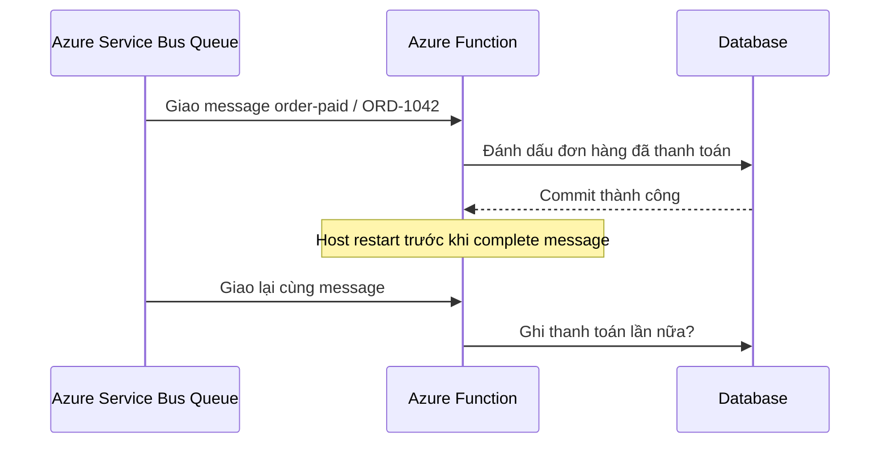
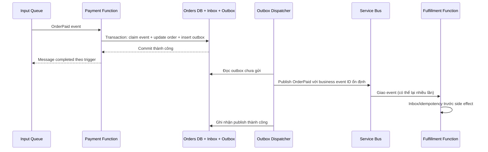
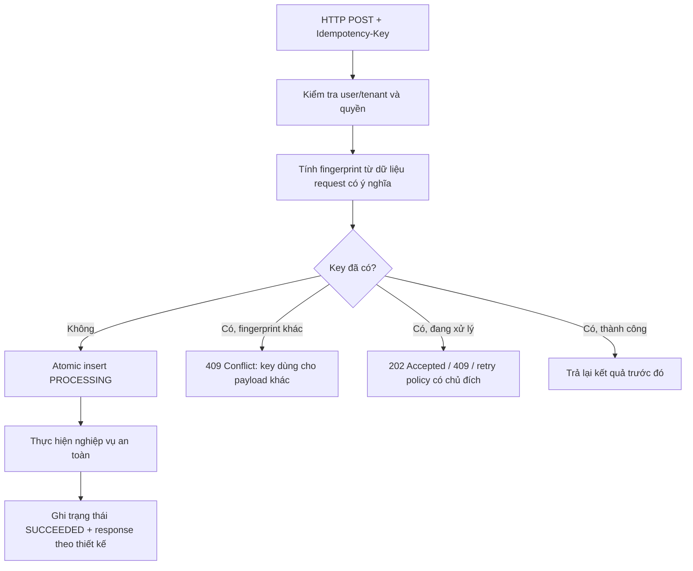
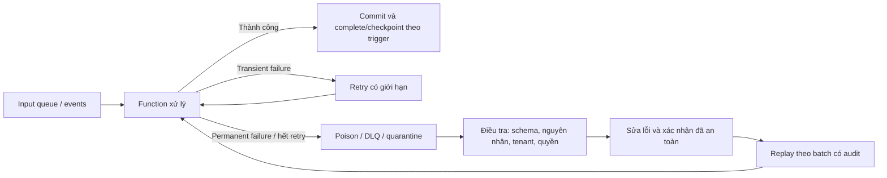
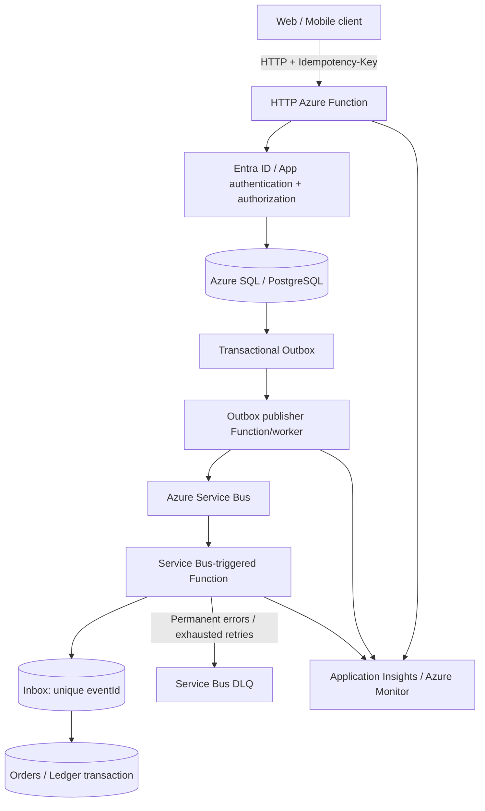

# Retry, xử lý trùng lặp và tính idempotent

Trong ứng dụng **Azure Functions**, một HTTP request, một message trong hàng đợi hoặc một sự kiện từ Blob Storage có thể kích hoạt việc xử lý. Tuy nhiên, hệ thống phân tán không bảo đảm mọi bước đều thành công trong lần đầu: kết nối mạng có thể bị ngắt, Azure SQL Database có thể tạm thời từ chối kết nối, một Function có thể bị restart hoặc quá thời gian thực thi, và nguồn sự kiện có thể gửi lại thông điệp khi không nhận được xác nhận hoàn tất. Nếu code luôn thực hiện lại toàn bộ tác dụng phụ trong mỗi lần gọi, một đơn hàng có thể bị ghi hai lần, cùng một hóa đơn bị phát hành hai lần hoặc khách hàng nhận nhiều email giống nhau.

Để xây dựng Functions đáng tin cậy, cần hiểu ba khái niệm đi cùng nhau: **retry** (thử lại khi lỗi), **duplicate processing** (cùng một công việc được thực hiện hơn một lần) và **idempotency** (thực hiện lặp lại không làm thay đổi kết quả nghiệp vụ ngoài ý muốn). Retry giúp tăng khả năng thành công trước lỗi tạm thời; idempotency và mô hình lưu trạng thái phù hợp giúp retry **không biến lỗi tạm thời thành dữ liệu sai**.

Bài học thuộc chương **Serverless với Azure Functions** trong mô-đun Microsoft Azure. Nội dung liên kết Azure Functions với subscription/resource group, Microsoft Entra ID, managed identity, Storage Queue, Service Bus, Event Grid, Event Hubs, Blob Storage, Azure SQL/PostgreSQL, Application Insights và vận hành an toàn. Ví dụ minh họa ứng dụng Java, cấu hình `host.json`, mô hình transaction/inbox–outbox, chiến lược kiểm thử và quan sát trên Azure.

## Mục tiêu học tập

Sau bài học, bạn có thể:

1. Giải thích khác biệt giữa **at-most-once**, **at-least-once** và mục tiêu **exactly-once ở cấp nghiệp vụ**.
2. Nhận biết nguồn trùng lặp trong HTTP, Storage Queue, Service Bus, Event Grid, Event Hubs, Blob trigger và hoạt động replay của Functions.
3. Phân biệt lỗi **transient** có thể retry với lỗi nghiệp vụ vĩnh viễn, đặt số lần thử, backoff, jitter và giới hạn timeout hợp lý.
4. Dùng **idempotency key**, unique constraint và transaction để tránh cập nhật cơ sở dữ liệu trùng khi Function được gọi lại hoặc chạy song song.
5. Thiết kế **inbox/deduplication store**, **transactional outbox**, message acknowledgment và xử lý poison/dead-letter messages.
6. Hiểu điểm khác nhau giữa retry do trigger/runtime, retry của Azure SDK, retry ở tầng ứng dụng và retry của client.
7. Vận dụng chiến lược quan sát, cảnh báo và diễn tập sự cố để chứng minh công việc vừa **không bị mất** vừa **không bị áp dụng trùng**.

## 1. Bài toán: một Function đã ghi dữ liệu nhưng chưa xác nhận thành công

Giả sử một Azure Function xử lý message `order-paid` chứa `orderId=ORD-1042`:



Thao tác ghi database đã thành công, nhưng nguồn thông điệp **không nhận được xác nhận hoàn tất**. Sau khi message lock/visibility hết hạn hoặc cơ chế retry kích hoạt, một Function invocation khác có thể nhận lại cùng thông điệp. Việc giao lại là hành vi cần dự kiến, không đủ để kết luận queue hay Azure Functions bị lỗi.

Nếu Function tính `balance = balance + 100` mỗi lần nhận event mà không kiểm tra định danh, số dư có thể tăng gấp đôi. Nếu Function đặt `paymentStatus = PAID` theo một lệnh cập nhật có điều kiện phù hợp, kết quả có thể ổn định hơn, nhưng vẫn cần xử lý những side effects khác như gửi email, ghi ledger hoặc gọi API ngân hàng.

**Nguyên tắc:** một lần gọi Function không nhất thiết tương ứng với một lần thực thi nghiệp vụ duy nhất. Hãy thiết kế để **cùng một event có thể quay lại**, thậm chí hai invocation xử lý đồng thời.

## 2. Delivery semantics: at-most-once, at-least-once và exactly-once

| Mô hình | Ý nghĩa | Đánh đổi |
|---|---|---|
| **At-most-once** | Công việc có thể được giao/xử lý tối đa một lần trong một ranh giới định nghĩa; có thể bị mất nếu lỗi. | Giảm xử lý trùng nhưng khó bảo đảm không mất dữ liệu. |
| **At-least-once** | Nguồn có thể giao lại để tăng khả năng công việc được xử lý; cùng event có thể xuất hiện nhiều lần. | Cần idempotency/dedup và xử lý retry an toàn. |
| **Exactly-once effect** | Một tác dụng nghiệp vụ được ghi nhận đúng một lần theo hợp đồng và phạm vi định nghĩa. | Thường cần transaction, unique key, trạng thái bền vững hoặc khả năng idempotent của dịch vụ đích. |

Nhiều nguồn sự kiện dùng với Azure Functions có hành vi **at-least-once** hoặc có khả năng replay. Khả năng gửi message theo thứ tự hoặc các tính năng duplicate detection của một broker **không tự tạo transaction xuyên database và API bên thứ ba**.

### 2.1. Exactly-once delivery khác exactly-once business effect

Ví dụ một Service Bus message được gửi lại hai lần, nhưng cơ sở dữ liệu có unique constraint cho `eventId` và chỉ commit thay đổi nghiệp vụ trong cùng transaction với bản ghi đã xử lý. Khi đó có thể đạt **một hiệu ứng database duy nhất** dù có nhiều Function invocations.

Ngược lại, nếu Function gọi cổng thanh toán bên ngoài rồi crash trước khi lưu bản ghi, khi retry nó có thể gọi lại cổng thanh toán. Bạn không thể chỉ đặt transaction ở database nội bộ để đảm bảo lệnh thanh toán ngoài hệ thống xảy ra đúng một lần. Cần **idempotency key được cổng thanh toán hỗ trợ**, hoặc quy trình hòa giải và bù trừ thích hợp.

### 2.2. Scope của idempotency phải rõ ràng

Phát biểu “Function idempotent” chỉ có ý nghĩa khi biết:

- **Đối tượng:** một lần thanh toán, một lần chuyển đổi ảnh, một report theo ngày, hay một lần cập nhật bản ghi?
- **Khóa:** `paymentId`, `orderId + eventType + version`, `blobPath + eTag` hay một message/event ID?
- **Phạm vi thời gian:** bao lâu phải nhớ các khóa đã xử lý để phát hiện trùng?
- **Tác dụng phụ:** database, email, Blob, bên thứ ba và event mới phát sinh có được bảo vệ nhất quán không?
- **Thất bại một phần:** điều gì xảy ra nếu side effect thành công nhưng ghi trạng thái thất bại?

Một Handler chỉ không tạo trùng trong vòng 60 giây **chưa chắc idempotent** đối với queue có thể giao lại sau nhiều giờ. Cần chọn retention của dedup state dựa trên cửa sổ replay/retention của nguồn, yêu cầu nghiệp vụ và chính sách dữ liệu.

## 3. Nguồn gây xử lý trùng lặp trong Azure Functions

Sự kiện trùng không chỉ do code vô tình gọi cùng hàm hai lần.

### 3.1. Retry của nguồn sự kiện

Một queue message chưa được xác nhận có thể được giao lại. Event Grid có cơ chế retry delivery khi subscriber không xác nhận thành công theo hợp đồng. Event Hubs/Cosmos DB change feed có thể phát lại các event hoặc batch sau khi checkpoint/lease chưa được ghi nhận. Cần xác định **semantics của đúng trigger và phiên bản extension**, không áp một quy tắc retry chung cho mọi Function.

### 3.2. Retry ở nhiều tầng

Một HTTP client tự retry khi timeout; Azure SDK bên trong Function cũng retry một lệnh Storage; runtime của trigger có thể giao message lại; và chính ứng dụng có vòng lặp retry. Ví dụ mỗi tầng tối đa 3 lần có thể gây ra nhiều lần gọi tới downstream hơn dự kiến. Cần có một **retry budget xuyên các tầng**, tránh retry storm.

### 3.3. Scale-out và xử lý đồng thời

Azure Functions có thể tăng số instances trên các hosting plans được hỗ trợ. Hai thông điệp có cùng business key nhưng message ID khác nhau có thể được xử lý **song song**, hoặc cùng một message được giao lại sau lỗi lock/visibility. Một biến `HashSet` trong RAM của Function instance A **không thể ngăn** instance B làm cùng công việc và cũng biến mất khi host restart.

### 3.4. Manual replay và vận hành

Người vận hành có thể đưa message từ dead-letter queue quay lại, chạy backfill, replay event hoặc bấm “retry” trong công cụ quản trị. Đây là lý do hệ thống phải có **khóa nghiệp vụ ổn định** chứ không chỉ dựa vào ID của Function invocation. Một sự kiện được gửi lại trong queue mới có thể nhận `MessageId` khác nhưng vẫn đại diện cho cùng một thanh toán.

### 3.5. Ví dụ theo từng nguồn

| Trigger/nguồn | Tình huống tạo lại công việc | Cơ chế bảo vệ nổi bật |
|---|---|---|
| **HTTP trigger** | Browser/client/API gateway retry sau timeout; webhook provider gửi lại event. | Idempotency-Key ở request, unique constraint, trả lại kết quả cũ. |
| **Azure Storage Queue trigger** | Function throw/host restart; message hiện lại sau visibility timeout; cuối cùng vào poison queue. | Key nghiệp vụ, transaction, giám sát dequeue count/poison queue. |
| **Azure Service Bus trigger** | Lock hết hạn, message abandoned hoặc handler thất bại; broker tăng delivery count. | Complete đúng lúc, lock renewal, idempotent handler, DLQ. |
| **Event Grid trigger** | Event được gửi lại sau lỗi delivery; thứ tự/duplicate có thể khác dự kiến. | Event ID + định danh resource/version, tránh giả định ordering. |
| **Event Hubs trigger** | Partition được đọc lại từ checkpoint gần nhất sau lỗi hoặc rebalance. | Key theo event/business sequence, xử lý batch/replay bền vững. |
| **Blob trigger** | Cơ chế phát hiện/sự kiện và retry có thể dẫn tới xử lý lại blob. | Blob identity + ETag/version ID hoặc khóa nghiệp vụ. |
| **Cosmos DB trigger** | Change feed processor có thể replay batch khi checkpoint/lease chưa được cập nhật. | Ghi theo document ID/version, kiểm soát side effects. |
| **Timer trigger** | Job được chạy lại thủ công, deploy/restart, vận hành bù lịch. | Khóa theo kỳ nghiệp vụ, không chỉ dựa vào thời điểm invocation. |

Không phải tất cả các trigger đều tự retry theo cùng số lần, thời gian hoặc chính sách. Một lỗi HTTP do code ném exception **không có nghĩa** Azure Functions tự gọi lại toàn bộ HTTP request; việc retry có thể thuộc về chính client hoặc hệ thống upstream.

## 4. Phân loại lỗi trước khi quyết định retry

Retry chỉ hữu ích khi lỗi có khả năng tự hết hoặc hệ thống có thể chuyển sang trạng thái hợp lệ sau khi thử lại.

| Loại lỗi | Ví dụ | Hướng xử lý |
|---|---|---|
| **Transient** | HTTP 429/503, database failover ngắn, DNS/connect timeout thoáng qua. | Retry giới hạn, exponential backoff, jitter; tôn trọng `Retry-After` nếu được hỗ trợ. |
| **Permanent/business invalid** | JSON sai schema, không có quyền xem đơn, số tiền âm, thiếu trường bắt buộc. | Không retry tự động vô hạn; đưa vào luồng lỗi/quarantine và ghi cảnh báo. |
| **Auth/configuration** | Managed identity thiếu RBAC, secret URI sai, service endpoint không tồn tại. | Sửa cấu hình/quyền; retry liên tục thường không hiệu quả. |
| **Concurrency conflict** | ETag thay đổi, optimistic lock thất bại. | Đọc trạng thái mới, xác định có nên retry hay trả conflict; giới hạn số lần. |
| **Business rule conflict** | Đơn hàng đã hủy nhưng event yêu cầu hoàn tất. | Quyết định theo nghiệp vụ, có thể trả trạng thái đã xử lý/ghi audit thay vì retry. |
| **Resource saturation** | Queue backlog lớn, hết connection pool, memory cao. | Backpressure, giới hạn concurrency, tăng capacity khi đúng nguyên nhân, retry có kiểm soát. |

### 4.1. Trả lại lỗi để trigger nhận biết thất bại

Một queue-triggered Function bắt exception rồi **chỉ log** và trả về thành công có thể khiến runtime xác nhận thông điệp như đã xử lý; message có thể bị mất khỏi luồng retry mặc dù nghiệp vụ thất bại. Khi lỗi thực sự cần trigger retry, không được nuốt exception mà quên lưu trạng thái thất bại bền vững.

Ngược lại, nếu input lỗi vĩnh viễn, cứ `throw` sẽ khiến message quay lại cho tới khi hết số lần giao rồi chuyển poison/dead-letter (nếu trigger/broker hỗ trợ). Cần quyết định có chủ đích: **ghi trạng thái invalid vào kho bền vững rồi ack** hay **throw để đưa về DLQ**, không lẫn lộn hai cách.

### 4.2. Timeout là kết quả không xác định, không luôn là thất bại nghiệp vụ

Nếu Function gọi một payment API và nhận timeout, phía đối tác **có thể đã xử lý thành công** nhưng response bị mất. Gọi lại với một `paymentId` mới có thể tạo hai giao dịch. Trong tình huống này phải **query trạng thái theo business/idempotency key** hoặc retry với **cùng idempotency key được đối tác chấp nhận**, thay vì tạo yêu cầu thanh toán mới.

## 5. Backoff, jitter, timeout và retry budget

Nếu nhiều Function instances cùng gặp lỗi downstream, thử lại ngay lập tức có thể làm tình trạng quá tải nặng thêm. Một chính sách retry cần tính cả **thời điểm** và **giới hạn**.

### 5.1. Fixed delay và exponential backoff

**Fixed delay:** các lần thử cách nhau một khoảng gần cố định, ví dụ 5 giây. Dễ hiểu nhưng có thể đồng bộ các clients thành spike tải lặp lại.

**Exponential backoff:** thời gian chờ tăng theo số lần thử, ví dụ 1, 2, 4, 8, 16 giây trước khi áp dụng giới hạn trên. Phù hợp với lỗi tạm thời và dịch vụ downstream cần thời gian hồi phục.

Một dạng công thức:

\[
d_n = \min(d_{max}, d_{base}\cdot 2^{n-1}) + J_n
\]

Trong đó `n` là lần retry, `d_base` là khoảng chờ ban đầu, `d_max` là mức giới hạn và `J_n` là **jitter** được chọn theo thuật toán thích hợp. Công thức chỉ là mô hình để hiểu; một implementation có thể áp dụng jitter toàn phần hoặc ràng buộc tổng delay khác. Không để `J_n` tạo tổng delay ngoài chính sách timeout và deadline đã định.

### 5.2. Vì sao cần jitter?

Giả sử 1.000 workers cùng gọi một API và bị 429 tại 10:00:00. Nếu tất cả chờ chính xác 5 giây rồi retry, API lại nhận 1.000 request lúc 10:00:05. Jitter làm lệch các lần thử, giảm **thundering herd**.

### 5.3. Retry-After và circuit breaker

Một downstream service có thể trả `429 Too Many Requests` kèm `Retry-After`. Client nên tôn trọng chỉ dẫn hợp lệ đó trong phạm vi deadline/timeout và chính sách SDK. Khi downstream lỗi dài, một **circuit breaker** có thể tạm ngừng các request mới, cho phép hệ thống phục hồi và giảm lượng retry vô ích. Circuit breaker không thay thế hàng đợi bền vững hoặc việc lưu trạng thái nghiệp vụ.

### 5.4. Ngân sách tổng thời gian

Ví dụ message phải xử lý trong 2 phút nhưng bạn đặt 10 lần retry SDK, mỗi lần timeout 30 giây: chỉ riêng một thao tác có thể chiếm vài phút. Nếu trigger có timeout, lock duration hoặc visibility timeout ngắn hơn, message có thể bị giao lại trong khi Function cũ còn chạy. Cần chọn **cùng một time budget**:

```text
Deadline nghiệp vụ
  >= thời gian xử lý có ích
   + tổng timeout/backoff của retries ở tầng ứng dụng và SDK
   + thời gian commit/ack/ghi trạng thái
```

Nếu không thể xử lý trong một lần giao, hãy chia công việc, tạo checkpoint, dùng Durable Functions hoặc một pipeline có trạng thái thay vì tăng timeout vô hạn.

## 6. Phân biệt chính sách retry theo trigger trong Azure Functions

### 6.1. Không có một thiết lập retry chung cho mọi trigger

Azure Functions hỗ trợ **runtime retry policies** cho **một số** trigger/extension theo phiên bản được hỗ trợ, thường với chiến lược **fixed delay** hoặc **exponential backoff**. Các trigger dựa trên queue/broker còn có cơ chế **message re-delivery, visibility/lock, delivery count và poison/dead-letter** ở lớp nguồn. Vì thế, không thể đặt một khối `retry` vào `host.json` rồi mặc định mọi loại trigger đều hoạt động giống nhau.

Trước khi triển khai cần xác minh: loại trigger, phiên bản Azure Functions runtime, binding extension, hosting plan, cách xử lý exception, retry policy được hỗ trợ và số lần thử cuối cùng. Không sử dụng annotations/configuration của một trigger để suy ra behavior của trigger khác.

### 6.2. Storage Queue trigger và host.json

Với **Azure Storage Queue trigger**, khi một Function invocation không thành công, message thường xuất hiện lại sau khoảng visibility timeout được cấu hình. Extension của queue có các thiết lập liên quan như `visibilityTimeout`, `maxDequeueCount` và batch/concurrency. Ví dụ `host.json` cho runtime/extension hỗ trợ cú pháp tương ứng:

```json
{
  "version": "2.0",
  "extensions": {
    "queues": {
      "visibilityTimeout": "00:00:30",
      "maxDequeueCount": 5,
      "batchSize": 8,
      "newBatchThreshold": 4
    }
  }
}
```

`visibilityTimeout` là khoảng chờ trước khi message có thể được nhìn thấy lại sau lần xử lý thất bại theo cơ chế extension; `maxDequeueCount` kiểm soát ngưỡng các lần giao được chấp nhận trước khi message được chuyển tới **poison queue**; `batchSize` và `newBatchThreshold` ảnh hưởng mức xử lý đồng thời theo host/scale behavior tương ứng.

**Những điểm cần nhớ:**

- Đặt `maxDequeueCount=5` không đồng nghĩa đảm bảo Function được gọi **chính xác năm lần trong mọi tình huống**; lỗi host, lease/visibility, tải, phiên bản extension và hành vi dịch vụ có thể ảnh hưởng thực tế.
- Sau khi vượt ngưỡng, queue extension có thể đặt message vào queue tên dạng **`<original-queue-name>-poison`** trong cùng storage account theo cơ chế hỗ trợ.
- Với queue message bị xử lý lâu, phải xét visibility timeout, renew behavior của runtime, idempotency và checkpoint; **không** đoán rằng chỉ đặt timeout lớn sẽ loại bỏ mọi duplicate.
- Cấu hình `host.json` nên được quản lý cùng source code, kiểm tra trong staging rồi theo dõi kết quả production.

### 6.3. Service Bus trigger và dead-letter queue

Azure Service Bus dùng những khái niệm **Peek-Lock**, **Complete**, **Abandon**, **DeadLetter** và `MaxDeliveryCount`. Khi message không được complete trước lock expiration hoặc bị abandon, broker có thể giao lại. Sau ngưỡng `MaxDeliveryCount` theo cấu hình entity, message thường được chuyển đến **dead-letter subqueue** (DLQ), thay vì chỉ thử mãi.

Các điểm phân biệt:

| Storage Queue trigger | Service Bus trigger |
|---|---|
| Message được điều khiển bằng visibility/dequeue behavior. | Message lock, delivery count, settlement và DLQ của Service Bus. |
| Thường dùng poison queue tên có hậu tố `-poison`. | Có **dead-letter subqueue** trên queue/subscription entity. |
| `maxDequeueCount` thuộc cấu hình Queue extension. | `MaxDeliveryCount` thuộc thực thể Service Bus; không phải cùng tham số `maxDequeueCount`. |
| Hành vi timeout/renew cần kiểm tra extension. | Có giới hạn lock và auto-lock renewal theo cấu hình extension/SDK hỗ trợ. |

**Không complete message trước khi side effects quan trọng đã commit.** Nếu Function đang chạy làm việc hơn thời gian lock và không gia hạn được, một processor khác có thể nhận lại message. Vì thế, ngay cả khi ứng dụng dùng Service Bus, xử lý vẫn phải idempotent.

### 6.4. Event Grid, Event Hubs và Cosmos DB change feed

**Event Grid** có cơ chế gửi lại khi delivery lỗi; cần kiểm tra event schema, event ID, subject, phiên bản resource và điều kiện lọc. Không dựa vào thứ tự đến của events để luôn suy ra phiên bản cuối cùng.

**Event Hubs** sử dụng partition offsets và checkpoints. Nếu dữ liệu nghiệp vụ đã commit nhưng checkpoint chưa được ghi, batch có thể được đọc lại khi Function host restart hoặc partition rebalance. Xử lý batch phải có cách chịu được replay, và không cập nhật checkpoint bằng một cơ chế tùy tiện tách rời logic của extension nếu không hiểu hợp đồng xử lý.

**Cosmos DB change feed trigger** cũng có thể thực hiện lại một batch khi lease/checkpoint chưa được cập nhật. Cần xét document ID, `_etag`, phiên bản, lựa chọn change feed mode và bài toán side effects để chọn key phù hợp.

### 6.5. HTTP trigger, Timer trigger và Durable Functions

- **HTTP trigger:** lỗi HTTP 500/timeout có thể được **caller** retry. Thiết kế `Idempotency-Key` và kết quả ổn định; không tự giả định runtime sẽ invoke lại HTTP request.
- **Timer trigger:** có thể có run trễ, thao tác vận hành chạy lại hoặc logic catch-up tùy cấu hình. Tạo business key theo **kỳ dữ liệu**, không chỉ theo `invocationId`.
- **Durable Functions:** orchestration có thể replay lịch sử để tái dựng trạng thái; activity có thể chạy lại khi retry/failure. **Orchestrator code phải deterministic**, còn side effects nên nằm trong activities có idempotency/transaction. Replay của orchestrator không có nghĩa được phép gửi email hoặc ghi DB trực tiếp trong orchestrator mỗi lần replay.

## 7. Idempotency: biến nhiều lần gọi thành một kết quả nghiệp vụ

Một thao tác `f` được gọi là idempotent nếu việc thực hiện lại trên cùng dữ liệu/trạng thái phù hợp không tạo thêm hiệu ứng ngoài kết quả mong muốn:

\[
f(f(x)) = f(x)
\]

Đây là **ý tưởng toán học**, còn implementation phải xét concurrency, version, side effects và thời gian lưu dedup keys.

### 7.1. Thao tác có thể idempotent tự nhiên

Ví dụ database cập nhật trạng thái:

```sql
UPDATE orders
SET status = 'PAID'
WHERE order_id = 'ORD-1042' AND status <> 'PAID';
```

Lặp lại câu lệnh có thể không thay đổi `status` sau lần đầu. Nhưng nếu mỗi lần gọi cũng tạo dòng ledger hoặc gửi email, **toàn bộ workflow vẫn không idempotent**. Cần bảo vệ cả những tác dụng phụ.

### 7.2. Thao tác không idempotent tự nhiên

```sql
UPDATE accounts
SET balance = balance + 100
WHERE account_id = 'ACC-8';
```

Chạy hai lần làm tăng số dư hai lần. Với giao dịch tài chính, cần một **transaction ID duy nhất** và ràng buộc database đảm bảo cùng giao dịch không được áp dụng hai lần.

### 7.3. Thiết kế idempotency key

Khóa tốt nên:

- **Ổn định giữa các retries:** cùng một công việc dùng cùng key.
- **Phân biệt những sự kiện hợp lệ khác nhau:** hai lần thanh toán khác nhau không vô tình bị gộp.
- **Có phạm vi tenant/đối tượng:** tránh cùng ID từ hai khách hàng khác nhau bị xem là trùng.
- **Tương thích với business semantics:** với báo cáo, có thể là `tenantId + reportType + period`; với thanh toán là `tenantId + paymentId`.
- **Được bảo vệ khỏi thay đổi payload:** nếu client dùng lại cùng key cho payload khác, hệ thống phải phát hiện conflict thay vì âm thầm trả kết quả cũ không phù hợp.

| Workload | Key ứng viên | Điều cần cẩn thận |
|---|---|---|
| Thanh toán | `tenantId:paymentId` | Không dùng `orderId` nếu một đơn có nhiều lần thanh toán hợp lệ. |
| Tạo báo cáo ngày | `tenantId:reportType:YYYY-MM-DD` | Kỳ dữ liệu theo timezone nghiệp vụ, hỗ trợ phiên bản báo cáo khi cố ý chạy lại. |
| Xử lý Blob | `storageAccount:container:blobName:ETag` | Blob có thể bị ghi đè; chỉ dùng path sẽ bỏ qua phiên bản mới. |
| Xử lý event | `sourceSystem:eventId` | Event ID phải ổn định khi provider retry; đôi khi còn cần business ID/version. |
| Tạo thumbnail | `blobVersion:variant:processorVersion` | Khi nâng cấp thuật toán có thể cần tạo lại hợp lệ. |
| HTTP POST tạo đơn | `tenantId:Idempotency-Key` | Ràng buộc key với request payload hash và retention policy. |

**Không dùng `FunctionInvocationId` làm idempotency key** nếu mong muốn dedup giữa retries: mỗi invocation mới có thể có ID khác nhau. `InvocationId` hữu ích cho tracing, không nhất thiết định danh công việc nghiệp vụ.

## 8. Vì sao HashSet trong RAM không đủ?

Một cách dễ nghĩ tới:

```java
// Chỉ minh họa cách KHÔNG NÊN bảo vệ việc xử lý trùng giữa các instances.
private static final Set<String> seen = ConcurrentHashMap.newKeySet();

if (seen.add(eventId)) {
    chargeCustomer();
}
```

Cách này có nhiều lỗ hổng:

1. Các Function instances khác nhau không chia sẻ cùng `seen`.
2. Khi host restart, trạng thái trong RAM biến mất.
3. Nếu thêm key rồi crash trước `chargeCustomer()`, retry trên cùng instance có thể **bỏ qua** công việc chưa hoàn tất.
4. Không có transaction giữa ghi key và side effect.
5. Không có eviction/retention phù hợp với event version và replay window.

Thay vào đó, cần một **durable deduplication store** như Azure SQL Database, PostgreSQL, Cosmos DB hoặc cơ chế lưu trữ có thao tác **atomic conditional create/compare-and-set** phù hợp. Chọn công cụ theo consistency, latency, khối lượng và tài nguyên đã có trong kiến trúc.

## 9. Inbox pattern và transaction để ghi nhận một lần

**Inbox pattern** lưu nhận diện message/event đã xử lý trong một kho bền vững, đồng thời kết hợp thay đổi nghiệp vụ sao cho retry không tạo thêm hiệu ứng. Với một database quan hệ, cách đơn giản và mạnh là dùng **unique constraint + transaction**.

### 9.1. Thiết kế bảng với PostgreSQL

Ví dụ hệ thống nhận event `order-paid`. Bảng inbox dùng khóa ghép bao gồm tenant và event ID:

```sql
CREATE TABLE processed_events (
    tenant_id       text        NOT NULL,
    event_id        text        NOT NULL,
    processed_at    timestamptz NOT NULL DEFAULT now(),
    PRIMARY KEY (tenant_id, event_id)
);

CREATE TABLE orders (
    tenant_id  text NOT NULL,
    order_id   text NOT NULL,
    status     text NOT NULL,
    PRIMARY KEY (tenant_id, order_id)
);
```

Trong **cùng một database transaction**, handler làm:

```sql
BEGIN;

-- Nếu event_id đã có, RETURNING không trả dòng nào.
INSERT INTO processed_events (tenant_id, event_id)
VALUES (:tenantId, :eventId)
ON CONFLICT DO NOTHING
RETURNING event_id;

-- Chỉ khi câu INSERT phía trên trả một dòng mới:
UPDATE orders
SET status = 'PAID'
WHERE tenant_id = :tenantId
  AND order_id = :orderId
  AND status = 'PENDING';

COMMIT;
```

Đoạn SQL minh họa **chuỗi câu lệnh có điều kiện ở tầng ứng dụng**, không phải script SQL có thể tự kiểm tra số dòng `RETURNING` để bỏ qua `UPDATE`. Handler phải kiểm tra kết quả INSERT và **chỉ chạy UPDATE nếu đã claim được event mới**. Nếu không tìm thấy order hoặc trạng thái không hợp lệ, phải quyết định rollback, lưu lỗi nghiệp vụ hay đánh dấu event đã được xử lý theo chính sách. Không tự nhận `COMMIT` thành công khi thay đổi nghiệp vụ không đạt yêu cầu.

### 9.2. Vì sao concurrent invocations vẫn an toàn hơn?

Nếu hai Function instances cùng INSERT `(tenantA, EVT-9)`, unique constraint khiến **tối đa một transaction** ghi được khóa đó theo semantics của PostgreSQL. Instance còn lại nhận conflict/không có dòng `RETURNING` khi transaction liên quan hoàn tất; nó không nên cập nhật đơn hàng lần thứ hai.

Nếu instance thứ nhất crash **trước commit**, transaction rollback, khóa chưa được ghi bền vững và lần retry có thể làm lại. Nếu crash **sau commit nhưng trước ack message**, inbox record đã tồn tại, lần retry nhận biết event đã xử lý và có thể trả thành công để message được complete.

### 9.3. Ranh giới của transaction

Mô hình trên đạt bảo vệ tốt khi **ghi inbox và cập nhật order cùng trong một database transaction**. Nếu handler còn gọi email API, Blob Storage hoặc cổng thanh toán ngoài database trong transaction, tính nguyên tử **không kéo dài sang hệ thống đó**. Cần cơ chế khác như **transactional outbox** hoặc idempotency key của provider.

### 9.4. Claim PROCESSING, lease và crash recovery

Với công việc dài không thể nằm trong một transaction, có thể dùng bảng trạng thái `PENDING → PROCESSING → SUCCEEDED/FAILED`, kèm owner ID, lease expiration và fencing/version. Việc **claim** phải atomic, ví dụ conditional update so sánh trạng thái/version. Nếu worker crash sau khi claim, lease hết hạn để worker khác tiếp quản; nếu worker cũ quay lại, fencing token giúp chặn nó ghi kết quả lỗi thời.

**Không đánh dấu SUCCEEDED ngay khi vừa nhận message.** Một thiết kế ghi `processed=true` trước khi thực sự lưu kết quả sẽ làm retry bỏ qua công việc đã thất bại sau bước đánh dấu. Tương tự, chỉ dựa vào một trường `PROCESSING` không có timeout/lease tạo ra các công việc bị kẹt mãi mãi.

## 10. Transactional outbox: khi Function cần tạo một sự kiện hoặc gọi dịch vụ khác

Hãy mở rộng ví dụ: sau khi cập nhật `orders.status='PAID'`, ứng dụng phải gửi sự kiện `OrderPaid` để dịch vụ kho hàng xuất hàng. Nếu cập nhật database rồi gọi Service Bus ngay:

```text
DB commit thành công
  → Function crash trước lúc gửi Service Bus
  → Đơn đã PAID nhưng kho hàng không nhận sự kiện
```

Nếu gửi Service Bus trước rồi mới commit database:

```text
Service Bus nhận OrderPaid
  → DB commit thất bại
  → Kho hàng nhận thông báo cho đơn chưa thanh toán
```

**Transactional outbox** giải quyết khoảng trống này bằng cách ghi trạng thái nghiệp vụ và bản ghi sự kiện cần gửi **trong cùng một transaction của một database**. Một dispatcher riêng đọc outbox rồi gửi ra broker; nếu dispatcher crash và gửi lại, consumer đích vẫn phải idempotent.

### 10.1. Quy trình end-to-end



Thứ tự minh họa không có nghĩa dispatcher và Function chạy tuần tự tuyệt đối: dispatcher có thể quan sát outbox ngay sau commit; Function có thể crash bất kỳ lúc nào. Mô hình đúng phải an toàn trước các điểm thất bại đó.

### 10.2. Bảng outbox đơn giản

```sql
CREATE TABLE outbox_events (
    event_id       text        PRIMARY KEY,
    event_type     text        NOT NULL,
    aggregate_id   text        NOT NULL,
    payload_json   jsonb       NOT NULL,
    created_at     timestamptz NOT NULL DEFAULT now(),
    published_at   timestamptz NULL
);
```

Trong transaction xử lý thanh toán, ngoài `INSERT processed_events` và `UPDATE orders`, handler thêm `INSERT outbox_events` với **cùng event ID nghiệp vụ ổn định**. Dispatcher chỉ đánh dấu `published_at` sau khi broker xác nhận publish. Nếu việc ghi `published_at` thất bại sau khi broker nhận message, dispatcher sẽ gửi lại; vì vậy outbox bảo vệ **không bỏ sót event khi DB commit**, nhưng **không tự đảm bảo subscriber nhận event đúng một lần**.

### 10.3. Outbox dispatcher phải chịu concurrency

Nếu nhiều dispatcher instances cùng quét bảng, cần dùng cơ chế **atomic claim/lease**, hoặc cơ chế đọc có row lock và batch phù hợp như PostgreSQL `FOR UPDATE SKIP LOCKED`, kết hợp thời hạn claim, retry và recovery. Không làm:

```text
SELECT * FROM outbox_events WHERE published_at IS NULL
for each event: publishToBus(event)
```

trên nhiều instances mà không điều phối, nếu mục tiêu là giảm duplicate publishes. Ngay cả khi đã có claim, cần thiết kế subscriber idempotent vì lỗi mạng/ack vẫn có thể tạo duplicate.

### 10.4. Khi cần gọi API bên ngoài

Outbox có thể ghi một **command** cần gọi API thanh toán/email thay vì trực tiếp publish message. Dispatcher gọi API với **idempotency key do nhà cung cấp chấp nhận**; nếu API không có cơ chế đó, phải dùng trạng thái nghiệp vụ và hòa giải. Không khẳng định có thể thực hiện transaction atomically giữa Azure SQL/PostgreSQL và mọi external HTTP API.

## 11. Ví dụ Java Azure Function: QueueTrigger gọi dịch vụ xử lý idempotent

Ví dụ sau cho thấy **ranh giới trách nhiệm** của một Azure Function Java nhận event qua Storage Queue. Tùy Azure Functions Java runtime/extension, cấu hình connection của trigger và cơ chế identity-based connections phải tương thích với hosting plan và phiên bản extension đang dùng.

### 11.1. Payload message

```json
{
  "tenantId": "tenant-A",
  "eventId": "evt-payment-01934",
  "orderId": "ORD-1042",
  "eventType": "OrderPaid",
  "schemaVersion": 1
}
```

`eventId` là **ID công việc nghiệp vụ**, không phải ID của Azure Function invocation. Nếu producer retry publish, nó phải giữ `eventId` cho cùng một event. Nếu có nhiều loại event cho cùng order, dùng `eventType`/version hoặc một định danh event đủ phân biệt, tránh gộp hai giao dịch hợp lệ.

### 11.2. Handler Java: validate, applyOnce, throw lỗi retryable

```java
import com.fasterxml.jackson.databind.JsonNode;
import com.fasterxml.jackson.databind.ObjectMapper;
import com.microsoft.azure.functions.ExecutionContext;
import com.microsoft.azure.functions.annotation.FunctionName;
import com.microsoft.azure.functions.annotation.QueueTrigger;

public class ProcessOrderPaidFunction {
    private static final ObjectMapper JSON = new ObjectMapper();

    @FunctionName("ProcessOrderPaid")
    public void run(
        @QueueTrigger(
            name = "message",
            queueName = "paid-orders",
            connection = "OrdersStorage") String rawMessage,
        final ExecutionContext context) {

        try {
            JsonNode event = JSON.readTree(rawMessage);
            String tenantId = required(event, "tenantId");
            String eventId  = required(event, "eventId");
            String orderId  = required(event, "orderId");

            // Hàm dịch vụ PHẢI được hiện thực bằng transaction bền vững:
            // claim (tenantId,eventId), cập nhật đơn hàng và outbox cùng commit.
            OrderPaidService.applyOnce(tenantId, eventId, orderId);

            context.getLogger().info("processed eventId=" + eventId);
        } catch (Exception error) {
            // Không ghi rawMessage/token/PII vào logs.
            context.getLogger().warning(
                "order-paid failed: " + error.getClass().getSimpleName());
            throw new IllegalStateException("Processing did not complete", error);
        }
    }

    private static String required(JsonNode event, String field) {
        JsonNode value = event.get(field);
        if (value == null || !value.isTextual() || value.asText().isBlank()) {
            throw new IllegalArgumentException("Missing field: " + field);
        }
        return value.asText();
    }
}
```

Đây là **khung tích hợp** với Azure Functions Java annotations và Jackson; `OrderPaidService.applyOnce` là thành phần nghiệp vụ **cần được lập trình riêng** với connection pool, transaction, duplicate detection và xử lý lỗi như các mục trước, không phải API sẵn có của Azure. Ví dụ thể hiện rằng Function không nên tự `ACK` message bằng một câu lệnh tách rời giao thức trigger; khi handler trả thành công, Queue extension xử lý message completion theo semantics của nó.

**Điểm phải bổ sung khi triển khai thật:** code trên ném exception cho cả input lỗi schema. Với message hỏng vĩnh viễn, cần chính sách poison queue/quarantine và cảnh báo, không retry vô hạn. Các lỗi duplicate đã được `applyOnce` nhận diện và hoàn tất an toàn nên **trả thành công**; lỗi database transient nên throw để trigger retry theo cơ chế phù hợp.

### 11.3. Pseudocode của `applyOnce` ở tầng dịch vụ

```text
function applyOnce(tenantId, eventId, orderId):
    beginDatabaseTransaction()
    inserted = insertInboxIfAbsent(tenantId, eventId) // atomic + unique key

    if not inserted:
        commitOrRollbackReadOnlyTransaction()
        return ALREADY_PROCESSED

    order = loadOrderForUpdate(tenantId, orderId)
    if order not found or invalidState(order):
        rollback()
        throw PermanentBusinessError()

    updateOrderState(order, PAID)
    insertOutboxEventWithStableId(eventId, ORDER_PAID, orderId)
    commitTransaction()
    return PROCESSED
```

Nếu việc ghi inbox và cập nhật order không cùng transaction, có thể xuất hiện “đánh dấu xử lý rồi mất update” hoặc “update thành công nhưng chưa đánh dấu”. Để kiểm tra, thực hiện test có hai worker nhận cùng event **đồng thời**, không chỉ chạy lại tuần tự hai lần.

### 11.4. Cấu hình connection an toàn

Trong annotation, `connection = "OrdersStorage"` tham chiếu **tên cấu hình connection** của Azure Functions, không phải mật khẩu/connection string được hard-code trong code. Với local development, có thể cấu hình thông qua `local.settings.json` **không commit secrets**; trên Azure, ưu tiên identity-based connections/managed identity khi trigger extension hỗ trợ, cùng data-plane RBAC đúng scope.

Identity của Function cần quyền truy cập **Storage Queue** để nhận message và quyền **database** để thực hiện transaction, nhưng các quyền này có thể dùng cơ chế xác thực khác nhau. Azure RBAC `Contributor` trên resource group không tự có nghĩa Function được đọc nội dung message hoặc ghi database.

## 12. HTTP API: Idempotency-Key, request fingerprint và response replay

HTTP clients có thể retry `POST` khi mạng timeout, response 502/503 hoặc vì ứng dụng mobile gửi lại yêu cầu. Nếu endpoint tạo đơn hàng hoặc thu tiền, **cần định nghĩa hợp đồng retry cho client**.

Ví dụ:

```http
POST /api/payments HTTP/1.1
Host: api.example.com
Content-Type: application/json
Idempotency-Key: 0cf8d6b4-2bb2-4529-9ff0-48d5d2308c3c

{"orderId":"ORD-1042","amount":100000,"currency":"VND"}
```

`Idempotency-Key` là hợp đồng ứng dụng tự định nghĩa, **không phải một header khiến Azure Functions tự lưu trạng thái chống trùng**.

### 12.1. Luồng quyết định



`202`, `409` và cơ chế polling chỉ là **lựa chọn thiết kế API**, không phải behavior cố định của Azure Functions. Bạn phải công bố trong API contract và giữ nhất quán giữa các lần gọi.

### 12.2. Lưu những gì trong idempotency store?

Một bản ghi có thể gồm:

| Trường | Mục đích |
|---|---|
| `tenantId` + `key` (unique) | Phân biệt caller và chống trùng theo tenant. |
| `requestHash` | Phát hiện cùng key nhưng payload khác. |
| `status` | `PROCESSING`, `SUCCEEDED`, `FAILED` theo state machine. |
| `resultRef` hoặc response được lọc | Cho phép trả lại kết quả ổn định. |
| `createdAt`, `expiresAt` | Retention và dọn dẹp dedup state. |
| `leaseOwner`, `leaseUntil`, `version` | Hỗ trợ recovery cho thao tác dài và fencing. |

Không lưu toàn bộ payment card data, secrets hoặc bearer tokens trong idempotency store. `requestHash` nên tính từ **payload canonical theo nghiệp vụ** thay vì raw JSON không được chuẩn hóa nếu thứ tự thuộc tính có thể khác nhưng ý nghĩa giống nhau.

### 12.3. Trả kết quả cũ không đồng nghĩa công khai dữ liệu

Một client mang đúng idempotency key nhưng đã mất quyền truy cập tài nguyên không nên được tự động nhận dữ liệu chỉ vì key trùng. **Authentication và authorization phải được đánh giá đúng theo policy** ngay cả khi trả cached response. Key phải được scope theo tenant/user và thời gian lưu hợp lý; không dùng key như credential có thể vượt qua quyền nghiệp vụ.

### 12.4. Nếu timeout sau khi bắt đầu nghiệp vụ

Nếu API trả 504 sau khi đã tạo payment, retry với cùng key nên kiểm tra trạng thái cũ. Khi nghiệp vụ chưa hoàn tất, có thể trả `202 Accepted` kèm operation ID và endpoint truy vấn kết quả. Đừng tạo payment mới chỉ vì client không nhận response từ lần trước.

## 13. Blob, Event Grid và event đến không đúng thứ tự

Idempotency không chỉ ngăn **duplicate của cùng event**; với event-driven architecture, còn phải xử lý **event cũ tới sau event mới**.

### 13.1. Blob overwrite và ETag

Giả sử app upload `photos/user-7/avatar.jpg` hai lần. Hai lần cập nhật có thể tạo ETag khác nhau, hoặc version ID nếu versioning được bật và cấu hình phù hợp. Nếu chỉ dùng `blobName` làm key, Function có thể xử lý bản mới một lần nhưng **bỏ qua tất cả cập nhật về sau** như trùng lặp.

Một key phù hợp hơn có thể là:

```text
storageAccount + container + blobPath + ETag + transformationVersion
```

Khi nhận một event, hãy kiểm tra ETag/version của blob, xác định thuật toán có cần chạy lại hay không, và thực hiện conditional write ở đích theo khả năng dịch vụ. Nếu source blob bị thay đổi giữa lúc event được phát và lúc Function đọc, cần chọn policy: xử lý phiên bản cụ thể nếu khả dụng, hoặc bỏ qua event cũ và chỉ xử lý phiên bản mới nhất.

### 13.2. Event Grid có thể delivery lại và không bảo đảm thứ tự như kỳ vọng

Một event `BlobCreated` có thể được delivery lại sau lỗi xác nhận; cũng có thể một thay đổi mới đến trước event cũ trong hệ thống nhận. Để tránh ghi đè thumbnail mới bằng kết quả cũ, lưu **version hoặc ETag đã xử lý** và dùng optimistic concurrency/conditional writes phù hợp.

Không lấy `eventTime` một mình làm đồng hồ quyết định tổng thứ tự chính xác giữa mọi nguồn sự kiện. Cần hiểu sequence/version của nguồn, thời gian đồng hồ có thể lệch và semantics của từng event schema.

### 13.3. Cosmos DB / Event Hubs và watermark

Với luồng có thứ tự trong một partition, có thể lưu **checkpoint/watermark** theo partition hoặc aggregate, nhưng không đánh đồng checkpoint đã dịch với transaction side-effect đã hoàn tất. Nếu xử lý nhiều partitions, total order không nhất thiết tồn tại. Cần bảo đảm một event cũ không thể cập nhật giá trị mới của cùng aggregate, thường bằng version check/optimistic concurrency hoặc cập nhật có điều kiện.

## 14. Poison message, dead-letter và chiến lược reprocess

Một message sai schema, chứa dữ liệu không hợp lệ hoặc luôn gây lỗi khi chạy không nên làm toàn queue bị tắc nghẽn. Sau một số lần giao thất bại, các hệ thống queue thường có nơi cách ly message lỗi:

- **Azure Storage Queue trigger:** cơ chế **poison queue** của Functions extension, tên dạng `<queue-name>-poison`, theo `maxDequeueCount` và khả năng hỗ trợ.
- **Azure Service Bus:** **DLQ** của queue/subscription, với thông tin dead-letter reason/description khi có.
- **Event Grid:** cơ chế delivery retry/dead-letter destination cần được bật/cấu hình theo subscription và khả năng dịch vụ; **không** tự mặc định tồn tại DLQ kiểu Service Bus.
- **Event Hubs:** thường cần chiến lược quarantine hoặc store lỗi riêng ở tầng ứng dụng; không áp cơ chế poison queue của Storage Queue cho Event Hubs.

### 14.1. Luồng xử lý message lỗi



Không tự động replay **toàn bộ** DLQ liên tục: một poison message có thể tạo loop vô hạn và làm tăng chi phí. Cần phân loại nguyên nhân, sửa code/data, phát hành lại **cùng business event ID**, kiểm soát tốc độ, theo dõi số lần reprocess và xác minh output.

### 14.2. DLQ không phải nơi lưu dữ liệu vĩnh viễn

Quy định thời gian lưu, người có quyền đọc/ghi/xóa, mức độ chứa PII, cảnh báo độ dài queue và quy trình xóa sau khi xử lý. Với Service Bus, dead-letter subqueue còn có semantics và retention riêng; không giả định message sẽ tự xóa đúng thời gian dự kiến nếu chưa kiểm tra chính sách và hành vi của dịch vụ.

### 14.3. Chọn xử lý lỗi vĩnh viễn

Ví dụ message `amount=-5` không thể trở thành hợp lệ chỉ nhờ retry. Có thể:

1. Lưu bản ghi invalid có `eventId`, nguyên nhân, schema version và thông tin đã được che nhạy cảm.
2. Chuyển message tới DLQ/quarantine theo trigger hoặc code chủ động khi phù hợp.
3. Cảnh báo đội xử lý và giữ correlation ID.
4. Chỉ reprocess khi payload/quy tắc nghiệp vụ đã được sửa và có phê duyệt.

Không nên log nguyên credit card details, thông tin y tế hoặc secrets chỉ để debug một poison message. Cần bảo vệ kho quarantine tương đương nguồn dữ liệu nhạy cảm.

## 15. Durable Functions: retry activity và orchestrator replay

**Durable Functions** giúp xây các workflow nhiều bước có trạng thái theo mô hình **orchestrator** và **activity functions**. Khi một orchestration được khôi phục sau restart, runtime có thể **replay** lịch sử để tái dựng trạng thái mà không chủ định thực hiện lại toàn bộ logic side-effect như một script bình thường. Tuy nhiên, điều này **không xóa bỏ yêu cầu idempotency của activities**: activity có thể bị retry hoặc chạy lại khi xảy ra lỗi ở một số thời điểm.

### 15.1. Deterministic orchestrator

Orchestrator cần tuân theo các quy tắc deterministic của Durable Functions SDK/version: tránh gọi random/time hệ thống trực tiếp, network I/O, hoặc gửi email/tạo thanh toán trong code orchestrator theo cách không được API orchestration hỗ trợ. Các side effects nên nằm trong **activity functions**; orchestrator sử dụng API lịch sử/thời gian/tác vụ do framework cung cấp.

```text
Orchestrator: ProcessOrderWorkflow(orderId)
  1. schedule activity ReserveInventory(orderId)
  2. schedule activity ChargePayment(orderId, paymentId)
  3. schedule activity IssueInvoice(orderId, invoiceId)
  4. nếu bước lỗi: áp retry policy thích hợp hoặc compensation

Mỗi activity:
  - nhận stable business key
  - kiểm tra trạng thái/idempotency
  - chỉ áp side effect mới khi cần
  - trả kết quả bền vững đủ để workflow tiếp tục
```

Pseudocode trên mô tả thiết kế, **không phải cú pháp Java Durable Functions SDK cụ thể**. API retry/orchestration khác nhau giữa ngôn ngữ và phiên bản; cần dùng đúng phiên bản runtime/extension và kiểm tra giới hạn theo hosting plan.

### 15.2. Replay không nên gửi email hai lần

Nếu orchestrator gọi `sendEmail()` trực tiếp mỗi khi code được chạy lại để replay, email có thể được gửi trùng. Thay vì vậy, dùng activity `SendEmailActivity` với một **notificationId** cố định được lưu ở inbox/outbox, hoặc API của nhà cung cấp có idempotency semantics phù hợp. Dù orchestrator quản lý lịch sử, email bên ngoài vẫn có thể thành công rồi mất response: **activity phải chịu được retry**.

### 15.3. Business compensation khác retry

Nếu thanh toán đã thành công nhưng bước đặt hàng thất bại vĩnh viễn, retry mãi không giải quyết được bất nhất. Một **saga/compensation** có thể thực hiện tác vụ bù trừ như refund, hủy reservation hoặc đánh dấu cần xử lý thủ công. Compensation cũng có thể thất bại và phải có idempotency key riêng.

## 16. Kiến trúc tham khảo cho hệ thống đơn hàng

Một kiến trúc thực tế kết hợp **Azure Functions + Service Bus + database + outbox**:



Các thành phần cùng tham gia:

1. **HTTP API:** xác thực caller, kiểm tra quyền nghiệp vụ, duy trì idempotency key/fingerprint và ghi một giao dịch có thể khôi phục.
2. **Database:** bảo đảm tính duy nhất qua khóa và transaction, không dựa vào bộ nhớ của Function instance.
3. **Outbox:** tránh mất message do crash giữa database commit và event publish.
4. **Service Bus:** đệm công việc, hỗ trợ giao lại và DLQ theo chính sách.
5. **Worker Function:** xử lý inbox, side effects và kết thúc message đúng thời điểm.
6. **Monitoring:** nối correlation ID từ HTTP request đến outbox, Service Bus event và downstream dependency.

**Managed identity** được dùng cho Functions khi truy cập các dịch vụ Azure hỗ trợ Entra ID; cần cấp đúng data-plane permissions và network route. Token hợp lệ không tự giải quyết lỗi firewall/Private Endpoint, và role management plane không tự cho phép đọc queue/database. Với database, chọn cách xác thực và quyền theo dịch vụ/driver được hỗ trợ, không đưa tài khoản quản trị database vào Function App settings khi có thể dùng danh tính tối thiểu.

### 16.1. Tại sao cần phân biệt message ID và business key?

Giả sử API phát sự kiện `PaymentConfirmed` với `eventId=EVT-7`. Khi backfill, operator gửi một message mới có Service Bus `MessageId=MSG-90` nhưng cùng `eventId=EVT-7`. Nếu dedup chỉ theo `MessageId`, hệ thống sẽ coi đó là message mới và thực hiện side effect lần nữa. Dedup dựa trên **business event ID** có thể nhận diện đúng event cũ, trong khi vẫn lưu `MessageId` để truy vết broker.

### 16.2. Quy tắc ưu tiên an toàn khi có nhiều hệ thống

Không yêu cầu “giao tiếp đúng một lần” vượt mọi hệ thống như một thuộc tính mặc định. Thay vào đó, xác định cho từng bước **at-least-once delivery + một hiệu ứng bền vững theo key**; khi không thể có transaction chung thì dùng idempotency của provider, outbox/inbox, reconciliation hoặc compensation. Hệ thống cần **có thể quan sát, có thể replay và có thể sửa lỗi**.

## 17. Observability: đo retry, trùng lặp và kết quả thực tế

Nếu chỉ đếm số lần invocation thành công, hệ thống có thể trông khỏe mạnh dù nhiều message bị xử lý trùng hoặc nhiều tác dụng phụ bị áp hai lần. Cần quan sát cả **kết quả nghiệp vụ**, **retries**, **queue health** và **trạng thái idempotency store**.

### 17.1. Những chỉ số cần theo dõi

| Nhóm tín hiệu | Metric/điều cần kiểm tra | Cảnh báo gợi ý |
|---|---|---|
| **Invocations** | Số lần gọi, failures, timeouts, execution duration. | Function failure rate/p95 duration tăng. |
| **Retry** | Attempts per business event, transient error type, retry delay và tổng retry budget. | Tỷ lệ retry tăng mạnh, retry storm. |
| **Dedup** | Số lần trùng đã bị bỏ qua, key conflicts, age của `PROCESSING` records. | Duplicate rate bất thường hoặc nhiều claims bị kẹt. |
| **Queue** | Active messages, dequeue/delivery count, oldest age, poison/DLQ count. | Backlog age vượt SLO, DLQ tăng. |
| **Database** | Unique conflicts, transaction aborts, deadlocks, connection saturation. | Transaction failures và lock waits tăng. |
| **Downstream** | HTTP 429/503, SQL latency, Storage failures, idempotency key responses. | Retry có thể làm downstream quá tải. |
| **Business** | Đơn thanh toán duy nhất, hóa đơn tạo đúng một lần, reconciliation drift. | Tổng tiền/đơn hàng lệch hoặc thiếu kết quả. |

### 17.2. Correlation ID và structured logging

Trong mỗi log entry, dùng những trường ổn định để nối các bước:

```json
{
  "event": "payment_event_processed",
  "businessEventId": "evt-payment-01934",
  "tenantId": "tenant-A",
  "orderId": "ORD-1042",
  "invocationId": "<current-invocation-id>",
  "deliveryAttempt": 3,
  "result": "already_processed",
  "durationMs": 84
}
```

`deliveryAttempt` ở đây là trường minh họa lấy từ metadata của trigger khi có hoặc từ hệ thống ghi nhận retry của ứng dụng; không mặc định **mọi** trigger đều cung cấp thông tin này với cùng tên/trị số. `businessEventId` liên kết các invocations, còn `invocationId` giúp điều tra từng lần chạy.

**Không log** access token, connection strings, secrets, dữ liệu thanh toán nhạy cảm hoặc nguyên payload chứa PII. Với một event thất bại, log mã lỗi, loại exception, request ID và key được che/giảm chi tiết theo chính sách dữ liệu.

### 17.3. Azure Monitor và Application Insights

Azure Functions thường tích hợp với Application Insights/Azure Monitor theo cấu hình telemetry. Có thể xem requests, exceptions, dependencies và traces để theo dõi toàn bộ workflow. Nếu cần KQL, phải xác định **đúng workspace/schema**; ví dụ dưới đây chỉ phù hợp với những bảng/cột tương ứng:

```kusto
// Ví dụ cho môi trường Application Insights sử dụng bảng traces
traces
| where timestamp > ago(24h)
| where message has "order-paid"
| summarize attempts=count() by operation_Id
| order by attempts desc
```

Query dùng `operation_Id` để minh họa correlation trong telemetry, nhưng **một operation ID không luôn tương đương một business event ID**. Để phát hiện duplicate xuyên nhiều invocations, ứng dụng nên ghi `businessEventId` vào **custom dimensions**, rồi query trường đó theo schema telemetry thực tế.

### 17.4. Sampling có thể che những lần retry

Application Insights có thể áp dụng sampling và retention theo cấu hình. Nếu số log thực tế nhiều hơn số bản ghi truy vấn, không nhất thiết là Functions không được gọi lại. Với audit tài chính hoặc exactly-once checks, cần một **business ledger/inbox store bền vững** làm nguồn xác thực, không dùng sampled telemetry làm bằng chứng duy nhất.

## 18. Hiệu năng và chi phí của các chính sách retry

Retry làm tăng số invocations, CPU/memory consumption, database transactions, Storage operations, Service Bus delivery và telemetry. Những chi phí này thay đổi theo **hosting plan, region, tier và cấu hình**; không có một giá cố định áp cho mọi Function.

### 18.1. Ví dụ định lượng

Giả sử một batch có 100.000 events:

- **Tình huống A:** 1% events cần thêm một lần xử lý → khoảng **101.000 invocations** cho lô đó, chưa tính retries SDK và những lần xử lý thủ công.
- **Tình huống B:** 10% events cần trung bình ba lần xử lý bổ sung → khoảng **130.000 invocations**.

Số invocations không phải số lần ghi nghiệp vụ duy nhất. Với idempotency hiệu quả, nhiều invocations có thể được nhận diện là duplicate và **không tạo lại side effects**, dù vẫn tốn tài nguyên kiểm tra trạng thái và lưu log.

### 18.2. Retry quá nhanh có thể đắt hơn việc chờ

Một API downstream bị rate limit trong 60 giây. Nếu 50 instances mỗi instance retry 10 lần/giây, số request từ retries có thể áp đảo service. Giới hạn concurrency, dùng exponential backoff/jitter và tôn trọng `Retry-After` có thể vừa **giảm tổng chi phí**, vừa **tăng xác suất thành công**.

### 18.3. Dedup store cũng có chi phí

Inbox/idempotency table tạo thêm reads/writes, unique indexes, storage, retention cleanup và đôi khi contention ở một khóa nóng. Chọn partition/shard theo tenant/event ID khi quy mô lớn, nhưng không hy sinh atomicity để tối ưu sớm. Với dữ liệu có yêu cầu kiểm toán dài hạn, tách **business ledger** cần giữ lâu khỏi dedup cache có TTL ngắn để không xóa nhầm chứng cứ thanh toán.

### 18.4. Monitoring chi phí trên Azure

Sử dụng **Azure Cost Management** và metric của Function App, Storage, Service Bus, database và Log Analytics. Đặt alerts cho DLQ, dependency errors, invocation surge, retry rate, throughput và ngân sách. Không chỉ nhìn giá execution/GB-s của Functions mà bỏ qua chi phí downstream do retries gây ra.

## 19. Lab thực hành: mô phỏng duplicate và lỗi giữa chừng

Mục tiêu lab là **chứng minh** rằng cùng một business event được giao nhiều lần không làm trạng thái nghiệp vụ sai. Có thể dùng một Azure Function Java trong môi trường thử nghiệm, Storage Queue, một Azure Database for PostgreSQL hoặc database có unique constraint/transaction tương đương, và Application Insights. Không dùng tài khoản production, dữ liệu thanh toán thật hoặc API gửi email thật.

### 19.1. Chuẩn bị

1. Tạo/tái sử dụng Function App môi trường lab có queue trigger được cấu hình đúng phiên bản extension, identity và connection settings.
2. Tạo queue `paid-orders` với message JSON từ mục 11.
3. Tạo bảng `processed_events`, `orders` và `outbox_events` trong database thử nghiệm.
4. Triển khai `OrderPaidService.applyOnce` theo transaction ở mục 9–10.
5. Cấu hình retry/poison queue phù hợp và theo dõi invocation logs.
6. Ghi giá trị ban đầu của `orders.status`, số dòng inbox và outbox.

**Lưu ý vận hành:** chỉ sử dụng dữ liệu giả và tài nguyên bạn có quyền chỉnh sửa. Không tắt dedup trên một hệ thống có thanh toán thật để “xem chuyện gì xảy ra”.

### 19.2. Bộ kiểm thử cần chạy

| Test | Cách tạo điều kiện | Kết quả cần chứng minh |
|---|---|---|
| **Một event hợp lệ** | Gửi một message lần đầu. | Một order transition, một inbox row, một outbox row. |
| **Duplicate tuần tự** | Gửi lại cùng `tenantId,eventId`. | Không sinh side effect mới; trả thành công theo policy. |
| **Duplicate đồng thời** | Gửi hai bản cùng key gần đồng thời/scale-out. | Unique constraint/atomic claim giữ đúng một hiệu ứng. |
| **Crash trước DB commit** | Giả lập throw/restart trong transaction trước commit. | Transaction rollback; retry xử lý được từ đầu. |
| **Crash sau DB commit trước ack** | Chèn fault injection sau commit nhưng trước khi handler trả. | Event được giao lại nhưng inbox nhận diện duplicate, không ghi lặp. |
| **DB transient failure** | Mô phỏng kết nối/429/503 hoặc failover an toàn. | Retry giới hạn, backoff, cuối cùng thành công hoặc đưa vào luồng xử lý lỗi. |
| **Payload sai schema** | Thiếu `eventId` hoặc sai `amount`. | Không chỉnh dữ liệu; poison/DLQ hoặc quarantine và có cảnh báo. |
| **Key trùng nhưng payload khác** | HTTP POST dùng lại key với body khác. | Conflict rõ ràng, không trả nhầm kết quả của request cũ. |
| **Gửi event từ outbox lại** | Dispatcher publish rồi crash trước khi update `published_at`. | Subscriber idempotent, không tạo tác dụng phụ thứ hai. |
| **Thời gian xử lý dài** | Giả lập giữ lock/visibility gần timeout. | Không mất task, xử lý replay/lock expiry đúng và không duplicate side effects. |
| **DLQ replay thủ công** | Sửa payload giả rồi replay cùng business ID đã kiểm tra. | Audit đầy đủ, không lặp side effects đã commit. |

### 19.3. Đánh giá pass/fail

Một bài test **PASS** khi cả hai điều kiện được chứng minh:

1. **Safety:** trạng thái tài chính/đơn hàng và side effects không bị nhân đôi khi duplicate/retry/concurrency xảy ra.
2. **Liveness:** lỗi tạm thời có thể được phục hồi, task không bị kẹt mãi ở `PROCESSING`, và lỗi vĩnh viễn xuất hiện ở DLQ/quarantine để vận hành xử lý.

Chỉ kiểm tra `Function succeeded` là chưa đủ. Phải đọc database, outbox, kết quả downstream hoặc manifest dữ liệu, đối chiếu theo **business key**.

### 19.4. Cleanup sau lab

Xóa message thử nghiệm, tables/dedup records và Function resources **chỉ sau khi xác minh** không có dữ liệu dùng chung hoặc audit cần giữ. Nếu resource group có cả tài nguyên production, không xóa cả group. Theo dõi Azure Cost Management vì queue, database hoặc telemetry vẫn có thể phát sinh chi phí khi lab đã kết thúc.

## 20. Các sai lầm thường gặp

| Sai lầm | Vì sao nguy hiểm? | Cách phòng tránh |
|---|---|---|
| “Azure Functions chạy đúng một lần nên không cần dedup.” | Queue/Event replay, client retry, host restart có thể tạo duplicate. | Thiết kế at-least-once + idempotent business effects. |
| Dùng `invocationId` làm idempotency key. | Retry thường là invocation khác với ID khác. | Dùng event/payment/order-operation ID ổn định. |
| Dùng `HashSet`/cache RAM để đánh dấu processed. | Scale-out và restart làm mất/khác trạng thái; crash giữa các bước. | Durable store + atomic unique key/transaction. |
| Ghi `processed=true` trước khi làm công việc. | Crash sau ghi trạng thái sẽ làm retry bỏ qua công việc chưa hoàn tất. | Commit trạng thái và business effect cùng transaction, hoặc lease/fencing. |
| Catch mọi exception rồi trả success. | Trigger có thể complete message dù nghiệp vụ thất bại. | Chỉ complete khi điều kiện thành công; route invalid message chủ động. |
| Retry mọi lỗi schema/RBAC vô hạn. | Tạo poison loops và tăng chi phí nhưng không sửa nguyên nhân. | Phân loại transient/permanent; DLQ và cảnh báo. |
| Chỉ dựa vào broker duplicate detection. | Không ngăn side effect bị thực hiện lại sau crash hoặc publish lại với ID khác. | Inbox/outbox và khóa nghiệp vụ ở đích. |
| Gửi email/payment trước khi commit database không có giao thức bù trừ. | Có thể side effect thành công nhưng DB thất bại. | Transactional outbox/provider idempotency/reconciliation. |
| Scale workers không giới hạn khi queue tồn đọng. | Downstream bị quá tải, số lần retry tăng. | Backpressure, concurrency limit, retry budget và DLQ. |
| Chỉ giám sát 5xx/invocation count. | Không thấy double charge, duplicate invoices hoặc stuck states. | Business ledger, duplicate counters, reconciliation metrics. |
| Xóa dedup keys quá sớm. | Event replay sau TTL được xem như công việc mới. | Retention theo nghiệp vụ/nguồn sự kiện và kiểm toán. |
| Mặc định timer/event luôn chạy theo thứ tự. | Out-of-order event có thể ghi đè trạng thái mới bằng dữ liệu cũ. | Version checks, conditional writes, state machine. |

## 21. Tình huống thiết kế: thanh toán và gửi hóa đơn

Một doanh nghiệp nhận webhook `PaymentSucceeded` từ cổng thanh toán vào HTTP Azure Function. Function phải cập nhật đơn hàng, tạo lệnh phát hành hóa đơn và gửi thông báo. Webhook provider có thể retry nếu không nhận HTTP 2xx kịp thời; nội bộ dùng Service Bus để xử lý nền. Doanh nghiệp yêu cầu **không ghi nhận thanh toán trùng, không phát hành hai hóa đơn và không bỏ sót hóa đơn**.

### 21.1. Thiết kế đề xuất

1. **HTTP ingress:** xác minh chữ ký webhook và quyền nguồn gửi, validate schema, lấy `paymentId/eventId` ổn định; không tin một ID do client bất kỳ có thể giả mạo.
2. **Transaction:** INSERT inbox/payment event với unique `(provider,paymentId,eventType)` theo business contract, cập nhật đơn hàng và INSERT outbox event `InvoiceRequested` **trong cùng database transaction**.
3. **HTTP response:** chỉ trả 2xx khi công việc đã được ghi bền vững theo hợp đồng; nếu timeout sau commit, retry của provider sẽ gặp key cũ và được xác nhận an toàn.
4. **Outbox dispatcher:** gửi `InvoiceRequested` vào Service Bus với stable event ID, cho phép gửi lại khi không chắc broker đã nhận.
5. **Invoice Function:** nhận event, dùng một **invoiceId duy nhất** theo đơn hàng/phiên bản được phép, tạo hóa đơn bằng unique constraint và conditional writes; trả success khi đã xác nhận kết quả.
6. **Email Function:** phát thông báo từ outbox mới sau khi hóa đơn hoàn tất; nếu mail provider hỗ trợ idempotency key thì dùng key ổn định, nếu không có thì quản lý trạng thái và khả năng trùng/hoà giải theo nghiệp vụ.
7. **Failure handling:** lỗi transient có retry budget/backoff, lỗi vĩnh viễn chuyển DLQ/quarantine; đội vận hành có dashboard và quy trình replay có kiểm soát.
8. **Security:** Functions dùng managed identity và RBAC phù hợp cho Service Bus/Storage, secret webhook lưu trong Key Vault hoặc cơ chế an toàn; không log thông tin thanh toán nhạy cảm.

### 21.2. Phân tích các thời điểm crash

| Thời điểm crash | Trạng thái còn lại | Hành vi phục hồi mong muốn |
|---|---|---|
| Trước transaction commit | Không có hiệu ứng DB bền vững. | Provider/queue retry; transaction chạy lại an toàn. |
| Sau DB commit, trước trả HTTP 2xx | Payment/inbox/outbox đã commit. | Provider gửi lại; duplicate key được nhận diện, không tính tiền lại. |
| Sau outbox publish, trước đánh dấu published | Broker có thể đã nhận. | Dispatcher phát lại cùng business ID; Invoice Function dedup. |
| Sau tạo hóa đơn, trước Service Bus Complete | Hóa đơn đã tồn tại. | Redelivery; unique invoice ID bảo vệ không phát hành trùng. |
| Sau email provider nhận, trước lưu status | Email có thể đã được gửi. | Kiểm tra provider status/idempotency hoặc reconciliation, chấp nhận/giảm rủi ro trùng theo hợp đồng. |

### 21.3. Câu hỏi tự kiểm tra

1. Tại sao cùng một webhook hợp lệ có thể đến nhiều lần dù provider không bị lỗi nghiệp vụ?
2. Vì sao chỉ tăng `maxDequeueCount` không giải quyết duplicate processing?
3. Unique constraint nên áp vào `FunctionInvocationId` hay một business event ID ổn định?
4. Nếu handler đã commit database rồi crash trước khi complete message, có được xem việc giao lại là lỗi broker không?
5. Transactional outbox bảo vệ khoảng trống nào và vì sao subscriber vẫn cần idempotency?
6. Nếu một HTTP POST sử dụng lại `Idempotency-Key` nhưng amount khác, nên xử lý ra sao?
7. Tại sao một `HashSet` static trong Function instance không thể đảm bảo idempotency trên môi trường scale-out?
8. Khi một message sai schema luôn thất bại, retry vô hạn có giúp nó hợp lệ không?
9. Một event Blob cũ tới sau event mới cần cơ chế nào để tránh ghi đè kết quả?
10. Vì sao function exception count giảm không nhất thiết chứng minh doanh nghiệp không bị double charge?

**Gợi ý trả lời:** delivery/retry có thể lặp sau timeout/ack loss; tăng retry count không tạo unique business effect; khóa cần ổn định giữa invocations; redelivery là điều kiện thiết kế; outbox tránh mất event giữa DB và broker nhưng publish có thể bị lặp; cùng key với payload khác nên báo conflict; RAM không chia sẻ/recover giữa instances; lỗi schema cần quarantine; dùng ETag/version/conditional write; phải đối chiếu ledger và kết quả nghiệp vụ chứ không chỉ logs kỹ thuật.

## 22. Checklist trước khi triển khai production

- [ ] Đã xác định rõ **delivery/retry semantics của từng trigger** và phiên bản Azure Functions extension/hosting plan được sử dụng.
- [ ] Đã phân loại lỗi transient, lỗi nghiệp vụ vĩnh viễn, lỗi cấu hình/authorization và xung đột concurrency.
- [ ] Có retry budget tổng hợp cho trigger/runtime, SDK, application và client; dùng backoff/jitter/deadline hợp lý.
- [ ] HTTP POST hoặc webhook có **idempotency key**, fingerprint, scope tenant và contract rõ khi key đang xử lý/đã hoàn tất.
- [ ] Queue/event processing dùng **stable business event ID**, không dựa vào invocation ID hoặc RAM cache.
- [ ] Inbox/dedup store có **unique constraint hoặc atomic conditional write** và retention phù hợp cửa sổ replay.
- [ ] Thay đổi nghiệp vụ và inbox marker cùng transaction khi nằm trong một database.
- [ ] Công việc dài có claim/lease expiration/fencing, tránh stuck `PROCESSING` và stale worker commits.
- [ ] External side effects được bảo vệ qua outbox, provider idempotency, reconciliation hoặc compensation theo khả năng.
- [ ] Không complete/ack message trước khi dữ liệu quan trọng đã commit; không nuốt exception rồi trả success nhầm.
- [ ] Storage Queue poison queue, Service Bus DLQ hoặc quarantine được thiết kế đúng theo trigger, có owner và cơ chế replay.
- [ ] Service Bus message lock/renewal hoặc Queue visibility timeout phù hợp thời gian xử lý và timeout của Function.
- [ ] Event versions, ETag, ordering và batch replay được kiểm tra ở những nguồn có thể phát sự kiện cũ.
- [ ] Function App dùng managed identity/RBAC tối thiểu, networking an toàn và không để secrets/token trong logs.
- [ ] Monitoring có retries, duplicates, DLQ depth, backlog age, stuck claims, dependency failures và business reconciliation.
- [ ] Đã thử **crash trước/sau commit, concurrent duplicate, poison message, timeout, restart, outbox replay** bằng dữ liệu thử nghiệm.
- [ ] Đã dự toán chi phí retries, database transactions, Service Bus/Storage operations và telemetry theo workload thực.
- [ ] Có quy trình rollback code, khôi phục và reprocess có audit, không tùy tiện gửi lại dữ liệu production.

## Kết luận

**Retry** trong Azure Functions giúp hệ thống vượt qua những lỗi tạm thời nhưng cũng khiến một sự kiện có thể được xử lý **nhiều lần**. Vì thế, thiết kế đáng tin cậy phải bắt đầu từ **at-least-once delivery**, chọn **idempotency key ổn định** và đảm bảo tác dụng nghiệp vụ chỉ được commit một lần trong phạm vi định nghĩa. Với database, dùng **unique constraint và transaction**; với chuỗi sự kiện liên hệ nhiều dịch vụ, kết hợp **inbox/outbox, provider idempotency, retry budget, dead-letter handling và reconciliation**. Mỗi trigger có cơ chế retry/checkpoint/lock riêng, nên không thể thay thế việc hiểu nguồn bằng một cấu hình `host.json` chung. Khi kiểm thử cả crash sau commit, xử lý đồng thời, replay và lỗi vĩnh viễn, Azure Functions có thể mở rộng linh hoạt mà vẫn bảo vệ tính đúng đắn của dữ liệu, khả năng phục hồi và chi phí vận hành.
