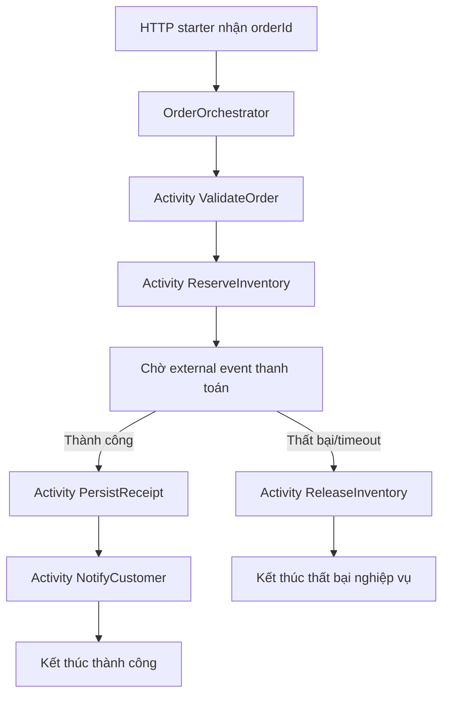
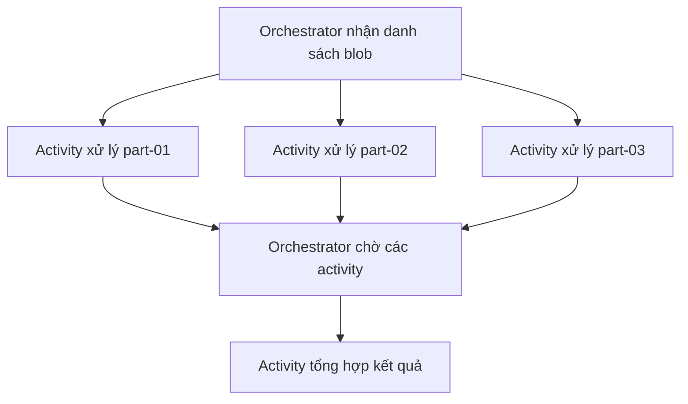
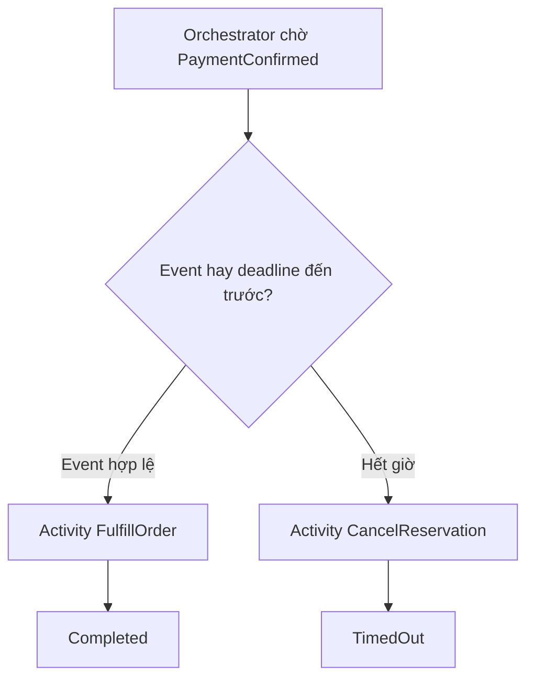
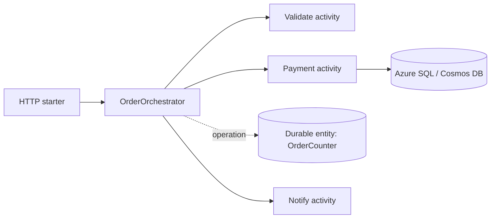
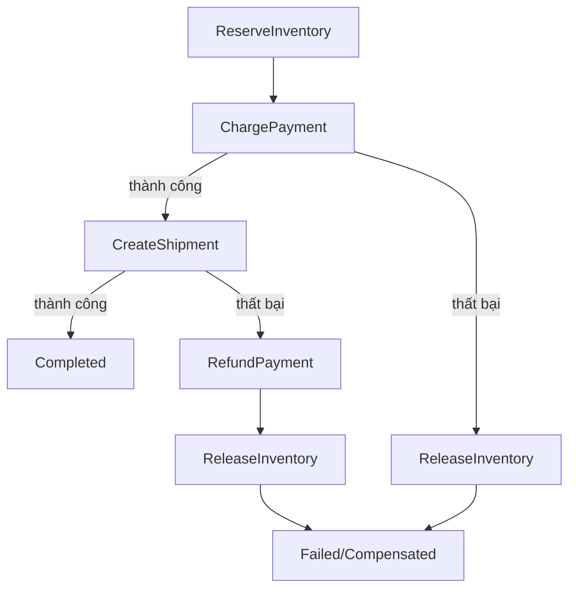

# Durable Functions với orchestrator, activity và entity

Một Azure Function thông thường được kích hoạt, xử lý công việc rồi kết thúc. Cách đó hiệu quả với tác vụ ngắn, nhưng khi nghiệp vụ gồm nhiều bước kéo dài hàng phút đến hàng ngày—ví dụ nhận đơn hàng, kiểm tra tồn kho, chờ thanh toán, gửi email và xử lý hoàn tiền khi có lỗi—việc tự lưu trạng thái và quản lý retry trở nên phức tạp.

**Azure Durable Functions** mở rộng Azure Functions bằng mô hình lập trình **stateful workflows**: định nghĩa luồng nghiệp vụ, lên lịch các tác vụ, lưu tiến trình thực thi, khôi phục sau khi process bị dừng và tiếp tục khi có sự kiện hoặc đến thời điểm hẹn. Ba khái niệm quan trọng là:

- **Orchestrator function:** mô tả **trình tự và mối quan hệ** giữa các bước; engine lưu lịch sử và có thể **replay** để tái dựng trạng thái workflow.
- **Activity function:** thực hiện **công việc thật** như gọi API, truy vấn dữ liệu, ghi Storage hoặc gửi thông báo; một bước có thể được retry nên cần idempotency.
- **Durable entity:** giữ **trạng thái bền vững theo entity ID** và xử lý các operation nhằm thay đổi/đọc trạng thái đó; thích hợp cho bộ đếm, khóa logic hoặc trạng thái phối hợp nhỏ theo mô hình được SDK hỗ trợ.

Bài học thuộc chương **Serverless với Azure Functions**, nằm trong module **CLOUD_PROVIDERS_AZURE** của hệ sinh thái Microsoft Azure. Nội dung gắn với subscription, resource group, Microsoft Entra ID, Azure Storage, mạng ảo, bảo mật, logging, giám sát và kiểm soát chi phí. Các đoạn mã/lệnh là **ví dụ học tập**; chúng không khẳng định đã triển khai hoặc kiểm thử trên tài khoản Azure thực tế.

> **Lưu ý quan trọng về ngôn ngữ:** Durable Functions có khả năng và API khác nhau theo **Functions runtime, extension và ngôn ngữ lập trình**. Bài học dùng **Java** cho ví dụ orchestrator/activity. **Entity** được mô tả theo mô hình và pseudocode độc lập ngôn ngữ; không được xem pseudocode entity là Java SDK code có thể biên dịch. Trước khi chọn entity cho dự án Java, cần xác nhận Durable Entities có được hỗ trợ bởi **đúng Java extension/SDK phiên bản đang dùng**. Nếu không, cân nhắc triển khai entity bằng runtime được hỗ trợ hoặc dùng Storage/Cosmos DB để quản lý trạng thái cùng cơ chế đồng thời thích hợp.

## Mục tiêu học tập

Sau bài học, bạn có thể:

1. Giải thích khi nào một chuỗi Azure Functions cần Durable Functions thay vì một HTTP-triggered Function thông thường.
2. Phân biệt orchestrator, activity, entity và Durable Task client.
3. Hiểu **durable execution**, checkpoint, lịch sử sự kiện, replay và yêu cầu **deterministic orchestrator**.
4. Viết luồng Java có HTTP starter, orchestrator và activity với input/output và trạng thái thực thi.
5. Nhận biết các mẫu **function chaining, fan-out/fan-in, async HTTP API, monitor và human interaction**.
6. Thiết kế retry, timeout, durable timer, external event, compensation và idempotency.
7. Mô hình hóa durable entity có state và các operation, đồng thời hiểu giới hạn hỗ trợ ngôn ngữ.
8. Lựa chọn state store/task hub và mô hình triển khai phù hợp với networking, identity và scale.
9. Quan sát instance ID, status, failures, log replay và chi phí của workflow.
10. Xử lý các sự cố thường gặp: activity thất bại, orchestration stuck, nondeterminism, versioning và entity contention.

## 1. Vì sao function thông thường chưa đủ cho workflow dài?

Giả sử một cửa hàng có quy trình:

1. Nhận đơn hàng mới.
2. Kiểm tra tồn kho.
3. Giữ hàng cho khách.
4. Yêu cầu thanh toán.
5. **Chờ** xác nhận của cổng thanh toán, có thể vài phút.
6. Gửi email và lưu hóa đơn.
7. Nếu thanh toán thất bại, **giải phóng hàng đã giữ**.

Nếu viết toàn bộ logic trong một HTTP Function:

- HTTP client hoặc frontend có thể timeout trước khi hoàn thành.
- Process Functions có thể bị tái khởi động hoặc scale-in.
- Không nên giữ một thread bằng `Thread.sleep(...)` trong nhiều phút.
- Developer phải tự lưu bước nào đã làm xong.
- Nếu retry toàn bộ HTTP request, rất dễ trừ tiền hoặc giữ hàng hai lần.
- Khi có nhiều phiên thực thi, khó kiểm tra trạng thái, lịch sử và khôi phục.

Durable Functions hỗ trợ chuyển workflow thành các **bước bền vững**. Orchestrator mô tả bước cần chạy; engine lưu lịch sử công việc đã hoàn thành để có thể khôi phục, còn activity chứa các side effects thật.

### Sơ đồ ý tưởng



Trong thực tế, các bước có thể thuộc những Function khác nhau và chạy trên nhiều host instances. Chúng **không phải một call stack Java tồn tại nguyên vẹn trong RAM suốt thời gian chờ**.

## 2. Ba thành phần: orchestrator, activity, entity

| Thành phần | Trách nhiệm | Có nên gọi HTTP/DB trực tiếp? | Dữ liệu/trạng thái |
|---|---|---|---|
| **Orchestrator** | Quyết định thứ tự, nhánh, chờ task, phối hợp retry/event/timer | **Không** thực hiện I/O tùy ý gây nondeterminism | Trạng thái tiến trình được tái dựng từ lịch sử durable |
| **Activity** | Xử lý I/O, tính toán, gọi API, ghi DB, gửi thông báo | **Có**, với xử lý lỗi và idempotency | Input/output được orchestration ghi nhận theo cơ chế provider |
| **Durable entity** | Quản lý state nhỏ theo ID, nhận operation như Add/Get/Reserve | Tránh I/O bên ngoài không an toàn; tập trung state/operation | State được persist, operation được điều phối theo entity |
| **Durable client** | Bắt đầu/tra cứu/ra tín hiệu/quản lý instance | Có thể gọi Durable APIs từ starter/endpoint thích hợp | Là client điều khiển, không phải orchestrator |

### Một ví dụ trực quan

**Orchestrator** giống người điều phối đơn hàng: “Kiểm tra, giữ hàng, chờ thanh toán, gửi hóa đơn.”

**Activity** giống nhân viên thực hiện bước nghiệp vụ: “Gọi Inventory API”, “Ghi hóa đơn vào Blob Storage.”

**Entity** giống một đối tượng có trạng thái bền vững: “Giỏ hàng của khách A hiện có 3 mục”, hoặc “Số suất còn lại của sự kiện X là 125”.

Dù tên “entity” gợi liên tưởng ORM/database entity, đây là mô hình **durable stateful actor** dùng operation theo định danh. Nó không tự thay thế database giao dịch hoặc hệ thống báo cáo truy vấn phức tạp.

## 3. Durable Task engine, task hub và persistence

Durable Functions sử dụng **Durable Task** để quản lý lịch sử, hàng đợi công việc và trạng thái instance. Với **Azure Storage provider** thường dùng, runtime dựa vào tài nguyên lưu trữ hỗ trợ orchestration; một số backend/provider khác có thể có khả năng và yêu cầu riêng theo phiên bản dịch vụ.

### Các khái niệm

- **Orchestration instance ID:** định danh một lần chạy workflow; thường xuất hiện trong status URL và log.
- **Task hub:** namespace logic chứa thông tin điều phối cho nhóm orchestration.
- **History:** các sự kiện như instance started, activity scheduled/completed, timer created/fired, external event received.
- **Checkpoint:** engine ghi nhận tiến trình durable để workflow tiếp tục sau khi host bị dừng hoặc tái khởi động.
- **Status:** trạng thái như Pending, Running, Completed, Failed, Terminated, Canceled/Suspended tùy API/runtime.
- **Payload:** input, output, custom status và dữ liệu sự kiện có thể được lưu theo backend, vì vậy không đặt bí mật/PII tùy tiện.

### Khi máy chủ bị restart

Giả sử ValidateOrder đã hoàn thành và workflow đang chờ Activity tiếp theo. Khi host restart, orchestrator có thể **chạy lại code từ đầu**, nhưng engine dựa vào **history** để cung cấp kết quả activity đã hoàn thành thay vì đơn giản gọi lại mọi bước đã checkpoint như một chương trình thông thường.

Đó là cơ chế quan trọng nhất cần hiểu: **orchestrator replay để dựng lại quyết định**, còn side effect phải nằm trong activity hoặc cơ chế được durable runtime hỗ trợ.

### Không đồng nghĩa exactly-once

Một activity có thể bị chạy lại trong một số tình huống timeout, retry, worker crash hoặc mất xác nhận kết quả. Durable orchestration không bảo đảm một giao dịch bên ngoài như **trừ tiền, gửi email hoặc ghi database** luôn xảy ra đúng một lần.

Giải pháp là kết hợp **idempotency key**, transaction hoặc conditional update ở hệ thống đích. Nếu một lần gọi API đã thành công nhưng kết quả chưa được ghi bền vững rồi activity retry, cùng operation phải an toàn.

## 4. Replay và deterministic orchestrator

**Replay** nghĩa là runtime có thể thực thi lại orchestrator function dựa trên lịch sử sự kiện. Vì vậy logic orchestrator phải **deterministic**: với cùng lịch sử, phải đưa ra cùng thứ tự quyết định/schedule task.

### Những thao tác không nên đặt trực tiếp trong orchestrator

- `Instant.now()`, `System.currentTimeMillis()` hoặc đồng hồ hệ thống tùy ý.
- `UUID.randomUUID()`, `Math.random()`, random không được durable runtime kiểm soát.
- Gọi HTTP, JDBC/SQL, Azure Storage SDK hoặc đọc file trực tiếp.
- `Thread.sleep(...)`, polling bằng vòng lặp chiếm thread.
- Tạo thread mới, chạy task song song bằng cơ chế không thuộc Durable Task scheduler.
- Dựa vào static mutable fields hoặc cache process-local.
- Đọc biến môi trường thay đổi theo thời gian để quyết định bước đã schedule, nếu nó có thể khiến replay đổi luồng.
- Ghi log “bước mới” mà không xét replay, dẫn đến log trùng và hiểu nhầm activity bị thực thi nhiều lần.

### Nên làm gì thay thế?

| Nhu cầu | Cách thiết kế |
|---|---|
| Lấy dữ liệu từ SQL/HTTP | Gọi activity |
| Gửi email hoặc thanh toán | Gọi activity có idempotency |
| Chờ một khoảng thời gian | Dùng **durable timer** được SDK hỗ trợ |
| Nhận xác nhận từ hệ thống khác | Dùng **external event** được SDK hỗ trợ |
| Tạo định danh nghiệp vụ | Truyền từ starter hoặc activity; dùng deterministic ID API nếu SDK cung cấp |
| Ghi log orchestrator | Dùng replay-aware logging hoặc điều kiện kiểm tra replay khi API hỗ trợ |
| Thực hiện nhiều việc cùng lúc | Schedule nhiều Durable Tasks và chờ theo primitive của SDK |
| Lưu state nghiệp vụ | Activity tới database/Storage hoặc durable entity khi supported |

### Ví dụ sai về mặt thiết kế

```java
// PSEUDOCODE: KHÔNG đặt các side effects/nondeterminism
// trực tiếp trong orchestrator.
String id = java.util.UUID.randomUUID().toString();
Thread.sleep(60000);
paymentGateway.chargeCard(id);
```

Lý do: replay có thể sinh ID mới, sleep giữ thread, và request thanh toán có thể được gửi lại không kiểm soát.

### Ví dụ thiết kế đúng hướng

```text
HTTP starter nhận orderId và idempotencyKey
    -> orchestrator có input ổn định
       -> activity ValidateOrder(orderId)
       -> activity ChargePayment(orderId, idempotencyKey)
       -> durable timer / external event nếu cần
       -> activity PersistReceipt(orderId)
```

Không gọi gateway trong orchestrator; activity quản lý giao dịch thực tế và cơ chế chống thực thi trùng.

## 5. Các mẫu orchestration phổ biến

### 5.1 Function chaining

Các bước nối tiếp, đầu ra bước trước là đầu vào bước sau:

```text
Validate -> Reserve -> Charge -> Persist -> Notify
```

Dùng khi bước sau phụ thuộc kết quả bước trước, và mỗi bước cần ghi nhận trạng thái riêng.

### 5.2 Fan-out / fan-in

Chia 1.000 file thành nhiều hoạt động xử lý độc lập rồi tổng hợp:



Không giữ 1.000 file lớn trong orchestration history. Chỉ truyền **blob URL/ID và metadata nhỏ**, để activity đọc/ghi dữ liệu lớn qua Storage SDK.

### 5.3 Async HTTP API

HTTP request khởi động workflow, trả **HTTP 202 Accepted** và status URL. Client theo dõi trạng thái thay vì giữ một kết nối mở quá lâu.

### 5.4 Monitor

Orchestrator đặt lịch kiểm tra định kỳ bằng **durable timer**, gọi activity kiểm tra trạng thái đối tác, dừng khi hoàn thành hoặc vượt timeout. Không dùng `Thread.sleep`.

### 5.5 Human interaction

Workflow gửi yêu cầu phê duyệt, rồi chờ một **external event** hoặc durable timer timeout. Việc chờ không nhất thiết chiếm thread liên tục như lối lập trình đồng bộ thông thường.

### 5.6 Sub-orchestration

Một workflow cha có thể gọi orchestration con để tái sử dụng luồng xử lý phức tạp, chia trách nhiệm và quản lý fan-out theo nhóm.

### 5.7 Entity-based coordination

Entity giữ state nhỏ của một mã đơn hàng/khách hàng; orchestrator hoặc client **gọi/ra tín hiệu operation** theo ngôn ngữ và SDK được hỗ trợ.

## 6. Thiết lập dự án Java Durable Functions

Bài học dùng **Azure Functions Java** cùng Durable Task Java extension hỗ trợ **orchestrator/activity**. Những yếu tố cần chuẩn bị:

- JDK phiên bản tương thích với Functions Java runtime.
- Maven và Azure Functions Maven Plugin khi xây dựng/chạy dự án theo workflow Maven.
- Azure Functions Core Tools v4 để chạy local, hoặc môi trường triển khai đã cấu hình.
- Azure Storage provider hoặc backend durable state được extension hỗ trợ.
- Azurite/Storage emulator phù hợp khi chạy local với `UseDevelopmentStorage=true`, hoặc tài khoản Storage lab được cấp phép.
- Đúng dependency Durable Task Java, Functions Java library và extension bundle/host configuration theo compatibility matrix hiện hành.

### Dependency Maven (trích đoạn minh họa)

```xml
<dependencies>
    <dependency>
        <groupId>com.microsoft.azure.functions</groupId>
        <artifactId>azure-functions-java-library</artifactId>
        <version><!-- Pin phiên bản tương thích --></version>
    </dependency>
    <dependency>
        <groupId>com.microsoft</groupId>
        <artifactId>durabletask-azure-functions</artifactId>
        <version><!-- Pin phiên bản tương thích --></version>
    </dependency>
</dependencies>
```

Đây là **đoạn cấu hình minh họa**, không phải `pom.xml` tự build: còn cần dependencies/plugin Maven phù hợp, và placeholder version phải được thay bằng version đã kiểm chứng. Tránh chọn phiên bản mới nhất một cách vô điều kiện nếu Azure Functions runtime/extension chưa tương thích.

### host.json (ví dụ cấu hình)

```json
{
  "version": "2.0",
  "extensionBundle": {
    "id": "Microsoft.Azure.Functions.ExtensionBundle",
    "version": "[4.*, 5.0.0)"
  },
  "extensions": {
    "durableTask": {
      "hubName": "OrdersTaskHub"
    }
  }
}
```

`OrdersTaskHub` là tên logic ví dụ. Trên môi trường nhiều app/staging slots, cần lập kế hoạch **task hub isolation** và storage provider để không làm các app/slot vô tình đọc hay xử lý cùng hàng đợi workflow.

### local.settings.json (ví dụ dành riêng local)

```json
{
  "IsEncrypted": false,
  "Values": {
    "AzureWebJobsStorage": "UseDevelopmentStorage=true",
    "FUNCTIONS_WORKER_RUNTIME": "java"
  }
}
```

Cấu hình này chỉ phù hợp khi **Azurite/Storage emulator** được cài và đang chạy theo yêu cầu extension. `local.settings.json` có thể chứa secrets; không commit file có credential vào Git. Với Azure thật, chọn connection/identity-based storage configuration theo khả năng backend và policy của tổ chức.

## 7. Ví dụ Java: HTTP starter, orchestrator và hai activity

Ví dụ nhận `orderId`, kiểm tra đầu vào rồi tạo “receipt” mô phỏng. Không gọi payment gateway hay database thật, giúp hiểu API và lifecycle trước khi bổ sung side effects.

Một Java class ví dụ `OrderWorkflow.java` trong project Functions đã cấu hình phù hợp:

```java
package vn.example.functions;

import com.microsoft.azure.functions.*;
import com.microsoft.azure.functions.annotation.*;
import com.microsoft.durabletask.*;
import com.microsoft.durabletask.azurefunctions.*;

import java.util.Optional;

public class OrderWorkflow {

    @FunctionName("StartOrderWorkflow")
    public HttpResponseMessage start(
        @HttpTrigger(
            name = "req",
            methods = {HttpMethod.POST},
            authLevel = AuthorizationLevel.FUNCTION,
            route = "orders/start")
            HttpRequestMessage<Optional<String>> request,
        @DurableClientInput(name = "durableClient")
            DurableTaskClient client,
        final ExecutionContext context) {

        String orderId = request.getBody()
            .orElse("")
            .trim();

        if (orderId.isEmpty()) {
            return request
                .createResponseBuilder(HttpStatus.BAD_REQUEST)
                .body("orderId is required")
                .build();
        }

        String instanceId =
            client.scheduleNewOrchestrationInstance(
                "ProcessOrder", orderId);

        context.getLogger().info(
            "event=orchestration_started instanceId=" + instanceId);

        return client.createCheckStatusResponse(
            request, instanceId);
    }

    @FunctionName("ProcessOrder")
    public String processOrder(
        @DurableOrchestrationTrigger(name = "ctx")
            TaskOrchestrationContext ctx) {

        String orderId = ctx.getInput(String.class);

        String validated =
            ctx.callActivity(
                "ValidateOrder", orderId, String.class).await();

        return ctx.callActivity(
            "CreateReceipt", validated, String.class).await();
    }

    @FunctionName("ValidateOrder")
    public String validateOrder(
        @DurableActivityTrigger(name = "orderId")
            String orderId,
        final ExecutionContext context) {

        if (orderId == null ||
                !orderId.matches("[A-Za-z0-9-]{1,40}")) {
            throw new IllegalArgumentException(
                "invalid_order_id");
        }

        context.getLogger().info(
            "event=order_validated orderId=" + orderId);

        return orderId;
    }

    @FunctionName("CreateReceipt")
    public String createReceipt(
        @DurableActivityTrigger(name = "orderId")
            String orderId,
        final ExecutionContext context) {

        // Lab: chỉ tạo kết quả logic, không ghi backend.
        // Production: mọi side effect cần idempotency.
        context.getLogger().info(
            "event=receipt_created orderId=" + orderId);

        return "receipt-for-" + orderId;
    }
}
```

**Phạm vi ví dụ:** các API và import Durable Task Java trên mô tả một kiểu SDK hỗ trợ; tên overload, annotation và dependency có thể khác theo bản SDK. Hãy đồng bộ toàn bộ dependencies và mẫu source code với đúng version được chọn trước khi biên dịch. Bài không khẳng định đã chạy Maven, Core Tools hoặc Azure thật.

### Điều gì xảy ra khi gửi request?

1. HTTP starter đọc input và tạo orchestration instance.
2. Trả **202 Accepted** cùng các đường quản lý trạng thái khi API runtime hỗ trợ.
3. Orchestrator schedule `ValidateOrder`.
4. Activity kiểm tra order ID, trả kết quả hoặc ném lỗi.
5. Orchestrator schedule `CreateReceipt` với dữ liệu đã validate.
6. Activity trả chuỗi receipt.
7. Orchestrator hoàn thành, trả output; caller lấy qua status URL.

**Hai activity là hai function độc lập về vòng đời**, ngay cả khi chúng nằm chung một Java class. Logic điều phối nằm trong `ProcessOrder`, còn side effects nằm trong activities.

## 8. Thực thi local và HTTP 202/status query

Sau khi project Functions Java hoàn chỉnh đã được tạo và cấu hình Maven plugin:

```bash
mvn -B clean package
mvn azure-functions:run
```

Lệnh thứ hai cần **Azure Functions Maven Plugin** được cấu hình trong project. Tùy môi trường có thể dùng Azure Functions Core Tools để chạy artifact Functions đã build.

Nếu chạy với `UseDevelopmentStorage=true`, phải bật **Azurite** và bảo đảm runtime/extension kết nối được tới backend. Không có Azurite hoặc Storage account hợp lệ, Durable host có thể thất bại trước khi HTTP starter hoạt động.

### Start orchestration

Khi local Functions host đang lắng nghe cổng mặc định và route đúng:

```bash
curl -i -X POST \
  -H "Content-Type: text/plain" \
  --data "ORD-1001" \
  http://localhost:7071/api/orders/start
```

Một response thành công thường là **202 Accepted** với instance ID và URL tra cứu hoặc thao tác trạng thái (tên JSON properties/route tùy phiên bản runtime).

### Polling trạng thái

Khi có `statusQueryGetUri` hoặc URL tương ứng từ response, dùng:

```bash
curl -i "<STATUS_QUERY_URL_FROM_RESPONSE>"
```

Theo dõi các trạng thái như Pending/Running/Completed/Failed, output, createdTime, lastUpdatedTime theo API. Đừng hardcode nội dung toàn bộ management URL vì nó có thể chứa token/key hoặc hostname nhạy cảm.

### Khác biệt local và cloud

Ở local, `AuthorizationLevel.FUNCTION` thường không yêu cầu function key theo cùng cách triển khai cloud. Trong Azure, endpoint production cần **function key, Microsoft Entra ID/App Service Authentication, API Management** hoặc cơ chế auth phù hợp với threat model; function key không phải thay thế hoàn chỉnh cho xác thực người dùng và phân quyền nghiệp vụ.

## 9. Replay ảnh hưởng logging và debugging thế nào?

Durable orchestrator có thể replay cùng code nhiều lần. Nếu bạn thêm:

```java
// Đặt trực tiếp trong orchestrator mà không lọc replay:
System.out.println("Begin ProcessOrder");
```

bạn có thể thấy nhiều dòng tương tự dù instance chỉ có một workflow logic. Đó không nhất thiết là bằng chứng activity được chạy nhiều lần.

Nên:

- Dùng **replay-safe logger** hoặc kiểm tra trạng thái replay theo API được SDK hỗ trợ.
- Log nghiệp vụ quan trọng trong activity, kèm `instanceId`/`orderId` hoặc correlation ID phù hợp.
- Không ghi dữ liệu nhạy cảm vào orchestration input/output hay log.
- Phân biệt **activity scheduled** và **activity actually executed**.
- Kết hợp history/telemetry thay vì chỉ đếm số dòng log.

### Dấu hiệu bất thường do nondeterminism

Nếu sửa thứ tự schedule activities trong phiên bản mới trong lúc nhiều instance phiên bản cũ đang chạy, replay của những instance cũ có thể không khớp lịch sử. Hệ quả có thể là lỗi nondeterminism hoặc workflow không thể tiếp tục như mong đợi.

Vì vậy cần **versioning** và kế hoạch nâng cấp orchestration code—đặc biệt với workflow chờ nhiều ngày hoặc nhiều tuần.

## 10. Retry activities và idempotency

Một activity gọi API có thể nhận 429, 503 hoặc timeout tạm thời. Durable Functions hỗ trợ cơ chế retry cho tasks trong các SDK/phiên bản tương ứng, có thể cấu hình chính sách số lần thử và độ trễ.

### Mô hình retry

```text
Orchestrator schedule ChargePayment
    -> Activity call payment API
    -> Timeout
    -> Durable retry (nếu cấu hình)
    -> Activity call lại với cùng idempotencyKey
    -> Payment provider nhận diện request đã xử lý
    -> Trả cùng kết quả
```

Không tự coi mọi lỗi nên retry: lỗi xác thực, schema sai hoặc dữ liệu không hợp lệ thường phải dừng/đưa vào xử lý nghiệp vụ thay vì thử lại vô hạn.

### Phân loại lỗi

| Loại lỗi | Ví dụ | Chiến lược |
|---|---|---|
| Tạm thời | HTTP 429, 503, network hiccup | Retry giới hạn, backoff, jitter phù hợp |
| Cấu hình | Sai URL, thiếu Azure RBAC, Key Vault 403 | Dừng và cảnh báo |
| Dữ liệu | Order ID sai, schema thiếu | Reject/quarantine; không retry vô hạn |
| Nghiệp vụ | Thanh toán bị từ chối, hết hàng | Chạy nhánh bù trừ hoặc trả kết quả phù hợp |
| Hệ thống | Backend storage outage dài | Retry có deadline, alert và runbook |

### Idempotency key

Ví dụ:

```text
operation = charge-payment
businessKey = ORD-1001
idempotencyKey = charge:ORD-1001:v1
```

Activity gửi cùng idempotency key cho mọi retry của **một thao tác nghiệp vụ**. Backend hoặc database phải hỗ trợ cách loại trùng phù hợp; chỉ ghép chuỗi ID mà hệ thống đích không kiểm tra thì chưa giải quyết vấn đề.

Với ghi Blob Storage hoặc Cosmos DB, cân nhắc conditional writes, ETag, unique keys hoặc transactions được sản phẩm hỗ trợ. Với email, ghi bảng trạng thái gửi/ID giao dịch và kiểm soát lặp thay vì giả định email service sẽ tự loại trùng.

## 11. Durable timer, timeout và external events

### Durable timer

Khi workflow cần đợi 10 phút trước khi kiểm tra trạng thái thanh toán, dùng timer thuộc Durable Task SDK. **Không dùng `Thread.sleep(600_000)` hoặc busy-loop trong orchestrator.**

```text
schedule CheckPayment activity
if not settled:
    create durable timer for the next poll time
    wait until timer fires
    repeat with bounded attempts/deadline
```

Timer được lưu cùng tiến trình workflow; host có thể rời bộ nhớ trong lúc chờ, rồi tiếp tục khi tới thời điểm.

### External event

Một workflow có thể đợi sự kiện tên `PaymentConfirmed` từ webhook. Phía webhook cần:

1. Xác thực và kiểm tra chữ ký/provider request.
2. Xác định **đúng instance ID** của orchestration đang chờ.
3. Validate payload và tính hợp lệ nghiệp vụ.
4. Gửi event tới instance bằng Durable client API được SDK hỗ trợ.
5. Bảo vệ khỏi replay/duplicate webhook và lưu audit.

### Race giữa timer và event

Ví dụ chờ thanh toán tối đa 15 phút:



Cần quyết định rõ nếu event đến **sau timeout**: từ chối, hoàn tiền hoặc xử lý đối soát tùy hợp đồng nghiệp vụ. Timer chỉ giải quyết thời gian, không tự giải quyết transaction race ở hệ thống thanh toán.

## 12. Entity là gì? Mô hình durable actor

**Durable entity** có:

- **Entity name/type:** ví dụ `InventoryCounter` hoặc `OrderTracker`.
- **Entity key/ID:** định danh riêng, ví dụ `sku-001` hoặc `tenant-a`.
- **State:** dữ liệu nhỏ được lưu bền vững, chẳng hạn số tồn kho hoặc số lần hoàn tất.
- **Operations:** hành động có tên, ví dụ `Add`, `Reserve`, `Release`, `Get`.
- **Serialization:** runtime điều phối operation theo entity ID để bảo đảm cách xử lý tuần tự của một entity theo mô hình được hỗ trợ.

### Ví dụ entity tồn kho

```text
Entity: InventoryCounter
Entity ID: sku-001
State:
  available = 12

Operations:
  Reserve(quantity):
    if quantity <= 0: reject
    if available < quantity: reject insufficient_stock
    available = available - quantity
    return accepted

  Release(quantity):
    if quantity <= 0: reject
    available = available + quantity
    return available

  Get():
    return available
```

**Đây là pseudocode biểu diễn hợp đồng state/operation, không phải mã Java Durable Entities có thể chạy.** SDK hỗ trợ entities có thể cung cấp trigger, dispatcher, proxy/client và API riêng.

### Vì sao cần entity thay vì biến static?

Một biến static trong một Functions host:

- Không bảo đảm tồn tại sau restart/scale.
- Không nhất thiết được chia sẻ giữa các host instances.
- Không bảo vệ các cập nhật đồng thời trên nhiều máy.
- Không tạo durable history hay một identity logic ổn định.

Entity sử dụng backend durable và runtime điều phối operation, phù hợp hơn cho một số trạng thái phối hợp nhỏ.

### Khi nào không nên dùng entity?

- Cần truy vấn dữ liệu theo nhiều cột/filter như database quan hệ.
- Một entity ID nhận lưu lượng cực cao và trở thành hotspot.
- State quá lớn làm tăng chi phí serialization/persistence.
- Cần transaction nguyên tử trên nhiều entity hoặc với database bên ngoài mà SDK không đảm bảo.
- Có yêu cầu realtime cực thấp latency, trong khi entity operations đi qua durable queues/persistence.

Nếu nghiệp vụ yêu cầu throughput lớn, indexing hoặc giao dịch đa bản ghi, **Azure SQL, Cosmos DB, Redis** hoặc một datastore phù hợp có thể là lựa chọn tốt hơn.

## 13. Orchestrator, activity và entity tương tác ra sao?

Trong một luồng đặt hàng:

- **Orchestrator** điều phối tiến trình.
- **Activity** gọi inventory/payment API và ghi kết quả bên ngoài.
- **Entity** có thể giữ một state phối hợp như số lượt xử lý hoặc counter, nếu runtime/SDK được triển khai hỗ trợ.
- **Database** vẫn lưu dữ liệu nghiệp vụ chuẩn, bảo đảm truy vấn và transaction theo thiết kế.



### Gọi entity hay gửi signal?

Nhiều Durable Entities SDK có hai kiểu tương tác khái niệm:

- **Call operation và chờ kết quả:** workflow cần giá trị để quyết định bước tiếp theo.
- **Signal operation:** gửi thông điệp yêu cầu cập nhật state mà không chờ kết quả ngay.

Tên API, khả năng ordering, transaction/lock và cách gửi từ client/orchestrator phụ thuộc SDK/ngôn ngữ. Không copy một API entity từ .NET/JavaScript sang Java và giả định nó tồn tại.

### Entity có hỗ trợ Java không?

Hãy kiểm tra phiên bản và khả năng của **Durable Task Java SDK**, Azure Functions extension và runtime trước khi thiết kế. Ví dụ Java ở bài này **chỉ hiện thực orchestrator/activity**. Nếu entity APIs chưa khả dụng trong stack Java bạn đang dùng, phương án thực dụng gồm:

1. Dùng Durable Entities qua một Function app/runtime đã được hỗ trợ, phân định API/ownership rõ ràng.
2. Dùng Java activity để cập nhật Azure SQL/Cosmos DB bằng conditional update, optimistic concurrency hoặc transaction.
3. Dùng Azure Storage Queue/Service Bus cùng state store khi cần message-driven coordination; tự thiết kế idempotency và consistency.

Không biến Entity thành bắt buộc chỉ vì có trong mô hình Durable Functions.

## 14. Fan-out/fan-in: ví dụ xử lý nhiều Blob

Một hệ thống cần đọc danh sách 100 tệp CSV từ Azure Blob Storage, xử lý từng tệp và tạo một báo cáo.

### Thiết kế

```text
HTTP/Timer starter
   -> Orchestrator nhận batchId
      -> Activity ListInputBlobs(batchId)
      -> Schedule N activity ProcessBlob(blobId)
      -> Wait for all activities
      -> Activity MergeResults(batchId, resultIds)
      -> Complete
```

### Không truyền nội dung tệp lớn qua history

Mỗi activity nhận **blob name/URL hoặc resource ID**, tự đọc dữ liệu qua Azure Storage SDK với managed identity. Kết quả activity nên là metadata nhỏ (ví dụ `rowsProcessed`, `outputBlobName`), không trả hàng trăm MB qua orchestration history.

### Giới hạn concurrency

Nếu 100 activity được schedule đồng thời, workload có thể vượt quota của database, Storage, API downstream hoặc plan. Cần:

- Chia batch, dùng semaphore/queue hoặc orchestration phân nhóm theo khả năng SDK.
- Dùng host/plan concurrency settings thích hợp.
- Cân nhắc retry và rate limiting phía downstream.
- Đo memory, execution latency và số activity thực sự đang chạy.
- Thiết kế idempotency và output riêng cho mỗi tệp.

### Nếu một activity thất bại?

Mặc định một thao tác chờ tập hợp tasks có thể fail theo SDK semantics; cần quyết định:

- Dừng toàn batch và đánh dấu failed.
- Thu thập kết quả thành công, lỗi của từng part rồi tạo báo cáo partial.
- Retry part tạm thời thất bại.
- Đưa tệp không hợp lệ vào quarantine, không lặp vô hạn.

Durable Functions điều phối bước chạy, **không tự quyết định thế nào là một batch “đã thành công nghiệp vụ”**.

## 15. Compensation và Saga cho giao dịch nhiều hệ thống

Durable Functions không cung cấp một **database transaction ACID duy nhất** trải qua payment gateway, inventory API, email và SQL. Nếu nhiều activity đã thành công nhưng activity kế tiếp lỗi, workflow cần thực hiện **compensation**.

Ví dụ:



### Thiết kế compensation cẩn trọng

- `RefundPayment` là nghiệp vụ riêng, không nhất thiết chỉ là “đảo” một lệnh.
- Compensation cũng có thể thất bại và cần retry/idempotency.
- Lưu correlation ID cho cả activity gốc và bước bù.
- Trạng thái “partially compensated” cần có cảnh báo hoặc can thiệp thủ công.
- Không tự động hoàn tiền khi chưa xác định thanh toán thật đã hoàn tất.
- Tránh gọi payment gateway trực tiếp trong orchestrator.

Khi dùng entity để giữ state phối hợp, **operation trên một entity không tạo transaction phân tán** qua payment API và database. Cần xác định boundary giao dịch ở nơi dữ liệu nghiệp vụ thực sự được lưu.

## 16. Versioning orchestration code đang chạy lâu dài

Một khác biệt lớn với Function thông thường: khi deploy mã mới, **các orchestration instances đang chờ có thể tiếp tục bằng code mới**. Nếu luồng schedule tasks bị thay đổi mà không tương thích với history cũ, replay có thể gặp lỗi.

### Ví dụ thay đổi nguy hiểm

Phiên bản v1:

```text
ValidateOrder -> ChargePayment -> SendEmail
```

Phiên bản v2:

```text
ValidateOrder -> ReserveInventory -> ChargePayment -> SendEmail
```

Nếu một instance v1 đã ghi lịch sử `ChargePayment` sau `ValidateOrder`, nhưng khi replay dưới code v2 lại muốn schedule `ReserveInventory` ở vị trí đó, engine có thể không khớp history.

### Chiến lược giảm rủi ro

1. **Versioned orchestration names:** ví dụ `ProcessOrderV1` và `ProcessOrderV2`, tiếp tục cho instance cũ dùng code tương thích.
2. **Deployment slots/app separation** với task hub/storage isolation theo quy trình được hỗ trợ.
3. **Versioning features của Durable Task** nếu runtime/backend/SDK phù hợp.
4. Tách các activity nhỏ, giữ input/output schema tương thích khi có thể.
5. Có kế hoạch migrate/terminate/restart instance cũ theo yêu cầu nghiệp vụ.
6. Dùng **continue-as-new** khi cần cắt lịch sử dài, theo khả năng SDK.

**Không xóa orchestration history hoặc task hub storage** để “làm sạch” trong khi instance đang hoạt động. Có thể làm mất trạng thái bền vững của workflow.

## 17. Continue-as-new, lịch sử dài và dữ liệu lớn

Một orchestrator chạy theo lịch giám sát hàng tháng có thể tích lũy nhiều sự kiện history. History lớn làm replay chậm hơn và tăng lưu trữ/chi phí.

Giải pháp thường dùng:

- Thiết kế workflow **bounded**: một instance cho một ngày, batch hoặc đơn hàng cụ thể.
- Dùng **continue-as-new** khi SDK hỗ trợ để tiếp tục logic với input mới nhưng khởi tạo history mới theo mô hình tương ứng.
- Không nhúng hàng nghìn records lớn vào input/output.
- Lưu payload lớn ở **Blob Storage** và truyền tham chiếu.
- Dọn/purge lịch sử instance **đã hoàn tất** theo retention policy được phê duyệt.
- Theo dõi tuổi instance, size của history và độ trễ xử lý.

### Giới hạn output

Nếu một orchestration kết quả là 100 MB JSON, không nên để toàn bộ JSON trong orchestration output/history. Tốt hơn, activity ghi JSON vào Blob Storage rồi trả:

```json
{
  "reportBlob": "reports/ORD-1001.json",
  "recordsProcessed": 45000,
  "checksum": "sha256:<VALUE>"
}
```

Tránh đưa SAS URL sống lâu hoặc nội dung nhạy cảm vào orchestration output/status endpoint.

## 18. Triển khai Azure và các lớp bảo mật

### Control plane và data plane

- **Azure RBAC:** ai được tạo/sửa Function app, Storage account, Application Insights hoặc đọc cấu hình.
- **Microsoft Entra ID/managed identity:** danh tính ứng dụng gọi Blob Storage, Key Vault, SQL hoặc API hỗ trợ.
- **Durable backend permissions:** quyền đọc/ghi tài nguyên cần cho orchestration history, task hub/queues/storage theo provider.
- **HTTP endpoint authentication:** bảo vệ starter, status query, raise-event, terminate hoặc purge endpoints.
- **Network:** VNet Integration, Private Endpoints, DNS, NSG/firewall và outbound connectivity theo hosting plan.
- **Kubernetes không tham gia trực tiếp** trừ khi Functions được host theo một mô hình Kubernetes cụ thể; đừng áp nguyên lý pod/node pool cho Function app mặc định.

### Tránh lộ dữ liệu qua management URL

Response HTTP 202 của Durable starter có thể cung cấp URL tra cứu trạng thái hoặc điều khiển instance. Một số URL chứa **system key/code**, là bearer credential đối với người sở hữu URL.

Vì vậy:

- Không ghi nguyên status URL vào log công khai, issue hay email đại trà.
- Đặt API Management hoặc gateway xác thực nếu client bên ngoài cần polling.
- Chỉ cho phép người có thẩm quyền terminate/raise event/purge.
- Lưu instance ID/correlation ID tách khỏi secret.
- Không tin một client chỉ vì client biết instance ID.

### Managed identity và secrets

Ưu tiên managed identity cho activity gọi Azure Storage/Key Vault khi dịch vụ/provider hỗ trợ. Phải cấp quyền data-plane tương ứng; có identity không tự cấp quyền đọc mọi Storage account.

Không lưu secret trong input/output orchestrator vì chúng có thể được **persisted trong durable history**. Nếu activity cần secret, lấy trực tiếp từ Key Vault/managed identity tại thời điểm chạy và hạn chế logging.

### Network

Function app có thể kết nối Storage qua endpoint công khai bị firewall giới hạn hoặc Private Endpoint/VNet theo hosting plan và khả năng của dịch vụ. Nếu durable backend không truy cập được, ứng dụng có thể **không khởi động hoặc không tiến hành orchestration** dù Java code không lỗi.

Khi dùng private endpoints, cần xác minh DNS resolution từ Function host và subresource/ports tương ứng của Storage provider. Không chỉ kiểm tra từ laptop.

## 19. Hosting plan, concurrency và scale

Durable Functions được thiết kế để hoạt động cùng mô hình scale của Azure Functions, nhưng khả năng cụ thể phụ thuộc **Functions hosting plan**, storage provider, phiên bản extension và quota.

### Những câu hỏi khi chọn plan

| Nhu cầu | Vấn đề cần đánh giá |
|---|---|
| Workflow có nhiều activity ngắn | Throughput/concurrency, queue latency, storage transactions |
| Workflow chờ external event nhiều ngày | Durable state retention, backend cost, quản lý orphan instances |
| Activity tính toán nặng | CPU/memory, timeout và loại compute plan |
| Hàng nghìn fan-out tasks | Burst/scale, downstream throttling và max concurrency |
| Private network nghiêm ngặt | VNet Integration, Private Endpoint, storage accessibility |
| SLO cao | Cold start, scale latency, HA của dependencies và retry strategy |
| Chi phí dự đoán được | Billing của plan và storage provider, Log Analytics ingestion |

Một orchestration **chờ durable timer** không cần dùng `Thread.sleep`, nhưng history, storage và dịch vụ nền vẫn có chi phí. Activity tính toán thực tế sẽ tiêu thụ compute theo plan.

### Phân biệt concurrency

- **Orchestrator concurrency:** số orchestrator executions/replays host có thể xử lý theo cấu hình.
- **Activity concurrency:** số activity thực thi trên một host hoặc nhiều hosts.
- **Scale-out:** số host instances mà platform cấp phát.
- **Downstream capacity:** SQL pool, API quota, Storage request limits—có thể thấp hơn năng lực scale của Functions.

Đặt concurrency cao không tự làm database nhanh hơn; có thể gây 429, deadlock hoặc retry storm.

## 20. Quan sát và theo dõi Durable Functions

Cần quan sát hai loại tín hiệu:

1. **Workflow state**: instance đang Running/Completed/Failed/Terminated, đã chờ bao lâu, đang chờ activity/event nào.
2. **Application telemetry**: activity exception, dependency failures, latency, số retry, memory và kết quả nghiệp vụ.

### Nguồn thông tin

| Nguồn | Thông tin |
|---|---|
| Durable client/status API | Instance ID, runtime status, input/output/custom status theo quyền và API |
| Azure Functions execution logs | Trigger, activity invocations, exceptions và runtime logs |
| Application Insights / Azure Monitor | Traces, dependency durations, failures, dashboard và alert |
| Storage provider backend | History, queue/task hub state theo provider; không sửa trực tiếp |
| Azure Activity Log | Thay đổi tài nguyên Function app, Storage, identity, settings |
| Business database | Trạng thái giao dịch thực, idempotency record, output đã persist |

### Log có cấu trúc

Ví dụ:

```text
event=workflow_started instanceId=inst-123 orderId=ORD-1001
event=activity_started instanceId=inst-123 name=ValidateOrder attempt=1
event=activity_completed instanceId=inst-123 name=ValidateOrder
event=workflow_completed instanceId=inst-123 result=receipt-for-ORD-1001
```

Dữ liệu minh họa; số `attempt` phải được lấy từ cơ chế log/context thật nếu muốn khẳng định một lần retry, không tự tăng biến static.

### Các cảnh báo nên có

- Số instance `Failed` tăng bất thường.
- Workflow Running quá deadline hoặc chờ event quá lâu.
- Activity timeout hoặc retry tăng.
- Queue backlog/task hub latency tăng.
- Backend Storage 403/429/5xx hoặc mất network.
- Fan-out làm downstream API throttling.
- Lượng history/storage/log ingestion và chi phí tăng mạnh.
- Số workflow Completed nhưng thiếu output nghiệp vụ.

**Completed không tự chứng minh thành công nghiệp vụ**: nếu activity trả kết quả thành công trước khi dữ liệu thực sự persist hoặc logic bỏ qua lỗi, instance vẫn có thể Completed mà báo cáo chưa tồn tại.

## 21. Những lỗi thường gặp và cách xử lý

| Triệu chứng | Nguyên nhân có thể | Hướng xử lý |
|---|---|---|
| HTTP starter 500 hoặc host không chạy | Durable extension/provider/storage config sai | Xem Functions host logs, host.json, storage connectivity |
| Instance tạo được nhưng không chạy tiếp | Backend task hub không xử lý queue, scale/storage lỗi | Xem runtime status, task hub/extension logs |
| Orchestrator log lặp nhiều lần | Replay | Dùng replay-safe logging, phân biệt history và activity attempts |
| Nondeterminism error sau deploy | Đổi thứ tự schedule activity hoặc dùng random/time/I/O trong orchestrator | So version code, history, giữ compatibility cho instances cũ |
| Activity retry gây duplicate payment/email | Thiếu idempotency | Cấp idempotency key và điều kiện chống trùng tại backend |
| Activity thất bại vì HTTP 429 | Downstream throttling/concurrency quá cao | Retry có backoff, giới hạn fan-out/concurrency |
| Instance chờ external event mãi | Sai instance ID/event name, event chưa gửi, quyền API | Kiểm tra correlation, webhook auth, logs và timeout |
| Durable timer không “chạy đúng lúc” | Latency scale/queue, clock/timezone hiểu sai | Dùng UTC, quan sát provider latency, đặt deadline phù hợp |
| Status query báo 401/403 | Function/system key, auth hoặc network restrictions | Kiểm tra endpoint authorization, gateway, IP allowlist |
| Task hub bị trộn giữa môi trường | Hai app/slot dùng chung provider/hub không được thiết kế | Tách hub/config, quản lý migration |
| Activity gọi Azure Storage 403 | Managed identity thiếu data role hoặc Storage firewall | Kiểm tra RBAC, private DNS, networking |
| Runtime báo lỗi entity API | SDK/ngôn ngữ hoặc extension không hỗ trợ entities | Xác minh support matrix; dùng backend state thay thế |
| Entity operation chậm | Hot entity ID, nhiều operation tuần tự | Shard theo key, dùng database/queue nếu throughput cao |
| History quá lớn/replay chậm | Workflow sống lâu, payload lớn | Continue-as-new, bounded workflows, Blob references |
| Chi phí tăng bất thường | Storage transactions, retries, fan-out và telemetry quá nhiều | Quan sát metrics/cost, giới hạn concurrency, retention |

### Quy trình điều tra đề xuất

1. Xác định **Function app, slot, task hub, backend provider và instance ID**.
2. Tra trạng thái instance và thời điểm cập nhật gần nhất.
3. Kiểm tra Functions host logs, activity logs và Application Insights.
4. Phân biệt lỗi **scheduler/orchestrator**, **activity code**, **external dependency** hoặc **storage provider**.
5. Nếu lỗi sau deployment, xem **thay đổi orchestration code và versioning**.
6. Khi retry, xác minh external side effects đã thực hiện chưa.
7. Khôi phục an toàn trong môi trường có phê duyệt và quan sát outcome nghiệp vụ.
8. Ghi RCA, cải tiến monitoring/idempotency và test lại tình huống lỗi.

## 22. Thực hành tổng hợp: quy trình đơn hàng Java

### Tình huống

Một hệ thống đơn hàng trong Azure có API nhận order ID và muốn xử lý bất đồng bộ:

- API không giữ HTTP connection chờ kết quả.
- ValidateOrder và CreateReceipt là hai activity.
- Caller theo dõi trạng thái từ một status endpoint được bảo vệ.
- Các bước có thể kiểm tra riêng bằng logging.
- Nhóm sẽ thiết kế entity `OrderCounter` ở mức kiến trúc, nhưng không giả định Java runtime đang có entity API.

### Bước 1: chuẩn bị project

- Tạo Azure Functions Java Maven project dùng runtime và dependency Durable Task phù hợp.
- Bổ sung class `OrderWorkflow.java` từ phần 7.
- Cấu hình `host.json` và `local.settings.json` theo phần 6.
- Chạy Azurite nếu dùng development storage local.
- Giữ `local.settings.json` chứa secret nằm ngoài Git.

### Bước 2: chạy local

```bash
mvn -B clean package
mvn azure-functions:run
```

Kiểm tra Functions host hiển thị các tên function `StartOrderWorkflow`, `ProcessOrder`, `ValidateOrder` và `CreateReceipt`. Nếu build fail, kiểm tra import/SDK API tương ứng trước khi coi workflow có vấn đề.

### Bước 3: chạy workflow hợp lệ

```bash
curl -i -X POST \
  -H "Content-Type: text/plain" \
  --data "ORD-1001" \
  http://localhost:7071/api/orders/start
```

Ghi lại instance ID và status URL. Poll tới khi Completed; kết quả mong đợi là:

```text
receipt-for-ORD-1001
```

### Bước 4: chạy workflow không hợp lệ

```bash
curl -i -X POST \
  -H "Content-Type: text/plain" \
  --data "INVALID*ORDER" \
  http://localhost:7071/api/orders/start
```

HTTP starter chỉ kiểm tra input **không rỗng**, nên có thể trả 202; sau đó `ValidateOrder` phát hiện ký tự không hợp lệ, activity thất bại và workflow có trạng thái Failed theo hành vi SDK. Đây là một ví dụ minh họa cách lỗi bên trong workflow **khác** lỗi HTTP khi bắt đầu.

### Bước 5: quan sát replay

Thêm replay-safe logging vào orchestrator theo API của SDK đang dùng hoặc quan sát logs runtime. So sánh dòng orchestrator với số lần activity thực sự chạy; không suy số lần activity từ số dòng log orchestrator.

### Bước 6: thiết kế retry

Đặt giả thuyết `CreateReceipt` gọi Storage API và có thể bị 503. Thiết kế retry có giới hạn, exponential backoff và idempotency key `receipt:ORD-1001:v1`. Phân biệt 503 tạm thời với 403 do quyền.

### Bước 7: mô hình hóa entity

Định nghĩa entity logic:

```text
Entity type: OrderCounter
Entity ID: store-A
State: completedOrders=0

Operation Increment:
  completedOrders += 1

Operation Get:
  return completedOrders
```

Không tăng counter chỉ vì mỗi lần replay của orchestrator; nếu cần ghi nhận số đơn hàng hoàn tất chính xác, update phải gắn với một **business event idempotent** để không đếm trùng khi activity/event bị retry. Xác định SDK/runtime nào thực sự hỗ trợ entity trước khi triển khai operation.

### Bước 8: viết báo cáo

Ghi nhận:

- Subscription/resource group hoặc local environment.
- Runtime/Java SDK/Durable extension phiên bản.
- Task hub, backend state provider.
- Instance ID, input, runtime status, output hoặc failure.
- Số activity invocations, exception và retry đã quan sát.
- Biện pháp chống duplicate side effects.
- Quyền truy cập logs và retention khi xử lý dữ liệu thật.

### Bước 9: dọn dẹp

Không xóa hoặc purge task hub/storage dùng chung với instance khác. Chỉ dọn các **instance đã hoàn tất** thuộc bài lab theo API được hỗ trợ và chính sách retention; trước khi xóa cloud resources, xác nhận chúng thuộc riêng resource group thử nghiệm.

## 23. Checklist vận hành production

- [ ] Đã xác định workflow cần trạng thái durable hay chỉ cần Function/queue ngắn.
- [ ] Orchestrator deterministic; không đọc time/random/HTTP/DB trực tiếp.
- [ ] Side effects nằm trong activity hoặc cơ chế được runtime hỗ trợ.
- [ ] Activity có idempotency key và retry policy phù hợp.
- [ ] HTTP starter trả 202/status API theo mô hình xác thực được phê duyệt.
- [ ] Có deadline/timer và xử lý external event đến trễ hoặc duplicate.
- [ ] Đã phân loại compensation thay vì giả định một transaction ACID phân tán.
- [ ] Input/output/history không chứa secret hoặc payload lớn không cần thiết.
- [ ] Có schema/versioning strategy cho instance chạy lâu ngày.
- [ ] Task hub và backend storage được phân tách đúng theo app/môi trường.
- [ ] Azure RBAC/managed identity/network/Private Endpoint được cấu hình đúng.
- [ ] Entity chỉ dùng khi runtime/ngôn ngữ thực sự hỗ trợ và state phù hợp kích thước/throughput.
- [ ] Có giới hạn fan-out, activity concurrency và downstream rate.
- [ ] Có log replay-safe, correlation ID, metrics và cảnh báo instance Failed/Stuck.
- [ ] Đã kiểm thử host restart, activity retry, storage outage, timeout và reprocess trong staging.
- [ ] Có chính sách retention/purge và giới hạn chi phí storage, compute, log.
- [ ] Có runbook điều tra và bảo vệ status/raise-event/terminate endpoints.
- [ ] Có quy trình dọn dẹp dữ liệu lab không gây mất instance của ứng dụng khác.

## 24. Câu hỏi tự kiểm tra

1. Vì sao một HTTP-triggered Function thông thường không phù hợp để giữ kết nối chờ người phê duyệt trong nhiều ngày?
2. Orchestrator và activity khác nhau về side effects như thế nào?
3. Durable Task engine dùng history/replay để khôi phục workflow ra sao?
4. Tại sao `UUID.randomUUID()` và `Thread.sleep()` không nên nằm trực tiếp trong orchestrator?
5. Vì sao log orchestrator có thể xuất hiện nhiều lần dù activity không được chạy lại?
6. Durable Functions có tự bảo đảm gửi email hoặc trừ tiền đúng một lần không?
7. Thế nào là idempotency key ở payment/receipt activity?
8. HTTP 202 và status URL giúp client theo dõi workflow như thế nào?
9. Phân biệt function chaining và fan-out/fan-in, kèm ví dụ.
10. Durable timer khác vòng lặp sleep trong host ra sao?
11. Nếu external event đến sau timeout, nghiệp vụ nên xử lý thế nào?
12. Durable entity có những khái niệm name, key, state và operation gì?
13. Vì sao entity có state bền vững khác một static Java field?
14. Entity có thay thế hoàn toàn Azure SQL/Cosmos DB và transaction đa hệ thống không?
15. Tại sao trước khi triển khai entity trong Java cần xác minh SDK support?
16. Vì sao orchestration history không nên chứa một file JSON 100 MB?
17. Khi thay đổi thứ tự activities trong code mới, instance cũ có thể gặp vấn đề gì?
18. Task hub trùng giữa staging và production có thể tạo rủi ro nào?
19. Managed identity có tự cho phép mọi activity đọc Blob và Key Vault không?
20. Muốn phân tích một instance Failed, cần thông tin nào?
21. Khi tăng fan-out từ 10 lên 1.000 activity, cần giới hạn điều gì?
22. Nên đo những khoản chi phí nào ngoài thời gian CPU của activity?

## Kết luận

**Durable Functions** là công cụ điều phối workflow serverless có trạng thái. **Orchestrator** định nghĩa tiến trình và được replay để tái dựng quyết định; **activity** thực hiện I/O và side effects nên phải có idempotency; **durable entity** quản lý trạng thái nhỏ theo định danh và operation trong các SDK/runtime hỗ trợ. Các mẫu chaining, fan-out/fan-in, monitor, async HTTP và human interaction giúp xử lý công việc lâu dài mà không phải tự giữ thread hay tự viết một bộ máy workflow đầy đủ.

Để áp dụng an toàn trên Azure, cần thiết kế deterministic orchestration, retry/timeout/compensation, bảo vệ history và management URLs, chọn backend/task hub đúng, giám sát từng instance và xác định chi phí. Với dự án Java, hãy kiểm tra chính xác **khả năng của Durable Task Java SDK** trước khi dùng entity API; phần orchestrator/activity có thể thực hiện bằng Java, còn entity nên được chọn theo support matrix và yêu cầu trạng thái thực tế.
