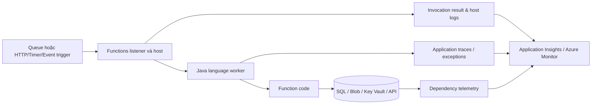
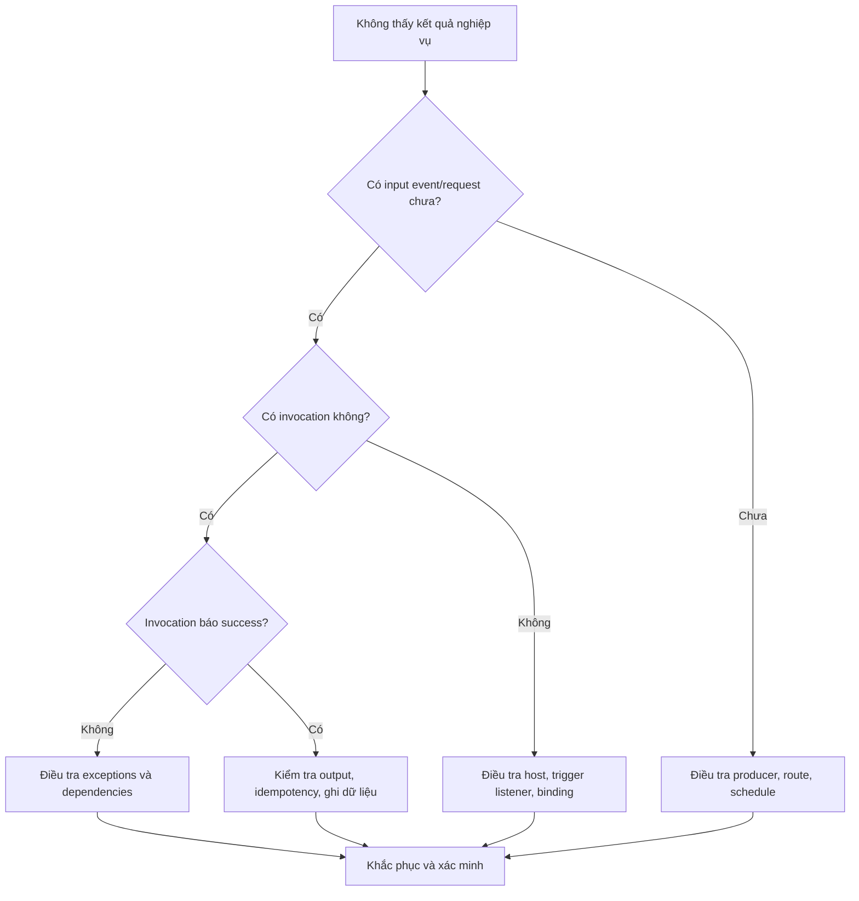
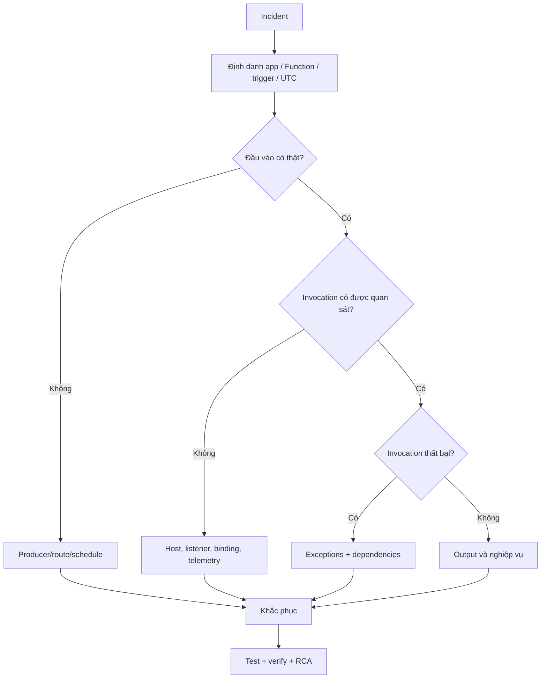

# Quan sát và chẩn đoán lỗi thực thi Function

Một ứng dụng **Azure Functions** có thể triển khai thành công nhưng vẫn không xử lý được công việc: HTTP trigger trả mã 500, Queue trigger nhận cùng một message nhiều lần, Timer trigger không chạy đúng lịch, Service Bus trigger chuyển message vào dead-letter queue, hoặc Java Function thất bại khi gọi Azure SQL, Blob Storage hay Key Vault.

Khó khăn lớn nhất khi điều tra thường không phải thiếu nút “View logs”, mà là **không biết một Function thực sự đã được kích hoạt chưa, chạy ở instance nào, thất bại tại bước nào, đã retry hay chưa và kết quả nghiệp vụ có được ghi nhận không**. Vì vậy, cần phối hợp **invocation logs, Azure Monitor metrics, Application Insights, distributed tracing, trigger metadata, platform diagnostics và dữ liệu tại nguồn/đích**.

Bài học thuộc chương **Serverless với Azure Functions** của module **CLOUD_PROVIDERS_AZURE**. Nội dung kết nối nền tảng Azure từ subscription, resource group, Microsoft Entra ID, mạng ảo đến dịch vụ lưu trữ, dữ liệu, bảo mật, giám sát và kiểm soát chi phí. Các lệnh và mã nguồn bên dưới nhằm minh họa phương pháp chẩn đoán trong môi trường được phép; không phải kết quả của một lần triển khai thực tế.

## Mục tiêu học tập

Sau bài học, bạn có thể:

1. Phân biệt lỗi **không có invocation**, lỗi **khởi động runtime**, lỗi **bên trong Function** và lỗi **dịch vụ phụ thuộc**.
2. Xác định những loại telemetry của Functions: invocation result, trace, exception, dependency, metric và platform event.
3. Dùng Azure Portal, Azure CLI và Azure Functions Core Tools để kiểm tra trạng thái ứng dụng và dữ liệu thực thi.
4. Cấu hình `host.json` và log level phù hợp; hiểu vì sao sampling hoặc filtering khiến không nhìn thấy log mong đợi.
5. Ghi log Java có invocation ID, correlation ID và exception mà không làm lộ secrets.
6. Truy vấn Application Insights/Log Analytics bằng KQL để xác định lỗi, độ trễ và phụ thuộc.
7. Chẩn đoán riêng các trigger HTTP, Storage Queue, Service Bus, Event Hubs, Timer và Durable Functions.
8. Phân biệt retry, duplicate delivery, poison queue và dead-letter queue; thiết kế idempotency.
9. Kiểm tra vấn đề storage connection, managed identity, VNet, private DNS, cold start, scale và deployment.
10. Xây dựng runbook điều tra, cảnh báo, lưu bằng chứng và kiểm soát chi phí quan sát.

## 1. Mô hình tư duy: một Function đi qua những lớp nào?

Giả sử hệ thống nhận message `ORD-1001` từ Azure Storage Queue. Java Function đọc message, kiểm tra đơn hàng, ghi báo cáo vào Blob Storage và kết thúc.



Khi không thấy kết quả, ta cần phân biệt những lớp sau:

| Lớp | Triệu chứng thường thấy | Điều cần xác minh |
|---|---|---|
| **Trigger source** | Không có request/message/sự kiện | Event đã phát sinh chưa, đúng queue/topic/route chưa? |
| **Functions host/listener** | Không có invocation dù có message | App có chạy, trigger có được index, listener có khởi động không? |
| **Language worker** | Java process lỗi lúc khởi động | JDK, runtime, classpath, package và worker có tương thích? |
| **Function code** | Exception hoặc kết quả sai | Input, logic, validation, exit/error path |
| **Dependencies** | Timeout, 401/403, 429, DNS hoặc TLS | Danh tính, quyền, mạng, quota, dịch vụ đích |
| **State/output** | Function báo thành công nhưng không có file hoặc record | Side effect thực sự đã commit chưa? |
| **Telemetry pipeline** | Không thấy log dù có xử lý | Logging config, sampling, retention, workspace và latency |

**Đừng bắt đầu bằng restart Function App** nếu chưa lưu đủ bằng chứng. Restart có thể làm mất dấu thời gian, ảnh hưởng xử lý đang chạy và che khuất nguyên nhân ban đầu.

## 2. Một invocation có những định danh gì?

Một **invocation** là một lần runtime thực thi một Function. Cần phân biệt:

- **Function App:** tài nguyên Azure chứa một hoặc nhiều Function.
- **Function name:** tên entry point, ví dụ `ProcessOrder`.
- **Invocation ID:** định danh của **một lần Function được gọi**. Khi cùng message bị retry, lần thực thi mới có thể có invocation ID mới.
- **Message ID/Event ID:** định danh dữ liệu đến từ Queue/Service Bus/Event Hubs; có thể được giữ nguyên qua nhiều lần delivery.
- **Correlation ID / trace ID:** nối những bước xử lý của **cùng giao dịch nghiệp vụ** xuyên nhiều Functions hoặc dịch vụ.
- **Operation ID:** thuộc tính correlation trong Application Insights, thường dùng để liên hệ request, dependency và trace.
- **Durable orchestration instance ID:** định danh workflow durable, khác invocation ID của từng orchestrator/activity execution.
- **Deployment version/slot:** mã phiên bản hoặc vị trí triển khai đã xử lý invocation đó.

Ví dụ:

```text
businessOrderId = ORD-1001
queueMessageId   = msg-8392
invocationId     = inv-23b8
traceId          = trace-7fe4
functionName     = ProcessOrder
deployment       = release-2026-11-20-1
```

Đây chỉ là dữ liệu giả lập.

Khi xảy ra retry, `queueMessageId` có thể vẫn giữ nguyên nhưng `invocationId` thay đổi. Nếu log chỉ có invocation ID mà không có message/business ID, bạn dễ hiểu nhầm hai lần chạy là hai đơn hàng khác nhau.

### Quy tắc correlation

Một log hữu ích nên trả lời được **ai xử lý dữ liệu nào, trong lần thực thi nào, trên phiên bản nào và kết quả ra sao**. Tuy nhiên không log PII, password, access token, SAS URL, nội dung message nhạy cảm hoặc connection string chỉ để tiện tìm kiếm.

## 3. Những nguồn dữ liệu quan sát chính

| Nguồn | Điểm mạnh | Giới hạn |
|---|---|---|
| **Functions → Monitor / Invocations** | Tra cứu lần thực thi và kết quả theo trải nghiệm Portal được hỗ trợ | Phụ thuộc Application Insights, runtime, sampling và data availability |
| **Application Insights** | Requests, traces, exceptions, dependencies, operation correlation | Chỉ có dữ liệu đã được instrument/ingest; có thể được sampling |
| **Azure Monitor Metrics** | Xu hướng số lần chạy, lỗi, mức dùng tài nguyên theo metric khả dụng | Không có stack trace hay input nghiệp vụ |
| **Azure Monitor Logs / Log Analytics** | KQL, dữ liệu lịch sử, alert và dashboard | Cần đúng bảng/schema, destination, retention và chi phí |
| **Live Metrics / Log streaming** | Theo dõi gần thời gian thực khi tái hiện lỗi | Không phải nguồn kiểm toán lịch sử đầy đủ |
| **Functions host/platform logs** | Lỗi worker startup, listener, binding, storage và scale | Vị trí/trải nghiệm truy cập khác theo hosting plan |
| **Azure Activity Log** | Những thay đổi control plane: app settings, deploy, identity, networking | Không ghi mọi lần Java method chạy |
| **Trigger backend** | Queue message, delivery count, DLQ, Event Hubs lag, schedule state | Không tự chứa nguyên nhân lỗi trong ứng dụng |
| **Business output** | Blob, SQL row, trạng thái đơn hàng hoặc sự kiện đã commit | Cần kiểm chứng độc lập; Function Success chưa đủ |

Điều tra tốt là **ghép dữ liệu giữa các nguồn** chứ không cho rằng một bảng telemetry luôn đầy đủ.

## 4. Quy trình xác định phạm vi trong 5 phút đầu

Trước khi đổi cấu hình, ghi nhận:

1. **Subscription, resource group, Function App và deployment slot** (nếu có).
2. Function name và trigger type.
3. Thời điểm sự cố bắt đầu theo **UTC**, độ dài khoảng lỗi và tỷ lệ ảnh hưởng.
4. Có request/message/event đầu vào không; có thể truy lại ID nào?
5. Có invocation ID, trace ID, message ID hoặc orchestration instance ID không?
6. Có deploy, config change, scale, runtime upgrade hoặc thay firewall gần thời điểm đó không?
7. Những môi trường nào bị ảnh hưởng: chỉ production hay cả staging?
8. Có nguy cơ dữ liệu bị xử lý trùng, mất hoặc ghi dở không?

### Câu hỏi phân nhánh đầu tiên



Đây là luồng phân loại, không phải sơ đồ trạng thái runtime chính xác cho mọi trigger. Một Function có thể khởi chạy mà telemetry bị mất, nên **“không thấy invocation” không chứng minh invocation không xảy ra** nếu logging chưa được kiểm chứng.

## 5. Kiểm tra Function App bằng Azure Portal

Trong Azure Portal:

1. Chọn đúng **Subscription → Resource group → Function App**.
2. Tại **Overview**, kiểm tra trạng thái, hostname, hosting plan, runtime stack và lỗi nền tảng được hiển thị.
3. Mở **Functions**, xác nhận function mong đợi xuất hiện và không bị disable.
4. Mở function → **Monitor** hoặc khu vực **Invocations** được phiên bản Portal hỗ trợ; chọn khoảng thời gian.
5. Chọn một lần chạy Failed để xem thông tin runtime và liên kết Application Insights, nếu đã cấu hình.
6. Mở **Application Insights**, **Metrics** hoặc **Logs** để xem exceptions/dependencies.
7. Kiểm tra **Configuration / Environment variables**, **Networking**, **Identity** và **Deployment** khi có dấu hiệu lỗi cấu hình.
8. Xem **Diagnose and solve problems** nếu trải nghiệm đó có trên plan/tài nguyên đang dùng.

Tên menu và dữ liệu hiển thị thay đổi theo **Windows/Linux, hosting plan, version/runtime và quyền người xem**. Không dùng một ảnh giao diện cũ làm bằng chứng tính năng luôn nằm ở cùng vị trí.

### Nếu không có dữ liệu ở Monitor

Khả năng gồm:

- Application Insights chưa được kết nối hoặc connection string sai.
- Function chưa được gọi trong khoảng thời gian đang xem.
- Host chưa index được Function vì lỗi runtime/binding.
- Sampling hoặc log level đã loại bỏ telemetry cần thiết.
- Đang xem nhầm app/slot, subscription hoặc Application Insights resource.
- Telemetry chưa kịp được ingest.
- Function chạy trên một hệ thống instrumentation khác với bảng đang truy vấn.

Cần kiểm chứng từng giả thuyết; không lập tức bật `Debug` cho toàn bộ production.

## 6. Azure CLI: kiểm tra đúng ứng dụng trước khi đọc log

Trong Bash với Azure CLI đã đăng nhập bằng danh tính được phép:

```bash
az account show --output table

az account set --subscription "<SUBSCRIPTION_ID>"

RG="<RESOURCE_GROUP>"
APP="<FUNCTION_APP_NAME>"

az functionapp show \
  --resource-group "$RG" \
  --name "$APP" \
  --query "{id:id,name:name,state:state,kind:kind,location:location,httpsOnly:httpsOnly}" \
  --output json
```

Lệnh trên mang tính **read-only**, giúp giảm nguy cơ kiểm tra nhầm ứng dụng.

### Liệt kê Function đã được nhận diện

```bash
az functionapp function list \
  --resource-group "$RG" \
  --name "$APP" \
  --output table
```

Nếu Function không hiện diện, cần kiểm tra deployment artifact, language worker, function indexing, trigger binding và runtime logs. Việc chỉ có Function App resource **không đảm bảo mọi Function method đã được phát hiện và kích hoạt thành công**.

### Kiểm tra metric definitions

```bash
APP_ID=$(az functionapp show \
  --resource-group "$RG" \
  --name "$APP" \
  --query id --output tsv)

az monitor metrics list-definitions \
  --resource "$APP_ID" \
  --output table
```

Sau đó chọn **tên metric có thật** trong danh sách của app và hosting plan tương ứng trước khi truy vấn. Một số metric như số execution hoặc execution units có thể xuất hiện tùy plan và API; không mặc định mọi môi trường cung cấp cùng metric hoặc cùng aggregation.

### Hạn chế khi dùng CLI

Azure CLI không phải đường xem **toàn bộ** exception/trace. Để phân tích chi tiết, dùng Application Insights/Log Analytics với KQL và đúng quyền truy cập. Không chạy lệnh liệt kê toàn bộ app settings rồi đăng nguyên output lên ticket, vì có thể chứa secrets hoặc key references nhạy cảm.

## 7. Log stream và Live Metrics

**Log stream** cho phép quan sát thông điệp gần thời gian thực trong lúc tái hiện lỗi. Với Azure Functions Core Tools, một phương án được hỗ trợ trên một số hosting/runtime là:

```bash
func azure functionapp logstream "<FUNCTION_APP_NAME>"
```

Tính khả dụng của log streaming phụ thuộc **hosting plan và hệ điều hành**; không phải mọi app Linux Consumption/Flex Consumption đều hỗ trợ cùng cách. Nếu lệnh không hỗ trợ, dùng **Portal → Application Insights → Live Metrics** hoặc **Logs**, theo dõi các nguồn được môi trường cung cấp.

### Log stream khác Live Metrics thế nào?

- **Log stream:** các dòng log host/worker/app theo đường thu thập hỗ trợ; thường hữu ích khi tái hiện exception.
- **Application Insights Live Metrics:** số requests, failures và telemetry gần thực, cùng sample stream theo cấu hình và tính năng.
- **Historical Logs:** dữ liệu đã ingest có thể truy vấn KQL, không nhất thiết xuất hiện ngay lập tức.

Không dùng cửa sổ Log stream để chứng minh “không có lỗi” khi cửa sổ trống. Host có thể chưa kết nối, app không ghi log, đang xem sai slot, pipeline bị lọc hoặc lỗi xảy ra trước khi worker khởi động.

### Khi mở logging chi tiết

- Đặt khoảng thời gian kiểm thử ngắn và có người giám sát.
- Không bật trace-level liên tục trên production.
- Không in Authorization header, SAS, JWT, message payload hoặc PII.
- Lưu bằng chứng đã che dữ liệu nhạy cảm.
- Khôi phục log level, sampling và diagnostic settings về mức được phê duyệt.

## 8. Cấu hình host.json và log levels

`host.json` điều khiển nhiều thiết lập của Functions host, trong đó có logging, extension options và một số chính sách runtime. Các field và khả năng phụ thuộc Functions runtime/extension version.

Ví dụ cấu hình logging cơ bản cho Functions runtime v4:

```json
{
  "version": "2.0",
  "logging": {
    "logLevel": {
      "default": "Information",
      "Host.Results": "Information",
      "Host.Aggregator": "Information",
      "Function": "Information"
    },
    "applicationInsights": {
      "samplingSettings": {
        "isEnabled": true,
        "excludedTypes": "Request;Exception"
      }
    }
  }
}
```

### Ý nghĩa

- `default: Information`: mức mặc định cho những category không được override.
- `Host.Results`: ảnh hưởng loại log kết quả execution được runtime gửi theo pipeline hỗ trợ.
- `Host.Aggregator`: điều khiển thống kê tổng hợp runtime; cấu hình quá hạn chế có thể làm thiếu dữ liệu.
- `Function`: mức log cho các category liên quan Function.
- `samplingSettings.isEnabled`: cho phép sampling telemetry trong pipeline hỗ trợ.
- `excludedTypes: "Request;Exception"`: yêu cầu giữ những loại telemetry này ngoài quá trình sampling của cấu hình này; **không phải lệnh tắt việc thu thập request/exception**.

**Cảnh báo:** đặt `Host.Results` thành `Warning` hoặc hạn chế quá mức một số category có thể khiến invocation telemetry như requests/results không được phát như mong đợi. Vì vậy, khi “Function chạy mà Monitor trống”, phải kiểm tra `host.json` và các app settings override trước khi kết luận có lỗi Azure Monitor.

### host.json có thể bị override

Azure Functions hỗ trợ các app settings tương ứng dạng `AzureFunctionsJobHost__...` để override cấu hình host trong những môi trường hỗ trợ. Ví dụ mức log có thể khác giữa local/staging/production dù file `host.json` giống nhau.

Không in toàn bộ app settings trong log. Hãy kiểm tra **tên setting và nguồn cấu hình** bằng quyền phù hợp, chỉ tiết lộ giá trị không nhạy cảm cho người điều tra.

### Sampling và cảnh báo

Sampling giúp giảm chi phí ingestion nhưng có thể khiến không thấy từng trace. Với sự kiện hiếm gặp hoặc giao dịch quan trọng, cần hiểu loại telemetry nào bị sampling, trường trọng số (như `ItemCount`) và giới hạn của phương pháp tổng hợp. Không mặc định đếm số dòng trong một bảng bằng tổng số execution thực tế.

## 9. Viết log trong Java Function có invocation ID

Với Azure Functions Java, `ExecutionContext` cung cấp logger và thông tin thực thi. Ví dụ xử lý một **Azure Storage Queue-triggered Function** trong project đã cấu hình Java Functions library:

```java
package vn.example.functions;

import com.microsoft.azure.functions.ExecutionContext;
import com.microsoft.azure.functions.annotation.FunctionName;
import com.microsoft.azure.functions.annotation.QueueTrigger;

import java.util.logging.Level;
import java.util.logging.Logger;

public class OrderProcessor {

    @FunctionName("ProcessOrder")
    public void process(
            @QueueTrigger(
                name = "message",
                queueName = "orders",
                connection = "OrdersStorage")
            String message,
            final ExecutionContext context) {

        Logger log = context.getLogger();
        String invocationId = context.getInvocationId();

        // Chỉ dùng dữ liệu lab; input production phải parse/validate
        // theo schema và không in toàn bộ message nhạy cảm.
        String orderId = message == null ? "" : message.trim();

        log.info("event=order_processing_started" +
                 " invocationId=" + invocationId);

        try {
            if (orderId.isBlank()) {
                throw new IllegalArgumentException("empty_order_id");
            }

            // Test lỗi có kiểm soát trong môi trường lab.
            if (orderId.equals("FAIL_LAB")) {
                throw new IllegalStateException("simulated_lab_failure");
            }

            // Production: gọi service xử lý dữ liệu và ghi
            // kết quả bền vững, có idempotency ở backend.
            log.info("event=order_processing_completed" +
                     " invocationId=" + invocationId);

        } catch (Exception ex) {
            log.log(
                Level.SEVERE,
                "event=order_processing_failed" +
                " invocationId=" + invocationId +
                " errorType=" + ex.getClass().getSimpleName(),
                ex
            );

            // Không nuốt lỗi; để runtime/trigger thấy thất bại.
            throw ex;
        }
    }
}
```

### Bài học từ ví dụ

1. **Log start/success/failure** với event name ổn định.
2. Có `invocationId` để nối log.
3. Exception được ghi bằng API có stack trace.
4. Lỗi được **ném tiếp** thay vì catch rồi coi thành công.
5. Không in dữ liệu message chứa PII hoặc token.
6. Với Storage Queue, cấu hình trigger quyết định retry/poison-message behavior—không phải mỗi dòng `SEVERE` tự làm message retry.
7. Nếu một message bị xử lý lại, invocation ID mới phải liên hệ với **message ID/business key** ở metadata hoặc log khác.

Ví dụ `FAIL_LAB` chỉ nên dùng trong **queue/resource group thử nghiệm**, vì nó cố ý khiến message thất bại. Không gửi chuỗi này vào queue production.

### Không nuốt exception

Mẫu sau rất nguy hiểm:

```java
try {
    performWork();
} catch (Exception ex) {
    context.getLogger().severe("Failed: " + ex.getMessage());
}
// Function kết thúc bình thường => runtime có thể coi invocation success.
```

Nếu nghiệp vụ chưa thực hiện và không có kết quả bền vững, hãy để lỗi đi lên runtime hoặc trả trạng thái thất bại theo contract của trigger. Nếu một bản ghi lỗi được xử lý theo hướng **quarantine có chủ đích**, phải ghi nhận bền vững trạng thái đã xử lý và tránh báo success giả.

## 10. Tương quan giữa log, trace và dependency

Một request có thể đi qua:

```text
HTTP API -> Function -> Azure SQL -> Blob Storage -> Service Bus
```

Application Insights/Distributed tracing có thể nối các span/request/dependency bằng **operation ID/trace context**, nhưng khả năng này phụ thuộc instrumentation của từng runtime và thư viện.

### Những ID cần giữ

- **Invocation ID:** một lần gọi Function.
- **Operation ID/trace ID:** request distributed trace.
- **Business ID:** mã đơn hàng hoặc batch ID không nhạy cảm.
- **Message ID:** định danh message từ broker.
- **Dependency request ID:** do dịch vụ đích phát, nếu API trả về.

Ví dụ log nên có cấu trúc:

```text
event=order_started invocationId=i-101 orderKey=ORD-1001
event=blob_write_started invocationId=i-101 blob=reports/ORD-1001.json
event=blob_write_failed invocationId=i-101 status=403 error=AuthorizationPermissionMismatch
```

Đây là dữ liệu giả lập. Thông tin blob path có thể nhạy cảm trong một số tổ chức, cần rút gọn hoặc mask.

### Log application khác dependency telemetry

Không phải mọi JDBC/HTTP request đều tự xuất hiện trong Application Insights trên mọi Java setup. Một số stack cần **Azure Monitor OpenTelemetry hoặc instrumentation/agent** phù hợp. Nếu dependencies trống, hãy kiểm tra hỗ trợ và cấu hình instrument trước khi khẳng định Java chưa gọi dependency.

## 11. Kết nối Application Insights và chọn đúng nơi truy vấn

Application Insights thuộc Azure Monitor, thường cung cấp những loại dữ liệu:

| Loại dữ liệu | Ý nghĩa |
|---|---|
| **Requests / AppRequests** | Những request hoặc function executions được ghi theo instrumentation |
| **Traces / AppTraces** | Log/trace messages |
| **Exceptions / AppExceptions** | Exception type, message/stack telemetry |
| **Dependencies / AppDependencies** | Outbound calls và latency/result theo instrumentation |
| **Custom events / metrics** | Nghiệp vụ tự phát ra theo contract |
| **Live Metrics** | Thông tin gần thời gian thực khi tính năng hỗ trợ |

Tên bảng phụ thuộc **Application Insights resource kiểu classic, workspace-based, schema resource-specific, diagnostic routing và loại ingestion**. Có hai nhóm phổ biến:

- Trải nghiệm Application Insights kiểu classic có bảng `requests`, `traces`, `exceptions`, `dependencies` với tên cột như `timestamp`, `operation_Id`, `success`.
- Truy vấn trực tiếp trong **Log Analytics workspace** thường có `AppRequests`, `AppTraces`, `AppExceptions`, `AppDependencies` với `TimeGenerated` và `OperationId`.

Không sao chép một truy vấn `requests` vào workspace chỉ có `AppRequests` rồi kết luận telemetry bị mất.

### Connection string

App settings thường dùng **`APPLICATIONINSIGHTS_CONNECTION_STRING`** để kết nối telemetry. Không đưa giá trị connection string vào giáo trình, ticket hoặc log. Khi instrumentation và resource association không đúng, Functions có thể chạy bình thường mà log lại đi sang resource khác hoặc không được gửi.

### Khi xuất hiện độ trễ ingestion

Telemetry không nhất thiết có mặt tức thời. Kiểm tra khoảng thời gian UTC rộng hơn, status của pipeline, sampling, retention và có thật sự phát ra request hay không. Một lời gọi Function có thể nhanh hơn thời gian telemetry xuất hiện trong dashboard.

## 12. KQL: thống kê invocation và lỗi

Ví dụ khi truy vấn **Log Analytics workspace** có bảng `AppRequests` và các trường tương ứng:

```kusto
AppRequests
| where TimeGenerated > ago(1h)
| summarize
    Invocations = count(),
    Failed = countif(Success == false),
    P95DurationMs = percentile(DurationMs, 95)
  by bin(TimeGenerated, 5m), Name
| order by TimeGenerated asc
```

Chú ý:

- `Name` là tên operation/request được telemetry ghi; với một số Functions nó có thể không trùng chính xác tên method Java.
- `Success` phản ánh quy tắc telemetry, không phải kết quả kinh doanh.
- `DurationMs` là thời gian đo theo loại request/operation đó.
- Nếu có sampling, `count()` có thể **không bằng tổng số invocation thực tế**. Khi phù hợp, xem dữ liệu `ItemCount` và quy tắc sampling để tính tổng đại diện.

### Tìm các invocation lỗi

```kusto
AppRequests
| where TimeGenerated > ago(2h)
| where Success == false
| project TimeGenerated, Name, ResultCode,
          DurationMs, OperationId, AppRoleName
| order by TimeGenerated desc
```

Với non-HTTP Functions, `ResultCode` không nhất thiết là HTTP status code. Không đánh đồng mọi `ResultCode = 500` với một response HTTP từ phía người dùng.

### Nếu truy vấn trong App Insights kiểu classic

```kusto
requests
| where timestamp > ago(1h)
| summarize
    Invocations = count(),
    Failed = countif(success == false),
    P95 = percentile(duration, 95)
  by bin(timestamp, 5m), name
| order by timestamp asc
```

**Chỉ dùng một schema khớp dữ liệu thực tế.** Nếu bảng trống hoặc cột không tồn tại, mở schema explorer của đúng resource, xác nhận logging/sampling và chỉnh query.

## 13. KQL: tìm exception, trace và dependency

### Tìm exception được ghi nhận

```kusto
AppExceptions
| where TimeGenerated > ago(2h)
| summarize Occurrences = count()
  by Type, ProblemId
| top 20 by Occurrences desc
```

Để xem chi tiết và correlation:

```kusto
AppExceptions
| where TimeGenerated > ago(1h)
| project TimeGenerated, Type, OuterMessage, OperationId
| order by TimeGenerated desc
```

Các trường có thể khác theo pipeline; khi thiếu `OuterMessage`, kiểm tra schema và tìm field message tương ứng. Không tìm exception từ bảng `AppRequests` rồi mặc định có đầy đủ stack trace ở đó.

### Tìm Java traces

```kusto
AppTraces
| where TimeGenerated > ago(1h)
| where Message contains "order_processing_failed"
| project TimeGenerated, Message, SeverityLevel,
          OperationId, AppRoleName
| order by TimeGenerated desc
```

### Liên hệ dependencies theo operation ID

```kusto
let op = "<OPERATION_ID>";
AppDependencies
| where TimeGenerated > ago(2h)
| where OperationId == op
| project TimeGenerated, Name, Target,
          DurationMs, Success, ResultCode
| order by TimeGenerated asc
```

Nếu không thấy dependency nào, cần xác minh instrumentation, sampling và resource correlation. Việc không có dependency telemetry **không chứng minh ứng dụng không gọi HTTP/SQL/Blob**.

### KQL qua FunctionAppLogs

Nếu diagnostic settings của Function App đẩy resource-specific logs tới bảng `FunctionAppLogs`, có thể bắt đầu:

```kusto
FunctionAppLogs
| where TimeGenerated > ago(1h)
| project TimeGenerated, FunctionName, Level, Message
| order by TimeGenerated desc
```

Chỉ dùng bảng này khi nó thực sự tồn tại trong workspace đã cấu hình. Diagnostic log schema/category có thể thay đổi; không mặc định `FunctionAppLogs` và `AppTraces` luôn chứa dữ liệu giống nhau.

## 14. Metrics và cảnh báo: đánh giá xu hướng

Log chi tiết trả lời **“vì sao”**, metrics hỗ trợ nhận ra **“khi nào, bao nhiêu và ảnh hưởng bao rộng”**.

Những metric/đại lượng cần quan sát:

- Số execution/requests và failure rate.
- Thời gian thực thi trung bình, **p95/p99** khi dữ liệu cho phép.
- Số exception theo loại và theo Function.
- Số request tới dependency bị lỗi, timeout hoặc throttling.
- Tốc độ tăng queue backlog, message age và DLQ count khi broker có metric.
- CPU/memory của plan/worker theo khả năng hosting plan.
- Restart, host startup errors, scale events nếu telemetry có sẵn.
- Số work items chưa xử lý hoặc “không có invocation đúng lịch”.
- Số output nghiệp vụ thành công, không chỉ số Function invocation thành công.

### Tỷ lệ lỗi và baseline

Ví dụ trong 5 phút có 1.000 invocations, 20 thất bại, tỷ lệ lỗi = 2%. Tuy nhiên, với Function chỉ chạy một lần/ngày, một lần thất bại có thể quan trọng hơn 2% lỗi ở một hệ thống chấp nhận retry.

Cảnh báo nên kết hợp:

1. **Rate/threshold** từ telemetry.
2. **Absolute count** để tránh nhiễu khi lưu lượng thấp.
3. **Absence detection** đối với Timer hoặc pipeline có SLA.
4. **Business output check** khi tác vụ có deadline.
5. **Severity/runbook** để người nhận biết hành động tiếp theo.

Azure Monitor alert có thể dùng **metrics hoặc log queries** tùy dữ liệu; cần kiểm tra độ trễ ingestion, độ dài window, tần suất đánh giá và chi phí.

## 15. HTTP-triggered Function: lỗi 4xx, 5xx và timeout

HTTP Function thường dễ tái hiện bằng `curl`, nhưng cần phân biệt status đến từ **client/gateway, Functions host hay code ứng dụng**.

### Kiểm tra có kiểm soát

```bash
curl -i \
  --connect-timeout 10 \
  --max-time 30 \
  "https://<FUNCTION_APP_NAME>.azurewebsites.net/api/<ROUTE>"
```

Nếu route yêu cầu xác thực, dùng cơ chế đã phê duyệt; không ghi function key vào URL được chia sẻ công khai hay shell history không kiểm soát.

### Các nguyên nhân

| HTTP status / triệu chứng | Giả thuyết | Nơi điều tra |
|---|---|---|
| 401/403 | Function key, App Service Authentication, APIM, IP restrictions | Auth settings, gateway, access policy, logs |
| 404 | Sai route, function chưa index, deployment slot/hostname sai | Function list, route, deployment history |
| 429 | Rate limit của gateway, API hoặc downstream | Response headers, APIM, dependency logs |
| 500 | Unhandled exception, binding/startup lỗi | App Insights exceptions, host logs |
| 502/503 | Host không sẵn sàng, worker crash, backend lỗi hoặc platform issue | Startup/runtime logs, metrics, diagnostics |
| Client timeout | Function chậm, proxy/frontend timeout, network không thông | Request duration, dependency traces, hosting constraints |

### Không giữ HTTP request để chạy batch quá lâu

HTTP frontend có giới hạn timeout độc lập với `functionTimeout`. Với tác vụ kéo dài, nên dùng **HTTP 202 + Queue/Durable Functions + status endpoint** thay vì giữ request chờ một Java Function nhiều giờ.

**HTTP trigger thông thường không tự được broker phát lại sau một 500** như Storage Queue trigger. Nếu client retry, phải có idempotency để tránh tạo lặp đơn hàng hoặc thanh toán.

## 16. Azure Storage Queue trigger: retry và poison queue

Với Storage Queue-triggered Functions, một message có thể được **ẩn tạm thời** khi worker đang xử lý. Nếu Function thất bại hoặc message không được xử lý thành công, message có thể xuất hiện lại sau thời hạn và được xử lý bởi invocation khác.

### Các trường hợp đáng chú ý

- Message bị **deserialize** hoặc binding sai.
- Function ném exception hoặc worker mất kết nối.
- Storage Queue hoặc output dependency trả 403/429/5xx.
- Visibility timeout khiến message được giao lại.
- Message tiếp tục lỗi và cuối cùng đi vào **poison queue** theo cơ chế/retry settings của Storage Queues extension.

Một số Storage Queue triggers có default `maxDequeueCount` thường là 5, sau đó message bị chuyển tới queue dạng `<queue-name>-poison`. **Không áp cứng con số này cho mọi extension/host.json version**; kiểm tra cấu hình và runtime thực tế.

### host.json ví dụ cho Queues extension

```json
{
  "version": "2.0",
  "extensions": {
    "queues": {
      "maxDequeueCount": 5,
      "visibilityTimeout": "00:00:30"
    }
  }
}
```

Đây là **trích đoạn host.json thay thế để giải thích Queue settings**, không phải file thứ hai cần ghép nguyên văn vào cùng một cấu hình. Với production, merge field này vào `host.json` hiện có và kiểm tra version của Storage Queues extension.

### Điều tra message không được xử lý

1. Xác nhận đúng Storage account và queue name.
2. Kiểm tra message vẫn đang ở queue hay đã vào poison queue.
3. Đối chiếu message ID, insertion time, dequeue count nếu metadata có.
4. Tra log Java theo invocation ID và event nghiệp vụ.
5. Xác định lỗi dữ liệu, code, quyền hay mạng.
6. Sửa nguyên nhân **trước khi requeue**.
7. Reprocess có idempotency và không làm mất message gốc.
8. Theo dõi queue depth và poison queue sau sửa.

**Poison queue không phải nơi vứt bỏ dữ liệu tự động vô thời hạn.** Cần có owner, retention, cảnh báo và quy trình reprocess hoặc quarantine.

## 17. Service Bus trigger: delivery count và dead-letter queue

**Azure Service Bus** có cơ chế message settlement và **dead-letter queue (DLQ)** khác Azure Storage Queue poison queue.

Những thông tin cần phân biệt:

- **Message ID**, session ID (nếu dùng), delivery count.
- **Peek-lock** hoặc settlement mode theo trigger/config.
- **MaxDeliveryCount** của queue/subscription.
- **Dead-letter reason/description** khi message vào DLQ.
- Message lock duration, auto-renewal, concurrency và transaction behavior.
- Service Bus entity namespace/queue/topic/subscription và quota.

### Khi Function thất bại

Trong các mô hình peek-lock phổ biến, khi xử lý không thành công hoặc lock hết hạn, message có thể được giao lại. Khi vượt chính sách delivery count hoặc được dead-letter theo lý do khác, message có thể nằm trong DLQ.

**Không đồng nhất DLQ Service Bus với poison queue của Azure Storage Queues.** Hai sản phẩm có schema, settlement, retry và công cụ vận hành khác nhau.

### Runbook Service Bus

1. Xác nhận namespace, entity và subscription nếu là topic.
2. Xem Active/Dead-letter message count.
3. Kiểm tra message ID, delivery count, dead-letter reason và host logs.
4. Tách lỗi message schema, Java exception, identity/network, lock expiration.
5. Đánh giá thời lượng xử lý so với lock renewal và concurrency.
6. Sửa nguyên nhân và **re-drive DLQ** bằng công cụ/quy trình có idempotency.
7. Không forward tất cả DLQ vào live queue nếu chưa phân loại dữ liệu độc hại hoặc code lỗi.

### Chính sách retry ở nhiều tầng

SDK hoặc ứng dụng có thể retry dependency, còn broker tiếp tục redeliver message. Nếu không có giới hạn, tải downstream và chi phí tăng. Theo dõi **tổng retry budget**, không chỉ `MaxDeliveryCount`.

## 18. Event Hubs trigger: checkpoint và xử lý lại dữ liệu

Event Hubs là **event stream**, không phải queue có poison queue theo từng message giống Storage Queues.

Các vấn đề thường gặp:

- Event đến nhưng consumer group sai.
- Function App dùng chung consumer group không được thiết kế, làm thay đổi phân bổ partition.
- Checkpoint chưa cập nhật khi worker crash.
- Một event/batch có thể được xử lý lại.
- Processing lag tăng khi số partition, throughput hoặc concurrency không đáp ứng.
- AzureWebJobsStorage/checkpoint storage hoặc identity/network gặp lỗi.
- Code xử lý batch không có idempotency và ghi trùng dữ liệu.

### Nguyên tắc chẩn đoán

- Kiểm tra đúng **Event Hub namespace, hub, consumer group và partition**.
- Xác định event time, partition ID, offset/sequence number nếu binding/telemetry cung cấp.
- So sánh tốc độ ingress, processing throughput và consumer lag.
- Xem host logs về listener, lease/checkpoint, partition balancing và exceptions.
- Xác minh output có thể chấp nhận **at-least-once processing** theo thiết kế.

Một Function báo thành công ở một batch không chứng minh mọi event đã được ghi vào database nếu code xử lý thiếu transaction/checkpoint logic tương thích. Thiết kế cần kiểm chứng output theo từng partition hoặc business key.

## 19. Timer trigger: chạy muộn, chạy trùng hay không chạy?

Timer trigger chạy theo lịch. Azure Functions dùng biểu thức lịch kiểu NCRONTAB có **trường giây** theo cơ chế được hỗ trợ, ví dụ:

```text
0 0 2 * * *
```

Biểu thức ví dụ chạy lúc **02:00 UTC mỗi ngày** khi app sử dụng UTC và timer hoạt động bình thường. Đây **không phải 02:00 theo giờ Việt Nam** (UTC+7); lúc đó ở Việt Nam là 09:00.

### Khi Timer không chạy đúng lịch

1. Kiểm tra function có được index/enable không.
2. Xác nhận biểu thức schedule và cách timezone được diễn giải.
3. Kiểm tra host start, storage schedule monitor và listener logs.
4. Xem deployment/restart/scale gần thời điểm dự kiến.
5. Kiểm tra các app settings có override trigger hoặc disable function không.
6. Xác nhận app có bị stop hoặc hosting plan có điều kiện ảnh hưởng hoạt động không.
7. Dùng `isPastDue` hoặc metadata tương tự nếu SDK/binding cung cấp để ghi nhận lần chạy trễ.
8. Xác minh output nghiệp vụ và không tạo trùng nếu chủ động chạy bù.

### Cẩn trọng với timezone

Một số cấu hình như `WEBSITE_TIME_ZONE` có **giới hạn theo hosting plan/OS**; không dựa vào việc đổi timezone app settings để mặc định Timer trên mọi Linux/Flex plan sẽ chạy theo giờ địa phương. Tốt nhất thiết kế lịch theo **UTC**, hiển thị chuyển đổi trong dashboard và kiểm tra daylight saving nếu liên quan các múi giờ khác.

**Timer trigger không phải SLA đúng từng mili giây.** Cần tính đến startup, hệ thống phân tán, độ trễ và xử lý bù khi nghiệp vụ yêu cầu đúng hạn.

## 20. Durable Functions: replay khác retry thực thi

Khi workflow dùng **Durable Functions**, vấn đề quan sát phức tạp hơn:

- **Orchestrator** có thể được **replay** từ history.
- **Activity** là Function thực thi side effects và có thể retry.
- **Entity** lưu trạng thái theo entity ID, với operation processing theo SDK hỗ trợ.
- **Orchestration instance ID** không phải invocation ID của mỗi lần Function chạy.
- Một workflow có thể Running trong nhiều ngày chỉ vì đang chờ timer/external event.

### Vì sao log trùng?

Nếu orchestrator ghi log mỗi khi code được thực thi/replayed, có thể thấy cùng dòng nhiều lần mà **activity chưa chắc đã chạy nhiều lần**. Hãy dùng replay-safe logger hoặc kiểm tra trạng thái replay bằng API của Durable SDK hiện có.

### Runbook Durable

1. Xác định **instance ID, task hub và storage provider**.
2. Tra instance runtime status và thời điểm cập nhật.
3. Đọc activity failures, orchestration history/events theo công cụ được hỗ trợ.
4. Kiểm tra external event name, timer deadline và event sender permissions.
5. Nếu lỗi sau deployment, đánh giá **orchestrator deterministic/version compatibility**.
6. Khi activity retry, kiểm tra side effects ở database/API trước khi reprocess.
7. Không sửa/xóa trực tiếp task hub storage để “reset” workflow nếu còn instance cần giữ.
8. Giám sát workflow hoàn thành **nghiệp vụ**, không chỉ trạng thái runtime.

### Nondeterminism

Thay đổi thứ tự schedule activity trong mã mới khi instance cũ còn chạy có thể khiến replay không khớp history. Phải có versioning/compatibility plan thay vì mặc định deploy code mới tương thích với mọi instance cũ.

## 21. Java worker, Functions runtime và lỗi startup

Nếu **không có invocation** nhưng trigger source có dữ liệu, rất có thể host hoặc Java worker chưa hoạt động đúng.

### Các lớp kiểm tra

| Thành phần | Dấu hiệu lỗi | Hướng xác minh |
|---|---|---|
| `FUNCTIONS_WORKER_RUNTIME` | Khác `java` so với artifact | App settings nguồn gốc/giá trị được phép xem |
| Functions runtime | Version không phù hợp với extension | Runtime/version và host startup |
| JDK | `UnsupportedClassVersionError` hoặc class version sai | Build target vs runtime Java version |
| Maven artifact | Thiếu Function metadata, dependencies hoặc class | Packaging, deployment logs, function indexing |
| Java worker | Startup timeout, OOM, process crash | Worker/platform logs, memory/CPU, startup time |
| Binding extension | Cannot find binding/extension hoặc listener fail | Extension bundle, dependencies, host logs |
| Trigger connection | Không thể kết nối queue/Service Bus/Storage | Secret/identity, DNS, firewall, permissions |
| Function disabled | App setting/Portal disable | Function list, configuration |
| Slot/deployment | Deploy sai slot hoặc artifact cũ | Deployment history, slot config, version |

### Đặc biệt chú ý Java version

Nếu build bằng JDK mới hơn runtime Java mà Function App hỗ trợ, ứng dụng có thể không load class. Việc Maven build thành công trên máy lập trình **không chứng minh Functions host trên Azure chạy được bytecode**.

Khi cần chẩn đoán, ghi nhận:

- JDK/build target.
- Azure Functions runtime và Java worker.
- Extension bundle/trigger extension.
- Artifact version hoặc image digest.
- Thời điểm deploy.
- App settings liên quan (không in secrets).
- Logs host startup/indexing.

## 22. Deployment, trigger synchronization và cấu hình

Sau deployment, các function definitions/bindings phải được runtime phát hiện. Có thể gặp:

- Artifact được deploy vào sai app hoặc slot.
- Function name/route thay đổi.
- Package deployment không chứa metadata hoặc file cần thiết.
- Host không khởi động do missing settings.
- Trigger synchronization/indexing không hoàn tất theo deployment model.
- Một setting thay đổi làm listener không còn kết nối tới nguồn.
- Version cũ vẫn đang phục vụ khi deployment hoặc slot swap chưa hoàn tất.

### Quy trình kiểm tra

1. Xác nhận deployment ID và artifact version.
2. Xem Azure Activity Log/Deployment logs.
3. Liệt kê Functions từ Portal/CLI.
4. Kiểm tra host startup và listener logs.
5. Kiểm tra từng trigger connection.
6. Gửi request/event thử **trong môi trường lab hoặc staging**.
7. So sánh App Insights before/after deployment.
8. Nếu cần rollback, xác định ảnh hưởng với event đã xử lý, stateful workflow và database schema.

**Không sửa app settings hoặc restart production để thăm dò** khi chưa có phương án quay lại. Một thay đổi runtime configuration có thể gây restart hoặc làm thay đổi trigger behavior.

## 23. Lỗi dependency: RBAC, managed identity, network và DNS

Một Function có thể chạy thành công ở mức Java nhưng không truy cập được Azure SQL, Blob, Key Vault hoặc API do lỗi riêng của dependency.

### Tách lỗi xác thực và lỗi kết nối

| Triệu chứng | Nguyên nhân cần xem |
|---|---|
| **401 Unauthorized** | Credential/token sai, audience hoặc OAuth flow sai |
| **403 Forbidden** | Identity có token nhưng thiếu data-plane role, firewall hoặc service policy chặn |
| **Timeout/TCP reset** | Network route, NSG, firewall, Private Endpoint hoặc service unavailable |
| **DNS resolution failed** | Private DNS, VNet link, custom DNS forwarder hoặc hostname sai |
| **TLS handshake failure** | Certificate chain, protocol/cipher hoặc proxy |
| **429 Throttling** | Quota/rate limit, concurrency quá cao |
| **5xx dependency** | Service đích quá tải hoặc lỗi tạm thời |
| **Connection pool exhausted** | Quá nhiều request hoặc thiếu release/timeout management |

### Azure RBAC và managed identity

Managed identity cung cấp danh tính; muốn đọc Blob phải có data role phù hợp như **Storage Blob Data Reader**, muốn ghi Blob cần role cho phép ghi (ví dụ Storage Blob Data Contributor) ở phạm vi thích hợp. Với Key Vault, kiểm tra mô hình RBAC/access policy và quyền secret cụ thể.

**Contributor ở subscription không tự bảo đảm mọi quyền data plane.** Đồng thời, có role đúng không vượt được Storage firewall.

### VNet Integration và Private Endpoint

- **VNet Integration** giúp Function App gửi outbound traffic vào VNet theo plan/tính năng hỗ trợ.
- **Private Endpoint** cung cấp private access cho dịch vụ/tài nguyên tương ứng.
- **Private DNS** quyết định hostname service có phân giải về private IP hay không.
- **NSG, UDR và Azure Firewall** có thể chặn đường truyền dù xác thực thành công.
- Đường kết nối từ **Function host** có thể khác laptop hoặc Cloud Shell.

Nếu Function dùng Storage account riêng làm backend cho triggers/state, networking sai tới backend đó có thể gây **host/listener không hoạt động**, khác lỗi chỉ xảy ra khi code gọi storage.

### Hướng xử lý an toàn

Không mở `publicNetworkAccess` cho mọi nguồn, dùng account key rộng hoặc tắt firewall để che nguyên nhân. Hãy kiểm tra từng lớp identity → role → endpoint → DNS → route → firewall → dependency response.

## 24. Scale, cold start, timeout và concurrency

Azure Functions có nhiều hosting plans và cơ chế scale; không nên áp một giới hạn timeout, instance count hoặc cold-start behavior cho mọi plan.

### Cold start

Khi Function App phải khởi tạo host hoặc Java worker mới, request/event đầu tiên có thể bị chậm. Những yếu tố ảnh hưởng:

- Kích thước JAR/dependencies và thời gian JVM startup.
- Dependency initialization, DI container hoặc Spring context nếu có.
- App settings/secret resolution.
- Network latency tới Storage và các services cần khi startup.
- Hosting plan và tính năng giữ instance warm theo khả năng.
- Việc tải image nếu ứng dụng chạy theo mô hình container hỗ trợ.

**Không kết luận cold start chỉ từ một request chậm**. Cần kiểm tra cùng thời điểm host startup logs, instance scale và dependency traces.

### Function timeout

`functionTimeout` trong `host.json` có thể điều khiển thời gian tối đa của execution theo khả năng hosting plan:

```json
{
  "version": "2.0",
  "functionTimeout": "00:05:00"
}
```

Đây là ví dụ minh họa; giới hạn tối thiểu/tối đa và điều kiện của từng hosting plan có thể khác nhau. Ngoài timeout Functions host, HTTP frontends, Service Bus lock, Queue visibility và dependency SDK đều có timeout riêng.

### Concurrency

Tăng concurrency có thể giúp throughput nhưng cũng có thể:

- Làm SQL connection pool cạn.
- Gây Storage/Key Vault 429.
- Tăng memory/GC và OOM trên Java worker.
- Tăng lock loss hoặc retry đối với broker.
- Khiến log rất nhiều và chi phí tăng.

Với **dynamic concurrency** và các extension hỗ trợ, host có thể điều chỉnh xử lý song song. Hãy đo latency, queue age, CPU, memory, retries và downstream rate trước khi thay đổi.

## 25. Diagnostic settings, lưu trữ log và bảo mật

Một số Function Apps hỗ trợ **Diagnostic settings** gửi platform/resource logs tới:

- **Log Analytics workspace** để truy vấn KQL và alert.
- **Azure Storage** để lưu dữ liệu theo retention/lifecycle.
- **Event Hubs** để chuyển telemetry sang pipeline khác.

Khả năng category và bảng đích phụ thuộc tài nguyên và cấu hình. Application Insights telemetry thường có **đường ingestion riêng**; không mặc định bật Diagnostic settings là tự tạo mọi bảng `AppRequests` hoặc `AppExceptions`.

### Retention

Xác định:

- Giữ raw logs trong bao lâu để phục vụ incident/RCA.
- Có cần retention dài hạn phục vụ kiểm toán không.
- Ai được đọc log chứa mã đơn hàng hoặc identifiers.
- Cách mask token, PII, payload và đường dẫn có dữ liệu nhạy cảm.
- Cách xuất bằng chứng không tiết lộ secrets.
- Chi phí ingestion, retention, queries và alerts.

### Không ghi gì vào log?

- `AzureWebJobsStorage` connection string hoặc account key.
- `APPLICATIONINSIGHTS_CONNECTION_STRING` và token.
- SAS URLs, Service Bus connection strings và client secrets.
- Authorization headers, cookies hoặc JWT.
- Nội dung raw message chứa PII/tài liệu nghiệp vụ.
- Full exception dump chứa request body bí mật.

Nếu cần phân tích message hỏng, lưu trong vùng quarantine có quyền giới hạn, log chỉ mã định danh/hash hoặc schema-validation error.

## 26. Runbook điều tra lỗi thực thi Function

Quy trình này áp dụng cho phần lớn tình huống production:

### Bước 1 — Ghi nhận sự cố

Ghi thời điểm UTC, Function App, Function name, slot, trigger source, error rate, SLA và phạm vi ảnh hưởng. Đừng thay đổi logging mức cao trước khi chụp lại metrics/health ban đầu.

### Bước 2 — Xác minh đầu vào

Kiểm tra HTTP request, Queue message, Service Bus message, Event Hubs event, Timer schedule hoặc Durable signal có thật. Ghi ID của nguồn, không sao chép payload nhạy cảm.

### Bước 3 — Tìm invocation hoặc dấu hiệu host/listener

Tra Azure Portal Monitor, Application Insights hoặc Functions host logs. Nếu không thấy invocation, kiểm tra index, disabled flag, trigger connection và telemetry pipeline.

### Bước 4 — Phân loại lỗi

Xác định lỗi ở **host startup, binding, Java worker, function code, dependency, output persistence hoặc observability**. Chỉ khi biết tầng lỗi mới chọn công cụ tiếp theo.

### Bước 5 — Correlate dữ liệu

Dùng invocation ID/operation ID/message ID đối chiếu requests, exceptions, traces, dependencies và backend metadata trong cùng khoảng thời gian UTC.

### Bước 6 — Kiểm tra thay đổi gần đây

Đối chiếu deploy, Java version, package, app settings, identity, Key Vault, firewall, VNet, DNS và quota/capacity.

### Bước 7 — Đánh giá retry và dữ liệu đã xử lý

Trước khi requeue/re-drive/replay, xem side effect đã thực sự xảy ra chưa. Chọn idempotency key hoặc conditional write để tránh trả tiền/gửi thông báo/ghi báo cáo trùng.

### Bước 8 — Sửa và kiểm thử

Thay đổi ở staging/lab hoặc canary trước. Với production, có phê duyệt, rollback, plan bảo toàn state và thời gian xử lý an toàn.

### Bước 9 — Xác minh khôi phục

Kiểm tra trigger tiếp tục nhận việc, errors giảm, queue age/DLQ trở về ngưỡng chấp nhận, output nghiệp vụ tồn tại và không có duplicate bất thường.

### Bước 10 — RCA và phòng ngừa

Ghi nguyên nhân gốc, khoảng tác động, bằng chứng, hành động sửa, alert/runbook cần thêm và owner theo dõi.



## 27. Thực hành tổng hợp: Queue-triggered Java Function bị lỗi

**Tình huống lab:** một Azure Storage Queue tên `orders` cung cấp order ID. Java Function `ProcessOrder` đọc message. Message hợp lệ được coi là xử lý thành công trong bài lab; message `FAIL_LAB` tạo exception để người học quan sát retry và poison queue.

### Điều kiện

- Có Azure subscription/resource group lab được phép sử dụng.
- Có một Function App Java và Storage account lab theo cấu hình Functions runtime được hỗ trợ.
- Queue `orders` chỉ chứa dữ liệu thử nghiệm.
- App settings `OrdersStorage` được cấu hình đúng, không commit secrets.
- Application Insights được kết nối nếu muốn tra invocation/exception bằng KQL.
- Có đủ quyền để xem log và queue metadata; không dùng quyền Owner rộng khi không cần.

### Bước 1 — Triển khai mã thử nghiệm

Tạo Azure Functions Java project với class `OrderProcessor` ở phần 9 và cơ chế build/deploy được tổ chức phê duyệt. Chọn runtime/JDK tương thích, xác nhận Function đã được index.

Ví dụ read-only xác minh:

```bash
az functionapp function list \
  --resource-group "<RESOURCE_GROUP>" \
  --name "<FUNCTION_APP_NAME>" \
  --output table
```

### Bước 2 — Phát message hợp lệ

Dùng Azure Portal/Storage Explorer hoặc ứng dụng producer thử nghiệm để gửi message `ORD-1001` vào queue. Không cần ghi connection string vào ví dụ.

Quan sát:

- Queue message được Function nhận.
- Log `order_processing_started` và `order_processing_completed`.
- Invocation có trạng thái success khi telemetry thu thập được.
- Message được xử lý theo semantics của Queue trigger.

### Bước 3 — Phát message cố ý lỗi

Gửi `FAIL_LAB` vào **queue lab**. Quan sát:

- Log `order_processing_failed`.
- Exception `simulated_lab_failure` và stack trace trong pipeline được cấu hình.
- Invocation không thành công.
- Message có thể được giao lại theo visibility/retry.
- Sau ngưỡng thất bại, message có thể vào queue `orders-poison` theo Storage Queues extension settings.

Không dựa vào số lần log giống nhau để đếm retry nếu chưa kiểm tra invocation/message metadata.

### Bước 4 — Truy vấn Application Insights

Ví dụ KQL trên workspace:

```kusto
AppTraces
| where TimeGenerated > ago(1h)
| where Message contains "order_processing_"
| project TimeGenerated, Message, OperationId
| order by TimeGenerated desc
```

Và exception:

```kusto
AppExceptions
| where TimeGenerated > ago(1h)
| project TimeGenerated, Type, OuterMessage, OperationId
| order by TimeGenerated desc
```

Nếu không có dữ liệu, kiểm tra connection string, source resource, sampling, log level, ingestion delay và schema trước khi kết luận app không chạy.

### Bước 5 — Đối chiếu poison queue

Dùng công cụ quản lý Storage được cấp phép để xem queue `orders-poison` và metadata nếu message được chuyển tới đó. Không tự đưa message lỗi trở lại queue live; phân tích nguyên nhân trước.

### Bước 6 — Thử một lỗi cấu hình trong staging (tùy chọn)

Ở môi trường riêng, mô phỏng việc Function không có quyền truy cập queue hoặc cấu hình sai `OrdersStorage`. Khi đó **listener có thể không khởi động**, khác với trường hợp Java method nhận message rồi ném exception.

Khôi phục ngay cấu hình sau bài test. Không thực hiện thử nghiệm này trên production vì có thể khiến toàn bộ pipeline dừng.

### Bước 7 — Ghi báo cáo

| Bằng chứng | Kết quả kỳ vọng |
|---|---|
| Function được index | `ProcessOrder` xuất hiện và host hoạt động |
| Message hợp lệ | Có invocation success và application log |
| `FAIL_LAB` | Có invocation failed và exception |
| Retry | Có thể quan sát nhiều invocations hoặc dequeue attempts theo settings |
| Poison queue | Message độc hại đi vào queue tương ứng khi đạt ngưỡng |
| Monitoring | Có thể truy vấn theo timestamp/ID |
| Sau sửa | Queue xử lý bình thường và không có dữ liệu nghiệp vụ bị trùng |

### Bước 8 — Dọn dẹp an toàn

Xóa dữ liệu thử nghiệm và tài nguyên **chỉ khi chắc chắn thuộc lab**. Nếu Function App/Storage account được dùng chung, không xóa nguyên resource group, queues hay Application Insights resource. Đảm bảo đã lưu bằng chứng được phép và không còn message `FAIL_LAB` gây retry vô hạn.

## 28. Checklist giám sát và vận hành production

- [ ] Đã xác định mọi Functions, trigger source, owner, lịch chạy và SLA nghiệp vụ.
- [ ] Function App, runtime, Java version, extension và deployment artifact được quản lý phiên bản.
- [ ] Có Application Insights/Azure Monitor destination phù hợp với retention và quyền truy cập.
- [ ] `host.json` không lọc mất execution results hoặc lỗi quan trọng ngoài ý muốn.
- [ ] Có hiểu biết về sampling, ingestion delay và khác biệt App Insights/Log Analytics schema.
- [ ] Java logs có event name, timestamp UTC, invocation/correlation ID và severity.
- [ ] Exception được propagate đúng; không báo success giả khi xử lý chưa hoàn tất.
- [ ] Không in secrets, Authorization header, raw payload nhạy cảm hoặc connection string vào log.
- [ ] Có dashboard executions, failures, latency, dependency errors và queue age/backlog.
- [ ] Có alert cho failure-rate, DLQ/poison, missed Timer, stale Durable workflow và output thiếu.
- [ ] Có idempotency key, retry budget, backoff và quy trình reprocess có kiểm soát.
- [ ] Đã đánh giá lock/visibility, batching, concurrency và throughput của từng trigger.
- [ ] Có kiểm tra `AzureWebJobsStorage` và trigger connections theo quyền/network thực tế.
- [ ] Đã thiết kế managed identity, RBAC data plane, VNet Integration, private DNS và firewall.
- [ ] Có runbook debug host startup, Java worker, binding, HTTP, Queue, Service Bus, Event Hubs, Timer, Durable.
- [ ] Có staging và rollback cho thay đổi runtime/extension/deploy.
- [ ] Có cơ chế kiểm chứng output nghiệp vụ, không chỉ invocation status.
- [ ] Đã cấu hình budget/alert cho compute, Storage transactions, Application Insights và Log Analytics.
- [ ] Có người chịu trách nhiệm xử lý poison/DLQ và kiểm tra không còn dữ liệu bị bỏ quên.
- [ ] Đã thực hành sự cố giả lập và xác nhận người on-call có quyền xem đúng telemetry.

## 29. Câu hỏi tự kiểm tra

1. Một Function App báo Running nhưng không thấy invocation; cần phân biệt những lớp lỗi nào?
2. Invocation ID, message ID, trace/operation ID và Durable instance ID khác nhau ra sao?
3. Vì sao không thấy dữ liệu trong Monitor chưa chứng minh Function chưa được gọi?
4. `Host.Results` trong `host.json` có thể ảnh hưởng telemetry như thế nào?
5. Sampling làm thay đổi khả năng đếm/tìm request riêng lẻ ra sao?
6. Khi dùng workspace-based Application Insights, vì sao `AppRequests` khác `requests`?
7. Java `ExecutionContext` cung cấp thông tin gì hữu ích để ghi log?
8. Vì sao catch exception rồi không throw có thể khiến Queue trigger coi xử lý đã thành công?
9. HTTP trigger và Storage Queue trigger khác nhau như thế nào về hành vi retry?
10. Storage Queue poison queue khác Service Bus dead-letter queue ở điểm nào?
11. Khi message Service Bus bị lock timeout, có thể xảy ra gì?
12. Event Hubs consumer group và checkpoint liên quan gì tới xử lý trùng?
13. Vì sao Timer biểu thức 02:00 UTC không phải 02:00 tại Việt Nam?
14. Log orchestrator lặp lại có đồng nghĩa activity được thực thi nhiều lần không?
15. Nếu không có `ProcessOrder` trong danh sách Functions, bạn sẽ kiểm tra gì trước?
16. Vì sao managed identity hợp lệ vẫn có thể nhận Storage 403?
17. Tại sao cần kiểm tra private DNS từ network của Function host, không chỉ từ Cloud Shell?
18. Cold start khác dependency timeout và Java OOM thế nào?
19. Khi tăng concurrency, những giới hạn downstream nào cần quan sát?
20. Vì sao Function execution success không đảm bảo file báo cáo đã tồn tại?
21. Trước khi re-drive DLQ hoặc poison queue, phải xác minh những gì?
22. Khi log và metric mâu thuẫn, bạn sẽ so sánh thời gian/sampling/schema ra sao?
23. Runbook cần lưu những bằng chứng nào để RCA có thể kiểm chứng?
24. Những nguồn chi phí nào phát sinh khi bật logging chi tiết lâu dài?

## Kết luận

Quan sát Azure Functions không chỉ là mở Log stream. Một lần xử lý đi qua **trigger source → Functions host/listener → language worker → code → dependency → output**, và mỗi lớp có thể tạo lỗi theo cách khác nhau. Phương pháp chẩn đoán tốt bắt đầu từ **đúng app, đúng trigger, đúng khoảng thời gian và đúng định danh**, sau đó dùng **Application Insights, Azure Monitor, KQL, runtime logs, metrics và trạng thái nguồn/đích** để xác định nguyên nhân.

Điểm then chốt khi vận hành production là không nhầm **telemetry bị thiếu** với **không có thực thi**, không nhầm **runtime success** với **nghiệp vụ thành công**, và không nhầm **retry** với bảo đảm exactly-once. Khi logs có correlation, triggers có cơ chế retry/quarantine rõ ràng, các dependency được bảo vệ bằng identity/network đúng và dashboard có cảnh báo theo SLA, hệ thống Azure Functions trở nên dễ chẩn đoán, dễ phục hồi và có thể kiểm toán với chi phí hợp lý.
