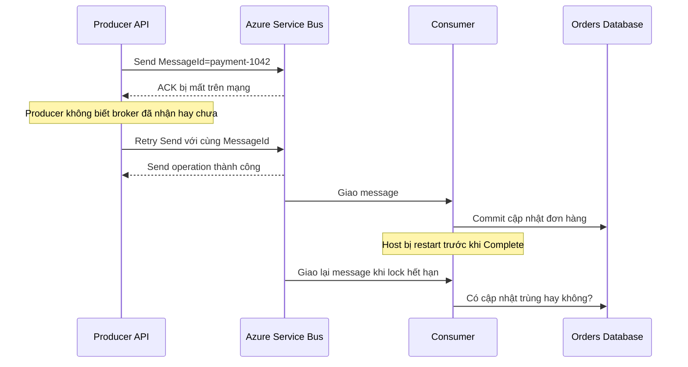
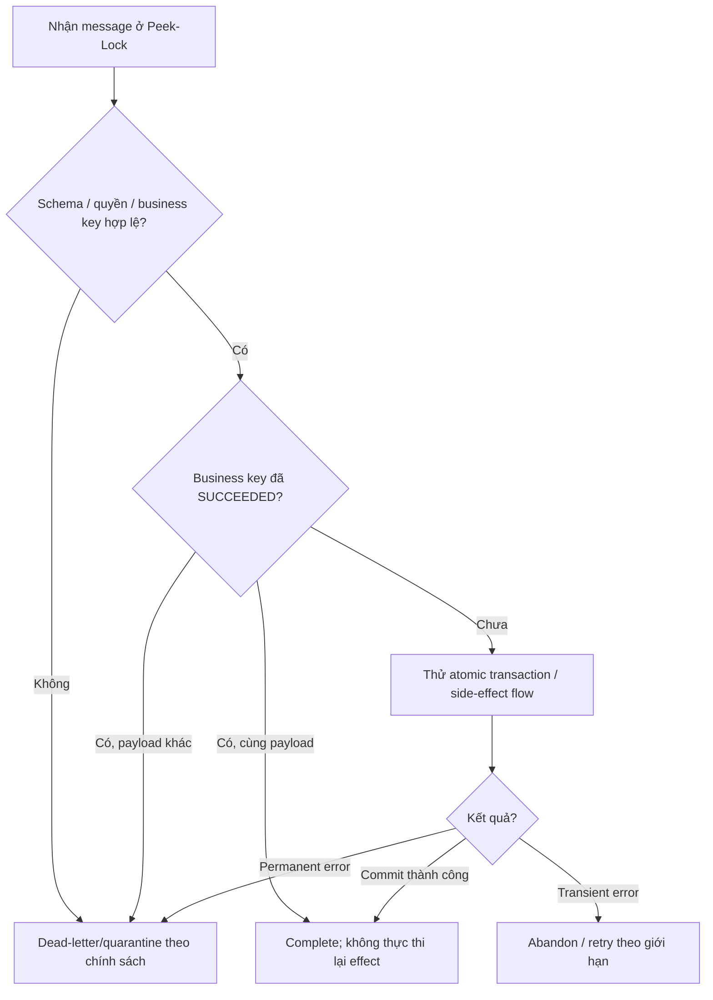
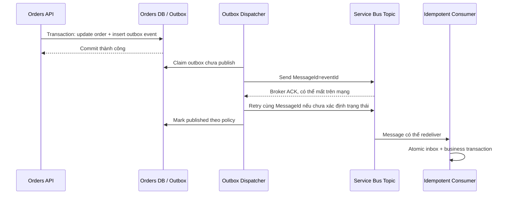

# Duplicate detection và thiết kế consumer idempotent

Trong kiến trúc ứng dụng Microsoft Azure, **hàng đợi và hệ thống thông điệp** giúp tách rời bên tạo công việc (*producer*) với bên xử lý (*consumer*). Ví dụ, một API nhận thanh toán đưa sự kiện `PaymentSucceeded` vào **Azure Service Bus**, còn một worker chạy bằng Azure Functions, Azure Container Apps hoặc VM xử lý đơn hàng ở phía sau. Cơ chế này tăng khả năng chịu tải và cho phép retry khi thành phần tạm thời gặp lỗi. Nhưng chính vì các thành phần hoạt động độc lập, thông điệp có thể được **gửi trùng, giao lại hoặc xử lý lại**, thậm chí khi từng dịch vụ đang hoạt động đúng thiết kế.

Một message trùng có thể dẫn đến **ghi sổ thanh toán hai lần, tạo hai hóa đơn, gửi hai email** hoặc cập nhật dữ liệu theo thứ tự sai. Azure Service Bus có tính năng **duplicate detection** để phát hiện một số lần *gửi* trùng trong một cửa sổ thời gian. Tuy nhiên, nó **không ngăn mọi lần giao lại cùng message cho consumer**, cũng không tạo transaction giữa broker và database. Vì vậy, consumer phải được thiết kế **idempotent**: xử lý lại cùng một công việc không tạo thêm hiệu ứng nghiệp vụ ngoài dự định.

Bài học thuộc chương **Hàng đợi và thông điệp** của mô-đun Azure, kết nối Azure Service Bus, Storage Queue, Event Grid, Event Hubs với Microsoft Entra ID, managed identity, Azure RBAC, Azure SQL/PostgreSQL, Azure Functions, mạng riêng, giám sát và kiểm soát chi phí. Chúng ta sẽ xây dựng tư duy end-to-end: **producer đặt ID ổn định → broker lọc gửi trùng trong giới hạn → consumer ghi nhận công việc bằng thao tác nguyên tử → xác nhận message sau khi commit → khôi phục có kiểm soát khi lỗi**.

## Mục tiêu học tập

Sau bài này, bạn có thể:

1. Phân biệt **gửi trùng (duplicate send)**, **giao lại (redelivery)**, **retry**, **replay** và **cùng nghiệp vụ nhưng khác message ID**.
2. Giải thích cơ chế duplicate detection của **Azure Service Bus** dựa trên `MessageId`, lịch sử phát hiện trùng và các giới hạn của tính năng.
3. Chọn **business identity** thích hợp, tránh nhầm `MessageId`, `SequenceNumber`, `DeliveryCount` và ID của lần gọi Function.
4. Thiết kế consumer idempotent với **unique key, transaction, inbox/dedup store, xử lý đồng thời** và **TTL/retention**.
5. Phân biệt cơ chế xác nhận và redelivery của Service Bus với Storage Queue, Event Grid và Event Hubs.
6. Viết skeleton Java SDK cho producer và consumer sử dụng Microsoft Entra ID/managed identity, xử lý message trong **Peek-Lock mode**.
7. Kết hợp **transactional outbox**, idempotency của dịch vụ đích và reconciliation để xử lý những tác dụng phụ ngoài database.
8. Kiểm thử các điểm crash khó, giám sát DLQ/duplicate rate, bảo vệ quyền và chọn cấu hình tiết kiệm chi phí.

## 1. Vấn đề gốc: gửi thành công nhưng producer không nhận được xác nhận

Giả sử backend đặt hàng gửi message thanh toán qua Service Bus:



Ở đây có **hai** tình huống khác nhau:

- **Gửi trùng:** producer retry lệnh `Send` vì không nhận ACK. Nếu Service Bus entity được bật duplicate detection, `MessageId` trùng và nằm trong cửa sổ lưu lịch sử, broker có thể loại bản gửi trùng.
- **Giao lại:** consumer đã xử lý database nhưng chưa `Complete` message. Khi lock hết hạn hoặc broker cần giao lại, consumer có thể nhận cùng message lần nữa. **Duplicate detection ở phía gửi không ngăn được tình huống này.**

Vì vậy phải phối hợp hai lớp:

```text
Producer                  Broker                    Consumer + Database
businessId ổn định   →   duplicate detection   →   atomic idempotent processing
retry cùng MessageId      chỉ lọc một số Send        nhận redelivery vẫn an toàn
```

**Tiêu chí thành công không phải là consumer chỉ được gọi đúng một lần**, mà là khi xảy ra nhiều lần gọi, **kết quả nghiệp vụ cuối cùng vẫn đúng và không bị nhân đôi**.

## 2. Những dạng trùng lặp cần phân biệt

| Hiện tượng | Ví dụ | Nơi cần xử lý |
|---|---|---|
| **Duplicate send** | Producer gửi lại sau khi timeout ở bước `Send`. | Broker duplicate detection và producer giữ `MessageId` ổn định. |
| **Duplicate delivery** | Message chưa được Complete, lock hết hạn, broker giao lại. | Consumer idempotency và lock/settlement phù hợp. |
| **Duplicate business event** | Hai request khác nhau cùng tạo một lệnh tính phí cho cùng `paymentId`. | Business key/unique constraint; broker không nhận ra nếu ID khác. |
| **Replay có chủ đích** | Quản trị viên chuyển một message từ DLQ về hàng đợi xử lý. | Idempotent consumer, audit và retention. |
| **Out-of-order delivery** | Event `OrderUpdated v3` được xử lý trước `v2`. | Version check, partition/session strategy và state machine. |
| **Concurrent processing** | Hai consumer instances cùng gặp hai messages tương đương. | Atomic claim/unique constraint, không dùng lock RAM. |
| **Retry sau partial success** | Đã ghi database nhưng chưa gửi confirmation/event khác. | Transactional inbox/outbox, provider idempotency và reconciliation. |

Lưu ý **duplicate** khác **hai hành động nghiệp vụ hợp lệ**. Một đơn có thể thanh toán hai đợt với hai `paymentId` khác nhau; dùng mỗi `orderId` làm dedup key sẽ vô tình loại giao dịch thứ hai. Key phải thể hiện đúng **đơn vị công việc cần thực hiện đúng một lần**.

### 2.1. At-most-once, at-least-once và exactly-once effect

**At-most-once delivery** chấp nhận nguy cơ mất công việc để hạn chế giao lại. **At-least-once** ưu tiên không bỏ sót: message có thể được giao nhiều lần cho tới khi xử lý/settlement thành công. Để đạt **một hiệu ứng nghiệp vụ duy nhất**, cần cơ chế transaction/conditional write ở hệ thống đích. Không tuyên bố rằng broker mang lại transaction exactly-once xuyên **Service Bus + Azure SQL + HTTP API** chỉ vì đã bật duplicate detection.

## 3. Azure Service Bus duplicate detection hoạt động thế nào?

**Duplicate detection** là tính năng của Service Bus queue hoặc topic có hỗ trợ. Khi **producer gửi message**, broker có thể ghi nhận `MessageId` (và thông tin partition khi áp dụng) trong một **history time window** đã cấu hình. Nếu một message được gửi tiếp với danh tính phát hiện trùng giống nhau trong cửa sổ đó, broker **chấp nhận thao tác Send ở mức API nhưng không enqueue một bản sao mới** theo cơ chế duplicate detection.

Đặc điểm:

1. Tính năng áp dụng cho **giai đoạn broker nhận message**, không phải việc một message đã nhận được xử lý/settlement ra sao.
2. **Body không phải tiêu chí so sánh nội dung**. Hai messages có ID trùng nhưng payload khác vẫn có thể bị xem là trùng trong cửa sổ — nguy cơ mất một hành động hợp lệ nếu chọn ID sai.
3. Cửa sổ lịch sử có **giới hạn thời gian**. Khi hết cửa sổ, một message dùng lại cùng ID có thể được chấp nhận như message mới.
4. Khi message đã được nhận rồi bị **abandon**, lock hết hạn hoặc cần redelivery, duplicate detection **không xóa quyền giao lại** của broker.
5. Duplicate detection **không biết trạng thái** database, email, thanh toán hoặc những side effects khác.
6. Tính năng có **ảnh hưởng tới throughput/tài nguyên của broker** do cần lưu và tra lịch sử ID, nhất là khi cửa sổ dài và lưu lượng cao.

### 3.1. Tier hỗ trợ và cấu hình cửa sổ

Trong các mô hình Azure Service Bus thông dụng, duplicate detection được cung cấp trên **Standard và Premium**, không phải mọi khả năng của Basic. Cấu hình phải được xem xét **khi tạo queue/topic**; đừng giả định một entity đã triển khai có thể bật/tắt tùy ý bằng lệnh update mà không có giới hạn. Nếu chuyển đổi cấu hình, kiểm tra khả năng hỗ trợ của API/tier và lập kế hoạch migration tương ứng.

**Duplicate detection history time window** thường có mặc định khoảng **10 phút**, có thể cấu hình trong dải được dịch vụ hỗ trợ (thông thường từ **20 giây đến 7 ngày** theo đặc tính Service Bus). Cửa sổ lớn hơn giúp phát hiện những lần gửi trùng đến muộn, nhưng làm tăng công tra cứu và có thể ảnh hưởng throughput. Không chọn 7 ngày chỉ để “an toàn hơn” mà chưa ước lượng số MessageIds cần ghi nhớ và tỷ lệ gửi thực tế.

| Thiết lập | Ưu tiên | Rủi ro cần tính |
|---|---|---|
| Window ngắn, ví dụ 2 phút | Luồng có retry send trong thời gian ngắn. | Retry sau 2 phút không được broker loại nữa. |
| Window vừa, ví dụ 10 phút | Cửa sổ retry tiêu chuẩn của producer. | Vẫn không bảo vệ replay nhiều giờ/ngày. |
| Window dài, ví dụ 24 giờ | Producer có khả năng gửi lại trong một ngày. | Tăng lịch sử ID, cần đánh giá throughput/chi phí/tier. |
| Không bật detection | Tối ưu đơn giản/throughput hoặc nguồn không hỗ trợ. | Producer/consumer tự cần cơ chế dedup phù hợp. |

**Hãy tách cửa sổ broker và retention nghiệp vụ**. Nếu yêu cầu không phát hành trùng hóa đơn suốt bảy năm, không thể dùng cửa sổ duplicate detection 10 phút hay 7 ngày như ledger kiểm toán dài hạn. Cần một **business record/unique key** được quản lý riêng.

### 3.2. MessageId là khóa kỹ thuật nhưng nên bắt nguồn từ nghiệp vụ

Producer thường tự đặt **`MessageId` ổn định** thay vì tạo UUID mới mỗi lần retry cùng một công việc:

```text
Logical operation: issue-invoice / tenant-A / payment-1009
MessageId:        invoice:tenant-A:payment-1009

Send attempt #1 → MessageId giữ nguyên
Send attempt #2 → MessageId giữ nguyên
Send attempt #3 → MessageId giữ nguyên
```

Nếu mỗi attempt tạo một `MessageId` mới, broker không thể biết ba messages đại diện cho cùng một công việc. Đối với một producer thiết kế theo outbox, lưu stable `eventId/MessageId` trong bản ghi outbox, rồi dispatcher sử dụng đúng ID ấy cho mọi lần phát lại.

**Không dùng ID thô có chứa dữ liệu nhạy cảm** (email, số thẻ, token, PII). Có thể dùng định danh nội bộ opaque hoặc hash được thiết kế phù hợp, nhưng phải đảm bảo không vô tình trùng giữa hai nghiệp vụ khác nhau. Với namespace nhiều tenant, bao gồm tenant/scope trong chiến lược ID.

### 3.3. Partitioning, sessions và phạm vi nhận diện trùng

Khi Service Bus entity **có partitioning**, việc xác định trùng có thể dựa trên **cặp `MessageId` + `PartitionKey`** chứ không chỉ `MessageId`. Vì vậy, nếu cùng event được retry với **PartitionKey khác**, broker có thể không coi đó là cùng bản gửi. Khi sử dụng **sessions**, `SessionId` được dùng để nhóm các message và có quan hệ với partitioning key theo những ràng buộc dịch vụ. Producer phải giữ các giá trị session/partition nhất quán cho **cùng logical event**.

```text
Retry lần 1: MessageId=EVT-7, PartitionKey=customer-A
Retry lần 2: MessageId=EVT-7, PartitionKey=customer-A  → có thể bị lọc trùng
Retry lần 3: MessageId=EVT-7, PartitionKey=customer-B  → không nên mặc định bị lọc
```

Quy tắc chính xác còn phụ thuộc loại entity, tier và cấu hình sessions/partitioning. Kiểm tra **đúng entity hiện hữu** thay vì áp kết luận từ một queue không partitioned cho một topic partitioned hoặc session-enabled.

### 3.4. Scheduled messages cũng cần được xem xét

Duplicate detection liên quan cả các message được **lên lịch gửi** theo tính năng Service Bus hỗ trợ. Một scheduled send và một send bình thường dùng cùng danh tính nhận diện trùng trong cửa sổ có thể ảnh hưởng nhau; không nên mặc định cả hai cùng được enqueue thành hai công việc độc lập. Nếu nghiệp vụ thật sự muốn chạy cùng loại thao tác tại **hai mốc thời gian khác nhau**, hãy đặt một logical operation ID riêng cho mỗi kỳ thực thi, ví dụ `report:2026-11-20` và `report:2026-11-21`.

### 3.5. Broker báo Send thành công không chứng minh đã enqueue bản mới

Một send operation trùng `MessageId` được **Service Bus chấp nhận thành công** có thể bị broker bỏ qua, không tạo thêm message trong queue. Vì vậy, producer **không nên suy số messages mới từ số `sendMessage()` không ném lỗi**. Theo dõi business outbox và downstream completion riêng; nếu cần đối chiếu, dùng correlation/billing/ledger theo kiến trúc.

## 4. Cấu hình duplicate detection trên Service Bus queue

### 4.1. Tạo queue trong Azure Portal

Quy trình logic với namespace hỗ trợ duplicate detection:

1. Chọn đúng **subscription**, **resource group** và **Service Bus namespace** (ví dụ Standard hoặc Premium).
2. Trong **Queues**, chọn tạo queue mới, ví dụ `orders-paid`.
3. Trong phần thiết lập nâng cao, bật **Duplicate detection** nếu tính năng được hiển thị và hỗ trợ.
4. Chọn **Duplicate detection history time window**, ví dụ 10 phút, dựa trên thời gian retry của producer.
5. Chọn `Max delivery count`, `Lock duration`, `Message TTL`, sessions/partitioning phù hợp với workload và yêu cầu consistency.
6. Tạo queue và đọc lại cấu hình. Không tự ý thay cấu hình queue production đang dùng chung vì nó có thể làm thay đổi cách xử lý các messages hợp lệ.

Nhãn giao diện và các tùy chọn có thể thay đổi. Nếu entity hiện hữu không thể bật duplicate detection theo API/tier/cấu hình, thiết kế **queue mới và migration producer/consumer có kiểm soát** thay vì xóa queue đang chứa dữ liệu.

### 4.2. Bicep minh họa cấu hình trên queue mới

Ví dụ Bicep cho **queue mới** trong một namespace Service Bus đã tồn tại. Đây là cấu hình tham khảo và cần điều chỉnh API version, quyền triển khai, thuộc tính hợp lệ theo môi trường trước khi dùng:

```bicep
param serviceBusNamespaceName string
param queueName string = 'orders-paid'

resource existingNamespace 'Microsoft.ServiceBus/namespaces@2022-10-01-preview' existing = {
  name: serviceBusNamespaceName
}

resource ordersQueue 'Microsoft.ServiceBus/namespaces/queues@2022-10-01-preview' = {
  parent: existingNamespace
  name: queueName
  properties: {
    requiresDuplicateDetection: true
    duplicateDetectionHistoryTimeWindow: 'PT10M'
    maxDeliveryCount: 10
    lockDuration: 'PT1M'
    defaultMessageTimeToLive: 'P7D'
  }
}
```

Ở đây `PT10M` là 10 phút, `PT1M` là 1 phút và `P7D` là bảy ngày theo dạng duration tương ứng. **TTL của message** và **history window của duplicate detection** là **hai chính sách khác nhau**: một cái quyết định vòng đời message, cái kia quyết định broker ghi nhớ ID gửi trùng trong bao lâu. Không được dùng TTL để suy ra dedup retention.

Nếu hạ tầng triển khai dùng Terraform/ARM/Portal, mục tiêu vẫn giống nhau: **enable duplicate detection ở nơi hỗ trợ, đặt cửa sổ, xác minh entity thật, kiểm thử retry và theo dõi kết quả**.

### 4.3. Đọc lại cấu hình bằng Azure CLI

```bash
az login
az account set --subscription '<subscription-id>'

RG='rg-messaging-lab'
SB_NAMESPACE='sb-orders-lab'
QUEUE='orders-paid'

az servicebus queue show \
  --resource-group "$RG" \
  --namespace-name "$SB_NAMESPACE" \
  --name "$QUEUE" \
  --output json
```

Đọc các thuộc tính của queue như `requiresDuplicateDetection`, `duplicateDetectionHistoryTimeWindow`, `maxDeliveryCount`, `lockDuration` theo schema CLI/API thực tế. **Không chỉ đọc tên queue rồi cho rằng detection đang bật**. Thực hành CLI này chỉ đọc metadata và không gửi/nhận message.

## 5. Lựa chọn MessageId và business key đúng

Thiết kế định danh là một trong những quyết định quan trọng nhất: broker chỉ biết message ID theo giao thức, trong khi doanh nghiệp cần biết **một tác dụng duy nhất** là gì.

| Công việc | MessageId đề xuất | Consumer dedup key | Cảnh báo |
|---|---|---|---|
| Thanh toán thành công | `payment:<paymentId>:confirmed` | `(tenantId, paymentId, eventType)` | Một order có thể chứa nhiều giao dịch hợp lệ. |
| Xuất hóa đơn | `invoice:<tenantId>:<invoiceId>` | `(tenantId, invoiceId)` | Invoice ID phải ổn định khi producer retry. |
| Ảnh được tải lên | `image:<blobVersion>:thumb-v2` | `(storageAccount, blobVersion, transformVersion)` | Cùng path với ETag mới là phiên bản mới, không nên bỏ qua. |
| Đồng bộ danh mục | `catalog:<source>:<batchId>` | `(source, batchId)` | Hai batch khác nhau không bị coi là duplicate. |
| Báo cáo theo ngày | `report:<tenantId>:<date>:v1` | `(tenantId, reportType, date, reportVersion)` | Backfill hoặc report version mới có thể là công việc hợp lệ. |

### 5.1. Không nhầm với SequenceNumber và DeliveryCount

- `MessageId`: ID được producer cung cấp/dùng cho broker duplicate detection theo cấu hình.
- `SequenceNumber`: metadata do broker cấp khi message được nhận vào entity; hữu ích cho tracing, **không thay thế business ID**.
- `DeliveryCount`: đếm các lần giao theo semantics của Service Bus; hỗ trợ theo dõi retries/lock, **không dùng làm khóa idempotency**.
- `LockToken`: liên quan quyền settlement trong một lần nhận Peek-Lock; **có thể thay đổi giữa deliveries**.
- `CorrelationId`: nối những bước trong một workflow; thường không duy nhất cho từng logical operation.
- `SessionId`: nhóm các messages có liên quan theo session; không phải ID duy nhất của một event.

Nếu producer gửi hai message IDs khác nhau nhưng chứa cùng `paymentId`, duplicate detection của broker sẽ không nhận ra cùng nghiệp vụ. Consumer phải có **unique business key** độc lập với metadata vận chuyển.

### 5.2. Payload fingerprint để phát hiện reuse key sai

Nếu hai messages cùng `MessageId` nhưng một message có `amount=100000` còn message sau có `amount=200000`, broker có thể bỏ bản thứ hai mà không so body. Đây là lỗi thiết kế ID nghiêm trọng: hai nghiệp vụ khác nhau có thể mất dữ liệu. Producer cần bảo đảm mỗi logical ID ánh xạ tới một **payload bất biến theo contract**, hoặc lưu **canonical payload hash** tại kho nghiệp vụ/outbox và từ chối reuse cùng key cho payload khác. Nếu điều chỉnh nghiệp vụ, phát hành một event/version mới thay vì lạm dụng ID cũ.

## 6. So sánh Service Bus với Storage Queue, Event Grid và Event Hubs

Cùng là nền tảng messaging/eventing Azure nhưng các dịch vụ có mục đích và semantics khác nhau. **Không được lấy tính năng duplicate detection của Service Bus để suy ra Storage Queue cũng có tính năng ấy.**

| Dịch vụ | Nhu cầu thường gặp | Duplicate detection ở broker | Vì sao vẫn cần idempotent consumer? |
|---|---|---|---|
| **Azure Service Bus Queue** | Lệnh nghiệp vụ, hàng đợi xử lý đáng tin cậy, sessions, DLQ, transactions trong phạm vi hỗ trợ. | Có tính năng tùy tier/cấu hình, theo ID và history window. | Message có thể redeliver nếu Complete thất bại hoặc lock hết hạn. |
| **Service Bus Topic/Subscription** | Fan-out sự kiện tới nhiều nhóm subscriber. | Detection ở phía **topic** theo cấu hình; mỗi subscription vẫn có delivery/settlement riêng. | Các subscriber độc lập, có thể retry/replay; mỗi subscriber cần dedup business effect của mình. |
| **Azure Storage Queue** | Hàng đợi đơn giản, xử lý bất đồng bộ chi phí thấp. | Không có tính năng broker duplicate detection tương đương Service Bus `requiresDuplicateDetection`. | Visibility timeout, retry, producer gửi lại và worker restart đều có thể dẫn tới trùng. |
| **Azure Event Grid** | Phát sự kiện tài nguyên, routing và fan-out sự kiện. | Không xem là bộ lọc MessageId giống Service Bus. | Delivery at-least-once và khả năng event đến lại/không đúng thứ tự. |
| **Azure Event Hubs** | Ingest luồng dữ liệu khối lượng lớn, consumer groups/partitions. | Không nên coi là queue có dedup broker theo MessageId. | Checkpoint replay, rebalance, xử lý nhiều partitions và trùng nghiệp vụ. |

### 6.1. Service Bus Topics và Subscriptions

Một producer gửi `OrderPaid` vào **topic**. Một subscription cho fulfillment và một subscription cho accounting đều có thể nhận bản sao logical event. Đây là **fan-out có chủ đích**, không phải duplicate cần bị loại giữa hai consumer groups. Mỗi subscriber nên có inbox key theo phạm vi consumer của mình, ví dụ `(subscriberName, eventId)`, nếu các subscriptions cùng ghi chung một kho dedup.

Nếu accounting đã xử lý event nhưng fulfillment chưa xử lý, việc accounting đánh dấu `eventId` trong một bảng global không nên khiến fulfillment bỏ qua công việc. Chọn **đơn vị idempotency phù hợp với mỗi hiệu ứng nghiệp vụ**, không tạo một khóa global vô tình chặn nhiều xử lý hợp lệ.

### 6.2. Storage Queue: visibility timeout và poison queue

Với Storage Queue, message có thể tạm ẩn sau khi worker lấy ra. Nếu worker không xóa đúng message bằng pop receipt khi hoàn tất hoặc visibility timeout hết hạn, message có thể trở lại. Khi dùng **Azure Functions Queue trigger**, extension có thể thực hiện retries và chuyển message sang **poison queue** theo `maxDequeueCount`. Việc đó **không thay thế** tính nguyên tử của cập nhật business data.

Một ứng dụng dùng Storage Queue có thể tự thiết kế dedup theo `businessOperationId` trong database/Blob metadata. Đừng chọn Service Bus chỉ vì nghe nói Storage Queue không “đảm bảo không trùng”: ngay cả khi Service Bus có duplicate detection, consumer của cả hai vẫn phải an toàn trước redelivery.

### 6.3. Event Grid và Event Hubs

**Event Grid:** có thể gửi lại event trong cơ chế retry delivery, và nhiều events của cùng resource không nhất thiết đến theo thứ tự tạo. Consumer xử lý Blob nên cân nhắc **event ID + Blob ETag/version**, so sánh trạng thái hiện tại và tránh ghi đè kết quả mới bằng event cũ.

**Event Hubs:** một consumer đọc partition offsets; khi checkpoint chưa cập nhật hoặc partition rebalance, batch có thể được đọc lại. Consumer phải ghi kết quả idempotent và quản lý version/watermark phù hợp, nhất là khi các events từ nhiều partitions có thể xuất hiện không theo tổng thứ tự mong muốn.

### 6.4. Sessions có giúp exactly-once không?

**Service Bus Sessions** hỗ trợ gom messages liên quan và xử lý có thứ tự trong phạm vi một session theo cơ chế broker. Nó hữu ích với đơn hàng cần chuỗi `Created → Paid → Shipped`. Tuy nhiên, session ordering **không xóa bỏ** duplicate sends, redelivery sau lock loss hay việc cập nhật database hai lần. Một session-enabled consumer vẫn cần idempotency key và kiểm tra **business version/state transition** trước khi commit.

## 7. Định nghĩa consumer idempotent theo hiệu ứng nghiệp vụ

**Idempotent consumer** là consumer có thể nhận cùng logical message hơn một lần mà hiệu ứng cuối cùng vẫn phù hợp với nghiệp vụ. Mục tiêu thường là:

\[
apply(m, apply(m, state)) = apply(m, state)
\]

Đây là mô hình khái niệm: việc nhận hai lần không thay đổi kết quả so với nhận một lần. Với side effects như email, payment gateway hoặc gọi API đối tác, cần hợp đồng riêng ở từng hệ thống đích. Không mặc định chỉ cần thêm `if (processed)` là đã an toàn trước xử lý đồng thời.

### 7.1. Ví dụ an toàn và không an toàn

```sql
-- Không idempotent nếu message bị nhận lại:
UPDATE accounts
SET balance = balance + 100000
WHERE account_id = 'ACC-8';

-- Có thể giữ trạng thái ổn định khi chạy lại:
UPDATE orders
SET payment_status = 'PAID'
WHERE order_id = 'ORD-1042' AND payment_status = 'PENDING';
```

Câu `UPDATE orders` thứ hai **chỉ là một phần** của idempotency: nếu mỗi lần chạy còn `INSERT ledger_entry`, `sendEmail()` hoặc `publishInvoice()` thì workflow vẫn có thể tạo trùng. Và nếu có nhiều giao dịch thanh toán hợp lệ cho một order, dùng `orderId` làm khóa duy nhất cho **payment charge** sẽ sai. Hãy định danh riêng payment, invoice, shipment và email notification theo hợp đồng của chúng.

### 7.2. Yêu cầu thiết kế cơ bản

Một consumer đáng tin cậy thường cần:

1. **Stable business key:** cùng logical operation giữ cùng ID qua retries/replay.
2. **Durable state:** lưu đã xử lý ở database/kho bền vững, không chỉ trong RAM của worker.
3. **Atomic claim/commit:** hai consumer đồng thời không cùng tuyên bố thắng.
4. **Transaction boundary:** đánh dấu đã xử lý và thay đổi business data nằm trong cùng transaction nếu có thể.
5. **Explicit state machine:** xử lý `PENDING`, `PROCESSING`, `SUCCEEDED`, `FAILED` theo điều kiện.
6. **Recovery path:** nếu worker crash hoặc lock expire, trạng thái có thể tiếp tục mà không tạo effect sai.
7. **Observability:** nhận ra duplicate đã bỏ qua, event conflict và công việc bị kẹt.

### 7.3. Vì sao kiểm tra rồi ghi là chưa đủ?

Một cách sai phổ biến:

```text
if not database.exists(eventId):
    chargeCustomer()
    database.insertProcessed(eventId)
```

Nếu hai instances cùng `exists(eventId) == false`, cả hai đều `chargeCustomer()` trước khi một bản ghi processed được thêm. Thậm chí với **một** worker, crash sau `chargeCustomer()` nhưng trước `insertProcessed()` làm lần retry gọi charge lần nữa. Cần **unique constraint/conditional write** và thiết kế atomicity ở đúng nơi side effect diễn ra.

## 8. Inbox pattern: consumer ghi nhận một event đúng một lần

**Inbox** là bảng/kho lưu các event đã được áp dụng cho một consumer effect. Một cách mạnh với database quan hệ là đưa **claim event và cập nhật nghiệp vụ vào cùng transaction**.

### 8.1. SQL schema minh họa cho PostgreSQL

```sql
CREATE TABLE consumer_inbox (
    consumer_name text        NOT NULL,
    tenant_id     text        NOT NULL,
    event_id      text        NOT NULL,
    payload_hash  text        NOT NULL,
    processed_at  timestamptz NOT NULL DEFAULT now(),
    PRIMARY KEY (consumer_name, tenant_id, event_id)
);

CREATE TABLE orders (
    tenant_id      text NOT NULL,
    order_id       text NOT NULL,
    payment_status text NOT NULL,
    PRIMARY KEY (tenant_id, order_id)
);

CREATE TABLE order_ledger (
    tenant_id   text        NOT NULL,
    payment_id  text        NOT NULL,
    order_id    text        NOT NULL,
    amount_vnd  bigint      NOT NULL,
    created_at  timestamptz NOT NULL DEFAULT now(),
    PRIMARY KEY (tenant_id, payment_id)
);
```

`consumer_name` là phạm vi tác dụng nghiệp vụ, ví dụ `accounting` hoặc `fulfillment`; nó giúp hai nhóm subscriber xử lý cùng event mà không chặn nhau. `payload_hash` giúp phát hiện cùng `event_id` nhưng payload không tương thích. **Payment ledger** có unique key theo `payment_id`, tăng lớp bảo vệ trước lỗi publish ID khác nhau cho cùng giao dịch.

### 8.2. Transaction mẫu

```sql
BEGIN;

INSERT INTO consumer_inbox
    (consumer_name, tenant_id, event_id, payload_hash)
VALUES
    (:consumer, :tenantId, :eventId, :payloadHash)
ON CONFLICT DO NOTHING
RETURNING event_id;

-- CHỈ khi INSERT trả về một dòng mới, application mới thực hiện:
INSERT INTO order_ledger (tenant_id, payment_id, order_id, amount_vnd)
VALUES (:tenantId, :paymentId, :orderId, :amountVnd);

UPDATE orders
SET payment_status = 'PAID'
WHERE tenant_id = :tenantId
  AND order_id = :orderId
  AND payment_status = 'PENDING';

COMMIT;
```

Đây là **chuỗi lệnh được điều khiển từ application**, **không phải SQL script có `IF` tự chạy**. Application **phải kiểm tra `RETURNING`** và chỉ thực hiện hai câu lệnh nghiệp vụ khi đã claim một event mới. Nếu `INSERT ... ON CONFLICT DO NOTHING` không trả dòng, hãy đọc bản ghi đã có để so `payload_hash`: trùng cả key và nội dung phù hợp thì return `ALREADY_PROCESSED`; trùng key nhưng payload khác phải báo **identity conflict** để điều tra, không âm thầm coi như thành công.

**Quan trọng:** nếu order không tồn tại, status không cho phép chuyển trạng thái hoặc ledger insert thất bại, transaction phải **rollback** (hoặc thực hiện nhánh nghiệp vụ đã thiết kế) thay vì commit inbox và làm mất cơ hội xử lý lại. Chỉ `COMMIT` khi các business invariants đã được kiểm tra.

### 8.3. Điều gì xảy ra khi hai consumers cạnh tranh?

Hai Function instances cùng nhận logical event `EVT-7`. Cả hai cố gắng INSERT cùng unique key. Theo semantics của database, chỉ **một transaction** có thể ghi thành công bản ghi khóa đó. Instance còn lại sẽ gặp conflict/chờ kết quả commit rồi trả `ALREADY_PROCESSED`, không thực hiện nghiệp vụ lần thứ hai.

| Thời điểm lỗi | Trạng thái inbox + business data | Hành vi retry mong đợi |
|---|---|---|
| Trước `BEGIN` | Chưa thay đổi. | Làm lại từ đầu. |
| Sau INSERT inbox nhưng trước COMMIT | Transaction chưa commit, rollback khi connection mất. | Có thể claim lại và áp dụng nghiệp vụ. |
| Sau cả inbox/ledger/order COMMIT nhưng trước Service Bus Complete | Các hiệu ứng DB đã commit. | Consumer nhận lại, phát hiện inbox rồi Complete an toàn. |
| Hai workers cùng claim | Unique constraint phân xử. | Một worker xử lý; worker còn lại bỏ qua đúng event. |
| Trùng key nhưng payload khác | Có thể là bug producer hoặc xung đột danh tính. | Báo conflict, không coi là cùng nghiệp vụ hợp lệ. |

### 8.4. Claim cho công việc dài

Nếu processing kéo dài hàng phút/giờ và không nên giữ database transaction mở, có thể dùng state machine:

```text
PENDING --atomic claim--> PROCESSING(leaseOwner, leaseUntil, version)
PROCESSING --valid owner commit--> SUCCEEDED
PROCESSING --transient error--> RETRYABLE_FAILURE/PENDING
PROCESSING --lease expired--> worker mới claim với version mới
PROCESSING --permanent error--> FAILED_REQUIRES_REVIEW
```

Claim phải **atomic**, có **lease expiry**, cập nhật trạng thái bằng **compare-and-set/fencing token** để worker cũ không ghi đè kết quả sau khi lease hết hạn. Nếu side effect ngoài database đã được thực hiện, cần provider idempotency hoặc reconciliation; lease của inbox **không tự làm external API atomically idempotent**.

## 9. Consumer message settlement: Complete, Abandon, DeadLetter và lock

Với Service Bus **Peek-Lock receive mode**, broker giao một message đang bị khóa trong thời gian giới hạn. Consumer phải quyết định settlement dựa trên kết quả xử lý:

| Hành động | Khi nào nên dùng | Rủi ro cần xem |
|---|---|---|
| **Complete** | Đã xử lý bền vững, hoặc xác nhận logical event là duplicate đã xử lý an toàn. | Complete trước commit có thể làm mất công việc nếu DB lỗi sau đó. |
| **Abandon** | Lỗi tạm thời và muốn message có thể được giao lại. | Có thể redeliver sớm, tạo retry storm nếu dependency vẫn lỗi. |
| **DeadLetter** | Message không thể xử lý sau đánh giá lỗi/giới hạn theo chính sách. | Cần lưu nguyên nhân, quyền đọc DLQ và quy trình sửa/replay. |
| **Defer** | Chủ động hoãn xử lý message theo workflow có cơ chế nhận deferred message phù hợp. | Deferred message cần quản lý sequence number/thu hồi; không phải lựa chọn mặc định để retry bất kỳ lỗi nào. |

**`ReceiveAndDelete` không phù hợp với nhiều công việc quan trọng**: broker xóa khi nhận theo semantics mode, nên host crash sau receive nhưng trước commit có thể làm mất công việc. Peek-Lock cùng idempotent processing thường phù hợp hơn khi cần chống mất dữ liệu, nhưng cần quản trị lock expiry và retries.

### 9.1. Lock duration và auto-lock renewal

Giả sử message có lock duration 60 giây nhưng công việc đôi lúc mất ba phút. Nếu không có cơ chế **auto-renew lock** được SDK/trigger hỗ trợ và cấu hình phù hợp, lock có thể hết hạn khi worker chưa hoàn tất. Broker giao lại message cho worker khác; worker đầu có thể tiếp tục chạy nhưng `Complete` thất bại do lock bị mất. Cần kết hợp:

- Chọn thời gian thực thi và lock renewal phù hợp với workload và giới hạn dịch vụ.
- Giảm thời gian xử lý một message qua batching/chia việc nếu quá dài.
- Có idempotency và atomic claim vì **lock renewal không bao giờ thay thế chống trùng**.
- Cẩn trọng khi scale-in/restart vì worker có thể bị dừng giữa xử lý.

### 9.2. `MaxDeliveryCount` và DLQ

Khi message liên tục bị giao lại và vượt giới hạn delivery count được cấu hình cho entity, Service Bus có thể chuyển message vào **dead-letter subqueue** với lý do phù hợp như `MaxDeliveryCountExceeded`. Đừng mặc định message được retry với exponential backoff chỉ vì có `MaxDeliveryCount`: thời gian retry còn phụ thuộc handler, settlement, lock và chính sách upstream.

**DLQ không phải hàng đợi “thành công muộn”.** Nó cần dashboard, cảnh báo, người sở hữu, quyền truy cập, thủ tục phân loại lỗi và replay có audit. Trước khi replay, sửa nguyên nhân vĩnh viễn và giữ business key ổn định để tránh tạo side effects mới không mong đợi.

### 9.3. Phân loại lỗi và quyết định settlement



Sơ đồ là **logic thiết kế**, không phải một trình tự tự động có sẵn của SDK. Với trigger tự động settlement (ví dụ cấu hình mặc định của một số Azure Functions Service Bus extension), **không tự gọi settlement lần nữa nếu runtime đang quản lý nó**. Khi dùng SDK và tắt auto-complete, consumer phải gọi Complete/Abandon/DeadLetter theo policy.

## 10. Producer và consumer Java với Azure Service Bus SDK

Ví dụ sử dụng **Azure SDK for Java** trong một background worker chạy trên Azure Functions/Container Apps/App Service/VM tùy mô hình vận hành. `DefaultAzureCredential` có thể lấy token từ managed identity khi chạy trên Azure, hoặc từ credential phù hợp trong môi trường phát triển. Mã minh họa **không tự tạo namespace/queue** và không ghi secrets vào source.

### 10.1. Dependency và quyền truy cập

```text
com.azure:azure-messaging-servicebus
com.azure:azure-identity
```

Các thư viện cần được khai báo bằng Maven/Gradle và quản lý phiên bản tương thích với Azure SDK BOM khi phù hợp. Worker identity phải có **Azure Service Bus Data Sender** để gửi, **Azure Service Bus Data Receiver** để nhận/settle theo phạm vi được phép. Role management plane như `Reader`/`Contributor` không tự đồng nghĩa có quyền gửi/nhận dữ liệu broker. Cần network/DNS/Private Endpoint cho namespace nếu bị giới hạn truy cập.

### 10.2. Java producer: dùng cùng MessageId khi retry

```java
import com.azure.identity.DefaultAzureCredentialBuilder;
import com.azure.messaging.servicebus.ServiceBusClientBuilder;
import com.azure.messaging.servicebus.ServiceBusMessage;
import com.azure.messaging.servicebus.ServiceBusSenderClient;

public class PaymentEventProducer {
    public static void main(String[] args) {
        String namespace = "<namespace>.servicebus.windows.net";

        try (ServiceBusSenderClient sender = new ServiceBusClientBuilder()
                .credential(namespace, new DefaultAzureCredentialBuilder().build())
                .sender()
                .queueName("orders-paid")
                .buildClient()) {

            String eventId = "payment:tenant-A:payment-1009:confirmed";
            String json = "{\"tenantId\":\"tenant-A\",\"paymentId\":\"payment-1009\"}";

            ServiceBusMessage msg = new ServiceBusMessage(json);
            msg.setMessageId(eventId); // Không sinh ID mới cho retry của cùng event.
            msg.setContentType("application/json");
            msg.setCorrelationId("order-1042");

            sender.sendMessage(msg);
        }
    }
}
```

Nếu `sendMessage` timeout sau khi broker đã nhận, một retry cần sử dụng **cùng `eventId` và payload tương đương**. Đoạn mã trên không tự retry, chỉ thể hiện cách đặt `MessageId` và cách gửi. Trong production, dùng Azure SDK retry policy có giới hạn, lưu outbox event ID bền vững và chỉ đánh dấu published khi có kết quả chắc chắn theo chính sách.

**Chú ý:** `.credential(namespace, credential)` sử dụng định danh namespace đầy đủ và token từ Entra ID. Với tenant, network hoặc service principal không được cấp quyền, thao tác gửi sẽ thất bại dù Java compile thành công. Không sửa lỗi 403 bằng cách đưa Shared Access Key rộng quyền vào code nếu có thể cấp RBAC đúng scope.

### 10.3. Java consumer: Complete sau khi commit

```java
import com.azure.identity.DefaultAzureCredentialBuilder;
import com.azure.messaging.servicebus.ServiceBusClientBuilder;
import com.azure.messaging.servicebus.ServiceBusProcessorClient;

public final class PaymentEventConsumer {
    public static void main(String[] args) {
        String namespace = "<namespace>.servicebus.windows.net";

        ServiceBusProcessorClient processor = new ServiceBusClientBuilder()
                .credential(namespace, new DefaultAzureCredentialBuilder().build())
                .processor()
                .queueName("orders-paid")
                .disableAutoComplete()
                .processMessage(context -> {
                    var msg = context.getMessage();
                    try {
                        String json = msg.getBody().toString();
                        // service này phải kiểm tra business key + payload hash,
                        // INSERT inbox, UPDATE business state trong cùng transaction.
                        PaymentService.applyOnce(json);

                        // Kể cả duplicate đã xử lý, Complete là an toàn
                        // SAU KHI service đã xác minh durable state.
                        context.complete();
                    } catch (Exception ex) {
                        // Ví dụ đơn giản: transient failure -> cho broker giao lại.
                        // Production: phân loại permanent vs transient và có DLQ.
                        System.err.println("Processing failed: " + ex.getClass().getSimpleName());
                        context.abandon();
                    }
                })
                .processError(errorContext ->
                    System.err.println("Service Bus consumer error: "
                            + errorContext.getException().getClass().getSimpleName()))
                .buildProcessorClient();

        processor.start();
        Runtime.getRuntime().addShutdownHook(new Thread(processor::close));
        // Trong worker thực tế cần giữ tiến trình sống và quản lý graceful shutdown.
    }
}
```

`PaymentService.applyOnce(json)` là **service nghiệp vụ phải tự hiện thực** theo transaction ở mục 8. Nếu message được xác nhận là `ALREADY_PROCESSED`, service trả về an toàn rồi `Complete`. Với lỗi **vĩnh viễn**, production nên dùng DLQ/quarantine thay vì cứ `abandon()`; ví dụ rút gọn không phân loại lỗi để tập trung vào vị trí commit/Complete.

**Đặc biệt:** `abandon()` có thể làm message được giao lại rất nhanh. Không xây retry loop không giới hạn khi database đang outage hoặc payload sai schema; cân nhắc retry budget, lock renewal, backoff phù hợp và MaxDeliveryCount/DLQ. Trong code production phải xử lý trường hợp **settlement cũng thất bại** (lock lost) mà không tạo side effect mới. Không log toàn bộ raw message, tokens hoặc PII.

### 10.4. Hàm applyOnce tối thiểu phải bảo vệ gì?

Pseudocode sau phản ánh trách nhiệm mà đoạn Java SDK không thể tự đảm bảo:

```text
function applyOnce(json):
    input = validateAndParse(json)
    businessKey = ("accounting", input.tenantId, input.eventId)
    payloadHash = canonicalFingerprint(input)

    beginTransaction()
    inserted = insertInboxIfAbsent(businessKey, payloadHash) // atomic

    if not inserted:
        stored = readExistingInbox(businessKey)
        if stored.payloadHash != payloadHash:
            rollback()
            throw PermanentIdentityConflict()
        commitOrRollbackReadOnly()
        return ALREADY_PROCESSED

    assertBusinessTransitionIsValid(input)
    insertLedgerEntryWithUniquePaymentId(input)
    updateOrderConditionally(input)
    insertOutboxEventIfNeeded(input)
    commitTransaction()
    return PROCESSED
```

**Kiểm chứng bằng test đồng thời**: hai instances cùng gọi `applyOnce` với cùng key phải tạo đúng một ledger entry. Nếu test chỉ gửi lần lượt hai messages, nó chưa chứng minh code an toàn trước race condition.

## 11. Transactional outbox: producer không làm mất event khi database đã commit

Duplicate detection và inbox bảo vệ những trường hợp trùng ở đầu vào, nhưng **producer cũng phải ngăn mất event**. Ví dụ API cập nhật một đơn hàng thành `PAID` rồi gửi message `ShipOrder`. Nếu nó crash sau database commit và trước Service Bus send, kho hàng không nhận được lệnh vận chuyển. Nếu gửi message trước database commit, message có thể đến khi đơn hàng cuối cùng không được lưu thành công.

**Transactional outbox** dùng một bảng lưu event cần phát trong **cùng transaction** với thay đổi nghiệp vụ. Dispatcher gửi messages từ outbox sau khi transaction commit. Mỗi event có ID ổn định, dùng làm `MessageId` cho những lần retry send.



### 11.1. Outbox schema minh họa

```sql
CREATE TABLE outbox_events (
    event_id       text        PRIMARY KEY,
    aggregate_id   text        NOT NULL,
    event_type     text        NOT NULL,
    payload_json   jsonb       NOT NULL,
    created_at     timestamptz NOT NULL DEFAULT now(),
    published_at   timestamptz,
    publish_tries  integer     NOT NULL DEFAULT 0
);
```

Trong transaction tạo lệnh xuất kho, thêm bản ghi outbox có `event_id` cố định. Dispatcher dùng chính `event_id` làm Service Bus `MessageId`, không tạo random UUID mới mỗi lần retry. Với nhiều dispatchers, phải **claim rows atomically** (row lock/lease/version theo database) để tránh cùng xử lý liên tục. Tuy nhiên, ngay cả khi chỉ có một dispatcher, vẫn có khoảng trống giữa broker ACK và việc update `published_at`.

### 11.2. Broker detection + outbox + inbox phối hợp thế nào?

| Lớp | Bảo vệ điều gì? | Không bảo vệ điều gì? |
|---|---|---|
| **Outbox ở producer** | Không bỏ quên phát event khi database thay đổi đã commit. | Dispatcher vẫn có thể phát lại. |
| **Service Bus duplicate detection** | Lọc một số lần Send trùng `MessageId` trong history window. | Redelivery, các sends ngoài window hoặc message khác ID cùng nghiệp vụ. |
| **Inbox/unique key ở consumer** | Ngăn business effect bị commit hai lần theo khóa và transaction. | External side effects không trong transaction; duplicate key chọn sai. |
| **Reconciliation/compensation** | Phát hiện/sửa trạng thái lệch giữa nhiều hệ thống. | Không biến mọi API call thành transaction toàn cục. |

**Đừng chọn một lớp thay cho tất cả lớp còn lại.** Với dữ liệu quan trọng, mô hình này giúp đạt “at-least-once transport, effectively-once business effect” theo phạm vi định nghĩa, chứ không phải hứa rằng toàn bộ message chỉ tồn tại một lần trên mọi dịch vụ.

## 12. Side effects bên ngoài database: email, Blob và thanh toán

Một transaction SQL chỉ nguyên tử **trong database đó**. Nếu consumer vừa cập nhật SQL vừa gửi email hoặc gọi một cổng thanh toán, những hệ thống bên ngoài không tự commit/rollback cùng transaction.

### 12.1. Gọi payment API với idempotency key

Một số payment providers cung cấp `Idempotency-Key` hoặc trường transaction reference được xử lý idempotently. Consumer nên gửi **cùng payment operation ID** cho mọi lần retry, tra trạng thái khi kết quả không xác định và không tạo một yêu cầu thanh toán mới chỉ vì HTTP timeout. Nếu provider không hỗ trợ cơ chế này, cần **reconciliation/compensation**, giới hạn rủi ro và quy trình vận hành thủ công.

Ví dụ trạng thái dễ gặp:

```text
Consumer -> Payment API: Charge paymentId=PAY-1009
Payment API: thực hiện charge thành công
Network: response bị mất
Consumer: không biết charge thành công chưa
```

Nếu consumer lập tức dùng `PAY-1010` để thử lại, có thể tạo charge thứ hai. Hành vi an toàn hơn là truy vấn/trial với **cùng `PAY-1009`** theo hợp đồng provider, hoặc đưa vào xử lý trạng thái không xác định trước khi phát sinh tác dụng phụ mới.

### 12.2. Ghi Blob bằng ETag hoặc conditional create

Nếu consumer tạo thumbnail, có thể dùng tên đầu ra ổn định theo `blobVersion + transformationVersion` và sử dụng **conditional upload**, `If-None-Match` hoặc ETag theo API hỗ trợ, thay vì ghi đè mù quáng. Nếu một worker đã tạo thành phẩm, worker khác có thể đọc metadata/checksum để xác nhận kết quả đã có và return `ALREADY_PROCESSED`.

Không coi “cùng tên file” là đủ nếu đầu vào được cập nhật: một blob path có thể chứa **phiên bản dữ liệu mới**. Key nên bao gồm ETag/version ID hoặc revision nghiệp vụ phù hợp.

### 12.3. Gửi email và thông báo

Nhiều dịch vụ gửi email không cung cấp exactly-once semantics toàn cục cho mọi lỗi mạng. Có thể sử dụng một **notification ID** ổn định, outbox event, trạng thái `PENDING/SENT/UNKNOWN` và provider-side idempotency khi hỗ trợ. Nếu response bị mất sau khi đã gửi, hệ thống phải biết khả năng **gửi trùng** và cân nhắc lookup/reconciliation thay vì retry mù quáng.

### 12.4. Khi công việc cần nhiều bước: saga

Ví dụ xử lý đơn hàng gồm giữ tồn kho, trừ tiền, tạo vận đơn. Nếu bước cuối thất bại vĩnh viễn, một **saga** có thể cần gửi command hoàn tiền/hủy giữ chỗ. Các compensation commands **cũng phải idempotent**. Khi workflow phức tạp, có thể đánh giá Durable Functions hoặc một orchestrator được hỗ trợ, nhưng orchestration replay và retries không xóa nhu cầu idempotency tại activities và dịch vụ đích.

## 13. Retention cho dedup store và khả năng replay sau nhiều ngày

Một quyết định dễ bị bỏ qua là **giữ inbox records bao lâu**. Nếu broker history window 10 phút nhưng người vận hành có thể replay DLQ sau 30 ngày, consumer chỉ giữ cache keys 15 phút sẽ không nhận ra event đã được xử lý khi replay.

### 13.1. Phân biệt ba đồng hồ

```text
Broker duplicate history window:  10 phút (ví dụ)
Queue message TTL / DLQ lifecycle: theo entity/policy (có thể lâu hơn)
Business idempotency retention:   theo nghĩa vụ tránh trùng / kiểm toán
```

Ba mốc **không được đồng nhất**. Nếu giao dịch tiền phải được đối chiếu trong nhiều năm, bảng ledger với unique `paymentId` thường cần giữ lâu theo chính sách pháp lý/nghiệp vụ, kể cả khi một **dedup cache** có TTL ngắn hơn. Không xóa bản ghi ledger chỉ vì muốn làm gọn bảng inbox.

### 13.2. Thiết kế retention theo cấp độ

| Dữ liệu | Chính sách gợi ý | Cảnh báo |
|---|---|---|
| Broker duplicate history | Theo producer send retry/retry uncertainty window. | Không ngăn redelivery, nằm trong giới hạn tier/window. |
| Consumer inbox/dedup marker | Ít nhất bao trùm khả năng replay cần hỗ trợ; có thể dài hơn. | Xóa quá sớm khiến event cũ thành công việc mới. |
| Business ledger/idempotency contract | Theo định danh giao dịch và chính sách lưu trữ dữ liệu. | Không coi là cache có thể xóa tự do. |
| Outbox published events | Theo nhu cầu reconciliation, audit và cleanup có kiểm soát. | Xóa quá sớm có thể làm mất bằng chứng publish. |
| DLQ/quarantine | Theo SLA xử lý lỗi, PII và chính sách lưu giữ. | Cần owner, cảnh báo, manual replay và audit. |

### 13.3. Cleanup an toàn

Trước khi xóa dedup state, xác định có còn messages, delayed/scheduled sends, DLQ replay, backfill hoặc partner re-sends trong khoảng thời gian đó không. Một kỹ thuật là lưu **business identity vĩnh viễn theo yêu cầu** trong bảng aggregate/ledger có unique key, còn inbox lịch sử chỉ giữ một khoảng ngắn cho performance. Nếu xóa theo batch, tránh khóa bảng quá lâu và giám sát ảnh hưởng tới throughput.

## 14. Message ordering, optimistic concurrency và version checks

Không phải mọi sự cố do message bị gửi trùng; message **cũ có thể đến sau message mới**. Ví dụ:

```text
Event A: OrderStatus v2 = PAID
Event B: OrderStatus v3 = SHIPPED

Consumer xử lý B trước, cập nhật SHIPPED.
Consumer xử lý A sau, cập nhật PAID nếu không kiểm tra version.
```

Đây là **stale update**, không phải duplicate cùng event. Consumer có thể dùng:

- **Aggregate version:** chỉ áp dụng event nếu version thỏa điều kiện expected (ví dụ `currentVersion + 1` đối với event yêu cầu tuần tự).
- **Optimistic concurrency/ETag:** update bản ghi khi version còn như kỳ vọng.
- **State machine:** cấm transition ngược từ `SHIPPED` sang `PAID` nếu nghiệp vụ không cho phép.
- **Session per aggregate:** gom message cùng `orderId` khi semantics Service Bus sessions phù hợp, nhưng vẫn kiểm tra version/retry.

Ví dụ SQL cập nhật có điều kiện:

```sql
UPDATE order_projection
SET status = :newStatus,
    version = :eventVersion
WHERE tenant_id = :tenantId
  AND order_id = :orderId
  AND version = :previousVersion;
```

Nếu `UPDATE` ảnh hưởng 0 dòng, có thể là **duplicate/stale event, event bị thiếu, hoặc trạng thái đã thay đổi**. Phải phân loại bằng cách đọc version hiện tại, không tự đánh dấu inbox `SUCCEEDED` cho một event chưa được áp dụng nếu nó cần được xử lý sau khi event trước đến.

### 14.1. Session ordering không bảo vệ toàn hệ thống

Sessions có thể giúp giới hạn mức xử lý đồng thời cho một `SessionId`, song không thay thế unique keys, ổn định message IDs và phương án khi session lock mất. Nếu hai nguồn publish cùng aggregate nhưng dùng SessionId khác nhau, hoặc một replay được gửi sang queue khác, thứ tự có thể khác dự kiến.

### 14.2. Reconciliation chống mất/sai dữ liệu

Định kỳ so sánh **số orders PAID với ledger entries/outbox events**, đối chiếu từng aggregate/version và số invoices đã phát hành. Reconciliation phát hiện cả **event đã bị bỏ sót** lẫn **business effect bị nhân đôi**, những lỗi mà chỉ nhìn Service Bus DLQ count không thể phát hiện.

## 15. Monitoring: phát hiện duplicate và backlog trước khi thành sự cố

**Broker deduplication hoạt động tốt không đồng nghĩa consumer không có duplicates**. Phải theo dõi từng lớp và trạng thái nghiệp vụ.

| Nguồn | Tín hiệu cần quan sát | Cảnh báo gợi ý |
|---|---|---|
| **Service Bus entity** | Active messages, scheduled, DLQ count, ingress/egress, size và throttling theo metric hỗ trợ. | Backlog tăng, DLQ liên tục tăng, namespace bị throttle. |
| **Producer** | Logical events created, Send attempts, timeouts, outbox backlog, published status. | Outbox age vượt SLA hoặc nhiều lần retry send. |
| **Consumer** | Deliveries, `DeliveryCount`, processed, `ALREADY_PROCESSED`, identity conflicts, failures. | Duplicate/conflict spike, failure rate và lock-lost tăng. |
| **Database** | Unique constraint conflicts, transaction errors, deadlock/lock wait, stale `PROCESSING`. | Idempotency claims bị kẹt hoặc connection pool saturation. |
| **External service** | Idempotency responses, HTTP 429/5xx, reconciliation exceptions. | Có duplicate external effects hoặc kết quả không xác định. |
| **Cost** | Service Bus tier/capacity, operations, Functions/Container Apps compute, database và log. | Chi phí tăng bất thường khi retries/republish tăng. |

### 15.1. Structured log minh họa

```json
{
  "component": "accounting-consumer",
  "event": "message_completed",
  "tenantId": "tenant-A",
  "businessEventId": "payment-1009-confirmed",
  "messageId": "payment:tenant-A:payment-1009:confirmed",
  "deliveryCount": 3,
  "outcome": "already_processed",
  "durationMs": 47
}
```

Không log raw messages chứa dữ liệu thanh toán/PII, bearer tokens, SAS URLs hoặc connection strings. `MessageId` nên là opaque ID nếu yêu cầu privacy. Sử dụng correlation ID để nối producer send, broker operations và consumer invocation; vẫn phải giữ **businessEventId** ổn định xuyên nhiều delivery attempts để đếm duplicates đúng.

### 15.2. Azure Monitor và Application Insights

Azure Monitor có các metrics về Service Bus theo loại entity/tier. Với Azure Functions/Container Apps, dùng Application Insights/Log Analytics hoặc telemetry tương ứng để thu exceptions, dependencies và business outcomes. **Không suy luận có duplicate broker detection từ một metric không được dịch vụ công bố**: nếu cần đếm số sends bị lọc, thiết kế logging/correlation tại producer và kiểm chứng downstream thực tế, đồng thời xem metric hỗ trợ của tier đang dùng.

### 15.3. Sampling và business audit

Application Insights có thể sampling nên một trace không xuất hiện không chứng minh invocation không diễn ra. Khi tiền/đơn hàng quan trọng, sử dụng **bảng ledger và inbox/outbox records bền vững** làm nguồn sự thật cho audit, kết hợp log kỹ thuật để truy tìm thời điểm lỗi.

### 15.4. Điểm cần cảnh báo đặc biệt

Một consumer liên tục gặp `MessageLockLost` hoặc settlement failure có thể đã **commit nghiệp vụ** nhưng không complete message, làm redelivery tăng. Nếu chỉ cảnh báo số 5xx mà không theo dõi duplicate skip rate, đội vận hành có thể bỏ qua dấu hiệu lock/timeout quá ngắn. Ngược lại, duplicate skip rate tăng sau chiến dịch replay có thể là điều **mong đợi**; cần đối chiếu thay đổi vận hành trước khi kết luận sự cố.

## 16. Kiểm thử duplicate detection và consumer idempotency

Mục tiêu kiểm thử không chỉ là thấy broker loại một lần Send trùng. Cần chứng minh **an toàn dữ liệu** qua nhiều thời điểm crash, concurrent processing và event replay ngoài broker history window. Thử nghiệm phải dùng **subscription, namespace, database và thông tin giả** được cấp phép; không tạo thanh toán/email thật để chứng minh lỗi.

### 16.1. Test duplicate Send trong window

1. Tạo queue thử nghiệm có duplicate detection bật với window phù hợp (ví dụ 10 phút).
2. Dùng producer gửi một message có `MessageId=demo-evt-1` và body `{"orderId":"test-1"}`.
3. Gửi lại **cùng MessageId** trong window, giữ các thuộc tính partition/session tương ứng ổn định.
4. Kiểm tra số messages broker nhận để giao cho consumer và kết quả xử lý, đối chiếu metadata/telemetry thực tế.
5. Xác nhận producer send operation có thể thành công ở cả hai lần dù broker chỉ enqueue một message hợp lệ theo cơ chế detection.

**Không dùng duy nhất việc `sendMessage()` không ném exception làm bằng chứng đã nhận hai messages.** Với queue đang có consumer, message có thể được Complete rất nhanh, khiến độ dài queue không còn phản ánh tổng messages từng được enqueue. Trong lab, cô lập consumer hoặc thu thập chứng cứ bằng logging có correlation ID.

### 16.2. Test ngoài window

Sau khi window hết hạn, gửi lại **cùng MessageId** và kiểm tra broker có thể chấp nhận nó như một message mới. Consumer phải nhận diện logical event cũ bằng **inbox/ledger** và không tạo effect lần hai. Đây là test quan trọng để chứng minh broker window và business retention là hai thứ khác nhau.

### 16.3. Test concurrent duplicate

Đưa vào queue hai messages mang **hai MessageIds khác nhau nhưng cùng `paymentId`**, để tránh broker lọc chúng ngay từ bước send. Chạy tối thiểu hai consumer instances đồng thời. Database phải có unique constraint phù hợp để **không thể tạo hai ledger entries**. Nếu dùng một `ConcurrentHashMap` local, test này sẽ lộ sai sót trên các instances khác nhau.

### 16.4. Test crash trước và sau commit

| Điểm fault injection | Kết quả mong đợi |
|---|---|
| Trước transaction | Retry có thể bắt đầu lại toàn bộ công việc. |
| Sau INSERT inbox nhưng **trước COMMIT** | Transaction rollback; retry có thể claim lại key. |
| Sau database COMMIT nhưng **trước Complete** | Message redeliver; consumer nhận `ALREADY_PROCESSED` và Complete an toàn. |
| Sau outbox Send nhưng trước mark published | Dispatcher gửi lại cùng ID, broker có thể lọc trong window; consumer vẫn dedup khi cần. |
| Sau external payment success nhưng trước lưu local status | Consumer dùng provider idempotency/reconciliation, không tạo charge mới một cách mù quáng. |
| Trong lúc hai workers tranh unique key | Một transaction commit; worker còn lại bỏ qua/đánh giá conflict đúng. |
| Khi queue lock hết hạn giữa chừng | Consumer cũ không ghi đè trạng thái mới; redelivery không nhân đôi effect. |

### 16.5. Test cùng key nhưng payload khác

Gửi `paymentId=PAY-1` với số tiền 100.000, rồi tạo message khác cùng business event/key nhưng số tiền 200.000. Consumer **phải phát hiện conflict** dựa trên payload fingerprint/business validation; không âm thầm xác nhận cả hai như cùng một event thành công. Trong lab Service Bus, lưu ý broker detection có thể lọc bản thứ hai nếu ID trùng trong window, nên cần test riêng **tại tầng consumer** bằng hai messages khác IDs hoặc trực tiếp gọi handler với cùng business key.

### 16.6. Tiêu chí PASS

Một bộ test chỉ được coi là **PASS** khi:

- **Safety:** số dòng ledger/payment/invoice đúng theo số nghiệp vụ **hợp lệ**, không theo số deliveries.
- **Liveness:** lỗi transient được retry và cuối cùng thành công hoặc đưa vào hàng đợi lỗi để điều tra; không có event kẹt vô thời hạn.
- **Traceability:** có thể nối producer event ID → MessageId → consumer business key → transaction/side effect → trạng thái hoàn tất.
- **Recovery:** có thể replay DLQ/backfill mà không tạo dữ liệu sai và biết vì sao từng event bị bỏ qua/áp dụng.

## 17. Troubleshooting: trùng hóa đơn, MessageLockLost và DLQ tăng

| Triệu chứng | Nguyên nhân có thể | Hướng xử lý |
|---|---|---|
| Producer send retry tạo hai messages. | Không bật detection, ngoài history window, MessageId/PartitionKey khác nhau. | Đọc entity settings, so stable IDs và thời điểm send. |
| Send thành công nhưng consumer không nhận bản mới. | Broker đã lọc Send trùng MessageId hoặc message bị TTL/filter/settlement xử lý. | Kiểm tra window, MessageId và subscription rules; đừng suy từ ACK. |
| Consumer xử lý lại dù detection đã bật. | Message redelivery do lock expire, abandon hoặc Complete failure. | Thiết kế inbox idempotent; quan sát DeliveryCount/lock telemetry. |
| Database có hai ledger entries cùng payment. | Thiếu unique payment ID, check-then-insert race, transaction bị tách. | Unique constraint, atomic transaction và concurrent test. |
| Event thứ hai bị bỏ qua dù hợp lệ. | Hai nghiệp vụ dùng chung MessageId hoặc business key quá thô. | Đổi key schema, version/scope ID; lập kế hoạch reprocess dữ liệu đã bỏ. |
| MessageLockLost xảy ra nhiều. | Handler chậm hơn lock/renewal, host restart hoặc network lỗi. | Giảm thời gian xử lý, điều chỉnh lock renewal, idempotency. |
| DLQ tăng mạnh. | Payload sai, thiếu RBAC, schema mismatch, downstream outage hoặc retries quá nhiều. | Phân loại DLQ reason, sửa nguồn lỗi và replay có audit. |
| Outbox backlog tăng. | Dispatcher ngừng chạy, broker throttling, networking/RBAC sai. | Alert theo age/attempts, khôi phục dispatcher, retry giới hạn. |
| SQL deadlocks hoặc contention tăng. | Nhiều consumers tranh một hot key, transaction kéo dài. | Thu nhỏ transaction, index đúng, partition workload và backoff. |
| Email trùng dù inbox không trùng. | Side effect nằm ngoài DB transaction, retry tại provider. | Notification ID, provider idempotency, outbox/reconciliation. |
| Storage Queue tạo duplicate dù có `dequeueCount`. | Không có broker dedup như Service Bus; visibility/redelivery. | App-level dedup và kiểm soát visibility/poison queue. |
| Event cũ ghi đè trạng thái mới. | Thiếu aggregate version/ordering policy. | Version check và state machine, sessions nếu phù hợp. |

### 17.1. Chẩn đoán theo bước thay vì tăng quyền hoặc retry vô hạn

```text
Phát hiện nghiệp vụ bị trùng hoặc thiếu
  |
  +-- Producer có phát cùng logical event nhiều lần?
  |      +-- So eventId, MessageId, PartitionKey, outbox record
  |
  +-- Broker có duplicate detection đúng cấu hình?
  |      +-- Tier, requiresDuplicateDetection, history window
  |
  +-- Consumer có nhận redelivery?
  |      +-- DeliveryCount, Complete/Abandon/LockLost, DLQ
  |
  +-- Business key và transaction đã bảo vệ chưa?
  |      +-- Unique index, concurrent claims, inbox, ledger
  |
  +-- Có side effect ngoài transaction?
         +-- Outbox, payment provider, email, Blob conditional write
```

**Không giải quyết sự cố duplicate bằng cách chỉ kéo dài window Service Bus lên tối đa.** Nếu lỗi là consumer đã commit nhưng chưa Complete, broker detection không thay đổi kết quả. Nếu lỗi là MessageId sai, kéo dài window còn có thể làm **mất thêm** những messages hợp lệ dùng chung ID.

### 17.2. Khi xuất hiện conflict trong inbox

Trùng key nhưng khác payload hash là tín hiệu **sai định danh** hoặc cập nhật nghiệp vụ không đúng hợp đồng. Không tự đánh dấu success và xóa message để “làm sạch backlog”. Hãy lưu sự kiện ở trạng thái cần xem xét, liên hệ producer owner, xác định bản nào đúng và xử lý bằng runbook có audit. Nếu dữ liệu tài chính bị ảnh hưởng, reconciliation và quy trình bù trừ phải được phê duyệt.

## 18. Bảo mật, mạng và chi phí vận hành

### 18.1. Microsoft Entra ID và managed identity

Với Azure Functions hoặc Container Apps consumer, ưu tiên **managed identity** và Azure RBAC cho Service Bus khi kiến trúc hỗ trợ, thay vì lưu SAS connection strings trong source code hoặc deployment manifests. Phân quyền tối thiểu:

- **Producer:** vai trò data sender phù hợp, ở scope namespace/entity khi hỗ trợ.
- **Consumer:** vai trò data receiver, không tự có quyền chỉnh sửa queue properties.
- **Operator DLQ:** quyền theo mô hình vận hành và cơ chế quản trị; không cấp `Owner` toàn subscription để đọc một DLQ.
- **Database:** quyền thực thi business transaction/inbox/outbox cần thiết, không mặc định database administrator.

Quyền Azure RBAC cho Service Bus là **độc lập** với quyền trong Azure SQL/PostgreSQL. Managed identity có token hợp lệ vẫn cần networking: VNet Integration, private endpoint, firewall, DNS và đường outbound. Không sửa lỗi `403` hoặc timeout bằng cách vô hiệu hóa mọi hạn chế network hoặc cấp quyền quá rộng.

### 18.2. Bảo vệ message payload và logging

Message có thể chứa định danh khách hàng, đơn hàng hoặc dữ liệu giao dịch. Không gửi thông tin thẻ thanh toán, access token, mật khẩu hay secrets khi có thể dùng ID và fetch dữ liệu qua API bảo vệ. Cấu hình retention, encryption at rest/in transit theo khả năng dịch vụ, audit role assignments và tránh log raw payload trong DLQ replay tools. Các dedup identifiers nên được thiết kế để không rò rỉ PII trong metrics hoặc truy vết.

### 18.3. Ảnh hưởng của cửa sổ detection tới throughput

Broker phải tra cứu và duy trì lịch sử ID trong window. Window quá lớn, số messages lớn và partitioning/session configuration phức tạp có thể làm tăng chi phí vận hành nội bộ broker và ảnh hưởng throughput. Hãy load test trên **tier và entity thật**, theo dõi gửi/nhận, throttling và latency; không dùng một kết luận áp cho mọi Standard/Premium namespace.

### 18.4. Tổng chi phí của một hệ thống idempotent

```text
Chi phí giải pháp messaging gần đúng
  = Service Bus namespace/tier/capacity và operations theo giá hiện hành
  + compute của Functions/Container Apps/VM consumers
  + inbox/outbox database reads/writes, indexes và retention
  + Azure Monitor/Application Insights/Log Analytics
  + traffic, Private Endpoint và các dịch vụ phụ thuộc nếu có
  + chi phí retries, DLQ và backfill/reconciliation
```

Duplicate detection có thể giảm những **messages được enqueue trùng** trong window, nhưng không loại bỏ mọi duplicate delivery và cũng không làm hệ thống không tốn phí khi retry. Bảng inbox/outbox cần indexes, transaction logs và retention. Dùng **Azure Pricing Calculator** để dự toán, **Azure Cost Management** để kiểm tra thực tế và alerts cho đợt tăng đột biến operations/compute/logs.

### 18.5. Không tối ưu chi phí bằng cách xóa state quá sớm

Xóa inbox/dedup records sau vài phút có thể làm giảm dung lượng database, nhưng nếu một replay sau 24 giờ tạo trùng thanh toán thì thiệt hại vượt xa phí storage. Chọn TTL theo **risk and compliance** chứ không chỉ theo giá GB-tháng. Phân tách business ledger bắt buộc giữ lâu với cache có thể loại bỏ khi hết cửa sổ nghiệp vụ.

## 19. Tình huống thiết kế: phát hành hóa đơn sau thanh toán

Một hệ thống bán hàng chạy trên Azure App Service và Azure Functions dùng Azure Service Bus Standard. API thanh toán có thể gặp timeout khi gửi event; bộ xử lý hóa đơn phải ghi một record invoice vào Azure SQL Database rồi gửi email. Đơn hàng có thể có nhiều khoản thanh toán hợp lệ. Bộ phận hỗ trợ có thể replay DLQ sau vài ngày. Doanh nghiệp yêu cầu:

- Không bỏ sót sự kiện thanh toán đã được database xác nhận.
- Không phát hành **hai hóa đơn** cho cùng một payment event.
- Không chặn một khoản thanh toán thứ hai hợp lệ của cùng order.
- Có thể kiểm tra lại kết quả khi network/consumer restart hoặc email provider timeout.
- Giới hạn quyền, tránh lưu payment secrets trong messages và theo dõi chi phí.

### 19.1. Phương án end-to-end

1. **Định danh:** mỗi thanh toán có `paymentId` riêng. Event `PaymentConfirmed` có ID ổn định `(tenantId, paymentId, eventType)`; không dedup chỉ theo `orderId`.
2. **Producer outbox:** API commit payment và outbox event trong cùng Azure SQL transaction; dispatcher gửi Service Bus với **cùng `MessageId`** qua retries.
3. **Broker:** queue/topic mới bật duplicate detection, chọn history window dựa trên thực tế send retries. Kiểm tra tier, sessions/partitioning và tác động throughput.
4. **Consumer inbox:** unique key `(invoiceConsumer, tenantId, eventId)` và business unique `(tenantId, invoiceId/paymentId)`; ghi inbox + invoice trong cùng database transaction.
5. **Complete:** chỉ Complete sau durable commit; nếu redelivery, consumer thấy duplicate đã commit và Complete lại an toàn.
6. **Email:** tạo một outbox notification với notification ID ổn định; dùng idempotency provider khi có, hoặc reconciliation/status để kiểm soát timeout không xác định.
7. **DLQ:** lỗi schema/quyền hoặc retries hết giới hạn được quản lý theo runbook; replay **giữ business event ID** và có audit.
8. **Security/ops:** managed identity, Service Bus Data Sender/Receiver, private access khi cần, giám sát inbox conflicts, outbox lag, DLQ và hóa đơn nghiệp vụ.

### 19.2. Dòng dữ liệu kiểm chứng

```text
Payment P-1001 cho Order O-55  → Invoice INV-P-1001
Retry cùng Payment P-1001      → không tạo thêm invoice
Payment P-1002 cho Order O-55  → Invoice INV-P-1002 (hợp lệ)
DLQ replay Payment P-1001      → không tạo thêm invoice
```

Nếu dùng `orderId=O-55` làm key duy nhất cho invoice processing, lần thanh toán P-1002 sẽ bị chặn sai. Nếu dùng random `MessageId` cho mỗi retry P-1001, broker không thể lọc các sends trùng, nhưng **inbox business key đúng vẫn bảo vệ invoice**. Thiết kế tốt cần cả hai lớp để giảm xử lý lặp và bảo vệ dữ liệu.

### 19.3. Câu hỏi tự kiểm tra

1. Vì sao Service Bus có thể trả Send success ở hai attempts nhưng chỉ enqueue một message?
2. Duplicate detection của Service Bus có ngăn consumer nhận lại một message chưa Complete được không?
3. Producer gửi cùng payload nhưng mỗi lần dùng MessageId mới: broker có biết đó là duplicate không?
4. Vì sao history window 10 phút không đủ để chống replay DLQ sau 7 ngày?
5. Khi queue partitioned, vì sao phải giữ PartitionKey ổn định qua retries?
6. Hai consumers chạy `if (!exists) insert` đồng thời gặp rủi ro gì?
7. Ghi inbox trong transaction rồi crash trước COMMIT khác gì crash sau COMMIT nhưng trước Complete?
8. Transactional outbox giải quyết điểm lỗi nào và vì sao consumer vẫn cần inbox?
9. Service Bus Sessions có thay thế version checks và idempotency không?
10. Vì sao dùng `orderId` làm khóa duy nhất cho thanh toán có thể loại mất nghiệp vụ hợp lệ?
11. `MessageLockLost` có chứng minh database transaction thất bại không?
12. Một email API trả timeout có chắc email chưa được gửi không?

**Gợi ý trả lời:** broker có thể chấp nhận send trùng nhưng bỏ enqueue; redelivery độc lập detection; MessageId mới không cùng khóa nhận diện; window broker ngắn hơn replay/business retention; partition key là thành phần của khóa trên entity partitioned; check-then-insert bị race; crash trước commit rollback, sau commit cần dedup; outbox không mất event nhưng có thể publish lại; sessions không tạo exactly-once; một order có thể có nhiều payment IDs; lock lost có thể xảy ra **sau** database commit; timeout của email/payment provider là kết quả không xác định cần kiểm tra theo stable key.

## 20. Checklist đưa vào production

- [ ] Đã biết nguồn trùng lặp là **send retry**, **redelivery**, **replay** hay hai business events khác nhau.
- [ ] Queue/topic dùng tier/cấu hình Service Bus hỗ trợ duplicate detection và đã xác minh `requiresDuplicateDetection` thực tế.
- [ ] History window được chọn theo send retry behavior; hiểu rõ nó không bảo vệ replay ngoài window.
- [ ] Producer giữ `MessageId`, `PartitionKey`/`SessionId` ổn định cho cùng logical event.
- [ ] MessageId không chứa secrets/PII và không tái sử dụng cho hai payload/operations khác nhau.
- [ ] Phân biệt `MessageId`, `SequenceNumber`, `DeliveryCount`, `CorrelationId` và **business event ID**.
- [ ] Consumer có stable business key và durable inbox/ledger với **unique constraint/conditional write**.
- [ ] Hai invocations đồng thời không thể commit trùng nghiệp vụ: đã test race condition thật.
- [ ] Inbox marker và business change commit trong cùng transaction khi cùng database.
- [ ] `Complete` chỉ được thực hiện sau durable commit hoặc xác minh duplicate đã hoàn tất.
- [ ] Lỗi transient có retry budget; lỗi permanent có DLQ/quarantine với owner và runbook.
- [ ] Lock duration/renewal, concurrency, MaxDeliveryCount và message TTL phù hợp với workload.
- [ ] Side effects ngoài database dùng provider idempotency, outbox, reconciliation hoặc compensation.
- [ ] Retention của inbox phù hợp khả năng replay; ledger nghiệp vụ không bị xóa như cache ngắn hạn.
- [ ] Event ordering và state version được xử lý; sessions không bị coi là giải pháp exactly-once.
- [ ] Có metrics/logs/alerts cho DLQ, outbox lag, identity conflicts, duplicate skips, lock lost và business anomalies.
- [ ] Service Bus, database và consumer dùng managed identity/RBAC tối thiểu, network/Private Endpoint phù hợp.
- [ ] Đã thử send trùng trong/ngoài window, redelivery, crash trước/sau commit, payload conflict, concurrent duplicates và replay DLQ.
- [ ] Có quy trình rollback/reprocess có audit, không replay dữ liệu production vô điều kiện.
- [ ] Tổng chi phí broker, compute, database/dedup state và monitoring đã được dự toán/giám sát.

## Kết luận

**Duplicate detection** của Azure Service Bus giúp lọc **một số lần gửi trùng** dựa trên `MessageId` và lịch sử ID trong một cửa sổ thời gian, nhưng **không loại bỏ redelivery và không bảo vệ mọi tác dụng nghiệp vụ**. Do đó, consumer cần được thiết kế **idempotent** với **business key ổn định, unique constraint/atomic claim và transaction**; với side effects ngoài database cần bổ sung **transactional outbox, provider idempotency, reconciliation và xử lý DLQ**. Hiệu quả của kiến trúc không được đo bằng giả định message chỉ đến một lần, mà bằng khả năng **retry/replay mà không mất công việc, không nhân đôi kết quả và luôn có dấu vết kiểm chứng**. Khi kết hợp lựa chọn đúng dịch vụ messaging, RBAC, mạng an toàn, metrics và kiểm soát chi phí, hệ thống Azure có thể co giãn và phục hồi sau lỗi mà vẫn giữ tính toàn vẹn của dữ liệu nghiệp vụ.
