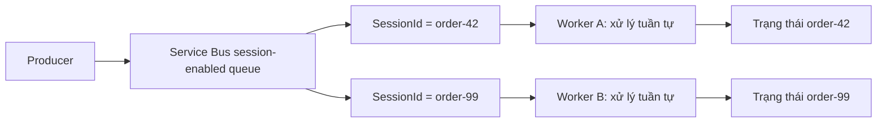
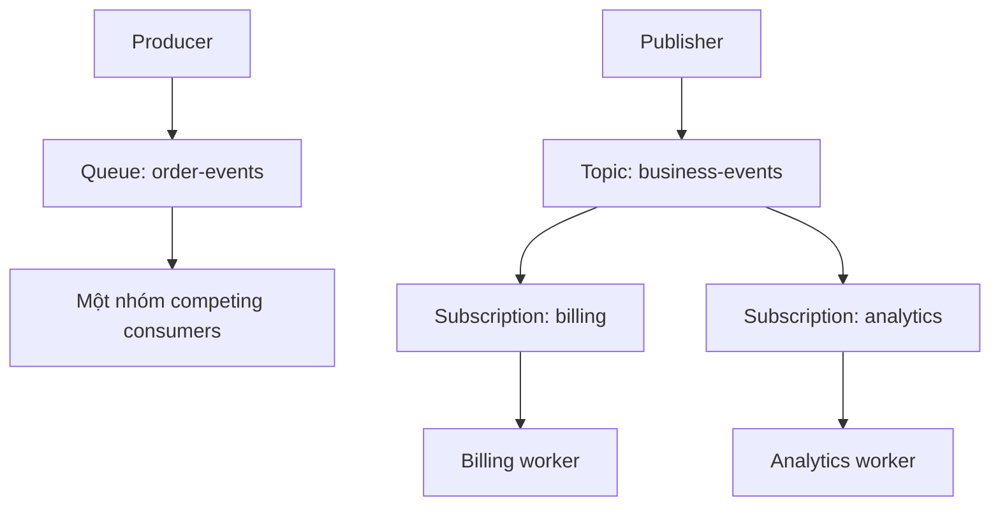
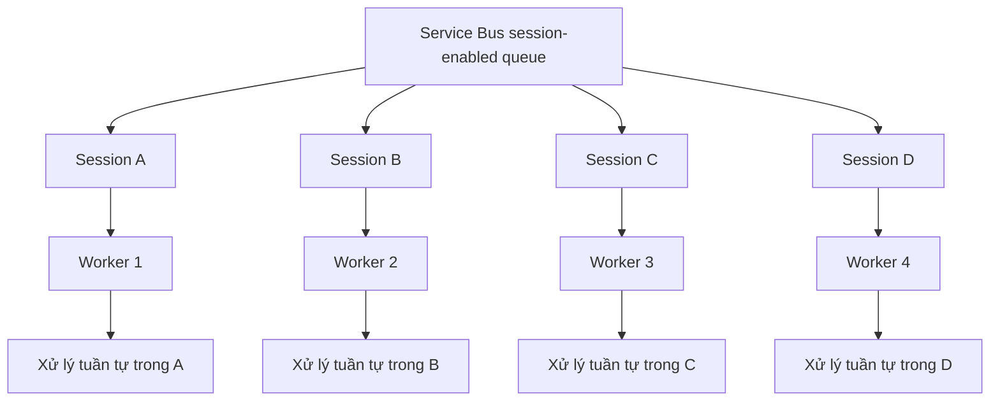
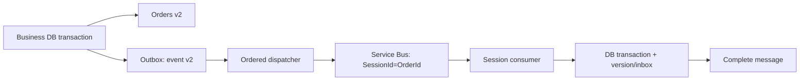
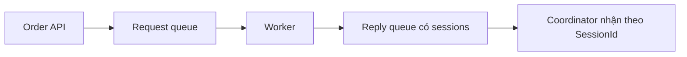
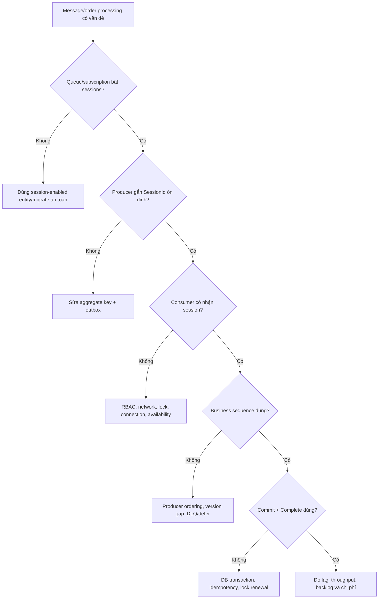

# Message session và bảo đảm thứ tự xử lý

Trong hệ thống thương mại điện tử, một đơn hàng có thể phát sinh các sự kiện **OrderCreated → PaymentAuthorized → OrderShipped**. Nếu sự kiện `OrderShipped` được một worker xử lý trước `PaymentAuthorized`, trạng thái đơn hàng sẽ sai dù không có message nào bị mất. Khi hàng nghìn đơn hàng được xử lý đồng thời, yêu cầu thực tế thường không phải **toàn bộ hệ thống xử lý tuần tự**, mà là **những sự kiện của cùng một đơn hàng phải được xử lý theo thứ tự**, trong khi các đơn hàng khác được xử lý song song.

**Azure Service Bus message sessions** là cơ chế giúp tổ chức các thông điệp liên quan vào những nhóm có khóa **`SessionId`**, rồi cho một consumer giữ quyền xử lý độc quyền một session tại một thời điểm. Kết hợp session với chiến lược phát message, settlement, idempotency và trạng thái nghiệp vụ giúp xây dựng một pipeline xử lý có thứ tự mà vẫn co giãn.

Bài học thuộc chương **Hàng đợi và thông điệp** của module `CLOUD_PROVIDERS_AZURE`. Trong hành trình khám phá Microsoft Azure từ subscription, resource group và Microsoft Entra ID đến mạng ảo, tính toán, lưu trữ, dữ liệu, triển khai, giám sát, bảo mật và kiểm soát chi phí, bài này đi sâu vào **Azure Service Bus sessions**, những giới hạn của FIFO và cách vận hành xử lý có thứ tự trong thực tế.

> **Phạm vi:** Ví dụ dùng Azure Service Bus **Standard hoặc Premium**, với **queue/subscription bật sessions** và Python SDK `azure-servicebus`. Azure Storage Queue là dịch vụ hàng đợi khác, **không cung cấp cùng cơ chế Service Bus session**. Những lệnh tạo/sửa tài nguyên có thể phát sinh phí; chỉ chạy trong môi trường lab được phê duyệt.

## Mục tiêu học tập

Sau bài học, bạn có thể:

1. Phân biệt **FIFO toàn hệ thống**, **FIFO theo SessionId**, **thứ tự broker nhận message** và **thứ tự nghiệp vụ**.
2. Mô tả cách cấu hình **session-enabled queue** hoặc **session-enabled topic subscription** trên Azure Service Bus.
3. Giải thích `SessionId`, session receiver, **exclusive session lock**, message lock, lock renewal và các giới hạn song song.
4. Gửi và nhận một chuỗi sự kiện theo cùng SessionId bằng Python SDK và Microsoft Entra ID.
5. Thiết kế settlement `Complete`, `Abandon`, `DeadLetter` và `Defer` mà không vô tình phá vỡ trình tự xử lý.
6. Phân biệt **`SequenceNumber` của broker** với **event version/sequence của miền nghiệp vụ**, đồng thời quản lý gap và duplicate.
7. Dùng **idempotency, transactional state, session state và outbox** để duy trì tính đúng đắn sau retry, lock loss hoặc crash.
8. Đánh giá song song nhiều sessions, hot sessions, partitioning, prefetch và mô hình Functions Service Bus trigger.
9. Theo dõi backlog, active sessions, dead-letter queue, lock failures, end-to-end lag, thông lượng và chi phí.
10. Thực hiện lab và kiểm thử failure scenarios trước khi thiết kế workload production.

## 1. Bài toán: thứ tự của từng thực thể, không phải của toàn bộ queue

Giả sử có ba đơn hàng với những message:

| Thời điểm producer gửi | `SessionId` | Event | Phiên bản nghiệp vụ |
|---|---|---|---:|
| T1 | `order-42` | OrderCreated | 1 |
| T2 | `order-99` | OrderCreated | 1 |
| T3 | `order-42` | PaymentAuthorized | 2 |
| T4 | `order-99` | PaymentAuthorized | 2 |
| T5 | `order-42` | OrderShipped | 3 |
| T6 | `order-99` | OrderCancelled | 3 |

Đội vận hành muốn:

- Đơn `order-42`: xử lý **Created trước Authorized trước Shipped**.
- Đơn `order-99`: xử lý **Created trước Authorized trước Cancelled**.
- Hai đơn có thể được xử lý **đồng thời** vì không phụ thuộc nhau.

Nếu tất cả messages được xử lý bởi một consumer đơn luồng, thứ tự có thể được giữ nhưng năng lực xử lý bị giới hạn. Nếu có mười consumers cùng lấy messages từ một queue **không có sessions**, mỗi consumer có thời gian chạy khác nhau, vì vậy thứ tự **hoàn thành** nghiệp vụ có thể khác thứ tự message được nhận.



**Ý tưởng chính:** Service Bus session tạo **một chuỗi xử lý logic cho mỗi khóa**, không buộc mọi thực thể phải chờ nhau. Tổ chức thực tế có thể có hàng chục nghìn sessions, nhưng số sessions được xử lý đồng thời vẫn chịu giới hạn compute, receiver concurrency, lock, throughput và tài nguyên bên dưới.

## 2. Thứ tự là gì? Phải xác định rõ loại bảo đảm

Trong messaging, câu “bảo đảm đúng thứ tự” có thể được hiểu theo nhiều cách:

| Loại thứ tự | Ý nghĩa | Service Bus Sessions có tự bảo đảm? |
|---|---|---|
| **Thứ tự producer tạo event** | Event 1 sinh ra trước event 2 trong ứng dụng | **Không tự biết** thứ tự trên các producers độc lập |
| **Thứ tự broker chấp nhận/enqueue** | Message nào được Service Bus nhận trước trong cùng session | Sessions hỗ trợ **ordered delivery** theo thứ tự chấp nhận trong điều kiện sử dụng thích hợp |
| **Thứ tự consumer nhận** | Một session receiver đọc messages theo chuỗi được broker cung cấp | Có mô hình ordered stream, nếu không tự xử lý song song trong session |
| **Thứ tự nghiệp vụ hoàn tất** | DB đã commit event N trước khi commit event N+1 | **Không tự có**; do code, settlement và storage transaction quyết định |
| **Thứ tự toàn bộ queue** | Mọi khách hàng/event phải được xử lý theo đúng một chuỗi | **Không phải mục tiêu** của nhiều sessions |
| **Exactly-once end-to-end** | Mỗi business effect xảy ra đúng một lần trong mọi lỗi | **Không tự có**; cần idempotency và giao dịch |

Ví dụ hai producers gửi gần như đồng thời các event có version 2 và 3 cho `order-42`. Nếu mạng khiến broker chấp nhận version 3 trước version 2, sessions sẽ bảo vệ **thứ tự broker chấp nhận**, chứ không tự biết “version 2 phải trước version 3”. Vì vậy kiến trúc mạnh phải **điều phối producer** hoặc **kiểm tra business sequence**.

### FIFO theo session không phải sorted-by-timestamp

Thứ tự trong queue không được tạo bằng cách sắp xếp `eventTime`:

- Đồng hồ của các producers có thể lệch.
- Timestamp có thể trùng hoặc không phản ánh commit transaction.
- Message có thể được gửi lại sau sự cố.
- Scheduled message có thể được đưa vào trạng thái sẵn sàng muộn.
- Một message cũ bị chuyển sang dead-letter/defer và được xử lý lại về sau.

Thứ tự nghiệp vụ đáng tin cậy nên dựa trên **sequence/version tăng tại nguồn dữ liệu có thẩm quyền** (ví dụ aggregate version hoặc event log offset), không chỉ dựa vào thời gian máy.

## 3. Azure Service Bus: Queue, Topic và Subscription

Azure Service Bus là dịch vụ messaging có các mô hình **queue** và **publish/subscribe**:



### Queue

Một queue chứa messages cho những consumers cạnh tranh xử lý. Với **session-enabled queue**, tất cả messages cần có SessionId hợp lệ và receiver phải nhận theo session. Một receiver không được tùy ý bỏ qua yêu cầu session của entity.

### Topic và Subscription

Topic cho phép **một message** được phân phối tới nhiều subscriptions theo filter/rule. **Session requirement được cấu hình trên subscription**, không phải giả định mọi subscription của topic đều dùng sessions giống nhau.

Ví dụ:

- Topic `business-events` nhận sự kiện đơn hàng.
- Subscription `billing-ordered` bật sessions và xử lý theo `SessionId=orderId`.
- Subscription `analytics` có thể dùng cách xử lý khác, tùy yêu cầu.

**Thứ tự xử lý độc lập theo từng subscription.** Việc subscription Billing đã complete event N không có nghĩa subscription Analytics cũng đã xử lý N. Không dùng topic sessions như một transaction coordinator giữa các subscribers.

### SKU hỗ trợ

Service Bus sessions khả dụng trong những tier hỗ trợ như **Standard và Premium**; tier **Basic** không phải lựa chọn cho bài toán session-enabled messaging. Kiểm tra SKU, namespace features, throughput/capacity, networking và chi phí hiện hành trong region của bạn trước khi tạo.

Azure **Storage Queues** và **Azure Event Grid** giải quyết những nhu cầu khác nhau; không coi `SessionId` của Service Bus là một tùy chọn có sẵn trên mọi queue/message broker của Azure.

## 4. SessionId: khóa gom messages theo một thực thể

Mỗi message gửi vào session-enabled queue/subscription phải chỉ rõ **`SessionId`**. Những messages có cùng SessionId thuộc cùng một chuỗi logic.

| Bài toán | SessionId phù hợp | Không nên chọn |
|---|---|---|
| Đơn hàng | `orderId` | `requestId` mới cho từng event |
| Tài khoản khách hàng | `accountId` nếu mọi event tài khoản cần thứ tự | Một SessionId chung `all-customers` |
| Workflow nhập hàng | `importBatchId` hoặc `workflowId` | Tên Function App/worker |
| Trò chuyện | `conversationId` | Timestamp mỗi tin nhắn |
| Thiết bị IoT | `deviceId` khi trạng thái từng thiết bị phải tuần tự | Một key chung cho mọi thiết bị |
| Ví điện tử | `walletId` với serial hóa thay đổi số dư | Một SessionId chung cho toàn hệ thống ví |

### Chọn độ hạt của session

**Quá rộng** (`SessionId=tenant-1` cho hàng triệu messages): chỉ một receiver tại một thời điểm xử lý chuỗi đó; tạo **hot session**, nghẽn throughput và tăng độ trễ.

**Quá hẹp** (mỗi message có SessionId ngẫu nhiên): không còn mối quan hệ thứ tự giữa các events cùng đơn hàng; mục tiêu bị mất.

Quy tắc thực tế là **SessionId = khóa của aggregate/đối tượng cần serial hóa thay đổi**. Đội thiết kế phải xác định rõ ranh giới nhất quán:

- Nếu chỉ cần trạng thái từng đơn hàng đúng, `orderId` hợp lý.
- Nếu mọi giao dịch của cùng ví phải tuần tự để bảo vệ số dư, `walletId` phù hợp hơn `transactionId`.
- Nếu một nghiệp vụ liên quan hai ví cùng lúc, chỉ một SessionId không tự tạo giao dịch atomic xuyên hai ví; cần transactional model hoặc saga phù hợp.

### Quy định producer

Khi triển khai nhiều producer instances:

1. Cùng thực thể phải luôn tính ra **cùng SessionId**; dùng cách normalize/canonicalize ổn định.
2. Producer không được tự thay SessionId giữa các bước của cùng workflow.
3. Phải có **business sequence** riêng để xác minh version nếu nhiều producer cùng phát.
4. **MessageId** biểu diễn danh tính message/operation, không thay thế SessionId.
5. Nếu entity có partitioning, cần tuân thủ quy tắc tương thích giữa `SessionId` và `PartitionKey` trong các trường hợp áp dụng.

## 5. Session-enabled entity phải được cấu hình trước khi gửi

Một queue thông thường và một queue **requires sessions** có behavior khác nhau. Với Azure Service Bus, yêu cầu session thường là thuộc tính được chọn **khi tạo queue/subscription**; không nên giả định có thể bật/tắt trên queue đang chạy chứa dữ liệu bằng một thao tác không gián đoạn.

### Quy trình trên Azure Portal

1. Mở **Service Bus namespaces** trong đúng subscription/resource group.
2. Chọn namespace có SKU hỗ trợ sessions, ví dụ Standard hoặc Premium.
3. Vào **Queues → + Queue**, đặt tên `orders-ordered`.
4. Bật tùy chọn **Requires Session / Enable Sessions** theo giao diện hiện hành.
5. Xem **Lock duration**, **Max delivery count**, TTL, dead-letter behavior và duplicate detection theo nhu cầu.
6. Tạo entity, vào trang thuộc tính và xác nhận `Requires Session = true`.
7. Tạo Azure role assignments cho producers/consumers ở phạm vi tối thiểu.

Với topic, tạo topic rồi tạo **subscription** `billing-ordered` với session requirement được bật. Khi application gửi vào topic, producer phải cung cấp SessionId cho những messages cần được subscription session-enabled chấp nhận và xử lý đúng.

### Không đổi trực tiếp entity đang có trong production

Nếu queue `orders` hiện đã hoạt động **không dùng sessions**, kế hoạch migration phù hợp thường gồm:

- Tạo queue mới `orders-ordered` có Requires Session.
- Triển khai producer phát SessionId và business sequence.
- Triển khai receiver dùng session semantics.
- Chuyển nguồn gửi theo cutover có kiểm soát, kiểm tra DLQ/backlog hai nơi.
- Drain hoặc migrate thông điệp còn ở queue cũ theo quy tắc nghiệp vụ.
- Giữ quyền rollback và cách tránh duplicate trong giai đoạn hai tuyến hoạt động.

**Không đổi namespace hoặc xóa queue cũ để “bật session” khi chưa có phương án bảo toàn dữ liệu đang chờ.**

### Đọc cấu hình bằng Azure CLI

Với queue lab đã được tạo:

```bash
az login --tenant "<tenant-id>"
az account set --subscription "<subscription-id>"

az servicebus queue show \
  --resource-group "rg-messaging-lab" \
  --namespace-name "<servicebus-namespace-name>" \
  --name "orders-ordered" \
  --query "{name:name,requiresSession:requiresSession,lockDuration:lockDuration,maxDeliveryCount:maxDeliveryCount,status:status}" \
  --output json
```

Nếu `requiresSession` không được trả về như mong đợi, đọc toàn bộ JSON và kiểm tra CLI/API version trước khi kết luận. Các lệnh đọc cấu hình không kiểm chứng message đã được xử lý đúng thứ tự.

## 6. Đường đi của một session qua Service Bus

```mermaid
sequenceDiagram
    participant P as Producer
    participant SB as Service Bus queue
    participant A as Receiver A
    participant B as Receiver B
    P->>SB: Event 1; SessionId=order-42
    P->>SB: Event 2; SessionId=order-42
    P->>SB: Event 3; SessionId=order-99
    A->>SB: Accept Session order-42
    SB-->>A: Session lock cho order-42
    B->>SB: Accept Session order-42
    SB-->>B: Không được sở hữu đồng thời
    B->>SB: Accept Session order-99
    SB-->>B: Session lock cho order-99
    SB->>A: Message 1 của order-42
    A->>SB: Complete Message 1
    SB->>A: Message 2 của order-42
    SB->>B: Message 1 của order-99
```

Sơ đồ mô tả **đặc tính độc quyền của session lock**. Thứ tự từng hành động cụ thể còn phụ thuộc SDK, receiver timeout, số messages được tải trước và concurrency trong ứng dụng.

### Session receiver

Consumer có hai lựa chọn phổ biến:

- **Nhận một SessionId cụ thể:** phù hợp khi biết chính xác workflow/khách hàng cần xử lý.
- **Nhận `NEXT_AVAILABLE_SESSION`:** để worker tự nhận một session có messages chờ theo cơ chế Service Bus, phục vụ mô hình nhiều consumers.

Khi receiver đã giữ một session, nó có thể nhận các messages cùng SessionId theo mô hình ordered delivery. Các workers khác có thể nhận sessions **khác** đồng thời.

### Session lock so với message lock

Trong queue không session, receiver thường dùng **Peek-Lock** để nhận và settle từng message. Với session-enabled entity, broker còn cấp **exclusive session lock** cho một receiver nhằm ngăn hai receivers độc lập cùng sở hữu một session trong thời gian lock hợp lệ.

**Không hiểu session lock là khóa vĩnh viễn.** Khi lock hết hạn, bị mất do mạng/host, hoặc receiver đóng, session có thể được receiver khác nhận. Vì thế ứng dụng phải xử lý:

- session lock renewal;
- quá trình xử lý nhanh trong khoảng lock;
- thất bại khi settlement do lock đã mất;
- xử lý lại message và idempotency;
- shutdown/drain để nhường session an toàn.

### Session state

Azure Service Bus có khả năng lưu **session state** gắn với SessionId theo API được hỗ trợ. Nó phù hợp cho checkpoint nhỏ như workflow stage hoặc correlation metadata.

Ví dụ:

```json
{
  "orderId": "order-42",
  "lastAppliedBusinessSequence": 2,
  "workflowStage": "AwaitingShipment"
}
```

**Quan trọng:** session state **không tự cập nhật** theo message settlement và **không phải transaction chung với database nghiệp vụ**. Nếu code cập nhật DB, update session state rồi Complete message ở ba bước riêng, crash ở giữa vẫn tạo các trạng thái khác nhau. Session state chỉ là một tiện ích cần được dùng cùng idempotency và kho dữ liệu chuẩn của nghiệp vụ.

## 7. Những ranh giới thực sự của “FIFO theo session”

| Tình huống | Điều session giúp | Điều ứng dụng vẫn phải làm |
|---|---|---|
| Một producer gửi event 1, 2, 3 tuần tự và broker xác nhận theo thứ tự | Broker có chuỗi messages cùng SessionId | Consumer xử lý và commit tuần tự |
| Hai producers cùng gửi cho một SessionId không có phối hợp | Broker sắp theo thứ tự chấp nhận | Thống nhất version ở nguồn, phát theo outbox hoặc phát hiện gap |
| Nhiều workers nhận cùng SessionId | Exclusive session lock giảm nguy cơ xử lý đồng thời | Gia hạn lock, ngừng xử lý khi mất lock |
| Message 2 bị lỗi và Abandon | Message có thể được nhận lại | Không xử lý message 3 tạo side effect trước khi 2 thành công |
| Message 2 bị DeadLetter | Message 3 có thể vẫn đến | Quyết định workflow bị chặn, quarantine hay có phép bỏ qua |
| Event được scheduled hoặc deferred | Service Bus có khả năng xử lý thời gian/hoãn theo cơ chế | Không coi message delayed là thứ tự business bắt buộc tự được giữ |
| Một SessionId quá nóng | Lock giữ xử lý theo một chủ sở hữu | Không mong nhiều receivers cùng tăng throughput cho chính session đó |
| Consumers đang chạy khi broker/host mất kết nối | Broker còn lưu message theo độ bền của dịch vụ | Idempotency, replay, checkpoint và xử lý lock loss |

**Ranh giới quan trọng:** sessions cung cấp **bộ khung ordered delivery**, không cấp cam kết **exactly-once business effects**, không tự tạo **transactional order** trên database và không bảo đảm global ordering.

## 8. Gửi message theo session bằng Python SDK

Ví dụ dùng Python 3, gói `azure-servicebus` và `azure-identity`. Với ứng dụng production, ưu tiên **Microsoft Entra ID/managed identity** thay vì embedded connection string.

### Chuẩn bị môi trường cho người học

Trong môi trường lab riêng, cài thư viện:

```bash
python -m pip install azure-servicebus azure-identity
```

Đặt hai biến môi trường (giá trị minh họa):

```bash
export SERVICEBUS_FQDN="<your-namespace>.servicebus.windows.net"
export SERVICEBUS_QUEUE_NAME="orders-ordered"
```

Với Azure CLI local, xác nhận subscription/tenant đúng và đăng nhập bằng `az login`. Khi chạy trong Azure Function App/VM/AKS, `DefaultAzureCredential` có thể sử dụng managed identity hoặc workload identity theo cấu hình môi trường.

Azure RBAC data plane cần cấp role phù hợp, ví dụ:

- Producer: **Azure Service Bus Data Sender**.
- Consumer: **Azure Service Bus Data Receiver**.

Azure `Reader` hoặc `Contributor` thông thường trên ARM không tự trao quyền gửi/nhận message ở Service Bus data plane.

### Producer: gửi ba event cho cùng một đơn

Mẫu tệp `send_order_events.py`:

```python
import json
import os

from azure.identity import DefaultAzureCredential
from azure.servicebus import ServiceBusClient, ServiceBusMessage


namespace = os.environ["SERVICEBUS_FQDN"]
queue_name = os.environ["SERVICEBUS_QUEUE_NAME"]

events = [
    {"sequence": 1, "eventType": "OrderCreated"},
    {"sequence": 2, "eventType": "PaymentAuthorized"},
    {"sequence": 3, "eventType": "OrderShipped"},
]

order_id = "order-42"

with DefaultAzureCredential() as credential:
    with ServiceBusClient(
        fully_qualified_namespace=namespace,
        credential=credential
    ) as client:
        with client.get_queue_sender(queue_name=queue_name) as sender:
            for event in events:
                payload = {
                    "orderId": order_id,
                    "sequence": event["sequence"],
                    "eventType": event["eventType"],
                }

                message = ServiceBusMessage(
                    body=json.dumps(payload),
                    session_id=order_id,
                    message_id=f"{order_id}:{event['sequence']}",
                    content_type="application/json"
                )
                sender.send_messages(message)
                print(
                    "Sent",
                    payload["eventType"],
                    "sequence",
                    payload["sequence"]
                )
```

Chạy **chỉ khi** namespace và queue đã có thật, yêu cầu sessions đã bật, identity có quyền và môi trường lab được duyệt:

```bash
python send_order_events.py
```

### Vì sao gửi tuần tự?

Producer ở trên đợi `sender.send_messages(message)` hoàn tất trước khi gửi event kế tiếp. Cách này giúp chuỗi gửi **một producer** có thứ tự broker chấp nhận theo luồng gửi, thay vì tạo nhiều tác vụ network concurrent rồi giả định event được enqueue theo `sequence`.

Trong production, producer còn phải quản lý:

- **Outbox:** nếu sự kiện bắt nguồn từ transaction database, chỉ gửi những event đã commit và bảo đảm không bỏ sót khi process chết.
- **MessageId ổn định:** dùng cho idempotency/dedup, không tạo ID ngẫu nhiên mỗi lần retry cùng event.
- **SessionId bất biến** với cùng aggregate.
- **Retries:** không phát version 3 trước khi biết version 2 đã được xử lý theo quy trình; nếu trạng thái send timeout không rõ có được broker nhận hay chưa, thiết kế duplicate detection/idempotency.
- **Business version** được cấp atomically ở nguồn; không để hai producer cùng gán sequence 2.

Ví dụ gửi message sẽ **không tự tạo** queue, role assignment hoặc outbox; những phần này thuộc hạ tầng và nghiệp vụ phải chuẩn bị trước.

## 9. MessageId, SessionId và SequenceNumber khác nhau

| Thuộc tính | Ai đặt? | Mục đích | Có thể dùng thay cho nhau? |
|---|---|---|---|
| **`SessionId`** | Producer | Nhóm những message cần xử lý có thứ tự | Không |
| **`MessageId`** | Producer | Định danh message, phục vụ tracing/dedup nếu bật tính năng | Không |
| **`SequenceNumber`** | Service Bus broker | Số thứ tự do broker cấp cho message trong entity theo cơ chế dịch vụ | Không |
| **`sequence` trong payload** | Domain/application | Version của đơn hàng/workflow, thứ tự phải commit | Không |
| **`CorrelationId`** | Producer hoặc orchestration layer | Liên kết traces/events trong workflow | Không |

### SequenceNumber của broker không phải eventVersion

Broker `SequenceNumber` giúp quan sát thứ tự chấp nhận trong một entity theo cơ chế broker; nó **không phải số tăng liên tiếp riêng cho từng OrderId**. Trong queue chứa nhiều sessions, số thứ tự của `order-42` có thể xen kẽ với message của `order-99`. Khi partitioning và các tính năng khác được bật, cần tôn trọng ý nghĩa được hỗ trợ của sequence number theo entity/partition.

Không nên xây logic:

```python
# Không nên: broker sequence number không phải domain sequence
if message.sequence_number == last_order_version + 1:
    apply_order_event()
```

Thay vào đó, đọc `sequence` trong payload do hệ thống nghiệp vụ phát hành và kiểm tra theo version đã commit:

```python
# Minh họa nguyên tắc, không phải triển khai DB hoàn chỉnh
if event["sequence"] == last_committed_version + 1:
    apply_in_transaction(event)
elif event["sequence"] <= last_committed_version:
    acknowledge_duplicate(event)
else:
    hold_or_reconcile_gap(event)
```

**Số thứ tự là một quy ước nghiệp vụ cần được bảo vệ ở producer và database**; chỉ thêm field `sequence` mà không có unique constraint/concurrency control sẽ không bảo đảm đúng thứ tự.

## 10. Nhận một session cụ thể và settle message

Mẫu người học trước tiên có thể nhận session `order-42` để quan sát logic đơn giản. Code bên dưới xử lý **một message tại một thời điểm**, dùng Peek-Lock mặc định và đóng receiver khi hết message trong khoảng chờ.

### Consumer tối thiểu

Tệp `receive_one_session.py`:

```python
import json
import os

from azure.identity import DefaultAzureCredential
from azure.servicebus import ServiceBusClient


namespace = os.environ["SERVICEBUS_FQDN"]
queue_name = os.environ["SERVICEBUS_QUEUE_NAME"]
session_id = "order-42"

with DefaultAzureCredential() as credential:
    with ServiceBusClient(
        fully_qualified_namespace=namespace,
        credential=credential
    ) as client:
        with client.get_queue_receiver(
            queue_name=queue_name,
            session_id=session_id,
            max_wait_time=10
        ) as receiver:
            print("Accepted session:", receiver.session.session_id)

            while True:
                messages = receiver.receive_messages(
                    max_message_count=1,
                    max_wait_time=5
                )
                if not messages:
                    break

                message = messages[0]
                try:
                    # Đoạn này chỉ dành cho Data body UTF-8 do producer tạo.
                    body_bytes = b"".join(message.body)
                    event = json.loads(body_bytes.decode("utf-8"))

                    print(
                        "Process:",
                        event["orderId"],
                        event["sequence"],
                        event["eventType"]
                    )

                    # Trong production: phải commit DB/checkpoint/idempotency
                    # trước khi complete message.
                    receiver.complete_message(message)
                except Exception as exc:
                    print("Processing failed:", type(exc).__name__)
                    receiver.abandon_message(message)
                    # Dừng session; không xử lý message kế tiếp tạo side effect.
                    break
```

**Giới hạn của demo:** code in log rồi complete, **chưa có business transaction** và chưa tự gia hạn session lock. Chỉ dùng với xử lý ngắn trong sandbox. Code vẫn có thể phát sinh exception khi lock đã mất; điều đó phải được xử lý bằng runbook/retry và cơ chế idempotent thay vì coi hoàn thành như thành công vĩnh viễn.

### Vì sao `max_message_count=1`?

Trong ví dụ đầu tiên, đọc từng message rồi hoàn tất xử lý trước khi lấy message kế tiếp giúp học viên không vô tình:

- tạo thread xử lý đồng thời trong một session;
- complete message 3 trước message 2;
- bỏ qua lỗi ở message 2 nhưng vẫn áp dụng event 3;
- nhầm một batch được nhận theo thứ tự với **một batch đã commit theo thứ tự**.

Với production có thể nhận batch để tối ưu throughput, nhưng phải **duy trì serial processing/settlement** hoặc thiết kế chuẩn theo workflow. Nhận 10 messages cùng session **không cho phép tự động chạy 10 tasks song song** nếu ordering là một invariant nghiệp vụ.

## 11. Nhận sessions linh hoạt bằng NEXT_AVAILABLE_SESSION

Trong production, consumer thường không biết trước tất cả `SessionId`. Azure Service Bus SDK hỗ trợ nhận **session có messages đang chờ**:

```python
from azure.servicebus import NEXT_AVAILABLE_SESSION

# Biến client đã tạo từ ServiceBusClient như ví dụ trước
with client.get_queue_receiver(
    queue_name="orders-ordered",
    session_id=NEXT_AVAILABLE_SESSION,
    max_wait_time=10
) as receiver:
    actual_session_id = receiver.session.session_id
    print("Worker đang giữ:", actual_session_id)
    # Nhận/settle lần lượt các messages trong session này.
```

Đoạn này là **fragment** cần đặt bên trong `with ServiceBusClient(...) as client` và sử dụng đúng quyền/data connection; nó không phải file Python độc lập.

### Mô hình worker pool

Giả sử chạy bốn workers và có 12 sessions đang chờ:



Các workers có thể lấy thêm sessions khi xong session hiện tại. Một worker cũng có thể dùng async/concurrency framework để xử lý nhiều sessions, nhưng **không triển khai đồng thời các mutations cạnh tranh cùng một SessionId** nếu thứ tự là điều kiện bắt buộc.

### Hot session

Nếu Session A có 10 triệu messages còn các sessions khác mỗi session chỉ có vài messages, tăng số workers từ 4 lên 40 **không tự tăng tốc xử lý của riêng Session A**: session A vẫn cần serial hóa để bảo vệ thứ tự.

Các phương án:

1. Xem xét **chọn khóa session hẹp hơn** nếu nghiệp vụ cho phép tách các thực thể độc lập.
2. Tối ưu xử lý mỗi event: dùng transaction ngắn, giảm round trips tới DB và loại bỏ tác vụ I/O không cần thiết.
3. Tách các bước nặng không yêu cầu thứ tự sang workload khác với cơ chế correlation/commit barrier.
4. Chuyển tác vụ có thể song song sang các subworkflows có SessionId riêng, nhưng phải có cơ chế hợp nhất/ordering phù hợp.
5. Theo dõi backlog **theo session**, không chỉ tổng queue depth.

Không “tăng `maxConcurrentSessions`” rồi mong một hot SessionId được chia qua nhiều consumers đang ghi cùng aggregate mà vẫn giữ ordering.

## 12. Session lock, lock expiry và auto-renew

Session-enabled receiver có một khoảng thời gian giữ độc quyền session. Nếu xử lý mất nhiều thời gian hơn khoảng lock, ứng dụng cần cơ chế gia hạn hỗ trợ bởi SDK/runtime.

### Khi lock mất

```text
Worker A nhận Session order-42
  → xử lý event sequence=2 trong 90 giây
  → network ngắt, session lock hết hạn
Worker B nhận lại session order-42
  → có thể thấy message chưa được settle
  → xử lý sequence=2 lại
Worker A hoàn thành side effect trong DB
  → Complete message thất bại do lock không còn thuộc A
```

Không nên giả định broker có thể hủy một transaction database đang chạy trên Worker A ngay khi lock mất. Vì thế **session lock là quyền sở hữu tạm thời đối với việc nhận message**, không phải cơ chế fencing tuyệt đối cho mọi side effect ngoài Service Bus.

### AutoLockRenewer

Python SDK có khả năng gia hạn lock tự động theo điều kiện của receiver/session thông qua `AutoLockRenewer` hoặc các cơ chế tương ứng. Mẫu ý tưởng:

```python
from azure.servicebus import AutoLockRenewer

# Bên trong context có receiver đang giữ session
with AutoLockRenewer() as renewer:
    renewer.register(
        receiver,
        receiver.session,
        max_lock_renewal_duration=300
    )
    # Thực hiện tác vụ giới hạn thời gian, theo dõi lock/renewal errors.
```

Đây là **đoạn tích hợp**, không phải ví dụ hoàn chỉnh; kiểm tra SDK version để xác nhận API và hành vi khi network bị gián đoạn. Gia hạn lock **không có nghĩa có thể giữ session mãi mãi**: application vẫn cần timeout, checkpoint và xử lý lại an toàn.

### Fencing ở tầng nghiệp vụ

Với nghiệp vụ đòi hỏi tuyệt đối không có hai writers cập nhật cùng một aggregate:

- Dùng **optimistic concurrency** với `expectedVersion`/ETag hoặc database unique constraint.
- Khi cần lease chủ động, sử dụng lease/fencing token ở kho lưu trữ có hỗ trợ theo thiết kế.
- Commit thay đổi theo transaction tại source-of-truth.
- Nếu lock Service Bus mất, worker cũ phải ngừng nhận thêm message, nhưng ứng dụng vẫn phải dựa vào database để ngăn writer cũ ghi muộn.

Đây là sự khác biệt giữa **single active session receiver theo broker** và **single successful writer của business entity**.

## 13. Settlement: Complete, Abandon, DeadLetter và Defer

| Operation | Ý nghĩa | Ảnh hưởng tới thứ tự |
|---|---|---|
| **Complete** | Đánh dấu message xử lý xong, loại khỏi active queue theo cơ chế | An toàn khi nghiệp vụ đã commit/idempotent |
| **Abandon** | Nhả message chưa hoàn thành để có thể giao lại | Message có thể bị giao lại; không được xử lý event sau một cách mù quáng |
| **DeadLetter** | Chuyển message sang dead-letter subqueue để phân tích/xử lý riêng | Chuỗi active có thể tiến tiếp dù event trước chưa áp dụng |
| **Defer** | Hoãn xử lý message để nhận lại có chủ đích, thường qua sequence number | Có thể tạo khoảng trống trong stream nếu bỏ qua event cần trước |
| **ReceiveAndDelete** | Xóa khi nhận theo chế độ không dùng settlement Peek-Lock | **Không phù hợp** với yêu cầu không mất event khi worker crash |

### Complete sau commit

Với đơn hàng, thứ tự lý tưởng:

```text
Nhận message #2 của order-42
→ xác minh #2 là phiên bản tiếp theo
→ transaction: cập nhật order + ghi processed-event ID
→ transaction COMMIT
→ Service Bus Complete message #2
→ nhận message #3
```

Nếu crash **sau DB commit nhưng trước Complete**, broker có thể giao lại #2; worker tra bảng processed-event/version rồi **complete bản lặp**, không thực hiện side effect thêm lần nữa.

Nếu Complete **trước DB commit**, crash có thể làm event đã bị xóa khỏi queue trong khi cập nhật DB chưa thực hiện — rủi ro mất nghiệp vụ.

### Abandon không có nghĩa phải lập tức chạy message tiếp theo

Ví dụ event #2 lỗi do database tạm thời unavailable. Nếu abandon #2 rồi consumer tiếp tục đọc #3 và cập nhật `Shipped`, invariant có thể bị phá.

Thiết kế an toàn cho strict order:

1. Ghi nhận lỗi #2 và nguyên nhân.
2. Abandon #2 hoặc cho lock hết hạn theo chính sách retry.
3. **Ngừng xử lý các event tiếp theo của session đó** cho đến khi #2 được commit hoặc có quyết định nghiệp vụ rõ ràng.
4. Không làm nghẽn những sessions độc lập không bị lỗi.

Trong hệ thống có nhiều receivers, logic này phải được củng cố bằng **business sequence guard** vì network timing, deferral và failure recovery có thể thay đổi cách message được giao lại.

### DeadLetter không tự giải quyết thứ tự

Nếu #2 bị dead-letter sau nhiều lần thất bại, message #3 vẫn có thể tiếp tục trong active entity. Có hai chính sách nghiệp vụ phổ biến:

- **Strict stop-the-line:** đánh dấu aggregate `Blocked`, không áp dụng #3 cho tới khi #2 được sửa/replay hay có quyết định bù trừ có kiểm soát.
- **Skip with audit:** một event không bắt buộc có thể được bỏ qua theo quyết định nghiệp vụ, ghi lý do và cập nhật expected sequence phù hợp.

Đừng coi việc vào DLQ là “đã xử lý thành công” và không âm thầm bỏ qua một event tài chính bắt buộc.

### Defer và gap handling

Deferred message thường được giữ để truy xuất lại có chủ đích theo `SequenceNumber`. Nó không còn được nhận như message active thông thường trong luồng nhận tiêu chuẩn. Nếu dùng defer để chờ điều kiện, phải lưu identifier phù hợp và có cơ chế lấy lại/timeout, nếu không message sẽ bị “quên”.

Các trường hợp scheduled/deferred messages và TTL cần được đánh giá riêng; **một message đến muộn có thể làm domain sequence không còn liền mạch** dù receiver tuân thủ sessions.

## 14. Bảo đảm thứ tự commit bằng business version và idempotency

Hãy tách hai việc:

- **Vận chuyển:** Service Bus cung cấp messages và bảo vệ quyền nhận độc quyền của session trong thời gian lock.
- **Tính đúng đắn nghiệp vụ:** database từ chối cập nhật sai phiên bản hoặc ghi lặp, bất kể sự cố broker/client.

Ví dụ bảng đơn hàng:

```sql
CREATE TABLE Orders (
    OrderId VARCHAR(100) PRIMARY KEY,
    CurrentState VARCHAR(50) NOT NULL,
    Version INT NOT NULL
);

CREATE TABLE ProcessedEvents (
    EventId VARCHAR(200) PRIMARY KEY,
    OrderId VARCHAR(100) NOT NULL,
    BusinessSequence INT NOT NULL
);
```

Đây là mô hình bảng minh họa, **không phải schema SQL Azure hoàn chỉnh cho production**. Kiểu dữ liệu/constraint/index và cách commit phải phù hợp hệ quản trị thực tế.

### Thuật toán áp dụng event

```text
Đầu vào: SessionId, EventId, BusinessSequence, EventType

BEGIN TRANSACTION
    Tải state của OrderId và khóa/version hiện hành.

    Nếu EventId đã có trong ProcessedEvents:
        → coi là bản lặp đã xử lý; COMMIT/đóng transaction.

    Nếu BusinessSequence == Order.Version + 1:
        → kiểm tra transition nghiệp vụ hợp lệ.
        → cập nhật order state và Version.
        → ghi ProcessedEvents(EventId, OrderId, Sequence).
        → COMMIT.

    Nếu BusinessSequence <= Order.Version:
        → phân biệt duplicate có chứng cứ và event mâu thuẫn.
        → không ghi side effect lặp.

    Nếu BusinessSequence > Order.Version + 1:
        → ROLLBACK / giữ event ở trạng thái chờ.
        → đánh dấu gap và không commit event sau.

Sau khi commit thành công / xác định duplicate đã commit:
    Complete Service Bus message.
Nếu chưa xử lý:
    Không Complete; retry/defer/quarantine theo policy.
```

**Lưu ý concurrency:** check `Order.Version` rồi update không có locking/conditional update là chưa đủ. Hai workers vẫn có thể cùng đọc Version=1 và cùng cố ghi Version=2. Cần transaction isolation/optimistic concurrency (ví dụ `UPDATE ... WHERE Version=@expectedVersion` rồi kiểm tra affected rows), hoặc cơ chế tương đương của database.

### Ví dụ kiểm tra version bằng SQL có điều kiện

```sql
UPDATE Orders
SET CurrentState = @NextState,
    Version = @ExpectedVersion + 1
WHERE OrderId = @OrderId
  AND Version = @ExpectedVersion;
```

Nếu không có bản ghi được cập nhật, phải phân biệt: order chưa tồn tại, stale version, concurrent writer hoặc thứ tự bị sai. Không được mặc định coi mọi trường hợp là thành công.

Việc cập nhật Orders và ProcessedEvents phải nằm **trong một transaction cùng kho** để tạo nhất quán về event đã xử lý. Nếu kho dữ liệu không hỗ trợ transaction nhiều bản ghi, thiết kế alternative bằng conditional writes, aggregate document hoặc cơ chế event-sourcing phù hợp.

### Vì sao vừa có sessions vừa có optimistic concurrency?

Sessions giúp giảm cạnh tranh và hỗ trợ ordered delivery, nhưng vẫn có failure windows như lock loss, host crash hoặc nhiều producers không phối hợp. Optimistic concurrency tại database đóng vai trò **hàng rào cuối** bảo vệ invariant của từng đơn hàng.

## 15. Outbox pattern: tạo event đúng thứ tự từ nguồn dữ liệu

Một vấn đề phổ biến xuất hiện **trước khi message đến Service Bus**:

```text
Ứng dụng cập nhật Orders.Version = 2 trong database
→ process crash trước khi send PaymentAuthorized
→ queue không bao giờ nhận event version 2
→ version 3 có thể đến từ luồng khác
```

Một hướng giải quyết là **Transactional Outbox**:

1. Trong **một database transaction**, cập nhật order và ghi một Outbox event với `OrderId`, `Sequence`, `EventId` và payload.
2. Outbox dispatcher đọc những events đã commit, xuất bản theo thứ tự hợp lệ **trong từng aggregate**.
3. Gửi vào Service Bus với `SessionId=OrderId` và `MessageId=EventId`.
4. Đánh dấu outbox event đã được publish theo cơ chế retry/idempotent.
5. Consumer dùng **Inbox/ProcessedEvents** để chống lặp khi nhận lại.



### Outbox có tự giải quyết mọi thứ không?

Không. Nếu nhiều outbox dispatchers chạy song song, phải có cơ chế **claim/partition theo aggregate** hoặc kiểm soát thứ tự publish. Nếu event version 3 được publish trước version 2 dù cùng SessionId, broker có thể nhận 3 trước. Dispatcher có thể dùng partitioning theo OrderId, lease, optimistic concurrency hoặc thiết kế stream/log phù hợp.

Outbox cung cấp cơ sở đáng tin cậy để **không mất event sau DB commit**; consumer inbox bảo vệ khỏi **duplicate delivery**. Kết hợp với sessions và version guard tạo một giải pháp bền vững hơn việc chỉ bật `Requires Session`.

### Khi nào dùng Service Bus transactions?

Azure Service Bus hỗ trợ những **transactional operations** nhất định **trong phạm vi dịch vụ** theo điều kiện entity/namespace và API được hỗ trợ, ví dụ kết hợp settlement và gửi message trong một số workflow. Nhưng một transaction của Service Bus **không bao gồm tự động** transaction của Azure SQL/Cosmos DB hoặc HTTP API bên ngoài.

Với quy trình cần commit DB và acknowledge message, cần thiết kế outbox/inbox, idempotency hoặc distributed saga. Không mô tả một broker transaction như “bảo đảm exactly once cho mọi hệ thống liên quan”.

## 16. Session state: checkpoint nhỏ, không phải database chuẩn

Session state giúp broker giữ một ít dữ liệu gắn với session, ví dụ:

```json
{
  "lastSeenEventId": "order-42:2",
  "lastAppliedSequence": 2,
  "processingStage": "payment-recorded"
}
```

Python SDK expose `receiver.session` khi receiver giữ session. Các phương thức đọc/ghi state của session được hỗ trợ có thể dùng như:

```python
# Fragment bên trong context của receiver session-enabled
state_bytes = receiver.session.get_state()

if state_bytes:
    state = json.loads(state_bytes.decode("utf-8"))
else:
    state = {"lastAppliedSequence": 0}

# Chỉ minh họa lưu checkpoint; không phải giao dịch chung với DB.
state["lastAppliedSequence"] = 2
receiver.session.set_state(
    json.dumps(state).encode("utf-8")
)
```

Đoạn này cần import `json` và phù hợp SDK đang dùng. Cần giới hạn dung lượng state, serializing format, quyền và retention. **State có thể tiếp tục tồn tại sau khi messages trong session đã hết** theo cơ chế broker, vì vậy phải có kế hoạch xóa/reset khi workflow kết thúc và tính tới tài nguyên/chi phí lưu state.

### Cẩn trọng với hai nguồn sự thật

Không để database `Orders.Version=3` trong khi session state `lastAppliedSequence=2` rồi kết luận bản 3 chưa xử lý. Nếu DB là source-of-truth, session state chỉ nên là **cache/checkpoint hỗ trợ**; khi mâu thuẫn, dùng reconciliation logic dựa trên giao dịch nghiệp vụ được xác nhận.

Một ứng dụng có thể dùng session state để ghi **workflow cursor**, nhưng vẫn cần:

- transaction hoặc conditional update ở database;
- dedup/inbox theo EventId;
- ability to recompute state khi metadata thất lạc hoặc lỗi;
- quy trình cleanup khi SessionId không còn hoạt động.

## 17. Duplicate detection, MessageId và retries

Service Bus có tính năng **duplicate detection** trên các entities/tier được hỗ trợ. Khi được bật, broker có thể nhận diện message gửi trùng theo `MessageId` (và các khóa liên quan như partition identity trong cấu hình nhất định) trong **cửa sổ thời gian được cấu hình**.

### Ví dụ retry send

```text
Producer gửi event OrderCreated, MessageId=order-42:1
→ mạng ngắt trước khi producer nhận ACK
→ producer không biết broker đã nhận chưa
→ producer retry cùng MessageId=order-42:1
→ duplicate detection có thể tránh lưu trùng trong window
```

**Duplicate detection không thay thế idempotency** vì:

- Có giới hạn thời gian window, không bảo vệ vô hạn.
- Khóa message phải **ổn định** qua retries.
- Hai messages khác MessageId nhưng cùng business effect vẫn có thể được nhận.
- Một duplicate có thể đã vượt qua và được consumer xử lý trước khi detection thay đổi.
- Khi failover/replay/hồi phục lâu, event cũ có thể xuất hiện lại ngoài window.

Đừng tạo `MessageId=UUID mới` cho mỗi lần retry cùng nghiệp vụ nếu kỳ vọng duplicate detection hoạt động theo ID.

### PartitionKey và SessionId

Trong entity có partitioning, `SessionId` liên quan đến partition affinity theo các quy tắc của Service Bus. **Nếu đồng thời cung cấp `PartitionKey`, nó phải tương thích với SessionId** trong tình huống entity áp dụng yêu cầu equality.

Không đổi PartitionKey giữa các messages của cùng SessionId rồi giả định chúng vẫn nằm trong một ordered stream có cùng đặc tính. Trước khi bật partitioning/transactions/duplicate detection cùng lúc, kiểm tra compatibility theo SKU, namespace và SDK đang dùng.

## 18. Concurrency: nhiều sessions song song, một session tuần tự

Đối với 1.000 đơn hàng, bạn có thể xử lý nhiều SessionIds độc lập đồng thời. Tuy nhiên, có ba giới hạn thường gặp:

1. **Concurrent sessions:** số sessions đang được consumers giữ và xử lý song song.
2. **Per-session concurrency:** số messages trong **một session** được code xử lý đồng thời. Với strict order, nên là **1** đối với phần nghiệp vụ cần serial.
3. **Downstream capacity:** database, API, queue, threadpool, I/O, quota và chi phí.

### Mô hình concurrency

| Cấu hình | Kết quả | Khi nào phù hợp |
|---|---|---|
| 1 receiver, 1 session | Rõ thứ tự nhưng throughput tổng thấp | Demo, workload nhỏ |
| 8 receivers, 8 sessions | 8 streams độc lập xử lý song song | Thực tế với nhiều aggregates |
| 8 receivers cho cùng SessionId | Không cùng giữ được session lock độc quyền hợp lệ | Không phải cách scale một hot session |
| Một receiver nhận batch rồi 8 threads xử lý trong cùng session | Có nguy cơ commit đảo thứ tự | Không phù hợp strict ordered mutations |
| Mỗi session có serial worker; nhiều sessions cùng truy cập DB | Tăng throughput, nhưng có thể vượt connection pool | Cần rate limit, backpressure và metrics |

### Prefetch có giúp gì?

Prefetch cho phép client đệm messages để giảm round trips, nhưng phải xét:

- lock thời gian thực vẫn tiếp tục trôi khi message nằm trong cache/prefetch;
- crash có thể làm batch đang chờ xử lý phải giao lại;
- đệm nhiều không đồng nghĩa được phép thực thi song song trong một session;
- phần tử đầu chậm có thể khiến các messages sau hết lock;
- thứ tự business commit vẫn phải do consumer quản lý.

Với strict order và xử lý dài, **prefetch nhỏ hoặc không prefetch** thường dễ kiểm soát hơn. Tối ưu throughput sau khi có đo đạc, không mặc định đặt `prefetchCount` thật lớn.

### CPU autoscale không giải quyết hot session

Nếu queue có nhiều messages nhưng phần lớn thuộc một SessionId, scale từ 2 lên 50 worker instances có thể không cải thiện bottleneck. Cần dashboard **per-SessionId backlog/age**, kiến trúc split aggregate hợp lệ hoặc rút ngắn thời gian xử lý của mỗi event.

## 19. Azure Functions Service Bus trigger có sessions

Azure Functions có thể nhận message từ Azure Service Bus qua **Service Bus trigger**. Với entity session-enabled, cần dùng phiên bản **binding extension** và cấu hình session support phù hợp.

### Ý tưởng Python v2

Ví dụ một function riêng trong `function_app.py`:

```python
import json
import logging
import azure.functions as func

app = func.FunctionApp()

@app.service_bus_queue_trigger(
    arg_name="message",
    queue_name="orders-ordered",
    connection="ServiceBusConnection",
    is_sessions_enabled=True
)
def process_order_event(message: func.ServiceBusMessage) -> None:
    event = json.loads(message.get_body().decode("utf-8"))
    logging.info(
        "Received event type=%s",
        event.get("eventType")
    )

    # Production: kiểm tra business version và commit idempotent.
    # Ném exception khi chưa xử lý thành công theo retry policy.
```

Tên decorator, tùy chọn `is_sessions_enabled` và loại message cần được xác minh với **Python v2 programming model, Functions runtime 4.x và Service Bus extension version** đang dùng. Đây là **ví dụ học tập**, chưa phải handler bảo đảm đúng thứ tự nghiệp vụ.

### Binding configuration và host.json

Trong phiên bản extension phù hợp, các tùy chọn concurrency/lock cho Service Bus trigger có thể gồm:

```json
{
  "version": "2.0",
  "extensions": {
    "serviceBus": {
      "maxConcurrentSessions": 8,
      "maxConcurrentCallsPerSession": 1,
      "prefetchCount": 0,
      "maxAutoLockRenewalDuration": "00:05:00",
      "autoCompleteMessages": true
    }
  }
}
```

**Cảnh báo:** cấu hình trên là mẫu khái niệm để hiểu concurrency; **hỗ trợ từng field phụ thuộc phiên bản Service Bus extension và hosting plan**. Kiểm tra schema và log host trước khi áp dụng. Với xử lý strict order, cần đặt per-session business concurrency ở mức tuần tự theo khả năng extension/runtime.

### Auto-complete và kiểm soát lỗi

Khi `autoCompleteMessages=true` theo cơ chế binding, Function runtime thường complete message sau invocation thành công và xử lý thất bại theo quy tắc retry/settlement. Điều này thuận tiện, nhưng không có nghĩa việc ghi DB đã có transaction chung với broker.

Nếu handler:

```python
def process_order_event(message):
    update_database()  # thành công
    raise RuntimeError("Network error after commit")
```

invocation báo lỗi và message có thể được giao lại, dù database đã thay đổi. **Idempotency/ProcessedEvents** vẫn bắt buộc.

Với workflow rất nhạy cảm với ordering, hãy kiểm tra kỹ settlement và session ownership của runtime; đôi khi một **Service Bus SDK session processor** do đội platform chủ động kiểm soát phù hợp hơn Functions binding xử lý theo mẫu chung.

### Dịch vụ kích hoạt và đối tượng cần bảo vệ

Một Function App cần:

- Kết nối Service Bus theo identity/secret configuration phù hợp.
- Quyền **Azure Service Bus Data Receiver** ở namespace/entity scope thích hợp.
- Extension phiên bản hỗ trợ sessions.
- Network path tới Service Bus endpoint và DNS/Private Link nếu dùng private networking.
- Application code idempotent, có version guard.
- Monitoring để biết session backlog, retries, DLQ, host restarts và lock errors.

Azure Functions có thể scale nhiều instances theo trigger/plan, nhưng **scale-out instances không vượt qua độc quyền một session** và không bảo đảm thứ tự domain nếu code bỏ qua version.

## 20. Request–reply, workflow và session affinity

Service Bus sessions còn được dùng cho **workflow stateful** và một số mô hình **request–reply**:



Ví dụ Coordinator gửi request với `correlationId` và chờ reply cho cùng workflow. Một reply queue session-enabled có thể dùng SessionId để nhóm các câu trả lời liên quan.

**Tuy nhiên:** request–reply không tự cần sessions trong mọi hệ thống; có thể dùng CorrelationId + message selector/state store. Chọn sessions khi thực sự cần một **conversation/workflow** với nhiều events phải tuần tự và một consumer sở hữu state tương ứng.

### Session state cho saga

Một saga đơn hàng có thể có:

```text
Created
→ InventoryReserved
→ PaymentAuthorized
→ ShipmentBooked
→ Completed
```

SessionId có thể là `orderId`. Workflow state được lưu vào database có version; session state có thể giữ metadata/last-seen pointer. Nếu bước PaymentAuthorized thất bại vĩnh viễn, workflow có thể bắt đầu **compensating actions** như giải phóng tồn kho.

**Sessions không phải saga orchestrator**. Bạn cần logic timeout, compensation, state persistence, retries và human intervention cho các nhánh ngoại lệ.

## 21. Bảo mật và truy cập Azure Service Bus Sessions

### Microsoft Entra ID và Azure RBAC

| Thành phần | Ví dụ role | Mục đích |
|---|---|---|
| Producer identity | `Azure Service Bus Data Sender` | Gửi messages |
| Consumer identity | `Azure Service Bus Data Receiver` | Nhận/settle messages |
| Nhóm quản trị entity | Vai trò quản lý Service Bus ở ARM scope phù hợp | Tạo queue/subscription, cấu hình |
| Nhóm quan sát | Role đọc metrics/config và logs phù hợp | Theo dõi backlog/DLQ, không cần gửi messages |

**Không cấp Data Owner hoặc Owner toàn subscription cho ứng dụng** nếu chỉ cần send hoặc receive một queue. Tách identity của producer và consumer để giảm blast radius.

### Managed identity trong Azure compute

Ứng dụng chạy trên Azure Functions, App Service, AKS hoặc VM có thể dùng **managed identity** hoặc workload identity để tạo `ServiceBusClient` mà không lưu SAS key trong code. Với Python SDK, `DefaultAzureCredential` giúp chọn credential theo môi trường nếu được cấu hình đúng.

Để dùng bảo mật:

1. Bật identity tại compute cần thiết.
2. Cấp đúng Azure RBAC data-plane role vào Service Bus entity/namespace.
3. Xác minh identity và tenant đúng (nhất là khi có nhiều subscriptions).
4. Tránh SAS connection string dài hạn khi không cần; nếu buộc dùng SAS, quản lý key trong kho bí mật, rotate theo chính sách.
5. Không log Authorization header, SAS key, JWT hoặc toàn bộ payload nhạy cảm.

### Private endpoint và kết nối mạng

Nếu namespace Service Bus giới hạn public network access:

- Client cần VNet/network path thích hợp qua Private Link, VPN/ExpressRoute hoặc kết nối được hỗ trợ.
- Private DNS phải phân giải `<namespace>.servicebus.windows.net` sang private IP phù hợp từ môi trường client.
- NSG/firewall/UDR và port của giao thức AMQP/AMQP over WebSockets theo SDK/config phải được cho phép.
- Azure RBAC vẫn cần thiết; private IP **không tự cấp quyền send/receive**.
- Container/Function App ở môi trường khác với laptop có thể dùng DNS/route khác; kiểm tra từ đúng runtime.

Không mở Service Bus public access hoặc cấp `RootManageSharedAccessKey` cho mọi consumer chỉ để sửa timeout. Hãy phân biệt **auth failure**, **network timeout**, **entity không hỗ trợ sessions** và **lock lost**.

## 22. Monitoring: thấy được thứ tự, không chỉ thấy queue rỗng

Một queue có thể có **ActiveMessages thấp** nhưng workflow vẫn sai thứ tự vì consumer đã complete sớm. Ngược lại, backlog cao có thể do hot session dù tổng số workers rất lớn.

### Dashboard tối thiểu

| Nhóm tín hiệu | Cần đo |
|---|---|
| **Queue/Sub DLQ** | Active message count, dead-letter message count, scheduled/deferred count theo khả năng metrics |
| **Age/lag** | Thời gian từ enqueue tới bắt đầu xử lý và tới business commit |
| **Per-session lag** | SessionIds bị nghẽn, phiên bản mới nhất chờ và phiên bản đã commit |
| **Lock** | Session lock lost, renewal failures, lock expiry, settlement failures |
| **Throughput** | Messages sent/received/completed per second, theo entity và workload |
| **Retries** | Delivery count, Abandon frequency, dead-letter reasons |
| **Business sequence** | LastAppliedVersion, gap detected, duplicate skipped, out-of-order attempts |
| **Compute** | Worker count, active sessions per instance, CPU/memory, DB connections |
| **Reliability** | Error rate, end-to-end processing success, replays, compensation |
| **Cost** | Service Bus operations, throughput capacity/tier, logs, compute, network |

Không phải mọi chỉ số như **per-session lag** được Service Bus xuất thành metric Azure Monitor trực tiếp. Những số liệu nghiệp vụ cần ứng dụng ghi qua Application Insights/OpenTelemetry hoặc hệ thống telemetry phù hợp.

### Correlation và structured logs

Mỗi invocation nên ghi:

```json
{
  "entity": "orders-ordered",
  "sessionId": "order-42",
  "eventId": "order-42:2",
  "messageId": "order-42:2",
  "businessSequence": 2,
  "eventType": "PaymentAuthorized",
  "deliveryCount": 2,
  "processingOutcome": "duplicate-skipped",
  "lastCommittedVersion": 2
}
```

Đây là log **minh họa**, không phải output mặc định của SDK. Không log dữ liệu thanh toán, token hoặc PII; nên dùng ID giả danh/hashing theo chính sách khi SessionId chứa định danh nhạy cảm.

### Cảnh báo quan trọng

1. DLQ tăng hoặc chứa message vượt thời hạn SLA.
2. Một hoặc nhiều session bị chặn trên một business sequence lâu bất thường.
3. Session lock lost/renewal failures tăng đột biến.
4. Queue backlog tổng tăng nhưng số sessions active thấp.
5. Message delivery count tiến gần MaxDeliveryCount.
6. Outbox backlog/publish lag tăng hoặc phát hiện business sequence gap.
7. Worker scale tăng nhưng throughput của hot session không đổi.
8. Azure RBAC/network failures khiến receivers không thể accept sessions.
9. Tiêu thụ Service Bus/compute hoặc logging vượt ngân sách.

Chỉ số và API cụ thể thay đổi theo tier, SDK và cách tích hợp Azure Monitor; xác minh metric definitions của namespace thực tế.

## 23. Xử lý sự cố thường gặp

| Triệu chứng | Nguyên nhân cần xét | Kiểm tra |
|---|---|---|
| Gửi vào session queue bị reject | Không cung cấp SessionId hoặc entity/session yêu cầu không khớp | Queue/subscription `requiresSession`, message properties |
| Receiver thường không lấy được message | Queue yêu cầu session nhưng client không dùng session receiver | `get_queue_receiver(session_id=...)` |
| Không nhận được SessionId cụ thể | Không có active messages, session đang bị receiver khác giữ, quyền hoặc kết nối lỗi | Session lock/receiver state, messages, logs |
| `NEXT_AVAILABLE_SESSION` không nhận session | Không có session sẵn sàng hoặc các sessions đang bị giữ lock | Active messages, receiver concurrency, timeout |
| Event 3 commit trước event 2 | Producer phát out-of-order, consumer xử lý song song hoặc bỏ qua lỗi | Business sequence, logs, outbox, settlement |
| `SessionLockLostError` hoặc settlement failure | Xử lý quá lâu, lock không renew, host/net glitch | Lock duration, renewal, execution time |
| Một session làm nghẽn cả workload | Hot SessionId, tác vụ dài, downstream chậm | Per-session backlog, duration, DB metrics |
| DLQ tăng liên tục | Poison message, schema lỗi, permission, repeated Abandon | DeadLetterReason, delivery count, version |
| Scheduled event xuất hiện sau event mới | Scheduling/availability khác thứ tự domain | Business version, outbox dispatch policy |
| Consumer nhận bản lặp sau khi DB commit | Crash trước Complete, lock lost hoặc replay | Inbox/ProcessedEvents, idempotency |
| Duplicate detection không chặn duplicate | Window hết, MessageId khác, cấu hình không bật | Entity duplicate detection, message identity |
| Service Bus Functions trigger không kích hoạt | Extension/session setting sai, connection/RBAC/net lỗi | Functions host logs, binding version, entity |
| Hàng đợi còn nhiều messages nhưng CPU workers thấp | Lock/chờ session, hot key, backpressure hoặc thiếu worker active | Active sessions, lock duration, subscriber logs |
| Bật thêm workers không tăng throughput | Cùng SessionId là bottleneck tuần tự | Session cardinality và processing time |
| Producer send thành công nhưng subscription không nhận | Topic filters, session requirements, TTL, DLQ | Subscription rules, dead-letter, entity metrics |
| Client local hoạt động, Azure Function timeout | Khác identity, network, DNS hoặc private endpoint | Thử từ runtime path và Azure RBAC |
| Khôi phục DLQ tạo event sai thứ tự | Replay không kiểm tra lastAppliedVersion | Reconciliation, business sequence guard |

### Lưu đồ phân tích



**Không sửa tất cả vấn đề bằng cách tăng retry, kéo dài lock vô hạn hay tăng số workers.** Với strict order, failure policy phải bảo vệ trạng thái nghiệp vụ, và sửa sai khóa SessionId có thể yêu cầu thay đổi producer/migration.

## 24. Lab: gửi hai sessions và chứng minh xử lý độc lập

### Mục tiêu

Thực hiện trong Service Bus namespace **Standard/Premium sandbox** đã được cấp quyền:

- Tạo `orders-ordered` với `Requires Session=true`.
- Gửi ba events cho `order-42`, hai events cho `order-99`.
- Nhận từng session, xác minh thứ tự theo business sequence.
- Thử lỗi và giải thích vì sao Abandon/DLQ có thể phá business order nếu không có version guard.
- Dọn dẹp **đúng phạm vi** và ước tính chi phí.

### Bước A. Chuẩn bị

Ghi các giá trị trước khi thao tác:

```text
Subscription: <subscription-id sandbox>
Resource group: rg-messaging-lab
Service Bus namespace: <global-unique-namespace>
SKU: Standard hoặc Premium theo ngân sách
Queue: orders-ordered
Requires Session: true
Receiver mode: Peek-Lock
Identity producer: <Azure Service Bus Data Sender>
Identity consumer: <Azure Service Bus Data Receiver>
Processing key: SessionId = orderId
Business sequence: integer tăng từ 1 trong mỗi order
```

Kiểm tra trên Portal/CLI entity có thật, sessions được bật và role assignment có hiệu lực trước khi gửi.

### Bước B. Producer gửi messages

Chạy `send_order_events.py` ở mục 8 cho `order-42`. Mở rộng dữ liệu test (không dùng dữ liệu thật) để thêm:

```json
[
  {
    "orderId": "order-99",
    "sequence": 1,
    "eventType": "OrderCreated"
  },
  {
    "orderId": "order-99",
    "sequence": 2,
    "eventType": "OrderCancelled"
  }
]
```

Gắn `session_id="order-99"` và MessageId ổn định như `order-99:1`, `order-99:2`.

Ghi nhận:

| Session | Messages dự kiến | Trật tự cần ghi lại |
|---|---:|---|
| `order-42` | 3 | 1 → 2 → 3 |
| `order-99` | 2 | 1 → 2 |

### Bước C. Consumer nhận sessions

Chạy consumer `receive_one_session.py` cho `order-42`, ghi thứ tự message và thời điểm Complete. Đổi SessionId trong bản demo hoặc tham số cấu hình thành `order-99` để xác minh chuỗi còn lại.

Nếu muốn kiểm chứng xử lý song song, chạy hai consumers trên **hai SessionIds khác nhau**, giữ xử lý tuần tự trong mỗi session. **Không chạy hai consumers cho cùng SessionId và kỳ vọng cả hai đều cùng được xử lý**: một receiver sẽ không giữ được khóa cùng lúc.

### Bước D. Cố ý mô phỏng lỗi có kiểm soát

Trong lab riêng, sửa consumer để xử lý event sequence=2 **ném exception một lần** trước khi `Complete`. Quan sát:

1. Message có thể được redelivered sau Abandon/lock expiry.
2. `deliveryCount` có thể tăng.
3. Session khác vẫn có thể tiếp tục trên receiver riêng.
4. Nếu code bất cẩn tiếp tục event #3, nghiệp vụ có nguy cơ vượt #2.
5. Khi bổ sung idempotency/version guard, event #3 phải chờ #2 được commit hoặc có quyết định nghiệp vụ được phê duyệt.

Không cố tình ghi message sai vào hệ thống production để thử DLQ. Trong sandbox, có thể tạo lỗi format để quan sát MaxDeliveryCount/poison behavior, sau đó **không tự replay** message bị dead-letter cho đến khi giải thích root cause.

### Bước E. Kiểm tra trạng thái và hậu kiểm

Trên Azure Portal:

- Xem active/dead-letter counts của queue.
- Kiểm tra những messages còn ở trạng thái xử lý/chờ.
- Đối chiếu logs theo `SessionId`, `EventId`, `BusinessSequence`.
- So sánh thời gian xử lý giữa hai sessions.
- Ghi nhận tính độc quyền của session lock bằng kết quả có bằng chứng.

Nếu bật duplicate detection trong lab, gửi lại một event với **cùng MessageId** trong thời gian window và quan sát hành vi, sau đó giải thích vì sao vẫn cần consumer idempotency.

### Bước F. Dọn dẹp

Sau khi kiểm tra resource group chỉ thuộc lab và không có message/dữ liệu cần giữ:

- Dừng producer/consumer và ghi lại logs cần thiết.
- Dọn messages test/queue/entity theo quy trình được phê duyệt.
- Kiểm kê namespace, metrics, diagnostic logs, compute và private endpoints nếu có.
- Xóa những tài nguyên sandbox do bạn sở hữu; **không xóa namespace Service Bus dùng chung**.
- Kiểm tra Azure Cost Management vì Premium capacity hoặc network/monitoring có thể tiếp tục tính phí.

## 25. Migration từ queue không có session sang queue có session

Một hệ thống đang dùng queue thường với 100.000 messages không nên “thử” thay entity ngay giữa giờ cao điểm. Kế hoạch migration:

| Giai đoạn | Việc làm | Tiêu chí đạt |
|---|---|---|
| **Inventory** | Xác định producers/consumers, message schema, throughput, TTL/DLQ, dependencies | Không bỏ sót nguồn phát/nhận |
| **Key design** | Chọn SessionId và business version, xây idempotency keys | Mỗi aggregate có một khóa ổn định |
| **New entity** | Tạo session-enabled queue/subscription riêng | Properties, RBAC/network/monitoring đúng |
| **Dual compatibility** | Nâng cấp consumer hiểu version/schema cũ/mới nếu cần | Không đổi trạng thái sai khi duplicate |
| **Controlled cutover** | Chuyển producer có checkpoint, duy trì thứ tự theo aggregate | Không phát version mới trước event cũ |
| **Drain legacy** | Xử lý hết messages cũ với đối chiếu trạng thái | Không có gap ngoài chính sách |
| **Validation** | So khớp DB state, inbox/outbox, lag, DLQ | Không mất/nhân đôi nghiệp vụ |
| **Rollback plan** | Giữ đường quay lại/compensation có kiểm soát | Có thể ngừng rollout khi regression |

### Rủi ro lớn nhất: một aggregate xuất hiện trên hai queues

Nếu event #2 nằm ở queue cũ, trong khi event #3 đã gửi sang queue mới, hai consumers có thể xử lý #3 trước #2. **Session lock chỉ bảo vệ trong entity có session**, không tạo thứ tự xuyên hai queue.

Các phương án xử lý:

- Cutover theo **aggregate** với barrier xác nhận đã drain hết messages cũ.
- Dùng **outbox dispatcher** duy nhất cho một khoảng chuyển đổi.
- Tạm ngừng producer đối với aggregate cụ thể để xử lý backlog cũ, rồi mở tuyến mới.
- Dùng version guard tại database để từ chối event #3 trước khi #2 được commit.

Không coi dual-write vào cả queue cũ và mới là giải pháp an toàn nếu không có idempotency và cơ chế thống nhất version.

## 26. Session design và chi phí

| Quyết định | Tác động thông lượng | Tác động chi phí/vận hành |
|---|---|---|
| SessionId hẹp theo aggregate | Nhiều sessions độc lập, tăng khả năng song song | Nhiều session states/checkpoints/metrics cần quản lý |
| Một SessionId chung cho mọi messages | Throughput bị serial hóa | Workers thừa không tăng hiệu quả |
| Premium tier | Dedicated messaging capacity theo cấu hình | Chi phí nền; cần sizing và monitoring |
| Standard tier | Phù hợp một số workload không cần dedicated capacity | Phí operation và giới hạn tier |
| Lock renewal dài | Hữu ích cho processing time biến động | Giữ session lâu có thể làm backlog tăng |
| Prefetch cao | Giảm round trips khi workload phù hợp | Message lock expiry, memory và re-delivery risk |
| Duplicate detection | Giúp giảm một loại duplicate send | Cần window/MessageId planning; không thay idempotency |
| DLQ retention/replay | Bảo toàn failure evidence | Cần owner, audit, xử lý, giám sát |
| Session state | Lưu checkpoint nhỏ bên broker | Không thay DB; cần dọn state khi hoàn tất |

### Ước lượng capacity

Giả sử mỗi message tốn trung bình **100 ms** để commit nghiệp vụ (bao gồm network/DB) và không xử lý song song trong cùng session. Năng suất lý thuyết của một **hot session** trong điều kiện tuần tự là khoảng:

\[
\frac{1}{0.1\,s} = 10\ \text{messages/giây}.
\]

Nếu có **20 sessions độc lập** và đủ workers/DB/Service Bus capacity, mức tổng lý thuyết có thể lớn hơn nhiều. Đây chỉ là **ước lượng minh họa**, không phải cam kết thông lượng: lock renewal, network RTT, retries, batch, throttling và partitioning có thể làm con số thực khác đi.

**Tăng workers không phá giới hạn tuần tự của một SessionId.** Với workload high-volume, phải chọn aggregate key và latency budget ngay từ giai đoạn thiết kế.

## 27. Các anti-pattern và điều cần tránh

**“Dùng SessionId = UUID mới cho mỗi message để tăng concurrency.”** Cách đó làm mất thứ tự của cùng aggregate.

**“Dùng một SessionId chung để mọi event có thứ tự.”** Cách đó biến toàn hệ thống thành một chuỗi, tạo điểm nghẽn nghiêm trọng.

**“MessageId và SequenceNumber có thể thay SessionId.”** Không. Chúng phục vụ mục đích khác nhau.

**“Bật sessions thì DB luôn được cập nhật đúng thứ tự.”** Không. Consumer phải commit tuần tự, có version guard và idempotency.

**“Bỏ qua message lỗi bằng DLQ sẽ không ảnh hưởng workflow.”** Không chắc. Event sau có thể phụ thuộc event trước bị DLQ.

**“Abandon rồi tiếp tục event kế tiếp cũng giống retry tuần tự.”** Sai trong nhiều nghiệp vụ: event sau có thể được xử lý trước khi event lỗi được áp dụng.

**“Session lock là khóa vĩnh viễn cho business entity.”** Sai. Lock có hạn và có thể mất; worker cũ vẫn có thể đang thực hiện I/O ngoài broker.

**“Tăng maxConcurrentSessions giúp xử lý một hot session nhanh hơn.”** Không. Nó chủ yếu giúp nhiều sessions khác nhau chạy song song.

**“Broker SequenceNumber luôn bằng EventVersion tăng từng đơn.”** Sai. Broker sequence không phải version riêng của aggregate.

**“Đã bật duplicate detection thì không cần ProcessedEvents.”** Sai. Window hữu hạn và nhiều kiểu duplicate không bị chặn.

**“Session state là database transaction bảo vệ Orders.”** Sai. Không có atomic transaction xuyên Service Bus state và database nghiệp vụ mặc định.

**“Có hai Service Bus subscriptions nghĩa một sự kiện đã hoàn thành ở cả hai khi Billing hoàn tất.”** Sai. Subscriber states/locks độc lập.

**“Queue trống là workflow đúng.”** Sai. Message có thể đã complete trước khi commit DB, bị DLQ, defer hoặc xử lý sai thứ tự.

**“Bật private endpoint là không cần RBAC.”** Sai. Networking và data-plane authorization là hai lớp độc lập.

**“Kiểm thử chỉ bằng ba messages là đủ cho production.”** Không. Cần failure injection, lock expiry, crash after commit, replay và concurrency tests theo workload.

## 28. Câu hỏi tự kiểm tra

**Câu 1.** Message sessions của Service Bus giải quyết vấn đề gì?

**Đáp án:** Nhóm messages cùng SessionId để hỗ trợ xử lý có thứ tự trong một chuỗi logic, đồng thời cho nhiều sessions độc lập xử lý song song.

**Câu 2.** Sessions có bảo đảm toàn bộ messages trong namespace được xử lý theo một FIFO toàn cục không?

**Đáp án:** Không. Thứ tự được tổ chức theo session/entity; các sessions và subscriptions độc lập có thể tiến hành đồng thời.

**Câu 3.** `SessionId` nên là `orderId` hay `messageId` khi một đơn phát nhiều events?

**Đáp án:** Thường là `orderId` nếu cần thứ tự cho từng đơn; `MessageId` dùng định danh message.

**Câu 4.** Tại sao không dùng một SessionId chung cho mọi khách hàng?

**Đáp án:** Một session chỉ có một receiver sở hữu hợp lệ tại một thời điểm, tạo hot session và giới hạn thông lượng toàn hệ thống.

**Câu 5.** Phải bật sessions ở đâu khi dùng topic?

**Đáp án:** Trên **subscription** cần hỗ trợ sessions; producer phải gửi message có SessionId phù hợp.

**Câu 6.** Hai producers gửi eventVersion=3 và eventVersion=2 gần nhau cho cùng SessionId. Sessions có tự sửa thứ tự version không?

**Đáp án:** Không. Broker lưu thứ tự chấp nhận; producer cần outbox/serial publish và consumer cần version guard.

**Câu 7.** `SequenceNumber` của broker có phải số version liên tiếp của đơn hàng không?

**Đáp án:** Không. Nó là số thứ tự broker cấp theo entity/partition semantics, không phải domain sequence riêng của aggregate.

**Câu 8.** Consumer có nên Complete message trước khi commit dữ liệu nghiệp vụ không?

**Đáp án:** Không nếu yêu cầu không mất event. Nên commit state/inbox idempotent trước rồi Complete; việc redelivery sau crash phải an toàn.

**Câu 9.** Vì sao một message có thể được giao lại sau khi database đã commit?

**Đáp án:** Host có thể crash hoặc mất session lock trước khi Complete thành công; broker chưa ghi nhận settlement.

**Câu 10.** Nếu event #2 lỗi và Abandon, có thể tiếp tục commit event #3 không?

**Đáp án:** Với strict order, không. Phải đợi #2 được giải quyết hoặc có chính sách nghiệp vụ bỏ qua/bù trừ rõ ràng.

**Câu 11.** Khi nào một message được chuyển sang DLQ, và vì sao điều này nguy hiểm cho thứ tự?

**Đáp án:** Có thể do MaxDeliveryCount hoặc dead-letter action/TTL/config được hỗ trợ. Event sau có thể tiếp tục trong active queue dù event trước chưa áp dụng.

**Câu 12.** Session state có thay thế database Orders.Version không?

**Đáp án:** Không. Session state là checkpoint/metadata hỗ trợ, không tự transaction đồng bộ với business DB.

**Câu 13.** AutoLockRenewer có bảo đảm exactly-once không?

**Đáp án:** Không. Nó giúp duy trì lock trong giới hạn, nhưng lock vẫn có thể mất và side effect ngoài broker vẫn cần idempotency.

**Câu 14.** Một queue có 10.000 messages nhưng 9.900 cùng SessionId. Tăng workers từ 4 lên 40 có chắc tăng throughput x10 không?

**Đáp án:** Không. Hot session có tính tuần tự; cần phân tích khóa, thời gian xử lý và tính độc lập nghiệp vụ.

**Câu 15.** Tại sao cần outbox ở producer?

**Đáp án:** Để gắn business state update với việc tạo event trong một DB transaction và phát lại có kiểm soát, tránh mất event khi crash giữa commit và send.

**Câu 16.** Duplicate detection có thể thay hoàn toàn idempotency không?

**Đáp án:** Không. Nó có window/khóa giới hạn và không bảo vệ mọi bản lặp hoặc lỗi sau khi consumer đã commit.

**Câu 17.** Khi bật sessions cho queue đã có traffic, vì sao nên cân nhắc tạo entity mới thay vì sửa tại chỗ?

**Đáp án:** Yêu cầu session thường được chọn lúc tạo entity; migration phải giữ dữ liệu, chuyển producers/consumers và tránh cùng aggregate bị xử lý trên hai queues không đồng bộ.

**Câu 18.** Với Python SDK, muốn consumer tự chọn session có message đang chờ thì dùng gì?

**Đáp án:** `NEXT_AVAILABLE_SESSION` khi tạo session-enabled receiver theo SDK.

**Câu 19.** Một ứng dụng có Azure RBAC Reader trên namespace nhưng không nhận được message. Có thể thiếu gì?

**Đáp án:** Quyền data-plane như `Azure Service Bus Data Receiver`, hoặc cần kiểm tra network/identity/session receiver config.

**Câu 20.** Trước khi tuyên bố thứ tự được bảo vệ trong production, cần kiểm thử những failure windows nào?

**Đáp án:** Parallel producers, send timeout/retry, lock loss, crash trước/sau DB commit, Abandon, DeadLetter, session migration, scheduled/deferred messages, hot sessions và replay.

## Tổng kết

**Azure Service Bus message sessions** cho phép gắn những events liên quan bằng **`SessionId`** và cho một receiver nắm **session lock độc quyền** để tiêu thụ ordered stream. Mô hình này giữ thứ tự theo từng aggregate và cho những aggregates khác được xử lý song song; nó **không bảo đảm global FIFO hoặc exactly-once business effects** và không tự sắp xếp sự kiện theo domain version.

Để bảo vệ thứ tự xử lý thực sự, hãy thiết kế **SessionId theo ranh giới nghiệp vụ**, producer phát phiên bản có kiểm soát qua **transactional outbox**, consumer xử lý tuần tự với **idempotency/inbox và conditional version update**, chỉ **Complete sau commit**, đồng thời có chính sách rõ ràng cho Abandon, Defer, DeadLetter và replay. Theo dõi backlog theo session, lock loss, gap, DLQ, chi phí và end-to-end latency để một pipeline messaging trên Azure vừa đúng trình tự, vừa có khả năng mở rộng, bảo mật và phục hồi.
