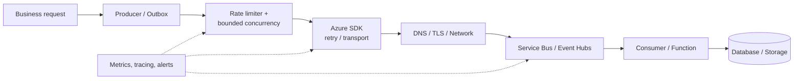
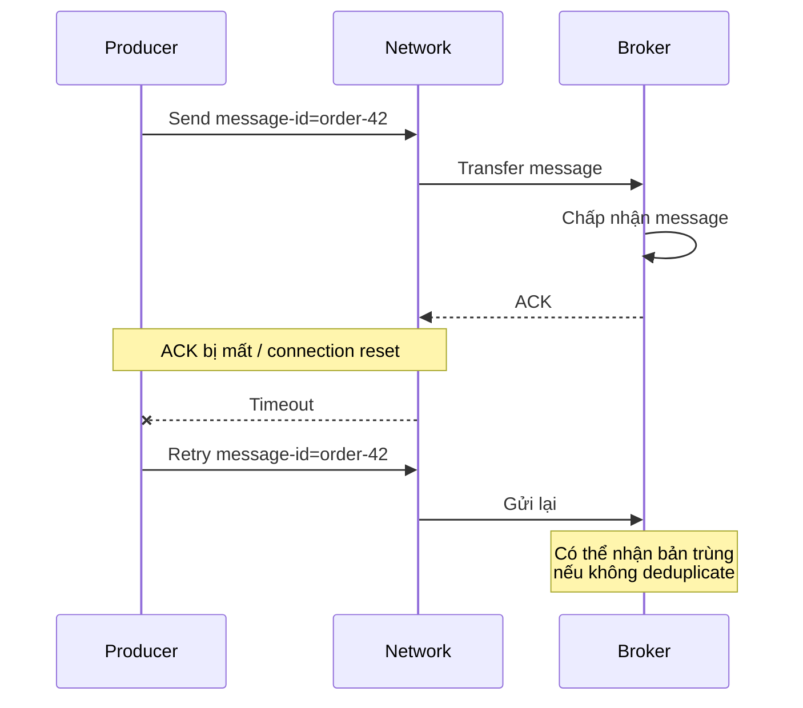
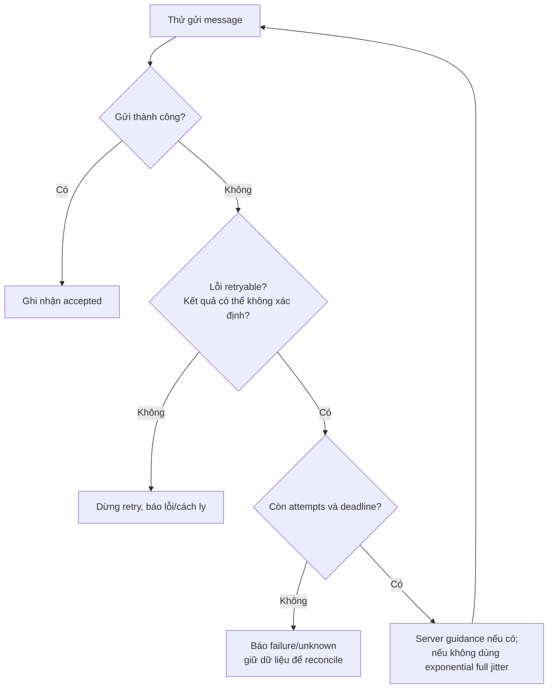
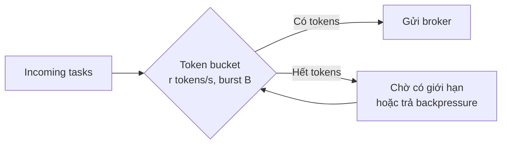
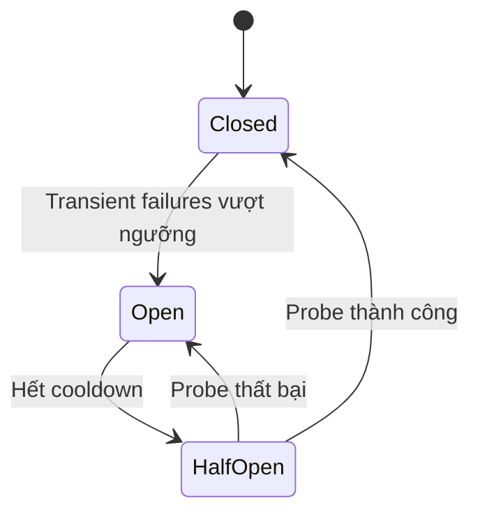
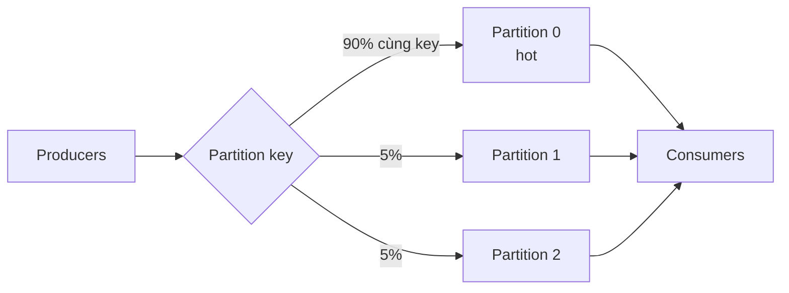
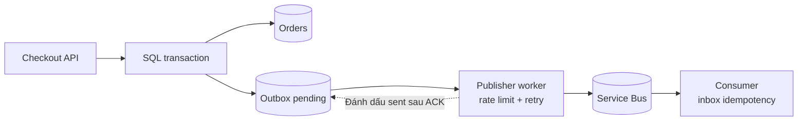
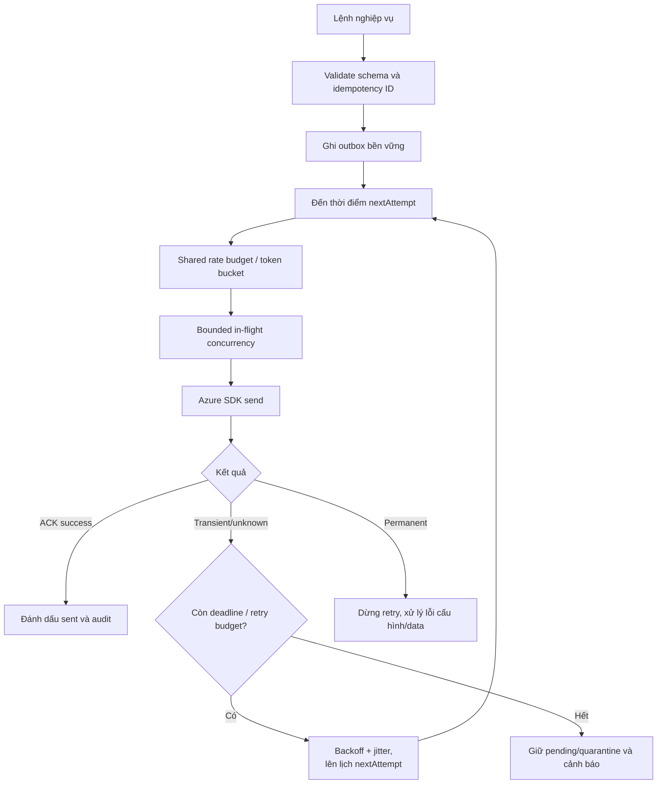

# Retry, backoff và kiểm soát thông lượng producer

Một ứng dụng đặt hàng gửi lệnh `CreateInvoice` vào **Azure Service Bus**. Trong giờ cao điểm, nhiều request đồng thời khiến producer gửi nhanh hơn khả năng của broker hoặc hệ thống phía sau. Một lần gửi có thể bị timeout, nhận tín hiệu throttling hoặc bị ngắt mạng. Nếu cứ thử lại tức thì từ mọi máy chủ, ứng dụng tạo ra **retry storm**: càng lỗi càng tăng tải, làm hệ thống phục hồi chậm hơn. Ngược lại, nếu bỏ message ngay sau lỗi đầu tiên, doanh nghiệp có thể mất đơn hàng. Vấn đề vì vậy không chỉ là “retry bao nhiêu lần”, mà là **retry có điều kiện, có ngân sách, có giãn cách và có cơ chế chống trùng**, đồng thời điều tiết lượng message được producer đưa vào hệ thống.

Bài học thuộc chương **Hàng đợi và thông điệp** của module **CLOUD_PROVIDERS_AZURE**. Module giới thiệu hệ sinh thái Microsoft Azure từ subscription, resource group và Microsoft Entra ID đến mạng ảo, dịch vụ tính toán, lưu trữ, dữ liệu; đồng thời học triển khai, giám sát, bảo vệ và kiểm soát chi phí kiến trúc ứng dụng Azure. Nội dung áp dụng tư duy reliability và capacity planning cho **Service Bus**, **Event Hubs**, **Azure Queue Storage** và các producer tự xây dựng. Mục tiêu là gửi dữ liệu đủ nhanh theo nhu cầu nhưng không làm quá tải broker, chi phí hoặc downstream.

**Sau bài học, bạn có thể:**

- Phân loại lỗi gửi message thành **tạm thời**, **vĩnh viễn** và **kết quả không xác định**.
- Thiết kế retry có **exponential backoff, full jitter, giới hạn số lần và deadline**.
- Giải thích vì sao timeout sau khi gửi tạo nguy cơ **duplicate** dù SDK đã báo lỗi.
- Áp dụng **idempotency key**, Service Bus duplicate detection hoặc transactional outbox đúng phạm vi.
- Kiểm soát thông lượng producer bằng **token bucket, leaky bucket, semaphore, batching, backpressure và circuit breaker**.
- Phân biệt thông lượng broker với thông lượng consumer/sink; phát hiện **hot partition** hoặc nghẽn do phân bố khóa.
- Thiết lập Azure SDK, identity, network, monitoring, alert và runbook vận hành.

## 1. Producer và hành trình của một lần gửi

**Producer** là ứng dụng tạo message/event và gửi tới queue, topic hoặc event hub. Producer có thể là API nhận request, batch job, Azure Function, ứng dụng IoT hoặc một hệ thống tích hợp.

Một lần gửi thường đi qua nhiều lớp:



Cần tách **ba chỉ số**:

1. **Producer rate:** số message/event hoặc bytes gửi đi mỗi giây.
2. **Broker accepted rate:** số message/event thực sự được broker chấp nhận và lưu theo ngữ nghĩa sản phẩm.
3. **Consumer completed rate:** tốc độ nghiệp vụ phía sau hoàn tất đúng.

Ba tốc độ không nhất thiết bằng nhau. Ví dụ producer đưa vào 600 message/giây trong khi consumer chỉ hoàn tất 400 message/giây: backlog tăng khoảng **200 message/giây**, tương đương **12.000 message mỗi phút**, nếu không có cơ chế giới hạn hoặc scale phù hợp. Việc producer nhận kết quả gửi thành công không có nghĩa đơn hàng đã được xử lý.

### 1.1. Broker acceptance khác business completion

| Mốc | Bằng chứng | Chưa chứng minh |
|---|---|---|
| Gọi hàm gửi trên SDK | Hàm được gọi | Network/broker đã nhận |
| SDK trả success | Broker đã phản hồi thao tác gửi theo giao thức | Consumer đã xử lý nghiệp vụ |
| Message nằm trong queue/event hub | Broker có dữ liệu trong phạm vi retention/cơ chế lưu trữ | Database đích đã commit |
| Consumer complete/checkpoint | Consumer đã xác nhận tiến độ theo cơ chế | Side effect được thực thi đúng một lần nếu code không idempotent |
| Database có bản ghi hợp lệ | Kết quả nghiệp vụ đã commit | Mọi hệ liên quan (email, đối tác) cũng đã đồng bộ |

Thiết kế cần nói rõ SLA đo ở đâu. Với lệnh thanh toán, KPI “HTTP 202 Accepted” hoặc “send success” **không thay thế** chỉ số giao dịch đã hoàn tất.

## 2. Phân loại lỗi trước khi quyết định retry

Không phải lỗi nào cũng nên được gửi lại. Một chính sách chỉ bắt mọi exception rồi sleep sẽ vừa làm chậm lỗi vĩnh viễn, vừa tạo traffic không cần thiết.

| Loại | Ví dụ | Phản ứng producer |
|---|---|---|
| **Transient / retryable** | Network reset, broker temporarily unavailable, server busy/throttling, timeout tạm thời | Retry có backoff, jitter, deadline và kiểm soát concurrency |
| **Permanent / non-retryable** | Payload vượt giới hạn entity/batch, sai schema cố định, entity không tồn tại, thiếu quyền sender, connection string sai | Không retry vô hạn; báo lỗi, sửa cấu hình hoặc đưa vào quarantine |
| **Conditional** | Hết quota dung lượng, entity bị disable, giới hạn policy, DNS bị cấu hình sai | Thường cần vận hành khắc phục; thử lại có điều kiện sau khi nguyên nhân thay đổi |
| **Ambiguous outcome** | Broker nhận message nhưng phản hồi ACK mất, SDK timeout sau khi gửi | Có thể phải retry nhưng **bắt buộc tính nguy cơ duplicate** |
| **Client overload** | Queue nội bộ producer đầy, process hết memory, số kết nối vượt ngưỡng | Dừng nhận thêm hoặc áp backpressure; không tạo vô số retry tasks |

Service Bus và Event Hubs thường trao đổi qua **AMQP** hoặc AMQP over WebSockets; ngoại lệ SDK có thể không biểu diễn trực tiếp thành mã HTTP. Những mã như **429 Too Many Requests**, **503 Service Unavailable** hoặc tín hiệu **Server Busy/throttled** là ví dụ chung, không có nghĩa mọi lần gửi AMQP đều trả HTTP 429.

### 2.1. Retry-After khi dịch vụ cung cấp

Một số API/giao thức trả thông tin yêu cầu chờ (*Retry-After* hoặc thời gian chờ tương đương). Khi có tín hiệu được SDK hỗ trợ, producer nên **tôn trọng khoảng chờ tối thiểu của server** và chính sách retry của SDK. Không tự giả định mọi lỗi Service Bus/Event Hubs đều cung cấp header `Retry-After`.

Nếu không có chỉ dẫn chờ rõ ràng, dùng chính sách **exponential backoff + jitter** với upper bound hợp lý. Cả hai trường hợp đều phải có tổng deadline.

### 2.2. Vì sao lỗi 401/403 không nên retry liên tục?

Giả sử một Azure Function dùng managed identity nhưng thiếu **Azure Service Bus Data Sender**. Gửi lại 100 lần chỉ tạo thêm log và latency; nó không cấp quyền mới. Quy trình đúng là kiểm tra principal, role assignment, scope, network và propagation.

Lỗi **401** có thể do credential/token; **403** có thể do quyền hoặc policy mạng. Phải đọc thông báo cụ thể và kiểm tra cấu hình trước khi xếp loại. Nếu token được SDK tự refresh, retry có thể phù hợp cho lỗi cấp token tạm thời, nhưng không nên lặp vô hạn khi role thiếu.

## 3. Kết quả gửi không xác định và nguyên tắc at-least-once

Một trong những tình huống khó nhất:



Khi SDK báo timeout, producer **không luôn biết** broker đã nhận hay chưa. Nếu không retry có thể mất nghiệp vụ; nếu retry có thể có message thứ hai. Đây là bài toán *ambiguous acknowledgement*, không phải lỗi riêng của một SDK.

**Nguyên tắc an toàn:** thiết kế producer theo hướng **at-least-once delivery attempt** cùng **idempotent effects** ở consumer. Không tuyên bố “exactly once” chỉ vì producer đã đặt số lần retry bằng 3 hoặc broker có tính năng duplicate detection.

### 3.1. Idempotency key

Mỗi lệnh nghiệp vụ cần ID ổn định qua các lần retry:

```json
{
  "schemaVersion": 1,
  "commandId": "cmd-order-42-invoice-v1",
  "orderId": "order-42",
  "action": "IssueInvoice",
  "occurredAt": "2026-11-20T10:00:00Z"
}
```

Khi retry cùng một **lệnh logic**, giữ nguyên `commandId` (và `MessageId`/event ID thích hợp). **Không tạo UUID mới cho từng lần thử** nếu mục tiêu là nhận diện chúng là cùng một lệnh.

Ở consumer hoặc database:

- Dùng unique constraint hoặc atomic conditional write theo ID nghiệp vụ.
- Ghi *inbox/processed-command ledger* và business side effect trong cùng transaction nếu có thể.
- Nếu ID đã xử lý, trả kết quả idempotent/no-op phù hợp.
- Nếu downstream cung cấp idempotency key (thanh toán, email), truyền ID ổn định.
- Có thời hạn lưu idempotency records đủ cho cửa sổ retry/replay thực tế.

### 3.2. Service Bus duplicate detection

Service Bus có tính năng **duplicate detection** khi entity/SKU hỗ trợ và được bật. Broker theo dõi `MessageId` trong một cửa sổ thời gian cấu hình; message có khóa trùng phù hợp trong cửa sổ có thể không được enqueue lần hai theo ngữ nghĩa dịch vụ.

Nhưng cần nhớ:

1. Không phải mọi tier/entity đều hỗ trợ tính năng như nhau; hãy kiểm tra cấu hình.
2. Deduplication chỉ có hiệu lực **trong cửa sổ đã cấu hình** và theo điều kiện partition/session/entity tương ứng.
3. Nó không thay thế giao dịch idempotent ở database hay xử lý duplicate phía consumer.
4. Với Event Hubs, đừng suy rằng trường `eventId` trong JSON tự kích hoạt broker-side deduplication.

**Không dựa vào MessageId mới ngẫu nhiên khi retry**, vì chính điều đó có thể vô hiệu lợi ích duplicate detection.

## 4. Exponential backoff và jitter

### 4.1. Fixed delay, exponential backoff

Nếu mọi worker retry sau đúng 1 giây, chúng có thể lại đánh broker cùng lúc:

```text
T=0:    10.000 request cùng gặp lỗi
T=1s:   10.000 request cùng retry
T=2s:   10.000 request cùng retry
=> Tải dồn theo nhịp, dịch vụ khó phục hồi.
```

**Exponential backoff** tăng thời gian chờ theo cấp số nhân:

\[
d_n = \min(d_{\max}, d_0 \times 2^n)
\]

Trong đó:

- `d_0`: thời gian chờ cơ sở.
- `n`: số lần retry đã lên lịch, tính từ 0.
- `d_max`: mức trần cho một lần chờ.

Ví dụ `d_0 = 200 ms`, `d_max = 5 s`:

| Retry thứ | Exponential delay trước jitter |
|---:|---:|
| 1 | 200 ms |
| 2 | 400 ms |
| 3 | 800 ms |
| 4 | 1.600 ms |
| 5 | 3.200 ms |
| 6 và sau đó | Tối đa 5.000 ms |

Các giá trị trên là **ví dụ tính toán**, không phải mặc định bắt buộc của Azure SDK.

### 4.2. Full jitter

**Full jitter** chọn ngẫu nhiên khoảng chờ trong đoạn:

\[
\mathrm{sleep}_n \sim U\left(0,\,\min(d_{\max},d_0 2^n)\right)
\]

Thay vì 10.000 producer cùng tỉnh dậy sau 800 ms, chúng phân tán trong cửa sổ chờ. Có những biến thể như equal jitter hoặc decorrelated jitter; **full jitter** là lựa chọn dễ hiểu và phù hợp cho nhiều client phân tán.



### 4.3. Jitter không thay thế rate limiter

Jitter giải quyết **sự đồng bộ của các retry**, nhưng producer vẫn có thể tạo 20.000 message mới mỗi giây nếu incoming requests quá nhiều. Rate limiter và bounded concurrency giải quyết áp lực tổng; retry và backoff chỉ giúp ứng phó với lỗi tạm thời.

## 5. Retry budget, deadline và timeout

Một chính sách gửi có trách nhiệm phải có **bốn giới hạn**:

1. **Max attempts:** tổng số lần gọi send, bao gồm lần đầu.
2. **Per-attempt timeout:** không để một lần gửi chờ vô hạn.
3. **End-to-end deadline:** tổng thời gian cho toàn bộ chuỗi retry.
4. **Retry budget:** giới hạn phần trăm/tổng số retry trong một cửa sổ tải để tránh retry storm.

Ví dụ:

```text
maxAttempts:         4
perAttemptTimeout:   2 giây (minh họa)
overallDeadline:     10 giây
backoffBase:         200 mili giây
backoffCap:          3 giây
retryBudget:         tối đa 10% tổng attempts trong cửa sổ quan sát
```

**Không phải cấu hình mặc định Azure.** Các con số cần xuất phát từ SLO, độ trễ broker, chi phí, mạng và khả năng mất kết nối. Một Function/HTTP request với deadline 3 giây không thể hợp lý nếu producer retry 10 lần kéo dài hàng phút.

### 5.1. Ngân sách retry toàn hệ thống

Nếu mỗi trong 4 tầng (API, integration SDK, job worker, broker adapter) retry 3 lần, số lần gọi thực tế có thể bị **nhân lên** khi các tầng cùng lặp lại. Tổ chức cần quyết định tầng nào chịu trách nhiệm retry:

- Azure SDK xử lý một số lỗi network/transport theo policy của SDK.
- Producer orchestration quyết định tổng deadline/business idempotency.
- Outbox publisher chịu trách nhiệm retry bền vững sau khi HTTP request kết thúc.
- Consumer có cơ chế retry/settlement riêng, không gộp cùng retry của producer.

Không bọc vô điều kiện **một SDK đã có retry 5 lần** trong vòng lặp 5 lần nữa mà không tính tổng số lần gửi.

### 5.2. Deadline khác TTL của message

- **Producer deadline:** thời điểm ngừng cố gửi cho một request/job.
- **Message TTL:** thời gian message tồn tại theo chính sách broker (phụ thuộc entity/tier và trạng thái).
- **Processing SLA:** thời gian từ lúc nghiệp vụ bắt đầu tới khi consumer hoàn tất.

Một message đến queue trước deadline gửi nhưng bị xử lý trễ hơn TTL vẫn có thể không đáp ứng nghiệp vụ. Phải quan sát cả backlog/age và consumer health.

## 6. Retry policy bằng Python: phân loại, deadline và full jitter

Ví dụ sau chỉ dùng **Python standard library** để minh họa algorithm. Nó nhận hàm `send_once` và bộ phân loại lỗi `is_retryable` từ caller; **không tự đoán mọi exception Azure SDK đều tạm thời**.

```python
import random
import time
from collections.abc import Callable
from typing import TypeVar

T = TypeVar("T")


def send_with_bounded_retry(
    send_once: Callable[[], T],
    is_retryable: Callable[[Exception], bool],
    *,
    max_attempts: int = 4,
    overall_timeout_s: float = 10.0,
    base_delay_s: float = 0.2,
    max_delay_s: float = 3.0,
) -> T:
    if max_attempts < 1 or overall_timeout_s <= 0:
        raise ValueError("Invalid retry budget")

    deadline = time.monotonic() + overall_timeout_s

    for attempt in range(max_attempts):
        if time.monotonic() >= deadline:
            raise TimeoutError("Send deadline exhausted")
        try:
            # SDK must also have a bounded per-attempt timeout.
            return send_once()
        except Exception as exc:
            # Caller must recognize real transient failures; never retry all.
            if not is_retryable(exc):
                raise
            if attempt + 1 >= max_attempts:
                raise

            remaining = deadline - time.monotonic()
            if remaining <= 0:
                raise TimeoutError("Send deadline exhausted") from exc

            ceiling = min(max_delay_s, base_delay_s * (2 ** attempt))
            # Full jitter, bounded by the remaining overall budget.
            time.sleep(min(random.uniform(0, ceiling), remaining))

    raise AssertionError("Unreachable")
```

**Giới hạn của ví dụ:**

- Caller phải chọn exception retryable dựa trên Azure SDK đang dùng: network timeout, transient/server busy, throttling, v.v. **Không** gán mặc định `lambda exc: True`.
- Deadline ở đây giới hạn vòng lặp và thời gian chờ **giữa** các lần gọi; nếu `send_once()` có thể treo lâu, cần đặt **timeout ở chính SDK/transport**. Hàm đồng bộ này không thể tự ngắt một blocking call đang chạy.
- Nếu SDK đã có retry nội bộ, chỉnh policy để tránh **retry lồng nhau** ngoài dự kiến.
- Nếu server trả hướng dẫn chờ cụ thể, cần bổ sung logic ưu tiên khoảng chờ đó, kiểm soát thời gian còn lại.
- Nếu ACK bị mất, vòng lặp này có thể gửi trùng. **Giữ idempotency key ổn định** và xử lý trùng ở broker/consumer.
- Với ứng dụng async, dùng `asyncio.sleep` và async SDK, không dùng `time.sleep` chặn event loop.

### 6.1. Bộ phân loại lỗi phải có quy trình

Một chính sách production có thể phân nhóm theo các exception classes của SDK, diagnostic reason và error codes của Azure SDK version đang sử dụng:

```text
Retryable:
  - transient network reset / send timeout
  - server busy / throttling / temporary service unavailable

Non-retryable:
  - message/event quá lớn, batch không hợp lệ
  - entity không tồn tại/disabled theo tình trạng lâu dài
  - access denied do role/policy/secret sai

Ambiguous:
  - timeout sau khi transfer có thể đã tới broker
  - connection lost trước khi nhận confirmation
```

Nhiều lỗi **ambiguous** cũng thuộc loại retryable về mặt vận hành, nhưng phải giữ ID và thực hiện reconciliation/idempotency. Log classification cần mô tả kết quả là `unknown` thay vì vội kết luận “broker chưa nhận”.

## 7. Rate limiting: token bucket và leaky bucket

Retry giúp phục hồi sau lỗi, còn **rate limiting** giúp producer không tự tạo ra lỗi do tải cao.

### 7.1. Token bucket

Token bucket có:

- **Refill rate** `r`: số tokens bổ sung mỗi giây.
- **Burst capacity** `B`: số tokens tối đa được tích trữ.
- **Cost** của mỗi thao tác: thường 1 token/message, hoặc tính theo số bytes/kích thước batch.

Nếu thiết lập `r = 100 message/s` và `B = 200`, producer có thể gửi một burst tối đa khoảng 200 message khi bucket đầy, sau đó tốc độ bền vững quay về khoảng 100 message/s.



### 7.2. Leaky bucket

Leaky bucket tạo dòng đầu ra gần đều hơn bằng cách để yêu cầu vào hàng chờ và xử lý ở tốc độ tương đối ổn định. Token bucket cho phép burst hữu hạn. Chọn theo yêu cầu:

| Nhu cầu | Cơ chế |
|---|---|
| Cho phép burst nhỏ nhưng giữ rate bền vững | Token bucket |
| Làm mượt luồng gửi, giữ nhịp gần cố định | Leaky bucket / paced queue |
| Giới hạn số request đang chạy cùng lúc | Semaphore / bounded worker pool |
| Hạn chế RAM và việc chờ vô hạn | Bounded queue + admission control |
| Ngăn retry khi broker rõ ràng đang quá tải | Circuit breaker / cooldown |

Trong thực tế thường dùng **kết hợp** token bucket, semaphore và bounded queue; không có một cơ chế đơn lẻ thay thế tất cả.

### 7.3. Python token bucket dùng trong một process

Ví dụ kiểm soát thao tác gửi bằng Python standard library:

```python
import threading
import time


class TokenBucket:
    def __init__(self, rate_per_second: float, burst: int):
        if rate_per_second <= 0 or burst < 1:
            raise ValueError("Invalid token bucket settings")
        self.rate = rate_per_second
        self.capacity = float(burst)
        self.tokens = float(burst)
        self.updated = time.monotonic()
        self.lock = threading.Lock()

    def acquire(self, cost: float = 1.0):
        if cost <= 0 or cost > self.capacity:
            raise ValueError("Invalid cost")
        while True:
            with self.lock:
                now = time.monotonic()
                elapsed = now - self.updated
                self.tokens = min(
                    self.capacity, self.tokens + elapsed * self.rate
                )
                self.updated = now
                if self.tokens >= cost:
                    self.tokens -= cost
                    return
                delay = (cost - self.tokens) / self.rate
            # Sleep outside the lock so other senders can proceed.
            time.sleep(delay)


# Demo only: at most ~20 tokens/second in steady state,
# with a burst capacity of 40 tokens per process.
bucket = TokenBucket(rate_per_second=20.0, burst=40)
# bucket.acquire()
# send_message()
```

**Quan trọng:** limiter trên chỉ giới hạn **một process**. Nếu triển khai 10 instances, mỗi instance có 20 token/giây, tổng hệ có thể đạt khoảng **200 message/giây**, chưa kể burst. Để giới hạn **toàn bộ ứng dụng/tenant/namespace**, cần phân bổ ngân sách cho các instances hoặc một distributed rate limiter/đầu mối producer phù hợp.

### 7.4. Throttling theo bytes thay vì chỉ messages

1.000 message mỗi giây, mỗi message 500 bytes, khác rất nhiều so với 1.000 message mỗi giây, mỗi message 200 KB. Broker có thể bị giới hạn **operations, bytes ingress, connections, throughput units, processing units** và các ràng buộc SKU khác nhau.

Khi payload biến thiên mạnh, token cost có thể dựa trên **ước lượng bytes** hoặc **số operations**, thậm chí dùng nhiều giới hạn đồng thời. Một batch 100 sự kiện cũng không được coi ngang một message 1 KB nếu tổng batch gần giới hạn kích thước.

## 8. Bounded concurrency và backpressure

### 8.1. Rate và concurrency không giống nhau

Rate limiter giới hạn **số thao tác/giây**; concurrency limiter giới hạn **số thao tác đang chờ ACK cùng lúc**.

Ví dụ producer cần gửi 100 message/s, latency ACK trung bình 0,2 s. Số thao tác đồng thời tối thiểu lý thuyết khoảng:

\[
L \approx \lambda W = 100 \times 0.2 = 20
\]

Đây là áp dụng định luật Little trong trạng thái ổn định, **không phải** tham số SDK mặc định. Nếu latency p99 cao hơn, số thao tác cần thiết hoặc yêu cầu buffer có thể tăng; phải đo thực tế và không dùng ước lượng này để cho phép tạo tác vụ không giới hạn.

### 8.2. Semaphore cho số lần gửi in-flight

Trong Python async:

```python
import asyncio

semaphore = asyncio.Semaphore(16)


async def bounded_send(send_once_async):
    async with semaphore:
        await send_once_async()
```

Ví dụ chỉ giới hạn **16 lần gọi đang chạy trong một event loop/process**, không áp giới hạn trên toàn bộ Function App khi scale ra nhiều instances. Hơn nữa, hàng nghìn coroutine **đợi semaphore** vẫn chiếm bộ nhớ; cần bounded queue và admission policy ở phía trước.

### 8.3. Bounded queue và admission control

Khi producer nhận yêu cầu nhanh hơn khả năng gửi lâu dài, phải xác định chính sách:

| Cách xử lý | Dùng khi | Rủi ro cần quản lý |
|---|---|---|
| Chờ trong hàng đợi nội bộ có giới hạn | Spike ngắn, deadline còn đủ | Queue đầy, tăng request latency |
| Trả HTTP `429` hoặc tín hiệu backpressure phù hợp | Client có thể retry và hợp đồng API cho phép | Cần hướng dẫn chờ, tránh client retry dồn |
| Ghi **transactional outbox** rồi trả trạng thái accepted | Nghiệp vụ không được mất yêu cầu | Outbox storage, delivery SLA và publisher worker |
| Loại bỏ event không thiết yếu có chủ đích | Telemetry sampling được phê duyệt | Mất độ đầy đủ dữ liệu; phải ghi tỷ lệ sampling |
| Chia hoặc giảm tốc producer upstream | Có quyền kiểm soát nguồn gửi | Phối hợp nhiều hệ thống/partner |

**Không dùng unbounded queue trong RAM** cho dữ liệu nghiệp vụ quan trọng. Khi process restart, các message chưa gửi có thể biến mất; khi broker chậm, RAM tăng không kiểm soát.

## 9. Circuit breaker và thích ứng tốc độ

### 9.1. Circuit breaker

Circuit breaker theo dõi lỗi liên tiếp hoặc lỗi theo cửa sổ:

- **Closed:** cho phép gửi bình thường.
- **Open:** tạm dừng những lần gửi mới vào dependency đang lỗi.
- **Half-open:** cho phép một lượng nhỏ yêu cầu thử để kiểm tra phục hồi.



Khi circuit mở, message nghiệp vụ cần được **giữ bền vững** (outbox) hoặc trả một kết quả thất bại rõ cho caller. Circuit breaker không phải lý do bỏ dữ liệu lặng lẽ.

### 9.2. Adaptive rate control

Ngoài giới hạn cố định, producer có thể giảm tốc khi:

- Tỷ lệ server busy/throttled tăng.
- Latency ACK p95/p99 tăng.
- Tỷ lệ retry tăng hoặc deadline failures nhiều.
- Consumer lag/backlog vượt ngưỡng SLO.
- Downstream database hoặc storage bị throttling.

Sau khi ổn định, tăng tốc **từ từ**, không nhảy ngay về tốc độ cũ. Cơ chế như **AIMD — additive increase, multiplicative decrease** có thể giúp giảm rate mạnh khi nghẽn và tăng từng bước khi healthy. Đây là chiến lược do ứng dụng thiết kế, không phải hành vi mặc định của mọi Azure messaging SDK.

### 9.3. Đừng dùng backlog làm tín hiệu duy nhất

Backlog cao có thể do consumer lỗi, không nhất thiết broker thiếu throughput; tăng producer sẽ làm tệ hơn. Ngược lại, backlog thấp nhưng broker send latency cao có thể do throttling hoặc network dù consumer vẫn xử lý nhanh.

Theo dõi **accepted ingress, retry rate, send latency, backlog age, consumer egress và downstream health** cùng lúc trước khi thay rate.

## 10. Batching để nâng hiệu quả gửi

Mỗi lần gọi mạng có chi phí thiết lập, serialization và ACK. **Batching** gộp nhiều message/event, giảm số round trips và overhead. Tuy nhiên batch có giới hạn kích thước và khiến kết quả lỗi của một lần gửi ảnh hưởng nhiều phần tử hơn.

### 10.1. Thiết kế batch

| Quyết định | Cân nhắc |
|---|---|
| Batch size | SDK/entity/SKU có maximum size; không vượt giới hạn |
| Batch fill timeout | Chờ đủ batch quá lâu làm tăng latency |
| Retry batch | ACK không chắc chắn có thể khiến **cả batch** bị gửi lại |
| Ordering | Partition key/session ID ảnh hưởng nhóm message và thứ tự |
| Memory | Batch quá lớn làm tăng RAM và GC |
| Downstream | Batch ingress nhanh có thể làm consumer/sink nghẽn hơn |

**Không đồng nhất batch send với giao dịch nghiệp vụ xuyên nhiều entity.** Các hạn chế atomicity và transaction scope tùy dịch vụ/SKU/API; phải kiểm tra trước khi dùng batching để bảo đảm consistency.

### 10.2. Service Bus batch ví dụ với SDK Python

Đoạn mã **minh họa thao tác gửi**, cần cài `azure-servicebus` và `azure-identity` phiên bản tương thích. Producer có Azure RBAC **Azure Service Bus Data Sender** cho queue được chọn, có kết nối mạng và DNS phù hợp:

```python
import os
from azure.identity import DefaultAzureCredential
from azure.servicebus import ServiceBusClient, ServiceBusMessage

namespace = os.environ["SERVICEBUS_FULLY_QUALIFIED_NAMESPACE"]
queue_name = os.environ["SERVICEBUS_QUEUE_NAME"]

credential = DefaultAzureCredential()
with ServiceBusClient(
    fully_qualified_namespace=namespace,
    credential=credential,
) as client:
    with client.get_queue_sender(queue_name=queue_name) as sender:
        batch = sender.create_message_batch()
        # Giữ MessageId ổn định cho cùng business command khi retry.
        batch.add_message(
            ServiceBusMessage(
                "Invoice request for order-42",
                message_id="cmd-order-42-invoice-v1"
            )
        )
        sender.send_messages(batch)
```

SDK xây `ServiceBusMessageBatch` để không vượt giới hạn batch đã xác định. Khi thêm message mới:

- Nếu `add_message` báo quá giới hạn batch, gửi batch hiện tại (theo retry policy hợp lệ), rồi tạo batch khác.
- Nếu **một message riêng lẻ** đã quá lớn, cần báo lỗi/quarantine/chuyển payload lớn sang Blob và gửi tham chiếu; **không retry cùng payload nguyên vẹn vô hạn**.
- Không tạo lại `MessageId` khi retry một batch logic. Consumer vẫn phải idempotent vì deduplication có giới hạn.
- SDK có thể đã có retry nội bộ; cần hiểu cấu hình `retry_total`/retry mode của phiên bản dùng trước khi bọc một vòng lặp ứng dụng.

**Code mẫu không tự áp rate limiter.** Khi production, đặt token bucket/semaphore hoặc outbox publisher phía trước `send_messages` để tránh spike.

## 11. Event Hubs producer: throughput, partitions và batch

Event Hubs phù hợp với telemetry/event stream có tần suất cao. Với producer, có ba quyết định:

1. **Số event và bytes/sec** mà namespace/event hub tier có thể nhận.
2. **Partition key** để phân bố tải và giữ thứ tự theo thực thể cần thiết.
3. **Batching và retry** theo chính sách SDK, đồng thời bảo đảm event ID ổn định khi có send outcome ambiguous.

### 11.1. Hot partition

Nếu mọi sự kiện gửi với `partition_key="tenant-big"`, chúng có thể dồn vào một partition. Dù tổng throughput của Event Hubs còn khả năng, partition đó có thể gây nghẽn và làm tăng lag.



Hãy chọn key có **cardinality đủ cao** để phân bố tải, đồng thời đáp ứng ràng buộc thứ tự. Với clickstream không cần thứ tự theo người dùng, có thể không cần ép mọi sự kiện về cùng một key; với event theo order, cần cân nhắc thứ tự trong partition.

### 11.2. Event Hubs batch với SDK Python

Ví dụ dùng `azure-eventhub` và `azure-identity`. Đường vào Azure cần role **Azure Event Hubs Data Sender** ở scope tương ứng:

```python
import os
from azure.identity import DefaultAzureCredential
from azure.eventhub import EventData, EventHubProducerClient

namespace = os.environ["EVENTHUB_FULLY_QUALIFIED_NAMESPACE"]
hub = os.environ["EVENTHUB_NAME"]

credential = DefaultAzureCredential()
with EventHubProducerClient(
    fully_qualified_namespace=namespace,
    eventhub_name=hub,
    credential=credential,
) as producer:
    batch = producer.create_batch(partition_key="shop-42")
    batch.add(EventData('{"eventId":"evt-9001","type":"PageViewed"}'))
    batch.add(EventData('{"eventId":"evt-9002","type":"Clicked"}'))
    producer.send_batch(batch)
```

`EventDataBatch.add` có thể từ chối event không còn vừa batch. Khi đó gửi batch hiện tại rồi tạo batch mới; không phải cứ tăng số messages là Event Hubs tự mở vô hạn giới hạn batch. Không gộp các key khác nhau trong cùng batch nếu cần logic partition key riêng.

**Cảnh báo:** nếu gửi batch timeout sau khi broker đã chấp nhận, retry cả batch có thể tạo **duplicate events**. Event Hubs không mặc nhiên deduplicate theo trường `eventId` của JSON. Downstream phải idempotent hoặc áp cơ chế tương đương.

### 11.3. Throughput units, processing units và quota

Event Hubs có mô hình capacity khác nhau theo tier (ví dụ throughput units/processing units hoặc các đơn vị tương ứng trong tier), giới hạn inbound bandwidth, events/sec, partitions và connections. Cần xem tier/region/quota thực tế để sizing.

**Không lấy số partitions nhân với một throughput mặc định** rồi tuyên bố toàn bộ namespace đạt tốc độ đó trong mọi SKU. Namespace capacity, độ lớn event, producer batching, partition skew và consumer processing cùng quyết định throughput thực tế.

## 12. Azure Queue Storage: retry đơn giản vẫn cần chống trùng

**Azure Queue Storage** phù hợp với một số workload hàng đợi đơn giản. Dù API khác Service Bus, nguyên tắc producer vẫn giống nhau:

- Một request gửi message có thể timeout sau khi dịch vụ đã nhận.
- Retry send có thể tạo message **trùng logic**.
- Queue Storage dùng semantics **visibility timeout/dequeue**, khác với Peek-Lock/settlement của Service Bus.
- Không suy rằng queue có session ordering, broker-side duplicate detection hoặc dead-letter subqueue giống Service Bus.

Với Storage Queue, SDK có retry policy riêng (Azure Storage SDK), và cần tính transaction rate, bandwidth, storage account limits cùng **Azure Storage Queue Data Message Sender** khi dùng identity-based authorization phù hợp.

Nếu cần delayed delivery, TTL, ordering hoặc poison-message handling, phải đối chiếu **tính năng thật của dịch vụ**; không tự copy thông số Service Bus như `MaxDeliveryCount` hoặc DLQ rồi giả định Storage Queue thực hiện tương tự.

## 13. Transactional outbox: không để request nghiệp vụ mất message

Giả sử REST API lưu đơn hàng vào SQL và **sau đó** gửi lệnh `IssueInvoice`. Nếu API crash sau SQL commit nhưng trước khi gửi, đơn hàng tồn tại mà message không đến broker.

**Transactional outbox** giải quyết hai hành động khó đồng bộ:

1. Trong **cùng database transaction**, ghi business row và outbox row.
2. Một publisher worker đọc các outbox rows chưa được xác nhận.
3. Publisher dùng rate limiter + bounded retry để gửi broker.
4. Sau khi SDK báo send success, đánh dấu outbox row đã gửi.
5. Nếu crash ở giữa bước 3 và 4, có thể gửi lại **cùng MessageId**; consumer idempotent ngăn hiệu ứng trùng.



### 13.1. Outbox không tự tạo exactly-once publish

Nếu broker accepted nhưng ACK mất, publisher có thể gửi lại. Nếu broker accepted và publisher crash trước khi đánh dấu `sent`, khi restart cũng có thể gửi lại. Outbox bảo vệ **không mất lệnh sau business commit**, còn consumer/đích phải bảo vệ **không áp dụng tác dụng nhiều lần**.

### 13.2. Quản lý outbox backlog

Outbox cần có:

- Unique event ID, transaction timestamp, schema version.
- Retry count, next attempt time, error category và trạng thái.
- Lease/claim record để nhiều publisher không gửi cùng row ngoài ý muốn.
- DLQ/quarantine hoặc escalation cho record không thể gửi.
- Data retention và cleanup sau khi đã đối soát.
- Alert cho oldest pending age, số pending rows và retry storm.

**Không dùng vòng lặp vô hạn trong HTTP request** để giải quyết lỗi broker; hãy giữ tác vụ bền vững rồi trả trạng thái theo API contract (ví dụ accepted/pending).

## 14. Kết hợp rate limiter, retries và outbox đúng thứ tự

Một pipeline gửi thông điệp đề xuất:



Không thực hiện `time.sleep` trong một worker rồi giữ khóa outbox transaction hàng phút. Thay vào đó, ghi `nextAttemptAt`, nhả claim/lease theo thiết kế và để scheduler worker chọn lại khi tới hạn.

### 14.1. Khi nào trả lỗi trực tiếp cho client?

| Kiểu API | Hành vi có thể chọn | Ràng buộc |
|---|---|---|
| Đồng bộ, cần xác nhận broker accepted trước khi trả HTTP success | Chờ send trong deadline ngắn, nếu unknown thì trả trạng thái không chắc chắn/reconcile | Client retries phải dùng idempotency key |
| Đồng bộ ghi DB/outbox rồi gửi nền | Trả `202 Accepted` kèm request ID/trạng thái pending theo contract | Có công cụ query kết quả cuối, không nhầm 202 với xử lý xong |
| Telemetry không thiết yếu | Có thể sampling/drop theo hợp đồng dữ liệu | Phải đo dropped rate, thông báo rõ giới hạn |
| Financial command quan trọng | Durable outbox và reconciliation | Không được drop âm thầm hoặc retry vô hạn không kiểm soát |

## 15. Global throughput control trong hệ thống scale-out

Một limiter mỗi instance không đảm bảo toàn hệ. Ví dụ 8 replicas mỗi replica giới hạn 100 message/s, tổng có thể lên 800 message/s. Nếu broker target chỉ an toàn ở 400 message/s, vẫn có nguy cơ throttling.

Ba mô hình:

1. **Phân bổ ngân sách:** mỗi instance nhận quota từ controller; cập nhật khi số instances thay đổi.
2. **Distributed rate limiter:** sử dụng một coordinator/state store nhất quán phù hợp với tải và failure model.
3. **Shared durable queue/outbox publisher:** tập trung gửi qua một nhóm workers có concurrency được kiểm soát.

**Không có phương án miễn phí độ phức tạp:** limiter phân tán thêm latency, một publisher duy nhất có thể thành bottleneck, quota tĩnh có thể lãng phí capacity. Chọn theo SLO, độ lớn tải, fairness và chi phí.

### 15.1. Fairness giữa các tenants/độ ưu tiên

Nếu một tenant gửi 90% lưu lượng, các tenant khác có thể bị đói capacity. Cân nhắc:

- Rate limit **theo tenant/producer** cộng quota toàn namespace.
- Hàng đợi/publisher riêng cho workload quan trọng theo yêu cầu isolation.
- Weighted fair scheduling hoặc priority queues ở tầng ứng dụng khi phù hợp.
- Không để telemetry khối lượng lớn làm trì hoãn lệnh thanh toán.

Rate limiting có thể triển khai ở API gateway, producer workers hoặc cả hai. Tuy nhiên **broker namespace quota** vẫn là ràng buộc chung nếu các workload chia namespace.

## 16. Monitoring: đo gửi thành công và áp lực thực

Nhóm chỉ số nên quan sát:

| Nhóm | Metrics/tín hiệu | Ý nghĩa |
|---|---|---|
| Producer | Send attempts/s, success/s, failures/s | Tách **lần thử** khỏi **message được chấp nhận** |
| Retry | Retry attempts, retry ratio, backoff histogram, deadline exhausted | Phát hiện retry storm |
| Latency | Send ACK p50/p95/p99, outbox age | Broker/network chậm hoặc lệnh chờ |
| Rate control | Token wait time, rejected/admission-limited requests, queue depth | Limiter đang giữ tải ở mức nào |
| Service Bus | Incoming/outgoing messages, active/dead-letter count, server busy/throttled | Kiểm tra broker và consumer backlog |
| Event Hubs | Incoming events/bytes, throttled requests, partitions/lag, outgoing metrics | Phát hiện namespace limit và hot partition |
| Consumer | Processing success/s, lag/backlog age, retry/DLQ/quarantine | Đo tiến độ nghiệp vụ |
| Dependency | SQL/Storage 429/503, timeouts, connection saturation | Ngăn producer làm sink quá tải |
| Cost | Broker units, operations, logs, egress, Functions/VM compute | Tối ưu cost per accepted/business message |

Không phải mọi metric có sẵn nguyên tên như trong bảng ở Azure Monitor cho mọi tier/API. Khi triển khai cần ánh xạ sang **Azure Monitor metrics, Application Insights custom metrics, SDK tracing và logs** thực tế.

### 16.1. Correlation và structured logs

Một bản ghi producer nên có:

```json
{
  "operation": "SendBusinessCommand",
  "commandId": "cmd-order-42-invoice-v1",
  "destination": "servicebus:orders",
  "attempt": 2,
  "outcome": "unknown_after_timeout",
  "elapsedMs": 1900,
  "retryable": true,
  "nextDelayMs": 780
}
```

Trong thực tế, thêm trace/correlation ID, producer instance, SDK exception category và kích thước payload. **Không log connection string, SAS token, bearer token hoặc toàn bộ payload chứa PII**.

### 16.2. Alert theo SLO

Có thể cảnh báo khi:

- Retry ratio tăng bất thường so với baseline.
- Send success rate giảm trong khi attempts/s tăng.
- Broker throttling kéo dài dù producer đã backoff.
- Outbox oldest pending age vượt ngân sách trễ.
- Service Bus DLQ/backlog age tăng.
- Event Hubs ingress throttled hoặc consumer lag tiến sát retention.
- Database downstream có nhiều timeout/429.
- Chi phí compute, broker hoặc log tăng ngoài kế hoạch.

**Không cảnh báo chỉ dựa trên queue depth tuyệt đối** nếu workload có burst dự kiến. Kết hợp **age of oldest message**, consumer completed rate và SLO để phân biệt spike bình thường với backlog không thể phục hồi.

## 17. Case study A: flash sale gây Retry Storm trên Service Bus

**Bối cảnh:** website bình thường có 100 đơn hàng/phút, trong sự kiện flash sale tăng lên 10.000 đơn/phút. Nhiều API instances cùng gửi `IssueInvoice` vào Service Bus và gặp `ServerBusy`/timeout.

### 17.1. Thiết kế dễ thất bại

```text
for mỗi request:
  tạo MessageId mới
  send()
  nếu lỗi: retry ngay 10 lần, không jitter
  không có max concurrency
  không có outbox
```

Hậu quả:

- Retry tạo burst lớn hơn request gốc.
- MessageId thay đổi khiến broker không thể liên hệ các lần thử cùng lệnh để duplicate detection.
- API latency tăng mạnh, hết thread/socket.
- Một số lệnh mất khi process crash, số khác được gửi trùng.
- Consumer/billing database nhận tải vượt khả năng.

### 17.2. Thiết kế tốt hơn

1. Mỗi đơn hàng có `commandId` ổn định.
2. Checkout API ghi order + outbox trong một transaction.
3. Publisher workers lấy outbox theo batch vừa phải.
4. Rate limiter giới hạn accepted send rate theo ngân sách chung.
5. Semaphore chặn số sends in-flight.
6. SDK retry transient theo bounded backoff/jitter; app kiểm soát overall deadline.
7. Bản gửi chưa chắc chắn vẫn giữ pending để reconcile, không tạo ID mới.
8. Consumer idempotent, ghi invoice theo unique order ID/command ID.
9. Theo dõi oldest pending, success rate, p95 send latency và DLQ.

**Kết quả cần đánh giá bằng test:** backlog có giảm dần sau peak không, tỷ lệ trùng nghiệp vụ có bằng 0 không, error budget của checkout có đạt không, broker/sink có bị throttling kéo dài không.

## 18. Case study B: Event Hubs telemetry và hot partition

**Bối cảnh:** nền tảng đo hoạt động người dùng đẩy 50.000 sự kiện/giây. Producer gom batch lớn nhưng luôn dùng cùng partition key `global-web`. Metrics cho thấy Event Hub bị throttling; consumer lag tăng ở một partition.

### 18.1. Phân tích

- Các event có cùng key được gán theo logic partitioning khiến tải không được trải đều.
- Tăng số instances producer không sửa được skew; có thể tăng số retries.
- Batch giúp giảm overhead nhưng không loại bỏ quota/partition bottleneck.
- Nếu consumer xử lý một partition quá chậm, event retention có thể hết trước khi bắt kịp.

### 18.2. Phương án

1. Xác định có cần thứ tự global hay chỉ thứ tự theo session/user/device.
2. Chọn partition key có phân phối tốt hơn, vẫn bảo toàn ordering cần thiết.
3. Batch theo ngưỡng bytes và max wait time; không tạo một event vượt limit.
4. Rate limiter dựa trên ingress bytes/sec và events/sec, không chỉ calls/sec.
5. Theo dõi per-partition skew, send latency, throttling và consumer lag.
6. Nếu capacity namespace thực sự không đủ, đánh giá tăng tier/capacity theo khả năng dịch vụ.
7. Consumer dùng checkpoint, idempotency và quarantine; tính retention đủ cho thời gian dừng dự kiến.

**Không thay đổi partition key mà bỏ qua tác động tới thứ tự nghiệp vụ**: cùng logical entity có thể chuyển partition ở giai đoạn cutover. Khi cần bảo toàn thứ tự nghiêm ngặt, phải có phương án versioning/sequence ở tầng ứng dụng.

## 19. Case study C: API partner bắt buộc whitelist và throttle

**Bối cảnh:** producer chạy trong Azure Functions, cần gửi message cho Service Bus private và sau đó consumer gọi API đối tác chỉ cho tối đa 200 request/s. Function App scale-out từ 2 lên 20 instances.

**Nguy cơ:** nếu mỗi instance áp limiter 200 request/s, toàn hệ có thể gửi đến 4.000 request/s, vượt giới hạn đối tác. Lỗi `429` từ đối tác được consumer retry dồn, tạo backlog và tăng thời gian xử lý.

**Thiết kế:**

- Đặt ngân sách tổng **200 request/s** hoặc thấp hơn theo hợp đồng, với cơ chế phân phối quota toàn hệ.
- Giới hạn số calls đồng thời, tránh bùng nổ connections.
- Khi đối tác trả `Retry-After` thực tế, tôn trọng chỉ dẫn và jitter/giới hạn chung.
- Dùng outbox/queue bền vững thay vì giữ tất cả request trong bộ nhớ.
- Tách rate của **producer tới broker** với rate của **consumer tới đối tác**: broker có thể nhận nhanh nhưng consumer phải xử lý theo quota API.
- Đo oldest pending age, DLQ, API throttle và độ trễ nghiệp vụ end-to-end.

## 20. Runbook xử lý throttling và send failures

### Giai đoạn 1 — Khoanh vùng

1. Xác nhận **dịch vụ đích**: Service Bus, Event Hubs hay Storage Queue; namespace/entity/tier.
2. Đọc **mã/loại lỗi gốc** từ SDK: transient, permanent, ambiguous hay client overload.
3. Xem send attempts/s so với accepted/s, error rate, retry ratio và latency.
4. Kiểm tra namespace ingress, entity message size, quota và trạng thái service.
5. Kiểm tra network/DNS, firewall, managed identity/Data Sender role và token.
6. Kiểm tra consumer lag/backlog và downstream health để không tối ưu sai chỗ.

### Giai đoạn 2 — Ổn định

1. Nếu có retry storm, **giảm concurrency/rate**, dùng backoff với jitter và tổng deadline.
2. Dừng các producer không thiết yếu hoặc giảm sampling theo chính sách khi cần.
3. Với lệnh quan trọng, **giữ trong outbox** và không discard khi broker tạm lỗi.
4. Khi server hướng dẫn retry interval, tuân thủ theo khả năng SDK.
5. Với 403/invalid payload, sửa quyền/schema thay vì tiếp tục retry.
6. Không xóa dữ liệu pending hoặc nới toàn bộ quyền Azure chỉ để hết lỗi tạm thời.

### Giai đoạn 3 — Phục hồi và đối soát

1. Cho phép một lượng nhỏ send probes để xác nhận broker đã phục hồi.
2. Tăng rate từ từ; quan sát throttling và latency.
3. Đối soát `MessageId`/`eventId` giữa outbox, broker và sink nếu có thể.
4. Replay/quarantine các message không hợp lệ theo runbook, có idempotency.
5. Kiểm tra backlog age và downstream throughput về mức SLO.
6. Ghi RCA, cập nhật quota/limiter và test retry scenario tránh lặp lỗi.

## 21. Các lỗi thiết kế thường gặp

| Triệu chứng | Nguyên nhân | Cách sửa |
|---|---|---|
| Thêm retry thì lỗi tăng nhanh | Retry đồng bộ, không jitter hoặc không ngân sách | Exponential full jitter, rate limit, deadline |
| Message bị ghi hai lần | ACK loss, ID thay đổi, consumer không idempotent | Stable MessageId + inbox/unique constraint |
| SDK timeout nhưng broker có message | Ambiguous outcome | Không khẳng định fail chắc; reconcile, idempotency |
| Hết memory lúc broker chậm | Unbounded queue hoặc tạo task vô hạn | Bounded queue, semaphore, backpressure |
| Rate limiter vẫn vượt quota | Mỗi instance giữ một limiter riêng | Global budget/distributed control |
| Lưu lượng nhỏ nhưng send latency cao | DNS/TLS/network hoặc quá nhiều kết nối khởi tạo | Reuse SDK clients, đo transport và network |
| Event Hubs có một partition nóng | Partition key quá tập trung | Chọn key phân bố tốt hơn, xét ordering |
| Batch lớn bị reject | Vượt max batch/event size | Dùng SDK batch builder, chia batch, quarantine event oversized |
| Một payload lỗi bị retry mãi | Non-retryable bị coi transient | Classification, validation, quarantine |
| Broker accepted nhanh nhưng nghiệp vụ chậm | Consumer/DB là bottleneck | Scale consumer/sink, rate-match, đo backlog age |
| Mất message khi web API restart | Pending send chỉ nằm trong RAM | Transactional outbox/durable queue |
| Function App báo 403 | Thiếu role data-plane hoặc sai principal/scope | Kiểm tra managed identity và Sender role |
| Private Endpoint có nhưng không kết nối | DNS/route sai hoặc public access bị tắt | Kiểm tra FQDN, private DNS, VNet/firewall |
| SDK retry + custom retry tạo quá nhiều attempts | Retry lồng nhau | Chọn một overall retry owner, tính total attempts |

## 22. Checklist production

- [ ] Đã phân biệt Service Bus, Event Hubs và Storage Queue theo semantics/message workload.
- [ ] Có schema version, stable message/event ID và correlation ID.
- [ ] Đã phân loại transient, permanent, ambiguous send outcomes.
- [ ] Retry policy có exponential backoff, jitter, max attempts và deadline.
- [ ] Đã xem default retry của SDK, không tạo retry lồng nhau không kiểm soát.
- [ ] Có idempotency ở consumer/database; Service Bus duplicate detection chỉ là lớp bổ sung.
- [ ] Có transaction outbox hoặc cơ chế lưu bền vững cho business commands quan trọng.
- [ ] Có token bucket/leaky bucket hoặc cơ chế rate shaping phù hợp.
- [ ] Có giới hạn số sends in-flight và bounded pending queue.
- [ ] Khi scale-out, limiter có **ngân sách tổng**, không chỉ per-instance.
- [ ] Batching không vượt message/event size; xét nguy cơ retry cả batch.
- [ ] Event Hubs partition key được đánh giá skew và yêu cầu thứ tự.
- [ ] Broker capacity/quota/SKU được xác minh; rate theo operations **và** bytes.
- [ ] Managed identity có Data Sender role và network/private DNS hoạt động.
- [ ] Có metrics send attempts, accepted, retry ratio, p95/p99, backlog age và downstream.
- [ ] Đã test timeout sau ACK, 429/ServerBusy, 403, invalid payload, broker outage và restart.
- [ ] Có runbook giảm tải, reconcile, replay và rollback khi thay đổi rate/SDK.

## 23. Câu hỏi tự kiểm tra

1. Tại sao một lần `send_messages()` timeout không chứng minh broker chưa nhận dữ liệu?
2. Vì sao `MessageId` cần ổn định giữa các lần retry cùng lệnh nghiệp vụ?
3. Service Bus duplicate detection giải quyết được gì và không thay thế điều gì?
4. Phân biệt lỗi transient, permanent và ambiguous; cho mỗi loại một ví dụ.
5. Tại sao fixed delay dễ tạo retry storm khi hàng nghìn producers gặp cùng sự cố?
6. Viết công thức exponential backoff capped và giải thích full jitter.
7. Vì sao max attempts mà không có deadline/per-attempt timeout vẫn có thể làm request chờ rất lâu?
8. Token bucket với `r=100/s` và `B=200` cho phép burst và rate ổn định như thế nào?
9. Semaphore 16 giải quyết gì? Vì sao vẫn cần bounded queue?
10. Một Function App có 10 instances, mỗi instance rate 20/s. Rate toàn ứng dụng có thể đạt bao nhiêu?
11. Vì sao Event Hubs producer cần tính cả bytes/s, partitions và partition key?
12. Khi `EventDataBatch.add` từ chối một event, nên xử lý thế nào thay vì retry mãi?
13. Producer được broker ACK nhưng consumer ghi database thất bại: nên đo thành công ở đâu?
14. Transactional outbox bảo vệ mất message như thế nào? Vì sao vẫn có thể có duplicate sends?
15. Một hệ thống nhận 600 message/s và xử lý 400/s. Backlog thay đổi ra sao trong một phút?
16. Tại sao 401/403 do thiếu role không nên dùng exponential retry vô hạn?
17. Vì sao rate limiter per-instance không bảo vệ được global namespace quota khi autoscale?
18. Nêu những metric cần kiểm tra trước khi quyết định tăng capacity broker hoặc giảm rate producer.

## Kết luận

**Retry** không phải cơ chế “thử lại càng nhiều càng tốt”. Producer vững chắc cần **phân loại lỗi**, giới hạn số lần và tổng thời gian, dùng **exponential backoff với jitter**, đồng thời giải quyết kết quả gửi **không xác định** bằng ID ổn định và idempotency. **Rate limiter** kiểm soát lượng request mới; **semaphore** giới hạn số lần gửi đồng thời; **bounded queue/outbox** bảo vệ tài nguyên và dữ liệu khi broker chậm; **circuit breaker** tránh đổ thêm tải khi phụ thuộc chưa phục hồi. Với Azure Service Bus, cần hiểu duplicate detection và giao nhận message; với Event Hubs, cần chú ý batch bytes, partitions và hot keys; với Storage Queue, không tự giả định có các tính năng settlement của Service Bus. Kết hợp quản trị Azure RBAC, mạng, monitoring, cost và runbook sẽ giúp hệ thống messaging chịu được tăng tải, throttling và lỗi mạng mà không làm mất hoặc nhân đôi tác dụng nghiệp vụ.
