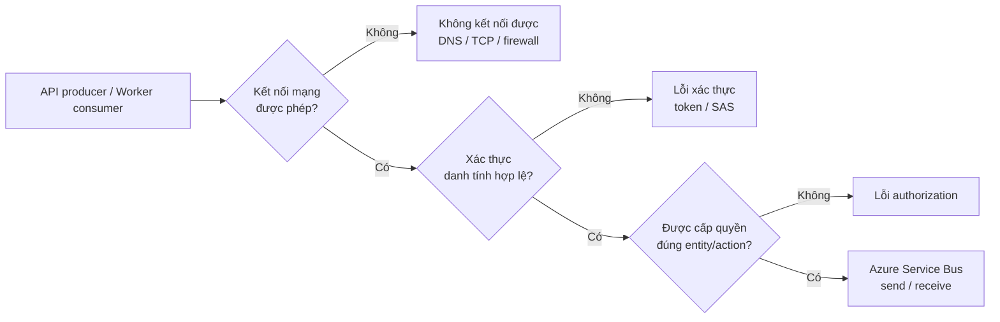
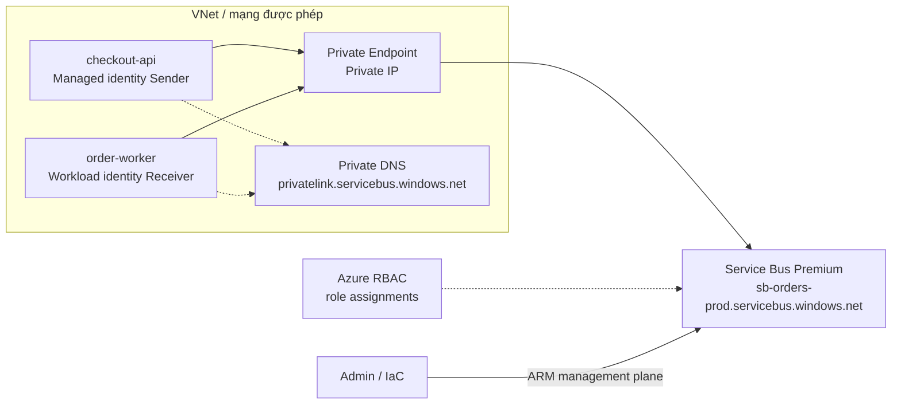
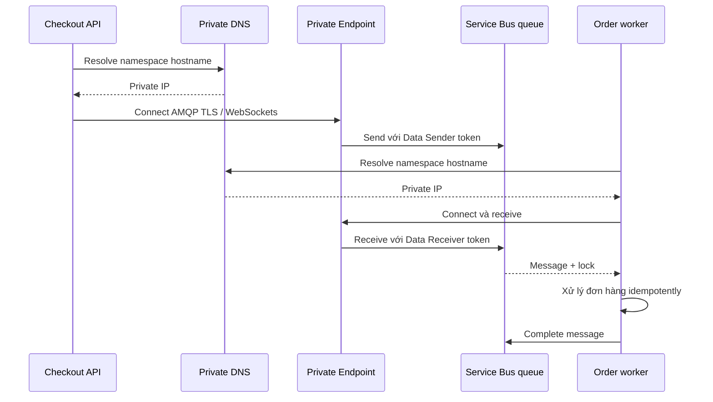

# Phân quyền và truy cập mạng riêng cho Service Bus

Một hệ thống đặt hàng có ba thành phần: API gửi thông điệp vào hàng đợi, worker nhận thông điệp để xử lý và nhóm vận hành quản trị Azure Service Bus. Nếu cả ba cùng dùng một connection string có quyền `Manage`, việc lộ khóa ở một worker có thể tạo rủi ro cho toàn namespace. Nếu tổ chức yêu cầu Service Bus chỉ được truy cập từ mạng doanh nghiệp mà namespace vẫn mở endpoint công khai, mô hình mạng chưa đáp ứng yêu cầu dù code đã xác thực.

**Azure Service Bus** hỗ trợ trao đổi thông điệp tin cậy qua **queue** và **topic/subscription**. Khi thiết kế bảo mật, cần kết hợp hai câu hỏi độc lập: **ai được phép làm gì?** (Microsoft Entra ID, Azure RBAC hoặc chính sách SAS) và **kết nối được đi qua đâu?** (public endpoint có giới hạn hay Azure Private Link). Một danh tính có đủ quyền nhưng không có đường mạng sẽ không sử dụng được dịch vụ; một kết nối mạng thành công cũng không đồng nghĩa được phép gửi hoặc nhận thông điệp.

Trong module **CLOUD_PROVIDERS_AZURE**, bạn học Microsoft Azure từ subscription, resource group, Microsoft Entra ID đến mạng ảo, tính toán, lưu trữ và dữ liệu, đồng thời triển khai, giám sát, bảo vệ và kiểm soát chi phí hệ thống. Bài thuộc chương **Hàng đợi và thông điệp**, hướng dẫn bảo vệ Service Bus từ quyền truy cập dữ liệu tới thiết kế private endpoint, kèm ví dụ Azure CLI, Java SDK, quy trình kiểm tra và xử lý lỗi.

## 1. Mục tiêu học tập

Sau bài học, bạn có thể:

- Phân biệt **management plane** và **data plane** của Service Bus.
- Chọn đúng role **Azure Service Bus Data Sender**, **Data Receiver** và **Data Owner** theo nguyên tắc quyền tối thiểu.
- Cấp role cho user, service principal hoặc **managed identity** ở scope phù hợp và hiểu thời gian lan truyền quyền.
- So sánh **Microsoft Entra ID (OAuth)** với **Shared Access Signature (SAS)** và lý do cần hạn chế khóa dùng chung.
- Giải thích sự khác nhau giữa **IP firewall**, **virtual network service endpoint** và **private endpoint**.
- Thiết kế private endpoint cho Service Bus Premium, DNS `privatelink.servicebus.windows.net`, tuyến mạng và cổng giao thức.
- Cấu hình ứng dụng Java dùng `DefaultAzureCredential` mà không lưu connection string trong source.
- Kiểm tra kết nối, token, role, DNS và firewall có hệ thống; không khắc phục bằng cách mở public access vô điều kiện.

## 2. Hiểu kiến trúc bảo mật của Service Bus

**Namespace** là ranh giới tổ chức tài nguyên Service Bus và endpoint kết nối. Bên trong namespace có thể chứa **queue** và **topic**; mỗi topic có thể có nhiều **subscriptions** để các nhóm consumer xử lý sự kiện. Ứng dụng gửi và nhận thông điệp thông qua endpoint của namespace, ví dụ `sb-orders-prod.servicebus.windows.net`.

| Thành phần | Vai trò | Điều cần bảo vệ |
|---|---|---|
| Namespace | Cấu hình dịch vụ, tier, networking và danh tính | Quyền thay đổi network rule, SAS policy, khóa và identity |
| Queue | Gửi/nhận point-to-point | Producer chỉ được gửi, consumer chỉ được nhận |
| Topic | Phát sự kiện cho nhiều luồng xử lý | Giới hạn publisher theo topic |
| Subscription | Nhận bản sao message theo filter/rule | Giới hạn subscriber theo nhu cầu xử lý |
| Client | API, worker, Functions, AKS, VM hoặc công cụ quản trị | Danh tính thực tế, token, mạng và khả năng lưu secret |

### Hai lớp kiểm soát phải cùng hợp lệ



Lớp mạng không thay thế lớp quyền và ngược lại. Trong triển khai production, ứng dụng còn cần kiểm tra nội dung message, xử lý lặp lại, retry, time-to-live và dead-letter; cấu hình RBAC/private endpoint không tự giải quyết các vấn đề nghiệp vụ này.

## 3. Management plane khác data plane như thế nào?

### Management plane (Azure Resource Manager)

Các thao tác **quản lý hạ tầng** gồm tạo namespace, thay đổi SKU, cấu hình networking, tạo queue/topic, thay đổi chính sách, cấp Azure RBAC và xóa tài nguyên. Chúng được điều khiển qua Azure Resource Manager và các role như **Reader**, **Contributor**, **Owner** hoặc custom role có quyền tương ứng.

**Quan trọng:** người có quyền quản lý rộng có thể thay đổi chính sách truy cập hoặc, trong một số cấu hình, lấy/sửa khóa SAS. Vì vậy, cấp role management plane rộng là vấn đề bảo mật dù ứng dụng bình thường dùng Microsoft Entra ID.

### Data plane (gửi và nhận message)

Các thao tác **sử dụng thông điệp** gồm:

- Gửi message vào queue hoặc topic.
- Nhận/complete/abandon/dead-letter message trong queue hoặc subscription.
- Những thao tác dữ liệu khác mà role Service Bus hỗ trợ.

Với **Microsoft Entra ID**, quyền data plane cần được cấp bằng các role tương ứng. **Azure RBAC Reader trên namespace không tự cấp quyền nhận message**, và **Azure RBAC Contributor** dùng cho quản lý không nên được xem là cách tối ưu để cấp quyền gửi/nhận qua OAuth.

| Danh tính | Quyền nghiệp vụ mong muốn | Vai trò điển hình |
|---|---|---|
| Checkout API | Chỉ gửi message đơn hàng | **Azure Service Bus Data Sender** |
| Order worker | Nhận và complete message từ queue | **Azure Service Bus Data Receiver** |
| Dịch vụ phát sự kiện | Publish vào một topic | **Azure Service Bus Data Sender** |
| Notification consumer | Nhận sự kiện từ subscription | **Azure Service Bus Data Receiver** |
| Công cụ vận hành data plane cần kiểm soát toàn diện | Thao tác dữ liệu theo phạm vi quản trị đã phê duyệt | **Azure Service Bus Data Owner** |
| Nhóm vận hành hạ tầng | Tạo namespace, kiểm soát network/role | Azure RBAC management role thích hợp; không cấp Data Owner mặc định |

**Data Owner không phải Azure Resource Manager Owner**: tên role có vẻ giống nhau nhưng phạm vi và quyền khác nhau. Trước khi cấp bất kỳ role nào, xem `Actions`/`DataActions` của định nghĩa role theo Azure RBAC để hiểu chính xác.

## 4. Azure RBAC scopes và cách áp dụng least privilege

Role assignment bao gồm **principal**, **role** và **scope**. Scope thường có thể là subscription, resource group, Service Bus namespace hoặc mức thực thể mà Azure RBAC hỗ trợ, tùy chức năng và phiên bản API.

### Thứ tự phạm vi cần cân nhắc

1. **Queue hoặc topic/subscription phù hợp**, nếu loại role và entity đang dùng hỗ trợ scope đó.
2. **Namespace** nếu ứng dụng cần nhiều queue/topic trong cùng một namespace.
3. **Resource group/subscription** chỉ khi thật sự cần phạm vi quản trị rộng và được kiểm soát.

Ví dụ nếu producer chỉ gửi vào queue `orders`, cấp **Data Sender tại queue** thích hợp hơn cấp **Data Owner trên namespace**. Nếu consumer cần nhận từ subscription `email` của topic `events`, xác minh scope role hỗ trợ rồi cấp quyền nhận tại phạm vi nhỏ nhất có hiệu lực. Role assignment ở scope cha có thể được kế thừa; kiểm tra cả quyền được kế thừa khi đánh giá truy cập.

### Ai là principal?

- **User:** người phát triển cần thử gửi/nhận trong lab hoặc nhóm vận hành được cấp quyền tạm thời.
- **Service principal:** ứng dụng tự động hóa có credential/certificate hoặc phương thức federated identity.
- **System-assigned managed identity:** danh tính gắn với Azure Functions, App Service, VM hoặc tài nguyên hỗ trợ; có vòng đời theo tài nguyên.
- **User-assigned managed identity:** danh tính độc lập có thể gán cho nhiều tài nguyên được hỗ trợ, quản lý vòng đời riêng.
- **AKS workload identity:** liên kết Kubernetes ServiceAccount với Microsoft Entra identity thông qua federation khi môi trường và SDK hỗ trợ.

Không nhầm **client ID** với **principal/object ID** khi tạo role assignment. Với managed identity, principal ID thường được dùng làm `--assignee-object-id`, còn client ID có thể dùng để yêu cầu ứng dụng chọn một user-assigned identity cụ thể.

### Lưu ý propagation và cache token

Sau khi thêm hoặc thu hồi role, Azure RBAC có thể cần thời gian để thay đổi có hiệu lực ở data plane. Token hoặc client kết nối dài hạn có thể tiếp tục dùng thông tin đã cache. Khi kiểm thử:

1. Xác nhận role assignment đúng principal, scope và môi trường.
2. Chờ quá trình propagation hợp lý.
3. Làm mới token hoặc kết nối theo khả năng SDK; không in token ra log.
4. Thử lại thao tác nhỏ, phân biệt lỗi từ role với lỗi network.

Không vội cấp quyền rộng hơn chỉ vì phép thử ngay sau role assignment vẫn báo 403.

## 5. Microsoft Entra ID và SAS: nên chọn thế nào?

### Xác thực bằng Microsoft Entra ID

Ứng dụng có thể dùng **OAuth access token** từ Microsoft Entra ID để tương tác với Service Bus thông qua Azure SDK. `DefaultAzureCredential` giúp chọn nguồn token phù hợp với môi trường, ví dụ developer credentials ở local hoặc managed identity trên Azure.

Ưu điểm:

- Không phải nhúng connection string hoặc SAS key cố định vào mã nguồn.
- Role data plane được cấp theo principal và scope.
- Thu hồi/điều chỉnh quyền qua Microsoft Entra ID và Azure RBAC.
- Thuận tiện với managed identity, workload identity và kiểm soát truy cập doanh nghiệp.

Nhưng token hợp lệ **không đủ** khi role data plane thiếu hoặc mạng bị chặn.

### Xác thực bằng Shared Access Signature

**Shared Access Signature (SAS)** dựa trên shared access authorization rules/key hoặc token được cấp quyền `Send`, `Listen`, `Manage` theo quy tắc SAS áp dụng. Nhiều hệ thống cũ dùng connection string chứa shared key.

Rủi ro:

- Key dùng chung giữa nhiều ứng dụng khó truy vết từng workload.
- Một khóa lộ có thể cho phép truy cập theo toàn bộ phạm vi của policy cho đến khi được thu hồi/rotate.
- Policy có quyền `Manage` rộng hơn rất nhiều nhu cầu gửi hoặc nhận message thông thường.
- Connection string thường vô tình bị đưa vào source code, logs, CI pipeline hoặc ticket.

Với ứng dụng Azure hỗ trợ Microsoft Entra ID, **ưu tiên managed identity + RBAC**. Nếu cần SAS do tích hợp bên thứ ba, dùng policy quyền tối thiểu, lưu trong kho secret được phê duyệt, đặt kế hoạch rotation và giới hạn network.

### Có nên tắt local/SAS authentication?

Service Bus hỗ trợ cấu hình **vô hiệu hóa local authentication** trong những điều kiện dịch vụ phù hợp. Khi tắt, các client còn sử dụng SAS/connection string có thể ngừng hoạt động. Vì vậy:

1. Kiểm kê toàn bộ producer, consumer, function triggers, connector, jobs và công cụ quản trị.
2. Chuyển từng client sang Entra ID, xác minh role và khả năng lấy token.
3. Kiểm thử workload chạy từ private network, retry và khởi động lại.
4. Sau khi mọi client đã chuyển đổi và có kế hoạch rollback, mới tắt local authentication.

**Tắt SAS không đồng nghĩa chặn public network.** Đó là hai chính sách riêng cần được cấu hình và kiểm chứng độc lập.

## 6. Kiến trúc quyền và mạng cho hệ thống đặt hàng

Giả sử:

- `checkout-api` chạy trên Azure App Service/Functions, chỉ được gửi message vào queue `orders`.
- `order-worker` chạy trên Azure Kubernetes Service, chỉ được nhận message từ queue `orders`.
- Namespace Service Bus là `sb-orders-prod` ở một region phù hợp.
- Chính sách bảo mật yêu cầu **đường dữ liệu từ các workload đi qua VNet/private endpoint**.



Trong thiết kế này:

- **RBAC** quy định ai được gửi/nhận.
- **Private endpoint** cung cấp địa chỉ private cho Service Bus namespace.
- **Private DNS** giúp client tiếp tục sử dụng tên namespace chuẩn nhưng phân giải tới private IP từ mạng thích hợp.
- **VNet integration/AKS routing** giúp workload thực sự đến được private endpoint.
- **Public network access** cần cấu hình theo chính sách, sau khi đã xác nhận kết nối private hoạt động.

Không cần sửa hostname trong SDK thành `privatelink.servicebus.windows.net`: client vẫn thường dùng `sb-orders-prod.servicebus.windows.net` và DNS đảm nhiệm việc định tuyến đúng tới private IP.

## 7. Tầng dịch vụ và khả năng network của Service Bus

Azure Service Bus có các tier như Basic, Standard và Premium, với giới hạn và khả năng riêng. **Private Endpoint (Azure Private Link) dành cho Service Bus namespace yêu cầu Premium trong mô hình hỗ trợ thông thường**; kiểm tra khả năng hiện hành theo region, subscription và cấu hình namespace trước khi thiết kế. Các cơ chế IP filtering và VNet rules/service endpoints cũng có giới hạn theo tier và phiên bản tính năng.

| Khả năng | Mục đích | Cần xác minh trước triển khai |
|---|---|---|
| **Public endpoint + authentication** | Truy cập qua endpoint công khai với token hoặc SAS | Public network policy, identity/role, TLS |
| **IP firewall rules** | Hạn chế public access theo địa chỉ/range IP nguồn khi tier hỗ trợ | IP egress thực tế của client/NAT, giới hạn và tier |
| **VNet service endpoint rules** | Giới hạn public service endpoint theo subnet được cho phép | Tier được hỗ trợ, service endpoint và cách route |
| **Private endpoint / Private Link** | Truy cập Service Bus qua private IP trong VNet | **Premium tier**, private endpoint approval, DNS và routing |
| **Public network access Disabled** | Chặn data-plane public endpoint theo chính sách | Còn đường private hợp lệ cho tất cả client/runtime |

**IP firewall không biến namespace thành dịch vụ có private IP.** Virtual network service endpoint vẫn liên quan đường truy cập public service endpoint được nhận diện bằng VNet/subnet; private endpoint mới là mô hình có network interface/private IP riêng trong VNet của bạn.

Hãy phân biệt **network reachability**, **network policy** và **data-plane authorization** thay vì dùng một chính sách duy nhất để thay thế cả ba.

## 8. Thực hành Azure RBAC: cấp Sender và Receiver đúng scope

### 8.1. Chuẩn bị lab và xác minh bối cảnh

Ví dụ sử dụng tên tài nguyên minh họa:

| Thành phần | Tên/giá trị mẫu | Ghi chú |
|---|---|---|
| Subscription | `<subscription-id>` | Thay bằng subscription được phép |
| Resource group Service Bus | `rg-messaging-lab` | Chứa namespace |
| Namespace | `sb-orders-lab` | Namespace đã tồn tại |
| Queue | `orders` | Producer gửi, consumer nhận |
| Function App producer | `func-checkout-lab` | Có system-assigned managed identity |
| Worker consumer | `mi-order-worker` | User-assigned identity hoặc principal đã cấu hình |

Người thực hiện role assignment phải có quyền quản lý access như **Role Based Access Control Administrator** hoặc **Owner** ở scope phù hợp; **Reader** không đủ. Các lệnh bên dưới thay đổi Azure RBAC, chỉ chạy trong môi trường được phê duyệt.

### 8.2. Bật identity cho producer

```bash
az login
az account set --subscription "<subscription-id>"

# Bật system-assigned managed identity trên Function App lab.
az functionapp identity assign \
  --resource-group "rg-functions-lab" \
  --name "func-checkout-lab"

# Nhận principal/object ID thực tế.
SENDER_PRINCIPAL_ID=$(az functionapp identity show \
  --resource-group "rg-functions-lab" \
  --name "func-checkout-lab" \
  --query principalId \
  --output tsv)

echo "Producer principal ID: $SENDER_PRINCIPAL_ID"
```

Nếu Function App đã có identity, không cần bật lại. Với user-assigned identity, principal ID được lấy từ tài nguyên managed identity và ứng dụng phải được cấu hình sử dụng **đúng client ID**. Không hoán đổi client ID với principal ID trong lệnh gán role.

### 8.3. Tạo role assignment ở queue

```bash
SB_ID=$(az servicebus namespace show \
  --resource-group "rg-messaging-lab" \
  --name "sb-orders-lab" \
  --query id \
  --output tsv)

QUEUE_SCOPE="$SB_ID/queues/orders"

# Checkout API chỉ được gửi message.
az role assignment create \
  --assignee-object-id "$SENDER_PRINCIPAL_ID" \
  --assignee-principal-type ServicePrincipal \
  --role "Azure Service Bus Data Sender" \
  --scope "$QUEUE_SCOPE"

# Đọc lại role assignment, kể cả role được kế thừa từ cha.
az role assignment list \
  --scope "$QUEUE_SCOPE" \
  --include-inherited \
  --output table
```

Đối với consumer, lấy `principalId` từ **identity thực sự được worker sử dụng**, không lấy mặc định identity của AKS control plane:

```bash
# Với user-assigned managed identity có tên mi-order-worker.
RECEIVER_PRINCIPAL_ID=$(az identity show \
  --resource-group "rg-identities-lab" \
  --name "mi-order-worker" \
  --query principalId \
  --output tsv)

az role assignment create \
  --assignee-object-id "$RECEIVER_PRINCIPAL_ID" \
  --assignee-principal-type ServicePrincipal \
  --role "Azure Service Bus Data Receiver" \
  --scope "$QUEUE_SCOPE"
```

Ví dụ giả định identity `mi-order-worker` đã tồn tại và đã được liên kết với workload theo cách được hỗ trợ (ví dụ AKS Workload Identity). **Cấp role chưa tự gắn identity cho pod/VM/container**. Bạn phải kiểm tra cả cơ chế workload nhận token.

### 8.4. Thu hồi quyền khi không cần

Việc thu hồi role là thay đổi bảo mật có thể làm ứng dụng dừng. Trong quy trình deprovision, xác minh principal và scope trước khi xóa:

```bash
# Ví dụ chỉ đọc để kiểm tra role của principal trước khi thu hồi:
az role assignment list \
  --assignee "$SENDER_PRINCIPAL_ID" \
  --scope "$QUEUE_SCOPE" \
  --output json
```

Trên production, thu hồi theo thay đổi được phê duyệt và kiểm tra ứng dụng còn quyền nào được **kế thừa** từ subscription, resource group hoặc namespace. Xóa một role assignment ở queue chưa chắc làm mất quyền nếu cùng principal vẫn có một role rộng ở scope cha.

## 9. Private Endpoint: namespace Service Bus truy cập bằng private IP

**Private Endpoint** là network interface trong VNet của bạn, có private IP và liên kết đến một dịch vụ hỗ trợ **Azure Private Link**. Với Service Bus Premium, private endpoint thường được tạo cho **namespace**, không tạo một NIC riêng cho từng queue hoặc topic.

Ví dụ:

```text
Producer trong VNet 10.20.0.0/16
        |
        | nslookup sb-orders-prod.servicebus.windows.net
        v
Private DNS -> 10.20.10.6
        |
        v
Private Endpoint 10.20.10.6
        |
        v
Service Bus Premium namespace
        |
        +-- Queue: orders
        +-- Topic: order-events
```

**Private endpoint giải quyết đường mạng**, không tự cấp role gửi/nhận và không đồng nghĩa public endpoint đã bị vô hiệu hóa. Sau khi kiểm thử private path, cần xem xét **Public network access: Disabled** theo chính sách tổ chức.

### 9.1. Chuẩn bị thiết kế

Trước khi tạo private endpoint, xác định:

1. Namespace đang ở **Premium tier** và có hỗ trợ tính năng tại region.
2. VNet/subnet chứa private endpoint hoặc nơi được phép kết nối qua peering/VPN/ExpressRoute.
3. DNS resolver được dùng bởi App Service, AKS, VM và máy ở on-premises.
4. Route và network security policy cho luồng dữ liệu tới private IP.
5. Quyền quản trị namespace/private endpoint; quy trình phê duyệt connection nếu cần.
6. Những workload ngoài VNet hoặc công cụ phát triển đang dùng public endpoint phải có đường chuyển đổi hợp lệ.

**Đặt private endpoint trong VNet không tự tạo đường mạng từ Azure Functions/App Service.** Các dịch vụ này có thể cần **outbound VNet integration** theo hosting plan, còn AKS cần cấu hình mạng và DNS phù hợp.

### 9.2. Tạo private endpoint bằng Azure portal

1. Mở [Azure portal](https://portal.azure.com/), chọn đúng subscription/resource group.
2. Chọn Service Bus namespace Premium, vào mục **Networking** hoặc **Private endpoint connections**.
3. Chọn **Add private endpoint** theo luồng portal hiện hành.
4. Chọn resource Service Bus namespace đích; **subresource/group ID** tương ứng với namespace.
5. Chọn VNet, subnet và vùng triển khai của endpoint phù hợp với chính sách mạng.
6. Tích hợp với **Private DNS zone** `privatelink.servicebus.windows.net` khi khả năng quản lý DNS của tổ chức cho phép.
7. Tạo tài nguyên, chờ trạng thái private endpoint connection được **Approved**.
8. Xác minh private IP, DNS zone record và quyền truy cập từ **một workload thật** trong mạng.

Nếu dùng DNS tập trung hoặc mạng hub-and-spoke, thiết lập DNS forwarding/link phù hợp thay vì để portal tạo nhiều private DNS zone trùng lặp không nhất quán.

### 9.3. Ví dụ Azure CLI tạo private endpoint

Đây là các lệnh **làm thay đổi hạ tầng mạng**. Chỉ chạy trên lab đã được phê duyệt; kiểm tra ID, resource group, VNet/subnet và loại private endpoint trước khi áp dụng.

```bash
az login
az account set --subscription "<subscription-id>"

NAMESPACE_ID=$(az servicebus namespace show \
  --resource-group "rg-messaging-lab" \
  --name "sb-orders-lab" \
  --query id --output tsv)

az network private-endpoint create \
  --resource-group "rg-network-lab" \
  --name "pe-sb-orders" \
  --vnet-name "vnet-app-lab" \
  --subnet "snet-private-endpoints" \
  --private-connection-resource-id "$NAMESPACE_ID" \
  --group-id "namespace" \
  --connection-name "pc-sb-orders"
```

Lệnh minh họa tạo kết nối private endpoint; **DNS zone integration không mặc nhiên hoàn chỉnh** nếu bạn chưa tạo/link private DNS zone và zone group/record phù hợp. Nếu CLI/version báo tham số khác, đối chiếu `az network private-endpoint create --help` trước khi sửa lệnh. Không tạo lại private endpoint chỉ vì kết nối mạng chưa thông: cần xác định DNS, routing hoặc approval đang sai ở đâu.

### 9.4. Khi nào tắt public network access?

Chỉ sau khi các client quan trọng **đã kết nối thành công bằng private path**, kiểm tra lại chính sách namespace:

1. Producer/consumer trong VNet gửi và nhận message mẫu thành công.
2. AKS/App Service/Functions/on-premises (nếu có) phân giải hostname đúng private IP.
3. Runtime và managed identity lấy token được; message processing và retry hoạt động.
4. Công cụ vận hành/điều tra có cách truy cập qua mạng được phép.
5. Có phương án rollback hoặc maintenance window nếu cắt public access làm gián đoạn client.
6. Trong portal, đặt **Public network access: Disabled** theo tính năng và tier hỗ trợ.

**Public network access Disabled** không nên được bật trước khi có đường private hoạt động nếu tổ chức chưa chấp nhận downtime. Tắt public access không tự tắt shared-key authentication; đó là một chính sách riêng.

## 10. Private DNS: giữ hostname chuẩn, thay địa chỉ IP

Đối với Service Bus Private Link, **private DNS zone điển hình** là:

```text
privatelink.servicebus.windows.net
```

Client vẫn dùng tên namespace chuẩn:

```text
sb-orders-lab.servicebus.windows.net
```

DNS public có thể trả về chuỗi CNAME liên quan tên `privatelink`, còn **resolver trong mạng có private DNS zone/link phù hợp** trả private IP của endpoint. Không nên hard-code IP private trong SDK hoặc sửa connection hostname thành IP: chứng chỉ TLS và hostname identity của dịch vụ có thể không còn được xác minh đúng.

### Các mô hình DNS

| Môi trường client | Cần bảo đảm |
|---|---|
| VM cùng VNet với private endpoint | VNet link tới private DNS zone, resolver sử dụng zone đúng |
| AKS cùng VNet hoặc spoke VNet | CoreDNS/nodes có đường phân giải phù hợp qua DNS Azure/custom DNS |
| App Service/Functions VNet integrated | Resolver trong VNet thấy private DNS record; integration và routing hoạt động |
| On-premises qua VPN/ExpressRoute | DNS forwarding/Private Resolver và route tới private endpoint IP |
| Mạng hub-and-spoke | VNet links hoặc forwarding tập trung; không dùng nhiều zone cùng tên mâu thuẫn |

Trong mô hình doanh nghiệp có custom DNS, chỉ link zone vào VNet chưa chắc đủ nếu máy đang hỏi một DNS server khác không forward truy vấn. Cần kiểm tra **từ đúng nơi chạy client**, không chỉ từ máy quản trị.

### Lệnh kiểm tra DNS

```bash
# Chạy trong máy/container có cùng đường mạng với ứng dụng.
nslookup sb-orders-lab.servicebus.windows.net
```

Với Windows PowerShell:

```powershell
Resolve-DnsName sb-orders-lab.servicebus.windows.net
```

Kết quả cần đối chiếu private IP của endpoint; một bản ghi CNAME đơn lẻ không chứng minh cuối cùng đã trỏ tới private IP. Nếu DNS trả địa chỉ public trong mạng lẽ ra phải private, xem private DNS zone links, custom DNS server, forwarding và record của namespace trước khi sửa code hoặc RBAC.

**DNS private không có nghĩa IP có thể được định tuyến**: sau khi DNS trả private IP vẫn phải có peering, route và chính sách firewall/NSG phù hợp với đường đi thực tế.

## 11. Giao thức, cổng và kiểm tra kết nối

Azure Service Bus SDK thường sử dụng **AMQP over TLS**; các client được cấu hình phù hợp có thể dùng **AMQP over WebSockets**. Một số cổng quan trọng:

| Giao thức/đường gọi | Cổng điển hình | Dùng trong tình huống |
|---|---|---|
| **AMQP over TLS** | **TCP 5671** | SDK gửi/nhận message theo AMQP |
| **AMQP over WebSockets** | **TCP 443** | Khi mạng yêu cầu kết nối qua HTTPS/WebSocket |
| **HTTPS** | **TCP 443** | Một số thao tác HTTPS/management/API, tùy client |

Hãy dùng **TLS** và xác minh chứng chỉ/hostname. Không mở cổng inbound vào client chỉ vì client cần kết nối outbound tới Service Bus. Với private endpoint, traffic vẫn cần đến được **private IP và cổng** mà SDK thực sự dùng.

### Kiểm tra từ máy client

Windows PowerShell:

```powershell
Test-NetConnection sb-orders-lab.servicebus.windows.net -Port 5671
Test-NetConnection sb-orders-lab.servicebus.windows.net -Port 443
```

Linux/macOS nếu có `nc`:

```bash
nc -vz sb-orders-lab.servicebus.windows.net 5671
nc -vz sb-orders-lab.servicebus.windows.net 443
```

**TCP test chỉ xác nhận một mức kết nối**, không chứng minh OAuth token hợp lệ, role đúng, TLS/AMQP negotiation hoàn tất hoặc queue có tồn tại. Nếu AMQP 5671 bị firewall chặn nhưng mạng cho phép WebSockets 443, có thể cấu hình transport phù hợp trong SDK; không mặc định mọi client tự chuyển giao thức.

### Không dùng IP allowlist như bản thay thế Private Link

IP firewall có thể giúp giới hạn truy cập public khi tính năng được hỗ trợ, nhưng địa chỉ outbound của serverless/Container Apps/AKS có thể thay đổi theo kiến trúc. Nếu cần egress IP ổn định, hãy thiết kế NAT/Firewall theo khả năng của hosting model rồi kiểm tra thực tế. Nếu chính sách yêu cầu **không có public data-plane entrypoint**, private endpoint và kiểm soát public network access là thiết kế thích hợp hơn chỉ dùng allowlist.

## 12. Java SDK: gửi/nhận message bằng Entra ID

Với Java, Azure SDK cho Service Bus hỗ trợ sử dụng **TokenCredential**. Trong lab và production, có thể dùng:

- `com.azure:azure-messaging-servicebus` — tạo sender/receiver.
- `com.azure:azure-identity` — cung cấp `DefaultAzureCredential` và các cách lấy token khác.

Chọn phiên bản thư viện tương thích theo BOM và quy trình bảo trì dependency của tổ chức. Các ví dụ giả định queue `orders` đã tồn tại và principal của ứng dụng đã được gán đúng role.

### 12.1. Gửi message: Data Sender

```java
import com.azure.identity.DefaultAzureCredentialBuilder;
import com.azure.messaging.servicebus.ServiceBusClientBuilder;
import com.azure.messaging.servicebus.ServiceBusMessage;
import com.azure.messaging.servicebus.ServiceBusSenderClient;

public class OrderProducer {
    public static void main(String[] args) {
        String namespace = "sb-orders-lab.servicebus.windows.net";
        String queue = "orders";

        try (ServiceBusSenderClient sender =
                     new ServiceBusClientBuilder()
                         .fullyQualifiedNamespace(namespace)
                         .credential(new DefaultAzureCredentialBuilder().build())
                         .sender()
                         .queueName(queue)
                         .buildClient()) {

            // Dữ liệu thử nghiệm, không chứa thông tin khách hàng thật.
            String payload = "{\"orderId\":\"LAB-1001\",\"status\":\"created\"}";
            sender.sendMessage(new ServiceBusMessage(payload));
            System.out.println("Sent order message");
        }
    }
}
```

Ở local, `DefaultAzureCredential` có thể dùng tài khoản phát triển đã đăng nhập bằng Azure CLI hoặc một credential trong chuỗi mặc định. Trên Azure, hãy kiểm tra credential nào thực sự được chọn: **không nên dựa vào một token local có quyền rộng để kết luận managed identity production đã có quyền**.

### 12.2. Nhận message: Data Receiver

```java
import com.azure.identity.DefaultAzureCredentialBuilder;
import com.azure.messaging.servicebus.ServiceBusClientBuilder;
import com.azure.messaging.servicebus.ServiceBusReceivedMessage;
import com.azure.messaging.servicebus.ServiceBusReceiveMode;
import com.azure.messaging.servicebus.ServiceBusReceiverClient;

import java.time.Duration;

public class OrderConsumer {
    public static void main(String[] args) {
        String namespace = "sb-orders-lab.servicebus.windows.net";

        try (ServiceBusReceiverClient receiver =
                     new ServiceBusClientBuilder()
                         .fullyQualifiedNamespace(namespace)
                         .credential(new DefaultAzureCredentialBuilder().build())
                         .receiver()
                         .queueName("orders")
                         .receiveMode(ServiceBusReceiveMode.PEEK_LOCK)
                         .buildClient()) {

            for (ServiceBusReceivedMessage message :
                    receiver.receiveMessages(10, Duration.ofSeconds(10))) {
                String id = message.getMessageId();
                String body = message.getBody().toString();
                System.out.println("Received id=" + id + " body=" + body);

                // Production: xác thực schema, idempotency và ghi kết quả bền vững.
                receiver.complete(message);
            }
        }
    }
}
```

Đây là **mẫu tối giản** để minh họa authentication và send/receive. Trong production, không log nguyên payload nếu chứa dữ liệu nhạy cảm. Lệnh `complete` chỉ nên thực hiện **sau khi** nghiệp vụ thành công và dữ liệu cần thiết đã được ghi bền vững. Nếu worker crash trước khi complete, message có thể được giao lại; phải thiết kế idempotency.

### 12.3. Khi mạng chặn AMQP 5671

Azure SDK cho phép cấu hình **AMQP over WebSockets** với port 443 trong những phiên bản và loại client hỗ trợ. Một ví dụ tùy chọn trong `ServiceBusClientBuilder`:

```java
import com.azure.core.amqp.AmqpTransportType;
import com.azure.messaging.servicebus.ServiceBusClientBuilder;

ServiceBusClientBuilder builder = new ServiceBusClientBuilder()
        .fullyQualifiedNamespace("sb-orders-lab.servicebus.windows.net")
        .transportType(AmqpTransportType.AMQP_WEB_SOCKETS);
// Thêm .credential(...) và .sender()/.receiver() như ví dụ trước.
```

Không tự chuyển sang HTTP `curl` để gửi/nhận AMQP khi SDK không kết nối được: cần sử dụng transport mà API/SDK hỗ trợ, xác nhận TCP 443 thực sự mở và proxy/firewall cho phép WebSockets. **Thay transport không sửa được 401/403 do token hoặc role**.

### 12.4. Cách kiểm tra Java app chạy trong private network

1. Triển khai lên VM, AKS pod hoặc App Service/Functions đã có **đường mạng** tới private endpoint.
2. Từ cùng môi trường, kiểm tra `nslookup` trả private IP.
3. Kiểm tra cổng `5671` hoặc `443` tùy SDK transport.
4. Kiểm tra chính xác principal ID/client ID mà code sử dụng.
5. Thử gửi/nhận message lab, xác minh message ID và trạng thái queue.
6. Theo dõi exception đầy đủ nhưng loại bỏ token, connection string và payload nhạy cảm.

Nếu chạy cùng mã ở laptop ngoài mạng riêng và thất bại sau khi tắt public network access, đó có thể là **hành vi bảo mật đúng**, không phải bằng chứng mã Java sai.

## 13. Portal và Azure CLI: kiểm tra networking trước khi thay đổi

### 13.1. Kiểm tra namespace hiện hành

Trong Azure portal, chọn Service Bus namespace và kiểm tra:

- **Overview:** namespace, tier, region, resource group.
- **Access control (IAM):** những role assignment và quyền kế thừa.
- **Networking:** public network access, firewall/VNet rules và private endpoint connections.
- **Shared access policies / local authentication:** có còn policy và client nào dùng SAS không.
- **Private endpoint:** connection status, VNet/subnet, private IP.
- **Monitoring:** metrics/log và kết quả từ các client.

Đối với tổ chức có Azure Policy, việc thay đổi public access hoặc tạo private endpoint có thể cần rule/approval riêng. Không vượt chính sách bằng cách tạm mở firewall toàn bộ để chạy lab.

### 13.2. Các lệnh chỉ đọc

```bash
az login
az account set --subscription "<subscription-id>"

RG="rg-messaging-lab"
NS="sb-orders-lab"

# Thông tin SKU, region và thuộc tính mạng của namespace.
az servicebus namespace show \
  --resource-group "$RG" \
  --name "$NS" \
  --query "{name:name,location:location,sku:sku.name,publicNetworkAccess:publicNetworkAccess,disableLocalAuth:disableLocalAuth}" \
  --output json

# Kiểm tra các quy tắc network do API hiện hành trả về.
az servicebus namespace network-rule-set show \
  --resource-group "$RG" \
  --namespace-name "$NS" \
  --output json

NS_ID=$(az servicebus namespace show \
  --resource-group "$RG" \
  --name "$NS" \
  --query id --output tsv)

# Xem quyền RBAC tại namespace, gồm assignment được kế thừa.
az role assignment list \
  --scope "$NS_ID" \
  --include-inherited \
  --output table

# Liệt kê các private endpoints trong resource group network.
az network private-endpoint list \
  --resource-group "rg-network-lab" \
  --output table
```

Trường JSON `publicNetworkAccess` hoặc `disableLocalAuth` có thể được thể hiện khác theo API/CLI; nếu trả giá trị null, hãy đối chiếu giao diện portal và tài liệu phiên bản dịch vụ. Kết quả từ API management plane **không chứng minh** mọi pod/VM đã phân giải DNS đúng.

### 13.3. Kiểm tra private endpoint cụ thể

```bash
az network private-endpoint show \
  --resource-group "rg-network-lab" \
  --name "pe-sb-orders" \
  --output json

# Xem private DNS zone tồn tại trong resource group DNS.
az network private-dns zone list \
  --resource-group "rg-dns-lab" \
  --output table

# Xem private DNS record cho namespace khi zone có sẵn.
az network private-dns record-set a list \
  --resource-group "rg-dns-lab" \
  --zone-name "privatelink.servicebus.windows.net" \
  --output table
```

Private DNS zone record và private endpoint connection state là **hai lớp xác minh**. Record có thể tồn tại nhưng connection chưa Approved; connection có thể Approved nhưng workload hỏi sai DNS server. Phải kiểm tra cả hai, sau đó thử gửi/nhận message từ **mạng thật của ứng dụng**.

## 14. Chiến lược chuyển đổi từ public/SAS sang Entra ID + Private Link

Một hệ thống cũ thường dùng SAS connection string và public endpoint. Thay đổi cả identity lẫn networking trong cùng một lần triển khai khiến lỗi khó khoanh vùng, thậm chí có thể làm toàn bộ worker không nhận message.

### Giai đoạn 1: kiểm kê và đo trạng thái hiện tại

Lập danh sách **toàn bộ clients**: API gửi, worker nhận, Azure Functions triggers, Logic Apps/connector, AKS, job theo lịch, công cụ vận hành và máy nhà phát triển. Với mỗi client, ghi lại:

- Nó gửi hay nhận, dùng queue/topic/subscription nào?
- Đang dùng SAS policy/key hay Entra identity?
- Chạy từ VNet, môi trường Azure tích hợp mạng, datacenter hay laptop?
- Giao thức AMQP 5671 hay WebSockets 443?
- Có SLO/queue backlog, khả năng dừng chờ và kế hoạch rollback không?

Thiếu một client nền ít chạy có thể dẫn đến sự cố âm thầm sau khi tắt public/SAS.

### Giai đoạn 2: chuyển identity trước

1. Bật/cấu hình managed identity hoặc Workload Identity cho producer/consumer.
2. Cấp **Data Sender/Receiver** theo đúng scope và xác minh role đã có hiệu lực.
3. Thay SDK từ connection string SAS sang token-based `DefaultAzureCredential`.
4. Thử gửi/nhận trên môi trường kiểm thử **khi network route cũ còn hợp lệ**.
5. Quan sát authentication/authorization errors, thu hồi token cũ khi đã chắc chắn.

Làm như vậy giúp phân biệt lỗi role/token với lỗi private DNS sau đó.

### Giai đoạn 3: triển khai private network

1. Xác minh tier Premium/capacity/region phù hợp.
2. Tạo private endpoint, connection approval và private DNS.
3. Kết nối VNet integration/AKS/on-premises routing cho từng nhóm client.
4. Thử `nslookup`, TCP/TLS rồi **gửi/nhận message thật** từ mạng private.
5. Cập nhật monitor, runbook và đường quản trị sự cố qua mạng được phép.
6. Sau khi đủ bằng chứng, chặn public access theo chính sách bảo mật.

### Giai đoạn 4: loại bỏ SAS và kiểm thử phục hồi

1. Kiểm tra không còn client sản xuất nào dựa vào shared key hoặc connection string SAS.
2. Phối hợp kế hoạch thay đổi, kiểm tra tương thích trước khi bật **Disable local authentication**.
3. Rotate/revoke keys hoặc policy SAS cũ theo quy trình được phê duyệt.
4. Diễn tập lỗi mất private DNS, thiếu role, network outage hoặc worker restart.
5. Ghi lại SLO, backlog, thời gian khôi phục và phương án rollback đã được kiểm chứng.

**Không xóa/rà soát key trên production chỉ theo suy đoán**. Các phần mềm tích hợp ít dùng có thể vẫn hoạt động bằng SAS và cần lộ trình thay thế. Với hệ thống chuyển sang private network, rollback mở public access cần được phê duyệt như một ngoại lệ bảo mật, không phải phương án ứng cứu mặc định.

## 15. Bảo vệ quyền quản trị, logging và cấu hình hạ tầng

### Phân tách trách nhiệm

Một hệ thống có thể phân quyền như sau:

| Nhóm/chủ thể | Trách nhiệm | Quyền tối thiểu nên cân nhắc |
|---|---|---|
| **Ứng dụng producer** | Gửi message nghiệp vụ | Service Bus Data Sender tại entity |
| **Ứng dụng consumer** | Nhận và complete message | Service Bus Data Receiver tại entity |
| **Platform team** | Cấu hình namespace, capacity, networking | Management role được kiểm soát và phân tách trách nhiệm |
| **Network team** | VNet, private endpoint, DNS, NSG/route | Quyền network đúng resource group |
| **Security team** | Rà soát IAM, local auth, public network access và audit | Quyền đọc/audit; quyền chỉnh chính sách chỉ khi cần |
| **SRE/on-call** | Điều tra incident, xem metrics/log, phục hồi dịch vụ | Quyền đọc và thao tác ứng cứu có kiểm soát, có thời hạn |

Không dùng cùng một principal cho producer, consumer, provisioning pipeline và người vận hành nếu có thể phân tách. Nếu cần quản lý entity qua pipeline IaC, tạo role quản trị riêng và hạn chế credential đó khỏi runtime app.

### Chính sách an toàn quan trọng

- **Microsoft Entra ID trước SAS** khi client tương thích; quản lý vòng đời identities và role assignments bằng IaC/approval.
- Bật/tắt **local authentication** theo lộ trình đã kiểm tra; tránh duy trì policy `Manage` phổ biến trong runtime.
- Thiết kế **private endpoint và public access restriction** đồng bộ với route/DNS của toàn bộ client.
- Sử dụng **TLS**, SDK được bảo trì và không tắt certificate validation để vượt lỗi kết nối.
- Không ghi **SAS token, Shared Access Key, OAuth bearer token** hoặc payload nhạy cảm vào log.
- Bảo vệ hạ tầng **Private DNS, network rules và role assignments** trước thay đổi không được duyệt.
- Kiểm tra Azure Policy, resource locks và quyền xóa namespace; lock không thay thế backup/cấu hình khôi phục.
- Duy trì danh sách owner và quy trình thu hồi quyền khi workload hoặc nhân viên không còn sử dụng tài nguyên.

### Audit có giới hạn gì?

**Azure Activity Log** chủ yếu giúp điều tra thay đổi quản lý tài nguyên qua Azure Resource Manager, chẳng hạn chỉnh namespace hoặc quyền. Nó **không mặc nhiên lưu toàn bộ nội dung message**, mọi lần `send`/`receive` hoặc đầy đủ hành động data plane. Nếu cần điều tra truy cập dữ liệu, phải thiết kế **diagnostic settings, audit/operational logs và application-level telemetry** trong phạm vi Service Bus hỗ trợ.

Không bật log payload nguyên văn chứa dữ liệu khách hàng chỉ để có khả năng điều tra; dùng message ID, correlation ID, operation name, principal/environment và mã lỗi, có retention/phân quyền phù hợp.

## 16. Giám sát hoạt động, security signals và chi phí

### Chỉ số nên theo dõi

| Tầng | Chỉ số/cảnh báo | Mục đích |
|---|---|---|
| Service Bus namespace | Requests, errors, throughput, throttling, capacity/usage theo tier | Theo dõi sức khỏe dịch vụ |
| Queue/topic/subscription | Active/dead-letter message count, backlog, processing latency | Đảm bảo hệ thống xử lý đúng hạn |
| Ứng dụng | Send/receive failures, timeouts, retries, message ID, connection errors | Phân biệt lỗi app với lỗi Service Bus |
| Identity | Token acquisition errors, authorization failures, role changes | Phát hiện principal thiếu quyền hoặc cấu hình bị thay |
| Networking | Private endpoint status, DNS result, TCP connectivity | Kiểm tra đường private |
| Security | Public access changes, shared key policy changes, RBAC modifications | Phát hiện thay đổi ranh giới truy cập |
| Chi phí | Namespace tier, Premium messaging units, Private Link/DNS, logs và network | Quản lý chi phí kiến trúc |

Đặt alert **theo SLO** thay vì chỉ theo một lỗi đơn lẻ: ví dụ dead-letter messages tăng liên tục, backlog cũ hơn thời hạn xử lý, authentication failures lặp lại hoặc private endpoint bị thay đổi trạng thái.

### Azure CLI: liệt kê Azure Monitor metrics có sẵn

```bash
SB_ID=$(az servicebus namespace show \
  --resource-group "rg-messaging-lab" \
  --name "sb-orders-lab" \
  --query id --output tsv)

# Liệt kê metric definitions; tên metric tùy namespace/tier/API.
az monitor metrics list-definitions \
  --resource "$SB_ID" \
  --output table

# Activity Log cho thao tác quản lý tài nguyên trong một khoảng mặc định.
az monitor activity-log list \
  --resource-id "$SB_ID" \
  --output table
```

Các lệnh trên đọc dữ liệu quản lý/telemetry, không hiển thị nội dung message hoặc token. Với giám sát sản xuất, cấu hình diagnostic settings và retention đúng yêu cầu; log ingestion/retention có chi phí. Tên metric và category cần tra trong **Azure Monitor resource** của chính namespace.

### Tác động chi phí của Private Link/Premium

Yêu cầu private endpoint có thể khiến tổ chức phải sử dụng **Premium tier** thay vì Standard/Basic. Premium có mô hình capacity/giá khác; khi dự toán hãy xem:

1. **Service Bus tier và capacity:** Premium messaging units hoặc các khoản phí được áp dụng ở region.
2. **Private Endpoint / Private Link:** chi phí endpoint và data processing theo bảng giá hiện hành.
3. **Private DNS / DNS resolver:** phí sử dụng zone/query hoặc dịch vụ DNS trung gian theo cấu hình.
4. **Mạng:** VNet integration, peering, VPN/ExpressRoute, NAT/Azure Firewall và egress nếu có.
5. **Giám sát:** Azure Monitor/Log Analytics ingestion và retention.
6. **Kịch bản dự phòng:** namespace ở nhiều region, môi trường DR và các tài nguyên phát sinh.

**Không thể kết luận private endpoint rẻ hay đắt chỉ từ phí NIC**. Với yêu cầu tuân thủ bắt buộc, mục tiêu là kiến trúc an toàn đạt SLO với TCO dự báo được. Dùng Azure Pricing Calculator và Cost Management theo tier, region và cấu hình thực tế; không suy ra giá cố định từ bài học.

## 17. Bảng xử lý lỗi: phân biệt DNS, TCP, identity và role

| Triệu chứng | Nguyên nhân thường gặp | Kiểm tra phù hợp |
|---|---|---|
| DNS vẫn trả public IP từ workload trong VNet | Private DNS zone không link hoặc custom DNS không forward | `nslookup` từ đúng pod/VM; kiểm tra record/zone link |
| DNS trả private IP nhưng kết nối timeout | Route, peering, NSG/firewall, private endpoint chưa Approved | Kiểm tra TCP 5671/443, PE state, network path |
| Port 5671 bị chặn nhưng 443 mở | Network policy/proxy không cho AMQP TCP | Đánh giá SDK `AMQP_WEB_SOCKETS` và WebSockets qua 443 |
| 401/Token acquisition failure | Wrong tenant, credential unavailable, identity chưa gắn đúng app | Kiểm tra credential chain, identity configuration, token endpoint |
| 403/Authorization failure | Thiếu Data Sender/Receiver, scope/principal sai, role chưa propagation | Kiểm tra role assignment, principal ID và kế thừa |
| Ứng dụng local chạy, production lỗi | Developer credential có quyền, managed identity production chưa có quyền hoặc mạng khác | Kiểm tra runtime identity và DNS từ workload production |
| Có role đúng nhưng vẫn không kết nối | Private link/public access/firewall/DNS | Kiểm tra network trước, không cấp thêm Owner |
| Namespace không cho tạo private endpoint | Tier không hỗ trợ, thiếu quyền/approval hoặc policy | Kiểm tra Premium, region, private link resource, Azure Policy |
| Private endpoint Approved nhưng không gửi được | DNS sai, subnet route, SDK transport hoặc auth | Kiểm tra theo thứ tự DNS → TCP/TLS → OAuth → RBAC |
| Public access đã Disabled, một connector ngừng hoạt động | Connector chạy ngoài private network | Kiểm kê clients và phương án tích hợp mạng/relay phù hợp |
| Tắt local auth khiến Function trigger dừng | Trigger/extension vẫn dùng SAS connection string | Migrate sang identity-based connection theo khả năng runtime/extension |
| Message liên tục vào dead-letter | Lỗi handler/retry, poison message hoặc timeout | Application logs, lock behavior và dead-letter reason |
| Queue active messages tăng dù network ổn | Consumer lỗi nghiệp vụ hoặc thiếu throughput | Metrics, CPU, số consumer, database dependency |
| Network hoạt động nhưng TLS fail | Hostname/certificate validation, proxy/TLS inspection hoặc cấu hình transport | Giữ hostname chuẩn, kiểm tra chứng chỉ và TLS policy |

**Thứ tự chẩn đoán tối ưu:**

1. **Xác nhận namespace, queue/topic và tier** mà client đang thực sự dùng.
2. **Kiểm tra DNS** từ chính môi trường client; private IP có đúng endpoint không?
3. **Kiểm tra TCP/TLS/transport** trên 5671 hoặc 443 tùy SDK.
4. **Kiểm tra identity/token**: user, system-assigned hay user-assigned identity, tenant nào?
5. **Kiểm tra role/scope**: Data Sender/Receiver, kế thừa, propagation và entity đích.
6. **Kiểm tra ứng dụng**: exception, retry, receive mode, lock duration, dead-letter, timeout.
7. **Kiểm tra metrics và thay đổi gần đây**: DNS, network rule, role, credentials hoặc deployment.

**Không coi một phép thử thất bại là lý do cấp Data Owner toàn namespace, mở firewall cho Internet hoặc tắt TLS.** Những biện pháp này tăng rủi ro và có thể không giải quyết đúng nguyên nhân.

## 18. Tình huống thực tế: bảo vệ luồng đơn hàng ở production

Một doanh nghiệp cần:

- Checkout API chạy trên Azure Functions để gửi đơn hàng vào queue `orders`.
- Worker chạy trên AKS để nhận, xử lý và ghi kết quả vào database.
- Không cho đường dữ liệu Service Bus đi qua Internet công khai.
- Giới hạn producer chỉ gửi và consumer chỉ nhận.
- Có khả năng điều tra lỗi, thay đổi quyền và phục hồi khi cấu hình mạng sai.

### Thiết kế đề xuất



### Quy trình triển khai

1. **Bước bảo mật danh tính:** bật managed identity cho Function; cấu hình AKS Workload Identity cho worker; xác minh cả hai lấy token bằng cách được hỗ trợ.
2. **Bước RBAC:** cấp Data Sender tại queue `orders` cho Function; Data Receiver tại queue `orders` cho worker. Không chia sẻ key `RootManageSharedAccessKey`.
3. **Bước mạng:** dùng Service Bus Premium, tạo private endpoint trong mạng được phép, thiết lập Private DNS zone và đường route từ Functions/AKS.
4. **Bước kiểm thử:** từ từng workload, xem hostname phân giải private IP; thử TLS 5671 hoặc WebSockets 443; gửi và nhận message giả.
5. **Bước siết quyền:** sau khi xác minh toàn bộ clients, tắt public network access và chuyển nốt client SAS sang Entra ID; cuối cùng xem xét disable local auth.
6. **Bước giám sát:** bật metrics/alerts về thất bại auth, backlog, dead-letter và tình trạng private endpoint/role changes.
7. **Bước phục hồi:** diễn tập tạm mất DNS hoặc role trên lab, đo thời gian phát hiện và khôi phục, ghi vào runbook.

### Điều gì xảy ra nếu một lớp thất bại?

Nếu private DNS bị lỗi, client có thể không đến được endpoint dù identity có quyền. Nếu managed identity bị xóa/thay hoặc role bị thu hồi, DNS/TCP có thể vẫn thông nhưng request bị từ chối. Nếu worker bị restart sau khi ghi database nhưng trước khi `complete` message, broker có thể giao message lại: cần **idempotency theo message ID/order ID** chứ không dựa vào private endpoint để tránh trùng.

## 19. Bài tập và câu hỏi tự kiểm tra

### Bài tập A: Chọn role

Một API chỉ cần gửi message vào queue `payments`, còn worker chỉ cần nhận. Nên cấp các role nào và ở scope nào?

*Gợi ý:* API dùng **Azure Service Bus Data Sender**, worker dùng **Azure Service Bus Data Receiver**, ở scope queue/entity nhỏ nhất mà Azure RBAC hỗ trợ. Không cần Data Owner cho cả hai.

### Bài tập B: Phân biệt inbound và outbound

Service Bus namespace đã có private endpoint, nhưng Function App ở ngoài VNet không thể kết nối sau khi public network access bị tắt. Role Sender vẫn tồn tại. Cần sửa gì?

*Gợi ý:* Kiểm tra **đường outbound của Function App** tới VNet/private endpoint, hosting plan, DNS, route và cổng; role không tạo kết nối mạng.

### Bài tập C: Tìm nguyên nhân theo lớp

`nslookup` đã trả private IP và `Test-NetConnection -Port 5671` thành công, nhưng SDK báo thiếu quyền gửi. Nên kiểm tra điều gì trước?

*Gợi ý:* Identity/token, tenant, role **Data Sender**, scope, quyền kế thừa và propagation. TCP test chưa chứng minh authorization.

### Bài tập D: Vì sao không dùng Shared Access Key `Manage` cho mọi ứng dụng?

*Gợi ý:* Quyền rộng, khóa dùng chung khó truy vết/thu hồi theo từng workload, rủi ro khi lộ và khó áp dụng least privilege. Ưu tiên managed identity và RBAC.

### Bài tập E: Thiết kế chuyển đổi không gây gián đoạn

Một namespace Standard có 12 ứng dụng dùng SAS/public endpoint. Công ty yêu cầu chuyển sang Private Link và loại bỏ SAS. Hãy viết kế hoạch từng giai đoạn.

*Gợi ý:* Kiểm tra khả năng/migration lên **Premium**, kiểm kê clients, chuyển Entra RBAC, triển khai private endpoint/DNS, chạy thử từng client, chặn public network và cuối cùng disable local auth. Không giả định có thể đổi tier hoặc tạo private endpoint mà không cần đánh giá migration và downtime.

### Bài tập F: Kiểm tra đường private trong lab

Trong một environment được phép:

1. Liệt kê namespace, queue, các identity gửi/nhận và scope role hiện tại.
2. Tạo/kiểm tra Premium private endpoint theo chính sách của tổ chức.
3. Xác nhận approval và private IP, kiểm tra private DNS zone/link.
4. Từ client trong VNet, thử DNS và TCP 5671/443.
5. Chạy sender/receiver bằng Entra credential; ghi lại message ID, trạng thái xử lý và lỗi nếu có.
6. Thử rút role Sender tạm thời **trên lab** và ghi nhận lỗi authorization; hoàn nguyên theo quy trình.
7. Xác minh đường public bị chặn theo mục tiêu, không log connection string/token và dọn tài nguyên **chỉ của lab**.

## 20. Checklist triển khai Service Bus an toàn

### Danh tính và phân quyền

- [ ] Producer/consumer dùng Microsoft Entra ID và managed/workload identity khi được hỗ trợ.
- [ ] Data Sender/Data Receiver được gán cho đúng principal và scope entity phù hợp.
- [ ] Không có Data Owner, Contributor hoặc Owner rộng không cần thiết cho runtime app.
- [ ] Đã kiểm tra inherited roles, propagation, principal ID và credential chain.
- [ ] SAS policies, local auth và kế hoạch thu hồi/rotate keys được kiểm soát.
- [ ] Azure RBAC management plane và data plane có owner/phạm vi riêng.

### Private networking

- [ ] Namespace tier/region hỗ trợ Private Endpoint; đã đánh giá chi phí Premium.
- [ ] Private endpoint được Approved, subnet/IP/routing đúng kiến trúc.
- [ ] Private DNS `privatelink.servicebus.windows.net` có record và VNet link/forwarding đúng.
- [ ] Client tiếp tục dùng hostname chuẩn `<namespace>.servicebus.windows.net`.
- [ ] Functions/App Service/AKS/on-premises có đường outbound tới private IP.
- [ ] TLS 5671 hoặc AMQP WebSockets 443 hoạt động theo transport SDK đã chọn.
- [ ] Public network access chỉ bị tắt khi toàn bộ clients đã có private path hợp lệ.
- [ ] Không nhầm IP firewall/service endpoint với Private Link.

### Vận hành

- [ ] Có metrics, diagnostic settings, alerts cho auth failures, queue backlog, dead-letter và network changes.
- [ ] Không lưu shared keys, tokens hoặc message payload nhạy cảm vào logs/repository.
- [ ] Producer/consumer có timeout, retry/backoff, idempotency và dead-letter strategy.
- [ ] Có runbook kiểm tra DNS → TCP/TLS → token → role → application.
- [ ] Đã thử rollout/rollback network và role trên lab, có phê duyệt production.
- [ ] Đã dự toán Service Bus tier, Private Link, DNS, network, logging và chi phí vận hành.

## Kết luận

**Bảo vệ Azure Service Bus** đòi hỏi hai kiểm soát bổ sung lẫn nhau: **Azure RBAC với Microsoft Entra ID** để xác định đúng principal được gửi/nhận thông điệp và **private networking** để giới hạn đường truy cập dữ liệu theo kiến trúc. Producer thường chỉ cần **Data Sender**, consumer chỉ cần **Data Receiver**; các quyền quản trị và khóa SAS phải được tách khỏi runtime application. Với yêu cầu private network, kiểm tra Service Bus Premium, Private Endpoint, private DNS, VNet integration và giao thức AMQP phù hợp trước khi tắt public access. Sau cùng, hệ thống phải có giám sát, quy trình khôi phục, retry và xử lý message idempotently để **an toàn, đáng tin cậy và vận hành được khi tải hoặc cấu hình thay đổi**.
