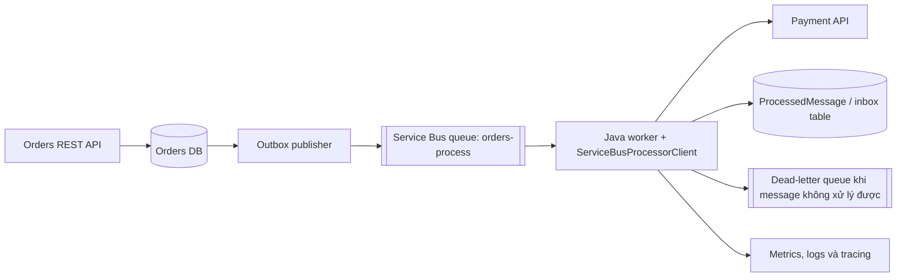
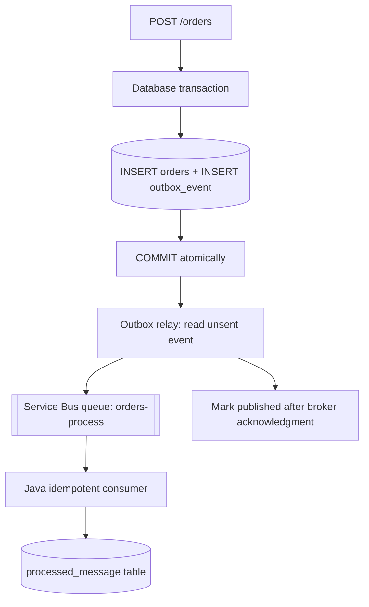

# Thiết kế tích hợp Java bằng Service Bus SDK

Trong module **CLOUD_PROVIDERS_AZURE**, người học khám phá hệ sinh thái Microsoft Azure từ subscription, resource group và Microsoft Entra ID đến mạng ảo, dịch vụ tính toán, lưu trữ và dữ liệu, đồng thời học cách triển khai, giám sát, bảo vệ và kiểm soát chi phí kiến trúc ứng dụng trên Azure. Ở chương **Hàng đợi và thông điệp**, bài học này tập trung vào **thiết kế và hiện thực tích hợp Java với Azure Service Bus SDK**: cách gửi và nhận thông điệp tin cậy, xác thực không dùng bí mật tĩnh, xử lý thông điệp lỗi và vận hành một hệ thống phân tán.

Hãy xét hệ thống đặt hàng. Khi API nhận một đơn mới, nó cần ghi đơn vào database, yêu cầu hệ thống thanh toán xử lý và gửi email xác nhận. Nếu HTTP request phải đợi cả thanh toán và email, một dịch vụ ngoài bị chậm có thể làm khách hàng chờ hoặc nhận lỗi dù đơn hàng đã được ghi thành công. **Azure Service Bus** giúp tách các bước bằng thông điệp: API gửi thông điệp vào broker; worker Java nhận thông điệp, xử lý và xác nhận hoàn tất theo cơ chế được thiết kế.

Tuy nhiên, chuyển từ HTTP đồng bộ sang message queue **không tự tạo ra exactly-once processing**. Một worker có thể xử lý xong trong database nhưng bị lỗi ngay trước khi xác nhận message; Service Bus có thể giao lại. Vì vậy phần quan trọng nhất không chỉ là gọi `sendMessage` và `processMessage`, mà là **idempotency, settlement, retry, dead-letter queue, schema evolution, ordering và observability**.

Sau bài học, bạn có thể:

- Lựa chọn **queue** hay **topic/subscription** theo nhu cầu single-consumer workflow hoặc publish/subscribe.
- Phân biệt **ServiceBusSenderClient, ServiceBusReceiverClient, ServiceBusProcessorClient** và các API async/session.
- Xác thực Java bằng **Microsoft Entra ID + DefaultAzureCredential/managed identity** và cấp quyền RBAC tối thiểu.
- Tạo message chứa `messageId`, `correlationId`, application properties và body có version; tránh nhúng secrets.
- Sử dụng **PeekLock**, `complete`, `abandon`, `deadLetter` và `defer` đúng thời điểm; hiểu lock duration và renew.
- Thiết kế retry có giới hạn, **DLQ**, idempotent consumer và **transactional outbox** để xử lý lỗi phân tán.
- Hiểu session ordering, duplicate detection, TTL, scheduled message và lưu ý về transaction.
- Xây worker Java chạy ổn định, theo dõi queue depth, processing latency, lỗi và chi phí.

## 1. Azure Service Bus dùng để giải quyết vấn đề gì?

**Azure Service Bus** là dịch vụ message broker được quản lý trên Azure, hỗ trợ **queues** và **topics/subscriptions**. Service Bus phù hợp với hệ thống cần lưu giữ và điều phối thông điệp giữa các thành phần độc lập, nhất là khi bên gửi và bên nhận có tốc độ xử lý hoặc tình trạng sẵn sàng khác nhau.

```text
Client
  |
  | POST /orders
  v
Orders API (Java)
  |
  | 1. Lưu đơn vào database
  | 2. Publish message "OrderCreated"
  v
Azure Service Bus: queue orders-process
  |
  | Broker giữ message đến khi được nhận/settle/hết hạn theo cấu hình
  v
Orders Worker (Java)
  |
  +--> Payment service
  +--> Update order state
  +--> Complete message
```

Trong thực tế, việc lưu DB và gửi message có thể xảy ra **không nguyên tử** nếu thực hiện thành hai thao tác độc lập. Bài học sẽ trình bày transactional outbox ở phần sau để tránh mất sự kiện khi một trong hai bước thất bại.

### 1.1. Những lợi ích chính

- **Decoupling:** API và worker không cần hoạt động đồng thời để mọi request được xử lý tức thì.
- **Buffering:** broker hấp thụ lượng message tăng đột biến khi consumer xử lý chậm hơn producer.
- **Retry có điều kiện:** message chưa được settle có thể được giao lại theo mô hình nhận và chính sách broker.
- **Fan-out:** topic có thể phân phối một sự kiện đến nhiều subscriptions với filter riêng.
- **Ordering theo nhóm:** session có thể tuần tự hóa xử lý message thuộc cùng `SessionId`.
- **Quan sát vận hành:** queue depth, dead-lettered messages, incoming/outgoing requests và các metric hỗ trợ giúp theo dõi backlog.

Giới hạn: Service Bus **không** là database nghiệp vụ, object storage, search engine hay công cụ stream analytics vô hạn. Message thường cần được xử lý và loại khỏi queue/subscription; những dữ liệu lâu dài hoặc payload lớn nên nằm trong database/Blob Storage phù hợp, còn message chứa tham chiếu và metadata cần thiết.

### 1.2. So với HTTP trực tiếp và các dịch vụ khác

| Phương án | Phù hợp | Điểm cần lưu ý |
|---|---|---|
| **HTTP/gRPC trực tiếp** | Request-response cần kết quả tức thì | Phụ thuộc tình trạng của dịch vụ đích, dễ lan truyền timeout |
| **Azure Service Bus queue** | Công việc bất đồng bộ cần broker quản lý | Retry, at-least-once, settlement và DLQ phải thiết kế |
| **Azure Service Bus topic/subscriptions** | Một sự kiện cho nhiều nhóm xử lý độc lập | Phải quản lý subscription filters, backlog và quyền |
| **Azure Storage Queue** | Queue đơn giản với nhu cầu API/tính năng phù hợp | Khác Service Bus về sessions, broker features và API |
| **Azure Event Grid** | Định tuyến sự kiện và tích hợp nguồn/đích theo event-driven model | Không thay thế queue workflow cần session/transaction semantics |
| **Azure Event Hubs** | Ingest streaming, telemetry và throughput lớn theo mô hình consumer groups | Mô hình log/partition/offset khác queue settlement của Service Bus |

Không mặc định Service Bus luôn tốt hơn các dịch vụ khác. Chọn theo delivery semantics, fan-out, throughput, độ trễ, dung lượng message, retention, chi phí và năng lực vận hành.

## 2. Kiến trúc tài nguyên của Service Bus

Một **Service Bus namespace** là ranh giới chứa queues, topics và subscriptions. Endpoint thường có dạng:

```text
sb-orders-dev.servicebus.windows.net
```

Ví dụ:

```text
Azure Service Bus namespace: sb-orders-dev
|
+-- Queue: orders-process
|
+-- Queue: notification-jobs
|
+-- Topic: orders-events
     |
     +-- Subscription: billing
     |     +-- Filter: sự kiện phù hợp billing
     |
     +-- Subscription: analytics
     |
     +-- Subscription: notifications
```

### 2.1. Queue: cạnh tranh xử lý một khối lượng công việc

Trong một queue, nhiều worker có thể cạnh tranh nhận message; mỗi lần một message được khóa nhận theo PeekLock, worker khác không đồng thời xử lý message đó trong lúc lock hợp lệ. Nhưng message **vẫn có thể bị giao lại** nếu receiver bỏ lock, không complete hoặc gặp sự cố. Vì vậy queue cung cấp khả năng **competing consumers**, không bảo đảm application-level exactly-once.

Ví dụ `orders-process`: năm replicas của cùng worker có thể xử lý nhiều đơn song song. Nếu business yêu cầu các thay đổi cho **một** đơn được xử lý theo thứ tự, cần xem xét sessions thay vì kỳ vọng thứ tự queue chung luôn giữ nguyên khi scale.

### 2.2. Topic/subscription: một sự kiện cho nhiều người nhận

Khi `OrderCreated` phải được xử lý độc lập bởi **billing**, **analytics** và **notifications**, có thể publish một message vào topic `orders-events`. Service Bus tạo luồng nhận ở **mỗi subscription** theo filter/rule phù hợp; một subscription không bị “ăn mất” message của subscription khác.

```text
Orders API
   |
   | Publish OrderCreated
   v
Topic orders-events
   |
   +--> Subscription billing       --> Billing Worker
   +--> Subscription analytics     --> Analytics Worker
   +--> Subscription notifications --> Email Worker
```

Lưu ý: **Topic subscription không phải Kubernetes subscription hay Azure subscription.** Đây là thực thể message broker. Lỗi một subscription có thể dẫn đến backlog/DLQ riêng, không có nghĩa mọi subscription khác phải chờ.

### 2.3. Queue hay topic?

| Yêu cầu | Queue | Topic/subscription |
|---|---|---|
| Một loại công việc được xử lý bởi nhóm worker | Thường hợp lý | Có thể được, nhưng phức tạp hơn khi không có fan-out |
| Một sự kiện gửi tới nhiều consumer group độc lập | Không tự fan-out | Phù hợp |
| Consumer mới cần nhận sự kiện tương lai | Tạo/điều chỉnh đường phân phối | Thêm subscription/rules phù hợp |
| Cần filter theo event type | Producer hoặc consumer tự điều phối | Subscription rules/filters khi được hỗ trợ |
| Cần backlog độc lập cho từng nhóm | Phải có nhiều queue/logic gửi | Mỗi subscription có backlog riêng |
| Chi phí và vận hành | Ít thực thể hơn khi workflow đơn giản | Thêm quản lý subscriptions, filters, metrics/DLQ |

**Ví dụ quyết định:** `orders-process` là queue cho một workflow xử lý đơn; `orders-events` là topic khi nhiều dịch vụ quan tâm `OrderCreated`, `OrderPaid` hoặc `OrderCancelled`.

## 3. Các khái niệm delivery phải hiểu trước khi viết Java

### 3.1. At-least-once và duplicate delivery

Với **PeekLock**, Service Bus giao message cho receiver kèm **lock token** trong thời gian cấu hình. Receiver xử lý rồi yêu cầu hoàn tất. Nếu receiver chết trước khi complete, lock có thể hết hạn và message được giao lại.

```text
Queue có message #42
     |
     v
Worker A nhận (PeekLock) ----> cập nhật database thành công
     |
     X  Mạng lỗi trước khi complete
     |
     v
Lock hết hạn, message #42 được giao lại cho Worker B
     |
     v
Worker B phải nhận ra tác vụ đã xử lý và không tạo side effect lần 2
```

Vì vậy **consumer phải idempotent** hoặc có biện pháp kiểm soát tính duy nhất của hành động. Cơ chế **duplicate detection** ở broker giúp giảm một lớp trùng lúc gửi nhưng không thay thế idempotency ở consumer.

### 3.2. PeekLock và ReceiveAndDelete

| Receive mode | Cách hoạt động | Khi sử dụng |
|---|---|---|
| **PEEK_LOCK** | Message được khóa tạm, receiver xử lý rồi `complete`/`abandon`/`deadLetter`/`defer` | Mặc định nên cân nhắc cho xử lý nghiệp vụ tin cậy |
| **RECEIVE_AND_DELETE** | Broker loại message khi giao theo chế độ này, không cần settlement | Chỉ khi chấp nhận mất message nếu consumer lỗi |

**Không dùng RECEIVE_AND_DELETE cho thanh toán hoặc workflow quan trọng** chỉ để giảm vài dòng code. Nếu tiến trình crash sau khi nhận mà chưa xử lý, message có thể đã mất khỏi queue.

### 3.3. Settlement: xử lý kết quả

| Hành động | Nghĩa | Khi áp dụng |
|---|---|---|
| `complete` | Xác nhận đã xử lý, broker loại message khỏi luồng nhận | **Sau** khi kết quả nghiệp vụ được commit hoặc đã idempotently xử lý |
| `abandon` | Từ bỏ lock, để message được nhận lại theo điều kiện broker | Lỗi tạm thời, cần retry |
| `deadLetter` | Đưa message vào Dead-Letter Queue (DLQ) | Payload hỏng, schema không hỗ trợ hoặc lỗi không nên retry vô hạn |
| `defer` | Trì hoãn xử lý message theo cơ chế deferred retrieval | Khi cần giữ message để lấy lại **theo sequence number** về sau |

**Defer không phải đặt lịch giao lại sau 5 phút.** Message bị deferred thường cần được nhận lại bằng **sequence number**; nó không tự xuất hiện ở luồng nhận thông thường đúng giờ như scheduled message. Nếu cần delayed retry, thiết kế cách lên lịch message mới hoặc một cơ chế retry broker phù hợp.

### 3.4. Lock duration, renewal và delivery count

Lock chỉ tồn tại trong một thời gian giới hạn. Nếu xử lý mất lâu hơn lock, receiver có thể không hoàn tất được message với lỗi mất lock, và message có thể được giao lại. Client processor hỗ trợ cơ chế **automatic lock renewal** với giới hạn cấu hình; không nên đặt một task kéo dài hàng giờ trong callback mà không thiết kế checkpoint/idempotency.

**Delivery count** tăng theo cơ chế giao/khóa lại. Khi vượt ngưỡng `MaxDeliveryCount` của entity, Service Bus có thể tự đưa message vào DLQ (theo ngữ nghĩa thực tế của broker). Đừng dùng delivery count làm số thứ tự nghiệp vụ; nó chỉ là tín hiệu về số lần delivery.

### 3.5. TTL và scheduled enqueue time

- **Time to Live (TTL):** giới hạn thời gian message còn hợp lệ để xử lý, chịu cấu hình entity và message; message hết TTL có hành vi tùy dead-letter-on-expiration và broker.
- **Scheduled enqueue:** lên lịch cho message khả dụng trong tương lai; không đồng nghĩa delay hoàn thành một handler đang chạy.
- **Duplicate detection window:** nếu entity bật duplicate detection và nhận message ID trùng trong cửa sổ quy định, broker có thể loại bản gửi trùng theo cơ chế của tính năng.

Các khả năng, giới hạn kích thước message, lock duration, session, duplicate detection và transaction **phụ thuộc SKU/tier và cấu hình thực thể**. Đừng hard-code giả định Basic, Standard và Premium hỗ trợ cùng mọi tính năng.

## 4. Thiết kế hợp đồng message trước khi viết client

Một message nên đại diện cho **một sự kiện hoặc mệnh lệnh nghiệp vụ rõ ràng**, có schema và version; không nên chỉ là một chuỗi không thể kiểm soát khi hệ thống tiến hóa.

Ví dụ message `OrderCreated`:

```json
{
  "schemaVersion": 1,
  "eventId": "evt-1042-20261120",
  "eventType": "OrderCreated",
  "occurredAtUtc": "2026-11-20T10:15:00Z",
  "orderId": "ORD-1042",
  "customerRef": "cust-72",
  "totalAmount": 125000,
  "currency": "VND"
}
```

Đây là payload minh họa, không phải dữ liệu khách hàng thực. Một message thực tế cần kiểm soát trường nào là dữ liệu cá nhân, trường nào có thể chứa số tiền/định danh nhạy cảm. Khi không cần toàn bộ dữ liệu nghiệp vụ, truyền **ID và các thuộc tính thiết yếu** rồi để worker tra cứu dữ liệu theo quyền.

### 4.1. Các thuộc tính của ServiceBusMessage

| Thuộc tính | Ví dụ | Cách dùng |
|---|---|---|
| `messageId` | `evt-1042-20261120` | Định danh message; hữu ích cho duplicate detection/idempotency |
| `correlationId` | `trace-3f5b...` | Kết nối hành trình một yêu cầu qua nhiều dịch vụ |
| `subject` | `OrderCreated` | Phân loại sự kiện nếu dùng thuộc tính được SDK/broker hỗ trợ |
| `contentType` | `application/json` | Mô tả định dạng body |
| `applicationProperties` | `eventType=OrderCreated`, `schemaVersion=1` | Metadata phục vụ lọc/định tuyến, không phải nơi chứa secrets |
| `sessionId` | `ORD-1042` | Nhóm message cần thứ tự theo session nếu entity bật sessions |
| `scheduledEnqueueTime` | Thời điểm tương lai | Dùng cho scheduling có kiểm soát |
| Body | JSON/bytes của sự kiện | Dữ liệu để consumer parse/validate |

**Không coi `messageId` là khóa giao dịch nghiệp vụ duy nhất bất biến trong mọi hệ thống.** Producer phải tạo ID ổn định theo chính sách; nếu retry một lần gửi mà phát sinh ID mới, duplicate detection theo message ID sẽ không giúp loại bản gửi lặp.

### 4.2. Envelope, schema evolution và compatibility

Một schema dễ duy trì nên có:

1. **Loại message:** event hoặc command, ngữ nghĩa đủ rõ.
2. **Schema version:** ví dụ version 1, 2.
3. **Event/command ID:** phục vụ idempotency và audit.
4. **Timestamp UTC:** thời gian xảy ra sự kiện, khác thời gian broker enqueue nếu cần.
5. **Business key:** `orderId` hoặc mã đối tượng dùng cho xử lý.
6. **Correlation/trace ID:** phục vụ truy vết xuyên hệ thống.
7. **Payload tối thiểu:** tránh sao chép dữ liệu nhạy cảm không cần thiết.

Khi thêm một field tùy chọn, consumer cũ nên chịu được field chưa biết nếu hợp đồng cho phép. Khi đổi ý nghĩa hoặc bỏ field bắt buộc, cần phương án versioned consumers/producers hoặc topic/subscription mới. **Không tái sử dụng một tên event với hai ý nghĩa nghiệp vụ khác nhau** chỉ vì muốn giảm số file schema.

### 4.3. Message size và “claim-check” pattern

Giới hạn kích thước message/batch khác theo Service Bus tier, protocol và tính năng. Với tệp PDF, ảnh, báo cáo lớn hoặc payload vượt giới hạn phù hợp, nên lưu ở **Azure Blob Storage**, sau đó gửi message có URL/ID tham chiếu và metadata:

```json
{
  "eventId": "evt-file-783",
  "eventType": "DocumentReady",
  "blobContainer": "documents",
  "blobName": "orders/ORD-1042/report.pdf",
  "checksumSha256": "example-checksum",
  "schemaVersion": 1
}
```

Worker dùng **managed identity + Azure RBAC** để đọc blob. Không đưa storage account key hoặc SAS URL có thời hạn dài vào message; broker là nơi lưu dữ liệu theo chính sách riêng, và message có thể được retry, DLQ hoặc giữ lâu hơn dự kiến.

## 5. Kiến trúc Java đề xuất

Một mô hình tương đối dễ vận hành cho ứng dụng Java:



Đường DB → outbox publisher là mô hình **transactional outbox** được trình bày ở phần riêng. Mũi tên tới DLQ thể hiện lựa chọn settlement/error, không có nghĩa worker luôn tự gửi một message mới tới queue khác.

### 5.1. Phân tách trách nhiệm

| Thành phần | Trách nhiệm | Không nên làm |
|---|---|---|
| **REST API** | Kiểm tra dữ liệu, ghi transaction nghiệp vụ/outbox, trả mã trạng thái phù hợp | Chờ tất cả downstream jobs trong HTTP request |
| **Publisher** | Đọc outbox, serialize schema, gửi Service Bus, đánh dấu đã gửi | Ghi lại secret/token vào message |
| **Service Bus** | Lưu, điều phối, khóa, settlement, DLQ theo cấu hình | Thay database xử lý idempotency |
| **Java consumer** | Deserialize, validate, thực hiện nghiệp vụ idempotent, settle message | Complete trước khi công việc thật hoàn tất |
| **Operational tooling** | Quan sát queue depth, errors, DLQ, latency, quota và chi phí | Tự động replay mọi DLQ message mà không phân loại |

### 5.2. Chọn synchronous hay asynchronous SDK

Java SDK hiện đại cung cấp các API **blocking/synchronous** và **asynchronous/reactive**:

- **`ServiceBusSenderClient`:** gửi đồng bộ; dễ tích hợp service thông thường.
- **`ServiceBusSenderAsyncClient`:** gửi bất đồng bộ, phù hợp pipeline Reactor khi cả ứng dụng đã dùng reactive.
- **`ServiceBusReceiverClient`:** chủ động nhận/browse/settle messages theo vòng điều khiển.
- **`ServiceBusReceiverAsyncClient`:** nhận/reactive processing với backpressure theo khả năng SDK.
- **`ServiceBusProcessorClient`:** nhận message bằng callback, quản lý kết nối, concurrency và auto-renew theo cấu hình; hữu ích cho worker.
- **Session receiver/processor:** dành cho queue/subscription bật sessions, cần bảo toàn xử lý tuần tự theo session.

**Không lựa chọn async chỉ vì “nhanh hơn”.** Nếu handler sử dụng blocking JDBC hoặc HTTP client, phải quản lý threading/concurrency phù hợp; reactive API không biến blocking call thành non-blocking. Với worker thông thường, processor client và callback có kiểm soát thường là điểm khởi đầu rõ ràng.

## 6. Xác thực an toàn: Microsoft Entra ID và Azure RBAC

Azure Service Bus hỗ trợ xác thực **Microsoft Entra ID** cho các thao tác data plane phù hợp. Với workload Java chạy trên Azure, nên ưu tiên **managed identity** và `DefaultAzureCredential` hoặc credential cụ thể được SDK hỗ trợ, thay vì đặt Shared Access Signature (SAS) connection string trong source code.

### 6.1. Role của producer và consumer khác nhau

| Danh tính | Vai trò Azure RBAC | Nhu cầu |
|---|---|---|
| `mi-orders-api-prod` | `Azure Service Bus Data Sender` | Gửi vào `orders-process` |
| `mi-orders-worker-prod` | `Azure Service Bus Data Receiver` | Nhận và settle message từ `orders-process` |
| `mi-orders-operations` | Vai trò quản trị/đọc phù hợp khi thật sự cần | Quản lý entity và kiểm tra cấu hình |

Những vai trò data-plane cần phân biệt với `Owner`, `Contributor` hoặc `Reader` của Azure Resource Manager:

- **`Azure Service Bus Data Sender`:** gửi message đến entities trong phạm vi được cấp.
- **`Azure Service Bus Data Receiver`:** nhận/settle messages từ entities trong phạm vi được cấp.
- **`Azure Service Bus Data Owner`:** quyền dữ liệu rộng hơn, không nên cấp cho runtime chỉ gửi hoặc nhận.

Role có thể được gán ở namespace hoặc entity scope theo tính năng hỗ trợ. **Scope nhỏ nhất** nên được ưu tiên nếu producer chỉ gửi vào một queue; không tự gán cả namespace nếu không cần thiết. Để tạo role assignment, người thực hiện còn cần quyền quản lý role assignments riêng.

### 6.2. Managed identity, service principal và kết nối bằng key

Với **App Service, Azure Container Apps, VM hoặc AKS Workload Identity** theo hỗ trợ, Java code có thể dùng Entra token thông qua Azure Identity SDK. Môi trường phát triển có thể dùng Azure CLI login/IDE credential, còn production nên dùng danh tính workload được phê duyệt.

Service Bus cũng hỗ trợ **Shared Access Signature** thông qua các authorization rules trên entity/namespace. Connection string có key tương ứng là **bí mật cần bảo vệ**. Với hệ thống cũ chưa chuyển được:

- Không commit connection string lên Git hoặc đưa vào Docker image.
- Lưu trong kho bí mật có quyền truy cập hẹp và kế hoạch rotation.
- Phân biệt quyền `Send`, `Listen`, `Manage` của SAS policies; không dùng một key `RootManageSharedAccessKey` cho ứng dụng thông thường.
- Cân nhắc vô hiệu hóa local/SAS authorization khi sản phẩm/tier và mọi tích hợp đã hỗ trợ, sau khi kiểm kê phụ thuộc.

**SAS token của Service Bus không giống SAS URL dùng cho Blob Storage.** Không đưa một Blob SAS URL vào `ServiceBusClientBuilder` rồi kỳ vọng được xác thực.

### 6.3. Tên namespace dùng trong Java SDK

Với Microsoft Entra credential, một giá trị cần thiết là **fully qualified namespace**, ví dụ:

```text
sb-orders-dev.servicebus.windows.net
```

Đây **không phải** connection string chứa `Endpoint=sb://...;SharedAccessKeyName=...;SharedAccessKey=...`. SDK dùng tên namespace và Entra credential để thiết lập kết nối AMQP theo cơ chế phù hợp.

## 7. Thực hành hạ tầng: tạo namespace và queue bằng Azure CLI

Các lệnh minh họa sử dụng **Bash/Azure Cloud Shell** trên môi trường dev đã được phê duyệt. Phải có quyền tạo tài nguyên Service Bus và role assignments phù hợp. **Standard** trong bài thực hành là tier có phí; không chạy rồi quên dọn tài nguyên.

Điều kiện:

1. Subscription Azure hoạt động, Azure CLI phiên bản hỗ trợ nhóm lệnh `servicebus`.
2. Resource group dev trong region hỗ trợ Service Bus đã được chọn.
3. Quyền tạo namespace/queue, đọc resource ID, cấp Azure RBAC và đủ quota.
4. Có principal/managed identity của producer và consumer để gán role.
5. Mạng từ nơi chạy Java SDK đến Service Bus endpoint được phép.

### 7.1. Khai báo biến và kiểm tra môi trường

```bash
az login
az account show --output table
az account set --subscription "<subscription-id>"

RG="rg-orders-messaging-dev"
LOCATION="southeastasia"
SB_NAMESPACE="sb-orders-dev-unique"
QUEUE="orders-process"
TOPIC="orders-events"
```

Thay `sb-orders-dev-unique` bằng tên namespace hợp lệ, duy nhất theo quy tắc Service Bus. Đừng tự sao chép tên ví dụ sang production hoặc để thông tin nhạy cảm trong resource names.

### 7.2. Tạo namespace và queue

```bash
az group create \
  --name "$RG" \
  --location "$LOCATION"

az servicebus namespace create \
  --resource-group "$RG" \
  --name "$SB_NAMESPACE" \
  --location "$LOCATION" \
  --sku Standard

az servicebus queue create \
  --resource-group "$RG" \
  --namespace-name "$SB_NAMESPACE" \
  --name "$QUEUE" \
  --max-delivery-count 5
```

Queue ở đây cho phép nhiều lần delivery trước khi broker có thể đưa message tới DLQ theo cấu hình `max-delivery-count`. Giá trị 5 là ví dụ cho bài lab, **không** phải ngưỡng lý tưởng cho mọi workload. Thời gian lock, TTL, duplicate detection, sessions, partitioning và các tùy chọn khác phải được quyết định riêng theo nhu cầu. Một số tùy chọn cần khai báo **ngay khi tạo entity** và không thể chuyển đổi tùy ý sau khi đã có dữ liệu.

### 7.3. Kiểm tra cấu hình

```bash
az servicebus namespace show \
  --resource-group "$RG" \
  --name "$SB_NAMESPACE" \
  --query "{name:name,location:location,sku:sku.name,id:id}" \
  --output json

az servicebus queue show \
  --resource-group "$RG" \
  --namespace-name "$SB_NAMESPACE" \
  --name "$QUEUE" \
  --query "{name:name,lockDuration:lockDuration,maxDeliveryCount:maxDeliveryCount,requiresSession:requiresSession,requiresDuplicateDetection:requiresDuplicateDetection}" \
  --output json
```

Nếu queue hiện tại bật `requiresSession=true`, ví dụ receiver thông thường ở phần sau sẽ không phù hợp; cần **session receiver/processor**. Không bỏ qua lỗi cấu hình entity bằng cách thay đổi message handler một cách tùy tiện.

### 7.4. Cấp quyền sender/receiver theo principal

Giả định hai **user-assigned managed identities** của ứng dụng đã tồn tại hoặc được tạo theo quy trình khác. Lấy **Principal/Object ID thật** của chúng, sau đó gán role.

```bash
SB_ID=$(az servicebus namespace show \
  --resource-group "$RG" \
  --name "$SB_NAMESPACE" \
  --query id --output tsv)

# Hai giá trị phải là Principal/Object ID thật, không phải Client ID.
PRODUCER_PRINCIPAL_ID="<producer-principal-object-id>"
CONSUMER_PRINCIPAL_ID="<consumer-principal-object-id>"

az role assignment create \
  --assignee-object-id "$PRODUCER_PRINCIPAL_ID" \
  --assignee-principal-type ServicePrincipal \
  --role "Azure Service Bus Data Sender" \
  --scope "$SB_ID"

az role assignment create \
  --assignee-object-id "$CONSUMER_PRINCIPAL_ID" \
  --assignee-principal-type ServicePrincipal \
  --role "Azure Service Bus Data Receiver" \
  --scope "$SB_ID"
```

**Scope namespace** ở ví dụ giúp lab gọn. Với production, nên đánh giá **scope queue/topic/subscription phù hợp** theo khả năng của Service Bus và cơ chế role assignment để hạn chế dữ liệu/đích mà danh tính có thể dùng. Không truyền `clientId` vào `--assignee-object-id`; phải truyền **object/principal ID**.

Xem role assignments:

```bash
az role assignment list \
  --scope "$SB_ID" \
  --include-inherited \
  --output table
```

Vai trò mới được gán có thể cần thời gian **RBAC propagation**. Nếu producer có thể `az login` nhưng gửi báo `Unauthorized`, kiểm tra principal, scope, data-plane role và môi trường network; không cấp `Owner` cho cả subscription để thử.

### 7.5. Không tạo topic nếu bài lab chỉ cần queue

Để hiểu fan-out, có thể tạo topic ở môi trường dev:

```bash
az servicebus topic create \
  --resource-group "$RG" \
  --namespace-name "$SB_NAMESPACE" \
  --name "$TOPIC"

az servicebus topic subscription create \
  --resource-group "$RG" \
  --namespace-name "$SB_NAMESPACE" \
  --topic-name "$TOPIC" \
  --name billing

az servicebus topic subscription create \
  --resource-group "$RG" \
  --namespace-name "$SB_NAMESPACE" \
  --topic-name "$TOPIC" \
  --name notifications
```

Ví dụ tạo subscriptions với **rule/filter mặc định** do Service Bus áp dụng. Khi cần mỗi consumer chỉ nhận một loại sự kiện, phải thiết kế rules và filters tường minh, rồi kiểm thử positive/negative routing; không chỉ dựa vào tên subscription.

## 8. Chuẩn bị Maven và cấu hình Java

Thư viện chính:

- **`com.azure:azure-messaging-servicebus`:** các sender, receiver, processor, message models.
- **`com.azure:azure-identity`:** Entra credentials như `DefaultAzureCredential` hoặc `ManagedIdentityCredential`.

Sử dụng **phiên bản SDK ổn định đã được tổ chức phê duyệt**, hoặc quản lý qua Azure SDK BOM. Mẫu `pom.xml`:

```xml
<dependencies>
  <dependency>
    <groupId>com.azure</groupId>
    <artifactId>azure-messaging-servicebus</artifactId>
    <version>REPLACE_WITH_APPROVED_SERVICEBUS_VERSION</version>
  </dependency>
  <dependency>
    <groupId>com.azure</groupId>
    <artifactId>azure-identity</artifactId>
    <version>REPLACE_WITH_APPROVED_IDENTITY_VERSION</version>
  </dependency>
</dependencies>
```

Các chuỗi `REPLACE_WITH_...` là **placeholders** bắt buộc thay bằng version Maven hợp lệ trước khi build. Không đoán một version SDK tương lai hoặc dùng hai phiên bản không tương thích chỉ để chạy nhanh. Nếu dùng Azure SDK BOM, quản lý dependency version qua `dependencyManagement` theo phiên bản BOM đã kiểm thử.

### 8.1. Cấu hình qua environment variables

```text
SERVICE_BUS_FQDN=sb-orders-dev-unique.servicebus.windows.net
SERVICE_BUS_QUEUE=orders-process
SERVICE_BUS_CLIENT_ID=<client-id-của-managed-identity-nếu-cần>
```

`SERVICE_BUS_FQDN` là hostname namespace, không gồm tiền tố `sb://`. Biến `SERVICE_BUS_CLIENT_ID` chỉ được dùng khi ứng dụng cần chọn **user-assigned managed identity** cụ thể. Nếu runtime chỉ có một system-assigned identity, `DefaultAzureCredential` có thể xác định theo chain được SDK hỗ trợ; nếu môi trường có nhiều credentials, nên cấu hình tường minh để tránh ứng dụng sử dụng nhầm danh tính.

### 8.2. DefaultAzureCredential ở local và production

`DefaultAzureCredentialBuilder` chọn credential theo chain mà Azure Identity SDK cung cấp (environment, workload identity, managed identity, developer tools v.v. tùy phiên bản/configuration). Vì vậy:

- **Local:** có thể dùng người dùng đã `az login`; principal đó phải có data-plane role phù hợp.
- **Azure VM/App Service/Container Apps:** workload dùng managed identity đã được gán quyền.
- **AKS:** nếu dùng Workload Identity, cần ServiceAccount/federated credential và webhook env/token file; Java SDK phải hỗ trợ.
- **Production cần xác thực chặt:** có thể sử dụng `ManagedIdentityCredential` hoặc `WorkloadIdentityCredential` tường minh khi mô hình triển khai phù hợp, tránh fallback bất ngờ.

Không nên đưa một connection string có secret vào environment như giải pháp “fallback” khi managed identity lỗi; làm vậy có thể che cấu hình RBAC sai và tăng rủi ro lộ credential.

## 9. Viết Java producer gửi thông điệp vào queue

Ví dụ sau dùng **Java 17+** với Azure SDK hiện đại. Giả định đã thay dependency versions, có namespace/queue thật và danh tính hiện tại có quyền **Azure Service Bus Data Sender**.

### 9.1. Sender đồng bộ với Microsoft Entra ID

```java
import com.azure.identity.DefaultAzureCredentialBuilder;
import com.azure.messaging.servicebus.ServiceBusClientBuilder;
import com.azure.messaging.servicebus.ServiceBusMessage;
import com.azure.messaging.servicebus.ServiceBusSenderClient;

import java.time.Instant;
import java.util.UUID;

public final class OrderEventPublisher {

    public static void main(String[] args) {
        String namespace = requiredEnv("SERVICE_BUS_FQDN");
        String queueName = requiredEnv("SERVICE_BUS_QUEUE");

        try (ServiceBusSenderClient sender = new ServiceBusClientBuilder()
                .credential(
                        namespace,
                        new DefaultAzureCredentialBuilder().build())
                .sender()
                .queueName(queueName)
                .buildClient()) {

            String orderId = "ORD-1042";
            String eventId = "evt-" + UUID.randomUUID();

            // Chỉ chứa dữ liệu minh họa; không nhúng secret.
            String payload = """
                    {
                      "schemaVersion": 1,
                      "eventType": "OrderCreated",
                      "orderId": "ORD-1042"
                    }
                    """;

            ServiceBusMessage message = new ServiceBusMessage(payload);
            message.setMessageId(eventId);
            message.setCorrelationId("trace-" + UUID.randomUUID());
            message.setContentType("application/json");
            message.setSubject("OrderCreated");
            message.getApplicationProperties().put("schemaVersion", 1);
            message.getApplicationProperties().put("source", "orders-api");

            sender.sendMessage(message);

            System.out.println("Message accepted: id=" + eventId
                    + ", sentAt=" + Instant.now());
        }
    }

    private static String requiredEnv(String name) {
        String value = System.getenv(name);
        if (value == null || value.isBlank()) {
            throw new IllegalStateException("Missing env: " + name);
        }
        return value;
    }
}
```

Ở ví dụ này `eventId` được tạo ngẫu nhiên cho một lượt chạy. Với hệ thống có **retry publish** hoặc transactional outbox, ID cần ổn định cho **cùng một logical event** giữa các lần gửi, ví dụ lưu trong outbox trước khi publish; nếu mỗi retry tạo ID mới thì broker không thể phát hiện trùng theo ID đã đổi.

### 9.2. Vì sao `sendMessage` thành công chưa đồng nghĩa “đơn đã thanh toán”?

Khi `sendMessage` trả về thành công, producer có bằng chứng từ SDK/broker rằng thao tác gửi đã được hoàn tất theo giao thức tại thời điểm đó. Nó **không chứng minh** worker nhận, hoàn thành thanh toán hay cập nhật database. Vì vậy:

- Trả HTTP `202 Accepted` có thể phù hợp với yêu cầu xử lý bất đồng bộ nếu API đã ghi durable request/outbox an toàn.
- Cần một trạng thái đơn như `PENDING`, `PROCESSING`, `PAID`, `FAILED` hoặc mô hình khác được thiết kế rõ.
- API cho client theo dõi trạng thái qua endpoint/webhook thay vì giả định message gửi xong là nghiệp vụ hoàn tất.
- Tránh “fire-and-forget” mà không theo dõi send failure, retry và trạng thái bất định.

### 9.3. Timeout hoặc lỗi khi gửi tạo trạng thái không chắc chắn

Một lỗi mạng tại producer có thể xảy ra **sau khi broker đã nhận message nhưng trước khi producer nhận được phản hồi**. Nếu producer retry với một `messageId` khác, rất dễ tạo message trùng.

Chiến lược:

1. Lưu **event ID** nhất quán trong dữ liệu/outbox.
2. Retry lỗi tạm thời theo policy SDK và giới hạn ứng dụng.
3. Nếu bật duplicate detection trên entity, đảm bảo cùng logical event dùng cùng message ID.
4. Consumer vẫn phải idempotent vì có nhiều nguyên nhân giao lặp ngoài duplicate publish.
5. Có metric/alert cho message chưa publish được từ outbox.

### 9.4. Batch gửi nhiều messages

Khi cần gửi nhiều message, dùng **ServiceBusMessageBatch** để tôn trọng giới hạn kích thước:

```java
import com.azure.messaging.servicebus.ServiceBusMessage;
import com.azure.messaging.servicebus.ServiceBusMessageBatch;
import com.azure.messaging.servicebus.ServiceBusSenderClient;

// sender đã được tạo bằng ServiceBusClientBuilder như ví dụ trước.
ServiceBusMessageBatch batch = sender.createMessageBatch();

for (String eventJson : eventJsonList) {
    ServiceBusMessage msg = new ServiceBusMessage(eventJson);
    // Gán message ID ổn định của từng event trong triển khai thật.
    if (!batch.tryAddMessage(msg)) {
        sender.sendMessages(batch);
        batch = sender.createMessageBatch();
        if (!batch.tryAddMessage(msg)) {
            throw new IllegalArgumentException(
                    "One event is too large for an empty batch");
        }
    }
}

if (batch.getCount() > 0) {
    sender.sendMessages(batch);
}
```

Đây là **đoạn code minh họa đặt trong hàm đã có `sender` và `eventJsonList`**, không phải class Java độc lập. `tryAddMessage` giúp tránh vượt giới hạn batch; vẫn cần thiết kế idempotency và lỗi gửi khi một batch bị timeout. Trong production, tránh giữ hàng triệu events trong memory; xử lý theo luồng/đợt phù hợp.

## 10. Viết Java consumer bằng ServiceBusProcessorClient

**`ServiceBusProcessorClient`** phù hợp cho một worker chạy liên tục nhận message qua callback. Nó quản lý kết nối/luồng nhận theo cấu hình, cung cấp callback xử lý message và lỗi. Hãy chọn **PeekLock** để chỉ complete sau khi nghiệp vụ đã đạt trạng thái bền vững.

### 10.1. Consumer có manual settlement

```java
import com.azure.identity.DefaultAzureCredentialBuilder;
import com.azure.messaging.servicebus.ServiceBusClientBuilder;
import com.azure.messaging.servicebus.ServiceBusProcessorClient;
import com.azure.messaging.servicebus.ServiceBusReceivedMessage;
import com.azure.messaging.servicebus.ServiceBusReceivedMessageContext;

import java.time.Duration;
import java.util.concurrent.CountDownLatch;

public final class OrdersWorker {

    public static void main(String[] args) throws InterruptedException {
        String namespace = requiredEnv("SERVICE_BUS_FQDN");
        String queue = requiredEnv("SERVICE_BUS_QUEUE");

        ServiceBusProcessorClient processor = new ServiceBusClientBuilder()
                .credential(
                        namespace,
                        new DefaultAzureCredentialBuilder().build())
                .processor()
                .queueName(queue)
                .disableAutoComplete()
                .maxConcurrentCalls(4)
                .maxAutoLockRenewDuration(Duration.ofMinutes(5))
                .processMessage(OrdersWorker::handleMessage)
                .processError(error -> {
                    System.err.println("Processor error: "
                            + error.getException().getClass().getSimpleName()
                            + "; source=" + error.getErrorSource());
                })
                .buildProcessorClient();

        Runtime.getRuntime().addShutdownHook(new Thread(processor::close));
        processor.start();
        System.out.println("Worker started.");

        // Demo service: giữ tiến trình hoạt động.
        // Ứng dụng thực quản lý lifecycle qua runtime/Spring Boot.
        new CountDownLatch(1).await();
    }

    private static void handleMessage(ServiceBusReceivedMessageContext context) {
        ServiceBusReceivedMessage message = context.getMessage();
        String eventId = message.getMessageId();

        try {
            String json = message.getBody().toString();
            processBusinessEvent(eventId, json);
            // Complete CHỈ SAU khi commit thành công hoặc đã xử lý idempotently.
            context.complete();
            System.out.println("Completed messageId=" + eventId);
        } catch (IllegalArgumentException invalidPayload) {
            // Lỗi schema vĩnh viễn: tránh retry mãi cùng payload hỏng.
            System.err.println("Invalid messageId=" + eventId);
            context.deadLetter();
        } catch (Exception transientOrUnknown) {
            System.err.println("Abandoning id=" + eventId
                    + ", type=" + transientOrUnknown.getClass().getSimpleName());
            context.abandon();
        }
    }

    private static void processBusinessEvent(String eventId, String json) {
        // Placeholder minh họa: phải thay bằng validate schema, inbox và
        // transaction nghiệp vụ trước khi dùng ở production.
        if (json.isBlank() || eventId == null) {
            throw new IllegalArgumentException("Missing message data");
        }
    }

    private static String requiredEnv(String key) {
        String value = System.getenv(key);
        if (value == null || value.isBlank()) {
            throw new IllegalStateException("Missing env: " + key);
        }
        return value;
    }
}
```

**Đây là ví dụ minh họa API/settlement, chưa phải consumer production:** `processBusinessEvent` mới kiểm tra đầu vào, chưa cập nhật database hay áp dụng idempotency. Không dùng bản demo này để thực hiện thanh toán thật.

Điểm quan trọng:

- `disableAutoComplete()` để callback chịu trách nhiệm settle rõ ràng, không vô tình hoàn tất một message khi business logic còn chờ xử lý.
- `maxConcurrentCalls(4)` giới hạn số callback đồng thời, không bảo đảm database/downstream chịu được cùng mức tải.
- `maxAutoLockRenewDuration` cho phép tự gia hạn lock trong giới hạn, không bảo đảm giữ lock khi worker mất kết nối hoặc xử lý quá lâu.
- `processError` bắt lỗi ở tầng processor/connection; lỗi nghiệp vụ vẫn cần phân loại ngay trong message handler.
- Shutdown hook đóng processor khi JVM dừng bình thường; trên Kubernetes cần xử lý `SIGTERM`, grace period, readiness và các messages đang xử lý.

### 10.2. Không luôn `abandon` mọi lỗi

| Lỗi | Tính chất | Hướng xử lý |
|---|---|---|
| Schema version không hỗ trợ | Vĩnh viễn | Dead-letter kèm reason theo chính sách |
| Thiếu field bắt buộc | Vĩnh viễn | Dead-letter hoặc luồng sửa dữ liệu |
| HTTP 503 từ downstream | Tạm thời | Retry có backoff/giới hạn, cân nhắc delayed retry |
| Database timeout | Có thể tạm thời, outcome có thể không chắc chắn | Kiểm tra idempotency/transaction rồi retry |
| Inbox unique key cho event đã xử lý | Duplicated delivery | Complete nếu xác nhận kết quả nghiệp vụ đã commit |
| Lock lost | Settlement thất bại, message có thể được giao lại | Log và để consumer khác xử lý idempotently |
| Service Bus authorization error | Lỗi identity/quyền | Alert và sửa RBAC, không retry vô hạn |
| Worker bị kill giữa chừng | Không có callback kịp xử lý | Lock hết hạn, message được giao lại |

Với lỗi tạm thời, `abandon` ngay có thể khiến message được nhận lại rất nhanh và gây **retry storm**. Khi downstream outage, hãy cân nhắc delayed retry, circuit breaker, giảm concurrency và monitoring thay vì retry không giới hạn.

### 10.3. Gia hạn lock không giải quyết side effect trùng

1. Worker thanh toán xong, commit kết quả.
2. Mạng đến Service Bus gián đoạn trước `complete`.
3. Lock hết hạn; message được giao lại.
4. Worker khác phải phát hiện giao dịch đã hoàn tất.

Do đó, **idempotency thuộc trách nhiệm nghiệp vụ**, không phải chỉ tăng lock duration hay auto-renew lên mức lớn.

## 11. Nhận chủ động bằng ServiceBusReceiverClient

Khi cần polling hoặc tích hợp một vòng xử lý chủ động, dùng **`ServiceBusReceiverClient`**. Ví dụ:

```java
import com.azure.identity.DefaultAzureCredentialBuilder;
import com.azure.messaging.servicebus.ServiceBusClientBuilder;
import com.azure.messaging.servicebus.ServiceBusReceivedMessage;
import com.azure.messaging.servicebus.ServiceBusReceiverClient;
import com.azure.messaging.servicebus.models.ServiceBusReceiveMode;

import java.time.Duration;

public final class PollOrders {
    public static void main(String[] args) {
        String namespace = System.getenv("SERVICE_BUS_FQDN");
        String queue = System.getenv("SERVICE_BUS_QUEUE");

        try (ServiceBusReceiverClient receiver =
                new ServiceBusClientBuilder()
                        .credential(
                                namespace,
                                new DefaultAzureCredentialBuilder().build())
                        .receiver()
                        .queueName(queue)
                        .receiveMode(ServiceBusReceiveMode.PEEK_LOCK)
                        .buildClient()) {

            for (ServiceBusReceivedMessage message :
                    receiver.receiveMessages(5, Duration.ofSeconds(20))) {
                try {
                    // Thực tế: parse/validate, idempotent DB commit, tracing.
                    System.out.println("Received id=" + message.getMessageId());
                    receiver.complete(message);
                } catch (Exception ex) {
                    receiver.abandon(message);
                }
            }
        }
    }
}
```

**Cảnh báo:** ví dụ complete sau khi **chỉ in message ID** để giới thiệu API. Muốn dùng thật, thay bằng nghiệp vụ và kiểm tra transaction commit/idempotency trước complete. `complete` hoặc `abandon` cũng có thể thất bại nếu lock đã mất; đừng nuốt ngoại lệ settlement rồi coi message chắc chắn bị xóa.

Nếu `ServiceBusReceiverClient` và `ServiceBusProcessorClient` cùng nhận từ một queue, chúng sẽ **cạnh tranh**, không tự mỗi bên nhận một bản sao. Muốn nhiều consumer groups nhận cùng event, dùng **topic với nhiều subscriptions** hoặc mô hình gửi có chủ đích tới nhiều queue.

## 12. Idempotent consumer: nền tảng xử lý tin cậy

**Idempotency** nghĩa là xử lý lại cùng một yêu cầu không tạo tác động nghiệp vụ trùng không mong muốn. Với message-driven integration, nên lưu **inbox/processed-message table** trong database consumer:

```sql
CREATE TABLE processed_message (
    consumer_name VARCHAR(100) NOT NULL,
    event_id VARCHAR(120) NOT NULL,
    processed_at_utc TIMESTAMP NOT NULL,
    PRIMARY KEY (consumer_name, event_id)
);
```

Đây là SQL khái niệm; kiểu thời gian, transaction isolation và schema phụ thuộc database. Cặp `(consumer_name,event_id)` cho phép hai consumer khác nhau xử lý cùng event mà không coi kết quả của người khác là đã xử lý cho mình.

### 12.1. Thuật toán transaction + settlement

```text
Nhận message bằng PeekLock
      |
      v
Parse và validate schema
      |
      v
BEGIN database transaction
      |
      +-- INSERT processed_message(consumerName, eventId)
      |        |
      |        +-- Trùng khóa -> xác minh đã xử lý, COMMIT/no-op
      |        |
      |        +-- Chưa tồn tại -> cập nhật DB nghiệp vụ, COMMIT
      |
      v
Sau COMMIT thành công -> complete Service Bus message
      |
      +-- Complete thất bại -> có thể nhận lại,
                              inbox sẽ chặn side effect trùng
```

**Điều kiện bắt buộc:** ghi dấu processed và cập nhật dữ liệu nghiệp vụ phải nằm trong **cùng transaction** nếu dùng cùng database. Nếu insert inbox rồi commit trước khi nghiệp vụ thành công, lần retry thấy đã xử lý và bỏ qua công việc chưa làm.

### 12.2. Pseudocode Java

```java
public void handleOrderCreated(OrderCreatedEvent event) {
    database.inTransaction(tx -> {
        boolean inserted = tx.tryInsertProcessedMessage(
                "orders-worker", event.eventId());
        if (!inserted) {
            return; // đã xử lý event này
        }
        tx.updateOrderState(event.orderId(), "PROCESSING");
        tx.appendAuditRecord(event.eventId(), event.orderId());
    });
    // Transaction đã commit: context.complete() ở lớp Service Bus.
}
```

Đây là **pseudocode**, không phải JDBC/JPA API có sẵn. Implementation phải rollback đồng thời cả inbox và thay đổi nghiệp vụ nếu lỗi, xử lý race/unique key đúng cách và tránh commit một phần.

### 12.3. Gọi dịch vụ ngoài không nguyên tử với DB

Ví dụ worker gọi payment provider thành công nhưng chết trước khi ghi DB rồi message được giao lại. Transaction database không rollback được một lần thu tiền đã được provider chấp nhận. Cần **idempotency key ổn định** theo yêu cầu thanh toán, kiểm tra trạng thái transaction với provider hoặc saga/đối soát bù trừ.

Không tạo payment idempotency key mới theo mỗi retry/delivery. Một **logical payment** phải giữ một key xuyên qua việc gửi lại, restart và redelivery.

## 13. Transactional outbox: tránh mất event giữa DB và broker

Giả sử Orders API thực hiện:

```text
1. INSERT đơn hàng vào database
2. COMMIT database transaction
3. Service Bus send OrderCreated
```

Nếu API crash **giữa bước 2 và bước 3**, đơn hàng tồn tại nhưng không có event cho worker. Nếu gửi message trước commit DB, worker có thể thấy một đơn không bao giờ được commit.

**Transactional outbox** giúp bằng cách ghi **business data và outbox event trong cùng một database transaction**, còn một publisher riêng đọc outbox và gửi qua Service Bus.



### 13.1. Outbox schema

```sql
CREATE TABLE outbox_event (
    event_id VARCHAR(120) PRIMARY KEY,
    event_type VARCHAR(100) NOT NULL,
    schema_version INTEGER NOT NULL,
    payload_json TEXT NOT NULL,
    created_at_utc TIMESTAMP NOT NULL,
    published_at_utc TIMESTAMP NULL
);
```

Business transaction:

```text
BEGIN TRANSACTION
  INSERT INTO orders (...);
  INSERT INTO outbox_event(event_id, event_type, schema_version, ...)
    VALUES('evt-1042-20261120', 'OrderCreated', 1, ...);
COMMIT
```

Relay:

1. Đọc outbox chưa `published_at_utc`, có cơ chế claim/lease/locking nếu có nhiều replicas.
2. Gửi message với **`messageId = event_id`** và payload đúng schema.
3. Chờ xác nhận gửi từ broker.
4. Đánh dấu `published_at_utc` và đo số lượng/tuổi event còn backlog.
5. Nếu gặp timeout/crash, retry **cùng event ID**, không tạo logical event mới.

Outbox có thể gửi lại nếu đã gửi thành công nhưng process chết trước khi đánh dấu published. **Đó không phải lỗi của pattern**: consumer idempotent và duplicate detection giảm hậu quả. Outbox giúp tránh bỏ sót sự kiện đã commit, **không biến cả DB + Service Bus thành một distributed exactly-once transaction**.

### 13.2. Khi nhiều publisher đọc cùng outbox

Các workers có thể đồng thời đọc một row chưa publish. Sử dụng row lock, trạng thái claim, lease hoặc cơ chế DB tương ứng để tránh gửi quá nhiều bản sao và tránh nghẽn. Dù có locking, vẫn cần stable `eventId` và idempotency vì một process có thể chết sau gửi nhưng trước commit trạng thái.

Quản lý retention/archival của outbox đã publish và index cho các rows chưa gửi. Không xóa sự kiện chưa publish chỉ vì nó đã chờ quá lâu; thay vào đó, alert cho outbox lag và xử lý nguyên nhân.

## 14. Retry, backoff, DLQ và poison message

Không nên retry vô hạn mọi lỗi. Một payload sai schema sẽ thất bại ở mọi delivery; một downstream outage có thể khiến hàng nghìn messages bị giao lại liên tục.

### 14.1. Phân loại trước settlement

```text
Nhận message
      |
      v
Validate schema/event type/business key
      |
      +-- Lỗi vĩnh viễn -> deadLetter + reason
      |
      v
Kiểm tra inbox/idempotency
      |
      +-- Đã xử lý -> complete
      |
      v
Thực hiện nghiệp vụ
      |
      +-- Commit thành công -> complete
      |
      +-- Lỗi tạm thời -> retry có backoff/giới hạn
      |
      +-- Vượt giới hạn hoặc cần can thiệp -> DLQ/incident
```

### 14.2. Exponential backoff và jitter

Với lỗi HTTP 503 hoặc network timeout, có thể tăng thời gian chờ giữa các lần thử và thêm jitter để các workers không cùng gửi lại vào một thời điểm. Retry có thể nằm ở nhiều cấp:

- **Azure SDK retry policy** cho những AMQP/network operations transient theo loại lỗi hỗ trợ.
- **Application-level retry** khi gọi payment, database hoặc HTTP backend.
- **Message-level delayed retry** bằng scheduled message/queue riêng nếu yêu cầu chờ nhiều phút.

**Không nhân chồng retry vô hạn:** nếu SDK retry 4 lần, HTTP client retry 5 lần và toàn message được giao lại 10 lần, số lần gọi downstream có thể lớn hơn rất nhiều dự kiến.

`abandon` cho phép message được nhận lại theo broker, nhưng không tạo khoảng chờ exponential mặc định cho nghiệp vụ. Nếu bạn muốn **chậm 5 phút trước khi thử lại**, phải thiết kế delayed-retry rõ ràng; không dùng `defer` như một "sleep 5 phút" vì deferred message cần được lấy theo sequence number.

### 14.3. Dead-Letter Queue là gì?

Mỗi queue/subscription có **dead-letter subqueue**. Message có thể tới DLQ khi:

- Consumer chủ động gọi `deadLetter` cho payload/schema không thể xử lý.
- Số lần delivery vượt cấu hình `MaxDeliveryCount`.
- Một số tình huống khác được Service Bus broker xử lý theo cấu hình, chẳng hạn TTL expiration với dead-letter-on-expiration.

DLQ **không tự xử lý hoặc replay**. Đội vận hành phải:

1. Alert khi `DeadletteredMessages` tăng hoặc backlog vượt ngưỡng/SLO.
2. Phân loại nguyên nhân từ metadata và logs an toàn.
3. Sửa lỗi code, dependency hoặc payload theo quy trình.
4. Replay **có kiểm soát** sau khi đã xử lý nguyên nhân, giữ truy vết event.
5. Kiểm thử idempotency của consumer trước khi replay số lượng lớn.

**Không tự động đẩy tất cả DLQ messages về queue gốc theo lịch 1 phút**. Điều đó tạo vòng lặp poison-message và làm giảm khả năng điều tra.

### 14.4. Đọc DLQ bằng Java SDK

Một receiver có thể chỉ định **`SubQueue.DEAD_LETTER_QUEUE`** cho queue hoặc topic subscription:

```java
import com.azure.identity.DefaultAzureCredentialBuilder;
import com.azure.messaging.servicebus.ServiceBusClientBuilder;
import com.azure.messaging.servicebus.ServiceBusReceivedMessage;
import com.azure.messaging.servicebus.ServiceBusReceiverClient;
import com.azure.messaging.servicebus.models.SubQueue;

import java.time.Duration;

String namespace = System.getenv("SERVICE_BUS_FQDN");
String queue = System.getenv("SERVICE_BUS_QUEUE");

try (ServiceBusReceiverClient dlq = new ServiceBusClientBuilder()
        .credential(namespace, new DefaultAzureCredentialBuilder().build())
        .receiver()
        .queueName(queue)
        .subQueue(SubQueue.DEAD_LETTER_QUEUE)
        .buildClient()) {
    for (ServiceBusReceivedMessage message :
            dlq.receiveMessages(5, Duration.ofSeconds(10))) {
        System.out.println("DLQ id=" + message.getMessageId());
        // Chỉ ghi metadata phục vụ điều tra, không in payload nhạy cảm.
        // Chưa replay, chưa complete trước khi có quy trình xử lý DLQ.
    }
}
```

Đây là **đoạn code minh họa bên trong một hàm Java**, không phải class độc lập. Đọc DLQ ở PeekLock không có nghĩa đã sửa hoặc xóa message. Nếu không settle, lock sẽ hết hạn theo cơ chế broker. Trong production, công cụ DLQ cần authentication, audit log, giới hạn quyền và quy trình review/replay.

### 14.5. Chọn mức MaxDeliveryCount thế nào?

Nếu một message cần gọi downstream không ổn định, đặt max delivery quá thấp có thể đưa nhiều message có khả năng tự phục hồi vào DLQ. Nếu quá cao, poison message liên tục gây tải và làm nhiễu queue.

Hãy lựa chọn dựa trên:

- Loại lỗi có khả năng transient hay permanent.
- Thời gian downstream thường hồi phục và khả năng delayed retry.
- SLA xử lý và mức backlog được phép.
- Khối lượng messages/độ dài xử lý/chi phí.
- Quy trình xử lý DLQ và mức độ sẵn sàng của đội vận hành.

Giới hạn của broker không thay thế việc **phân loại lỗi có chủ đích** trong Java handler.

## 15. Sessions: xử lý có thứ tự theo khóa nghiệp vụ

Service Bus có tính năng **sessions** trên entity hỗ trợ. Producer gán `SessionId`; những messages thuộc một session được điều phối để một session receiver có thể xử lý tuần tự trong bối cảnh lock session hợp lệ.

Ví dụ một đơn hàng đi qua ba sự kiện:

```text
SessionId = ORD-1042

OrderCreated -> PaymentAuthorized -> OrderCompleted
```

Nhiều đơn hàng độc lập có thể được xử lý song song, nhưng các messages cùng `SessionId` có thể được xử lý theo thứ tự trong một session processor được cấu hình đúng.

### 15.1. Sender có SessionId

```java
ServiceBusMessage created = new ServiceBusMessage(orderCreatedJson);
created.setMessageId("evt-order-1042-created");
created.setSessionId("ORD-1042");
created.setContentType("application/json");
sender.sendMessage(created);
```

Đây là **đoạn code minh họa** giả định `sender` và `orderCreatedJson` tồn tại. Entity đích phải được **tạo với sessions enabled** theo khả năng Service Bus. Không chỉ set SessionId trong message rồi mong một queue vốn không hỗ trợ sessions tự thay đổi cấu hình.

### 15.2. Session processor và thứ tự

Với queue/subscription bật sessions, Java dùng API **session receiver/processor** tương ứng (ví dụ `sessionProcessor()` hoặc session receiver builder theo SDK). Cần giới hạn **maximum concurrent sessions** và số callbacks/đơn vị xử lý theo cấu hình.

Thứ tự có ý nghĩa chủ yếu **trong phạm vi một session** khi producer và consumer thiết kế đúng. Không suy ra tất cả messages trong namespace có thứ tự toàn cục. Ngay cả với session, nếu consumer tạo background tasks không chờ kết quả và `complete` quá sớm, application side effects vẫn có thể xuất hiện ngoài thứ tự mong muốn.

### 15.3. SessionId phải được chọn có chủ đích

| Cách chọn | Ưu điểm | Hạn chế |
|---|---|---|
| `SessionId = orderId` | Thứ tự theo một đơn | Cần quản lý khi hàng triệu đơn và thời gian sống session |
| `SessionId = customerId` | Thứ tự tất cả sự kiện của một khách | Khách lớn dễ thành hotspot, giảm concurrency |
| Một SessionId chung cho toàn bộ hệ thống | Thứ tự toàn cục tương đối dễ mô tả | Tắc nghẽn; gần như tuần tự hóa toàn workload |
| Không dùng sessions | Throughput/fan-out đơn giản hơn | Không có bảo đảm xử lý theo thứ tự nghiệp vụ |

**Thứ tự gửi** cũng cần được đảm bảo ở producer, nhất là khi nhiều producer instances hoặc outbox relays cùng publish. Session không tự sửa thứ tự nghiệp vụ đã bị đảo trước khi tới broker.

### 15.4. Session state không phải database lâu dài

Service Bus có khả năng **session state** trong một số mô hình để lưu trạng thái nhỏ liên quan session. Đừng dùng nó làm nguồn sự thật thay database nghiệp vụ cho toàn bộ đơn hàng. Khi dùng, thiết kế dung lượng, cleanup và xử lý khi session không hoạt động theo giới hạn dịch vụ.

## 16. Duplicate detection, scheduling, transactions và TTL

### 16.1. Duplicate detection

Khi entity bật **duplicate detection** với lịch sử ID trong cửa sổ cấu hình, broker có thể phát hiện cùng `MessageId` được gửi lại và bỏ bản trùng theo quy tắc tính năng. Điều này giúp một số lỗi “producer không biết broker đã nhận hay chưa”.

Ví dụ:

```text
Attempt 1: MessageId = evt-1042-A   -> broker nhận thành công
ACK thất lạc
Attempt 2: MessageId = evt-1042-A   -> phát hiện trùng trong window
```

Nhưng nếu retry dùng `evt-1042-B` hoặc bản gửi lặp nằm ngoài window, tính năng có thể không giúp. Trùng do **redelivery khi consumer chưa complete** cũng không được giải quyết bằng dedup ở lúc gửi. Vì vậy consumer inbox/idempotency vẫn cần.

### 16.2. Scheduled message

SDK cho phép lên lịch một message khả dụng trong tương lai, ví dụ:

```java
import java.time.OffsetDateTime;
import java.time.ZoneOffset;

ServiceBusMessage retry = new ServiceBusMessage(retryJson);
retry.setMessageId(stableRetryAttemptId);
sender.scheduleMessage(
        retry,
        OffsetDateTime.now(ZoneOffset.UTC).plusMinutes(5));
```

Đây là **đoạn minh họa bên trong hàm** có `sender`, `retryJson`, `stableRetryAttemptId`. Phải cẩn thận với mối quan hệ giữa **duplicate detection**, scheduled messages và message ID theo quy tắc broker: nếu cần tạo *attempt mới* sau lần trước đã được xử lý, phân biệt **logical event ID** với **transport message ID** và ghi nhận `attemptNumber`, không tùy tiện tái sử dụng ID khiến message mới bị loại do dedup.

Khi triển khai delayed retry, phải xác định lúc nào complete message gốc, lúc nào scheduled copy đã được broker chấp nhận, và xử lý trường hợp process crash giữa hai bước để không mất công việc. Nếu không có atomic transaction phù hợp, hãy dùng trạng thái retry bền vững/idempotency.

### 16.3. Deferred message không phải scheduled message

Deferred messages được giữ để receiver có thể gọi nhận theo **sequence number** mà đã lưu lại. Nếu bạn defer rồi không lưu sequence number, message có thể rất khó tìm lại bằng luồng receive thông thường. Dùng defer khi có thiết kế rõ cho việc quản lý sequence numbers, không làm retry delay đơn giản.

### 16.4. Transaction trong Service Bus khác transaction database

Azure Service Bus hỗ trợ transaction cho **một số thao tác broker** trong các điều kiện/SKU được hỗ trợ. Điều này hữu ích cho một số luồng chuyển message và settlement trong phạm vi broker, nhưng **không tự gộp transaction SQL + Service Bus thành một distributed transaction xuyên dịch vụ**.

Khi cần bảo đảm DB commit dẫn tới một event không bị mất, dùng outbox. Khi cần consumer ghi DB và complete message mà vẫn chịu lỗi crash, dùng inbox/idempotency. Không dựa vào tên "transaction" của SDK để hứa với nghiệp vụ **exactly once end-to-end**.

### 16.5. TTL, lock, backlog và retention

Thiết kế nên trả lời:

- Message có giá trị trong bao lâu? Một job gửi email có thể hết ý nghĩa sau vài ngày.
- Khi message TTL hết, broker xóa hay chuyển DLQ theo cấu hình?
- Lock duration có phù hợp thời gian xử lý bình thường không?
- Backlog có thể phình to bao lâu khi consumer outage?
- Ai xử lý DLQ trước khi dữ liệu không còn giá trị?
- Message chứa dữ liệu nhạy cảm có yêu cầu retention/compliance nào?

Đừng giải quyết backlog bằng cách tăng TTL vô hạn mà không xem capacity, số consumer và nguyên nhân workflow chậm.

## 17. Concurrency, backpressure và khả năng mở rộng worker Java

Khi queue có 100.000 messages, bản năng phổ biến là tăng `maxConcurrentCalls` và số replicas ngay lập tức. Nhưng nếu mỗi message gọi một database có connection pool chỉ 20 connections, quá nhiều concurrency có thể làm backend nghẽn hơn.

### 17.1. Ba giới hạn cần cân bằng

| Giới hạn | Ví dụ | Hậu quả khi cấu hình sai |
|---|---|---|
| **Processor concurrency** | 4 callbacks đồng thời/replica | Quá thấp tạo backlog; quá cao gây memory/connection pressure |
| **Số worker replicas** | 6 pods trong AKS | Nhiều pods có thể vượt quota DB/Service Bus hoặc cùng tạo retry storm |
| **Downstream capacity** | Payment API 50 request/s | Tăng consumer không giúp khi downstream vẫn giới hạn |

Số lượng xử lý đồng thời tối đa **xấp xỉ** bằng số replicas nhân concurrency mỗi replica trong thiết kế đơn giản, nhưng throughput thật còn phụ thuộc prefetch, session partitioning, CPU, handler latency, retry, lock và quota.

### 17.2. Prefetch

Service Bus SDK có cấu hình **prefetch count** cho những receiver/processor được hỗ trợ. Prefetch có thể giảm round-trip latency khi xử lý nhiều message nhỏ, nhưng cũng giữ messages trong client buffer:

- Nếu prefetch quá cao và handler chậm, lock có thể bắt đầu hết hạn trước khi message được xử lý.
- Với messages lớn, prefetch có thể tăng memory footprint.
- Với queue có nhiều worker, prefetch quá cao ở một worker có thể làm phân phối tải kém cân bằng.
- Cần tune dựa trên throughput, processing time và lock renewal thực tế, không lấy một giá trị quá lớn vì muốn “nhanh”.

Một phép thử hiệu năng đúng sẽ đo **messages processed/s, p95 processing latency, lock-lost errors, queue depth và memory** sau khi thay prefetch hoặc concurrency.

### 17.3. Backpressure và circuit breaker

Nếu Payment API đang 503:

1. Giảm tốc độ worker gọi downstream hoặc mở circuit breaker có thời hạn.
2. Sử dụng retry có backoff/jitter và đảm bảo message không bị complete sai.
3. Theo dõi backlog, số DLQ và thời gian chờ của message.
4. Quyết định tăng compute sau khi xác nhận bottleneck thật sự do worker thiếu năng lực.
5. Nếu sự cố kéo dài, thông báo SLA và cân nhắc tạm ngừng producer/nhận job mới theo quy trình.

Không chỉ dựa vào độ sâu queue để tự scale vô hạn: queue có thể sâu vì **downstream không đáp ứng**, và tăng consumers khiến tình hình tệ hơn.

### 17.4. Autoscale workers

Trên **AKS**, đội vận hành có thể sử dụng KEDA-based autoscaling theo Service Bus queue length nếu cluster và scaler được cấu hình. Trên **Azure Container Apps**, có thể dùng các cơ chế scale dựa trên Service Bus được hỗ trợ. Tuy nhiên, authentication cho **scaler** và authentication mà **code Java** dùng để nhận message là hai luồng cần kiểm tra riêng, nhất là khi dùng managed identity/Workload Identity.

Ví dụ:

```text
Queue active messages tăng
        |
        v
Scaler quan sát queue depth bằng danh tính được cấp quyền
        |
        v
Tăng số worker replicas trong giới hạn min/max
        |
        v
Mỗi worker dùng Entra identity để receive/settle
```

Đừng để scaler có quyền Data Owner/Manage toàn namespace nếu nó chỉ cần quyền đọc runtime metrics theo cơ chế được hỗ trợ. Kiểm thử identity bindings, token acquisition, RBAC, network và scale-down grace period.

## 18. Kết nối mạng, DNS và transport AMQP

Java Service Bus SDK thường dùng **AMQP qua TLS** để truyền message. Trong nhiều mô hình, AMQP TLS dùng **TCP 5671**, và có cấu hình hỗ trợ **AMQP over WebSockets qua TLS trên TCP 443** khi mạng doanh nghiệp hạn chế cổng AMQP trực tiếp.

### 18.1. Cần kiểm tra gì?

- DNS có giải được `<namespace>.servicebus.windows.net` không?
- VM/AKS/App Service có outbound route tới Service Bus endpoint phù hợp không?
- NSG, Azure Firewall, proxy và network policy có chặn TCP 5671 hoặc WebSockets 443 không?
- Nếu namespace dùng firewall/private endpoint (theo SKU hỗ trợ), private DNS và tuyến đường có đúng không?
- Token issuer của Microsoft Entra ID có thể truy cập để lấy access token không?
- Nếu dùng private endpoint, ứng dụng đang phân giải hostname sang IP riêng như dự kiến chưa?

**Đã có Azure RBAC Data Sender/Receiver không có nghĩa đã có kết nối mạng.** Ngược lại, mở TCP 5671 không cho phép client không có danh tính/quyền gửi message.

### 18.2. AMQP over WebSockets

Trong Azure Java SDK, có thể đặt transport type theo API đang được dùng nếu cần dùng **AMQP WebSockets**. Ví dụ khái niệm:

```java
// Minh họa khi dùng SDK/transport enum tương thích.
new ServiceBusClientBuilder()
    .credential(namespace, credential)
    .transportType(
        com.azure.core.amqp.AmqpTransportType.AMQP_WEB_SOCKETS);
```

Đây là **đoạn cấu hình builder**, không phải một producer hoàn chỉnh. Khi sử dụng proxy corporate, cần cấu hình proxy/network theo khả năng SDK và test thực tế. WebSockets 443 có thể giải quyết một số rào cản outbound, nhưng không bypass được firewall Service Bus, private endpoint hay RBAC.

### 18.3. Network isolation và bảo mật

Một thiết kế production có thể gồm:

```text
AKS / App Service / Container Apps
     |
     | VNet integration / node egress
     v
VNet + DNS + NSG/Firewall
     |
     v
Service Bus namespace endpoint (private/public theo thiết kế)
     |
     v
Azure Service Bus queue/topic
```

Không tự tắt public network access khi chưa xác minh mọi producer/consumer có đường tới private endpoint được hỗ trợ. Với hệ thống đã triển khai, thay network rules cần kiểm kê CI jobs, workers, runbooks, DLQ tools và các kết nối đa vùng.

## 19. Quan sát và cảnh báo hệ thống message-driven

Để vận hành, cần quan sát đồng thời **broker** và **producer/consumer**. Một queue depth tăng không đủ cho biết lỗi nằm ở sender, receiver, schema, downstream hay cơ chế scale.

### 19.1. Những metrics nên theo dõi

| Nhóm | Metric/tín hiệu | Câu hỏi vận hành |
|---|---|---|
| **Backlog** | Active messages, scheduled messages, dead-lettered messages | Queue đang chờ bao nhiêu công việc? |
| **Throughput** | Incoming/Outgoing messages, send/receive operations | Có bất thường về lưu lượng không? |
| **Reliability** | Throttled requests, server/user errors, exceptions/lock lost | Broker hoặc client bị hạn chế/lỗi? |
| **Latency** | Message age, time-to-process, end-to-end event latency | Đơn hàng chờ bao lâu? |
| **Producer** | Outbox unsent count, outbox oldest age, send failures | API có ghi event mà không publish được? |
| **Consumer** | Processing success/fail, retries, duplicate detections, handler duration | Worker có xử lý đúng và kịp không? |
| **Dependency** | DB pool, Payment API p95 latency, 429/503 | Bottleneck có ở downstream không? |

Tên metric cụ thể trên Azure Monitor và các dimensions phụ thuộc SKU/API/phiên bản. Hãy xem danh sách metric thực tế của namespace/entity; không giả định mọi counter có sẵn ở mọi tier.

### 19.2. Một dashboard tối thiểu

Một dashboard cho `orders-process` có thể hiển thị:

```text
ActiveMessages              1,250
DeadletteredMessages           12
IncomingMessages/min         400
Completed business events/min 380
Oldest unprocessed age      6m 20s
Processing latency p95      1.8s
Worker replicas               4
```

Các số chỉ minh họa. **Oldest age** và **business completion rate** có thể cần đo từ application telemetry/outbox thay vì metric broker có sẵn. Đừng ghi một con số tự tính thành “Azure built-in metric” nếu nó do ứng dụng định nghĩa.

### 19.3. Logging và distributed tracing

Producer và consumer nên log dữ liệu đủ để truy vết mà không lộ payload:

```json
{
  "timestamp": "2026-11-20T10:15:01Z",
  "level": "INFO",
  "service": "orders-worker",
  "eventId": "evt-1042-20261120",
  "messageId": "evt-1042-20261120",
  "correlationId": "trace-3f5b",
  "status": "COMPLETED",
  "processingDurationMs": 1820
}
```

Đây là log giả lập. Không ghi `SharedAccessKey`, Entra access token, nội dung credit card hay payload chứa PII. Với OpenTelemetry/Application Insights, cần instrument producer/consumer spans và propagate trace context theo khả năng SDK/ứng dụng; `correlationId` không tự tạo distributed trace hoàn chỉnh.

### 19.4. Alert có runbook

Gợi ý:

- **DLQ > 0 hoặc tăng đột biến:** cảnh báo và phân loại lỗi, không auto-replay.
- **Oldest message age > SLA:** kiểm tra consumer throughput và downstream.
- **Outbox unsent age tăng:** kiểm tra producer/sender/RBAC/network.
- **No completed messages trong giờ làm việc khi backlog > 0:** kiểm tra worker health.
- **Lock-lost/retry rate cao:** kiểm tra handler duration, prefetch, lock renewal và dependency latency.
- **Service Bus server errors/throttling:** đánh giá quota, network và SKU.

Alert phải có **scope, ngưỡng, cửa sổ, action group, owner và runbook**. Một DLQ lớn tồn tại lâu không nên tạo hàng nghìn cảnh báo lặp giống nhau mà không ai xử lý.

## 20. Bảo mật message, IAM và quản lý secrets

### 20.1. Least privilege

Một chính sách gợi ý:

| Workload | Cấp quyền gì? | Không cấp gì? |
|---|---|---|
| Orders API | Data Sender tới queue/topic cần thiết | Data Owner, Manage keys |
| Orders worker | Data Receiver đúng queue/subscription | Data Sender nếu không có nghiệp vụ publish |
| Outbox relay | Sender tới entity đích | Owner cả namespace |
| DLQ operator | Quyền tối thiểu cho thao tác xử lý DLQ theo quy trình | Quyền gửi/nhận toàn bộ entities không cần |
| Security/monitoring | Quyền đọc metrics/logs và audit | Quyền sửa message hoặc cấp role khi không cần |

**Role ở Azure control plane và data plane là hai lớp khác nhau.** Không mặc định `Contributor` tại resource group có quyền đọc dữ liệu broker như `Azure Service Bus Data Receiver`.

### 20.2. Không ghi secrets vào message

Message có thể bị:

- Lưu trong broker tới khi settle hoặc TTL.
- Giao lại nhiều lần.
- Chuyển vào DLQ và chờ operator kiểm tra.
- Được xem bởi principal có data-plane receiver role.
- Xuất sang logging/tracing nếu code không lọc.

Vì thế không đưa mật khẩu database, access token, SAS key hoặc dữ liệu nhạy cảm không cần thiết vào message body/application properties. Nếu phải truyền dữ liệu được bảo vệ, đánh giá **mã hóa tầng ứng dụng**, phân quyền, retention và quản lý khóa theo yêu cầu pháp lý/hệ thống.

### 20.3. Rotation và revocation

Nếu còn dùng SAS authorization policies:

1. Kiểm kê client và scope của Send/Listen/Manage.
2. Dùng luồng rotation phù hợp với primary/secondary keys và những client đang dùng.
3. Cập nhật secrets và triển khai có canary/rollback.
4. Thu hồi key cũ khi đã xác nhận không còn client phụ thuộc.

Với managed identity/Entra ID:

- Thu hồi role assignment hoặc identity khi không còn nhu cầu.
- Kiểm tra access token còn hiệu lực trong khoảng thời gian nhất định; đừng hứa mọi phiên cũ bị cắt ngay lập tức.
- Theo dõi thay đổi role IAM, identity, SAS policies và firewall trong Azure Activity Log.

### 20.4. Message schema và quyền truy cập dữ liệu

Sự kiện `OrderCreated` có thể được fan-out cho nhiều subscriptions. Nếu một subscription thuộc analytics không cần thông tin khách hàng, không nên đưa mọi dữ liệu nhạy cảm vào chung message và hy vọng consumer bỏ qua. Thiết kế payload tối thiểu, sử dụng tokenization/lookup có quyền khi cần, hoặc tách event types/topics theo policy dữ liệu.

## 21. Chi phí và chọn tier Service Bus

Azure Service Bus có các tier khác nhau về tính năng, quota, throughput và billing. Bài học minh họa **Standard**, nhưng cần đánh giá kỹ trước production:

| Nhóm tier | Mục đích tham khảo | Điểm lưu ý |
|---|---|---|
| **Basic** | Queue đơn giản khi các giới hạn/tính năng đáp ứng | Không giả định hỗ trợ topics, sessions, transactions như tier cao |
| **Standard** | Messaging doanh nghiệp với nhiều broker features | Hạ tầng/capacity chia sẻ theo mô hình tier; có quotas/throttling |
| **Premium** | Workload cần isolation/capacity, performance/networking và các khả năng nâng cao theo hỗ trợ | Dự toán capacity/messaging units và chi phí nền tảng phù hợp |

Không có một số giá áp dụng cho mọi region/tenant. Dùng **Azure Pricing Calculator** và bảng giá hiện hành để dự toán. Các yếu tố chi phí gồm:

- Số operations/messages theo mô hình tính phí của tier.
- Số namespace/entities, lựa chọn tier/capacity và thời gian hoạt động.
- Throughput, network egress, private endpoints/Firewall/NAT nếu dùng.
- Azure Monitor/Log Analytics ingestion và retention.
- Compute của producer/worker, database, Blob Storage và dịch vụ phụ trợ.
- Số lần retry, DLQ replay, số bản fan-out và tăng concurrency.

Nếu một sự kiện được publish vào topic với ba subscriptions, số lượng deliveries/operations và tổng xử lý backend có thể nhiều hơn mô hình một queue. Không coi chi phí của fan-out là miễn phí vì producer chỉ gửi một message.

### 21.1. Chi phí ẩn của retry lỗi

Một poison message bị giao lại 100 lần có thể gây:

- Tăng send/receive/settlement operations theo cơ chế billing.
- Tăng CPU/RAM của worker.
- Tăng HTTP calls tới backend, log volume và alarms.
- Làm tắc concurrency, khiến message tốt bị xử lý chậm.

Giảm chi phí hiệu quả thường đến từ **schema validation sớm**, retry có giới hạn, idempotency và DLQ workflow, chứ không chỉ đổi sang tier nhỏ hơn.

### 21.2. Quản lý tài nguyên lab

Khi hoàn tất lab, kiểm kê queues/topics/subscriptions, namespace, RBAC assignments, identities và những worker còn chạy. Nếu resource group **chỉ dành cho lab** và không có tài nguyên khác, có thể đề xuất xóa theo phê duyệt:

```bash
# CHỈ MINH HỌA: lệnh này có thể xóa toàn bộ resource trong group.
# az group delete --name "$RG"
```

Không xóa namespace production hoặc thay TTL/max delivery để thử cho nhanh. Việc xóa queue làm mất messages, DLQ và những consumer/producer đang phụ thuộc.

## 22. Chẩn đoán lỗi theo từng lớp

Khi một Java worker báo không nhận được message hoặc `ServiceBusException`, hãy điều tra **theo thứ tự**. Không nên sửa IAM, network hoặc max delivery cùng lúc: như vậy rất khó biết thay đổi nào thực sự khắc phục lỗi.

### 22.1. Bảng triệu chứng

| Triệu chứng | Nguyên nhân có thể | Cách kiểm tra |
|---|---|---|
| Không kết nối namespace | DNS, firewall, TCP 5671/443, private endpoint, proxy | DNS/route/AMQP transport từ môi trường chạy Java |
| `Unauthorized` hoặc `403` | Managed identity sai, thiếu Data Sender/Receiver hoặc scope | Principal ID, role assignments, namespace/entity |
| Local gửi được nhưng production lỗi | Local dùng developer `az login`, production dùng identity khác | Credential chain thực tế và role production |
| Gửi thành công nhưng consumer không có message | Nhầm queue/topic, subscription filter, message TTL, sessions | Resource name, rules, messages count và consumer config |
| Worker chỉ nhận nhưng không complete | Handler lỗi, settlement exception, lock lost | Processor logs, delivery count, lock renewal |
| Message được xử lý hai lần | Crash sau DB commit trước complete hoặc retry publish | Inbox idempotency, stable MessageId, outbox |
| Message liên tục quay lại | Abandon ngay, downstream 503 hoặc lock hết hạn | Retry policy, handler duration, MaxDeliveryCount |
| Message đi DLQ hàng loạt | Poison payload, schema mismatch, delivery count vượt ngưỡng | DLQ reason, schema version và rollout timeline |
| `MessageLockLost` | Xử lý quá lâu, mất mạng, không renew được | LockDuration, auto-renew, connection health |
| `SessionCannotBeLocked` hoặc không nhận | Entity bật sessions nhưng receiver không đúng hoặc session đang bị khóa | RequiresSession và session receiver/processor |
| `MessageSizeExceeded` | Payload/batch vượt giới hạn entity/tier | Batch `tryAddMessage`, size và claim-check |
| SDK bị throttling | Quota/throughput hoặc concurrency quá mức | Azure Monitor metrics, exceptions và tier |
| Payment đã xong nhưng queue còn message | Complete thất bại, lock hết hạn | DB/idempotency, log settlement, redelivery |
| Topic nhận nhưng một subscription không có | Filter/rule khác hoặc subscription cấu hình sai | Subscription rules, event type/property values |

Mã lỗi và thông báo có thể khác theo phiên bản SDK, tier và protocol. Hãy ghi nhận **`ServiceBusFailureReason`** (khi exception hỗ trợ) cùng operation name, entity và UTC time thay vì chỉ tìm chuỗi thông báo.

### 22.2. Kiểm tra danh tính và scope

1. Xác định environment hiện tại: App Service, Azure Container Apps, VM, AKS hay local.
2. Xác nhận Java dùng **managed identity/Workload Identity** nào; không giả định `DefaultAzureCredential` luôn chọn cùng principal ở mọi môi trường.
3. Lấy Object/Principal ID của identity thực tế.
4. Xem Azure RBAC Data Sender/Data Receiver scope, kể cả role inherited.
5. Chờ role propagation khi vừa thay IAM và tạo lại client/refresh token theo quy trình.
6. Kiểm tra namespace name và queue/topic/subscription chính xác.

```bash
az servicebus namespace show \
  --resource-group "$RG" \
  --name "$SB_NAMESPACE" \
  --output table

az role assignment list \
  --scope "$SB_ID" \
  --include-inherited \
  --output table
```

Đây là các lệnh kiểm tra **control-plane metadata và role assignment**. Chúng không chứng minh client đang dùng đúng principal hoặc có data-plane kết nối. Phải xác minh trong runtime và thao tác send/receive thử.

### 22.3. Kiểm tra mạng và endpoint

Nếu lỗi xảy ra trước authentication:

- Xác nhận Java truy cập `<namespace>.servicebus.windows.net`, không nhầm namespace ở subscription khác.
- Kiểm tra DNS resolution từ pod/VM thực tế, không chỉ laptop của developer.
- Nếu egress chặn TCP 5671, đánh giá AMQP WebSockets qua 443 theo SDK/architecture.
- Nếu dùng private endpoint, xác minh private DNS, tuyến IP riêng và firewall rule.
- Kiểm tra khả năng lấy token Entra ID; có mạng tới Service Bus nhưng không tới token endpoint vẫn lỗi authentication.

Đừng tạm mở mọi IP Internet trên production để xử lý “connection timeout” chưa xác định đúng đích/cổng.

### 22.4. Phân biệt không có message và không nhận được message

Một queue có `ActiveMessages = 0` có thể vì producer chưa gửi, worker đã xử lý xong hoặc message đã bị dead-lettered/expired/scheduled. Ngược lại, queue có active messages mà worker không nhận có thể vì:

- Receiver dùng tên entity sai hoặc credentials thiếu Listen/Data Receiver.
- Queue đòi hỏi sessions nhưng receiver thường không nhận được.
- Network/AMQP handshake lỗi.
- Worker chưa start hoặc bị crash/restart.
- Messages bị lock bởi workers khác hoặc đang deferred.

Kiểm tra **active, scheduled, dead-lettered, transfer counts** theo metadata được Service Bus/portal hỗ trợ, rồi đối chiếu logs của từng consumer.

### 22.5. Xem DLQ an toàn

Không đổ toàn bộ DLQ payload vào log hoặc tải ra máy cá nhân để debug. Với message chứa dữ liệu nghiệp vụ, cần phân quyền, kiểm soát nơi lưu, lọc thông tin nhạy cảm và xác định thời gian lưu.

Trong DLQ operator workflow, ghi:

```text
messageId
correlationId
eventType / schemaVersion
entity (queue hoặc topic/subscription)
dead-letter reason
delivery count
first failure / last retry UTC
owner + remediation ticket
```

Khi replay, ghi nguồn và thời điểm, phiên bản code đã xử lý, trạng thái idempotency và số lượng messages. Nếu phải tạo lại transport message ID, lưu liên hệ với logical event ID để giữ khả năng audit.

## 23. Kiểm thử tích hợp Java theo lớp

Kiểm thử thành công chỉ với một message đơn giản chưa đủ cho môi trường production. Cần có **positive tests**, **negative tests**, xử lý lỗi chủ động và kiểm tra khả năng replay an toàn.

### 23.1. Unit tests không cần Azure

Tách nghiệp vụ khỏi Service Bus SDK bằng các interfaces:

```java
public interface OrderEventHandler {
    void handle(OrderCreatedEvent event);
}

public interface ProcessedMessageStore {
    boolean alreadyProcessed(String consumerName, String eventId);
    // Implementation thật phải có transaction/unique constraint an toàn.
}
```

Unit test cần kiểm tra:

- JSON hợp lệ được deserialize/validate đúng schema.
- Schema version không hỗ trợ bị phân loại permanent.
- Cùng một event ID được xử lý hai lần không tạo side effect trùng.
- Business exception transient không bị coi là hoàn tất.
- Event type không nhận diện không được silently complete.

Đừng mock `ServiceBusClientBuilder` rồi kết luận **quyền IAM, lock và network** đã được kiểm thử: unit test chỉ xác minh logic Java.

### 23.2. Integration tests trên namespace riêng

Trong môi trường Azure test có quyền phù hợp, tạo queue/topic riêng và kiểm tra:

| Kịch bản | Điều kiện thử | Kết quả mong muốn |
|---|---|---|
| Gửi/nhận bình thường | Message schema v1 | Worker commit và complete |
| Redelivery | Kill worker sau commit DB nhưng trước complete | Inbox chặn side effect lặp |
| Timeout downstream | Payment service giả lập 503 | Retry có giới hạn, không storm |
| Payload sai | Thiếu `orderId` | Dead-letter với reason được quản lý |
| Duplicate publish | Gửi lại cùng logical event | Không xử lý nghiệp vụ hai lần |
| RBAC deny | Producer chỉ có Receiver role cố gửi | Không được gửi |
| Role đúng nhưng network sai | Chặn egress tới namespace | Connection lỗi, không tự mở quyền |
| Sessions | Event cùng `SessionId` | Consumer xử lý theo thứ tự session |
| Schema evolution | Producer v2, consumer v1 | Có chính sách tương thích hoặc dead-letter rõ ràng |
| DLQ replay | Sau khi sửa lỗi, replay có kiểm soát | Không mất audit và không nhân đôi nghiệp vụ |

### 23.3. Chaos/failure testing

Một bài kiểm thử đáng giá:

1. Gửi `OrderCreated` có stable event ID.
2. Worker ghi DB thành công.
3. Ngắt kết nối với Service Bus **trước settlement** hoặc kill worker trong môi trường test.
4. Chờ lock hết hạn để message được giao lại.
5. Xác minh processed-message table nhận ra duplicate.
6. Xác minh trạng thái đơn/payment chỉ thay đổi **một** lần theo logical event.
7. Kiểm tra log có đủ message ID, correlation ID và lỗi settlement nhưng không lộ secrets.

Đây là bằng chứng tốt hơn nhiều so với việc chỉ xem `sendMessage` trả về không ném exception.

### 23.4. Kiểm thử load và ngưỡng

Tăng tốc producer theo các mức tải; đồng thời đo:

- Queue age/depth và tốc độ drained khi ngừng producer.
- Consumer throughput và latency p50/p95/p99.
- CPU, RAM, connection pool và HTTP/backend saturation.
- Lỗi lock-lost, throttling, retry, dead-letter.
- Hiệu quả khi thay `maxConcurrentCalls`, prefetch và replicas.
- Chi phí ước tính mỗi nghìn/mỗi triệu logical events đã xử lý.

Không chọn cấu hình với throughput cao nhất nếu nó tạo tail latency hoặc DLQ vượt giới hạn SLO. Mục tiêu là **throughput ổn định và có thể phục hồi**.

## 24. Tích hợp vào Spring Boot và lifecycle ứng dụng

Trong dự án Java doanh nghiệp, nên tách:

```text
OrdersController
   |
OrdersApplicationService
   |
OrdersRepository + OutboxRepository (cùng DB transaction)
   |
OutboxRelay -> ServiceBusSenderClient

OrdersConsumerApplication
   |
ServiceBusProcessorClient
   |
OrderEventDeserializer -> OrderEventHandler -> Database + downstream
```

Một tổ chức có thể chọn **Spring Boot** cùng dependency injection và bean lifecycle. Không cần đưa toàn bộ Service Bus client code vào HTTP controller:

- **Sender** nên được tái sử dụng có kiểm soát, không tạo mới cho từng HTTP request.
- **Processor** nên start sau khi ứng dụng sẵn sàng và được close trong shutdown hook/`@PreDestroy` phù hợp.
- **Message handler** không phụ thuộc trực tiếp vào static state, có thể test độc lập.
- **DB transaction** được quản lý trong service/repository layer, không nhầm với `complete` của broker.
- **Threading và bounded concurrency** được đo/giới hạn theo node/container resources.
- **Health endpoints** phản ánh worker readiness và dependency cần thiết, tránh báo `READY` nếu consumer chưa thể nhận trong thời gian dài mà SLO không chấp nhận.

### 24.1. Graceful shutdown trên AKS/Container Apps

Khi platform scale-in hoặc rollout, tiến trình có thể nhận SIGTERM và có một khoảng thời gian để dừng:

1. Đánh dấu không nhận công việc mới theo khả năng processor/runtime.
2. Cho các callbacks đang chạy kết thúc trong giới hạn.
3. Commit kết quả DB rồi `complete` những messages đủ điều kiện.
4. Với công việc chưa hoàn tất, không complete sai; để lock hết hạn/retry khi worker khác chạy.
5. Đóng clients/AMQP connections và ghi metrics.

Nếu một callback cần 10 phút trong khi termination grace period chỉ vài chục giây, cần thiết kế **checkpoint/splitting job** hoặc idempotency để chịu được việc bị cắt ngang; không dựa vào Kubernetes sẽ chờ vô hạn.

### 24.2. Health probe và broker outage

Không nên cấu hình liveness probe chỉ thất bại vì có một network timeout ngắn tới Service Bus: worker có thể bị restart hàng loạt, tăng contention và retry. Dùng readiness/liveness theo mục đích:

- **Liveness:** JVM/process còn hoạt động và không deadlock.
- **Readiness:** có khả năng nhận hoặc thực thi workload theo chính sách, tùy loại deployment.
- **Metrics/alert:** broker outage hoặc outbox backlog cần xử lý nhưng không nhất thiết restart toàn fleet liên tục.

Thiết kế rõ sự khác biệt giữa tạm mất kết nối (có thể recover) và lỗi cấu hình cần can thiệp.

## 25. Bài tập tình huống kiến trúc

### Tình huống A: tạo đơn nhưng không phát event

Orders API ghi đơn thành công, sau đó lỗi mạng khi gửi `OrderCreated`. API đã trả success cho khách.

**Nhiệm vụ:**

1. Giải thích khoảng trống nhất quán giữa database và Service Bus.
2. Đề xuất transaction ghi đơn + outbox.
3. Mô tả cơ chế relay retry với stable event ID.
4. Thiết kế alert cho outbox oldest age.
5. Chứng minh consumer xử lý duplicate mà không tạo thanh toán hai lần.

**Hướng giải:** database và outbox phải commit cùng nhau; relay publish và đánh dấu sent, có thể retry cùng `eventId` khi ACK không chắc chắn. Consumer sử dụng inbox và payment idempotency key. Theo dõi các events chưa publish, không tự xóa để giảm backlog.

### Tình huống B: xử lý trùng sau khi worker crash

Worker nhận `OrderCreated`, payment provider đã thanh toán nhưng worker crash trước `complete`. Sau một khoảng lock, Service Bus giao lại.

**Nhiệm vụ:** xây trình tự kiểm tra inbox, payment provider transaction ID/idempotency key, cập nhật DB, complete và audit. Giải thích vì sao tăng lock duration không đủ.

**Hướng giải:** stable payment request ID và cơ chế idempotency của provider (nếu hỗ trợ) ngăn charge lặp; consumer không complete cho tới khi trạng thái đã được ghi bền vững, đồng thời lưu dấu processed trong cùng transaction DB nếu phù hợp.

### Tình huống C: một event, ba consumer groups

`OrderPaid` cần:

- Billing ghi invoice.
- Notifications gửi email.
- Analytics cập nhật dashboard.

**Nhiệm vụ:** queue hay topic? Thiết kế subscriptions, filtering và backlog; phân tích khi email worker bị outage nhưng billing vẫn cần tiếp tục.

**Hướng giải:** topic `orders-events` với subscriptions độc lập. Consumer groups có backlog và DLQ riêng; email worker outage không nhất thiết chặn billing. Mỗi consumer có inbox/idempotency và role Receiver riêng.

### Tình huống D: DLQ tăng sau rollout

Sau nâng consumer lên schema v2, queue `orders-process` có hàng nghìn messages dead-lettered; logs báo missing required field.

**Nhiệm vụ:**

1. Xác định bản v1 có còn trong queue không.
2. Quyết định rollback consumer hay bổ sung backward compatibility.
3. Phân loại và đánh giá payload trong DLQ không lộ dữ liệu nhạy cảm.
4. Thiết kế replay theo batch nhỏ, metric và abort condition.
5. Xem lại schema contract tests giữa producer và consumer.

**Hướng giải:** tránh đổi nghĩa field bắt buộc đột ngột; hỗ trợ v1/v2 trong giai đoạn chuyển đổi hoặc tách event type/version. Chỉ replay sau khi sửa root cause, có audit và idempotent consumer.

### Tình huống E: scale worker khiến downstream sập

Queue từ 0 lên 100.000 messages. KEDA tăng workers từ 2 lên 40; Payment API trả 429/503 nhiều hơn.

**Nhiệm vụ:** thiết kế max replicas/concurrency, circuit breaker, retry backoff/jitter, monitoring và giới hạn rate của downstream. Giải thích vì sao tăng compute Service Bus/AKS không phải lời giải đơn độc.

**Hướng giải:** xác định throughput khả dụng của payment provider, hạn chế concurrent requests, retry có kiểm soát, dùng backlog/age làm tín hiệu và scale theo capacity tổng thể. Nếu bottleneck bên ngoài, nhiều consumers chỉ làm retry storm nặng hơn.

## 26. Câu hỏi tự kiểm tra

**1. Queue khác topic ở điểm nào?** Queue phù hợp work queue với competing consumers; topic phát sự kiện tới các subscriptions độc lập theo rules/filter.

**2. Vì sao không complete trước khi DB commit?** Nếu process chết sau complete nhưng trước commit, message đã bị xóa và nghiệp vụ chưa được ghi.

**3. PeekLock có bảo đảm exactly-once processing không?** Không. Lock có thể hết hạn và message được giao lại; cần idempotency.

**4. Data Sender và Data Receiver khác gì?** Sender gửi message, Receiver nhận/settle; không cấp Owner nếu không cần.

**5. `DefaultAzureCredential` trong production có nhất thiết dùng cùng principal như máy developer không?** Không. Phụ thuộc chain và môi trường; kiểm tra identity thực tế.

**6. Outbox giải quyết vấn đề gì?** Tránh mất event khi business DB commit thành công nhưng gửi Service Bus thất bại.

**7. Outbox có loại bỏ mọi duplicate không?** Không. Relay có thể gửi lại; phải dùng stable event ID và consumer idempotency.

**8. `defer` có tương đương “retry sau 5 phút” không?** Không. Deferred message cần được nhận lại theo sequence number.

**9. Khi nào dùng session?** Khi cần bảo toàn thứ tự theo một khóa nghiệp vụ, ví dụ orderId.

**10. Duplicate detection ở broker có thay thế inbox không?** Không. Dedup có window/phạm vi riêng và không ngăn mọi redelivery.

**11. Vì sao DLQ phải có runbook?** DLQ giữ messages lỗi nhưng không tự sửa hay replay an toàn; cần phân loại, audit và xử lý có kiểm soát.

**12. Nếu `sendMessage` thành công, có thể coi Order đã PAID không?** Không. Broker chấp nhận message chưa chứng minh consumer hoàn thành business workflow.

**13. Khi nào cần claim-check?** Khi body lớn hoặc chứa artifact nên lưu trong Blob Storage; message chỉ giữ tham chiếu và metadata cần thiết.

**14. Tại sao tăng `maxConcurrentCalls` đôi khi làm throughput giảm?** Downstream DB/API, CPU/memory hoặc quota có thể bị quá tải.

**15. Lỗi `MessageLockLost` có thể tạo hậu quả nào?** Complete thất bại, message có thể được giao lại; logic nghiệp vụ phải chịu xử lý trùng.

## 27. Checklist triển khai production

- [ ] Đã xác định use case cần queue hay topic/subscription và fan-out/routing.
- [ ] Đã chọn tier/SKU, namespace, region và giới hạn message/throughput phù hợp.
- [ ] Producer và consumer dùng danh tính Entra ID/managed identity nếu có thể, tránh key tĩnh.
- [ ] Đã gán Data Sender/Data Receiver đúng principal và scope tối thiểu.
- [ ] Đã kiểm tra DNS, AMQP TLS 5671 hoặc WebSockets 443, firewall/private endpoint và Entra token access.
- [ ] Message có schemaVersion, eventId/messageId, correlationId, business key và thời gian UTC.
- [ ] Message body không chứa secrets; dùng claim-check cho payload lớn/nhạy cảm khi phù hợp.
- [ ] Producer giữ stable event ID xuyên retry, có transactional outbox khi dữ liệu DB cần publish tin cậy.
- [ ] Consumer dùng PeekLock và complete **sau** khi commit, không sớm hơn.
- [ ] Đã có inbox/idempotency và payment/external API idempotency keys khi cần.
- [ ] Đã phân loại transient/permanent errors, retry policy, backoff/jitter, lock renewal và MaxDeliveryCount.
- [ ] Đã có DLQ monitoring, quy trình investigation/replay và bảo mật dữ liệu DLQ.
- [ ] Đã đánh giá sessions/ordering và duplicate detection theo nhu cầu/tier.
- [ ] Java clients được tái sử dụng, đóng đúng lifecycle, concurrency/prefetch có giới hạn.
- [ ] Worker có graceful shutdown, health probes và kế hoạch scaling/backpressure.
- [ ] Đã thiết lập metrics backlog, message age, processing latency, outbox lag, retries và errors.
- [ ] Đã liên kết logs/traces bằng correlationId mà không ghi access tokens hoặc PII không cần thiết.
- [ ] Đã kiểm thử redelivery sau crash, downstream timeout, DLQ, permissions/network deny và schema migration.
- [ ] Đã dự toán chi phí Service Bus tier/operations, compute, networking, logging và retry.
- [ ] Cấu hình queue/topic, RBAC, network và workload được quản lý bằng IaC/review khi có thể.

## Kết luận

**Azure Service Bus SDK cho Java** giúp kết nối các thành phần ứng dụng qua **queue** hoặc **topic/subscription** bằng API gửi/nhận message được quản lý. Những client như **`ServiceBusSenderClient`**, **`ServiceBusReceiverClient`** và **`ServiceBusProcessorClient`** kết hợp với **Microsoft Entra ID + Azure RBAC** cho phép xây producer và consumer tách biệt mà không cần nhúng khóa truy cập vào source code.

Tuy nhiên, thiết kế bền vững không dừng ở `sendMessage` hay `processMessage`: cần **PeekLock và settlement đúng thời điểm, idempotent consumer, transactional outbox, retry có giới hạn, DLQ, schema versioning, session ordering khi cần, quan sát backlog và bảo vệ secrets**. Khi xử lý đúng các tình huống crash, timeout, redelivery và scale-out, hệ thống Java trên Azure mới có thể vận hành nhất quán, phục hồi được và mở rộng theo nhu cầu thực.
