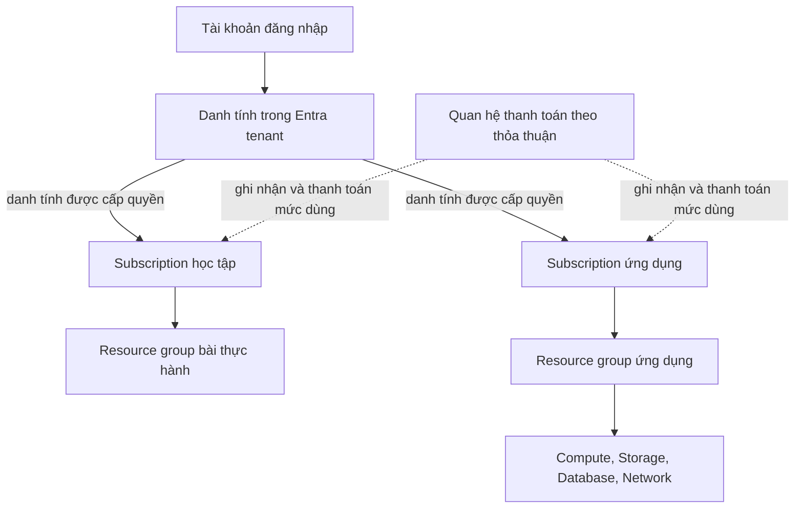

# Tạo tài khoản và lựa chọn loại Azure subscription

## 1. Mục tiêu của việc chuẩn bị tài khoản

Trước khi tạo mạng ảo, máy ảo, App Service, tài khoản lưu trữ hoặc cơ sở dữ liệu trên Azure, người học cần xác định ba việc: đăng nhập bằng danh tính nào, sử dụng subscription nào và ai chịu trách nhiệm thanh toán. Một tài nguyên được tạo thành công trong sai subscription vẫn có thể gây nhầm chi phí, sai phạm vi quản trị hoặc khó bàn giao sau này.

Bài học thuộc chương **Tài khoản và công cụ** trong hệ sinh thái Microsoft Azure. Mục tiêu là chuẩn bị môi trường có thể dùng cho các bài triển khai, giám sát và bảo vệ ứng dụng, đồng thời kiểm soát chi phí ngay từ đầu.

Sau bài học, bạn cần có khả năng:

- Phân biệt tài khoản đăng nhập, Microsoft Entra tenant, Azure subscription và tài khoản thanh toán.
- Chọn chương trình hoặc hình thức mua Azure phù hợp với việc học, phát triển thử nghiệm hay vận hành ứng dụng.
- Thực hiện quy trình đăng ký hoặc xin cấp quyền vào môi trường tổ chức.
- Kiểm tra đúng tenant, subscription, trạng thái và quyền trước khi triển khai.
- Phân biệt tín dụng ưu đãi, hạn mức sử dụng, spending limit và budget.

Các điều kiện ưu đãi, dịch vụ được hỗ trợ và yêu cầu xác minh có thể thay đổi. Những đường dẫn chính thức được đặt ngay tại các phần liên quan để người học đối chiếu điều kiện hiện hành trước khi xác nhận đăng ký hoặc nâng cấp.

## 2. Bốn khái niệm dễ nhầm lẫn

### 2.1. Tài khoản đăng nhập: bạn là ai?

Tài khoản đăng nhập cung cấp danh tính để vào Azure Portal và các công cụ quản trị. Hai trường hợp thường gặp là:

- **Microsoft account cá nhân:** danh tính do cá nhân quản lý, thường dùng khi tự học và tự đăng ký dịch vụ.
- **Tài khoản cơ quan hoặc trường học:** danh tính thuộc tổ chức, được quản lý trong hệ thống Microsoft Entra của tổ chức đó.

Cùng một chuỗi địa chỉ email có thể xuất hiện trong các ngữ cảnh đăng nhập khác nhau. Khi hệ thống yêu cầu chọn tài khoản cá nhân hoặc tài khoản cơ quan, cần chọn đúng loại đã dùng để nhận quyền hoặc đăng ký.

Đăng nhập thành công chỉ chứng minh hệ thống nhận diện được bạn. Nó chưa chứng minh bạn có subscription đang hoạt động, được tạo tài nguyên hoặc được xem hóa đơn.

### 2.2. Microsoft Entra tenant: danh tính được tổ chức ở đâu?

**Tenant** là một phiên bản thư mục Microsoft Entra ID của tổ chức, chứa các đối tượng như người dùng, nhóm và danh tính ứng dụng. Tenant có **Tenant ID** để định danh.

Một subscription tin cậy một tenant tại một thời điểm; một tenant có thể gắn với nhiều subscription. Quan hệ tin cậy này xác định thư mục danh tính phục vụ việc cấp quyền vào tài nguyên. Quan hệ thanh toán của subscription là một chiều khác, gắn với thỏa thuận mua dịch vụ. [Microsoft Learn: quan hệ giữa billing và tenant](https://learn.microsoft.com/en-us/azure/cost-management-billing/understand/understand-billing-tenant-relationship).

Người học có thể được mời vào tenant của trường hoặc công ty mà không trở thành người thanh toán. Vì vậy, không nên suy ra rằng có mặt trong một tenant đồng nghĩa sở hữu các subscription của tenant đó.

### 2.3. Azure subscription: tài nguyên được quản lý và ghi nhận chi phí ở đâu?

**Azure subscription** là phạm vi để triển khai và quản lý tài nguyên Azure, áp dụng các cơ chế quản trị phù hợp và tập hợp mức sử dụng để phục vụ tính phí. Mỗi subscription có **Subscription ID**.

Tên hiển thị giúp con người nhận biết, ví dụ `sub-azure-learning` hoặc `sub-orders-dev`. ID giúp công cụ xác định chính xác đối tượng; hai subscription có thể được đặt tên gần giống nhau nên không nên chỉ nhìn tên.

Một subscription thường chứa nhiều resource group, mỗi resource group chứa các tài nguyên liên quan. Tài nguyên được triển khai theo các lựa chọn vùng của từng dịch vụ; không nên hiểu subscription là một máy chủ hoặc một vùng triển khai duy nhất.

Subscription là phạm vi quản trị quan trọng nhưng không tự hoàn thành thiết kế mạng, quyền truy cập hay cách bảo vệ dữ liệu. Các quyết định đó vẫn cần được cấu hình cho kiến trúc ứng dụng.

### 2.4. Billing account và thỏa thuận mua dịch vụ: ai trả tiền, theo điều kiện nào?

Billing account biểu diễn quan hệ thanh toán với Microsoft hoặc cấu trúc thương mại tương ứng. Tùy loại thỏa thuận, còn có billing profile, invoice section hoặc những cấp quản lý khác. Không phải mọi tài khoản Azure đều có cùng cây thanh toán hay cùng cách xuất hóa đơn. [Microsoft Learn: các loại billing account](https://learn.microsoft.com/en-us/azure/cost-management-billing/manage/view-all-accounts).

Quyền quản lý tài nguyên và quyền quản lý thanh toán cần được kiểm tra riêng. Ví dụ, một lập trình viên có thể được giao triển khai vào resource group mà không có quyền thay đổi phương thức thanh toán của doanh nghiệp.

| Khái niệm | Câu hỏi nó giúp trả lời | Ví dụ định danh hoặc đối tượng |
| --- | --- | --- |
| Tài khoản đăng nhập | Ai đang truy cập? | Người dùng cá nhân hoặc người dùng tổ chức |
| Entra tenant | Danh tính và nhóm nằm trong thư mục nào? | Tenant ID |
| Subscription | Tài nguyên thuộc phạm vi Azure nào? | Subscription ID |
| Resource group | Những tài nguyên nào được quản lý cùng nhau? | `rg-orders-dev` |
| Billing account và cấu trúc thanh toán | Chi phí được thanh toán theo quan hệ nào? | Thỏa thuận mua và các phạm vi hóa đơn tương ứng |



Sơ đồ là ví dụ minh họa một tổ chức. Không nên coi nó là quy định rằng mọi subscription trong cùng tenant phải dùng chung một tài khoản thanh toán.

## 3. Hiểu đúng cụm từ “loại subscription”

Trong trao đổi thông thường, người dùng thường gọi Free Account, Pay-As-You-Go, Students, Enterprise Agreement và CSP là các “loại subscription”. Các tên này thực tế thuộc những lớp khái niệm khác nhau:

| Lớp lựa chọn | Ví dụ | Điều cần đánh giá |
| --- | --- | --- |
| Chương trình hoặc quyền lợi đăng ký | Azure free account, Azure for Students, quyền lợi Visual Studio | Điều kiện đủ, tín dụng, thời hạn và phạm vi sử dụng |
| Cách tính phí theo mức dùng | Pay-as-you-go | Mức sử dụng nào phát sinh phí và ai thanh toán |
| Quan hệ hoặc kênh mua dịch vụ | MCA, EA, mua qua CSP | Hợp đồng, hóa đơn, quyền quản lý và hỗ trợ |
| Ưu đãi dành cho môi trường phát triển | Dev/Test phù hợp điều kiện | Ai được dùng và workload nào được phép |
| Cấu hình của từng tài nguyên | SKU, tier, kích thước VM | Năng lực, tính năng và đơn giá của tài nguyên |

MCA là **Microsoft Customer Agreement**; EA là **Enterprise Agreement**; CSP là **Cloud Solution Provider**, kênh mua qua đối tác. Việc một subscription dùng mức giá theo lượng tiêu thụ không đủ để xác định toàn bộ cấu trúc hợp đồng của nó. [Microsoft Learn: các hình thức billing account](https://learn.microsoft.com/en-us/azure/cost-management-billing/manage/view-all-accounts).

Đổi gói hỗ trợ kỹ thuật, chọn VM lớn hơn hoặc mua một phương án tiết kiệm chi phí không đồng nghĩa tạo ra một loại tài khoản đăng nhập mới. Khi lựa chọn subscription, cần tách câu hỏi thương mại khỏi câu hỏi cấu hình tài nguyên.

## 4. Các lựa chọn phổ biến khi bắt đầu

### 4.1. Azure free account: khám phá trong phạm vi ưu đãi

Azure free account hướng đến khách hàng mới đủ điều kiện muốn thử Azure. Trang giới thiệu hiện mô tả khoản tín dụng ban đầu 200 USD sử dụng trong 30 ngày, cùng các lượng sử dụng miễn phí có điều kiện. Để tiếp tục sau thời hạn hoặc khi hết tín dụng, người dùng cần chủ động chuyển sang giá pay-as-you-go. [Microsoft Azure: Free Account và Pay-As-You-Go](https://azure.microsoft.com/en-us/free/).

Điểm cần phân biệt là tín dụng thử nghiệm với hạn mức miễn phí của từng dịch vụ. Hết tín dụng không đồng nghĩa mọi dịch vụ trở nên miễn phí; một cấu hình ngoài phạm vi ưu đãi vẫn cần được đánh giá trước khi tiếp tục sử dụng.

Quy trình đăng ký có bước xác minh danh tính và phương thức thanh toán phù hợp. Điều khoản nêu tín dụng không áp dụng cho mọi sản phẩm, chẳng hạn một số dịch vụ mua riêng hoặc sản phẩm Marketplace. Không nên dựa vào số tín dụng để kết luận mọi lựa chọn trong Portal đều được ưu đãi chi trả. [Điều khoản Azure free account](https://azure.microsoft.com/en-us/pricing/offers/ms-azr-0044p/).

Đây là lựa chọn phù hợp để thử một chuỗi bài học có kế hoạch, với điều kiện người học biết ưu đãi của mình kết thúc khi nào và quản lý tài nguyên sau mỗi bài.

### 4.2. Azure for Students: kiểm tra điều kiện sinh viên trước

Azure for Students là chương trình dành cho sinh viên đáp ứng điều kiện của Microsoft và hoàn tất xác minh học tập. Trang chương trình hiện mô tả 100 USD tín dụng dùng trong 12 tháng, không yêu cầu thẻ tín dụng, cùng khả năng gia hạn theo điều kiện sinh viên. Có địa chỉ email trường học chưa đủ để tự kết luận đăng ký chắc chắn được chấp nhận. [Microsoft Azure: Azure for Students](https://azure.microsoft.com/en-us/free/students/).

Người học cần kiểm tra chương trình cụ thể mình đang chọn, vì Azure for Students và những chương trình có tên gần giống không nhất thiết cung cấp cùng quyền lợi. Khi làm đồ án, hãy đối chiếu dịch vụ và cấu hình bài yêu cầu với khả năng thực tế của subscription đã được cấp.

### 4.3. Pay-as-you-go: trả theo mức dùng, cần quản lý liên tục

Pay-as-you-go là cách sử dụng Azure với chi phí phát sinh theo tài nguyên và mức tiêu thụ áp dụng. Nó phù hợp khi cần tiếp tục học hoặc vận hành workload vượt phạm vi thử nghiệm, sau khi đã xác định người thanh toán và ngân sách. [Microsoft Azure: lựa chọn tài khoản](https://azure.microsoft.com/en-us/free/).

Không nên hiểu “trả theo mức dùng” là chỉ bị tính tiền khi có người mở ứng dụng. Một tài nguyên được cấp sẵn có thể tiếp tục phát sinh phí khi không có request. Phần lưu trữ, mạng, sao lưu hoặc log có thể được tính riêng tùy dịch vụ.

Một subscription theo giá pay-as-you-go không có spending limit kiểu tín dụng thử nghiệm để đặt thành một mức tiền tùy ý. Budget cần được dùng đúng vai trò theo dõi và cảnh báo. [Microsoft Learn: Azure spending limit](https://learn.microsoft.com/en-us/azure/cost-management-billing/manage/spending-limit).

### 4.4. Quyền lợi Azure đi kèm Visual Studio subscription

Một số Visual Studio subscription có quyền lợi tín dụng Azure theo tháng. Mức tín dụng và điều kiện phụ thuộc gói sở hữu; quyền lợi này dành cho phát triển, kiểm thử cá nhân theo điều khoản áp dụng. Không nên đồng nhất việc cài Visual Studio hoặc dùng Visual Studio Code với việc có quyền lợi tín dụng Azure. [Microsoft Azure: tín dụng cho Visual Studio subscribers](https://azure.microsoft.com/en-us/pricing/member-offers/credit-for-visual-studio-subscribers/).

Nếu đã được tổ chức cấp quyền lợi phù hợp, hãy kiểm tra trước khi tạo một subscription trả phí độc lập. Với workload sản xuất, cần dùng hình thức cho phép production thay vì mặc định tận dụng tín dụng dev/test.

### 4.5. Dev/Test cho nhóm phát triển đủ điều kiện

Các chương trình Azure Dev/Test cung cấp mức giá dành cho phát triển và kiểm thử khi đáp ứng điều kiện, bao gồm yêu cầu về Visual Studio subscription trong những trường hợp áp dụng. Đây là ưu đãi cho workload không phải production; không phải chế độ miễn phí chung cho mọi tài nguyên. [Microsoft Azure: Azure Dev/Test pricing](https://azure.microsoft.com/en-us/pricing/offers/dev-test/).

Nhóm cần xác định ai tham gia môi trường, mục đích sử dụng và người phê duyệt điều kiện cấp phép. Một subscription phục vụ khách hàng thật không nên được coi là môi trường thử nghiệm chỉ vì đang ở giai đoạn đầu dự án.

### 4.6. Subscription của tổ chức: MCA, EA hoặc mua qua đối tác

Nếu công ty hoặc trường đã có môi trường Azure, hướng đi đầu tiên thường là xin cấp quyền đúng phạm vi hoặc yêu cầu tạo subscription theo quy trình nội bộ. Tổ chức có thể mua trực tiếp theo MCA, dùng EA hoặc mua dịch vụ qua đối tác CSP; cách quản lý hóa đơn và đầu mối hỗ trợ phụ thuộc quan hệ mua. [Microsoft Learn: billing offers và Entra tenant](https://learn.microsoft.com/en-us/azure/cloud-adoption-framework/ready/landing-zone/design-area/azure-billing-microsoft-entra-tenant).

Người thực hiện bài học không cần tự đứng ra làm người thanh toán nếu tổ chức đã cấp môi trường. Đầu mối nội bộ cần xác nhận subscription nào dùng cho học tập, tài nguyên nào được phép tạo và quy trình dọn dẹp sau thực hành.

## 5. Chọn phương án theo nhu cầu thực tế

### 5.1. Bảng định hướng lựa chọn

| Nhu cầu | Phương án nên kiểm tra trước | Điều kiện quyết định |
| --- | --- | --- |
| Sinh viên muốn học và làm đồ án | Azure for Students | Đủ điều kiện xác minh và dịch vụ cần dùng có thể triển khai |
| Cá nhân mới thử Azure trong thời gian ngắn | Azure free account | Đủ điều kiện khách hàng mới và nắm rõ thời hạn ưu đãi |
| Cá nhân cần tiếp tục dùng sau thử nghiệm | Pay-as-you-go | Có người thanh toán, mức chi dự kiến và lịch kiểm tra chi phí |
| Đã có quyền lợi Visual Studio phù hợp | Tín dụng Azure trong quyền lợi đó | Đã kích hoạt đúng và dùng theo điều kiện dev/test |
| Nhóm phát triển trong doanh nghiệp | Subscription tổ chức hoặc Dev/Test đủ điều kiện | Có phê duyệt, phạm vi quyền và quy tắc dùng chung |
| Ứng dụng phục vụ khách hàng thật | Subscription production do tổ chức quản lý | Hình thức mua cho phép mục đích sử dụng và có đầu mối vận hành |

Bảng là hướng dẫn ra quyết định cho bài học. Lựa chọn cuối cùng phụ thuộc điều kiện đăng ký, dịch vụ cần dùng và chính sách của tổ chức; phương án có tín dụng cao hơn chưa chắc phù hợp hơn.

### 5.2. Năm câu hỏi trước khi xác nhận

1. **Ai sở hữu môi trường?** Cá nhân, trường học hay công ty phải có đầu mối rõ ràng.
2. **Ai trả tiền?** Người đăng nhập có thể khác người thanh toán.
3. **Môi trường tồn tại bao lâu?** Một buổi thực hành khác với API cần hoạt động liên tục nhiều tháng.
4. **Bài học cần dịch vụ gì?** Cần xem dịch vụ, vùng, quota và cấu hình có thể sử dụng trong subscription cụ thể.
5. **Khi kết thúc sẽ xử lý thế nào?** Ai xuất dữ liệu, xóa tài nguyên và kiểm tra chi phí còn lại?

Ví dụ, một sinh viên làm API Java dùng Storage có thể kiểm tra quyền lợi Students trước. Nếu một dịch vụ bắt buộc của đồ án không khả dụng, cần xem lại yêu cầu hoặc xin môi trường phù hợp từ trường; không nên nâng cấp chỉ vì một thông báo lỗi mà chưa xác định nguyên nhân.

Với nhân viên phát triển ứng dụng của công ty, ưu tiên môi trường công ty đã phê duyệt giúp gắn tài nguyên với quyền quản trị và quy trình bàn giao của tổ chức. Tự dùng tài khoản cá nhân cùng thẻ cá nhân dễ làm trách nhiệm thanh toán tách khỏi chủ sở hữu ứng dụng.

## 6. Chuẩn bị trước khi đăng ký

### 6.1. Chuẩn bị danh tính và thông tin xác minh

Trước khi mở quy trình đăng ký, chuẩn bị:

- Danh tính bạn dự định dùng lâu dài cho môi trường này.
- Quyền truy cập email và phương thức xác minh mà quy trình yêu cầu.
- Thông tin cá nhân hoặc tổ chức chính xác theo biểu mẫu.
- Phương thức thanh toán được chấp nhận nếu chương trình yêu cầu.
- Bằng chứng học tập hoặc quyền lợi tổ chức nếu đăng ký theo chương trình tương ứng.

Yêu cầu cụ thể phụ thuộc chương trình và quốc gia hoặc khu vực. Điều khoản Free Account mô tả các yêu cầu về điện thoại, tài khoản và thẻ phù hợp, đồng thời có thể có bước tạm giữ xác minh. Người học cần đọc biểu mẫu thực tế, thay vì cho rằng mọi chương trình đều yêu cầu hoặc đều miễn xác minh thẻ. [Điều khoản đăng ký Free Account](https://azure.microsoft.com/en-us/pricing/offers/ms-azr-0044p/).

Quốc gia hoặc khu vực trong hồ sơ thanh toán không đồng nghĩa vùng của mọi tài nguyên. Dùng thông tin thanh toán thực tế; vùng triển khai ứng dụng sẽ được lựa chọn theo khả năng dịch vụ và yêu cầu hệ thống.

### 6.2. Chuẩn bị quyền nếu sử dụng tài khoản tổ chức

Hỏi đầu mối quản trị nội bộ về tenant phải dùng, subscription dành cho bài thực hành, phạm vi được tạo tài nguyên và đầu mối thanh toán. Việc tạo thêm subscription theo thỏa thuận của tổ chức cần quyền ở phạm vi thanh toán tương ứng; có quyền trong một resource group chưa đủ để tự tạo subscription mới. [Microsoft Learn: tạo subscription theo MCA](https://learn.microsoft.com/en-us/azure/cost-management-billing/manage/create-subscription).

Nếu đã được cấp resource group thực hành, bạn có thể không cần tạo subscription mới. Điều cần hoàn thành là đăng nhập đúng danh tính và kiểm tra quyền trong môi trường được giao.

### 6.3. Bảo vệ danh tính quản trị từ đầu

Thiết lập phương thức xác thực mạnh phù hợp với tài khoản và chính sách tổ chức, hoàn tất các yêu cầu xác thực nhiều yếu tố khi được yêu cầu và chuẩn bị cách khôi phục tài khoản. Không chia sẻ một tài khoản quản trị giữa cả nhóm để thay cho việc cấp quyền cho từng thành viên.

Trong môi trường nhóm, cấp quyền theo công việc giúp truy vết ai đã tạo, sửa hoặc xóa tài nguyên. Người chỉ cần thực hành trong một resource group không mặc nhiên cần quyền quản trị toàn subscription.

## 7. Quy trình tạo tài khoản hoặc nhận môi trường

### Bước 1: Mở đúng trang chính thức của chương trình

Với cá nhân, vào trang [lựa chọn tài khoản Azure](https://azure.microsoft.com/en-us/free/) hoặc [Azure for Students](https://azure.microsoft.com/en-us/free/students/) theo phương án đã chọn. Với quyền lợi Visual Studio, dùng luồng kích hoạt quyền lợi của chính subscription Visual Studio được cấp.

Nếu tổ chức đã có Azure, thực hiện theo đường dẫn và quy trình tổ chức cung cấp. Đừng đăng ký một quan hệ thanh toán cá nhân mới chỉ để giải quyết việc chưa thấy subscription công ty.

### Bước 2: Đăng nhập và xác nhận đúng danh tính

Kiểm tra tài khoản đang dùng trước khi tiếp tục. Nếu trình duyệt đang đăng nhập nhiều danh tính, chú ý lựa chọn tài khoản cá nhân hoặc cơ quan/trường học ở bước chuyển hướng.

Tên tài khoản hiển thị trong Portal, tenant đang chọn và subscription đang thấy là ba thông tin cần đối chiếu riêng. Chỉ nhìn ảnh đại diện hoặc địa chỉ email chưa đủ.

### Bước 3: Hoàn tất thông tin và xác minh của chương trình

Điền thông tin theo biểu mẫu, hoàn tất xác minh yêu cầu và đọc phần điều kiện thanh toán. Với chương trình sinh viên, hoàn tất bước xác minh học tập; với chương trình yêu cầu thẻ, kiểm tra điều kiện chấp nhận tại khu vực của bạn.

Nếu quy trình không xác minh được, sử dụng hướng dẫn hoặc kênh hỗ trợ chính thức của chương trình. Không tự thay đổi thông tin nhận dạng, quốc gia hoặc lập nhiều đăng ký để né điều kiện đủ.

### Bước 4: Đọc lại lựa chọn trước khi chấp nhận

Xác nhận chương trình được đăng ký, người chịu thanh toán, tín dụng hoặc thời hạn nếu có, và hành vi khi kết thúc ưu đãi. Đặc biệt lưu ý một thao tác chuyển sang trả phí có thể thay đổi cách subscription tiếp tục sử dụng dịch vụ.

Mục tiêu của bước này là bảo đảm hình thức bạn chấp nhận đúng với quyết định ở phần lựa chọn, thay vì chỉ đi qua biểu mẫu để có thể vào Portal.

### Bước 5: Vào Azure Portal và kiểm tra subscription

Mở [Azure Portal](https://portal.azure.com/), tìm **Subscriptions**, chọn subscription dự định sử dụng và xem trang thông tin tổng quan. Tên hoặc vị trí nhãn giao diện có thể thay đổi; hãy tìm theo chức năng quản lý subscription.

Ghi nhận Subscription ID, Tenant ID, tên hiển thị, trạng thái hoạt động và chương trình hoặc thông tin thanh toán có thể xem theo quyền của bạn. Với người được mời vào môi trường tổ chức, kiểm tra thêm directory và bộ lọc subscription nếu danh sách chưa hiển thị môi trường được giao.

### Bước 6: Xác nhận quyền và đầu mối quản trị

Mở **Access control (IAM)** tại phạm vi phù hợp để kiểm tra quyền hoặc nhờ quản trị viên xác nhận. Đối chiếu quyền với công việc cần làm, như đọc tài nguyên, tạo tài nguyên trong resource group hoặc quản lý quyền cho người khác.

Việc hoàn tất đăng ký chưa phải lý do để tạo ngay các tài nguyên lớn. Chỉ chuyển sang bài triển khai khi đã biết phạm vi, người thanh toán và cách theo dõi chi phí.

## 8. Kiểm tra quyền và ngữ cảnh trước khi triển khai

### 8.1. Đăng nhập được không đồng nghĩa có đủ quyền

Azure RBAC quản lý quyền đối với tài nguyên Azure, còn Microsoft Entra roles quản lý những đối tượng và chức năng trong thư mục. Vì vậy, quản trị tenant và quản trị subscription là các phạm vi cần phân biệt. [Microsoft Learn: Azure roles và Microsoft Entra roles](https://learn.microsoft.com/en-us/azure/role-based-access-control/rbac-and-directory-admin-roles).

Ba vai trò Azure thường gặp giúp hình dung mức quyền:

| Vai trò | Khả năng ở phạm vi được gán |
| --- | --- |
| Reader | Xem tài nguyên; không đủ để tạo hoặc sửa tài nguyên |
| Contributor | Quản lý tài nguyên; không có quyền gán Azure RBAC roles chỉ nhờ vai trò này |
| Owner | Quản lý tài nguyên và có quyền gán Azure RBAC roles |

Đây là mô tả khái quát của các vai trò, không thay thế việc kiểm tra quyền hiệu lực và các ràng buộc áp dụng. Quyền còn phụ thuộc phạm vi được gán, quyền kế thừa và chính sách của tổ chức. [Microsoft Learn: các vai trò Azure cơ bản](https://learn.microsoft.com/en-us/azure/role-based-access-control/rbac-and-directory-admin-roles).

Trong môi trường học nhóm, một người có thể chỉ được Contributor tại `rg-azure-learning`, trong khi người quản trị giữ quyền ở subscription. Không cần đưa tất cả thành viên thành Owner để triển khai một bài thực hành.

### 8.2. Kiểm tra bằng Portal hoặc Azure CLI

Portal là đủ cho việc xác minh ban đầu. Nếu đã cài và đăng nhập Azure CLI, có thể dùng các lệnh sau để xem và chọn subscription. Đây là ví dụ cho người học; không phải các bước tạo tài nguyên.

```bash
az account list --output table

az account set --subscription "<SUBSCRIPTION_ID>"

az account show \
  --query "{subscription:name,subscriptionId:id,tenantId:tenantId,state:state}" \
  --output json
```

Thay `<SUBSCRIPTION_ID>` bằng ID thật; không giữ nguyên dấu ngoặc nhọn. Dấu `\` nối dòng trong ví dụ dùng cho Bash; có thể viết lệnh cuối thành một dòng ở các shell khác.

`az account list` liệt kê subscription mà tài khoản hiện tại thấy; `az account set` chọn subscription mặc định trong ngữ cảnh CLI, không chuyển tài nguyên sang subscription khác; `az account show` xem thông tin subscription đang chọn. [Tài liệu Azure CLI: az account](https://learn.microsoft.com/en-us/cli/azure/account).

Ví dụ kết quả minh họa:

```json
{
  "subscription": "sub-azure-learning",
  "subscriptionId": "11111111-1111-1111-1111-111111111111",
  "tenantId": "22222222-2222-2222-2222-222222222222",
  "state": "Enabled"
}
```

Các ID trên là dữ liệu giả. Khi bắt đầu một phiên làm việc, hãy đối chiếu ID thực tế với môi trường đã được giao. Portal và CLI có thể đang chọn các subscription khác nhau, nên cần xác minh trong chính công cụ sẽ dùng để triển khai.

### 8.3. Phân biệt quyền, quota và khả năng cung cấp dịch vụ

Có quyền tạo VM không đồng nghĩa luôn tạo được mọi kích thước VM ở mọi vùng. Một yêu cầu triển khai còn có thể bị giới hạn bởi quota, điều kiện subscription, chính sách hoặc khả năng cung cấp của dịch vụ.

Quota là giới hạn năng lực hoặc số lượng tài nguyên, chẳng hạn vCPU tại một vùng; nó không phải mức tiền tối đa. Một số quota có thể được yêu cầu tăng trong điều kiện phù hợp, còn một số giới hạn không thể thay đổi. Free trial có hạn chế với việc tăng quota. [Microsoft Learn: giới hạn và quota của Azure](https://learn.microsoft.com/en-us/azure/azure-resource-manager/management/azure-subscription-service-limits).

Khi gặp lỗi, đọc mã và nội dung lỗi trước: thiếu quyền cần xử lý quyền; vi phạm policy cần làm việc với quản trị viên; thiếu quota cần xem đúng loại quota và vùng; subscription không hoạt động cần kiểm tra trạng thái hoặc thanh toán. Nâng cấp subscription không phải cách sửa mặc định cho mọi lỗi.

## 9. Thiết lập quản lý chi phí ngay từ buổi học đầu tiên

### 9.1. Tín dụng, miễn phí, spending limit và budget

| Khái niệm | Ý nghĩa | Điều dễ hiểu nhầm |
| --- | --- | --- |
| Credit — tín dụng | Khoản ưu đãi được dùng theo điều kiện và thời hạn | Không phải tiền sử dụng tùy ý cho mọi sản phẩm |
| Lượng sử dụng miễn phí | Một mức dùng hoặc cấu hình trong chương trình cụ thể | Không phải toàn bộ dịch vụ miễn phí không giới hạn |
| Spending limit | Cơ chế giới hạn gắn với một số subscription có tín dụng | Không phải nút đặt trần tùy ý cho mọi subscription |
| Budget | Mức ngân sách để theo dõi và kích hoạt cảnh báo | Không tự dừng mọi tài nguyên khi chạm ngưỡng |
| Quota | Giới hạn tài nguyên hoặc năng lực theo phạm vi dịch vụ | Không thay thế quản lý chi phí |

Spending limit có thể được bật với các chương trình tín dụng phù hợp; phạm vi bảo vệ và ngoại lệ cần được đọc theo chương trình. Không có nghĩa người học đặt budget 10 USD thì Azure tự áp một spending limit 10 USD. [Microsoft Learn: spending limit](https://learn.microsoft.com/en-us/azure/cost-management-billing/manage/spending-limit).

### 9.2. Tạo budget và hiểu cách cảnh báo hoạt động

Trong Portal, tìm Cost Management tại phạm vi bạn được phép quản lý, chọn chức năng Budgets, đặt kỳ theo dõi, số tiền và người nhận cảnh báo. Ví dụ minh họa, người học chọn ngân sách tháng tương đương 10 USD và ngưỡng 50%, 80%, 100%; số tiền thực phải theo đồng tiền của phạm vi thanh toán và khả năng chi trả của mình.

Budget dùng dữ liệu chi phí để đánh giá ngưỡng, không phải công tắc ngắt sử dụng tức thời. Dữ liệu và cảnh báo có độ trễ; nếu cần hành động tự động, phải có cơ chế riêng được thiết kế và kiểm tra. [Microsoft Learn: tạo và quản lý budget](https://learn.microsoft.com/en-us/azure/cost-management-billing/costs/tutorial-acm-create-budgets).

Với subscription mới, các chức năng Cost Management có thể chưa sẵn sàng ngay. Khi chưa tạo được budget, kiểm tra quyền, loại tài khoản và thời gian kích hoạt theo hướng dẫn chính thức; không suy ra rằng chưa thấy báo cáo chi phí nghĩa là chưa có phí. [Microsoft Learn: điều kiện sử dụng Budgets](https://learn.microsoft.com/en-us/azure/cost-management-billing/costs/tutorial-acm-create-budgets).

### 9.3. Ước tính cả những thành phần đi kèm ứng dụng

Một API Java nhỏ có thể gồm App Service, cơ sở dữ liệu, Storage, mạng và log. Trước khi triển khai, lập bảng dự kiến cho toàn bộ thành phần thay vì chỉ xem giá của nơi chạy mã Java.

| Thành phần | Câu hỏi để ước tính mức dùng |
| --- | --- |
| Compute | Cấp năng lực liên tục hay tính theo tiêu thụ? Chạy bao nhiêu giờ hoặc bao nhiêu instance? |
| Database | Dùng tier nào, dung lượng bao nhiêu, cơ chế hoạt động và sao lưu ra sao? |
| Storage | Dung lượng, số thao tác và lựa chọn lưu trữ là gì? |
| Network | Có truyền dữ liệu, IP hoặc thành phần mạng tính phí riêng không? |
| Monitoring | Thu thập bao nhiêu log và giữ trong bao lâu? |

Dùng [Azure Pricing Calculator](https://azure.microsoft.com/en-us/pricing/calculator/) để xây dựng ước tính theo cấu hình dự định. Ước tính phục vụ lập kế hoạch; mức dùng thực tế và điều kiện giá áp dụng mới quyết định chi phí phát sinh.

Sau mỗi buổi học, xem lại tài nguyên đã tạo và xóa những thành phần thực hành không cần giữ. Với VM, dừng bên trong hệ điều hành và deallocate có ý nghĩa vận hành khác nhau; các thành phần đi kèm như đĩa vẫn cần được xem xét riêng. Với dịch vụ khác, kiểm tra trạng thái và mô hình tính phí của chính dịch vụ đó.

Nếu gom tài nguyên một bài vào resource group riêng, việc kiểm kê và dọn dẹp sẽ thuận tiện hơn. Trước khi xóa, xác định nhóm có tài nguyên dùng chung hoặc dữ liệu cần giữ không; sau khi dọn, kiểm tra kết quả và báo cáo chi phí khi dữ liệu đã được cập nhật.

## 10. Những vấn đề thường gặp khi bắt đầu

| Hiện tượng | Điều cần kiểm tra | Hướng xử lý ban đầu |
| --- | --- | --- |
| Đăng nhập Portal được nhưng không thấy subscription | Danh tính, directory, bộ lọc và quyền đã được cấp | Chuyển đúng ngữ cảnh, đối chiếu lời mời hoặc hỏi quản trị viên |
| Thấy subscription nhưng không tạo được tài nguyên | Trạng thái, quyền hiệu lực, policy, quota và lỗi dịch vụ | Đọc thông báo cụ thể trước khi xin thêm quyền hoặc đổi cấu hình |
| Không xem được hóa đơn | Phạm vi và quyền thanh toán | Liên hệ đầu mối billing; không dùng quyền tài nguyên để suy ra quyền hóa đơn |
| Không được chấp nhận ưu đãi | Điều kiện khách hàng, chương trình, khu vực và xác minh | Kiểm tra điều khoản và hỗ trợ chính thức |
| Subscription bị vô hiệu hóa hoặc không tiếp tục triển khai được | Hết tín dụng, hết hạn, vấn đề thanh toán hoặc trạng thái quản lý | Xác định nguyên nhân trong Portal và xử lý theo hướng dẫn của chương trình |
| Không thấy chi phí ngay sau khi tạo tài nguyên | Độ trễ dữ liệu và bộ lọc báo cáo | Theo dõi lại đúng phạm vi sau khi dữ liệu được cập nhật |
| CLI triển khai vào môi trường khác Portal | Subscription hiện tại trong từng công cụ | Đối chiếu Subscription ID trước thao tác |

**Tình huống minh họa:** Lan được công ty mời vào tenant và đăng nhập Portal thành công, nhưng trang Subscriptions trống. Lan không nên lập tức tạo một Free Account bằng thẻ cá nhân. Lan kiểm tra đang chọn đúng tài khoản cơ quan, đúng directory và bộ lọc; sau đó nhờ quản trị viên đối chiếu quyền trên subscription hoặc resource group được giao.

Nếu mục tiêu chỉ là thực hành trong môi trường công ty, vấn đề cần giải quyết là quyền và ngữ cảnh truy cập. Tạo thêm một quan hệ thanh toán cá nhân không làm subscription công ty xuất hiện.

**Một tình huống khác:** Nam dùng subscription thử nghiệm và không tạo được VM theo cấu hình trong hướng dẫn. Nam đọc lỗi để phân biệt thiếu quota với cấu hình không khả dụng. Nam xem lại nhu cầu bài học, thử lựa chọn được hỗ trợ nếu phù hợp, hoặc xin môi trường được cấp phép. Việc chuyển sang trả phí chỉ nên diễn ra sau khi đã hiểu tác động và người thanh toán.

Không nên để dữ liệu duy nhất hoặc một dịch vụ quan trọng phụ thuộc vào ưu đãi sắp hết hạn. Nếu cần tiếp tục sử dụng, lập kế hoạch hợp lệ trước thời điểm kết thúc; nếu kết thúc thực hành, xuất dữ liệu cần giữ và dọn tài nguyên theo kế hoạch.

## 11. Bài thực hành và câu hỏi tự kiểm tra

### 11.1. Bài thực hành: chuẩn bị môi trường mà chưa triển khai ứng dụng

Thực hiện bằng Portal với tài khoản của bạn hoặc môi trường tổ chức đã được cấp:

1. Chọn trường hợp sử dụng: tự học cá nhân, sinh viên hoặc môi trường công ty.
2. Ghi lại lý do chọn chương trình hoặc hình thức mua, người thanh toán và thời gian dự kiến sử dụng.
3. Đăng ký theo điều kiện được phép hoặc nhận quyền từ quản trị viên.
4. Mở Subscriptions và xác nhận đúng Subscription ID, Tenant ID và trạng thái.
5. Kiểm tra quyền của mình tại phạm vi thực hành.
6. Xác định nơi xem chi phí, tín dụng và ngày kết thúc quyền lợi nếu có.
7. Thiết lập budget nếu được hỗ trợ và có quyền; xác nhận người nhận cảnh báo.
8. Lập kế hoạch dọn dẹp cho bài triển khai đầu tiên.

Bài thực hành kết thúc khi bạn biết chắc môi trường nào sẽ được dùng, ai chịu chi phí và mình có quyền gì. Không cần tạo VM, database hoặc Storage chỉ để chứng minh tài khoản đã sẵn sàng.

Mẫu tự ghi nhận, không điền mật khẩu, mã xác minh hoặc thông tin thẻ:

```text
Mục đích: học triển khai API Java
Hình thức sử dụng: chương trình đã chọn hoặc môi trường tổ chức
Người sở hữu và đầu mối thanh toán: ...
Danh tính đăng nhập và directory cần dùng: ...
Subscription ID và Tenant ID: đã đối chiếu
Trạng thái subscription: ...
Phạm vi được phép thực hành: ...
Tín dụng hoặc thời hạn cần theo dõi: ...
Ngân sách dự kiến và nơi nhận cảnh báo: ...
Kế hoạch xuất dữ liệu, dọn tài nguyên: ...
```

### 11.2. Câu hỏi tự kiểm tra

**Câu 1: Có tài khoản Microsoft có nghĩa là đã có Azure subscription đang hoạt động không?**

Không. Danh tính đăng nhập, quan hệ subscription và quyền truy cập là các thông tin phải kiểm tra riêng.

**Câu 2: Hai subscription có cùng tenant thì bắt buộc cùng người thanh toán không?**

Không nên suy ra như vậy. Quan hệ danh tính và quan hệ thanh toán là hai chiều khác nhau; phải xem cấu trúc thương mại và quyền quản lý thực tế.

**Câu 3: Budget 10 USD có bảo đảm hóa đơn không vượt 10 USD không?**

Không. Budget phục vụ theo dõi và cảnh báo; cần quản lý tài nguyên, xem độ trễ dữ liệu và thiết kế hành động riêng nếu yêu cầu tự động phản ứng.

**Câu 4: Gặp lỗi tạo VM có nên chuyển sang trả phí ngay không?**

Cần đọc lỗi trước. Quyền, policy, quota, trạng thái subscription và khả năng cung cấp tài nguyên là các nguyên nhân khác nhau, với cách xử lý khác nhau.

**Câu 5: Contributor ở một resource group có mặc nhiên quản lý hóa đơn và cấp quyền cho mọi người không?**

Không. Vai trò có phạm vi và khả năng cụ thể; quyền thanh toán và quyền gán vai trò cần được xem xét riêng.

**Câu 6: Đổi subscription hiện tại bằng CLI có chuyển tài nguyên sang subscription đó không?**

Không. Nó đổi ngữ cảnh lựa chọn của CLI. Di chuyển tài nguyên hoặc đổi quan hệ của subscription là các thao tác quản trị khác, cần được đánh giá riêng.

## 12. Kiến thức cần ghi nhớ

Chuẩn bị Azure bắt đầu bằng việc xác định đúng danh tính, tenant, subscription và quan hệ thanh toán. Với người mới, lựa chọn phù hợp phải dựa trên điều kiện đủ, dịch vụ cần thực hành, thời hạn sử dụng và đầu mối chịu chi phí.

Khi đã có môi trường, kiểm tra trạng thái, quyền, quota và Subscription ID trước khi triển khai. Phân biệt tín dụng với lượng miễn phí, spending limit với budget, đồng thời theo dõi cả các thành phần tính phí đi kèm ứng dụng. Những bước này tạo nền tảng để học mạng, tính toán, lưu trữ và dữ liệu trên Azure trong một phạm vi có thể quản trị và bàn giao rõ ràng.
