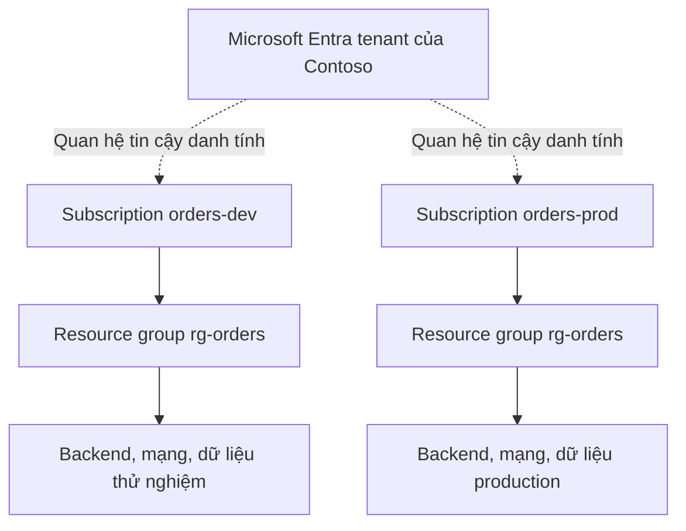

# Chọn tenant, subscription và ngữ cảnh làm việc

## Mục tiêu và bối cảnh

Trong chương **Tài khoản và công cụ** của module **CLOUD_PROVIDERS_AZURE**, chọn đúng ngữ cảnh là bước nối tài khoản đăng nhập với tài nguyên Azure mà bạn định thao tác. Một tài khoản có thể nhìn thấy nhiều tổ chức và nhiều subscription. Đăng nhập thành công mới xác nhận được một phần thông tin; bạn vẫn cần biết công cụ đang nhắm đến môi trường nào.

Bài này hướng dẫn xác định tenant, subscription và phạm vi tài nguyên trong Azure Portal, Azure CLI và Azure PowerShell. Các ví dụ gắn với ứng dụng có mạng ảo, backend, lưu trữ, dữ liệu và giám sát, để việc chọn ngữ cảnh hỗ trợ đúng kế hoạch triển khai và kiểm soát chi phí.

Các GUID, tên subscription, tài khoản và resource group trong bài đều là **giá trị minh họa**. Khi tự thực hành, thay chúng bằng thông tin môi trường được giao. Các đoạn lệnh khảo sát chỉ đọc dữ liệu Azure hoặc thay đổi phiên đăng nhập/ngữ cảnh của công cụ; bài không yêu cầu tạo hay xóa tài nguyên.

## 1. Ngữ cảnh làm việc gồm những gì?

Có thể dùng mô hình sau để mô tả đích của một thao tác:

```text
Ngữ cảnh cần xác minh
  = cloud environment
  + danh tính thực hiện
  + tenant
  + subscription
  + phạm vi tài nguyên
```

Đây là mô hình thực hành để suy nghĩ về thao tác, không phải tên một đối tượng API duy nhất của Azure.

| Thành phần | Câu hỏi cần trả lời | Ví dụ minh họa |
| --- | --- | --- |
| Cloud environment | Đang dùng hệ endpoint Azure nào? | AzureCloud |
| Danh tính | Người dùng hoặc workload nào đang thực hiện yêu cầu? | developer@contoso.example |
| Tenant | Directory nào cung cấp ngữ cảnh danh tính cho đích này? | Tenant của tổ chức Contoso |
| Subscription | Tài nguyên thuộc phạm vi quản lý nào? | orders-dev |
| Phạm vi tài nguyên | Đang làm trên nhóm hoặc tài nguyên cụ thể nào? | rg-orders-dev |

**Region/location** là một tham số triển khai cần kiểm tra riêng. Chọn đúng subscription chưa xác nhận tài nguyên sẽ được đặt đúng region.

Cũng cần ghi công cụ và phiên đang dùng. Kết quả kiểm tra trong Portal không thay thế kết quả kiểm tra của lệnh `az` hoặc cmdlet `Az` mà bạn sắp chạy.

## 2. Tenant và subscription có quan hệ thế nào?

**Microsoft Entra tenant**, còn gọi là directory trong nhiều giao diện, chứa ngữ cảnh danh tính của một tổ chức. **Azure subscription** là phạm vi quản lý tài nguyên và các quyền Azure liên quan.

Một subscription tin cậy một Microsoft Entra tenant tại một thời điểm; một tenant có thể được nhiều subscription tin cậy. Vai trò Microsoft Entra và vai trò Azure là hai hệ thống cần phân biệt. Xem [quan hệ giữa Azure subscription và Microsoft Entra tenant](https://learn.microsoft.com/en-us/entra/fundamentals/how-subscriptions-associated-directory).

Sơ đồ minh họa một tổ chức dùng hai subscription:



Hai nhóm cùng tên `rg-orders` trong sơ đồ thuộc hai subscription khác nhau. Khi làm việc, tên nhóm cần đi cùng subscription hoặc resource ID đầy đủ.

### 2.1. Tài khoản đăng nhập không phải tenant

Một địa chỉ email giúp nhận diện tài khoản khi tương tác, nhưng không đủ để suy ra tenant đích. Ví dụ, kỹ sư của công ty triển khai có thể dùng cùng tài khoản để hỗ trợ nhiều khách hàng.

Trong mô hình cộng tác nhiều tenant, **home tenant** chứa người dùng ở tổ chức gốc; **resource tenant** là tenant chứa tài nguyên được chia sẻ. Hai khái niệm này được giải thích trong [thuật ngữ quản lý người dùng nhiều tenant](https://learn.microsoft.com/en-us/entra/architecture/multi-tenant-user-management-introduction).

Với tình huống hỗ trợ khách hàng, hãy lấy tenant ID đích từ hồ sơ môi trường khách hàng. Không dùng home tenant chỉ vì đó là nơi tài khoản thường đăng nhập.

### 2.2. Chọn tenant không đồng nghĩa có quyền

Azure RBAC cấp quyền theo bộ ba: **security principal, role definition và scope**. Chuyển sang một ngữ cảnh phù hợp không tự tạo role assignment. Xem [tổng quan Azure RBAC](https://learn.microsoft.com/en-us/azure/role-based-access-control/overview).

Do đó, cần tách ba kết quả:

- Đăng nhập được: bước xác thực đã thành công theo phương thức đang dùng.
- Chọn được subscription: công cụ xác định được phạm vi subscription khả dụng.
- Thực hiện được thao tác: danh tính còn phải đáp ứng quyền và các điều kiện của thao tác cụ thể.

Ví dụ, đọc được metadata của một resource group không chứng minh rằng bạn được phép thay đổi cấu hình backend trong nhóm đó.

## 3. Chọn đích bằng ID và hồ sơ môi trường

Tên như “Development”, “Production” hoặc “Azure subscription 1” phù hợp để con người đọc, nhưng có thể giống nhau hoặc được đổi tên. Trong script và cấu hình triển khai, nên dùng GUID đã xác minh.

Một hồ sơ môi trường minh họa:

| Trường | Development | Production |
| --- | --- | --- |
| Cloud | AzureCloud | AzureCloud |
| Tenant ID | 11111111-1111-4111-8111-111111111111 | 11111111-1111-4111-8111-111111111111 |
| Subscription name | orders-dev | orders-prod |
| Subscription ID | 22222222-2222-4222-8222-222222222222 | 33333333-3333-4333-8333-333333333333 |
| Resource group | rg-orders | rg-orders |
| Công việc minh họa | Thử cấu hình ứng dụng | Vận hành hệ thống thật |

Trong ví dụ này, tenant giống nhau nhưng subscription khác nhau. Nếu chỉ so tenant ID, một script vẫn có thể nhắm nhầm production.

Một quy trình làm việc nên nhận tenant ID, subscription ID và phạm vi tài nguyên từ yêu cầu hoặc cấu hình môi trường đã thống nhất. Khi các giá trị này chưa rõ, hãy dừng trước thao tác thay đổi và đối chiếu với chủ môi trường.

## 4. Xác định ngữ cảnh trong Azure Portal

### 4.1. Chọn directory

Trong Portal, mở **Settings** rồi tìm **Directories + subscriptions**. Kiểm tra **Current directory**; dùng **All Directories** và **Switch** để chọn directory cần làm việc. Portal còn có lựa chọn startup directory, gồm một directory cụ thể hoặc directory truy cập gần nhất.

Các mục này được mô tả trong [hướng dẫn cấu hình Azure Portal](https://learn.microsoft.com/en-us/azure/azure-portal/set-preferences). Tên và vị trí mục có thể thay đổi theo phiên bản giao diện hoặc ngôn ngữ.

Khi vào một môi trường khách hàng, hãy đối chiếu directory đang hiển thị với tenant ID của yêu cầu, thay vì chỉ dựa vào logo hoặc tên tổ chức.

### 4.2. Hiểu bộ lọc subscription

Portal có bộ lọc mặc định và bộ lọc danh sách subscription. Một subscription có thể không xuất hiện vì bộ lọc đang loại nó khỏi màn hình. Danh sách subscription cũng gắn với directory đang đăng nhập. Xem [cách lọc và xem subscription](https://learn.microsoft.com/en-us/azure/cost-management-billing/manage/filter-view-subscriptions).

Vì vậy, “không nhìn thấy subscription” chưa đủ để kết luận subscription đã bị xóa hoặc tài khoản chắc chắn không có quyền.

Trình tự khảo sát phù hợp:

1. Kiểm tra tài khoản đang đăng nhập.
2. Kiểm tra current directory và tenant ID.
3. Kiểm tra bộ lọc subscription.
4. Vào subscription dự kiến và đối chiếu subscription ID.
5. Mở resource group hoặc tài nguyên cần thao tác và kiểm tra phạm vi của nó.

### 4.3. Kiểm tra đích ngay tại tài nguyên

Trước khi đổi cấu hình một backend, hãy xem thông tin subscription và resource group trên trang của backend. Nếu đang tạo tài nguyên, kiểm tra lại các trường subscription, resource group và region trên biểu mẫu.

Bộ lọc giúp thu hẹp màn hình. Nó không phải cơ chế phân quyền thay thế Azure RBAC và không thay thế việc đối chiếu đích của thao tác.

## 5. Chọn tenant và subscription bằng Azure CLI

Các ví dụ lệnh `az` dưới đây dùng cú pháp nhập trong **PowerShell**. Máy người học cần cài Azure CLI và có phương thức đăng nhập phù hợp.

### 5.1. Kiểm tra cloud environment

```powershell
az cloud show --query name --output tsv
```

Ví dụ đầu ra cho Azure public cloud:

```text
AzureCloud
```

Azure CLI hỗ trợ các cloud environment với endpoint khác nhau. Có thể khảo sát bằng `az cloud list` và `az cloud show`. Nếu công việc thuộc cloud khác, cần chọn đúng cloud rồi xác thực và kiểm tra subscription tương ứng. Xem [quản lý Azure clouds bằng CLI](https://learn.microsoft.com/en-us/cli/azure/manage-clouds-azure-cli).

Bài này dùng `AzureCloud`. Không tự chuyển cloud chỉ vì danh sách subscription đang thiếu; trước hết hãy xác minh môi trường được giao.

### 5.2. Đăng nhập vào tenant đích

```powershell
$tenantId = '11111111-1111-4111-8111-111111111111'

az login --tenant $tenantId
```

Hoàn tất bước xác thực tương tác, bao gồm MFA hoặc điều kiện đăng nhập do tổ chức yêu cầu. Sau đăng nhập, có thể xuất hiện bước chọn tenant/subscription tùy phiên bản và môi trường.

Ở một số môi trường, để đăng nhập tenant chỉ định cần tắt subscription selector trước:

```powershell
az config set core.login_experience_v2=off
az login --tenant $tenantId
```

Đây là nhánh xử lý khi cần theo hành vi công cụ, không phải bước bắt buộc cho mọi lần đăng nhập. Có thể bật lại selector bằng `az config set core.login_experience_v2=on`. Xem [đăng nhập tương tác bằng Azure CLI](https://learn.microsoft.com/en-us/cli/azure/authenticate-azure-cli-interactively).

### 5.3. Liệt kê rồi chọn subscription

```powershell
az account list --query "[].{name:name,id:id,tenantId:tenantId,state:state,isDefault:isDefault}" --output table

$subscriptionId = '22222222-2222-4222-8222-222222222222'
az account set --subscription $subscriptionId
```

`az account list` giúp đối chiếu các subscription mà phiên CLI biết đến. `az account set` đặt subscription hoạt động; lệnh chấp nhận tên hoặc ID. Trong ví dụ, dùng ID để tránh chọn tên giống nhau. Xem [quản lý Azure subscriptions bằng CLI](https://learn.microsoft.com/en-us/cli/azure/manage-azure-subscriptions-azure-cli).

Nếu không tìm được ID được giao, chưa chuyển sang thao tác tiếp theo. Kiểm tra lại account, tenant và quyền truy cập trước.

### 5.4. Đọc lại ngữ cảnh hiện tại

```powershell
az account show --query "{name:name,id:id,tenantId:tenantId,state:state,account:user.name,accountType:user.type}" --output json
```

Đầu ra minh họa:

```json
{
  "name": "orders-dev",
  "id": "22222222-2222-4222-8222-222222222222",
  "tenantId": "11111111-1111-4111-8111-111111111111",
  "state": "Enabled",
  "account": "developer@contoso.example",
  "accountType": "user"
}
```

Đối chiếu ít nhất tenant ID và subscription ID với hồ sơ môi trường. Trường account giúp nhận biết phiên đang dùng người dùng hay một danh tính workload; cách biểu diễn account phụ thuộc phương thức xác thực.

`az account show` là lệnh đọc ngữ cảnh. Nó không phải phép kiểm tra đầy đủ mọi quyền của danh tính đó.

### 5.5. Gắn subscription vào từng lệnh quan trọng

Để đọc resource group với đích tường minh:

```powershell
az group show --name rg-orders --subscription $subscriptionId --query "{id:id,name:name,location:location}" --output json
```

Tham số `--subscription` chọn subscription cho lệnh hỗ trợ tham số đó, giúp giảm phụ thuộc vào mặc định. Xem [global parameters của Azure CLI](https://learn.microsoft.com/en-us/cli/azure/azure-cli-global-parameters).

Việc truyền subscription không cấp quyền bổ sung và không sửa một phiên đăng nhập sai cloud. Với tài nguyên được chỉ bằng resource ID đầy đủ, cần kiểm tra ID đó nữa; không cho rằng mọi tham số đích đều tự được thay thế theo subscription mặc định.

## 6. Ngữ cảnh trong Azure PowerShell

Azure PowerShell dùng các cmdlet như `Connect-AzAccount`, `Get-AzContext` và `Set-AzContext`. Đây là hệ công cụ khác với việc chạy executable `az` bên trong một cửa sổ PowerShell.

### 6.1. Kết nối tới tenant và subscription cụ thể

```powershell
$tenantId = '11111111-1111-4111-8111-111111111111'
$subscriptionId = '22222222-2222-4222-8222-222222222222'

Connect-AzAccount -Environment AzureCloud -Tenant $tenantId -Subscription $subscriptionId -Scope Process -ErrorAction Stop
```

`Connect-AzAccount` hỗ trợ chỉ định environment, tenant, subscription và scope của thay đổi ngữ cảnh. Tham khảo [Connect-AzAccount](https://learn.microsoft.com/en-us/powershell/module/az.accounts/connect-azaccount).

Ví dụ này dùng đăng nhập người dùng. `-Scope Process` giới hạn ngữ cảnh mới của lần kết nối vào tiến trình hiện tại; nó không phải thao tác xóa mọi thông tin đăng nhập đã lưu trước đó.

### 6.2. Chọn và đọc lại context

```powershell
$context = Set-AzContext -Tenant $tenantId -Subscription $subscriptionId -Scope Process -ErrorAction Stop

Get-AzContext | Format-List Account, Tenant, Subscription, Environment
```

`Set-AzContext` thiết lập thông tin tenant, subscription và environment cho các cmdlet của phiên. Xem [Set-AzContext](https://learn.microsoft.com/en-us/powershell/module/az.accounts/set-azcontext).

Có thể đọc ID bằng thuộc tính của đối tượng context:

```powershell
if ($context.Tenant.Id -ne $tenantId) {
    throw 'Tenant trong context không khớp đích.'
}

if ($context.Subscription.Id -ne $subscriptionId) {
    throw 'Subscription trong context không khớp đích.'
}

if ($context.Environment.Name -ne 'AzureCloud') {
    throw 'Cloud environment không khớp đích.'
}
```

Kiểm tra dựa trên ID giúp tránh phụ thuộc vào tên context hoặc tên hiển thị.

### 6.3. Truyền context vào cmdlet đọc tài nguyên

```powershell
Get-AzResourceGroup -Name rg-orders -DefaultProfile $context -ErrorAction Stop |
    Select-Object ResourceGroupName, ResourceId, Location
```

`-DefaultProfile` của cmdlet này nhận thông tin account, tenant và subscription dùng cho kết nối. Xem [Get-AzResourceGroup](https://learn.microsoft.com/en-us/powershell/module/az.resources/get-azresourcegroup).

Khi viết hàm nhận context, hãy truyền đối tượng đó xuyên suốt những cmdlet hỗ trợ nó. Với cmdlet không hỗ trợ cùng tham số, cần đối chiếu cơ chế chọn đích trong tài liệu riêng.

## 7. Dùng resource ID để xác định phạm vi cuối cùng

Một resource ID Azure Resource Manager có thể chứa subscription, resource group, resource provider, loại và tên tài nguyên. Ví dụ minh họa:

```text
/subscriptions/22222222-2222-4222-8222-222222222222/resourceGroups/rg-orders/providers/Microsoft.Web/sites/orders-api-dev
```

Cấu trúc scope và resource ID được mô tả trong [hướng dẫn phạm vi Azure RBAC](https://learn.microsoft.com/en-us/azure/role-based-access-control/scope-overview).

Khi rà đích của một lệnh, hãy đọc ID theo các phần:

| Phần | Giá trị minh họa | Điều cần đối chiếu |
| --- | --- | --- |
| subscriptions | 22222222-2222-4222-8222-222222222222 | Đúng môi trường development |
| resourceGroups | rg-orders | Đúng nhóm được giao |
| provider/type | Microsoft.Web/sites | Đúng loại tài nguyên |
| resource name | orders-api-dev | Đúng backend cần khảo sát |

Resource ID không chứa tenant ID dưới dạng một đoạn đường dẫn tương tự. Vì vậy, kiểm tra chuỗi ID không thay thế kiểm tra tenant trong ngữ cảnh danh tính.

Trong thực hành, đừng chỉ nhìn hậu tố `-dev`. Một tên dễ hiểu vẫn có thể được dùng nhầm; ID giúp đối chiếu trực tiếp với phạm vi yêu cầu.

## 8. Mẫu kiểm tra trước thao tác bằng CLI

Đoạn PowerShell dưới đây minh họa một bước kiểm tra **chỉ đọc**. Nó yêu cầu phiên CLI đã đăng nhập và chọn ngữ cảnh trước đó, rồi so sánh đích hiện tại với các giá trị dự kiến.

Đoạn này không tự đăng nhập, không đổi subscription và không sửa tài nguyên. Cơ chế dừng khi sai đích được đặt ngay trước phần mà một workflow thực tế có thể tiếp tục.

```powershell
$ErrorActionPreference = 'Stop'

$expectedCloud = 'AzureCloud'
$expectedTenantId = '11111111-1111-4111-8111-111111111111'
$expectedSubscriptionId = '22222222-2222-4222-8222-222222222222'
$resourceGroupName = 'rg-orders'

function Invoke-AzureCliJson {
    param(
        [Parameter(Mandatory)]
        [string[]] $CliArguments
    )

    $output = & az @CliArguments
    $exitCode = $LASTEXITCODE

    if ($exitCode -ne 0) {
        throw "Azure CLI thất bại với exit code $exitCode."
    }

    $jsonText = $output -join [Environment]::NewLine
    if ([string]::IsNullOrWhiteSpace($jsonText)) {
        throw 'Azure CLI không trả về JSON.'
    }

    return ($jsonText | ConvertFrom-Json -ErrorAction Stop)
}

$cloud = Invoke-AzureCliJson -CliArguments @(
    'cloud', 'show', '--output', 'json'
)

if ($cloud.name -ne $expectedCloud) {
    throw 'Cloud environment không khớp đích.'
}

$account = Invoke-AzureCliJson -CliArguments @(
    'account', 'show', '--output', 'json'
)

if ($account.tenantId -ne $expectedTenantId) {
    throw 'Tenant ID không khớp đích.'
}

if ($account.id -ne $expectedSubscriptionId) {
    throw 'Subscription ID không khớp đích.'
}

if ($account.state -ne 'Enabled') {
    throw 'Subscription không ở trạng thái Enabled.'
}

$resourceGroup = Invoke-AzureCliJson -CliArguments @(
    'group', 'show',
    '--name', $resourceGroupName,
    '--subscription', $expectedSubscriptionId,
    '--output', 'json'
)

$expectedResourceGroupId =
    "/subscriptions/$expectedSubscriptionId/resourceGroups/$resourceGroupName"

if ($resourceGroup.id -ne $expectedResourceGroupId) {
    throw 'Resource group ID không khớp đích.'
}

[pscustomobject]@{
    Cloud = $cloud.name
    Account = $account.user.name
    AccountType = $account.user.type
    TenantId = $account.tenantId
    SubscriptionId = $account.id
    ResourceGroupId = $resourceGroup.id
    ContextCheck = 'PASS'
}
```

`az group show` đọc thông tin nhóm tài nguyên; cú pháp nằm trong [tham chiếu az group](https://learn.microsoft.com/en-us/cli/azure/group#az-group-show).

Có ba điểm thiết kế trong ví dụ:

1. Kiểm tra exit code ngay sau từng lệnh `az`. Một lệnh CLI thất bại không được coi là kiểm tra ngữ cảnh đạt.
2. So tenant, subscription và cloud trước khi đọc nhóm đích.
3. Truyền subscription ID tường minh ở lệnh đọc nhóm, rồi đối chiếu resource group ID nhận về.

`ContextCheck = 'PASS'` chỉ có nghĩa các điều kiện trong script đã đạt tại thời điểm kiểm tra. Nó chưa xác nhận danh tính là người hoặc workload được quy trình cho phép, chưa kiểm tra mọi quyền ghi và chưa xác nhận region phù hợp.

Trong workflow thực tế, cần bổ sung chính sách xác minh danh tính theo phương thức đăng nhập đang dùng. Không dùng email hiển thị làm bằng chứng duy nhất cho một service principal hoặc managed identity.

Nếu có nhiều tiến trình dùng chung cấu hình CLI, ngữ cảnh mặc định có thể thay đổi giữa các bước. Vì vậy, thao tác tiếp theo vẫn phải mang đích tường minh và chạy trong môi trường cấu hình được quản lý nhất quán.

## 9. Mặc định được lưu ở đâu và có ý nghĩa gì?

### 9.1. Azure CLI và cấu hình mặc định

Azure CLI có thể có cấu hình mặc định cho resource group và location. Thư mục cấu hình được xác định qua `AZURE_CONFIG_DIR`; mặc định trên Windows là `%USERPROFILE%\.azure`. Tham số dòng lệnh có thể được dùng để làm rõ đích thay vì dựa vào cấu hình mặc định. Xem [cấu hình Azure CLI](https://learn.microsoft.com/en-us/cli/azure/azure-cli-configuration).

Điều này dẫn đến hai thói quen thực hành:

- Khi nhận một terminal có sẵn, đọc lại ngữ cảnh trước khi dùng.
- Khi xử lý nhiều môi trường song song, dùng cấu hình hoặc tiến trình đã tách theo quy trình của đội, và truyền đích tường minh.

Nếu sử dụng `AZURE_CONFIG_DIR` riêng, cần thiết lập nó nhất quán trước khi đăng nhập và trước mọi lệnh trong workflow. Tách thư mục cấu hình không tạo ranh giới quyền Azure; nó giúp quản lý trạng thái công cụ.

### 9.2. Azure PowerShell có context persistence

Azure PowerShell có thể lưu context giữa các phiên. `-Scope Process` và `Disable-AzContextAutosave -Scope Process` giúp quản lý việc lưu context mới trong tiến trình. Tắt autosave không xóa token hoặc context đã lưu từ trước. Xem [Azure contexts và thông tin đăng nhập](https://learn.microsoft.com/en-us/powershell/azure/context-persistence).

Không suy ra rằng “đã đóng cửa sổ” nghĩa là mọi dấu vết đăng nhập đã được xóa. Khi cần đăng xuất hoặc dọn ngữ cảnh, dùng chức năng của công cụ theo đúng phạm vi dự định.

### 9.3. Kiểm tra công cụ thực sự chạy yêu cầu

Một cửa sổ PowerShell có thể chạy cả `az account show` và `Get-AzContext`. Hai lệnh này kiểm tra hai hệ công cụ khác nhau. Trong Portal, Cloud Shell hoặc terminal của IDE, hãy chạy kiểm tra tương ứng với công cụ sắp thực hiện yêu cầu.

| Bạn sắp dùng | Kiểm tra trực tiếp |
| --- | --- |
| Azure Portal | Directory, subscription và tài nguyên trên giao diện |
| Lệnh Azure CLI | `az cloud show` và `az account show` |
| Cmdlet Azure PowerShell | `Get-AzContext` và context truyền vào cmdlet |
| Pipeline | Danh tính của job cùng tenant/subscription từ cấu hình job |

Đừng dùng kết quả “đúng” của một hàng để suy ra các hàng còn lại cũng đúng.

## 10. Ngữ cảnh đúng và quyền dữ liệu là hai việc cần kiểm tra riêng

Azure phân biệt **control plane**, dùng để quản lý tài nguyên, với **data plane**, dùng để truy cập hoặc sử dụng dữ liệu của dịch vụ. Endpoint và cách kiểm soát quyền có thể khác nhau. Xem [Azure control plane và data plane](https://learn.microsoft.com/en-us/azure/azure-resource-manager/management/control-plane-and-data-plane).

Ví dụ, một người đọc được thông tin storage account trong đúng subscription vẫn cần đáp ứng điều kiện truy cập dữ liệu nếu muốn đọc blob. Chọn lại subscription không tự giải quyết một lỗi quyền dữ liệu.

Trong chẩn đoán, hãy ghi rõ yêu cầu đang thất bại thuộc loại nào:

| Yêu cầu minh họa | Thông tin đích cần xác minh |
| --- | --- |
| Đọc metadata backend | Subscription, resource ID, danh tính quản lý |
| Đổi cấu hình ứng dụng | Các thông tin trên cùng quyền thực hiện thay đổi |
| Đọc dữ liệu lưu trữ | Endpoint dữ liệu, phương thức xác thực, phạm vi quyền |
| Gửi log hoặc truy vấn giám sát | Tài nguyên đích, danh tính gửi/đọc và quyền liên quan |

Cách phân biệt này giúp tránh việc đổi tenant hoặc mở rộng quyền quản trị khi nguyên nhân nằm ở endpoint hay quyền dữ liệu của một dịch vụ cụ thể.

## 11. Tự động hóa cần danh tính và đích tường minh

Script chạy tương tác và pipeline chạy tự động có nhu cầu đăng nhập khác nhau. Azure CLI hỗ trợ danh tính người dùng cùng các phương thức cho workload, như service principal và managed identity. Microsoft hướng dẫn dùng workload identity phù hợp cho tự động hóa thay vì dựa vào đăng nhập bằng mật khẩu người dùng. Xem [các phương thức xác thực Azure CLI](https://learn.microsoft.com/en-us/cli/azure/authenticate-azure-cli).

Một job triển khai nên được cung cấp những giá trị đích rõ ràng:

```text
Cloud environment:
Tenant ID:
Subscription ID:
Danh tính workload được phép:
Phạm vi triển khai:
Môi trường ứng dụng:
```

Sau bước xác thực của job, đọc lại tenant/subscription và đối chiếu với cấu hình dự kiến. Không để pipeline lấy subscription mặc định từ trạng thái đăng nhập thủ công của một người trên máy chạy.

Ví dụ về cách phân tách trách nhiệm:

- Cấu hình môi trường cho biết deployment nhắm development hay production.
- Cơ chế xác thực cho biết workload nào đang thực hiện deployment.
- Role assignment cho biết workload được làm gì và ở phạm vi nào.
- Kiểm tra ngữ cảnh đối chiếu đích thực tế với yêu cầu của job.

Tenant ID và subscription ID là định danh, không phải mật khẩu. Tuy vậy, khi ghi log, chỉ xuất thông tin cần cho truy vết theo chính sách của tổ chức; không xuất access token, refresh token hoặc nội dung credential.

## 12. Chẩn đoán khi không thấy hoặc không dùng được subscription

Để giảm việc thay đổi sai chỗ, khảo sát theo thứ tự từ ngữ cảnh đến quyền rồi đến thao tác dịch vụ.

| Triệu chứng | Giả thuyết cần kiểm tra | Bước khảo sát phù hợp |
| --- | --- | --- |
| Portal không hiện subscription | Sai directory hoặc bộ lọc | Xem current directory, tenant ID và subscription filters |
| CLI không tìm được ID | Sai account, tenant hoặc danh sách phiên đã cũ | Đọc `az account list`; xác minh tài khoản và đăng nhập lại khi cần |
| CLI hiện subscription khác dự kiến | Mặc định chưa được chọn lại | Chọn bằng ID rồi đọc `az account show` |
| Portal đúng nhưng lệnh sai đích | Kiểm tra ở khác công cụ | Đọc ngữ cảnh của chính CLI hoặc Az PowerShell |
| Đọc được tài nguyên nhưng không sửa được | Quyền của hành động không đủ hoặc có điều kiện chặn | Đối chiếu danh tính, action và scope của yêu cầu |
| Đọc metadata được nhưng dữ liệu bị từ chối | Sai endpoint hoặc quyền data plane | Kiểm tra phương thức truy cập của dịch vụ dữ liệu |
| Có thông báo subscription bị vô hiệu hóa | Trạng thái subscription không phù hợp | Xem state và xử lý với đơn vị quản lý subscription |
| Thao tác đúng ID nhưng ở cloud không phù hợp | Endpoint hoặc cloud context sai | Đối chiếu cloud được giao với `az cloud show` |

### Khi danh sách subscription của CLI chưa cập nhật

Nếu vừa được cấp quyền mà CLI chưa thấy subscription, có thể cần xác thực lại để làm mới danh sách. Sau khi bảo đảm không làm gián đoạn công việc đang dùng phiên đó, có thể dùng:

```powershell
az logout
az login --tenant $tenantId
az account list --output table
```

Azure CLI cũng có `az account clear` để xóa cache subscription; sau lệnh này cần đăng nhập lại trước khi tiếp tục. Không chạy thao tác xóa cache như bước mở đầu cho mọi lỗi. Hành vi làm mới và giới hạn của cache được mô tả trong [hướng dẫn quản lý subscription bằng CLI](https://learn.microsoft.com/en-us/cli/azure/manage-azure-subscriptions-azure-cli#troubleshooting).

Nếu đăng nhập lại vẫn không thấy ID đúng, hãy đối chiếu quyền ở tenant và subscription đích. Không thử lần lượt các subscription lạ để tìm một nơi lệnh chạy được.

### Khi chỉ làm công việc directory

Một số công việc Microsoft Entra không cần quản lý tài nguyên trong một Azure subscription. Azure CLI có tùy chọn `az login --allow-no-subscriptions` cho trường hợp phù hợp. Tùy chọn đó không tạo subscription và không cấp quyền quản lý tài nguyên. Xem [tham chiếu az login](https://learn.microsoft.com/en-us/cli/azure/reference-index#az-login).

Do đó, phiên đăng nhập làm công việc directory không nên được mặc định coi là phiên triển khai backend hoặc cơ sở dữ liệu đã sẵn sàng.

## 13. Phân biệt đổi ngữ cảnh với chuyển tài nguyên

`az account set` và `Set-AzContext` thay đổi đích công cụ sử dụng. Chúng không di chuyển tài nguyên, không đổi nơi phát sinh chi phí của tài nguyên đang có và không chuyển subscription sang tenant khác.

Ví dụ:

```text
Trước:
  CLI đang chọn orders-prod
  Backend production vẫn thuộc orders-prod

Thao tác:
  Chọn orders-dev trong CLI

Sau:
  CLI đang chọn orders-dev
  Backend production vẫn thuộc orders-prod
```

Nếu yêu cầu là chuyển subscription sang directory khác, đó là một thao tác quản trị khác với các ảnh hưởng riêng đến quyền danh tính. Cần theo quy trình dành cho việc chuyển directory, được mô tả trong [tài liệu liên kết subscription với tenant](https://learn.microsoft.com/en-us/entra/fundamentals/how-subscriptions-associated-directory).

Không dùng việc đổi context như một cách “chuyển môi trường” của tài nguyên hiện hữu.

## 14. Một luồng làm việc có thể lặp lại

Giả sử yêu cầu là đọc cấu hình backend development thuộc resource group `rg-orders`:

1. Lấy cloud, tenant ID, subscription ID và resource ID từ hồ sơ development.
2. Đăng nhập bằng đúng danh tính được giao.
3. Chọn tenant/subscription trong công cụ sẽ dùng.
4. Đọc lại ngữ cảnh và so với hồ sơ.
5. Đọc resource group hoặc backend bằng đích tường minh.
6. Đối chiếu resource ID trả về với đích yêu cầu.
7. Tiếp tục thao tác đã được giao, dùng cùng cơ chế chọn đích rõ ràng.
8. Ghi lại thông tin truy vết cần thiết và kết thúc phiên theo quy trình của đội.

Trong ví dụ này, nếu bước 4 cho thấy subscription production, luồng phải dừng ở đó dù tài khoản có đủ quyền thao tác. Nguyên nhân là đích không khớp yêu cầu.

Một ghi chép thao tác gọn có thể dùng mẫu:

```text
Công việc:
Công cụ và phiên:
Cloud:
Danh tính thực hiện:
Tenant ID:
Subscription ID:
Resource group / Resource ID:
Thời điểm kiểm tra:
Kết quả đọc ngữ cảnh:
```

Khi làm việc với Azure, hãy xác định đồng thời **ai đang thao tác, tenant nào cung cấp ngữ cảnh, subscription nào chứa đích và resource ID nào sẽ nhận yêu cầu**. Các thông tin này tạo nền tảng để triển khai, giám sát và vận hành ứng dụng trong đúng môi trường đã được giao.
