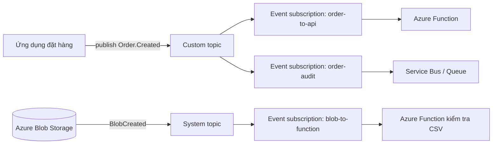
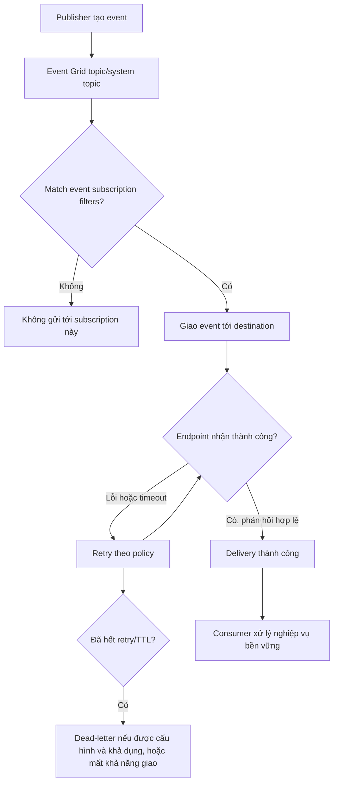
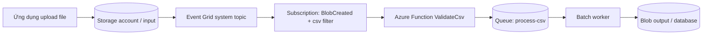
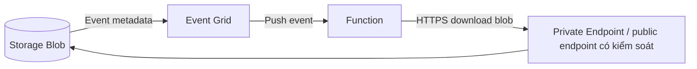
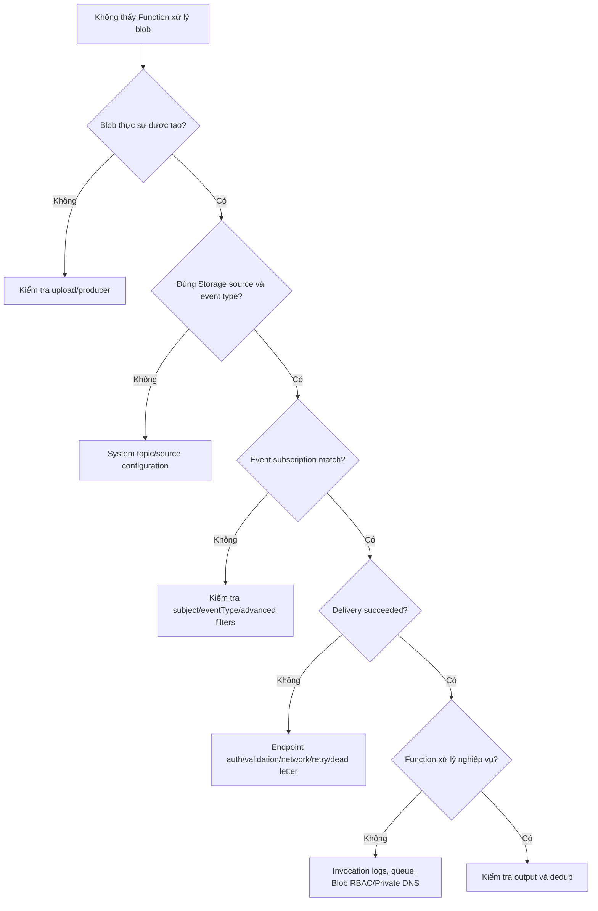
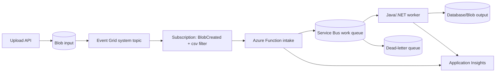

# Event Grid topic, system topic và subscription

Trong kiến trúc hướng sự kiện (*event-driven architecture*), một hệ thống phát thông báo **“đã có sự kiện xảy ra”** thay vì gọi trực tiếp từng dịch vụ cần biết về sự kiện đó. Ví dụ, sau khi khách tải tệp CSV lên Azure Blob Storage, hệ thống có thể kích hoạt Azure Function để kiểm tra dữ liệu, gửi tín hiệu tới một hàng đợi xử lý hoặc cập nhật danh mục tìm kiếm mà không cần ứng dụng upload gọi tất cả thành phần ấy.

**Azure Event Grid** là dịch vụ định tuyến sự kiện được quản lý trên Azure. Ba khái niệm trung tâm của bài học là:

- **Event Grid topic:** điểm phát hành sự kiện. Với *custom topic*, ứng dụng của bạn chủ động publish sự kiện theo schema được cấu hình.
- **System topic:** tài nguyên đại diện cho nguồn sự kiện do **một dịch vụ Azure** phát ra, chẳng hạn sự kiện tạo blob của Storage Account. Ứng dụng không dùng system topic như một cổng publish custom events tùy ý.
- **Event subscription:** quy tắc kết nối từ **một nguồn topic** tới **một điểm nhận** (*event handler/destination*), có thể có bộ lọc, retry, dead-lettering và các thiết lập delivery.

Bài học thuộc chương **Sự kiện và dữ liệu streaming** của module Microsoft Azure, mã dịch vụ **CLOUD_PROVIDERS_AZURE**. Kiến thức liên kết các khái niệm subscription, resource group, Microsoft Entra ID, VNet, Azure Functions, Blob Storage, bảo mật, giám sát và kiểm soát chi phí. Nội dung tập trung vào luồng **Event Grid Basic/push delivery** phổ biến; những khả năng **Event Grid namespace/Standard, MQTT hoặc pull delivery** có mô hình tài nguyên khác và cần được đánh giá riêng khi triển khai.

> Những lệnh CLI và payload bên dưới là ví dụ cho môi trường lab được cấp phép, không phải thao tác đã thực thi. Tên command, tham số và tính năng có thể phụ thuộc phiên bản Azure CLI, Azure Event Grid và region; xác minh trong môi trường mục tiêu trước khi áp dụng production.

## Mục tiêu học tập

Sau bài học, bạn có thể:

1. Giải thích sự khác biệt giữa **sự kiện**, **message công việc** và **luồng event streaming**.
2. Phân biệt **custom topic**, **system topic** và **event subscription** trong Azure Event Grid.
3. Đọc payload **Event Grid event schema** và **CloudEvents v1.0**, nhận biết ID, type, subject, time và data.
4. Tạo custom topic, phát sự kiện mẫu và đăng ký endpoint nhận qua Azure Portal/Azure CLI.
5. Tạo subscription cho nguồn Azure Storage BlobCreated và hiểu việc system topic có thể được tạo/tái sử dụng theo quy trình Azure.
6. Thiết kế bộ lọc theo **event type**, **subject prefix/suffix** và **advanced filters** phù hợp.
7. Hiểu kiểm tra quyền sở hữu webhook (*endpoint validation*) và cơ chế giao sự kiện.
8. Xử lý **at-least-once delivery**, duplicate events, retry, TTL, dead-lettering và idempotency.
9. Lựa chọn Azure Functions, WebHook, Storage Queue, Service Bus hoặc Event Hubs làm destination.
10. Bảo vệ publisher, subscriber, credential, networking và payload dữ liệu.
11. Quan sát publish/match/delivery/error metrics và xây dựng runbook xử lý lỗi.
12. Thiết kế một pipeline xử lý tệp hướng sự kiện đáng tin cậy, có theo dõi chi phí.

## 1. Sự kiện khác lời gọi API và message công việc như thế nào?

**Sự kiện (event)** mô tả sự thay đổi hoặc điều đã xảy ra: `Order.Created`, `Microsoft.Storage.BlobCreated`, `User.Registered`. Sự kiện thường mang một lượng nhỏ metadata để người nhận quyết định có cần hành động hay không.

**Command/message công việc** yêu cầu một hành động: “Hãy xử lý tệp X”, “Hãy tính hóa đơn Y”. Nó thường được đưa qua queue với cơ chế xử lý/acknowledgment, quản lý retry và bảo đảm công việc không biến mất trước khi worker hoàn thành.

**Event streaming** lưu chuỗi sự kiện liên tục để nhiều consumer có thể đọc theo partition/offset, như Azure Event Hubs. Event Grid tập trung vào **routing/distribution** của những sự kiện rời rạc, chứ không nhằm thay thế broker lưu log streaming dài hạn.

| Mô hình | Ví dụ | Điểm cần quan tâm |
|---|---|---|
| HTTP gọi trực tiếp | Upload API gọi Thumbnail API | Chặt chẽ về đồng bộ, timeout và khả năng phụ thuộc |
| Event Grid notification | BlobCreated được gửi tới hai subscriber | Fan-out, filters, at-least-once và xử lý nhanh ở endpoint |
| Service Bus work queue | Worker lấy message “ProcessBlob” | Lock/settlement, DLQ, retry và điều phối công việc |
| Event Hubs stream | Hàng triệu telemetry records | Partition, consumer group, offset và retention |
| Event Grid + queue | Event Grid đưa BlobCreated vào queue, worker xử lý | Tách tốc độ phát và xử lý, chống quá tải |

Không nên đưa nội dung tệp vài trăm MB vào payload Event Grid. Hãy gửi **định danh hoặc tham chiếu tới dữ liệu**, sau đó để worker đọc qua Storage SDK bằng quyền thích hợp.

## 2. Topic, system topic và event subscription: đúng một câu mỗi loại

**Topic là nơi publish. System topic là nguồn sự kiện từ Azure được biểu diễn thành tài nguyên Event Grid. Event subscription là nơi định nghĩa ai nhận loại sự kiện nào và nhận bằng cách nào.**



Một nguồn có thể có **nhiều event subscriptions**. Mỗi subscription có filters và destination khác nhau. Khi một topic nhận event, Event Grid xét các subscriptions của nguồn đó và chuyển event phù hợp tới từng destination.

### Đừng nhầm ba kiểu “subscription”

| Tên | Ý nghĩa |
|---|---|
| **Azure subscription** | Phạm vi thanh toán/quản trị tài nguyên Azure, có ID, Azure RBAC và quota |
| **Event Grid event subscription** | Tài nguyên/qui tắc định tuyến event từ topic/source tới destination |
| **Service Bus topic subscription** | Hàng đăng ký nhận message của Service Bus topic, với khả năng lưu message/settlement riêng |

Chúng không thay thế nhau. Một Event Grid subscription có thể định tuyến event vào một **Service Bus queue/topic** nhưng không trở thành Service Bus subscription.

## 3. Custom topic: ứng dụng làm publisher

**Custom topic** được tạo khi sự kiện xuất phát từ **ứng dụng hoặc một hệ thống tự quản lý** chứ không trực tiếp từ một publisher Azure có sẵn.

Ví dụ một ứng dụng Java sau khi ghi nhận giao dịch thành công phát:

```text
Order.Created
subject: /orders/ORD-1001
data: orderId, tenantId (không nhạy cảm), eventVersion
```

Những consumer khác nhau có thể tự đăng ký nhận:

- Billing Service cần khởi tạo hóa đơn.
- Analytics Service cần cập nhật chỉ số.
- Notification Service cần gửi email.
- Audit Service cần lưu dấu vết nghiệp vụ.

Publisher không cần biết địa chỉ của cả bốn hệ thống. Nó chỉ cần **có quyền publish lên custom topic** và tuân thủ hợp đồng event schema.

### Khi nào custom topic phù hợp?

- Bạn kiểm soát ứng dụng phát event.
- Muốn fan-out cho nhiều consumer độc lập.
- Không muốn đồng bộ vòng đời publisher với downstream HTTP endpoint.
- Muốn filters theo type/subject và hành vi delivery được quản lý.
- Chấp nhận mô hình **at-least-once** và thiết kế consumer idempotent.

### Khi nào không phù hợp?

- Bạn cần thực thi một command với response đồng bộ trong vài giây: HTTP/API có thể phù hợp hơn.
- Bạn cần transaction/message queue với lock, sessions hoặc dead-letter theo quy trình công việc: cân nhắc Service Bus.
- Bạn cần lưu chuỗi sự kiện lớn với offset/replay: Event Hubs có thể phù hợp hơn.
- Bạn cần query dữ liệu nghiệp vụ: database/search index không được thay bằng Event Grid.

## 4. System topic: Azure service là publisher

**System topic** biểu diễn nguồn sự kiện được tạo ra bởi một Azure service. Một ví dụ quan trọng là **Azure Storage account** phát các loại sự kiện như:

- `Microsoft.Storage.BlobCreated`
- `Microsoft.Storage.BlobDeleted`

Tùy dịch vụ/loại tài khoản và tính năng, còn có các loại event khác; phải kiểm tra danh sách event types mà nguồn thực sự hỗ trợ.

### Điểm khác custom topic

| Đặc điểm | Custom topic | System topic |
|---|---|---|
| Ai phát event? | Ứng dụng hoặc publisher bạn kiểm soát | Azure resource/service tương ứng |
| Ai định nghĩa event type? | Bạn và hợp đồng ứng dụng | Dịch vụ Azure công bố |
| Có publish event tùy ý bằng HTTP không? | Có khi có quyền và schema hợp lệ | Không dùng như custom publisher endpoint |
| Nguồn là gì? | Event Grid custom topic resource | Resource Azure và `topicType` của provider |
| Có event subscription không? | Có | Có |
| Bộ lọc và destination | Có | Có |
| Lifecycle | Theo tài nguyên topic | Theo nguồn và event subscriptions, có thể được quản lý tự động khi đăng ký |

Ví dụ user upload tệp `input/orders-2026-11-20.csv` vào Blob Storage. Storage event được gửi vào Event Grid, sau đó Event Grid định tuyến qua event subscription đến Azure Function.

### System topic tạo theo cách nào?

Một số quy trình Azure Portal/CLI cho phép tạo **system topic tường minh**. Trong nhiều workflow, khi đăng ký sự kiện trực tiếp trên Azure resource (ví dụ từ mục **Events** của Storage Account), Azure có thể tạo hoặc tái sử dụng system topic phù hợp.

Do đó, khi điều tra hệ thống hiện có, hãy kiểm tra **nguồn Storage account, system topic và event subscriptions**. Không tự tạo system topic thứ hai chỉ vì chưa thấy sự kiện trong Log Analytics; nguyên nhân có thể nằm ở filter, endpoint hoặc trạng thái subscription.

## 5. Event subscription thực sự chứa những gì?

Một **event subscription** gắn với topic/source, thông thường gồm:

- **Tên** và phạm vi resource.
- **Nguồn**: custom topic hoặc system topic/resource Azure.
- **Event types** cần nhận.
- **Subject filtering**: prefix/suffix của subject.
- **Advanced filters**: điều kiện bổ sung dựa trên những trường được hỗ trợ.
- **Destination/endpoint**: nơi Event Grid gửi event.
- **Event delivery schema**: dạng payload gửi cho handler nếu tùy chọn schema được hỗ trợ.
- **Retry policy**: số lần thử/giới hạn thời gian theo khả năng dịch vụ.
- **Dead-letter destination**: vị trí lưu sự kiện không giao được, khi được cấu hình.
- **Identity/authentication**: cơ chế mà Event Grid dùng để giao vào destination.
- **Delivery settings**: batching hoặc tùy chọn khác theo destination và tính năng.

**Một event subscription không tự tạo ứng dụng consumer.** Event Grid chỉ đảm nhiệm việc lọc và phân phối theo cấu hình; handler phải tồn tại, xác thực đúng và xử lý payload.

### Ví dụ

```text
Nguồn: Azure Storage account storderdemo
Event type: Microsoft.Storage.BlobCreated
Subject begins with: /blobServices/default/containers/input/
Subject ends with: .csv
Destination: Azure Function ValidateCsv
```

Chỉ tệp CSV dưới container `input` mới nằm trong phạm vi lọc dự kiến. Tệp PNG trong cùng account không nên được gửi tới handler này nếu bộ lọc đúng.

## 6. Dòng dữ liệu từ publish tới xử lý thành công



Sơ đồ mô tả ý tưởng, không phải tất cả nhánh retry status codes của Event Grid. Cần phân biệt:

1. **Publisher đã gửi event lên topic**.
2. **Event đã match một subscription**.
3. **Event Grid giao thành công tới endpoint**.
4. **Consumer đã hoàn thành nghiệp vụ**.

Bước 3 **không bảo đảm bước 4** nếu endpoint trả HTTP 2xx trước khi công việc được ghi bền vững. Một thiết kế đáng tin cậy có thể đưa event vào queue rồi worker xử lý bất đồng bộ.

## 7. Event Grid Schema: các trường cơ bản

Event Grid schema truyền thống thường có các trường:

```json
[
  {
    "id": "evt-order-1001",
    "eventType": "Order.Created",
    "subject": "/orders/ORD-1001",
    "eventTime": "2026-11-20T08:15:00Z",
    "dataVersion": "1.0",
    "data": {
      "orderId": "ORD-1001",
      "reportBlob": "reports/ORD-1001.json"
    }
  }
]
```

### Ý nghĩa

| Trường | Mục đích |
|---|---|
| `id` | Định danh của một event; hữu ích cho deduplication |
| `eventType` | Loại điều đã xảy ra: `Order.Created` |
| `subject` | Phân loại đối tượng sự kiện, ví dụ đường dẫn logic theo order |
| `eventTime` | Thời điểm event phát sinh, thường dạng UTC ISO 8601 |
| `dataVersion` | Phiên bản contract của nội dung `data` |
| `data` | Metadata nghiệp vụ cần thiết để consumer hành động |
| `topic` | Resource topic/nguồn theo schema khi event được delivery; cách điền có thể do Event Grid quản lý |
| `metadataVersion` | Metadata về schema do nền tảng cung cấp ở payload nhận theo trường hợp |

Đối với publisher custom topic, ví dụ trong khối JSON thể hiện những trường thiết yếu thường sử dụng. **Không tự điền hoặc phụ thuộc vào `topic`/`metadataVersion` nếu phía dịch vụ đang quản lý chúng**; kiểm tra yêu cầu publish và payload delivery của schema đã chọn.

### Thiết kế event contract tốt

- `id` đủ ổn định/duy nhất để chống trùng ở consumer.
- `eventType` có nghĩa rõ ràng và versioning strategy.
- `subject` có cấu trúc thống nhất để filter.
- `data` nhỏ, tránh secrets, token hoặc dữ liệu cá nhân không cần thiết.
- Event chỉ thông báo **đã có thay đổi**, còn trạng thái đầy đủ lưu ở database/Storage được xác định.
- Document rõ consumer dùng event time hay thời điểm xử lý; hai thời điểm có thể cách nhau đáng kể.

## 8. CloudEvents v1.0 và ranh giới schema

**CloudEvents** là một đặc tả sự kiện có schema/metadata chuẩn hóa. Một event dạng CloudEvents có thể trông như:

```json
{
  "specversion": "1.0",
  "id": "evt-order-1001",
  "source": "/shop/orders",
  "type": "com.example.order.created",
  "subject": "ORD-1001",
  "time": "2026-11-20T08:15:00Z",
  "datacontenttype": "application/json",
  "data": {
    "orderId": "ORD-1001"
  }
}
```

| Event Grid Schema | CloudEvents |
|---|---|
| `eventType` | `type` |
| `eventTime` | `time` |
| `topic` hoặc nguồn resource | `source` |
| `dataVersion` | Versioning thường do ứng dụng định nghĩa trong `type`/`data` hoặc extension attribute |
| `data` | `data` |

**Không giả định payload có cả `eventType` và `type` cùng lúc.** Input schema của topic và delivery schema của subscription phải tương thích với producer/consumer.

Khi dùng **CloudEvents đến webhook**, cách xác minh endpoint có thể khác Event Grid schema. Hãy dùng handler/SDK hỗ trợ đúng handshake của CloudEvents thay vì chỉ copy code `SubscriptionValidationEvent` truyền thống.

### Khi nào chọn CloudEvents?

- Nhiều hệ thống khác Azure cần trao đổi sự kiện cùng chuẩn.
- Muốn contract dễ tái sử dụng trên nhiều event brokers/clouds.
- Consumer đã có thư viện xử lý CloudEvents.

Dù chọn schema nào, Event Grid vẫn không biến event thành **transaction** hoặc một bản snapshot dữ liệu luôn nhất quán.

## 9. Tạo custom topic bằng Azure CLI

Ví dụ sử dụng Bash trong Azure Cloud Shell. Các lệnh tạo resource có thể phát sinh phí; chỉ thực hiện khi resource group/region được phép.

### Bước 1: xác nhận subscription

```bash
az account show --output table
az account set --subscription "<SUBSCRIPTION_ID>"

RG="rg-eventgrid-lab"
LOCATION="southeastasia"
TOPIC="eg-orders-lab"

az group create \
  --name "$RG" \
  --location "$LOCATION"
```

### Bước 2: tạo topic

```bash
az eventgrid topic create \
  --name "$TOPIC" \
  --resource-group "$RG" \
  --location "$LOCATION"
```

Các điều kiện như provider registration, SKU/region và namespace/quota cần được kiểm tra trong subscription thực tế.

### Bước 3: xem endpoint và resource ID

```bash
TOPIC_ID=$(az eventgrid topic show \
  --name "$TOPIC" \
  --resource-group "$RG" \
  --query id --output tsv)

TOPIC_ENDPOINT=$(az eventgrid topic show \
  --name "$TOPIC" \
  --resource-group "$RG" \
  --query endpoint --output tsv)

az eventgrid topic show \
  --name "$TOPIC" \
  --resource-group "$RG" \
  --query "{name:name,id:id,endpoint:endpoint,provisioningState:provisioningState}" \
  --output json
```

Thông tin endpoint chưa đủ để publish: publisher còn cần **cơ chế xác thực và quyền được topic hỗ trợ**. Endpoint URL không phải secret, nhưng key/token đi cùng endpoint thì phải bảo vệ.

### Topic name có phải DNS name không?

Tên Azure Event Grid topic góp phần xác định endpoint, nhưng không nên tự ghép endpoint bằng chuỗi đoán từ tên. Hãy lấy trực tiếp `endpoint` từ tài nguyên để tránh sai host và sai cách định tuyến.

## 10. Publish một event mẫu lên custom topic

### Bước 1: tạo tệp event.json ở môi trường lab

Nội dung theo Event Grid event schema:

```json
[
  {
    "id": "evt-order-1001",
    "subject": "/orders/ORD-1001",
    "eventType": "Order.Created",
    "eventTime": "2026-11-20T08:15:00Z",
    "dataVersion": "1.0",
    "data": {
      "orderId": "ORD-1001",
      "source": "lab"
    }
  }
]
```

Đây là một **event notification**, không phải yêu cầu trực tiếp “xử lý đơn” gửi tới worker. `eventTime` là thời gian ví dụ, không cần là thời điểm request publish để minh họa schema; trong ứng dụng thật nên gắn thời điểm sự kiện xảy ra chính xác.

### Bước 2: xác thực để publish

Custom topic hỗ trợ cơ chế xác thực phù hợp như **access keys/SAS** hoặc **Microsoft Entra ID và role data sender** theo cấu hình/tính năng được sử dụng. Với lab đơn giản sử dụng access key, tuyệt đối **không chép key vào tài liệu hoặc command line được lưu công khai**.

Ví dụ Bash dưới đây yêu cầu nhập key trong terminal tương tác:

```bash
# Gõ key trong terminal tương tác, không lưu vào Git.
read -r -s -p "Event Grid topic key: " TOPIC_KEY
echo

curl --fail-with-body -sS \
  -X POST "$TOPIC_ENDPOINT" \
  -H "Content-Type: application/json" \
  -H "aeg-sas-key: $TOPIC_KEY" \
  --data-binary @event.json

unset TOPIC_KEY
```

`curl --fail-with-body` cần phiên bản curl hỗ trợ; nếu môi trường cũ không có, dùng `curl -i` và kiểm tra HTTP status riêng. **Không thực thi `curl` khi chưa kiểm tra biến endpoint/key đúng topic lab**. Một publish thành công nghĩa là Event Grid **đã nhận sự kiện**; chưa chứng minh đã có subscriber, match filter hoặc xử lý nghiệp vụ thành công.

### Production không nên phụ thuộc key thủ công

Nếu SDK/API và cấu hình topic hỗ trợ, ưu tiên **Microsoft Entra ID với managed identity/service principal** và quyền publish tối thiểu thay vì chia sẻ access key rộng. Azure RBAC quản lý resource và data-plane publish có thể sử dụng các role khác nhau; xác minh chính xác phạm vi/role theo mô hình topic.

Nếu vẫn cần access key, lưu trong Key Vault hoặc secret store được phê duyệt và có quy trình rotation.

## 11. Tạo event subscription cho custom topic

Một event subscription cần destination thật. Với **Webhook**, endpoint phải là một dịch vụ HTTPS có thể nhận request và hoàn tất **subscription validation** trước khi sự kiện được giao thành công.

### Cách tạo trong Portal

1. Mở Event Grid custom topic `eg-orders-lab`.
2. Chọn **Event Subscriptions → + Event Subscription**.
3. Đặt tên như `orders-to-webhook`.
4. Chọn event types cần nhận, ví dụ `Order.Created` nếu được liệt kê hoặc theo cấu hình custom types.
5. Chọn **Endpoint Type = Web Hook**, nhập URL HTTPS của dịch vụ nhận được phê duyệt.
6. Cấu hình **subject begins with** = `/orders/`.
7. Cấu hình retries, dead-lettering và delivery authentication nếu cần.
8. Tạo và xác minh trạng thái validation/registration.

### CLI minh họa

```bash
WEBHOOK_URL="https://<VERIFIED_HTTPS_HOST>/webhooks/eventgrid"

az eventgrid event-subscription create \
  --name orders-to-webhook \
  --source-resource-id "$TOPIC_ID" \
  --endpoint-type webhook \
  --endpoint "$WEBHOOK_URL" \
  --included-event-types Order.Created \
  --subject-begins-with "/orders/"
```

Trước khi chạy, endpoint phải tồn tại và hỗ trợ quy trình validation. Nếu dùng **Azure Function với Event Grid trigger**, cách tạo subscription an toàn hơn thường là chọn **Endpoint Type = Azure Function** từ Portal để nền tảng sử dụng đúng endpoint/credential dành cho trigger; **không gán địa chỉ webhook thông thường của một Function bất kỳ** mà chưa xác minh extension/auth.

### Vì sao không có subscriber nhưng topic vẫn publish được?

Publisher và subscriber độc lập. Một event có thể được Event Grid nhận hợp lệ dù **không có active event subscription** nào khớp. Vì vậy phải xem cả **publish metrics**, **matched events**, **delivery metrics** và kết quả handler.

## 12. Webhook endpoint validation hoạt động thế nào?

Event Grid cần xác minh bạn kiểm soát endpoint trước khi giao event cho webhook. Với **Event Grid Schema**, Event Grid có thể gửi sự kiện loại:

```text
Microsoft.EventGrid.SubscriptionValidationEvent
```

Payload minh họa:

```json
[
  {
    "id": "validation-event-1",
    "eventType": "Microsoft.EventGrid.SubscriptionValidationEvent",
    "subject": "",
    "eventTime": "2026-11-20T08:16:00Z",
    "dataVersion": "1",
    "data": {
      "validationCode": "sample-code",
      "validationUrl": "https://<VALIDATION_URL>"
    }
  }
]
```

Endpoint webhook nhận validation event và có thể trả phản hồi JSON thích hợp:

```json
{
  "validationResponse": "sample-code"
}
```

**Giá trị phải trùng với `data.validationCode` thực tế**, không phải chuỗi ví dụ. Một số workflow có tùy chọn manual validation theo URL và thời hạn riêng.

### Những lỗi thường gặp khi validate

- URL không dùng HTTPS hoặc certificate/TLS không hợp lệ.
- Endpoint trả 401/403 do auth/allowlist chưa cấu hình để nhận validation.
- Endpoint trả 404 vì route sai.
- Endpoint chỉ biết xử lý `Order.Created` mà không xử lý validation event.
- Handler trả 200 nhưng không có `validationResponse` hợp lệ khi cơ chế validation yêu cầu.
- Endpoint timeout hoặc bị redirect tới trang đăng nhập.
- Dùng CloudEvents nhưng triển khai handshake của Event Grid Schema.

**Validation là bước chứng minh quyền kiểm soát endpoint, không thay thế xác thực/ủy quyền của từng event delivery.** Production cần thiết kế authentication và kiểm tra nguồn event phù hợp.

## 13. System topic từ Azure Blob Storage

Giả sử tổ chức có Storage account và container `input`. Mỗi khi một blob mới được tạo theo sự kiện mà Storage phát ra, Event Grid có thể gửi `Microsoft.Storage.BlobCreated` tới subscriber.

### Kiến trúc



Đây là sơ đồ khái niệm. Azure Storage lưu **file thật**, Event Grid chỉ gửi **event metadata**, Function kiểm tra và chuyển thành **work message**; batch worker xử lý sau. Điều này tránh để webhook chờ một phép chuyển đổi dữ liệu kéo dài.

### Cách tạo từ Portal

1. Mở **Storage account** đúng subscription/resource group.
2. Chọn mục **Events** hoặc trải nghiệm Event Grid được Portal cung cấp.
3. Chọn **+ Event Subscription**.
4. Chọn event type `Microsoft.Storage.BlobCreated`.
5. Đặt filter theo container/path và đuôi tệp.
6. Chọn Azure Function hoặc endpoint đích được hỗ trợ.
7. Cấu hình delivery, retry và dead-letter nếu cần.
8. Tạo và kiểm tra system topic/resource event subscription liên quan.

Khi tạo subscription trên Azure resource, Azure có thể quản lý việc tạo/tái sử dụng **system topic**. Không giả định phải tự tạo cả system topic lẫn một subscription khác; tránh đăng ký trùng khiến xử lý tệp hai lần.

### Tạo system topic tường minh bằng CLI

Với Storage account có sẵn, trước tiên lấy resource ID:

```bash
STORAGE_ID=$(az storage account show \
  --resource-group "<STORAGE_RESOURCE_GROUP>" \
  --name "<STORAGE_ACCOUNT_NAME>" \
  --query id --output tsv)

STORAGE_LOCATION=$(az storage account show \
  --resource-group "<STORAGE_RESOURCE_GROUP>" \
  --name "<STORAGE_ACCOUNT_NAME>" \
  --query location --output tsv)

az eventgrid system-topic create \
  --resource-group "$RG" \
  --name "eg-storage-events-lab" \
  --location "$STORAGE_LOCATION" \
  --topic-type "Microsoft.Storage.StorageAccounts" \
  --source "$STORAGE_ID"
```

Ví dụ này dùng loại nguồn Storage account phổ biến. Với nguồn khác, `topic-type` và yêu cầu region có thể khác. Trước khi tạo, kiểm tra nguồn có hỗ trợ Event Grid và có system topic phù hợp đang tồn tại hay chưa.

### Tạo subscription từ resource nguồn

Một cách triển khai thông dụng là tham chiếu **source resource ID** khi tạo event subscription:

```bash
az eventgrid event-subscription create \
  --name blob-created-to-webhook \
  --source-resource-id "$STORAGE_ID" \
  --endpoint-type webhook \
  --endpoint "https://<VERIFIED_HTTPS_HOST>/webhooks/blob" \
  --included-event-types Microsoft.Storage.BlobCreated \
  --subject-begins-with "/blobServices/default/containers/input/" \
  --subject-ends-with ".csv"
```

Lệnh minh họa **một cách đăng ký** vào Storage source; không cần chạy đồng thời nhiều subscription cho cùng endpoint nếu không có ý định xử lý trùng. Tùy phiên bản CLI và cách hệ thống quản lý system topic, có thể có nhóm lệnh riêng `az eventgrid system-topic event-subscription ...`; hãy kiểm tra `--help` trong môi trường đã chọn.

## 14. Hiểu subject và lọc theo container/đuôi file

Payload BlobCreated thường có subject dạng:

```text
/blobServices/default/containers/input/blobs/orders/2026-11-20.csv
```

Khi cấu hình:

```text
subject begins with: /blobServices/default/containers/input/
subject ends with: .csv
event type: Microsoft.Storage.BlobCreated
```

subscription chỉ match các event phù hợp với **tất cả điều kiện liên quan** theo cách bộ lọc được cấu hình.

### Dễ sai ở đâu?

| Mong muốn | Cấu hình đúng hướng | Lỗi hay gặp |
|---|---|---|
| Chỉ tệp container `input` | Prefix chứa đúng container path | Dùng prefix `/input/` không khớp actual subject |
| Chỉ file CSV | `subjectEndsWith=.csv` | Một số producer tạo path khác phần mở rộng |
| Chỉ event tạo blob | Included event type `Microsoft.Storage.BlobCreated` | Đăng ký tất cả types rồi xử lý nhầm delete |
| Chỉ thư mục logic `orders/` | Prefix gồm `.../blobs/orders/` | Tưởng folder là một resource riêng trong flat namespace |
| Case-insensitive | Kiểm tra tùy chọn case matching | Giả định Event Grid luôn không phân biệt hoa/thường |

**Subject là metadata của event**, không nhất thiết bằng URL đầy đủ của Blob. Với Storage, đường file có thể được encode hoặc nguồn phát event có biến thể. Trước khi thiết kế filter production, nên lấy **một payload event thực** từ môi trường staging để xác nhận subject và data.

### Advanced filters

Event Grid có thể hỗ trợ các phép so khớp khác trên trường event và `data`, tùy schema/tính năng, ví dụ:

- String begins with / ends with.
- String contains / equals / not equals.
- Numeric greater/less hoặc range theo filter operator hỗ trợ.
- Boolean equals.
- Một số array-related matching khi được hỗ trợ.

Không xem advanced filter là một truy vấn SQL tùy ý vào toàn bộ nội dung file. Muốn đọc CSV và quyết định dựa trên cột bên trong tệp, consumer vẫn phải truy cập Blob Storage và xử lý dữ liệu.

## 15. Chọn destination: Azure Function, webhook hay queue?

| Destination | Khi nào phù hợp | Điều kiện và rủi ro |
|---|---|---|
| **Azure Function Event Grid trigger** | Xử lý sự kiện ngắn, tích hợp sâu Azure Functions | Auth/extension, runtime và thời gian xử lý |
| **Webhook HTTPS** | Ứng dụng HTTP bất kỳ có endpoint nhận event | Endpoint validation, HTTPS/auth và phản hồi nhanh |
| **Azure Storage Queue** | Chuyển event thành công việc cho worker khác | RBAC/destination auth, message schema, poison/retry |
| **Azure Service Bus** | Workflow cần message broker, DLQ, settlement và kiểm soát tải | Queue/topic permissions, TTL, lock và idempotency |
| **Azure Event Hubs** | Đưa sự kiện sang pipeline streaming/analytics | Partition, consumer groups, throughput và checkpoint |
| **Logic Apps** | Workflow tích hợp/automation với connectors | Chi phí actions, quản lý flow và auth |

Cách chọn tùy nhu cầu nghiệp vụ:

- Handler chỉ cần ghi log nhỏ và trả ngay: Azure Function Event Grid trigger có thể đủ.
- Handler cần xử lý tệp 15 phút: **Event Grid → Queue → worker** giảm rủi ro webhook timeout.
- Nhiều consumer độc lập cùng quan tâm một event: tạo **nhiều subscriptions** với filters riêng.
- Cần lưu event để consumer đọc lại theo offset: đánh giá Event Hubs thay vì coi Event Grid topic như một stream dài hạn.

### Event Grid không phải scheduler của ứng dụng

Event Grid quyết định khi nào **giao thông báo**; việc chạy một tác vụ dài, quản lý checkpoint, transaction và business retry là trách nhiệm của consumer hoặc hệ thống điều phối như Service Bus/Durable Functions.

## 16. Java Azure Function nhận Event Grid event

Ví dụ dùng Azure Functions Java với **Event Grid trigger**. Function chỉ đọc metadata sự kiện và ghi log tối thiểu; muốn xử lý CSV thật phải mở rộng thành công việc idempotent, không chỉ ghi log.

```java
package vn.example.events;

import com.microsoft.azure.functions.ExecutionContext;
import com.microsoft.azure.functions.annotation.EventGridTrigger;
import com.microsoft.azure.functions.annotation.FunctionName;

public class BlobEventHandler {

    @FunctionName("OnBlobCreated")
    public void onEvent(
            @EventGridTrigger(name = "event")
            String event,
            final ExecutionContext context) {

        // Lab: không in toàn bộ payload vì event.data có thể
        // chứa URL, tên file hoặc metadata nhạy cảm.
        context.getLogger().info(
            "event=eventgrid_received"
            + " invocationId=" + context.getInvocationId()
            + " payloadLength="
            + (event == null ? 0 : event.length())
        );

        // Production:
        // 1. Parse JSON theo schema đã chọn.
        // 2. Xác minh eventType/type, subject và input metadata.
        // 3. Dùng event ID + source làm dedup key.
        // 4. Ghi work item vào queue/database bền vững.
        // 5. Trả thành công chỉ khi bước nhận việc đã commit.
    }
}
```

Lưu ý:

- Cần project Azure Functions Java, dependency, extension bundle/extension Event Grid và runtime **tương thích**. Đây là đoạn ví dụ class, không phải toàn bộ project có thể build độc lập.
- Nếu subscription được tạo từ Azure Portal với **Endpoint Type = Azure Function**, nền tảng và Event Grid extension xử lý cơ chế trigger/validation theo cấu hình hỗ trợ.
- Không đưa nguyên JSON chứa dữ liệu cá nhân vào log.
- Một Function invocation có thể thành công dù **chưa tạo output nghiệp vụ**, vì vậy cần bước persist work item và kiểm chứng.
- Khi parse Event Grid Schema, tìm `eventType`; với CloudEvents Schema, tìm `type`. Không giả định chung một parser cho mọi delivery schema.

### Handler cần nhanh và idempotent

Nếu việc xử lý tệp có thể kéo dài, handler nên:

1. Parse, validate schema và xác định event ID.
2. Kiểm tra chính sách chống trùng tại durable store hoặc dùng idempotent sink.
3. Enqueue một lệnh xử lý theo khóa duy nhất.
4. Trả kết quả thành công sau khi enqueue đã được hệ thống xác nhận.
5. Worker thực hiện công việc thật, có retry và checkpoint.

**Cẩn trọng với dedup trước khi enqueue:** nếu đánh dấu event “đã xử lý” rồi process chết trước khi enqueue, công việc có thể bị mất. Cần cơ chế transaction/outbox, hoặc trạng thái `Received/Enqueued/Completed` và reconciliation thích hợp.

## 17. Webhook validation không phải bảo mật delivery

Đối với webhook tự xây, validation chứng minh bạn kiểm soát một URL nhưng chưa xác minh mọi HTTP request đến từ nguồn đáng tin cậy.

### Các lớp bảo vệ

- **HTTPS/TLS** và chứng chỉ hợp lệ.
- Authentication/authorization của webhook theo cơ chế Event Grid hỗ trợ, ví dụ **Microsoft Entra authentication** khi destination và tính năng có hỗ trợ.
- Chỉ cấp quyền cho sender identity/scope được phê duyệt.
- Kiểm tra event schema/type/source, kích thước, định dạng và ID.
- Quản lý ingress/network restrictions tương thích với cách Event Grid giao push requests.
- Không lộ function key hoặc bí mật trong URL/log.
- Giới hạn resource/timeout, không cho request tùy ý chạy lệnh nội bộ.

### Không chặn Event Grid một cách vô tình

Một webhook chỉ chấp nhận request từ private VNet hoặc luôn trả redirect tới login có thể không nhận được push delivery theo kiến trúc đã chọn. Với yêu cầu private networking, nên xem **destination tích hợp, service endpoint/network model được hỗ trợ hoặc queue trung gian** thay vì đoán rằng Event Grid sẽ truy cập được bất kỳ private IP nào.

Bảo mật phải đồng thời thỏa hai điều kiện: **đúng quyền** và **có đường mạng**. Mở public endpoint cho mọi nguồn để thử nhanh rồi quên đóng lại là rủi ro production.

## 18. At-least-once và thứ tự sự kiện

Event Grid được thiết kế để giao sự kiện theo mô hình **at-least-once** trong phạm vi retry/TTL và điều kiện dịch vụ: khi một sự kiện được chấp nhận để giao, consumer **có thể nhận lại cùng event nhiều lần**. Event Grid **không bảo đảm thứ tự** của các event trong mọi tình huống.

### Ví dụ duplicate

```text
T0: Storage phát BlobCreated id=evt-1001
T1: Event Grid gọi Function
T2: Function ghi output thành công
T3: HTTP response/ack bị mất hoặc bị coi là timeout
T4: Event Grid thử gửi lại evt-1001
T5: Function có nguy cơ ghi output lần nữa
```

Cách xử lý không phải “tắt retry”, mà là thiết kế **idempotent consumer**.

### Khóa chống trùng

Một khóa thường dùng là sự kết hợp:

```text
source/resource + eventId
```

Với một event business có thể có nhiều version hoặc nhiều operation, có thể cần:

```text
eventType + source + eventId
```

Khóa thực tế phải theo quy ước ID của publisher và phạm vi duy nhất của nó. Nếu publisher có thể tạo hai event khác nhau với cùng ID do bug, consumer sẽ bị mất sự kiện khi dedup.

### Idempotent output

- Ghi record database với **unique constraint** theo event ID hoặc business operation ID.
- Dùng conditional create/ETag trên Blob Storage để không ghi lặp file.
- Dùng trạng thái xử lý có transition rõ ràng và transaction/outbox.
- Với thanh toán, dùng **idempotency key** được gateway/transaction store xác nhận.
- Với email, lưu trạng thái gửi và xử lý race; không coi gọi email API một lần là bảo đảm gửi duy nhất.

**Không giả định at-least-once đồng nghĩa sự kiện chắc chắn sẽ đến đích vĩnh viễn.** Khi hết TTL/retries, endpoint lỗi kéo dài hoặc cấu hình dead-letter không hoạt động, event có thể không còn được giao tiếp.

## 19. Retry, TTL, batching và phản hồi của handler

Event Grid có thể thử giao lại khi lần delivery không thành công theo **retry policy** và kiểu destination. Những thiết lập đáng quan tâm:

- **Maximum delivery attempts**.
- **Event time-to-live (TTL)** hoặc giới hạn thời gian chờ giao.
- Cách xử lý status code lỗi/timeout tùy dịch vụ.
- **Batching** khi được hỗ trợ để gộp nhiều event trong một delivery.
- **Dead-lettering** khi không giao được.

Không tự cố định số attempts hoặc khoảng backoff cho mọi topic/plan: kiểm tra giá trị cấu hình và giới hạn mà portal/API hiển thị trong hệ thống thực tế.

### Phản hồi nào là an toàn?

Với webhook nhận sự kiện:

- Chỉ trả **HTTP 2xx** sau khi payload đã được validate và **công việc cần giữ đã được ghi bền vững**, hoặc đã hoàn tất xử lý thật.
- Nếu backend tạm thời không ghi được work item, trả lỗi phù hợp để delivery policy có thể xử lý.
- Không dùng một request webhook kéo dài hàng chục phút để thực hiện batch lớn.
- Kiểm soát timeout và concurrency để tránh retry storm khi downstream suy yếu.
- Cần phân biệt lỗi có thể retry và lỗi permanent; trạng thái HTTP cụ thể có thể dẫn đến behavior khác nhau theo Event Grid destination.

### Batching

Nếu bật batching và endpoint nhận một **array nhiều events**, code không thể chỉ parse một event đơn lẻ rồi bỏ qua những phần tử khác. Một response 2xx cho cả batch có thể khiến Event Grid coi toàn delivery thành công. Vì vậy cần quy tắc xử lý, cách quarantine event lỗi và bảo đảm những event đã nhận được persist.

## 20. Dead-letter destination: đừng để sự kiện lỗi biến mất

Nếu Event Grid không giao được sự kiện theo policy, có thể cấu hình **dead-letter** vào một Azure Storage Blob container (theo khả năng dịch vụ/endpoint). Mục đích là giữ lại metadata/payload để điều tra và reprocess.

### Vì sao cần dead-letter?

- Webhook lỗi 503 trong nhiều giờ.
- Receiver bị xóa hoặc đổi URL.
- Không có đường mạng/permission delivery.
- Sự kiện liên tục không phù hợp với hệ thống consumer.
- Event retry hết policy hoặc vượt TTL.

### Cấu hình cần kiểm tra

1. Destination Storage account/container được phép dùng.
2. Danh tính và **quyền ghi vào dead-letter location** đúng theo cơ chế được cấu hình.
3. Storage firewall/network rules cho phép thao tác dead-letter theo kiến trúc hỗ trợ.
4. Retention, encryption, monitoring và ai được đọc dữ liệu sự kiện lỗi.
5. Alert về dead-lettered events và runbook re-drive.
6. Chi phí lưu trữ và lifecycle cleanup.

**Không nên nhầm Event Grid dead-letter blob với Service Bus dead-letter queue hoặc Storage Queue poison queue**; chúng có format và quy trình xử lý lại khác nhau.

### Xử lý lại sau sự cố

- Phân loại nguyên nhân trước khi re-drive.
- Xác minh payload và event schema của file dead-letter.
- Dùng một publisher/process re-drive được phê duyệt, không gửi trực tiếp sang production handler bằng key lộ trong script.
- Giữ event ID/correlation và tuân thủ idempotency.
- Đánh dấu reprocessing status để không đưa cùng event vào pipeline nhiều lần.
- Kiểm tra output nghiệp vụ cuối cùng.

Không có dead-letter configuration hoặc dead-letter Storage bị lỗi nghĩa là **không được giả định luôn có bản sao event sau TTL**.

## 21. Xác thực, phân quyền và bí mật

Quyền của **publisher**, **người quản trị topic** và **destination** là ba phạm vi cần xem riêng.

| Vai trò logic | Nhu cầu quyền |
|---|---|
| Publisher ứng dụng | Publish event lên đúng custom topic |
| Topic administrator | Tạo/cấu hình topic và event subscription |
| Event subscription creator | Đăng ký nguồn event và destination, có quyền phù hợp ở hai bên |
| Event Grid delivery identity | Gửi event vào destination theo cơ chế được hỗ trợ |
| Receiver Azure Function/worker | Ghi dữ liệu output, đọc Blob hoặc gọi dịch vụ khác |
| Security/auditor | Đọc metrics, cấu hình và log trong phạm vi cần thiết |

### Quản lý custom topic keys

- Không commit access key hoặc SAS vào Git.
- Không đặt key trực tiếp trong URL/ticket/CI log.
- Lưu bí mật ở Key Vault hoặc secret manager phù hợp.
- Rotation có phương án không gián đoạn publisher.
- Nếu hỗ trợ, ưu tiên managed identity và Microsoft Entra authorization với quyền data sender tối thiểu.

### Azure RBAC khác quyền dữ liệu

Một tài khoản có quyền nhìn thấy resource Event Grid trong Portal chưa chắc có quyền **publish** hoặc thay destination. Tương tự, Azure Function nhận event không tự có quyền đọc Blob input; cần cấp **Storage Blob Data Reader** hoặc data role phù hợp và có đường mạng hợp lệ.

### Bảo vệ payload và telemetry

Sự kiện có thể được lưu trong retry queues/history/diagnostic/dead-letter theo cấu hình dịch vụ. Vì vậy không đưa **client secret, access token, connection string, thông tin thẻ hay dữ liệu sức khỏe** vào `data` của event.

## 22. Event Grid với Azure Storage, Private Endpoint và DNS

Trong kiến trúc xử lý file, có ít nhất hai đường mạng khác nhau:

1. **Event Grid giao event tới handler**.
2. **Handler/worker đọc Blob Storage hoặc ghi output**.

Ngay cả khi event delivery thành công, Azure Function vẫn có thể nhận Storage 403 hoặc timeout khi tải tệp. Nguyên nhân có thể là RBAC, Storage firewall, VNet Integration, Private Endpoint, DNS hoặc NSG/UDR.

### Phân biệt đường đi



### Những câu hỏi cần kiểm tra

- Function có **managed identity** và đúng data-plane role đọc Blob chưa?
- Storage account có tắt public network access không?
- Function hosting plan có hỗ trợ VNet Integration theo thiết kế không?
- Private DNS zone `privatelink.blob.core.windows.net` có được liên kết/forward đúng từ Function không?
- Route/NSG/firewall có cho phép outbound HTTPS tới Blob endpoint không?
- Có sự nhầm lẫn giữa **Event Grid webhook endpoint** và **Azure Storage private endpoint** không?

Không dùng **Storage account key** như giải pháp chung cho lỗi firewall; credential đúng không vượt được network restriction.

## 23. Monitoring và correlation: publish khác delivery

Event Grid cần được giám sát ở nhiều lớp.

| Tín hiệu | Câu hỏi vận hành |
|---|---|
| **Publish attempts/success/failure** | Publisher có gửi được event lên topic không? |
| **Matched/unmatched events** | Bộ lọc subscription có khớp event mong muốn không? |
| **Delivery succeeded/failed** | Destination có phản hồi phù hợp không? |
| **Delivery attempts/retries** | Endpoint có timeout/5xx hoặc authentication lỗi không? |
| **Dead-lettered events** | Bao nhiêu event không giao được cần điều tra? |
| **Receiver invocation failure** | Handler có fail ở code hoặc dependency không? |
| **Queue backlog/age** | Worker có theo kịp event rate không? |
| **Business completion** | Tệp/báo cáo cuối đã tạo đúng chưa? |

Metric names/dimensions và cách truy cập phụ thuộc tài nguyên Event Grid, Azure Monitor API và phiên bản hiện hành. **Không đoán tên metric CLI**; đọc từ metric definitions của đúng resource.

### Xem Metrics trong Portal

1. Mở Event Grid topic/system topic/subscription nguồn.
2. Chọn **Metrics** hoặc Azure Monitor metrics.
3. Chọn khoảng thời gian có event thử nghiệm theo UTC.
4. Xem publish, matched, delivery, failure hoặc dead-letter theo metric được hỗ trợ.
5. Nếu metric có dimensions theo event subscription, chọn đúng subscriber.
6. Đối chiếu với Application Insights/Function invocation logs.

### Read-only Azure CLI

```bash
az monitor metrics list-definitions \
  --resource "$TOPIC_ID" \
  --output table
```

Sau đó tra metric thực tế theo tên từ kết quả, không tự điền một tên phỏng đoán. System topic/source resource có scope khác custom topic, nên phải chọn resource ID chính xác.

### Correlation ID

Một log hữu ích có:

```text
eventgridEventId=evt-order-1001
eventType=Order.Created
subject=/orders/ORD-1001
receiverInvocationId=inv-42
processingJobId=job-91
result=Enqueued
```

Để điều tra một event, tra thứ tự:

**publisher event ID → matching subscription → delivery attempt → receiver invocation → queued job → business output**.

## 24. Diagnostic settings, Application Insights và lưu lịch sử

Azure Monitor metrics giúp biết khối lượng/tỷ lệ lỗi, còn logs/traces cung cấp chi tiết khi đã bật pipeline phù hợp.

### Diagnostic settings

Có thể cấu hình diagnostic logs của tài nguyên Event Grid tới một destination hỗ trợ như **Log Analytics workspace, Storage account hoặc Event Hubs**, tùy tính năng, category và resource type.

Các log delivery/publish failure có thể cung cấp thông tin về event subscription, thời gian, endpoint và kết quả. Tuy nhiên, **không mặc định mọi category log đều tồn tại ở mọi topic/region**. Hãy mở danh sách category được Portal cung cấp trước khi thiết kế truy vấn.

### App Insights ở receiver

Nếu destination là Azure Function, **Application Insights** có thể cung cấp:

- Function invocation count và exceptions.
- Request/trigger-related telemetry theo runtime.
- Outbound Blob/SQL/HTTP dependency duration khi instrumentation được hỗ trợ.
- Trace/correlation ID và logs Java/.NET/Node.

Không nhầm **Event Grid delivery success** với **Function business success**. Nếu Event Grid đã giao thành công tới Functions endpoint nhưng Function xử lý business thất bại sau khi đã nhận, cần có cơ chế retry/queue/telemetry của phía consumer.

### KQL minh họa ở receiver workspace

Nếu workspace-based Application Insights có bảng `AppTraces`:

```kusto
AppTraces
| where TimeGenerated > ago(1h)
| where Message contains "eventgrid_received"
| project TimeGenerated, Message, OperationId, AppRoleName
| order by TimeGenerated desc
```

Nếu thấy exceptions:

```kusto
AppExceptions
| where TimeGenerated > ago(1h)
| summarize Errors = count() by Type
| top 20 by Errors desc
```

Các bảng và cột phụ thuộc telemetry pipeline; trong classic Application Insights có thể dùng `traces`, `exceptions` với tên cột tương ứng khác. Khi truy vấn rỗng, kiểm tra connection string, sampling, time window và schema trước khi kết luận event không được gửi.

## 25. Sơ đồ chẩn đoán khi “BlobCreated không tới Function”



### Runbook chi tiết

1. **Nguồn dữ liệu:** xác minh blob tồn tại, thời điểm tạo, container, path, account và region.
2. **System topic:** xác minh topic/source resource đúng và active.
3. **Event subscription:** kiểm tra event type `BlobCreated`, subject begins/ends và advanced filters.
4. **Validation:** nếu Webhook, endpoint đã validate thành công chưa?
5. **Delivery:** xem Metrics/diagnostic logs của source/subscription; có HTTP error/timeout hoặc dead letter không?
6. **Function runtime:** kiểm tra function indexing, Event Grid trigger extension, identity, auth và Application Insights.
7. **Dependency:** nếu function được gọi nhưng tải blob lỗi, kiểm tra RBAC/Storage firewall/DNS.
8. **Business output:** xác minh file/record cuối và idempotency; không dừng ở log `received`.
9. **Retry:** kiểm tra có event duplicate hoặc retry song song sau phục hồi không.
10. **Khắc phục:** sửa đúng tầng lỗi, replay/re-drive có kiểm soát và ghi RCA.

Không xử lý bằng cách mở Storage account ra Internet, tắt Function auth, chia sẻ topic key hoặc xóa system topic khi chưa biết root cause.

## 26. Các sự cố thường gặp

| Triệu chứng | Khả năng nguyên nhân | Cách kiểm chứng |
|---|---|---|
| Publisher nhận 401/403 khi publish | Topic key/token/RBAC không đúng | Đúng endpoint, publisher credential, role/scope |
| Publish 400 Bad Request | Event schema sai, thiếu field hoặc payload không hợp lệ | Validate JSON/schema/size |
| Publish thành công nhưng subscriber không nhận | Không có event subscription match, endpoint lỗi | Matched events, filters, delivery metrics |
| Webhook subscription chưa active | Validation handshake thất bại | HTTPS, certificate, 2xx, validationResponse |
| Custom event không đi qua filter | Sai event type hoặc subject prefix/suffix/case | So payload thực với filter |
| System topic không có event | Nguồn Azure không tạo event tương ứng hoặc đăng ký sai resource | Storage operations, supported event types |
| Delivery lặp | At-least-once, response timeout hoặc retry | Event ID, delivery attempts, dedup store |
| Event đến sai thứ tự | Không có ordering guarantee | Sequence/version, business logic |
| Webhook liên tục 503 | Receiver quá tải, code lỗi hoặc downstream quá chậm | Handler logs, latency, queue, autoscale |
| Event vào dead-letter | Hết TTL/attempts hoặc không giao được | Destination settings, dead-letter blobs, alert |
| Dead-letter không thấy dữ liệu | Chưa bật hoặc dead-letter endpoint/permission lỗi | Config và identity/storage logs |
| Function nhận event nhưng không đọc được Blob | RBAC data-plane thiếu, firewall hoặc DNS sai | App Insights, VNet/Private Endpoint |
| Azure Function không thấy trigger | Extension/binding/deployment không phù hợp | Function list, startup logs, endpoint type |
| Event handler trả 200 nhưng mất việc | Ack trước khi persist/queue | Outbox/transaction và output checks |
| Nhiều replica ghi báo cáo trùng | Consumer không idempotent | Unique key/conditional write |
| Chi phí tăng | Publish/delivery nhiều, retry, Log Analytics, storage | Cost Management và metrics |

### Phương pháp phân lớp

Đừng chỉ hỏi “Event Grid có hoạt động không?”. Hỏi theo thứ tự:

**Nguồn tạo event? → Topic nhận event? → Subscription match? → Delivery tới endpoint? → Consumer ghi nhận công việc? → Nghiệp vụ hoàn thành?**

Mỗi bước có cách kiểm chứng và chủ sở hữu khác nhau.

## 27. Thiết kế production: xử lý tệp CSV dựa trên sự kiện

### Bài toán

Một ứng dụng cho phép khách upload tệp đơn hàng. Một file CSV có thể lên tới vài GB, xử lý mất vài phút; yêu cầu không mất dữ liệu, không xử lý trùng và có cảnh báo khi lỗi.

### Kiến trúc đề xuất



### Trách nhiệm từng lớp

| Lớp | Trách nhiệm | Điểm cần quan sát |
|---|---|---|
| Upload API | Tải file và xác nhận upload hoàn thành | Blob path/version, upload status |
| Storage | Lưu file bền vững | Blob existence, version/ETag |
| System topic | Nhận event từ Storage service | Matched/published events |
| Event subscription | Filter và giao BlobCreated | Delivery/retries/dead-letter |
| Intake Function | Validate metadata, dedup và enqueue | Invocation ID, event ID, queue send result |
| Work queue | Lưu message tới khi worker xử lý | Queue depth, age, DLQ |
| Worker | Stream CSV, validate, transform, ghi output | Checkpoint, records, errors, duration |
| Output store | Lưu báo cáo bền vững | Unique business key, checksum/manifest |

### Tránh xử lý file chưa hoàn tất

Không suy đoán rằng mọi hệ thống upload sẽ tạo event sau khi một file lớn hoàn tất theo cùng một pattern. Cần thiết kế rõ:

- Cách upload commit một blob hoặc publish file `ready`.
- Blob version/ETag làm tham chiếu input chính xác.
- Có thể dùng manifest cho batch nhiều tệp.
- Chỉ enqueue sau khi điều kiện input hợp lệ được kiểm chứng.
- Khi worker đọc, kiểm tra version/ETag không đổi nếu cần nhất quán.

### Idempotency cuối đường

Ví dụ dùng khóa nghiệp vụ:

```text
storageAccount + container + blobName + blobVersionId
```

Khi Blob Storage event có version/ETag, thiết kế dedup cần theo những trường thực sự có trong event và contract của hệ thống. Nếu cùng blob path được upload phiên bản mới, không được vô tình coi đó là bản trùng của bản cũ.

### Vì sao không xử lý CSV trực tiếp trong webhook?

Tệp vài GB có thể khiến HTTP handler timeout, retries làm xử lý lặp và scaling khó đo. Khi handler chỉ cần nhận event rồi enqueue, việc xử lý lâu được chuyển sang worker có checkpoint/visibility/lock phù hợp.

## 28. Chi phí, giới hạn và trách nhiệm vận hành

Azure Event Grid phát sinh chi phí theo loại resource/tier, số operation/events/deliveries hoặc features tương ứng, với đơn giá tùy region và thời điểm. Các chi phí liên quan thường gồm:

- Custom/system topic và các hoạt động publish/delivery theo mô hình pricing đang áp dụng.
- Số event subscriptions/filters và hoạt động truyền sự kiện.
- Retry/failed delivery hoặc những thành phần tính phí khác theo biểu giá.
- Azure Functions executions và hosting plan.
- Storage Queue/Service Bus/Event Hubs nếu dùng làm destination.
- Blob Storage input/output và dead-letter retention.
- Log Analytics ingestion/retention, Application Insights và alerts.
- Networking như Private Endpoint, Firewall, NAT hoặc data transfer khi có.

### Cách giảm chi phí mà không đánh đổi an toàn

1. Lọc event sớm bằng event type/subject để giảm traffic không cần thiết tới consumer.
2. Truyền ID/reference thay vì payload lớn.
3. Không để endpoint luôn trả 503 gây nhiều attempts và log vô hạn.
4. Giới hạn concurrency/rate và dùng queue để hấp thụ burst.
5. Chọn retention/dead-letter lifecycle theo yêu cầu kiểm toán.
6. Dùng metrics/alerts để phát hiện bất thường về volume và failure.
7. Gắn tag `owner`, `environment`, `service` và `costCenter` khi policy hỗ trợ.
8. Dọn subscriptions không sử dụng và destination cũ theo quy trình thay đổi.
9. Kiểm tra tài liệu định giá tại thời điểm triển khai; không dùng bảng giá cố định trong tài liệu học tập.

### Giới hạn kỹ thuật

- Event payload có giới hạn kích thước theo dịch vụ/tier.
- Event delivery có giới hạn attempts/TTL.
- Mỗi topic/subscription có quota/filters/endpoint constraints.
- Webhook HTTPS phải đáp ứng validation/auth.
- Azure Resource Manager/RBAC, Storage firewall và region có thể giới hạn thiết kế.
- Trong hệ thống nhiều subscriber, mỗi consumer có SLA và năng lực xử lý khác nhau.

Không kết luận một event subscription có khả năng “không giới hạn throughput” chỉ vì dịch vụ được quản lý.

## 29. Thực hành tổng hợp: hai loại nguồn sự kiện

Bài lab được chia thành hai phần độc lập để thấy rõ custom topic và system topic. Có thể chỉ thực hành một phần nếu subscription lab không cho phép tạo đủ resources.

### Phần A — Custom topic phát `Order.Created`

**Bước 1:** chọn subscription/resource group lab, tạo custom topic `eg-orders-lab` theo phần 9.

**Bước 2:** chuẩn bị một receiver HTTPS được phép dùng, có hỗ trợ Event Grid Schema subscription validation. Nếu dùng Azure Functions Event Grid trigger, chọn endpoint tích hợp từ Azure Portal.

**Bước 3:** tạo event subscription `orders-to-webhook` với `--subject-begins-with "/orders/"`.

**Bước 4:** tạo `event.json` theo phần 10 và publish qua curl với key lab được nhập an toàn, hoặc dùng SDK publisher có managed identity.

**Bước 5:** xác minh trên Event Grid metrics:

- Publish request đã thành công?
- Event có match subscription?
- Delivery tới endpoint đã thành công?
- Receiver đã log/cam kết xử lý event chưa?

**Bước 6:** thử event với `subject=/customers/CUST-1001`, trong khi subscription chỉ nhận `/orders/`. Kỳ vọng publisher vẫn có thể publish thành công nhưng event **không match** subscription orders.

### Phần B — System topic nhận BlobCreated

**Bước 1:** chuẩn bị Storage account/container `input` và Azure Function Event Grid trigger hoặc receiver HTTPS đã validate.

**Bước 2:** từ Storage account → Events tạo subscription cho `Microsoft.Storage.BlobCreated`.

**Bước 3:** đặt filter prefix container và suffix `.csv`.

**Bước 4:** upload hai file lab:

```text
input/orders-001.csv
input/photo-001.png
```

**Bước 5:** kiểm tra sự kiện CSV được match/deliver, còn PNG không đi tới subscription CSV nếu filter đúng.

**Bước 6:** trên Function, kiểm tra metadata event và xử lý idempotency. Không đưa file thật có dữ liệu cá nhân vào bài lab.

**Bước 7:** thử một lỗi endpoint có kiểm soát trong staging (ví dụ tạm ngừng receiver) để quan sát delivery failures/retries theo chính sách. Không cố ý phá production hoặc xóa Function đang nhận sự kiện thật.

**Bước 8:** cấu hình dead-letter nếu cần và xác minh quyền/Storage backend. Không giả định event sẽ lập tức xuất hiện ở dead-letter; điều đó phụ thuộc retry/TTL.

### Bằng chứng mong đợi

| Kiểm tra | Kết quả mong đợi |
|---|---|
| Custom topic tồn tại | Có endpoint/topic ID và trạng thái provisioned |
| Publish event mẫu | Event Grid nhận payload hợp lệ |
| Subscription validation | Endpoint được xác nhận và có thể nhận event |
| Filter theo subject | `/orders/` match, `/customers/` không match |
| Storage BlobCreated | Event phát từ Azure Storage source |
| Filter suffix | CSV match, PNG không match nếu subject thực tế đúng |
| Receiver | Có event ID/correlation ID và dữ liệu được tiếp nhận đúng |
| Retry/dedup | Không tạo output nghiệp vụ trùng khi event được giao lại |
| Metrics | Có dữ liệu publish/match/delivery theo nguồn được cấu hình |
| Dọn lab | Không xóa resource/tài liệu thuộc môi trường dùng chung |

### Dọn dẹp an toàn

Kiểm tra event subscriptions, topics, Functions, Storage, queues và dead-letter resources thuộc **riêng lab** trước khi xóa. Không xóa system topic nguồn đang phục vụ subscriptions khác. Nếu dọn một resource group lab, phải chắc chắn không chứa tài nguyên được nhóm khác sử dụng.

## 30. Checklist triển khai production

- [ ] Đã chọn Event Grid phù hợp thay vì nhầm với Service Bus/Event Hubs.
- [ ] Đã xác định nguồn custom topic hay Azure system topic, schema và ownership.
- [ ] Có event contract với ID, type, subject, time, version và data nhỏ.
- [ ] Không đặt credential, PII hoặc raw file lớn trong payload.
- [ ] Đã cấu hình Event subscription đúng source, event types và subject filters.
- [ ] Đã kiểm thử case sensitivity và advanced filters trên payload thực.
- [ ] Endpoint validation thành công với schema/destination đang dùng.
- [ ] Webhook HTTPS có authentication, authorization và logging an toàn.
- [ ] Publisher dùng managed identity/RBAC tối thiểu hoặc key rotation phù hợp.
- [ ] Delivery identity có quyền vào destination theo cơ chế được hỗ trợ.
- [ ] Handler trả kết quả thành công chỉ sau khi đã ghi nhận công việc bền vững.
- [ ] Có consumer idempotency, retry budget và xử lý duplicate/out-of-order events.
- [ ] Đã cấu hình retry/TTL theo SLA và dead-letter nếu cần.
- [ ] Dead-letter Storage có quyền, firewall, retention, alert và runbook re-drive.
- [ ] Đã thiết kế Event Grid → Queue/Service Bus cho công việc dài.
- [ ] Có giải pháp xác minh input Blob version/ETag và trạng thái ready.
- [ ] Đã kiểm tra Blob/network/Private Endpoint/DNS từ chính consumer.
- [ ] Có metrics publish/matched/delivery/errors và logs/trace correlation.
- [ ] Có alert cho delivery failures, dead-letter, backlog và output thiếu.
- [ ] Có kế hoạch đổi schema, chuyển endpoint, tạo/xóa subscription tránh xử lý trùng.
- [ ] Đã đo quota, scale, giới hạn payload và chi phí Azure Functions/Storage/logs.
- [ ] Đã kiểm thử sự cố endpoint outage, retry, re-drive, duplicate và khôi phục.
- [ ] Có quy trình dọn tài nguyên lab và bảo vệ tài nguyên dùng chung.

## 31. Câu hỏi tự kiểm tra

1. Topic, system topic và event subscription khác nhau như thế nào?
2. Vì sao **Azure subscription** không phải **Event Grid event subscription**?
3. Khi nào nên tạo custom topic thay vì đăng ký events từ Storage account?
4. System topic có phải là một endpoint để ứng dụng tự publish `Order.Created` không?
5. Một topic có thể có nhiều subscriptions khác destination/filter không?
6. Event Grid khác Service Bus và Event Hubs ở trách nhiệm nào?
7. Các trường `id`, `eventType`, `subject`, `eventTime` và `data` có ý nghĩa gì?
8. Event Grid Schema và CloudEvents khác nhau ở cách đặt tên trường nào?
9. Vì sao publisher nhận HTTP thành công chưa chứng minh consumer xử lý thành công?
10. Event subscription validation có thay thế authentication của webhook không?
11. Nếu webhook trả 200 trước khi ghi queue, công việc có thể mất như thế nào?
12. Tại sao event có thể được giao nhiều lần hoặc đến sai thứ tự?
13. Khóa idempotency nên dựa trên event ID hay business ID trong trường hợp nào?
14. Khi BlobCreated không match suffix `.csv`, cần kiểm tra gì trong subject thực tế?
15. Advanced filters có thay thế được việc parse CSV nội dung Blob không?
16. Vì sao một Azure Function nhận Event Grid event vẫn có thể bị Storage 403?
17. Event Grid dead-letter khác Service Bus DLQ thế nào?
18. Khi endpoint lỗi trong thời gian dài, retry/TTL có thể ảnh hưởng thế nào tới dữ liệu?
19. Vì sao không nên xóa system topic khi đang điều tra sự cố?
20. Những metric nào giúp phân biệt publish failure với delivery failure?
21. Với nhiều files lớn, vì sao dùng Event Grid → Queue → worker tốt hơn xử lý trực tiếp ở webhook?
22. Nếu hai event BlobCreated cùng blob path nhưng khác version, có nên dedup theo blob path không?
23. Khi thay đổi schema của publisher, cần chuẩn bị gì cho consumer cũ?
24. Những khoản chi phí nào ngoài Event Grid phát sinh trong một pipeline hướng sự kiện?

## Kết luận

**Custom Event Grid topic** cho phép ứng dụng chủ động publish events; **system topic** đại diện sự kiện được phát từ một tài nguyên Azure; **event subscription** quyết định **event nào được giao tới destination nào** bằng filters và delivery settings. Ba thành phần này giúp tách publisher khỏi consumer, hỗ trợ fan-out và mở rộng kiến trúc hướng sự kiện trên Azure.

Thiết kế Event Grid đáng tin cậy không dừng ở việc tạo topic và xem webhook nhận JSON. Cần **schema nhất quán, endpoint validation, quyền tối thiểu, retry/TTL, dead-lettering, idempotent consumer, correlation, giám sát và xác minh output nghiệp vụ**. Khi tác vụ xử lý dài hoặc dữ liệu lớn, kết hợp Event Grid với Azure Functions, Service Bus/Queue và Blob Storage giúp hệ thống phản ứng theo sự kiện mà vẫn vận hành, bảo mật và kiểm soát chi phí được trong production.
