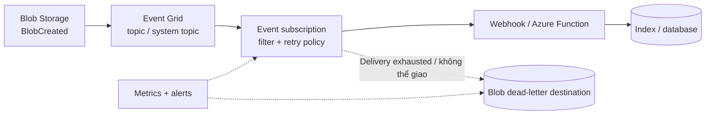
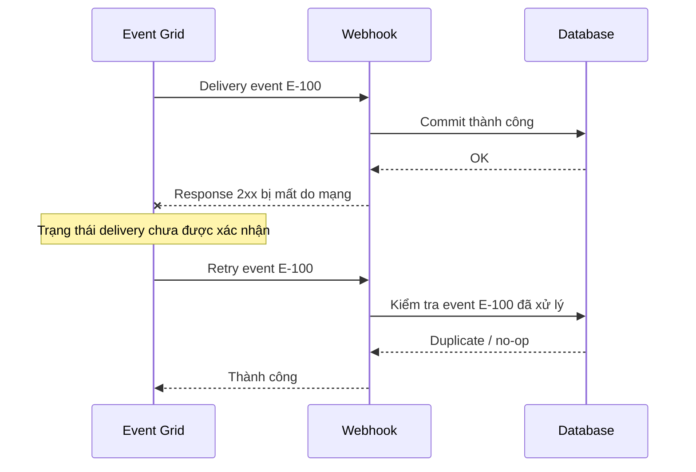
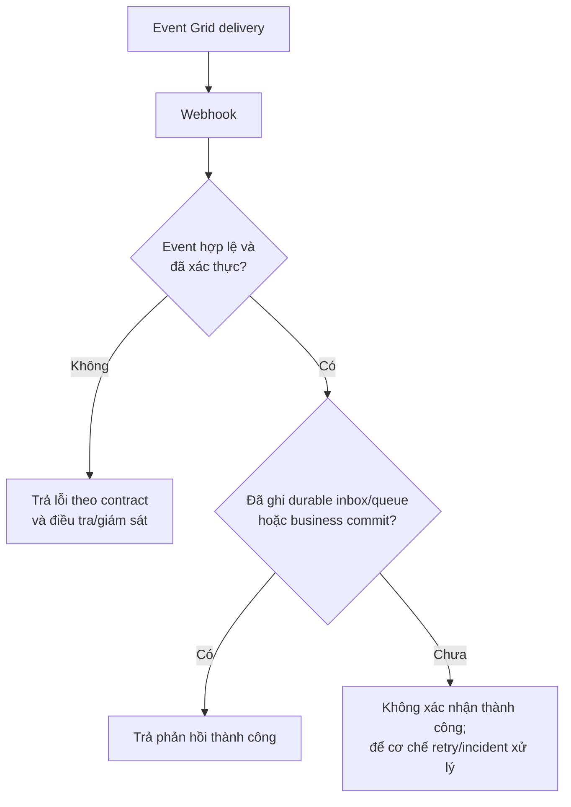
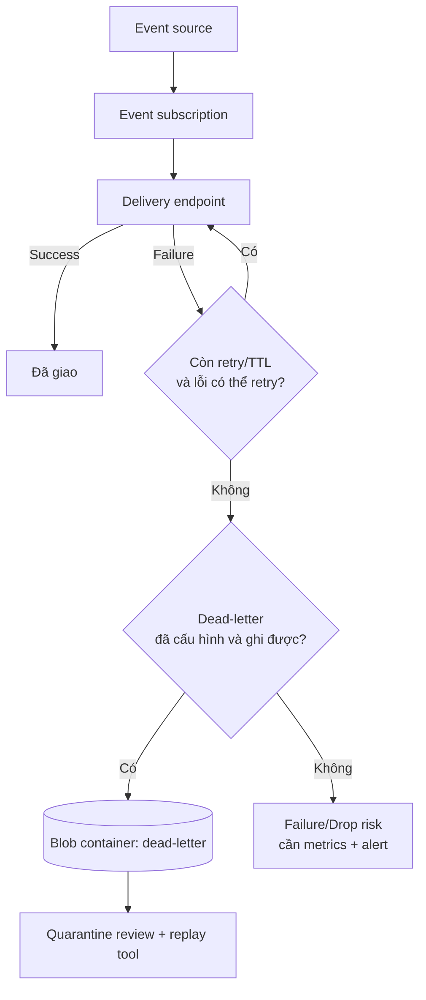
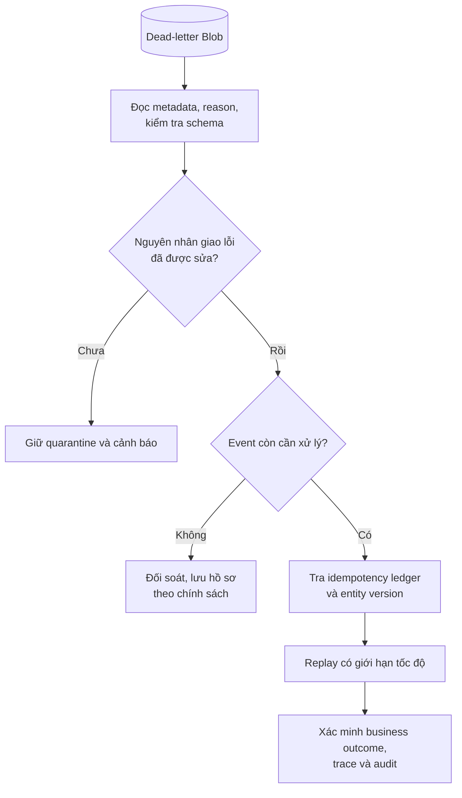
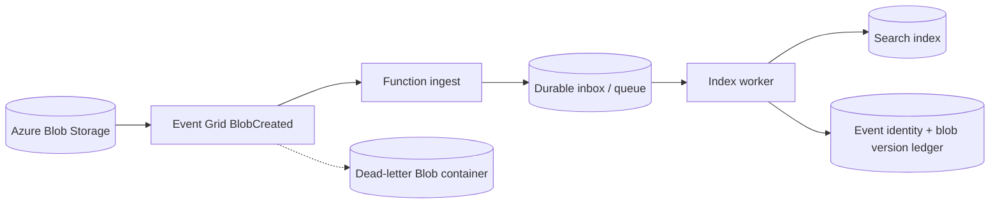

# Delivery retry, dead-letter và chống xử lý trùng sự kiện

Một doanh nghiệp lưu hóa đơn lên **Azure Blob Storage** rồi dùng **Azure Event Grid** phát sự kiện để kích hoạt dịch vụ lập chỉ mục. Trong giờ cao điểm, điểm nhận sự kiện bị lỗi HTTP 503 trong vài phút. Khi hệ thống phục hồi, một số sự kiện được gửi lại; thậm chí có sự kiện đã được xử lý thành công nhưng phản hồi xác nhận bị mất nên tiếp tục được gửi thêm lần nữa. Nếu ứng dụng tạo bản ghi hóa đơn mới sau **mỗi** lần nhận, dữ liệu bị trùng. Nếu ứng dụng đơn giản bỏ qua tất cả lỗi, một số tài liệu không bao giờ được lập chỉ mục.

Bài toán đúng cần giải quyết **ba cơ chế phối hợp**:

1. **Delivery retry:** dịch vụ phân phối thử gửi lại khi một lần giao không thành công.
2. **Dead-letter:** cách ly sự kiện không thể phân phối sau điều kiện đã cấu hình để điều tra và phục hồi.
3. **Deduplication/idempotency:** nhiều lần nhận cùng một sự kiện không dẫn đến nhiều tác động nghiệp vụ ngoài ý muốn.

Bài thuộc chương **Sự kiện và dữ liệu streaming** của module **CLOUD_PROVIDERS_AZURE**, nằm trong lộ trình tìm hiểu Microsoft Azure từ subscription, resource group và Microsoft Entra ID đến mạng, compute, storage, dữ liệu, triển khai, giám sát, bảo mật và kiểm soát chi phí. Trọng tâm là **Azure Event Grid với mô hình push delivery của event subscriptions**, đồng thời phân biệt rõ hành vi này với **Service Bus** và **Event Hubs** để không áp dụng nhầm cơ chế retry, dead-letter và checkpoint.

Sau bài học, bạn có thể:

- Giải thích vì sao Event Grid có thể giao sự kiện **ít nhất một lần** và **không bảo đảm thứ tự toàn cục**.
- Phân loại các lỗi delivery của webhook/Function để lựa chọn response và retry hợp lý.
- Hiểu tương tác giữa **maximum delivery attempts**, **event TTL** và backoff của dịch vụ.
- Thiết kế **dead-letter destination** dùng Blob Storage, quyền truy cập, giám sát và quy trình replay.
- Định nghĩa danh tính sự kiện từ **Event Grid schema** hoặc **CloudEvents 1.0** rồi chống xử lý trùng.
- Thực hiện **atomic inbox + business transaction** hoặc handoff bền vững trước khi xác nhận giao sự kiện.
- Kiểm tra delivery failures, dead-letter metrics, poison events, identity/network và chi phí.

## 1. Event source, event subscription và event handler

Trong mô hình Event Grid push, hệ thống có ba vai trò:

| Thành phần | Vai trò | Ví dụ |
|---|---|---|
| **Event source** | Phát sinh sự kiện khi trạng thái thay đổi | Blob Storage phát `Microsoft.Storage.BlobCreated` |
| **Event Grid topic/system topic** | Tiếp nhận, lọc và điều phối sự kiện theo cấu hình | System topic gắn với storage account |
| **Event subscription** | Chỉ định filter, destination, retry policy và dead-letter policy | Subscription chuyển sự kiện BlobCreated tới Function |
| **Event handler/destination** | Nhận sự kiện và thực hiện logic xử lý | Azure Function, webhook, Service Bus hoặc endpoint hỗ trợ |
| **Business sink** | Lưu kết quả cuối cùng, có bảo vệ chống trùng | Azure SQL, Cosmos DB, Azure AI Search, Blob |



**Điều kiện quan trọng:** sơ đồ trên áp dụng cho **Event Grid Basic push delivery/event subscriptions** có cơ chế giao lại và dead-letter hỗ trợ. **Event Grid namespaces** có thể dùng những mô hình khác như **pull delivery, push delivery hoặc MQTT** theo tính năng/tier; giao thức xác nhận, lock, retry và retention của từng mô hình không mặc nhiên giống nhau. Khi thiết kế phải xác định rõ **loại Event Grid resource và delivery model** đang sử dụng.

### 1.1. Phân biệt delivery và processing

- **Delivery succeeded:** Event Grid đã nhận được phản hồi thành công từ destination theo hợp đồng giao nhận.
- **Processing succeeded:** ứng dụng đã hoàn thành xử lý nghiệp vụ và lưu được kết quả bền vững.

Hai điều kiện này không luôn xảy ra cùng lúc. Nếu webhook trả HTTP 200 ngay khi vừa đặt một event vào **hàng đợi RAM**, rồi process crash, Event Grid đã coi delivery thành công nhưng event có thể mất trước khi nghiệp vụ xử lý. Ngược lại, nếu database commit thành công nhưng HTTP response bị mất, Event Grid có thể gửi lại cùng sự kiện.

**Nguyên tắc:** chỉ xác nhận thành công sau khi sự kiện đã được **xử lý an toàn hoặc được bàn giao vào durable storage/queue** mà tổ chức chấp nhận là hoàn tất trách nhiệm của webhook.

## 2. Hợp đồng giao sự kiện: at-least-once, duplicate và out-of-order

Event Grid push delivery có thể giao một event **nhiều hơn một lần**. Một consumer không nên giả định mỗi Event Grid event ID chỉ xuất hiện đúng một lần trong hệ thống của mình.

Hai tình huống cơ bản:



**At-least-once** không phải bảo đảm rằng mọi sự kiện **chắc chắn** sẽ được giao mãi cho đến khi consumer xử lý. Mô hình push có giới hạn attempts, TTL, khả năng truy cập destination và policy dead-letter. Nếu hết các giới hạn hoặc destination chết quá lâu, sự kiện có thể không còn được phân phối.

### 2.1. Không bảo đảm thứ tự

Giả sử một tệp được tạo rồi xóa:

```text
Thời điểm nguồn:
  10:00:00  BlobCreated  file-A
  10:00:02  BlobDeleted  file-A

Thời điểm consumer thực nhận:
  10:00:03  BlobDeleted  file-A
  10:00:06  BlobCreated  file-A  (do retry chậm)
```

Nếu consumer cứ ghi “file-A tồn tại” khi thấy `BlobCreated`, nó có thể làm trạng thái cuối cùng sai dù cả hai event đều đã được nhận. **Deduplication không giải quyết vấn đề out-of-order**; cần thêm phiên bản/trạng thái thực tế của entity hoặc cơ chế so sánh thứ tự được nghiệp vụ hỗ trợ.

### 2.2. Một bảng so sánh bảo đảm

| Khả năng | Event Grid push | Service Bus | Event Hubs |
|---|---|---|---|
| Nhận message/event | Push event tới handler | Consumer nhận từ queue/subscription | Consumer đọc stream theo partition |
| Delivery/processing trùng | Có thể có; cần idempotency | Có thể redelivery; cần idempotency | Có thể replay sau checkpoint/crash |
| Thứ tự | Không giả định giữ thứ tự | Có thể dùng sessions với điều kiện hỗ trợ | Có thứ tự trong **mỗi partition**, không có thứ tự toàn hub |
| Xử lý lỗi | Delivery retry, max attempts, TTL | Lock, abandon, delivery count, settlement | Consumer retry, offset/checkpoint |
| Dead-letter | Destination Blob khi event subscription hỗ trợ/cấu hình | DLQ tích hợp cho queue/subscription | Không có DLQ từng event giống Service Bus; tự quarantine |
| Replay | Từ dead-letter hoặc nguồn event riêng | Chuyển message từ DLQ theo runbook | Đọc lại trong retention/nguồn lưu ngoài |

**Không đồng nhất ba dịch vụ** chỉ vì chúng đều hỗ trợ event-driven architecture. Bài học này tập trung vào retry và dead-letter **ở tầng Event Grid event subscription**.

## 3. Delivery retry hoạt động theo điều kiện nào?

Với push destination, Event Grid gửi event và quan sát **kết quả delivery**. Khi endpoint không phản hồi theo hợp đồng thành công và lỗi thuộc trường hợp được retry, dịch vụ có thể gửi lại theo **lịch backoff**.

Những nguyên nhân có thể bao gồm:

- Webhook hoặc Function trả lỗi máy chủ như HTTP 5xx.
- Endpoint không phản hồi trước giới hạn timeout được dịch vụ áp dụng.
- Kết nối TLS, DNS hoặc mạng bị lỗi tạm thời.
- Destination bị throttling, hết capacity hoặc không sẵn sàng.
- Một số phản hồi không thành công có hành vi retry riêng theo endpoint type và chính sách Event Grid.

**Lưu ý:** không nên tuyên bố rằng **mọi** HTTP status khác 2xx đều được retry. Event Grid có thể coi một số phản hồi client error như lỗi không có ích khi retry và **không tiếp tục thử lại**, tùy loại destination và hợp đồng delivery hiện hành. Với các lỗi 400/401/403/413, cần xác minh hành vi thực tế và tài liệu của endpoint; không tự dựa vào việc trả 400 để yêu cầu Event Grid thử lại.

### 3.1. Mã phản hồi và cách hiểu ở webhook

| Kết quả quan sát | Ý nghĩa thường gặp | Hướng thiết kế |
|---|---|---|
| Phản hồi thành công theo hợp đồng delivery | Event Grid có thể coi event đã được nhận | Chỉ phản hồi khi đã xử lý/bàn giao bền vững |
| HTTP 5xx | Lỗi ứng dụng hoặc dependency của handler | Điều tra dependency; để retry có giới hạn nếu phù hợp |
| Timeout/connection reset | Không biết chắc handler đã commit hay chưa | Retry có thể xảy ra; consumer phải idempotent |
| HTTP 429 hoặc throttling | Destination quá tải | Giảm tải, scale hoặc đưa vào durable buffer; kiểm tra hành vi retry thực tế |
| HTTP 400 | Payload/contract không hợp lệ hoặc validation lỗi | Sửa schema/handler; một số lỗi có thể không retry |
| HTTP 401/403 | Auth/authorization không hợp lệ hoặc endpoint bị chặn | Kiểm tra identity, token, firewall; không giả định sẽ tự hồi phục |
| HTTP 413 | Event/batch vượt giới hạn endpoint | Điều chỉnh thiết kế tiếp nhận; retry nguyên payload thường không giải quyết |

### 3.2. Handler không nên trả 200 rồi quên event

Một webhook có thể trả `202 Accepted` khi đã ghi event vào **Azure Service Bus** hoặc database inbox bền vững. Tuy nhiên, chỉ đặt event vào một task chạy nền trong cùng process rồi trả 2xx là không đủ cho các nghiệp vụ không được mất dữ liệu.



Nếu downstream tạm lỗi, đưa event vào durable queue trước khi phản hồi cho Event Grid có thể giảm áp lực lên webhook và tách thời gian xử lý nghiệp vụ khỏi giới hạn thời gian giao event.

## 4. Retry policy: max delivery attempts và event TTL

Một **Event Grid event subscription** trong mô hình hỗ trợ có thể cấu hình **retry policy** gồm:

- **Maximum delivery attempts:** giới hạn số lần thử giao event mà dịch vụ có thể thực hiện.
- **Event time-to-live (TTL):** khoảng thời gian event còn đủ điều kiện để thử giao tính từ lúc Event Grid tiếp nhận theo semantics dịch vụ.

Hai giới hạn này kết hợp theo nguyên tắc **điều kiện hết trước**: event không được retry vô hạn chỉ vì còn thời gian, cũng không nhất thiết thực hiện đủ số lần thử nếu thời gian sống đã hết. Những phản hồi được coi là lỗi không retry có thể làm quá trình kết thúc sớm.

### 4.1. Ví dụ thiết kế policy

```text
Event subscription: blob-indexing-prod
Delivery mode:      Event Grid Basic push
Destination:        Azure Function hoặc webhook HTTPS
Max attempts:       12  (giá trị minh họa; xác minh giới hạn hỗ trợ)
Event TTL:          360 phút (ví dụ 6 giờ; xác minh tính hợp lệ)
Dead-letter:        Azure Blob Storage container eventgrid-deadletter
```

Đây không phải mặc định của Azure. Khi thiết kế production phải xác minh **giới hạn và giá trị được hỗ trợ tại thời điểm triển khai** cho loại event subscription/endpoint/tier. Không dùng một TTL sáu giờ cho mọi nghiệp vụ: một sự kiện báo “giá vừa thay đổi” có thể nhanh chóng mất ý nghĩa, còn sự kiện “hóa đơn cần lập chỉ mục” có thể cần lưu bền vững để xử lý muộn.

### 4.2. Backoff không phải lịch giờ cố định của ứng dụng

Event Grid điều phối retry theo chính sách của dịch vụ. Không nên thiết kế với giả định rằng event sẽ được gửi lại **chính xác mỗi 30 giây** hoặc các attempts xảy ra vào thời điểm có thể dự đoán tuyệt đối. Phải chuẩn bị cho các trường hợp:

- Event được retry trong lúc lần delivery trước đã làm side effect.
- Nhiều sự kiện cùng được retry sau khi endpoint phục hồi, tạo burst.
- Retry bị kết thúc trước max attempts vì TTL hoặc loại lỗi.
- Event bị đưa vào dead-letter sau điều kiện phù hợp, hoặc không thể dead-letter vì destination bị lỗi.

### 4.3. Dead-letter không phải backup vô hạn

Nếu cấu hình dead-letter, các event không giao được **có thể** được ghi tới nơi lưu cách ly khi điều kiện của dịch vụ cho phép. Nhưng nếu Blob container sai, quyền thiếu, storage firewall chặn hoặc chính dead-letter destination không khả dụng, không thể xem sự kiện là đã được bảo tồn thành công.

**Chính sách production:** có alert riêng cho **delivery failures** và **dead-letter failures**, không chỉ xem webhook 5xx.

## 5. Dead-letter destination trên Azure Blob Storage

Trong mô hình Event Grid hỗ trợ dead-letter, destination thường là **container trong Azure Blob Storage**. Event Grid ghi những sự kiện không thể phân phối theo chính sách để đội vận hành điều tra hoặc phát lại.



Sơ đồ là mô hình logic. Thời điểm dead-letter và hành vi của một phản hồi không retry có thể khác nhau theo loại endpoint/tính năng; cần đo bằng kiểm thử và metrics thực tế.

### 5.1. Tiền đề cần xác minh

1. Storage account/container đúng subscription/resource ID, được tạo trước và không bị xóa khi xử lý sự cố.
2. Event subscription có cấu hình **dead-letter destination** được nền tảng chấp nhận.
3. **Access mode:** tài khoản hoặc identity mà Event Grid sử dụng có quyền **ghi blob** tại scope phù hợp, theo cơ chế hỗ trợ (ví dụ Storage Blob Data Contributor cho identity tương ứng khi dùng managed identity).
4. **Network:** firewall, Private Endpoint, trusted services hoặc cấu hình mạng của Storage không vô tình chặn đường ghi dead-letter. **Private Endpoint cho consumer không tự cấp quyền Event Grid ghi blob.**
5. Lifecycle retention và chính sách xóa blob đủ cho thời gian điều tra, lưu bằng chứng hoặc yêu cầu compliance.
6. Có người chịu trách nhiệm giám sát container, phân loại lỗi, khôi phục và xóa có kiểm soát.

Việc Event Grid hỗ trợ **managed identity** cho destination/dead-letter và cách cấp role phụ thuộc loại event subscription/identity delivery mode; không tự gán role lên nhầm identity của Function hoặc identity của Storage.

### 5.2. Dead-letter khác DLQ của Service Bus

| Tiêu chí | Event Grid dead-letter Blob | Service Bus DLQ |
|---|---|---|
| Dữ liệu lưu | Blob chứa thông tin sự kiện không thể phân phối | Message trong dead-letter subqueue của queue/subscription |
| Cách đọc | Storage Blob API/SDK/Portal | Service Bus Receiver ở dead-letter subqueue |
| Cách replay | Tool/pipeline do đội vận hành thiết kế | Tool nhận và gửi lại message theo đúng entity/contract |
| Tự động xử lý sau khi dead-letter | Không mặc nhiên | Không mặc nhiên |
| Quyền bảo mật | Azure Storage data-plane và network | Service Bus data-plane và network |
| Retention/xóa | Blob lifecycle/retention/immutability theo cấu hình | Theo semantics và quản trị của Service Bus DLQ |

Một **dead-letter blob** không thể được ứng dụng tiêu thụ như một Service Bus message chỉ bằng cách đổi connection string. Cần định nghĩa rõ schema và pipeline replay.

### 5.3. Dead-letter chứa dữ liệu cần bảo vệ

Sự kiện có thể chứa đường dẫn dữ liệu nội bộ, ID khách hàng, order ID, metadata bảo mật hoặc tham chiếu tới tài liệu nhạy cảm. Vì vậy:

- Không bật public anonymous read trên container.
- Dùng RBAC tối thiểu: hệ thống ghi, đội trực sự cố đọc theo phê duyệt, pipeline replay có quyền riêng.
- Định nghĩa retention và deletion policy, không giữ dữ liệu nhạy cảm vô thời hạn.
- Mã hóa, audit, theo dõi truy cập và kiểm tra chính sách tuân thủ.
- Không dán nguyên payload vào chat/ticket nếu chưa redaction.

## 6. Cấu hình event subscription ở mức ý tưởng

Ví dụ mô hình policy trong ARM/REST của **Event Grid Basic event subscription**:

```json
{
  "properties": {
    "retryPolicy": {
      "maxDeliveryAttempts": 12,
      "eventTimeToLiveInMinutes": 360
    },
    "deadLetterDestination": {
      "endpointType": "StorageBlob",
      "properties": {
        "resourceId": "<STORAGE_ACCOUNT_RESOURCE_ID>",
        "blobContainerName": "eventgrid-deadletter"
      }
    }
  }
}
```

**Đây là trích đoạn thuộc tính minh họa, không phải ARM template/REST request hoàn chỉnh.** Cần thêm API version, source resource, destination endpoint, filter, scope, identity và các thuộc tính bắt buộc theo loại event subscription. Khi dùng managed identity có thể cần cấu trúc **delivery/dead-letter with resource identity** khác; không sao chép trích đoạn này để suy rằng Storage account tự cho phép ghi.

### 6.1. Kế hoạch tạo cấu hình

1. Xác định **nguồn sự kiện** và **loại Event Grid topic/system topic**.
2. Xác định endpoint đích (Azure Function, webhook, Service Bus, Event Hubs hoặc dịch vụ hỗ trợ).
3. Kiểm tra **filter** để không gửi các event không cần thiết.
4. Xác định **TTL/attempts** theo SLA nghiệp vụ và thời gian endpoint có thể gián đoạn.
5. Tạo Blob dead-letter container, cấp quyền và cấu hình mạng.
6. Tạo event subscription bằng Portal, ARM/Bicep, Terraform hoặc CLI đã xác minh cú pháp.
7. Gửi sự kiện thử, kiểm tra successful delivery.
8. Mô phỏng lỗi endpoint, kiểm tra retry, dead-letter và telemetry.

**Không dùng dead-letter để thay thế việc xử lý lỗi nghiệp vụ sau khi handler đã trả 2xx.** Sau khi Event Grid nhận ACK thành công, phần xử lý bị lỗi bên trong hệ thống của bạn phải được phục hồi từ **durable queue/inbox và runbook riêng**.

## 7. Xác thực webhook và subscription validation

Với một **webhook tự quản lý**, Event Grid cần xác thực endpoint trước khi giao event theo cơ chế validation phù hợp với **event schema** và **endpoint type**. Ví dụ:

- Với **Event Grid event schema**, có luồng **SubscriptionValidationEvent**: webhook phải xử lý validation code theo hợp đồng dịch vụ.
- Với **CloudEvents**, validation/handshake có thể dùng cơ chế khác theo CloudEvents webhook HTTP binding (ví dụ challenge qua HTTP OPTIONS), tùy endpoint và tích hợp.
- Với **Azure Functions Event Grid trigger**, runtime/extension có thể hỗ trợ phần validation, nên không nên tự thực hiện hai lần một cơ chế đã được nền tảng xử lý.

**Không coi việc hoàn tất validation là xác thực mọi request sau đó.** Webhook vẫn cần TLS, kiểm soát truy cập, xác minh nguồn/identity và thiết kế chống giả mạo theo những cơ chế Event Grid hỗ trợ.

### 7.1. Phản hồi webhook là một quyết định nghiệp vụ

Webhook production cần:

1. Kiểm tra content type, event schema, dữ liệu bắt buộc và kích thước.
2. Áp dụng authentication/authorization phù hợp; không tin một JSON có `eventType` bất kỳ là do Event Grid phát.
3. Nhận diện sự kiện trùng theo identity ổn định.
4. **Commit dữ liệu hoặc durable inbox/queue trước khi trả success**.
5. Đặt timeout của database/queue ngắn hơn ngân sách webhook.
6. Tránh giữ request mở hàng phút để chạy business workflow dài.

```text
POST /events
  -> auth / schema validation
  -> insert vào durable inbox (unique event key)
  -> success cho event mới hoặc duplicate đã xử lý
  -> worker xử lý downstream theo policy riêng
```

Nếu không ghi được inbox do database outage, webhook **không nên trả ACK thành công** rồi hy vọng event vẫn còn trong RAM.

## 8. Chống trùng từ identity của sự kiện

Sự kiện có những trường giúp xác định **một thông báo logic**. Nhưng cần hiểu sự khác biệt giữa **event identity** và **business operation identity**.

### 8.1. Event Grid event schema

Ví dụ Event Grid schema:

```json
{
  "id": "a19f0e8b-9012-47ef-a326-43ff4fa11111",
  "eventType": "Contoso.Orders.InvoiceRequested",
  "subject": "/orders/order-42",
  "eventTime": "2026-11-20T03:00:00Z",
  "dataVersion": "1.0",
  "topic": "/subscriptions/<SUB_ID>/resourceGroups/rg-events/providers/Microsoft.EventGrid/topics/orders",
  "data": {
    "orderId": "order-42",
    "commandId": "issue-invoice-order-42-v1"
  }
}
```

Trong ví dụ:

- `id` nhận diện event instance do producer tạo; **giữ nguyên khi Event Grid retry cùng event**.
- `topic` mô tả nguồn publish ở Event Grid schema.
- `subject` thường biểu diễn tài nguyên/đối tượng nghiệp vụ, không nên coi là event ID duy nhất.
- `data.commandId` là một **business idempotency key** có thể giữ nguyên nếu cùng yêu cầu bị publish lại thành **hai events khác nhau**.

**Hai trường hợp trùng:**

1. **Delivery duplicate:** cùng một `event.id` được gửi lại do retry.
2. **Business duplicate:** producer tạo hai events có `event.id` khác nhau nhưng đều yêu cầu lập hóa đơn cho `order-42`.

Để chống tác dụng trùng nghiêm ngặt, có thể cần **cả event-level dedup và business-level idempotency**.

### 8.2. CloudEvents 1.0

Ví dụ CloudEvents:

```json
{
  "specversion": "1.0",
  "id": "evt-order-42-v1",
  "source": "/services/orders",
  "type": "com.contoso.orders.invoice.requested",
  "subject": "order-42",
  "time": "2026-11-20T03:00:00Z",
  "datacontenttype": "application/json",
  "data": {
    "orderId": "order-42",
    "commandId": "issue-invoice-order-42-v1"
  }
}
```

Trong CloudEvents, **cặp `source` + `id`** là khóa danh tính event theo mô hình chuẩn. Nếu nhiều producers tự dùng `id="1"`, chỉ so `id` đơn lẻ có thể gây **false duplicate**.

### 8.3. Bảng chọn khóa chống trùng

| Mục tiêu | Khóa đề xuất | Rủi ro cần xem |
|---|---|---|
| Event Grid schema delivery dedup | `consumerId + topic/source + event.id` | Các nguồn khác nhau có thể trùng ID |
| CloudEvents delivery dedup | `consumerId + source + id` | Không bỏ qua source |
| Business command idempotency | `orderId + action` hoặc `commandId` theo contract | Event publish lại có thể mang ID mới |
| Snapshot/aggregation update | `entityId + version/ETag/sequence` | Out-of-order cần so sánh phiên bản |
| Payment/external side effect | Stable idempotency key do API đích hỗ trợ | Side effect không thể hoàn nguyên nếu key thay đổi |

Không dùng `eventTime` hoặc thời gian consumer nhận làm khóa duy nhất; các event hợp lệ có thể có timestamp gần nhau hoặc giống nhau.

## 9. Inbox pattern và giao dịch idempotent

Một giải pháp phổ biến là **inbox table** ghi lại sự kiện đã được consumer chấp nhận/xử lý. Lợi ích quan trọng nhất là biến câu hỏi “đã xử lý chưa?” thành một thao tác **atomic** trong datastore.

### 9.1. Sai lầm: SELECT rồi INSERT riêng biệt

```text
Worker A: SELECT ... WHERE eventId=E1 -> không có
Worker B: SELECT ... WHERE eventId=E1 -> không có
Worker A: INSERT invoice
Worker B: INSERT invoice
=> hai hóa đơn nếu không có unique constraint / transaction
```

**SELECT trước rồi INSERT sau** mà không khóa/giao dịch phù hợp có race condition. Cần unique constraint/conditional write và kiểm soát commit để hai workers không cùng áp dụng side effect.

### 9.2. Pseudocode xử lý atomic

```python
def handle_invoice_event(event, database):
    identity = event["data"]["commandId"]  # business key ổn định
    order_id = event["data"]["orderId"]

    with database.transaction() as tx:
        # try_claim_unique phải dùng UNIQUE constraint hoặc
        # conditional insert nguyên tử trong cùng transaction.
        claimed = tx.try_claim_unique(
            consumer="invoice-worker",
            key=identity,
        )
        if not claimed:
            return "duplicate-no-op"

        # Business write phải thuộc CÙNG transaction với dấu inbox.
        tx.create_invoice_if_absent(order_id=order_id)
        # Commit khi thoát transaction thành công.

    return "committed"
```

Đây là **pseudocode dùng database adapter do ứng dụng tự cung cấp**, không phải thư viện Python hoặc Azure SDK sẵn có. Trong production, `try_claim_unique` có thể dựa trên unique index, transactional insert hoặc API conditional write. Với hai workers cạnh tranh, một giao dịch có thể gặp duplicate-key conflict; xử lý conflict thành **no-op an toàn** sau khi đã xác nhận bản ghi trước đó đại diện cùng yêu cầu.

### 9.3. Điều gì phải cùng transaction?

Nếu inbox ghi “đã xử lý” rồi tiến trình crash **trước** khi ghi hóa đơn, lần retry sẽ thấy duplicate và bỏ qua, dẫn tới **mất tác dụng nghiệp vụ**.

Nếu hóa đơn được ghi rồi tiến trình crash **trước** khi đánh dấu inbox, lần retry có thể tạo hóa đơn thứ hai.

Nếu database hỗ trợ, đặt **dấu inbox và business write trong cùng transaction**. Nếu side effect nằm ngoài transaction (gọi thanh toán, gửi email, gọi API đối tác), dùng **outbox, idempotency key của downstream hoặc saga/reconciliation** thay vì tuyên bố có một transaction xuyên mọi hệ thống.

### 9.4. TTL của inbox

Nếu xóa dấu đã xử lý sau 1 giờ nhưng Event Grid retry/replay sau một ngày, duplicate có thể tạo tác dụng lại. Cần chọn retention inbox theo:

- Thời gian delivery/retry còn hiệu lực.
- Thời gian lưu dead-letter và khả năng replay thủ công.
- Thời gian event có thể được publish lại từ hệ nguồn.
- Yêu cầu compliance và dữ liệu nhạy cảm.

Với lệnh tài chính quan trọng, **business uniqueness** (ví dụ một hóa đơn cho một order/action) thường cần lâu hơn cửa sổ dedup event thuần túy.

## 10. Azure Functions Event Grid trigger: mẫu tiếp nhận

Nếu destination là **Azure Function**, có thể dùng Event Grid trigger phù hợp runtime và programming model. Ví dụ **Python v2 programming model**:

```python
import logging
import azure.functions as func

app = func.FunctionApp()


@app.event_grid_trigger(arg_name="event")
def on_blob_event(event: func.EventGridEvent):
    event_id = event.id
    event_type = event.event_type
    subject = event.subject
    data = event.get_json()

    logging.info(
        "Event Grid received: id=%s type=%s subject=%s",
        event_id, event_type, subject
    )

    # PRODUCTION TODO:
    # 1. Validate event type, source, schema and business rules.
    # 2. Persist an inbox record or business result atomically.
    # 3. Handle duplicate event IDs without repeating side effects.
    # 4. Raise on transient failure; do not pretend a log is a commit.
    # 5. Use durable handoff if downstream processing is long-running.
```

Ví dụ trên chứng minh cách lấy event metadata, **chưa thực hiện idempotent persistence**. Không đưa lên production rồi trả thành công chỉ vì `logging.info` chạy không lỗi. Event Grid extension/Functions runtime có những cơ chế validation và delivery response riêng; cần xác minh phiên bản extension và cách nó báo failure để Event Grid retry.

### 10.1. Function invocation retry khác Event Grid delivery retry

Đừng tự động áp dụng hướng dẫn retry của **Timer/Queue/Event Hubs triggers** sang Event Grid trigger. Với Event Grid push, producer service **Event Grid** điều phối delivery đến endpoint; nếu ứng dụng muốn retry nghiệp vụ dài sau khi đã nhận event, hãy đẩy sang **Service Bus/Durable Functions/queue bền vững** rồi quản lý retry độc lập.

Một Function xử lý event trong 20 phút có thể vượt deadline delivery hoặc timeout plan. Phương án an toàn hơn:

```text
Event Grid -> Function ingest nhỏ
                 -> ghi Service Bus / inbox bền vững
                 -> trả thành công
Service Bus -> Function worker -> business DB -> complete/DLQ
```

Trong thiết kế này, Event Grid xử lý retry **giao vào ingest**, còn Service Bus xử lý retry **nghiệp vụ**. Không nhầm hai cơ chế và không để queue consumer gọi lại Event Grid như một thao tác ACK.

## 11. Webhook handler: validation, acknowledgement và bảo mật

Khi tự xây HTTP endpoint thay vì dùng Event Grid trigger, cần tách **subscription validation** khỏi **business event delivery**.

### 11.1. Ví dụ pseudo-flow cho webhook

```text
1. Nhận HTTP request từ Event Grid
2. Xác thực nguồn/identity theo tích hợp được hỗ trợ
3. Nếu là validation handshake:
      trả validation response đúng schema/endpoint type
4. Nếu là business event:
      kiểm tra schema/event type/source
      ghi durable inbox hoặc queue với unique event key
      nếu duplicate đã được commit thì trả success
      nếu ghi durable thành công thì trả success
      nếu durable sink không khả dụng thì trả failure hợp lệ
5. Worker nền xử lý side effect idempotently
```

Event Grid schema có thể giao **một mảng event** trong HTTP payload theo cấu hình delivery; CloudEvents có format/batching khác theo mode. Nếu batch có hai events và consumer chỉ lưu được một event rồi trả success cho toàn request, event còn lại có thể mất. Phải thiết kế **xác nhận toàn bộ batch hoặc durable inbox từng phần kèm retry idempotent**.

### 11.2. Xác thực request không chỉ dựa vào hostname

- Dùng **HTTPS/TLS** và chứng chỉ endpoint hợp lệ.
- Áp dụng **Microsoft Entra authentication/managed identity delivery** hoặc cơ chế bảo vệ destination được Event Grid hỗ trợ khi phù hợp.
- Kiểm soát network/access restrictions theo khả năng endpoint, không suy ra chỉ vì một request có trường `eventType` là nó đáng tin.
- Bảo vệ mọi header/token/secret khỏi log và đường truy cập quản trị.
- Cấu hình secret rotation và kiểm tra webhook validation sau khi đổi domain.

**Chứng thực nguồn** và **idempotency** là hai yêu cầu riêng. Một request hợp lệ từ Event Grid vẫn có thể chứa event được giao lại.

## 12. Out-of-order, event version và chống ghi đè trạng thái cũ

Dedup event ID chỉ loại bỏ **cùng event**. Với hai sự kiện khác nhau cho cùng đối tượng, consumer cần bảo vệ thứ tự.

Ví dụ `OrderStatusChanged`:

```json
{
  "id": "evt-status-42-v3",
  "source": "/orders",
  "type": "contoso.order.status-changed",
  "specversion": "1.0",
  "time": "2026-11-20T03:05:00Z",
  "data": {
    "orderId": "order-42",
    "version": 3,
    "status": "Shipped"
  }
}
```

Consumer nên ghi theo điều kiện:

```text
Current DB version = 4
Incoming event version = 3
=> Không ghi đè trạng thái version 4 bằng version 3.

Current DB version = 2
Incoming event version = 3
=> Chỉ cập nhật nếu điều kiện nghiệp vụ/sequence hợp lệ.
```

**Đừng coi eventTime là thứ tự tuyệt đối:** clock giữa các systems có thể lệch; retry làm thời điểm nhận thay đổi. Dùng version/ETag/sequence được nguồn đảm bảo hoặc truy vấn lại trạng thái thực tế nếu event chỉ đóng vai trò thông báo thay đổi.

### 12.1. BlobCreated/BlobDeleted

Một event `BlobCreated` có thể được gửi lại **sau** khi blob đã bị xóa hoặc ghi đè. Worker không nên chỉ dựa vào event payload cũ để khẳng định blob hiện tại còn tồn tại. Có thể:

- Kiểm tra Blob ETag/version ID khi event/kiến trúc cung cấp.
- Dùng conditional requests để chỉ cập nhật nếu phiên bản còn phù hợp.
- Đọc **trạng thái hiện tại** của đối tượng và phân biệt 404 hợp lệ với lỗi tạm thời.
- Không coi một bản lưu cũ được replay là tín hiệu buộc tạo lại tài nguyên đã xóa theo chủ đích.

### 12.2. Khi nào cần tuần tự hóa?

Nếu nghiệp vụ đòi xử lý chính xác theo thứ tự cho một `orderId`, cân nhắc:

- Một Service Bus queue/session theo khóa nghiệp vụ sau ingest Event Grid.
- Optimistic concurrency/row version trong database.
- Partitioning/work queue theo aggregate key với giới hạn song song.
- State machine chấp nhận sự kiện đến muộn theo version.

Không giả định Event Grid tự bảo đảm trình tự delivery để bỏ qua những lớp trên.

## 13. Replay dead-letter: đừng “gửi lại tất cả” vô điều kiện

Khi sự kiện đã nằm trong dead-letter Blob, việc phục hồi là **một workflow vận hành riêng**. Cần trả lời:

1. Nguyên nhân gốc đã được sửa chưa (endpoint down, IAM, firewall, schema)?
2. Event đã được consumer xử lý trước đó chưa, nhưng ACK thất lạc?
3. Event còn có giá trị nghiệp vụ không, hay quá cũ?
4. Có cần giữ thứ tự theo entity/version khi replay?
5. Có thể trích xuất metadata/correlation để đối soát không?
6. Replay qua **endpoint ban đầu, một queue trung gian hay một processor riêng**?

### 13.1. Quy trình replay an toàn



**Replay phải giữ identity sự kiện hoặc business command ID** theo chính sách. Nếu xây event mới với ID khác mỗi lần replay mà consumer chỉ dedup theo event ID, doanh nghiệp có thể tạo side effect trùng dù đã có inbox.

### 13.2. Ba chiến lược replay

| Chiến lược | Ưu điểm | Rủi ro |
|---|---|---|
| Đưa lại vào Event Grid topic được hỗ trợ | Dùng routing/filter hiện có | Có thể phải tạo envelope mới; semantic identity/cost thay đổi |
| Đưa vào Service Bus queue dành cho recovery | Có DLQ, concurrency và backpressure riêng | Thêm đường xử lý cần kiểm soát quyền và payload mapping |
| Chạy replay worker gọi business handler trực tiếp | Kiểm soát tỉ mỉ từng event, phù hợp khối lượng nhỏ | Dễ bỏ qua logic auth/dedup nếu không dùng chung core handler |

**Không xóa dead-letter Blob ngay sau khi bắt đầu replay.** Chỉ archive/xóa sau khi xác minh kết quả nghiệp vụ và có audit đủ để giải thích sự kiện nào được phục hồi, bỏ qua hoặc thất bại.

### 13.3. Throttling khi replay

Nếu 100.000 sự kiện tồn sau outage, đẩy đồng loạt có thể gây sự cố thứ hai. Replay worker nên có:

- Bounded concurrency và token bucket.
- Ưu tiên theo business criticality/age thay vì chỉ timestamp.
- Backoff/jitter khi downstream bị throttled.
- Giới hạn retry/timeout và chỗ cách ly event lỗi vĩnh viễn.
- Metrics replay attempts, committed, duplicate, skipped, failed.

## 14. Xử lý một event “độc” làm hỏng mọi lần giao

Một event có schema sai hoặc dữ liệu không hỗ trợ có thể khiến handler luôn trả lỗi. Đây là **poison event**.

Với Event Grid:

- Nếu lỗi được retry, delivery có thể tiêu tốn attempts/TTL rồi đi dead-letter khi cấu hình/hỗ trợ.
- Nếu loại lỗi bị coi **non-retryable**, đường xử lý có thể kết thúc sớm; phải kiểm tra hành vi và dead-letter.
- Nếu handler **nuốt lỗi và trả success**, Event Grid sẽ không có lý do giao lại; dữ liệu có thể mất về mặt nghiệp vụ nếu chưa được lưu bền vững.

Một chiến lược xử lý payload sai nhưng không mất dữ liệu:

1. Kiểm tra schema và version.
2. Nếu không xử lý được, ghi event + reason + identity vào **quarantine store bền vững**.
3. Chỉ phản hồi success sau khi quarantine commit thành công, nếu đây là hợp đồng nhận event mong muốn.
4. Gửi alert cho đội phụ trách schema và mở quy trình sửa/replay.

**Quarantine ở ứng dụng** khác **dead-letter của Event Grid**. Event Grid chỉ biết trạng thái giao tới destination, không tự hiểu dữ liệu có hợp lệ với nghiệp vụ hay không.

## 15. Monitoring: không chỉ nhìn Failed Deliveries

Nên theo dõi bốn nhóm:

| Lớp | Chỉ số/tín hiệu | Câu hỏi cần trả lời |
|---|---|---|
| Event Grid subscription | Delivery succeeded/failed, attempts, dropped/undelivered, dead-lettered theo metric sẵn có | Event có đến đích không? |
| Dead-letter Storage | Số blob mới, lỗi ghi, tuổi blob tồn, kích thước | Có sự kiện đang bị bỏ quên không? |
| Ingest webhook/Function | 2xx, 4xx, 5xx, timeout, p95/p99 latency, durable commit failures | Destination thực sự có thể nhận không? |
| Business worker | Duplicate count, inbox commits, processing failures, replay backlog, business completion SLO | Sự kiện đã tạo đúng kết quả chưa? |

**Tên metric chính xác** phụ thuộc Event Grid resource type, endpoint, Azure Monitor dimension và tính năng đang sử dụng; không phải mọi tên trong bảng là một metric Azure Monitor được định nghĩa nguyên văn.

### 15.1. Correlation end-to-end

Nên log/tracing có cấu trúc:

```json
{
  "subscription": "blob-indexing-prod",
  "source": "/storage/files",
  "eventId": "a19f0e8b-9012-47ef-a326-43ff4fa11111",
  "businessKey": "document-42",
  "eventType": "Microsoft.Storage.BlobCreated",
  "outcome": "duplicate-no-op",
  "durableAccepted": true,
  "processedAtUtc": "2026-11-20T03:15:00Z"
}
```

Đối với CloudEvents, ghi `source + id`. Cần bổ sung trace ID, version và attempt/replay origin khi ứng dụng có thể thu thập. **Không log token, private key, payload PII hoặc đầy đủ URL chứa credential**.

### 15.2. Alert production tham khảo

- Delivery failure rate vượt baseline và kéo dài theo ngưỡng SLO.
- Event Grid event TTL gần hết trong lúc endpoint không sẵn sàng.
- Dead-letter blob count tăng hoặc có blob không được xử lý vượt giới hạn tuổi.
- Có lỗi ghi dead-letter destination hoặc Storage authorization/network.
- Ingest ACK success nhưng business completion rate giảm (hàng đợi nội bộ tắc).
- Duplicate rate tăng bất thường sau deploy/cutover/replay.
- Business result không cập nhật dù event source phát sự kiện.

Không chỉ cảnh báo theo số lượng duplicate: số duplicate nhỏ có thể bình thường với at-least-once; phải đo **duplicate side effects** (mong muốn bằng không đối với nghiệp vụ nhạy cảm).

## 16. IAM, Private Endpoint và kết nối mạng

### 16.1. Ba chiều kết nối khác nhau

1. **Source → Event Grid:** quyền phát/nhận nguồn sự kiện.
2. **Event Grid → destination:** webhook/Function/Event Hubs/Service Bus có hỗ trợ đường kết nối và authentication tương ứng.
3. **Event Grid → dead-letter Storage:** quyền riêng để ghi Blob và network policy riêng.

Ngoài ra:

4. **Business worker → Azure SQL/Blob/Key Vault:** danh tính và quyền data plane của worker.

Đừng cấp mọi identity quyền `Contributor` trên toàn resource group rồi cho rằng kiến trúc đã hoàn tất. **Azure RBAC control plane** không luôn tương đương quyền data-plane cần thiết để ghi Blob hoặc gọi Service Bus.

### 16.2. Endpoint private và mạng có giới hạn

- Event Grid là dịch vụ được quản lý; **không** suy rằng nó có thể kết nối tới mọi private IP trong VNet chỉ vì một Function consumer có VNet integration.
- Khi webhook chỉ cho traffic trong private network, kiểm tra những mô hình **private delivery/managed identity/broker trung gian** được Event Grid resource type hỗ trợ.
- Nếu dùng Service Bus/Event Hubs làm destination trung gian, cần xác minh identity, tier, Private Link và kết nối của từng đoạn.
- Khi dead-letter Storage giới hạn bằng firewall/private endpoint, phải kiểm tra đường ghi từ Event Grid và các ngoại lệ/trusted services được dịch vụ hỗ trợ; không mặc định “Private Endpoint Approved” là đủ.

**Network reachability, authentication và authorization là ba lớp độc lập.** HTTP 403 có thể là thiếu quyền; timeout có thể là DNS/route; không sửa một lỗi mạng bằng cách cấp cluster-admin hoặc Storage Owner.

### 16.3. Quyền vận hành

| Nhóm | Quyền phù hợp |
|---|---|
| Người quản lý event subscriptions | Azure RBAC trên Event Grid source/subscription theo scope cần thiết |
| Event Grid identity ghi dead-letter | Azure Storage data-plane write trên đúng container/account theo cơ chế hỗ trợ |
| Đội incident đọc dead-letter | Storage Blob Data Reader với scope phù hợp |
| Replay worker | Quyền đọc quarantine + gửi đến destination được duyệt |
| Business Function | Quyền nhỏ nhất tới database/Storage/Service Bus |
| Monitoring | Quyền đọc metrics/logs, không nhất thiết được đọc toàn bộ payload |

Giới hạn rõ **người có thể thay đổi endpoint**: đổi destination thành endpoint của kẻ khác có thể gây rò rỉ dữ liệu sự kiện.

## 17. Azure CLI: kiểm tra event subscription và dead-letter

Các ví dụ dưới đây **chỉ đọc tài nguyên**. Chúng không tạo subscription hoặc xóa Blob. Tên resource và identity là placeholders; Azure CLI có thể yêu cầu extension/phiên bản hỗ trợ tùy resource type.

### 17.1. Xác nhận scope và subscription

```bash
az account show \
  --query "{subscription:name,subscriptionId:id,tenantId:tenantId}" \
  -o json

# Thay bằng Resource ID chính xác của Event Grid event source:
SOURCE_ID="<EVENT_SOURCE_AZURE_RESOURCE_ID>"

az eventgrid event-subscription list \
  --source-resource-id "$SOURCE_ID" \
  -o table
```

### 17.2. Xem chi tiết event subscription

```bash
EVENT_SUB="blob-indexing-prod"

az eventgrid event-subscription show \
  --source-resource-id "$SOURCE_ID" \
  --name "$EVENT_SUB" \
  --query "{name:name,provisioningState:provisioningState,destination:destination,retryPolicy:retryPolicy,deadLetterDestination:deadLetterDestination,filter:filter}" \
  -o json
```

Trường và cú pháp có thể phụ thuộc Azure CLI/extension/API version; khi một field không hiển thị, kiểm tra JSON đầy đủ trước khi kết luận chưa được cấu hình. **Không in bí mật delivery destination hoặc credential lên ticket/chat** nếu response có dữ liệu nhạy cảm.

### 17.3. Đọc danh sách dead-letter blobs

```bash
DL_RG="rg-events-prod"
DL_STORAGE="steventdeadletterprod"
DL_CONTAINER="eventgrid-deadletter"

az storage blob list \
  --account-name "$DL_STORAGE" \
  --container-name "$DL_CONTAINER" \
  --auth-mode login \
  --query "[].{name:name,lastModified:properties.lastModified,size:properties.contentLength}" \
  -o table
```

Tài khoản chạy lệnh cần quyền Azure Storage data plane phù hợp; quyền xem resource group không tự cho phép đọc nội dung Blob. **Không tải và phát tán payload dead-letter** nếu chưa có quyền và biện pháp che dữ liệu nhạy cảm.

### 17.4. Xác minh quyền ghi của identity

```bash
STORAGE_ID=$(az storage account show \
  --resource-group "$DL_RG" \
  --name "$DL_STORAGE" \
  --query id -o tsv)

az role assignment list \
  --scope "$STORAGE_ID" \
  --include-inherited \
  -o table
```

Đây là bước kiểm tra tổng quát **role assignments ở storage account và scope cha**, chưa chắc liệt kê các assignments ở container scope thấp hơn. Xác định đúng principal/identity mà Event Grid dùng cho dead-letter, kiểm tra inherited roles, network restrictions và lỗi ghi thực tế.

## 18. Thiết lập retry/dead-letter có kiểm soát

Trong Azure Portal hoặc IaC pipeline được phê duyệt:

1. Mở event subscription thuộc đúng Event Grid source/topic.
2. Xác nhận destination đã qua validation/authorization.
3. Đặt **delivery attempts và event TTL** phù hợp với RTO/SLO.
4. Chọn **dead-letter Blob container** và cấp quyền đúng.
5. Cấu hình Storage network policy và kiểm chứng Event Grid ghi được.
6. Gửi một event thử có ID rõ ràng.
7. Tạm mô phỏng endpoint lỗi **trên staging**, chờ policy điều phối, kiểm tra metrics và dead-letter.
8. Phục hồi endpoint, thử **replay có idempotency** từ dead-letter.
9. Ghi change record, owner, kênh alert và kế hoạch rollback.

**Không thử gây lỗi trên production** bằng cách cố ý tắt Function hoặc trả 503 cho mọi event mà không có phê duyệt. Việc đó có thể tạo backlog hoặc mất sự kiện trong phạm vi TTL.

### 18.1. Các bài kiểm thử bắt buộc

| Test | Cách mô phỏng | Kết quả cần có |
|---|---|---|
| Delivery success | Event hợp lệ, endpoint hoạt động | Event được durable-accepted, business process đúng |
| Transient failure | Endpoint staging tạm 5xx | Retry có giới hạn, không gây duplicate side effect |
| Ambiguous ACK | Commit thành công nhưng response bị mất | Retry được coi là duplicate/no-op |
| Permanent failure | Schema/identity/endpoint không hợp lệ | Phân loại đúng, có audit và cách ly theo policy |
| Dead-letter | Endpoint lỗi lâu hơn policy staging | Event được ghi vào Blob nếu policy và quyền hoạt động |
| Dead-letter failure | Thu hồi quyền trong môi trường kiểm thử | Metrics/alert cho biết cơ chế cách ly thất bại |
| Out-of-order | Gửi version 3 sau version 4 | Version 3 không ghi đè trạng thái mới |
| Replay | Đọc dead-letter và gửi lại có kiểm soát | Không tạo tác dụng trùng; kết quả được đối soát |
| Scale-out | Nhiều Functions chạy đồng thời | Unique constraint ngăn race condition |

## 19. Case study A: BlobCreated → lập chỉ mục tài liệu

**Yêu cầu:** mỗi tài liệu cần được lập chỉ mục một lần theo **phiên bản nội dung**, nhưng storage có thể phát nhiều sự kiện, webhook có thể được retry và tệp có thể bị ghi đè trước khi consumer đọc.

### 19.1. Thiết kế



**Luồng chi tiết:**

1. Event `BlobCreated` chứa event ID, blob subject và metadata tham chiếu.
2. Ingest nhận diện event, xác thực nguồn, ghi durable inbox rồi trả success.
3. Worker tra blob **version/ETag** hoặc trạng thái hiện tại theo contract.
4. Nếu event là duplicate, chỉ ghi metric `duplicate-no-op`.
5. Nếu blob đã bị xóa hoặc version không còn là đích cần index, xử lý như sự kiện stale theo chính sách.
6. Nếu cần index phiên bản mới, worker thực hiện upsert có điều kiện/khóa version để không ghi đè index mới bằng nội dung cũ.
7. Nếu dependency tạm lỗi, worker retry riêng; nếu thất bại vĩnh viễn, đưa vào quarantine và tạo incident.

### 19.2. Điều kiện kiểm thử

- Replay đúng một event ba lần → chỉ một index entry đúng version.
- BlobDeleted đến trước BlobCreated cũ → index không sống lại sai.
- Search service lỗi 10 phút → inbox tăng nhưng ingest không mất event.
- Dead-letter có event cũ → replay sau khôi phục vẫn tôn trọng version.

## 20. Case study B: Event Grid webhook kích hoạt phát hành hóa đơn

**Yêu cầu:** không được phát hành hai hóa đơn cho cùng đơn hàng dù Event Grid gửi trùng hoặc producer publish lại event với ID mới.

**Thiết kế sai:**

```text
POST /events -> parse orderId -> INSERT Invoice -> return 200

Lỗi: nếu lần gửi đầu đã INSERT nhưng response mất,
Event Grid retry và handler INSERT hóa đơn thứ hai.
```

**Thiết kế đúng hơn:**

1. Xác định `commandId` ổn định ở producer, ví dụ `IssueInvoice:order-42`.
2. Ghi **inbox + invoice trong cùng transaction**, sử dụng unique constraints.
3. Nếu cùng event ID nhận lại, trả success/no-op sau khi xác nhận kết quả cũ.
4. Nếu event ID mới nhưng cùng command ID, vẫn no-op theo khóa nghiệp vụ.
5. Nếu gọi API kế toán bên ngoài, truyền stable idempotency key hoặc dùng outbox và reconciliation.
6. Giữ chứng từ/ledger để đối soát sau retry/replay.

**Điểm cần nhấn mạnh:** dedup event ID giải quyết **transport duplicate**; unique business command giải quyết **business duplicate**.

## 21. Case study C: Dead-letter không ghi được do Storage firewall

**Tình huống:** webhook production bị lỗi liên tục. Event subscription được cấu hình dead-letter Blob, nhưng sau TTL không thấy Blob nào. Đội vận hành mặc định rằng “nếu không có Blob thì không có event thất bại”.

**Nguyên nhân có thể:**

- Event Grid identity thiếu quyền ghi Storage Blob data plane.
- Container đã bị đổi tên/xóa hoặc resource ID sai.
- Storage firewall/private networking không hỗ trợ đường ghi hiện tại.
- Loại event subscription/destination không hỗ trợ dead-letter theo cách đã cấu hình.
- Metrics/delivery status chưa được quan sát đúng hoặc policy chưa đến điều kiện kết thúc.

**Quy trình điều tra:**

1. Đọc Event Grid delivery/undelivered/dead-letter failure metrics theo resource type.
2. Kiểm tra retry policy, event TTL và thời điểm event được phát.
3. Đọc storage resource/container tồn tại và access restrictions.
4. Xác định **identity thật** được dùng ghi dead-letter, đối chiếu RBAC ở đúng scope.
5. Kiểm tra Activity Log và storage diagnostics theo quyền và dữ liệu sẵn có.
6. Khắc phục quyền/network, thử lại bằng event mới trên staging; **không tuyên bố event quá khứ chắc chắn được khôi phục** nếu không có bản sao nguồn.
7. Nếu event source có log/record gốc hoặc hệ thống outbox, đối soát và phát lại có kiểm soát.

**Bài học:** dead-letter là một dependency cần được kiểm thử, giám sát và có owner; không phải bảo hiểm tự động đảm bảo mọi event đều còn nguyên.

## 22. Cost và capacity planning

Các chi phí liên quan có thể gồm:

- Event Grid operations/delivery theo tier/billing model hiện hành.
- Azure Functions hoặc webhook compute, request processing và logging.
- Blob Storage cho dead-letter, transactions, lưu giữ dữ liệu và truy xuất.
- Service Bus/Storage Queue nếu dùng durable handoff.
- Database inbox, unique indexes, backup, event retention.
- Azure Monitor/Log Analytics và mạng/outbound.

### 22.1. Ước tính backlog trong sự cố

Giả sử hệ phát **300 event/giây**, handler mất khả năng tiếp nhận trong **10 phút**, mọi event đều thuộc filter cần giao:

```text
300 event/giây × 60 giây/phút × 10 phút = 180.000 events
```

Đây là **khối lượng event đến trong thời gian lỗi**, không khẳng định toàn bộ 180.000 event đều còn sống trong retry queue hoặc đều được dead-letter; kết quả phụ thuộc TTL, attempts, loại lỗi, lọc, throughput dịch vụ và policy. Khi endpoint phục hồi, lượng retry có thể tạo **burst** vượt năng lực của business sink.

Nếu event trung bình 2 KB, dung lượng payload thô khoảng **360 MB** trước overhead, metadata và replication. Không sử dụng phép tính đơn giản này làm hóa đơn Azure thực tế; hãy đánh giá billing meters và payload size tại môi trường đang dùng.

### 22.2. Chọn nơi xử lý nghiệp vụ dài

Không nên bắt Event Grid webhook chờ một công việc AI indexing 2 phút để trả HTTP 2xx. Mô hình tốt hơn:

```text
Event Grid -> Function ingest ngắn -> Service Bus queue
                                           |
                                           v
                              Workers có autoscale, retry, DLQ
                                           |
                                           v
                                    Durable business result
```

Điều này thêm chi phí queue và vận hành, nhưng giảm sự phụ thuộc giữa timeout delivery của Event Grid và thời gian xử lý nghiệp vụ, đồng thời cho phép điều tiết consumer concurrency.

## 23. Runbook sự cố delivery và dead-letter

### Giai đoạn A — Xác định phạm vi

1. Xác định nguồn event, event subscription, destination, schema, region và thời điểm phát.
2. Kiểm tra delivery metrics, endpoint 4xx/5xx/timeout, Azure Activity Log và thay đổi cấu hình gần đây.
3. Xác định event đang retry, đã dead-letter, đã drop hoặc đã ACK nhưng business process lỗi.
4. Kiểm tra mạng/DNS/TLS/identity và độ trễ durable inbox.
5. Ghi nhận event IDs/correlation IDs mà không làm lộ dữ liệu nhạy cảm.

### Giai đoạn B — Ngăn mất thêm dữ liệu

1. Nếu lỗi endpoint tạm thời, phục hồi Function/webhook và downstream; tránh tự gây nhiều lỗi hơn bằng deploy chưa kiểm thử.
2. Nếu có outbox/source event log, đảm bảo bản ghi nguồn được lưu bền vững để đối soát.
3. Nếu dead-letter đang hỏng, ưu tiên khắc phục Storage access; đồng thời kiểm tra loại lỗi có thể không retry.
4. Không tăng TTL/attempts vô điều kiện khi endpoint trả lỗi vĩnh viễn; việc này có thể làm tăng chi phí và trì hoãn điều tra.
5. Nếu downstream nghẽn, dùng durable queue và bounded concurrency; không trả 200 cho dữ liệu chỉ nằm trong RAM.

### Giai đoạn C — Phục hồi đúng

1. Xác minh webhook/Function đang ACK sau durable commit.
2. Thử lại một event có ID riêng và đối soát kết quả.
3. Đọc dead-letter blobs, phân loại nguyên nhân và phiên bản business.
4. Chạy replay với giới hạn tốc độ, idempotency và audit.
5. Kiểm tra kết quả nghiệp vụ, duplicate side effects, stale updates.
6. Lưu RCA, cập nhật policy, alert và retention.

## 24. Những lỗi thiết kế cần tránh

| Triệu chứng | Sai lầm gốc | Khắc phục |
|---|---|---|
| Hóa đơn/index bị tạo hai lần | Tin vào exactly-once delivery | Event key + business idempotency |
| Gửi 200 rồi mất event | Chỉ giữ event trong RAM | Durable inbox/queue trước ACK |
| Event bị mất dù đã cấu hình retry | TTL/attempts hết hoặc lỗi non-retryable | Hiểu policy, giám sát undelivered/drop |
| Dead-letter Blob rỗng khi endpoint lỗi | Storage RBAC/network sai hoặc không được hỗ trợ | Kiểm thử dead-letter destination |
| Replay tạo side effect trùng | Tạo ID mới và không kiểm tra business key | Stable key, inbox và ledger |
| Trạng thái bản ghi quay về cũ | Event đến sai thứ tự | Entity version/ETag/optimistic concurrency |
| Handler luôn retry JSON lỗi | Poison event không có quarantine | Validation + durable quarantine |
| Webhook không tạo subscription được | Chưa xử lý validation handshake | Implement schema-specific validation |
| Một webhook được public rộng | Không xác thực nguồn/authorization | TLS, Entra auth hoặc cơ chế hỗ trợ |
| Chỉ nhìn delivery success | Worker nội bộ fail sau ACK | Business completion metrics |
| Nhiều event replay làm database sập | Replay không có rate limit | Bounded concurrency/token bucket |
| IAM đúng mà endpoint không tới | Private DNS/firewall/route sai | Tách network và authorization |
| Ingest vẫn nhận nhưng storage sắp đầy | Không có retention/lifecycle/capacity alerts | Giám sát inbox/dead-letter và chi phí |

## 25. Checklist triển khai production

- [ ] Đã phân biệt Event Grid Basic push với Event Grid namespaces pull/MQTT hoặc cơ chế khác.
- [ ] Đã xác định event source, schema (Event Grid/CloudEvents), destination và filter.
- [ ] Đã thiết kế theo at-least-once, duplicate và out-of-order.
- [ ] Webhook/Function xử lý đúng subscription validation và authentication.
- [ ] Delivery success chỉ được trả sau durable accept hoặc business commit an toàn.
- [ ] Retry policy có max attempts/TTL phù hợp và hiểu các loại lỗi không retry.
- [ ] Dead-letter Blob container tồn tại, có quyền ghi đúng identity và network phù hợp.
- [ ] Có alert cho delivery failures, dropped/undelivered và dead-letter failures.
- [ ] Đã xác định event identity `topic/source + id` và business idempotency key.
- [ ] Inbox có unique constraint/conditional write nguyên tử, business side effect không chạy trùng.
- [ ] Có version/sequence hoặc đọc trạng thái thực tế để chống out-of-order.
- [ ] Quarantine khác với dead-letter và có runbook cho cả hai.
- [ ] Replay giữ identity, được kiểm soát tốc độ và có bước đối soát.
- [ ] Role assignments tối thiểu; secret/payload được bảo vệ.
- [ ] Có metrics về xử lý nghiệp vụ hoàn tất, không chỉ ACK của Event Grid.
- [ ] Đã thử timeout sau commit, duplicate parallel, event cũ, poison và Storage dead-letter outage.
- [ ] Retention, chi phí và người chịu trách nhiệm đã được phê duyệt.

## 26. Câu hỏi tự kiểm tra

1. Vì sao Event Grid có thể gửi lại một event dù webhook đã ghi database thành công?
2. Event Grid push có bảo đảm sự kiện được xử lý chính xác một lần không? Hãy phân biệt delivery với business effect.
3. Max delivery attempts và event TTL tương tác như thế nào?
4. Tại sao không thể mặc định mọi HTTP 4xx đều được Event Grid retry?
5. Khi nào event vào dead-letter Blob? Dead-letter có bảo đảm không mất dữ liệu nếu Storage bị chặn quyền không?
6. Event Grid dead-letter Blob khác Service Bus DLQ ở đâu?
7. Vì sao chỉ kiểm tra event `id` có thể không đủ khi producer publish lại cùng lệnh nghiệp vụ với một event ID mới?
8. Với CloudEvents, cặp trường nào xác định danh tính một event?
9. Vì sao thao tác `SELECT đã xử lý chưa` rồi `INSERT` không có ràng buộc unique là không an toàn khi scale-out?
10. Nếu inbox ghi thành công trước khi business write nhưng business write thất bại, hệ thống có nguy cơ gì?
11. Một `BlobCreated` event cũ đến sau `BlobDeleted` mới. Consumer cần thêm cơ chế gì ngoài dedup?
12. Tại sao HTTP 200 sau khi đưa event vào queue RAM là không an toàn?
13. Một Function Event Grid trigger cần xử lý 30 phút. Kiến trúc ingest + Service Bus có lợi ích gì?
14. Nếu dead-letter blobs tăng nhanh sau thay đổi firewall, cần kiểm tra theo thứ tự nào?
15. Trong case study 300 event/giây, 10 phút downtime tạo ra bao nhiêu event ở nguồn? Có chắc số đó đều được dead-letter không?
16. Đề xuất ba chỉ số chứng minh **business processing** thành công thay vì chỉ chứng minh Event Grid delivery thành công.

## Kết luận

Thiết kế sự kiện đáng tin cậy phải xem **delivery retry, dead-letter và deduplication** là **ba lớp bổ trợ** chứ không phải ba cách gọi của cùng một tính năng. Event Grid có thể giao lại event khi delivery không được xác nhận, nhưng retry chịu giới hạn **attempts, TTL và loại lỗi**; dead-letter Blob chỉ hữu ích khi cấu hình ghi và quyền/mạng hoạt động; consumer vẫn phải bảo vệ tác động nghiệp vụ bằng **event identity, business idempotency key, unique constraint, atomic inbox và kiểm soát version**. Đối với workflow dài, hãy bàn giao bền vững sang queue/worker, tách retry delivery khỏi retry business processing. Cuối cùng, duy trì metrics, access controls, runbook replay và kiểm thử lỗi thực tế để hệ thống Azure không làm mất sự kiện, không tạo hiệu ứng trùng và không bị đảo trạng thái khi traffic tăng hoặc endpoint gặp sự cố.
