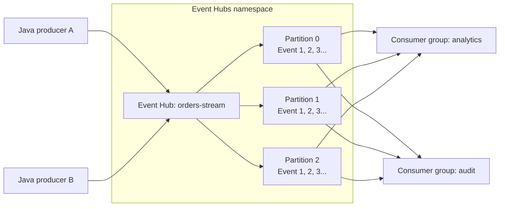
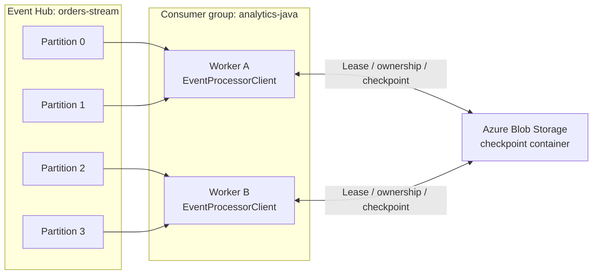
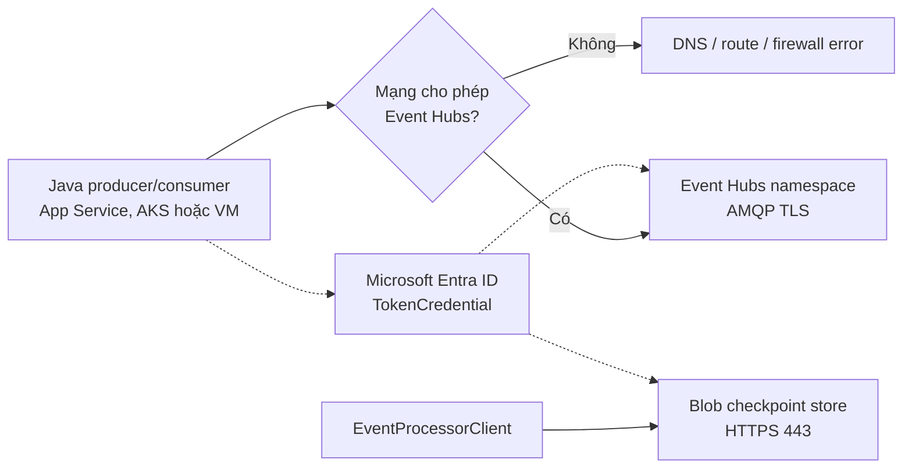
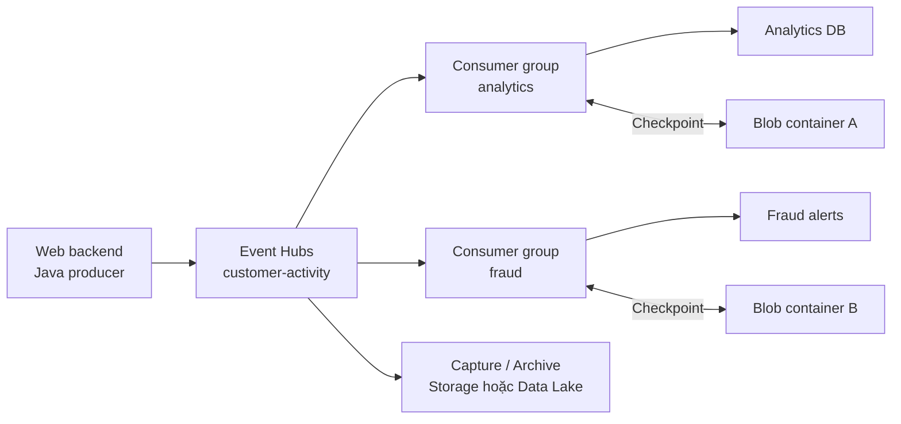

# Phát triển producer và consumer Java cho Event Hubs

Giả sử một nền tảng thương mại điện tử nhận hàng trăm nghìn sự kiện mỗi phút: người dùng xem sản phẩm, thêm giỏ hàng, đặt hàng và ứng dụng ghi nhận telemetry. Nhiều hệ thống cần cùng đọc những sự kiện này: một ứng dụng tính chỉ số thời gian thực, một pipeline phân tích dữ liệu và một hệ thống phát hiện bất thường. Nếu từng producer gửi trực tiếp đến từng consumer, số lượng kết nối và mức độ phụ thuộc giữa dịch vụ sẽ tăng nhanh.

**Azure Event Hubs** là dịch vụ tiếp nhận và phân phối **dòng sự kiện (event streaming)** ở quy mô lớn. Producer gửi sự kiện vào các **partition** của Event Hub; consumer đọc độc lập theo **consumer group** và vị trí trong log. Với Java, Azure SDK cung cấp `EventHubProducerClient`, `EventHubConsumerClient` và `EventProcessorClient` để xuất bản sự kiện, đọc dữ liệu và xử lý theo nhiều instance có checkpoint.

Trong module **CLOUD_PROVIDERS_AZURE**, bạn khám phá Microsoft Azure từ subscription, resource group và Microsoft Entra ID đến mạng, compute, storage, dữ liệu, giám sát, bảo vệ và chi phí triển khai ứng dụng. Bài thuộc chương **Sự kiện và dữ liệu streaming**, tập trung vào việc **phát triển producer và consumer Java cho Event Hubs** bằng SDK hiện đại, xác thực Microsoft Entra ID, kiểm soát partition, checkpoint, lỗi và khả năng vận hành thực tế.

## 1. Mục tiêu học tập

Sau bài học, bạn có thể:

- Phân biệt **Event Hubs namespace**, **event hub**, **partition**, **consumer group**, **offset** và **sequence number**.
- Mô tả luồng producer → partition → consumer và sự khác biệt giữa Event Hubs với Service Bus.
- Chuẩn bị ứng dụng Java với `azure-messaging-eventhubs`, `azure-identity` và checkpoint store khi cần.
- Dùng `EventHubProducerClient` để gửi một batch sự kiện đúng giới hạn kích thước.
- Sử dụng **partition key** khi cần giữ thứ tự sự kiện theo thực thể nghiệp vụ.
- Đọc sự kiện bằng `EventHubConsumerClient` để thăm dò/kiểm thử một partition.
- Dùng `EventProcessorClient` kết hợp Azure Blob Storage để cân bằng partition giữa nhiều process và lưu checkpoint.
- Áp dụng **managed identity / Microsoft Entra ID + Azure RBAC**, tránh nhúng connection string vào source.
- Xử lý retry, duplicate events, schema versioning, throughput và lỗi kết nối trong production.

## 2. Khi nào dùng Azure Event Hubs?

Event Hubs phù hợp với dữ liệu **append-only** được phát liên tục và nhiều nhóm consumer cần đọc lại/đọc độc lập trong một thời hạn lưu giữ:

| Nguồn dữ liệu | Event minh họa | Consumer |
|---|---|---|
| Ứng dụng web/mobile | `page_view`, `checkout_started` | Dashboard theo thời gian thực |
| IoT / thiết bị | Nhiệt độ, trạng thái máy, vị trí hợp lệ | Phát hiện bất thường |
| Backend services | Audit event, trạng thái đơn hàng | Phân tích hành vi, kho dữ liệu |
| Hệ thống vận hành | Telemetry, logs, metrics sự kiện | Streaming ETL |
| CDC / integration | Sự kiện thay đổi dữ liệu từ nguồn đã kiểm soát | Pipeline cập nhật chỉ mục/tổng hợp |

### Event Hubs khác Azure Service Bus ra sao?

| Tiêu chí | Azure Event Hubs | Azure Service Bus |
|---|---|---|
| Mô hình cốt lõi | Dòng sự kiện phân vùng, log lưu giữ theo thời gian | Queue/topic với xử lý message và settlement |
| Consumer | Đọc theo partition/offset trong consumer group | Nhận, complete/abandon/dead-letter message |
| Lưu dữ liệu sau khi đọc | Event **không bị xóa chỉ vì đã đọc** | Message thường được hoàn tất và rời khỏi queue |
| Nhiều pipeline độc lập | Consumer groups giữ tiến độ riêng | Topic/subscription hoặc kiến trúc fan-out riêng |
| Trình tự | Được xác định trong **một partition** | Tùy entity/tính năng và phiên xử lý |
| Trường hợp tiêu biểu | Telemetry, clickstream, streaming analytics | Command, workflow, tác vụ nghiệp vụ có settlement |

Nếu yêu cầu chính là một worker nhận lệnh rồi **complete message** hoặc xử lý dead-letter chuyên biệt, cân nhắc Service Bus. Nếu cần nhiều ứng dụng cùng tiêu thụ **dòng event có khả năng đọc lại**, Event Hubs thường phù hợp hơn.

## 3. Kiến trúc Event Hubs: namespace, hub và partition

**Namespace** cung cấp ranh giới quản lý, định danh endpoint, tier, throughput capacity và security/network. Trong một namespace có thể có nhiều **event hubs**; mỗi event hub chứa một số **partition**.



**Partition** là một log có thứ tự riêng. Event được nối thêm, gắn metadata như partition ID, offset, sequence number và thời gian enqueue. Thứ tự được bảo toàn **trong cùng partition**, không có một thứ tự toàn cục duy nhất trên tất cả partitions.

### Offset và sequence number

- **Sequence number:** số tăng theo thứ tự event được lưu trong partition; không dùng làm ID toàn cục qua các partition.
- **Offset:** vị trí của event trong log của một partition, dùng khi tiêu thụ/đọc tiếp; hình thức biểu diễn phụ thuộc API/SDK.
- **Enqueued time:** thời điểm hệ thống tiếp nhận event; không nhất thiết là thời điểm event thực sự xảy ra tại ứng dụng phát.
- **Retention:** thời gian các event còn được giữ theo cấu hình và khả năng tier; không phụ thuộc vào việc consumer đã đọc.

Đọc lại từ offset cũ chỉ thực hiện được nếu event đó vẫn nằm trong retention. Nếu consumer dừng quá lâu, checkpoint cũ có thể trỏ tới dữ liệu không còn tồn tại; cần quy tắc phục hồi/lấp khoảng trống thông qua nguồn dữ liệu bền vững khác nếu nghiệp vụ yêu cầu.

### Consumer group

**Consumer group** là góc nhìn độc lập lên cùng Event Hub. Ví dụ, group `analytics-java` đọc để tính báo cáo, group `fraud-detector` đọc để phát hiện bất thường. Hai group có vị trí/checkpoint riêng và không “giành” event của nhau.

Trong cùng một consumer group, những process `EventProcessorClient` có thể chia nhau sở hữu các partition, giúp scale horizontally. Đừng dùng cùng consumer group/checkpoint store cho hai pipeline có mục đích khác nhau nếu bạn muốn chúng **mỗi bên đều đọc toàn bộ sự kiện**.

## 4. Producer, consumer và event processor khác nhau

| Thành phần SDK | Vai trò | Khi nên dùng |
|---|---|---|
| `EventHubProducerClient` | Gửi event/batch vào Event Hub | Ứng dụng phát sự kiện đồng bộ |
| `EventHubProducerAsyncClient` | Gửi bất đồng bộ (Reactor) | Ứng dụng reactive hoặc pipeline có backpressure |
| `EventHubConsumerClient` | Đọc một partition theo vị trí chỉ định | Công cụ chẩn đoán, ứng dụng thử nghiệm, logic đọc partition thủ công |
| `EventHubConsumerAsyncClient` | Đọc partition theo API bất đồng bộ | Tích hợp reactive, kiểm soát việc subscribe |
| `EventProcessorClient` | Xử lý nhiều partitions, cân bằng ownership và checkpoint | Consumer production chạy nhiều replicas |
| `BlobCheckpointStore` | Lưu ownership/checkpoint vào Azure Blob Storage | Phối hợp nhiều `EventProcessorClient` instances |

**Event Hubs không có khái niệm consumer gọi `complete(message)` như Service Bus.** Thay vào đó, consumer theo dõi tiến độ đọc bằng vị trí/checkpoint; các event được giữ đến khi hết retention. Sau crash, event có thể được xử lý lại từ checkpoint trước đó.

## 5. Chuẩn bị Azure và dự án Java

Ví dụ sử dụng tên minh họa (phải thay bằng tài nguyên tồn tại thực):

| Tài nguyên | Tên ví dụ | Mục đích |
|---|---|---|
| Resource group | `rg-stream-lab` | Quản lý tài nguyên |
| Event Hubs namespace | `evh-orders-lab` | Endpoint Event Hubs |
| Event Hub | `orders-stream` | Log nhận sự kiện |
| Consumer group | `analytics-java` | Pipeline tiêu thụ riêng |
| Storage account | `ststreamlab01` | Checkpoint storage |
| Blob container | `eh-checkpoints` | Lưu ownership/checkpoint |
| Producer identity | `mi-event-producer` | Gửi event |
| Consumer identity | `mi-event-consumer` | Đọc event, checkpoint |

### 5.1. Điều kiện tiên quyết

- Có Java **17 hoặc bản LTS tương thích** với SDK đang dùng và build tool (Maven/Gradle) do dự án quản lý.
- Có các dependency ở phiên bản được tổ chức hỗ trợ, hoặc sử dụng **Azure SDK BOM** để quản lý tương thích:
  - `com.azure:azure-messaging-eventhubs`;
  - `com.azure:azure-identity`;
  - `com.azure:azure-messaging-eventhubs-checkpointstore-blob` (chỉ khi dùng event processor);
  - `com.azure:azure-storage-blob` cho checkpoint container.
- Event Hub và consumer group đã được tạo; application có đường mạng đến namespace và Storage.
- Principal producer có quyền **Azure Event Hubs Data Sender**, consumer có **Azure Event Hubs Data Receiver**; consumer processor được cấp quyền Blob phù hợp.

**Không gắn một phiên bản Maven ngẫu nhiên** từ ví dụ cũ nếu pipeline có BOM được quản lý. Kiểm tra compatibility, API changes và security updates trước khi build. Những đoạn Java tiếp theo minh họa SDK v5 đồng bộ và có thể cần điều chỉnh import/phiên bản theo dependency thực tế.

### 5.2. Cấu hình môi trường không chứa secret

Trên máy phát triển, dùng `az login` với tài khoản được cấp role để SDK `DefaultAzureCredential` có thể lấy token. Trên Azure, dùng **managed identity** hoặc AKS Workload Identity.

Các biến cấu hình ví dụ:

```text
EVENTHUB_NAMESPACE=evh-orders-lab.servicebus.windows.net
EVENTHUB_NAME=orders-stream
EVENTHUB_CONSUMER_GROUP=analytics-java
CHECKPOINT_STORAGE_ACCOUNT=ststreamlab01
CHECKPOINT_CONTAINER=eh-checkpoints
```

Biến chứa **tên tài nguyên** không phải secret. Tránh đặt connection string/Shared Access Key vào source code hoặc commit file `.env` có credential. Với user-assigned managed identity, cần cấu hình `AZURE_CLIENT_ID`/credential theo phương thức của SDK để chọn đúng danh tính.

## 6. Khám phá Event Hub và consumer groups bằng Azure CLI

Những lệnh sau **chỉ đọc** thông tin cấu hình (trừ trường hợp cố ý tạo consumer group ở bước tiếp theo). Chọn đúng subscription để tránh nhầm tài nguyên:

```bash
az login
az account set --subscription "<subscription-id>"

RG="rg-stream-lab"
NS="evh-orders-lab"
HUB="orders-stream"

az eventhubs namespace show \
  --resource-group "$RG" \
  --name "$NS" \
  --query "{name:name,location:location,sku:sku.name}" \
  --output json

az eventhubs eventhub show \
  --resource-group "$RG" \
  --namespace-name "$NS" \
  --name "$HUB" \
  --query "{name:name,partitions:partitionCount,retention:messageRetentionInDays}" \
  --output json

az eventhubs eventhub consumer-group list \
  --resource-group "$RG" \
  --namespace-name "$NS" \
  --eventhub-name "$HUB" \
  --output table
```

Nếu cần group riêng cho lab và có quyền quản trị:

```bash
az eventhubs eventhub consumer-group create \
  --resource-group "rg-stream-lab" \
  --namespace-name "evh-orders-lab" \
  --eventhub-name "orders-stream" \
  --name "analytics-java"
```

Lệnh `create` là thao tác thay đổi tài nguyên; nếu consumer group đã tồn tại, nên kiểm tra và dùng lại thay vì tạo trùng. Dữ liệu consumer group và các thông số retention/partition phụ thuộc tier; hiện diện của event hub không bảo đảm ứng dụng có role data plane hoặc đủ throughput capacity.

## 7. Producer Java: gửi một batch sự kiện an toàn

Producer tạo `EventData` từ payload và dùng `EventHubProducerClient` để gửi đến Event Hub. Batch giúp giảm số lần gọi mạng, nhưng **giới hạn kích thước request** và số byte của event phụ thuộc SDK/tier. Đừng cố ghép tất cả sự kiện vào một batch không giới hạn.

### 7.1. Ví dụ Java hoàn chỉnh

Chương trình bên dưới:

1. Lấy namespace và event hub name từ biến môi trường.
2. Khởi tạo client bằng `DefaultAzureCredential`.
3. Tạo batch bằng `createBatch()`.
4. Thử thêm lần lượt 6 sự kiện; khi batch đầy, **gửi batch cũ rồi tạo batch mới**.
5. Nếu **một event riêng lẻ quá lớn**, ném lỗi có thông báo thay vì bỏ qua dữ liệu.

```java
import com.azure.identity.DefaultAzureCredentialBuilder;
import com.azure.messaging.eventhubs.EventHubClientBuilder;
import com.azure.messaging.eventhubs.EventHubProducerClient;
import com.azure.messaging.eventhubs.models.EventDataBatch;
import com.azure.messaging.eventhubs.EventData;

import java.time.Instant;
import java.util.UUID;

public final class EventHubBatchProducer {
    private static String requiredEnv(String key) {
        String value = System.getenv(key);
        if (value == null || value.isBlank()) {
            throw new IllegalArgumentException("Missing environment variable: " + key);
        }
        return value;
    }

    public static void main(String[] args) {
        String namespace = requiredEnv("EVENTHUB_NAMESPACE");
        String eventHubName = requiredEnv("EVENTHUB_NAME");

        try (EventHubProducerClient producer = new EventHubClientBuilder()
                .fullyQualifiedNamespace(namespace)
                .eventHubName(eventHubName)
                .credential(new DefaultAzureCredentialBuilder().build())
                .buildProducerClient()) {

            EventDataBatch batch = producer.createBatch();
            for (int i = 1; i <= 6; i++) {
                String eventId = UUID.randomUUID().toString();
                String json = String.format(
                        "{\"eventId\":\"%s\",\"type\":\"page_view\","
                                + "\"page\":%d,\"occurredAt\":\"%s\"}",
                        eventId, i, Instant.now());

                EventData event = new EventData(json);
                event.getProperties().put("schemaVersion", 1);

                if (!batch.tryAdd(event)) {
                    if (batch.getCount() == 0) {
                        throw new IllegalArgumentException(
                                "One event exceeds the allowed batch size");
                    }

                    producer.send(batch);
                    batch = producer.createBatch();

                    if (!batch.tryAdd(event)) {
                        throw new IllegalArgumentException(
                                "One event exceeds the allowed batch size");
                    }
                }
            }

            if (batch.getCount() > 0) {
                producer.send(batch);
            }
            System.out.println("All test events submitted to Event Hubs");
        }
    }
}
```

**Giải thích API chính:**

- `EventHubClientBuilder` xây client theo hostname của namespace và tên event hub.
- `DefaultAzureCredentialBuilder` lấy token từ nguồn credential được cho phép, không cần SAS connection string.
- `EventData` chứa body và application properties; không nên gửi dữ liệu nhạy cảm nếu không có yêu cầu và biện pháp bảo vệ phù hợp.
- `EventDataBatch.tryAdd(event)` trả `false` nếu event không vừa với giới hạn của batch; nó **không tự gửi batch**.
- `producer.send(batch)` gửi batch; SDK có xử lý retry cho một số lỗi tạm thời theo cấu hình, nhưng **không bảo đảm exactly-once** nếu client không nhận được phản hồi sau khi server đã chấp nhận.
- `try-with-resources` đóng client khi ứng dụng kết thúc. Với producer chạy lâu, thường **tái sử dụng client** thay vì tạo/đóng theo từng event.

Đây là đoạn Java thử nghiệm với 6 sự kiện. Với hệ thống thật, payload cần schema rõ ràng, event ID ổn định, timestamp nguồn và chính sách bảo vệ dữ liệu. Không in các event nhạy cảm nguyên văn trong log.

### 7.2. Vì sao không gửi từng event một?

Gửi một request cho mỗi event thường tốn thêm CPU/round-trip/network overhead. Batch có thể cải thiện throughput khi sự kiện nhỏ và đến liên tục. Tuy nhiên, batch quá lớn có thể tăng latency và chi phí retry khi request thất bại; hãy đo hiệu quả với kích thước payload, tần suất sự kiện và độ trễ chấp nhận được.

**Không giả định batch đảm bảo một transaction nghiệp vụ xuyên nhiều hệ thống.** Nếu producer ghi database xong rồi mới gửi batch, một lỗi ở giữa có thể tạo ra bất nhất. Với sự kiện nghiệp vụ quan trọng, cân nhắc **transactional outbox** hoặc quy trình xuất sự kiện bền vững.

## 8. Partition key và quy tắc giữ thứ tự

Khi không chỉ định partition, producer có thể phân phối sự kiện giữa nhiều partitions theo cơ chế SDK/dịch vụ. Điều này thuận lợi cho cân bằng tải, nhưng không bảo đảm sự kiện liên quan cùng một đơn hàng đi vào một partition.

### Sử dụng partition key

Ví dụ, muốn tất cả sự kiện liên quan một `orderId` được gửi với cùng partition key:

```java
import com.azure.messaging.eventhubs.EventData;
import com.azure.messaging.eventhubs.EventHubProducerClient;
import com.azure.messaging.eventhubs.models.CreateBatchOptions;
import com.azure.messaging.eventhubs.models.EventDataBatch;

// producer đã được khởi tạo và xác thực như mục trước.
CreateBatchOptions options = new CreateBatchOptions()
        .setPartitionKey("order-1001");

EventDataBatch batch = producer.createBatch(options);
if (!batch.tryAdd(new EventData(
        "{\"orderId\":\"order-1001\",\"status\":\"created\"}"))) {
    throw new IllegalArgumentException("Event is too large");
}
producer.send(batch);
```

Ví dụ là **đoạn mã đặt bên trong scope có biến `producer`**, không phải một class Java độc lập. SDK dùng partition key để cố gắng đưa các event có cùng key đến cùng một partition trong cấu hình đang áp dụng. Nếu thứ tự có ý nghĩa nghiệp vụ, bạn còn phải đảm bảo:

- Producer phát các event của cùng key **theo đúng thứ tự** mong muốn; gửi đồng thời từ nhiều thread/process có thể làm thứ tự quan sát khác thứ tự nghiệp vụ.
- Consumer xử lý tuần tự hoặc có cơ chế phối hợp theo partition/key khi cần.
- Khi thay đổi partition count hoặc kiến trúc partitioning, không mặc định ánh xạ key → partition giữ nguyên vĩnh viễn.
- Partition key quá “nóng” (mọi event cùng một key) có thể gây **hot partition** và giới hạn throughput.

**Partition key không phải primary key của event.** Nhiều sự kiện cùng một orderId có thể có eventId khác nhau; consumer dùng eventId để phát hiện xử lý trùng, dùng orderId để nhóm theo thực thể.

### Chỉ định partition ID trực tiếp?

SDK cũng hỗ trợ các lựa chọn chỉ định partition ở những API phù hợp, nhưng producer ứng dụng nghiệp vụ thường nên dùng **partition key** khi cần affinity thay vì hard-code partition `0`, `1`. Hard-code partition có thể làm lệch tải và khiến phần mềm phụ thuộc cấu hình hạ tầng.

## 9. Consumer Java: đọc sự kiện từ một partition

`EventHubConsumerClient` phù hợp để hiểu API đọc theo partition và kiểm tra các sự kiện trong lab. Bạn cần biết **partition ID**, **consumer group** và **vị trí bắt đầu**. Consumer không xóa sự kiện sau khi đọc và không có `complete()` kiểu Service Bus.

### 9.1. Java consumer đồng bộ

```java
import com.azure.identity.DefaultAzureCredentialBuilder;
import com.azure.messaging.eventhubs.EventHubClientBuilder;
import com.azure.messaging.eventhubs.EventHubConsumerClient;
import com.azure.messaging.eventhubs.models.EventPosition;
import com.azure.messaging.eventhubs.models.PartitionEvent;

import java.time.Duration;

public final class ReadOnePartition {
    private static String requiredEnv(String key) {
        String value = System.getenv(key);
        if (value == null || value.isBlank()) {
            throw new IllegalArgumentException("Missing environment variable: " + key);
        }
        return value;
    }

    public static void main(String[] args) {
        String namespace = requiredEnv("EVENTHUB_NAMESPACE");
        String eventHubName = requiredEnv("EVENTHUB_NAME");
        String group = requiredEnv("EVENTHUB_CONSUMER_GROUP");

        try (EventHubConsumerClient consumer = new EventHubClientBuilder()
                .fullyQualifiedNamespace(namespace)
                .eventHubName(eventHubName)
                .consumerGroup(group)
                .credential(new DefaultAzureCredentialBuilder().build())
                .buildConsumerClient()) {

            String[] partitions = consumer.getPartitionIds().stream()
                    .toArray(String[]::new);
            if (partitions.length == 0) {
                throw new IllegalStateException("Event Hub has no partitions");
            }

            String partitionId = partitions[0];
            System.out.println("Reading partition: " + partitionId);

            // Chỉ đọc tối đa 20 events từ đầu retention của partition này.
            Iterable<PartitionEvent> events = consumer.receiveFromPartition(
                    partitionId,
                    20,
                    EventPosition.earliest(),
                    Duration.ofSeconds(20));

            for (PartitionEvent partitionEvent : events) {
                System.out.println(
                        "partition=" + partitionEvent.getPartitionContext().getPartitionId()
                        + ", sequence=" + partitionEvent.getData().getSequenceNumber()
                        + ", body=" + partitionEvent.getData().getBodyAsString());
            }
        }
    }
}
```

**Về ví dụ:**

- `getPartitionIds()` đọc danh sách partition ID. Chương trình chỉ lấy **partition đầu tiên** để minh họa, **không đọc toàn bộ Event Hub**.
- `EventPosition.earliest()` bắt đầu từ sự kiện sớm nhất **còn trong retention** của partition đó.
- `receiveFromPartition(..., 20, ..., Duration.ofSeconds(20))` yêu cầu tối đa 20 sự kiện và chờ theo API. Nếu không có event, chương trình có thể không in dữ liệu và vẫn kết thúc bình thường.
- Mỗi `PartitionEvent` cung cấp body và metadata/partition context.
- Consumer API này **không tự duy trì checkpoint lâu dài** cho ứng dụng của bạn.

Đoạn code in body để dễ quan sát **chỉ trong lab**, không log payload trong production nếu có dữ liệu cá nhân hoặc thông tin nhạy cảm. Với payload JSON thực, phải parse và validate schema, xử lý dữ liệu lỗi.

### 9.2. Đọc từ vị trí nào?

Trong Java SDK, các phương thức `EventPosition` hỗ trợ lựa chọn điểm bắt đầu:

| Lựa chọn | Ý nghĩa | Khi sử dụng |
|---|---|---|
| `EventPosition.earliest()` | Bắt đầu từ đầu dữ liệu còn trong retention | Backfill hoặc kiểm thử đọc lại |
| `EventPosition.latest()` | Theo dõi từ cuối luồng theo semantics API | Consumer chỉ quan tâm dữ liệu mới |
| Vị trí theo offset | Đọc gần một điểm offset xác định | Khôi phục hoặc điều tra tại vị trí biết trước |
| Vị trí theo sequence number | Đọc theo sequence trong partition | Debug/replay có kiểm soát |
| Vị trí theo enqueued time | Bắt đầu gần thời điểm enqueue | Replay trong khoảng thời gian |

Với offset/sequence, cần hiểu tùy chọn **inclusive/exclusive** của API. **Không dùng một offset của partition A để đánh dấu tiến độ partition B**.

### 9.3. Vì sao không chạy consumer thủ công trên 20 pods?

Nếu 20 process cùng chạy `ReadOnePartition` và cùng dùng partition đầu tiên, chúng có thể đọc **trùng cùng dữ liệu**, không tự chia công việc cho nhau. Với consumer production chạy nhiều instance, cần cơ chế **partition ownership và checkpoint**, ví dụ `EventProcessorClient` với Blob checkpoint store.

## 10. EventProcessorClient: consumer production có checkpoint

`EventProcessorClient` giúp xử lý dữ liệu từ nhiều partition với mô hình callback và phối hợp nhiều instances. Khi chạy nhiều consumer processes cùng một consumer group và dùng **cùng checkpoint store**, các process chia sẻ thông tin ownership để phân phối partition.

### 10.1. Checkpoint giải quyết điều gì?

Checkpoint lưu vị trí xử lý thành công gần nhất của **mỗi partition**, nhằm giúp consumer tiếp tục từ vị trí hợp lý sau restart hoặc khi partition ownership chuyển sang process khác.



Trong sơ đồ 4 partition/2 worker, mỗi worker có thể xử lý 2 partition sau khi cân bằng. Đây là **phân bố minh họa**, số partition thực tế và cơ chế load balancing do SDK điều phối. Không đảm bảo có 4 worker thì mọi worker luôn xử lý chính xác một partition tại mọi thời điểm vì rebalancing, reconnect và failures.

### 10.2. Chuẩn bị Blob container

Checkpoint store dựa trên Azure Blob Storage cần **storage account + container có sẵn**. Chọn một container riêng cho một pipeline hoặc tổ chức scope theo nhu cầu, tránh vô tình chia sẻ checkpoint với các ứng dụng độc lập.

Ví dụ tạo container lab từ Azure CLI bằng Entra ID (thao tác ghi):

```bash
az storage container create \
  --account-name "ststreamlab01" \
  --name "eh-checkpoints" \
  --auth-mode login
```

Principal thực hiện lệnh cần role dữ liệu phù hợp với Storage account/container. Runtime consumer cần được cấp **Storage Blob Data Contributor** tại container `eh-checkpoints` (hoặc scope hợp lệ) để đọc, ghi và cập nhật thông tin ownership/checkpoint.

**Đừng dùng một container checkpoint như một nơi lưu sự kiện nghiệp vụ.** Blob checkpoint store lưu **tiến độ và thông tin ownership**, không chứa bản sao đầy đủ của event stream hay thay thế Event Hubs Capture/Data Lake.

### 10.3. Java EventProcessorClient hoàn chỉnh

Ví dụ sau sử dụng:

- `DefaultAzureCredential` để lấy token cho **Event Hubs và Blob**.
- Consumer group riêng `analytics-java`.
- `BlobCheckpointStore` sử dụng `BlobContainerAsyncClient`.
- Callback `processEvent` xử lý message và chỉ cập nhật checkpoint **sau khi** phần xử lý được coi là thành công.

```java
import com.azure.core.credential.TokenCredential;
import com.azure.identity.DefaultAzureCredentialBuilder;
import com.azure.messaging.eventhubs.EventProcessorClient;
import com.azure.messaging.eventhubs.EventProcessorClientBuilder;
import com.azure.messaging.eventhubs.checkpointstore.blob.BlobCheckpointStore;
import com.azure.storage.blob.BlobContainerAsyncClient;
import com.azure.storage.blob.BlobContainerClientBuilder;

public final class CheckpointedEventProcessor {
    private static String requiredEnv(String key) {
        String value = System.getenv(key);
        if (value == null || value.isBlank()) {
            throw new IllegalArgumentException("Missing environment variable: " + key);
        }
        return value;
    }

    public static void main(String[] args) throws InterruptedException {
        String namespace = requiredEnv("EVENTHUB_NAMESPACE");
        String eventHubName = requiredEnv("EVENTHUB_NAME");
        String consumerGroup = requiredEnv("EVENTHUB_CONSUMER_GROUP");
        String storageAccount = requiredEnv("CHECKPOINT_STORAGE_ACCOUNT");
        String storageContainer = requiredEnv("CHECKPOINT_CONTAINER");

        TokenCredential credential =
                new DefaultAzureCredentialBuilder().build();

        BlobContainerAsyncClient blobContainer =
                new BlobContainerClientBuilder()
                        .endpoint("https://" + storageAccount + ".blob.core.windows.net")
                        .containerName(storageContainer)
                        .credential(credential)
                        .buildAsyncClient();

        EventProcessorClient processor = new EventProcessorClientBuilder()
                .fullyQualifiedNamespace(namespace)
                .eventHubName(eventHubName)
                .consumerGroup(consumerGroup)
                .credential(credential)
                .checkpointStore(new BlobCheckpointStore(blobContainer))
                .processEvent(context -> {
                    String partitionId =
                            context.getPartitionContext().getPartitionId();
                    String eventId = context.getEventData().getMessageId();
                    String body = context.getEventData().getBodyAsString();

                    // LAB: chỉ mô phỏng xử lý. Production: validate schema,
                    // idempotency + ghi output bền vững trước checkpoint.
                    System.out.printf("partition=%s eventId=%s bytes=%d%n",
                            partitionId, eventId, body.length());

                    // Checkpoint mỗi event để dễ thấy tiến độ trong lab.
                    // Production: chọn chu kỳ checkpoint theo volume/SLO.
                    context.updateCheckpoint();
                })
                .processError(context -> {
                    System.err.println("Event Processor error: "
                            + context.getThrowable().getMessage());
                })
                .buildEventProcessorClient();

        processor.start();
        try {
            Thread.sleep(60_000); // Lab: để processor nhận event khoảng 1 phút.
        } finally {
            processor.stop();
        }
    }
}
```

**Điều kiện để code thực thi:** Blob container đã tồn tại và có thể truy cập; principal có **Event Hubs Data Receiver** trên Event Hub và **Storage Blob Data Contributor** trên checkpoint container; namespace, group và endpoint đúng; network có thể kết nối cả Event Hubs lẫn Blob Storage.

Mã trên **không lưu output nghiệp vụ**, chỉ minh họa nơi cần thực hiện xử lý. Vì vậy, khi chuyển sang production, không được giữ `updateCheckpoint()` ngay sau một dòng log rồi xem như sự kiện đã xử lý nghiệp vụ thành công. Phải commit kết quả nghiệp vụ bền vững trước, sau đó checkpoint.

### 10.4. Vì sao checkpoint mỗi event không luôn tối ưu?

Checkpoint là thao tác lên backend lưu trữ, có **I/O, độ trễ và chi phí transaction**. Với hàng triệu sự kiện, checkpoint mỗi event thường đắt và làm giảm throughput.

Thường đặt một chính sách **checkpoint theo số sự kiện hoặc khoảng thời gian**, đồng thời đảm bảo vị trí checkpoint luôn tiến cùng một partition **sau khi các event trước đó đã được xử lý an toàn**.

| Chiến lược | Lợi ích | Rủi ro/đánh đổi |
|---|---|---|
| Checkpoint mỗi event | Ít phải đọc lại sau restart | Nhiều ghi Blob, chi phí/latency |
| Sau mỗi 100–1000 event | Giảm số thao tác Storage | Khi crash có thể xử lý lại nhiều event |
| Mỗi vài giây | Phù hợp stream đều | Với batch không đều cần xét tiến độ mỗi partition |
| Sau commit một batch nghiệp vụ | Đồng bộ tốt với lưu output | Cần quản lý thứ tự và failure boundary |

Các ngưỡng trên chỉ là ví dụ thiết kế, **không phải cấu hình bắt buộc** của Event Hubs. Hãy benchmark, đo khả năng retry/idempotency và không checkpoint vượt quá sự kiện chưa hoàn tất.

## 11. Multiple consumer instances, ownership và rebalancing

Giả sử Event Hub có **4 partitions**. Một `EventProcessorClient` có thể đọc cả 4; khi chạy thêm 3 processor instances trong cùng consumer group và cùng Blob checkpoint store, SDK có thể phân chia partitions theo cơ chế load balancing.

### Khi mở rộng đến nhiều replicas

- Nếu số processor instances **ít hơn** số partitions, một instance có thể sở hữu nhiều partitions.
- Nếu số processor instances **bằng** số partitions, hệ thống có thể chia gần một partition/instance trong điều kiện ổn định.
- Nếu số processor instances **lớn hơn** partitions, một số instances có thể không được giao partition; thêm nhiều replicas không bảo đảm tăng throughput.
- Khi instance chết hoặc tăng/giảm replicas, **ownership chuyển giao**; các events chưa checkpoint có thể được đọc lại.

Vì vậy, **partition count đặt một giới hạn thực tế cho mức song song của một consumer group ở cấp xử lý partition**. Việc xử lý đồng thời nhiều events *trong một partition* có thể giúp tăng throughput ở ứng dụng nhưng làm phức tạp bảo đảm thứ tự và checkpoint.

### Checkpoint container phải chia sẻ đúng phạm vi

Trong cùng một logical consumer application:

1. Dùng **cùng Event Hubs namespace, event hub và consumer group**.
2. Dùng checkpoint store tương ứng mà các instances cùng đọc/ghi.
3. Các instances có cùng logic/phiên bản xử lý tương thích và sử dụng identity được phép.

Giữa hai pipeline độc lập, dùng **consumer group khác nhau**. Nếu muốn audit pipeline đọc mọi event và analytics pipeline cũng đọc mọi event, không cho cả hai cùng “chia” một group vì chúng có thể chia partitions thay vì mỗi pipeline đọc toàn bộ.

### Lưu ý về process và shutdown

Khi triển khai trên Azure Container Apps, AKS hoặc VM Scale Sets, hỗ trợ **graceful shutdown**: dừng tiếp nhận, hoàn tất xử lý in-flight, cập nhật checkpoint phù hợp và giải phóng resources. Không giả định SIGTERM cho phép tiến trình chạy vô hạn; sau grace period container có thể bị hủy, và xử lý lại từ checkpoint là hành vi cần dự kiến.

## 12. Event ID, duplicate delivery và idempotent consumer

**Event Hubs giữ sự kiện theo retention, không theo trạng thái “đã hoàn thành” của từng subscriber.** Khi processor crash sau khi ghi database nhưng trước khi checkpoint, event có thể được giao lại.

### Ví dụ sự kiện có định danh ổn định

```json
{
  "eventId": "evt-2026-000123",
  "eventType": "OrderPlaced",
  "schemaVersion": 1,
  "occurredAt": "2026-11-20T10:15:00Z",
  "orderId": "ORD-1001",
  "amount": 250000
}
```

Lưu ý sự khác nhau giữa:

- **`eventId` nghiệp vụ** do producer tạo để định danh event xuyên mọi lần gửi lại.
- **`partitionId + sequenceNumber`** định danh vị trí record trong một Event Hub cụ thể, không thay thế event ID nếu producer có thể phát cùng sự kiện nghiệp vụ hai lần.
- **`MessageId`** có thể được đặt trên event/AMQP message theo API, nhưng đừng giả định SDK tự tạo một eventId ổn định với chính sách deduplication nghiệp vụ.

### Consumer idempotent

Một cách phổ biến:

```text
Khi nhận event E:
    1. Validate schema, event ID và dữ liệu bắt buộc.
    2. Kiểm tra bảng processed_events có E.eventId hay chưa.
    3. Trong transaction:
         - Áp dụng thay đổi nghiệp vụ (nếu chưa áp dụng).
         - Ghi nhận processed_events[E.eventId].
    4. Commit transaction.
    5. Chỉ khi commit thành công mới checkpoint partition.
```

**Kiểm tra rồi ghi** ở hai bước không nguyên tử vẫn có race condition nếu hai instances cùng xử lý cùng event. Cần unique constraint hoặc transaction/conditional write của backend phù hợp. Với side effects ngoài database như gửi email, payment hoặc gọi API, cân nhắc outbox và idempotency key ở dịch vụ đích.

### Schema evolution

Payload JSON phải có phiên bản schema. Nếu producer thêm field mới, consumer cũ nên có khả năng bỏ qua field không biết khi hợp đồng cho phép. Nếu thay kiểu dữ liệu hoặc xóa field bắt buộc, cần chiến lược tương thích ngược, triển khai theo giai đoạn hoặc versioned event type.

Không lưu một payload tùy ý rồi để các consumer tự suy đoán. Các quy tắc về kiểu dữ liệu, timezone/UTC, currency, event ID, source và privacy cần được thống nhất trong hợp đồng sự kiện.

## 13. Cấp quyền Azure Event Hubs và Blob cho Java clients

Với **Microsoft Entra ID**, Service Bus và Event Hubs có **bộ Azure RBAC data roles riêng**. Để gửi/nhận trong Event Hubs, dùng:

| Principal | Nhiệm vụ | Role dữ liệu nên cấp |
|---|---|---|
| Producer Java | Chỉ gửi event | **Azure Event Hubs Data Sender** |
| Consumer Java | Chỉ đọc event | **Azure Event Hubs Data Receiver** |
| Công cụ data plane cần quản lý dữ liệu rộng hơn | Thao tác dữ liệu theo phạm vi được duyệt | **Azure Event Hubs Data Owner** khi thật sự cần |
| EventProcessorClient checkpoint identity | Đọc/ghi Blob ownership và checkpoint | **Storage Blob Data Contributor** trên checkpoint container |
| Pipeline tạo namespace/event hub | Quản trị tài nguyên Azure | Azure RBAC management plane phù hợp |

**Azure RBAC Reader/Contributor trên resource group không phải lựa chọn tương đương** với quyền đọc/ghi Event Hubs qua Entra token. Hãy xem `DataActions` của role và tránh cấp Owner toàn subscription cho ứng dụng runtime.

### 13.1. Scope nên nhỏ nhất có thể

Role assignment có thể cấp tại namespace hoặc event hub theo những scope được Azure RBAC hỗ trợ. Với producer `orders-stream`, ưu tiên cấp Data Sender ở Event Hub tương ứng thay vì toàn namespace nếu chỉ cần gửi một luồng. Đối với consumer, tương tự dùng Data Receiver. Nếu một pipeline cần đọc nhiều Event Hubs, cân nhắc scope namespace theo chính sách tổ chức.

**Consumer group là ranh giới điều phối việc đọc**, không tự thay thế Azure RBAC. Cấp Data Receiver ở namespace/event hub không nhất thiết ngăn một client dùng consumer group khác; muốn cô lập chặt các pipeline, xem xét phân tách hub/namespace hoặc khả năng kiểm soát truy cập phù hợp.

### 13.2. Azure CLI role assignments

Các lệnh dưới đây **thay đổi quyền** và cần người thực hiện có quyền gán role (ví dụ Role Based Access Control Administrator hoặc Owner) tại scope tương ứng. Chỉ áp dụng cho lab được phép.

```bash
az login
az account set --subscription "<subscription-id>"

# Lấy ID của event hub cần phân quyền.
EVENTHUB_ID=$(az eventhubs eventhub show \
  --resource-group "rg-stream-lab" \
  --namespace-name "evh-orders-lab" \
  --name "orders-stream" \
  --query id --output tsv)

# Principal IDs của producer và consumer đã có sẵn.
PRODUCER_PRINCIPAL_ID="<producer-principal-object-id>"
CONSUMER_PRINCIPAL_ID="<consumer-principal-object-id>"

az role assignment create \
  --assignee-object-id "$PRODUCER_PRINCIPAL_ID" \
  --assignee-principal-type ServicePrincipal \
  --role "Azure Event Hubs Data Sender" \
  --scope "$EVENTHUB_ID"

az role assignment create \
  --assignee-object-id "$CONSUMER_PRINCIPAL_ID" \
  --assignee-principal-type ServicePrincipal \
  --role "Azure Event Hubs Data Receiver" \
  --scope "$EVENTHUB_ID"
```

Nếu principal là **system-assigned managed identity**, lấy `principalId` từ tài nguyên Azure đang chạy app; nếu là **user-assigned**, lấy `principalId` của managed identity; với AKS Workload Identity, xác định identity đã liên kết với Kubernetes ServiceAccount và federated credential.

Để checkpoint vào Blob container:

```bash
STORAGE_ID=$(az storage account show \
  --resource-group "rg-storage-lab" \
  --name "ststreamlab01" \
  --query id --output tsv)

CONTAINER_SCOPE="$STORAGE_ID/blobServices/default/containers/eh-checkpoints"

az role assignment create \
  --assignee-object-id "$CONSUMER_PRINCIPAL_ID" \
  --assignee-principal-type ServicePrincipal \
  --role "Storage Blob Data Contributor" \
  --scope "$CONTAINER_SCOPE"

# Kiểm tra quyền có hiệu lực/được kế thừa ở scope đích.
az role assignment list \
  --scope "$EVENTHUB_ID" \
  --include-inherited \
  --output table
```

Role mới có thể cần thời gian propagation. Nếu nhận `Unauthorized` hoặc lỗi auth ngay sau thao tác, kiểm tra principal, scope, token cache và kết nối trước khi cấp quyền rộng hơn.

### 13.3. Vì sao identity producer và consumer nên tách riêng?

Nếu cả producer và consumer cùng dùng một managed identity có quyền gửi và nhận mọi hub, một lỗ hổng ở producer có thể làm lộ khả năng đọc dữ liệu mà producer không cần. Sử dụng principal riêng theo workload:

- Giảm blast radius nếu container hoặc credential bị xâm phạm.
- Giúp audit thay đổi RBAC theo vai trò nghiệp vụ.
- Có thể thu hồi producer mà không làm gián đoạn consumer.
- Tránh đưa Storage Blob Data Contributor cho producer chỉ cần phát event.

## 14. Mạng riêng, TLS và địa chỉ Event Hubs

Tên endpoint Event Hubs SDK thường theo mẫu:

```text
<namespace>.servicebus.windows.net
```

Khi namespace có firewall hoặc truy cập qua **Azure Private Link**, ứng dụng phải có đường mạng, DNS và quyền hợp lệ. Đối với Event Hubs, khả năng hỗ trợ private endpoint và hạn chế mạng phụ thuộc tier/region và cấu hình dịch vụ; cần kiểm tra trước khi thiết kế.

### Luồng kết nối của Java application



Hãy phân biệt **đường đi tới Event Hubs**, **đường tới checkpoint Blob** và **đường lấy token Microsoft Entra**. Một worker có thể đọc event được nhưng checkpoint lỗi nếu Blob account đã chặn public access mà worker chưa có network path tới private endpoint của Blob.

### AMQP over TLS và WebSockets

| Kết nối | Cổng thường dùng | Lưu ý |
|---|---|---|
| **AMQP over TLS** | **TCP 5671** | Thường được Java Event Hubs SDK sử dụng |
| **AMQP over WebSockets** | **TCP 443** | Có thể phù hợp mạng chỉ cho WebSockets/HTTPS outbound |
| **Azure Blob checkpoint store** | **HTTPS TCP 443** | Kết nối riêng tới Storage account |
| **Microsoft Entra token endpoint** | **HTTPS TCP 443** | Token acquisition theo identity flow |

Để dùng WebSockets khi SDK và proxy hỗ trợ:

```java
import com.azure.core.amqp.AmqpTransportType;
import com.azure.messaging.eventhubs.EventHubClientBuilder;

// Đoạn cấu hình bên trong code khởi tạo client.
EventHubClientBuilder builder = new EventHubClientBuilder()
        .fullyQualifiedNamespace("evh-orders-lab.servicebus.windows.net")
        .transportType(AmqpTransportType.AMQP_WEB_SOCKETS);
// Bổ sung .eventHubName(...), .credential(...) và build client như ví dụ.
```

Không tắt xác thực chứng chỉ TLS hoặc hard-code IP thay hostname để xử lý lỗi DNS. Transport WebSockets 443 **không sửa được** principal thiếu role Data Receiver hoặc Blob không có quyền checkpoint.

### Private Endpoint và DNS

Với kiến trúc Azure Private Link, endpoint private được tạo ở cấp namespace theo khả năng tier. **Private DNS zone thường là `privatelink.servicebus.windows.net`**; client vẫn dùng hostname chuẩn `evh-orders-lab.servicebus.windows.net`, còn DNS trong mạng được phép phân giải qua private endpoint.

Kiểm tra từ chính container/VM chạy ứng dụng:

```bash
nslookup evh-orders-lab.servicebus.windows.net

# Khi có netcat, thử đường AMQP.
nc -vz evh-orders-lab.servicebus.windows.net 5671

# Kiểm tra Blob checkpoint khi dùng private endpoint.
nslookup ststreamlab01.blob.core.windows.net
```

Một phép thử TCP thành công **không chứng minh** OAuth authorization đúng hoặc event hub tồn tại. Ngược lại, DNS trả private IP nhưng kết nối thất bại cần xem VNet integration, peering, route, NSG, private endpoint approval và outbound firewall.

### Public network access và local authentication

**Network access** và **authentication** là hai chính sách khác nhau:

- Chặn public network access yêu cầu các client có đường private hợp lệ.
- Vô hiệu hóa local/SAS authentication (nếu cấu hình hỗ trợ) yêu cầu các client chuyển sang Entra token trước.
- Tắt một chính sách không tự động thay thế chính sách còn lại.

Khi chuyển production từ public/SAS sang private/Entra, triển khai theo từng giai đoạn: **migrate identity → kiểm chứng network private → chuyển public access → loại bỏ SAS**. Không thay tất cả cùng lúc khi chưa có rollback.

## 15. Đảm bảo tin cậy cho producer

### Send thành công, timeout và nguy cơ gửi trùng

Ví dụ producer gửi batch, server nhận và lưu event nhưng response bị mất. Client thấy timeout và retry. Nếu cùng event được gửi lại, Event Hubs có thể chứa **hai record** cho một sự kiện nghiệp vụ.

Do đó:

- Tạo **event ID ổn định** trước khi gửi và dùng lại khi retry một event.
- Không tạo event ID mới mỗi lần retry cùng một sự kiện nghiệp vụ.
- Xác định retry nào an toàn; xử lý `ServerBusy`/throttling, timeout, network reset bằng **exponential backoff có giới hạn và jitter**.
- Giới hạn queue/buffer trong producer để không làm tràn RAM khi Event Hubs tạm ngưng nhận.
- Theo dõi số event **đã yêu cầu gửi**, số batch thành công, exception và event bị chặn ở upstream.
- Với dữ liệu quan trọng, dùng **transactional outbox** hoặc durable buffer để tránh mất event khi producer process crash.

**SDK retry không phải bảo đảm exactly-once business processing**. Những khả năng liên quan idempotent publishing (nếu có ở tier/API/SDK cụ thể) cần được xác minh riêng; consumer vẫn nên có logic xử lý trùng.

### Sử dụng batch hợp lý

| Điều chỉnh | Lợi ích có thể có | Rủi ro |
|---|---|---|
| Gom nhiều event nhỏ vào batch | Giảm overhead/request | Tăng thời gian đợi event cuối batch |
| Tăng số producer threads | Tăng throughput ở nguồn CPU-bound | Hot partition, memory và network pressure |
| Dùng partition key hợp lý | Giữ thứ tự theo thực thể trong một partition | Key không đều tạo hot partitions |
| Retry khi throttling | Phục hồi lỗi tạm thời | Retry storm nếu không backoff |
| Bổ sung buffer bền vững | Tránh mất event khi process restart | Tăng chi phí và độ phức tạp |

Nếu một event không vừa batch trống, hãy **giảm kích thước payload hoặc đặt dữ liệu lớn ở Blob** rồi gửi tham chiếu Blob/event metadata. Đừng tự chia một object lớn thành nhiều event rồi kỳ vọng consumer ghép đúng nếu chưa thiết kế ordering, checksum và timeout.

## 16. Đảm bảo tin cậy cho consumer

### Replay và retention

Event Processor lưu checkpoint theo từng partition. Khi restart, nó đọc lại vị trí theo checkpoint và chính sách SDK. Nếu checkpoint đã quá cũ so với retention, dữ liệu không còn trong Event Hubs có thể không replay được.

Vì vậy, cần theo dõi **consumer lag** và đối chiếu:

- Tốc độ event đến theo partition và tốc độ xử lý thực tế.
- Thời gian consumer ngừng hoạt động tối đa.
- Retention của Event Hub đã cấu hình.
- Hành vi phục hồi khi checkpoint không còn hợp lệ.

Nếu nghiệp vụ cần lưu lịch sử nhiều tháng, dùng **Event Hubs Capture**, Storage/Data Lake hoặc pipeline lưu dữ liệu bền vững phù hợp; không xem retention ngắn của Event Hubs là kho lưu trữ vĩnh viễn.

### Xử lý lỗi dữ liệu

Trong callback:

1. Parse payload theo schema và validate field bắt buộc.
2. Phân biệt lỗi tạm thời của database/network với dữ liệu không hợp lệ.
3. Với lỗi tạm thời, retry có giới hạn; không checkpoint event nếu output chưa thành công.
4. Với event lỗi vĩnh viễn, có **quarantine/dead-letter application-level store** riêng (ví dụ Blob hoặc queue quản lý lỗi), lưu event ID và nguyên nhân rồi quyết định checkpoint theo chính sách.
5. Có runbook replay sau khi sửa consumer, tránh xử lý trùng trên các event đã xử lý.

Event Hubs **không cung cấp cơ chế `abandon`/`deadLetter` trên từng event** giống Service Bus queue. Khi muốn tránh một event hỏng khiến cả partition bị kẹt, ứng dụng phải chủ động thiết kế cách lưu/cô lập event đó trước khi tiến checkpoint.

### Không checkpoint quá sớm

Trình tự nguy hiểm:

```text
Đọc event --> checkpoint --> ghi database
                              |
                              +-- database lỗi -> mất cơ hội replay từ checkpoint
```

Trình tự hợp lý hơn:

```text
Đọc event --> validate --> ghi database bền vững
                                   |
                                   v
                            checkpoint partition
```

Dù checkpoint sau commit, một crash giữa hai bước vẫn có thể dẫn đến **duplicate processing**; vì vậy idempotency và checkpoint sau commit là hai biện pháp bổ sung nhau, không biện pháp nào thay thế được biện pháp còn lại.

## 17. Throughput, partition count và giới hạn scale

Khả năng xử lý Event Hubs phụ thuộc **tier/capacity**, số partition, kích thước event, số producers, consumer groups và năng lực ứng dụng Java. Tăng số Java worker không làm Event Hub tăng throughput vô hạn.

### 17.1. Tính thông lượng sơ bộ

Giả sử producer gửi **8.000 events/giây**, mỗi event trung bình **1 KiB** (không kể overhead giao thức):

\[
\text{Ingress payload} \approx 8000 \times 1\,\text{KiB/s}
\approx 7{,}8\,\text{MiB/s}
\]

Đây mới là **payload throughput**. Dung lượng tính phí hoặc giới hạn dịch vụ còn có overhead, event size, partitioning, tier capacity và các quy tắc của Azure.

Giả sử một Java consumer xử lý ổn định **600 events/giây**, muốn xử lý 8.000 events/giây cần tối thiểu:

\[
\left\lceil\frac{8000}{600}\right\rceil = 14
\]

consumer workers lý tưởng, *nếu* có đủ partition parallelism, network/backend capacity và mỗi worker có thể nhận partition phù hợp. Nếu hub chỉ có 4 partitions và bạn dùng một EventProcessorClient/consumer group, thêm 14 process có thể không làm cả 14 cùng nhận partition. Lúc đó phải tăng throughput **mỗi partition/processor**, điều chỉnh partitioning theo khả năng tier hoặc thiết kế luồng khác.

### 17.2. Tier và năng lực Event Hubs

Event Hubs có những tier khác nhau, ví dụ Standard, Premium và Dedicated; các cơ chế như **throughput units** hoặc **processing units** và khả năng mở rộng phụ thuộc tier. Không suy ra số event/giây chỉ từ số partition và không lấy giới hạn của Standard áp dụng cho Premium.

| Thành phần | Có thể bị giới hạn bởi | Triệu chứng |
|---|---|---|
| Namespace capacity | Quota/throughput units hoặc processing units | Throttling, send latency |
| Partition count | Parallelism theo partition, tier và khả năng thay đổi cấu hình | Ít processor instances được phân công |
| Producer Java | CPU, memory, batch size, network, retry | Buffer tăng, gửi chậm |
| Consumer Java | Parse JSON, I/O database, GC, checkpoint writes | Consumer lag tăng |
| Blob checkpoint store | Storage throughput, transaction latency, firewall/RBAC | Ownership/checkpoint lỗi |
| Backend | Database transactions, API rate limit | Consumer có đọc được nhưng xử lý chậm |

### 17.3. Tính partition key và độ lệch tải

Nếu 90% events dùng cùng partition key `tenant-main`, chỉ một partition có thể nhận phần lớn công việc, tạo **hot partition**. Tăng consumer group hoặc tăng số replicas chưa chắc giải quyết được. Cân nhắc:

- Chọn key có độ phân bố hợp lý (ví dụ theo deviceId/orderId thay vì hằng số).
- Nếu cần thứ tự theo thực thể, chấp nhận giới hạn của những thực thể quá “nóng” hoặc chia nhỏ theo các khóa con có thiết kế.
- Không tùy ý thay partition key nếu consumer phụ thuộc ordering cho một order/device.
- Đánh giá tác động khi thay đổi số partition theo tier và hạn chế API đang sử dụng.

### 17.4. Sync hay async SDK?

**Synchronous clients** dễ đọc, phù hợp bài học, công cụ command-line và producer/consumer có mức concurrency vừa phải. Với throughput cao, cân nhắc **async clients** cùng Reactor:

- Dùng non-blocking I/O và backpressure đúng mô hình.
- Tái sử dụng client, hạn chế số request đồng thời.
- Quản lý bộ đệm để không giữ vô hạn dữ liệu trong RAM.
- Đo CPU, GC, thread pool, connection count và p95 send latency.

**Async không tự làm throughput cao hơn** nếu giới hạn nằm ở Event Hubs capacity hoặc database của consumer. Phải thử tải trên dữ liệu đại diện.

## 18. Quan sát producer, consumer và Event Hubs

**Azure Monitor** cung cấp metrics/diagnostic capabilities cho Event Hubs theo tier và cấu hình. Ứng dụng Java cần bổ sung telemetry ở mức SDK/business event để xác định end-to-end lag và độ tin cậy.

| Thành phần | Chỉ số gợi ý | Ý nghĩa |
|---|---|---|
| Producer | Events/s, bytes/s, send latency, batch size, retry/failure count | Phát event có đúng nhịp? |
| Event Hubs namespace | Incoming/outgoing messages/bytes, throttled requests, server errors | Có bão hòa capacity không? |
| Consumer | Events processed/s, processing duration, error count | Khả năng xử lý thật |
| Checkpoint | Thời gian kể từ lần checkpoint, checkpoint write failures | Khả năng replay khi restart |
| Partition | Consumer lag theo offset/sequence hoặc thời gian, hot partition | Phân phối có đều không? |
| Blob storage | Request latency, 4xx/5xx, transactions | Checkpoint store có ổn định? |
| Business | Event ID bị trùng, số sự kiện xử lý hợp lệ, số event quarantine | Chất lượng nghiệp vụ |

### Azure CLI: xem metrics được hỗ trợ

```bash
EH_NAMESPACE_ID=$(az eventhubs namespace show \
  --resource-group "rg-stream-lab" \
  --name "evh-orders-lab" \
  --query id --output tsv)

az monitor metrics list-definitions \
  --resource "$EH_NAMESPACE_ID" \
  --output table
```

Lệnh này chỉ **liệt kê tên metrics** của resource. Để quan sát lịch sử, dùng Azure portal hoặc `az monitor metrics list` với metric name và time range phù hợp. Không suy đoán một metric cụ thể luôn được xuất ở mọi tier.

### Correlation ID và privacy

Một event nên có các metadata cần thiết cho tracing như `eventId`, `source`, `eventType`, `schemaVersion` và `occurredAt`. Với OpenTelemetry/Application Insights, liên kết luồng producer → Event Hubs → consumer theo correlation/tracing conventions được SDK và ứng dụng hỗ trợ.

Không log bearer token, connection string, credential hay toàn bộ payload chứa PII. Khi cần điều tra, dùng event ID, partition ID, sequence number, timestamp và mã lỗi; bật retention/log access phù hợp.

### KEDA và autoscaling consumer

Khi consumer chạy trên AKS/Container Apps, có thể xem xét scale theo **Event Hubs lag** bằng một scaler được hỗ trợ. Tuy nhiên:

- Scale theo lag phải dùng **consumer group và checkpoint/position đáng tin cậy**.
- Nhiều replicas hơn partition không mặc định tăng số partition xử lý.
- Khi scale in, checkpoint và idempotency phải chịu được ownership chuyển giao.
- HPA/KEDA tăng pod không tự cấp node nếu AKS thiếu capacity; cần node autoscaling tương ứng.

Tách **scale của consumer applications** khỏi **capacity của Event Hubs namespace**, vì hai giới hạn có thể tăng theo cơ chế và tốc độ khác nhau.

## 19. Các lỗi thường gặp và phương pháp chẩn đoán

| Triệu chứng | Nguyên nhân có thể | Cách xác minh/xử lý |
|---|---|---|
| Producer trả 401 | Token không hợp lệ, sai tenant hoặc credential không lấy được | Kiểm tra `DefaultAzureCredential`, managed identity, tenant/SDK logs |
| Producer trả unauthorized/permission error | Principal thiếu **Azure Event Hubs Data Sender** | Kiểm tra role, scope, propagation |
| Consumer không nhận được event | Sai hub, group, partition hoặc start position | Đọc cấu hình, thử `EventPosition.earliest()` trong lab |
| Consumer dùng Receiver role nhưng vẫn không lưu checkpoint | Thiếu **Storage Blob Data Contributor** | Kiểm tra checkpoint Blob container, role và network |
| Hai pipelines “chia nhau” events thay vì mỗi bên đọc đủ | Dùng chung consumer group và cùng phân phối partitions | Tạo consumer group riêng cho mỗi pipeline |
| Producer gửi được nhưng số event trong analytics thấp | Partition lag, lỗi parse hoặc consumer chưa đủ throughput | Metrics, processor logs, checkpoint, partition distribution |
| Consumer xử lý trùng sau restart | Checkpoint trước đó chưa được cập nhật | Idempotency, checkpoint policy, transaction boundary |
| `tryAdd(event)` luôn trả `false` ở batch trống | Event quá lớn | Giảm payload hoặc lưu file Blob rồi gửi tham chiếu |
| EventProcessor không phân phối partition | Blob checkpoint ownership không truy cập được hoặc group/store sai | Checkpoint container, role, SDK error, configuration |
| Client kết nối timeout | DNS, private endpoint, firewall, cổng 5671/443 hoặc proxy | Kiểm tra DNS → TCP/TLS → token → role |
| App hoạt động local nhưng lỗi trên Azure | Developer identity khác managed identity hoặc mạng private khác | Kiểm tra principal runtime và private networking |
| Producer bị throttling/server busy | Thiếu capacity, hot partition, gửi quá nhanh | Đo capacity, backoff, batching, key distribution |
| Checkpoint nằm trước retention | Consumer ngừng quá lâu hoặc backlog vượt thời gian lưu | Đánh giá mất event, restore từ nguồn lịch sử, điều chỉnh retention |
| CPU/RAM consumer cao dù hub khỏe | JSON parsing, allocation, GC, thiếu concurrency control | Profile Java, batch strategy, heap/off-heap |
| Code nâng phiên bản rồi không đọc được event | Schema breaking change | Versioned schema, compatibility tests, replay từ lab |

### Trình tự điều tra nhanh

1. **Xác định chính xác resource:** namespace, event hub name, tier, consumer group, partition count.
2. **Kiểm tra đường mạng:** DNS, TCP 5671 hoặc WebSockets 443, Private Link và firewalls.
3. **Kiểm tra danh tính:** Azure credential chain, principal, role Data Sender/Receiver, propagation.
4. **Kiểm tra event thực sự vào hub chưa:** metrics incoming, producer send status, partition distribution.
5. **Kiểm tra consumer offset/position:** group đúng, checkpoint đúng, dữ liệu còn trong retention.
6. **Kiểm tra checkpoint Blob:** role, container name, network, write failures.
7. **Kiểm tra nghiệp vụ:** JSON schema, database, retry, eventId, idempotency và throughput.

**Không xử lý lỗi bằng cách cấp Owner toàn subscription, mở public firewall hoặc xóa checkpoint trong production.** Xóa checkpoint có thể khiến consumer replay rất nhiều dữ liệu hoặc bỏ qua dữ liệu tùy start position, cần runbook và phương án kiểm soát.

## 20. Tình huống thực tế: clickstream phân tích theo thời gian thực

Một hệ thống e-commerce phát event `product_viewed`, `add_to_cart` và `order_placed`. Có ba ứng dụng cần tiêu thụ độc lập:

- **Analytics worker:** tính số lượt xem sản phẩm theo phút.
- **Fraud worker:** phát hiện hành vi bất thường.
- **Archive pipeline:** lưu sự kiện vào Data Lake để phân tích lại sau nhiều tháng.

### Kiến trúc



### Triển khai từng bước

1. **Thiết kế event schema:** `eventId`, `eventType`, `customerId` (khi có căn cứ pháp lý), `productId` và UTC timestamp; không đưa dữ liệu thanh toán nhạy cảm nếu không thật sự cần.
2. **Chọn partition key:** ví dụ `customerId` nếu cần thứ tự theo phiên người dùng và phân phối khách hàng tương đối đều; đo skew/hot keys.
3. **Producer Java:** tái sử dụng EventHubProducerClient, gom batch theo giới hạn, retry có backoff và ghi nhận kết quả gửi.
4. **Consumer groups:** `analytics-java` và `fraud-java` khác nhau, có cấu hình checkpoint riêng; archive độc lập theo khả năng dịch vụ/tier.
5. **Consumer Java:** dùng EventProcessorClient, validate schema và ghi dữ liệu đầu ra bền vững trước checkpoint.
6. **Quyền:** producer Data Sender; mỗi consumer Data Receiver; quyền Blob checkpoint tại đúng container của nhóm.
7. **Mạng:** namespace/Storage nếu dùng private endpoint phải có DNS và outbound routes từ workloads.
8. **Kiểm thử restart:** cố tình dừng một consumer instance sau khi ghi kết quả nhưng trước checkpoint để xác minh không tạo kết quả trùng nhờ idempotency.
9. **Đo hiệu năng:** incoming/outgoing events, lag, batch send latency, checkpoint writes, storage/database throughput.
10. **Báo cáo vận hành:** theo dõi event mất do retention, schema incompatible, consumer backlog và tổng chi phí.

### Thử nghiệm 3 trường hợp lỗi

| Thử nghiệm | Kỳ vọng |
|---|---|
| Dừng analytics worker trong 5 phút rồi chạy lại | Consumer tiếp tục từ checkpoint trong retention, xử lý lại nếu cần mà không nhân đôi nghiệp vụ |
| Producer gửi sự kiện trùng eventId | Downstream nhận diện trùng và không tạo hai đơn hàng/bản ghi tính tiền |
| Blob checkpoint tạm không truy cập được | Processor báo lỗi, ứng dụng cảnh báo; không ghi checkpoint giả và phải có cách retry/phục hồi |

Với streaming analytics, nên đo **thời gian từ event được enqueue đến khi kết quả xuất hiện**, không chỉ tổng events/giây. Hệ thống có thể xử lý nhiều event nhưng trễ hàng giờ nếu consumer backlog liên tục tăng.

## 21. Bài tập thực hành và câu hỏi tự kiểm tra

### Bài tập A. Producer batch

Bạn có 10.000 sự kiện JSON, mỗi sự kiện khoảng 1 KiB. Vì sao không tạo một batch rồi gọi `tryAdd` 10.000 lần và bỏ qua kết quả trả về?

**Gợi ý:** batch có giới hạn kích thước. Khi `tryAdd` trả false, gửi batch hiện tại, tạo batch mới và thử thêm lại event; nếu vẫn false ở batch trống thì event quá lớn.

### Bài tập B. Consumer groups

Hai ứng dụng Java cùng muốn đọc **toàn bộ** event trong `orders-stream`. Nên dùng cùng consumer group hay hai consumer groups khác nhau?

**Gợi ý:** hai consumer groups khác nhau để có tiến độ/processing độc lập. Trong cùng group, các processor instances phối hợp sở hữu partition.

### Bài tập C. Thứ tự event

Producer có sự kiện `OrderCreated`, `OrderPaid` và `OrderShipped` cho cùng `orderId`. Điều gì giúp consumer xử lý đúng thứ tự trong phạm vi Event Hubs?

**Gợi ý:** cùng partition key theo `orderId`, gửi tuần tự ở producer khi cần, consumer giữ ordering trong partition; không có total ordering trên nhiều partitions.

### Bài tập D. Checkpoint sau crash

Consumer ghi database thành công cho event E nhưng crash trước khi checkpoint. Khi restart, E có thể được đọc lại. Nên làm gì để không ghi dữ liệu hai lần?

**Gợi ý:** eventId nghiệp vụ, unique constraint/transaction idempotent và checkpoint sau khi output bền vững.

### Bài tập E. Phân biệt quyền

Một Java consumer có role **Azure Event Hubs Data Receiver** nhưng Blob checkpoint store báo 403 khi ghi. Bạn sẽ kiểm tra role nào?

**Gợi ý:** **Storage Blob Data Contributor** trên checkpoint container, principal runtime, network/firewall/DNS của Storage, và propagation.

### Bài tập F. Lab end-to-end

Chỉ thực hành trên subscription/tài nguyên được phép:

1. Tạo hoặc kiểm tra Event Hub `orders-stream`, consumer group `analytics-java` và checkpoint container `eh-checkpoints`.
2. Cấp role Data Sender/Receiver và Blob Data Contributor ở scope tối thiểu.
3. Đặt tên namespace/hub/group/storage trong biến môi trường, không đưa secret vào code.
4. Chạy producer Java, xác minh batch send không lỗi và metrics incoming tăng.
5. Dùng consumer Java đọc một partition với `EventPosition.earliest()` để xem metadata event.
6. Chạy EventProcessorClient, kiểm tra checkpoint được ghi và ngừng process rồi chạy lại.
7. Chạy hai processor instances cùng group/store, quan sát ownership phân bố và hành vi khi một instance dừng.
8. Ghi lại events processed, duplicate count, lag và checkpoint frequency; điều chỉnh nếu cần.
9. Dọn **chỉ tài nguyên lab do bạn tạo**, không xóa consumer group, checkpoint container hoặc namespace dùng chung.

## 22. Checklist trước khi triển khai producer/consumer Java vào production

### Thiết kế event stream

- [ ] Đã chọn Event Hubs thay vì Service Bus theo nhu cầu streaming/replay.
- [ ] Event schema, eventId, schemaVersion, occurredAt và privacy rules được thống nhất.
- [ ] Partition count, partition key và phân bố tải được đo kiểm thực tế.
- [ ] Consumer groups tách theo từng pipeline có yêu cầu đọc độc lập.
- [ ] Retention đáp ứng consumer downtime tối đa; có archival khi cần lịch sử dài hạn.

### Producer Java

- [ ] Azure SDK/BOM và runtime Java ở phiên bản được hỗ trợ.
- [ ] Client được tái sử dụng, không tạo một kết nối mới cho mỗi event.
- [ ] Batch dùng `tryAdd`, xử lý event quá lớn và backpressure.
- [ ] Retry có giới hạn và backoff; eventId ổn định khi gửi lại.
- [ ] Đã xem xét outbox/durable buffer nếu event nghiệp vụ không được phép mất.
- [ ] Có metrics send latency, retry count, throughput và alert throttling.

### Consumer Java

- [ ] Production processor dùng partition ownership và checkpoint store phù hợp.
- [ ] Checkpoint luôn thực hiện **sau** khi dữ liệu nghiệp vụ xử lý thành công.
- [ ] Có idempotency, unique key/transaction và xử lý duplicate event.
- [ ] Có quarantine strategy cho event sai schema; không mắc kẹt vô hạn.
- [ ] Shutdown/restart/rebalancing không gây mất dữ liệu nghiệp vụ.
- [ ] Đã benchmark số consumer instances với partition count và backend throughput.

### Bảo mật, mạng và vận hành

- [ ] Producer Data Sender, consumer Data Receiver, checkpoint Storage Blob Data Contributor đúng principal/scope.
- [ ] Managed identity/Workload Identity được ưu tiên; không commit SAS connection string hoặc key.
- [ ] Event Hubs, Blob checkpoint và Entra token endpoints có đường mạng cần thiết.
- [ ] TLS/AMQP ports, private DNS, Private Link/firewall đã được kiểm chứng từ workload thật.
- [ ] Azure Monitor metrics/logs, lag, dead-letter application-level và alerts được cấu hình.
- [ ] Đã ước tính tier/capacity, retention, Storage checkpoint transactions, logs và network cost.
- [ ] Có runbook replay, xử lý checkpoint lỗi và phân quyền khôi phục có kiểm soát.

## Kết luận

Để phát triển **producer và consumer Java cho Azure Event Hubs**, cần nắm ba nguyên tắc: **producer gửi theo batch/partition**, **consumer đọc theo partition và consumer group**, và **checkpoint thể hiện tiến độ xử lý nhưng không thay thế tính đúng đắn nghiệp vụ**. `EventHubProducerClient` giúp gửi event hiệu quả, `EventHubConsumerClient` phù hợp kiểm thử việc đọc theo vị trí, còn `EventProcessorClient` cùng `BlobCheckpointStore` phù hợp cho ứng dụng consumer nhiều instances. Khi kết hợp **Microsoft Entra ID + Azure RBAC**, schema versioning, idempotency, bảo vệ private networking và giám sát throughput/lag, hệ thống streaming Java có thể mở rộng và phục hồi sự cố mà vẫn giữ dữ liệu nhất quán, an toàn và kiểm soát được chi phí.
