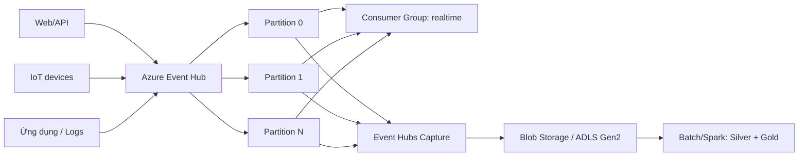
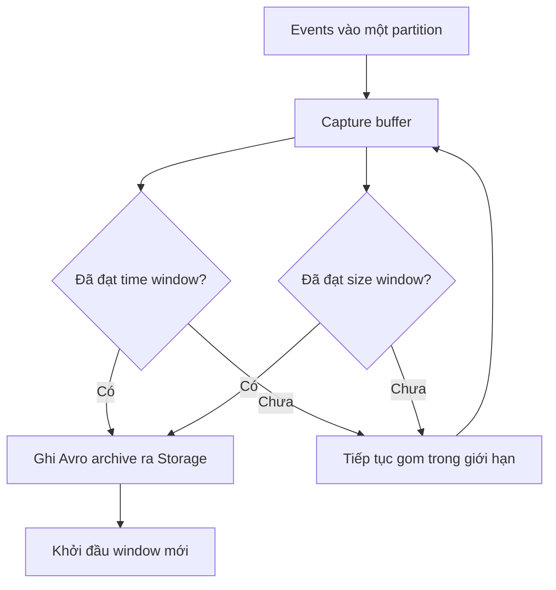
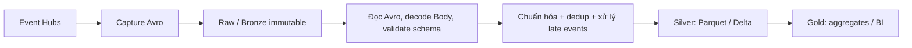
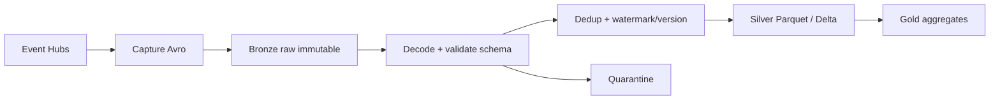

# Event Hubs Capture và lưu trữ luồng dữ liệu

Một hệ thống phát sinh hàng triệu sự kiện từ ứng dụng web, giao dịch, thiết bị IoT hay log nghiệp vụ cần hai khả năng khác nhau: **xử lý gần thời gian thực** để phản ứng nhanh, và **lưu dữ liệu gốc lâu dài** để phân tích, kiểm toán hoặc chạy lại pipeline. **Azure Event Hubs** cung cấp điểm tiếp nhận dữ liệu streaming với các **partitions**, còn **Event Hubs Capture** cho phép tự động ghi những sự kiện đi qua Event Hub vào **Azure Blob Storage** hoặc **Azure Data Lake Storage Gen2 (ADLS Gen2)** mà không phải tự duy trì một consumer chỉ để lưu bản thô.

Ví dụ, ứng dụng bán hàng đẩy sự kiện `OrderCreated` và `PaymentConfirmed` vào Event Hub. Một consumer group phục vụ dashboard gần thời gian thực, trong khi Capture đưa dữ liệu vào vùng `raw/bronze` của data lake. Nhóm dữ liệu có thể đọc những tệp này vào ngày hôm sau để xây bảng tổng hợp, kiểm tra số liệu hoặc phục hồi quá trình phân tích khi một consumer bị lỗi. Tuy nhiên, Capture **không biến Event Hubs thành database hay hệ thống giao dịch exactly-once**, không chuyển đổi dữ liệu nghiệp vụ thành Parquet/Delta tự động theo mọi nhu cầu, và không thay thế việc kiểm soát chất lượng dữ liệu.

Bài học thuộc chương **Sự kiện và dữ liệu streaming** trong mô-đun `CLOUD_PROVIDERS_AZURE`. Nó kết nối các khái niệm subscription, resource group, Microsoft Entra ID, mạng riêng, Azure Storage, giám sát và chi phí để triển khai một kiến trúc tiếp nhận, lưu trữ và phân tích sự kiện trên Microsoft Azure.

## Mục tiêu học tập

Sau bài học, bạn có thể:

1. Giải thích **Event Hub, partition, producer, consumer group, retention và Capture** trong cùng một kiến trúc.
2. Phân biệt **dữ liệu đang lưu trong Event Hubs** với **archive lâu dài trong Blob Storage/ADLS Gen2**.
3. Hiểu **cửa sổ thời gian và dung lượng Capture**, `skip empty archives` và hậu quả về số lượng tệp nhỏ.
4. Giải thích cấu trúc đường dẫn lưu trữ, định dạng **Apache Avro**, metadata, `Body` và offset/sequence number.
5. Lựa chọn nơi lưu trữ, partition layout, retention và các bước chuyển từ **raw/bronze → silver → gold**.
6. Cấu hình Capture bằng Azure Portal hoặc template/IaC minh họa và xác minh file được tạo.
7. Thiết kế quyền truy cập storage, managed identity, RBAC, firewall/Private Endpoint và mã hóa.
8. Giám sát Capture, đối chiếu dữ liệu, chẩn đoán lỗi và lập kế hoạch chi phí/dung lượng.

## 1. Event Hubs trong kiến trúc streaming

**Azure Event Hubs** là dịch vụ tiếp nhận luồng sự kiện có throughput cao. Producer gửi event vào một **Event Hub** thuộc một namespace; dữ liệu được ghi vào một trong nhiều **partitions**. Consumer kết nối thông qua **consumer group**, đọc events theo offset/sequence number, lưu checkpoint và tiếp tục từ vị trí đã xử lý.



Sơ đồ minh họa các luồng logic, không có nghĩa Capture chỉ là một consumer process do bạn tự viết hoặc mọi partition phải đi qua cùng consumer group. Capture là **tính năng tích hợp của dịch vụ Event Hubs**, tự ghi archive theo cấu hình; các consumer ứng dụng tiếp tục đọc từ những consumer groups của họ.

### 1.1. Namespace, Event Hub và partition

| Khái niệm | Vai trò | Lưu ý vận hành |
|---|---|---|
| **Event Hubs namespace** | Ranh giới quản lý, mạng, bảo mật và năng lực của những Event Hubs. | Chọn region/tier/capacity và quyền thích hợp. |
| **Event Hub** | Luồng events có tên, bao gồm nhiều partitions. | Một namespace có thể có nhiều Event Hubs tùy giới hạn tier. |
| **Partition** | Nhật ký dữ liệu có thứ tự tương đối trong phạm vi một partition. | Không có một thứ tự toàn cục được bảo đảm giữa mọi partitions. |
| **Partition key** | Producer dùng để định tuyến các events liên quan cùng khóa. | Skew về một partition có thể tạo hotspot. |
| **Offset/sequence number** | Vị trí của một event trong một partition. | Dùng để kiểm tra tiến trình/khả năng replay trong phạm vi partition. |
| **Consumer group** | Góc nhìn đọc độc lập của ứng dụng consumer. | Những consumer groups không làm events biến mất khỏi Event Hub sau khi đọc. |
| **Retention** | Khoảng thời gian events còn có thể được đọc trong Event Hubs. | Không phải chính sách lưu trữ dài hạn thay cho storage archive. |

Một đơn hàng có các events `Created → Paid → Shipped` cần thứ tự tương đối thì producer có thể dùng `orderId` làm partition key nhất quán. Nhưng nếu mọi thông điệp đều dùng `partitionKey="all-events"`, tải dồn vào một partition gây hotspot, làm throughput thực bị giới hạn dù namespace còn capacity ở các partitions khác.

### 1.2. Event Hubs retention không phải long-term archive

Event Hubs giữ event trong **retention window** theo khả năng tier/cấu hình, phục vụ consumers đọc và replay trong khoảng thời gian đó. Khi retention hết hạn, event có thể không còn trong log để đọc lại, dù một consumer chưa xử lý xong. Consumer có đọc thành công hay không **không tự xóa** event khỏi log.

**Capture** ghi bản archive sang Storage với **vòng đời độc lập**. File đã ghi vào Blob/ADLS Gen2 có thể được lưu nhiều tháng/năm theo lifecycle, hoặc xóa sớm theo chính sách, bất kể Event Hubs retention còn bao lâu. Đừng nhầm **message retention** với **storage lifecycle**.

### 1.3. Capture so với consumer tự ghi vào Storage

| Khía cạnh | Event Hubs Capture | Consumer tự xây lưu file |
|---|---|---|
| Cơ chế | Tính năng tích hợp của Event Hubs. | Code/stream processor do đội ngũ triển khai. |
| Mục tiêu chính | Ghi sự kiện từ Event Hub thành archive raw. | Tùy biến format, lọc, transform, business logic. |
| Vận hành worker | Không cần giữ một app đọc/ghi riêng chỉ cho raw archive. | Cần quản lý scale, checkpoint, retry, deployment. |
| Format | Thông dụng là **Avro** chứa envelope và body sự kiện. | Có thể chọn JSON/Parquet/Delta theo pipeline. |
| Thời điểm ghi | Theo capture time/size window, không phải event-by-event tức thời. | Có thể tinh chỉnh latency/flush theo chương trình. |
| Trách nhiệm quality | Chỉ lưu raw events; không tự đảm bảo schema nghiệp vụ đúng. | Có thể validate/enrich/dedup nếu được lập trình. |

Capture rất phù hợp cho mục tiêu **lưu bản thô để xử lý tiếp**, không phù hợp khi cần mỗi event lập tức gọi API khác, lọc dữ liệu theo quy tắc phức tạp hoặc ghi transaction đã chuẩn hóa vào database. Khi cần như vậy, dùng Azure Functions, Stream Analytics, Apache Spark, Event Hubs consumers hoặc dịch vụ xử lý streaming khác theo bài toán.

## 2. Capture hoạt động theo partition và cửa sổ ghi

Khi Capture được bật cho một Event Hub có hỗ trợ tính năng, dịch vụ quản lý việc gom events thành **những tệp lưu trữ** và ghi xuống container của Storage. Cấu hình tiêu biểu gồm:

- **Destination:** Storage account, blob container và cấu trúc tên archive; Blob Storage hoặc ADLS Gen2 tùy thiết lập.
- **Time window:** khoảng thời gian gom dữ liệu trước khi ghi.
- **Size window:** ngưỡng dung lượng gom dữ liệu.
- **Encoding/format:** định dạng archive được tính năng hỗ trợ, thường là **Avro**.
- **Skip empty archives:** có ghi một archive khi một cửa sổ không có event hay không.

### 2.1. Hai ngưỡng thời gian và kích thước

Một file Capture thường được chốt khi **một trong hai ngưỡng được thỏa**: khoảng thời gian hoặc kích thước. Ví dụ đặt **5 phút** hoặc **100 MiB**:

- Một partition nhận dữ liệu chậm: sau khoảng thời gian đã cấu hình, nó có thể tạo file nhỏ tương ứng với dữ liệu có trong kỳ.
- Một partition có lượng dữ liệu dày: có thể đạt ngưỡng dung lượng **trước 5 phút**, nên xuất nhiều files trong cùng khung thời gian.
- Các partitions khác nhau có thể có số lượng files và thời điểm flush khác nhau.



Trong cấu hình Event Hubs Capture phổ biến, time window có thể được chọn trong khoảng **1–15 phút**, size window trong khoảng **10–500 MB**; giá trị và giới hạn có thể phụ thuộc API/tier/tính năng tại thời điểm triển khai. Hãy kiểm tra giá trị được Azure Portal/API của namespace đang dùng chấp nhận thay vì suy đoán mọi tier đều giống nhau.

**Không coi time window là cam kết file luôn xuất hiện đúng mili-giây ở thời điểm kết thúc**. Có thể có độ trễ do nội bộ dịch vụ, throughput, Storage/network và tình trạng backend. Khi đưa dữ liệu vào SLA downstream, cần theo dõi thực tế **archive arrival lag**, không chỉ đọc cấu hình 5 phút.

### 2.2. Ví dụ chọn ngưỡng

| Workload | Time window ban đầu | Size window ban đầu | Vì sao cần kiểm thử |
|---|---|---|---|
| IoT telemetry liên tục | 5 phút | 100 MB | Cân bằng số file với độ trễ dữ liệu. |
| Clickstream lưu lượng thấp | 10–15 phút | Ngưỡng vừa phải | Hạn chế quá nhiều files rất nhỏ. |
| Log hệ thống lưu lượng cao | 1–5 phút | Ngưỡng phù hợp throughput | File có thể đạt ngưỡng size sớm; cần kiểm tra chi phí/độ trễ. |
| Dữ liệu phải có trong dashboard ngay lập tức | Không chỉ dựa vào Capture | Không áp dụng như đường xử lý chính | Cần consumer/streaming processor cho realtime. |

Các thông số ở bảng **chỉ là điểm bắt đầu để kiểm thử**, không phải lời khuyên tối ưu cho mọi khối lượng hay một SLA của dịch vụ.

### 2.3. Skip empty archives

Khi một partition **không có dữ liệu trong cửa sổ**, hệ thống có thể tạo **empty archive** nếu cấu hình không bỏ qua. Với `skipEmptyArchives` được hỗ trợ và bật, dịch vụ có thể không tạo file rỗng cho cửa sổ không có events.

Điều này ảnh hưởng cách kiểm tra completeness:

- **Không có file** trong một window có thể nghĩa là **không có event** nếu skip-empty bật.
- Nhưng cũng có thể là **Capture không ghi được** vì quyền Storage, quota, cấu hình hoặc sự cố backend.
- Một file rỗng **không phải** bằng chứng rằng cả hệ thống đã kiểm tra đầy đủ mọi nguồn dữ liệu.

Vì vậy, khi giám sát cần đối chiếu **số events thực sự ingress, tình trạng Capture và số files xuất hiện**, không chỉ đặt quy tắc “mỗi partition phải có đúng một file mỗi 5 phút”.

### 2.4. Files được tạo theo từng partition

Capture tổ chức archives theo **partition**. Nó không tự gộp toàn bộ partitions thành một file duy nhất sắp xếp theo event time. Khi đọc lại, pipeline downstream phải xử lý các files theo partition, offset/sequence và thời gian phù hợp. Một event ở partition 0 với `EnqueuedTimeUtc=10:00:01` và một event ở partition 1 `10:00:00` không được đảm bảo có thứ tự xử lý toàn cục khi chúng nằm trong hai files khác nhau.

## 3. Nơi lưu trữ: Azure Blob Storage và ADLS Gen2

Cả **Azure Blob Storage** và **ADLS Gen2** đều dựa trên năng lực Azure Storage, nhưng mục tiêu quản lý và truy cập dữ liệu có thể khác nhau.

| Tiêu chí | Blob Storage | ADLS Gen2 (hierarchical namespace) |
|---|---|---|
| Mô hình | Object/blob với containers và prefixes. | Data lake có cấu trúc thư mục phân cấp trên Storage Account hỗ trợ HNS. |
| Phù hợp | Raw archive, backup, object workloads, xử lý batch đơn giản. | Lakehouse, Spark/analytics, quản trị folders, ACLs và downstream pipelines. |
| Cách Capture ghi | Ghi objects vào blob container. | Ghi tới storage container/filesystem hỗ trợ HNS theo cấu hình tính năng. |
| Phân quyền | Azure Storage data-plane RBAC, SAS theo policy, network. | Data-plane RBAC kết hợp POSIX-like ACLs khi cần theo operation/model. |
| Phân tích sau này | Có thể đọc/convert sang nhiều định dạng. | Thuận tiện cho các công cụ data lake/Spark/analytics. |

**ADLS Gen2 không phải Event Hubs retention thứ hai**: đó là lớp lưu trữ bền vững mà bạn kiểm soát theo storage lifecycle/permissions. Khi chọn tài khoản Storage, xem xét khả năng Capture hỗ trợ **loại account, namespace, region, tier và network** của đích.

### 3.1. Nên tách raw capture khỏi dữ liệu đã xử lý

Một cấu trúc data lake thường có các vùng:

```text
storage-account/
  raw-events/                 # Capture ghi file Avro, ưu tiên immutable
    <namespace>/<event-hub>/<partition>/<time-path>/...
  silver-events/              # Đã parse, chuẩn hóa, dedup
    event_type=OrderPaid/...
  gold-analytics/             # Dữ liệu phục vụ báo cáo và BI
    report_date=2026-11-20/...
```

Capture chỉ cần quyền **ghi vào nơi tiếp nhận raw**. Jobs đọc/transform cần quyền đọc raw và ghi silver/gold. Analysts thường chỉ nên đọc các vùng đã được làm sạch, không mặc định được đọc raw nếu chứa PII. Tách storage accounts/containers hoặc folders theo ranh giới truy cập và quản trị của tổ chức.

### 3.2. Blob versioning, immutability và lifecycle

Dữ liệu Capture có thể cần giữ làm bằng chứng kiểm toán hoặc nguồn replay. Cân nhắc:

- **Lifecycle management:** chuyển đối tượng ít được truy cập sang tiers phù hợp hoặc xóa theo retention hợp lệ.
- **Versioning/soft delete:** hỗ trợ phục hồi trong một số tình huống sửa/xóa nhầm; không thay thế backup/DR trong mọi mô hình.
- **Immutability/legal hold:** khi có yêu cầu tuân thủ, áp dụng theo chính sách và khả năng storage account/container.
- **Tags/metadata và catalog:** ghi nhận nguồn, thời điểm, schema version và owner để có lineage.
- **Encryption và network restrictions:** bảo vệ dữ liệu nhạy cảm cả khi lưu và khi truyền.

Đừng bật chính sách xóa sau 7 ngày trên raw zone chỉ vì Event Hubs retention cũng là 7 ngày. Hai chính sách phục vụ mục tiêu khác nhau và phải dựa vào yêu cầu lưu trữ thực tế.

## 4. Tổ chức archive: tên tệp, folder và thời gian

Event Hubs Capture dùng mẫu tên archive có các **placeholders** được hỗ trợ, ví dụ:

```text
{Namespace}/{EventHub}/{PartitionId}/{Year}/{Month}/{Day}/{Hour}/{Minute}/{Second}
```

Giả sử namespace `evh-commerce`, Event Hub `order-events`, partition `2` và một archive được tạo tại thời điểm UTC tương ứng:

```text
raw-events/
  evh-commerce/
    order-events/
      2/
        2026/
          11/
            20/
              02/
                15/
                  00.avro
```

Đây là **ví dụ cấu trúc tên**, không phải khẳng định mọi triển khai đều tạo đúng tên `00.avro`. Tên thực tế do `archiveNameFormat`, thời điểm capture, partition và các quy tắc của dịch vụ quyết định. Hãy đọc paths được tạo thật sau khi bật Capture. Trong cấu hình mặc định, mục tiêu chính là có các thành phần **namespace, event hub, partition và thời điểm capture** để dễ khám phá theo prefix.

### 4.1. Thời gian trong path có phải event time không?

**Không nhất thiết.** Các trường Year/Month/Day/Hour... trong archive name liên quan **thời điểm Capture ghi archive** theo quy tắc đặt tên, không đảm bảo đó là thời gian nghiệp vụ ghi trong payload hay `EnqueuedTimeUtc` của từng event.

Có ít nhất ba loại thời gian:

1. **Event time:** thời điểm nghiệp vụ/sensor phát sinh; có thể nằm trong `Body`, do producer quy định.
2. **Enqueue time:** khi event được Event Hubs chấp nhận, thường thể hiện qua metadata `EnqueuedTimeUtc`.
3. **Capture/file time:** khi archive được tạo theo cửa sổ, dùng cho tổ chức lưu trữ và freshness.

Ví dụ một IoT device offline từ 09:00 rồi gửi bù lúc 11:00: `eventTime=09:00`, `enqueuedTime≈11:00` và tệp Capture có timestamp một lúc sau 11:00. Data pipeline cần định nghĩa dùng thời gian nào khi tính báo cáo theo ngày và xử lý sự kiện đến muộn.

### 4.2. Folder partitioning cho analytics

Cấu trúc Capture thuận tiện để kiểm kê data theo Event Hub và partition, nhưng không nhất thiết là tối ưu cuối cùng cho mọi engine phân tích. Với dữ liệu silver, có thể thiết kế `event_date=YYYY-MM-DD`, `tenant_id` hoặc `event_type` theo khối lượng và truy vấn thực tế. Tránh tạo một folder/partition riêng cho mỗi userId nếu cardinality quá lớn dẫn tới hàng triệu files nhỏ.

Đặc biệt, **không suy ra transaction ordering xuyên partitions chỉ bằng cách sort tên files**. Nếu cần sắp xếp event theo aggregate, dùng business sequence/version và partition key nhất quán từ producer.

## 5. Định dạng dữ liệu: Avro và envelope của Event Hubs

**Apache Avro** là định dạng nhị phân hỗ trợ schema và block-oriented storage, thích hợp để lưu events theo lô. Event Hubs Capture truyền thống ghi **Avro archives** với những trường metadata Event Hubs bên ngoài `Body`. Đây **không phải** file JSON Lines mà có thể mở trực tiếp bằng text editor và đọc từng dòng.

Một archive có thể chứa nhiều event records với thông tin tương tự:

| Thông tin | Ý nghĩa |
|---|---|
| `Body` | Payload bytes do producer gửi; có thể là UTF-8 JSON, Protobuf, Avro ứng dụng hoặc dữ liệu khác. |
| `SequenceNumber` | Vị trí sequence của event trong một partition. |
| `Offset` | Offset của event trong partition. |
| `EnqueuedTimeUtc` | Thời điểm broker chấp nhận event vào Event Hub. |
| `SystemProperties` | Một số metadata hệ thống của event. |
| `Properties` | Application properties do producer đặt. |

**Tên/kiểu trường cụ thể phụ thuộc schema Capture được dịch vụ hỗ trợ** và phiên bản reader; hãy kiểm tra schema có trong Avro thật trước khi ép kiểu dữ liệu. `Body` là **bytes**, không tự động có trường `orderId` ở cấp top-level của file Avro. Muốn truy vấn `orderId`, pipeline downstream phải giải mã Body theo schema ứng dụng.

### 5.1. Hai lớp schema

```text
Avro archive (Capture envelope):
  SequenceNumber
  Offset
  EnqueuedTimeUtc
  Properties
  SystemProperties
  Body [bytes]
      |
      +--> JSON ứng dụng:
             eventId
             eventType
             eventTime
             tenantId
             orderId
             schemaVersion
```

**Schema evolution** gồm hai lớp: schema do Capture dùng để mô tả envelope và schema ứng dụng nằm trong Body. Nếu ứng dụng đổi từ `schemaVersion=1` sang 2, Capture vẫn chỉ lưu bytes; batch reader cần biết cách giải mã cả hai phiên bản.

### 5.2. Vì sao không nên coi Capture đã tạo sẵn Parquet/Delta?

Parquet và Delta Lake tối ưu cho analytics/lakehouse; Avro archive tốt cho lưu sự kiện tuần tự. Pipeline thường thực hiện:



Không nên viết rằng **Event Hubs Capture luôn xuất Delta tables hoặc tự dedup event payload**. Nếu tính năng hỗ trợ thêm lựa chọn encoding ở một tier/phiên bản cụ thể, vẫn phải kiểm tra cấu hình thực tế và hợp đồng đọc dữ liệu. Với kiến trúc có yêu cầu Delta, cần định nghĩa **bước chuyển đổi/ingestion** vào bảng Delta cùng schema/partition strategy.

### 5.3. Thiết kế payload để dễ lưu và replay

Một event JSON mang tính minh họa:

```json
{
  "eventId": "evt-order-1057",
  "eventType": "OrderPaid",
  "schemaVersion": 1,
  "tenantId": "tenant-A",
  "orderId": "ORD-1057",
  "eventTime": "2026-11-20T02:14:31Z",
  "amountVnd": 350000
}
```

Nên có **event ID ổn định**, version/schema registry nếu ứng dụng cần, business timestamp và correlation ID. Không gửi access tokens, credentials, dữ liệu thẻ thanh toán hay PII không cần thiết vào một stream sẽ được archive lâu dài. Capture có thể nhân bản dữ liệu nhạy cảm sang một storage account mới; quyền truy cập và retention phải được xem xét **trước khi bật**.
## 6. Điều kiện trước khi bật Event Hubs Capture

Một cấu hình Capture hợp lệ cần đồng thời đúng ở **source Event Hub**, **destination Storage** và **quyền/truy cập mạng**. Trước khi dùng Azure Portal hoặc IaC, hãy hoàn thành bảng kiểm:

| Nhóm | Cần xác minh | Vì sao quan trọng |
|---|---|---|
| **Subscription/resource group** | Namespace, Event Hub và Storage thuộc đúng môi trường được phê duyệt. | Tránh ghi dữ liệu production sang storage lab hoặc sai subscription. |
| **Event Hubs tier** | Tier/region hỗ trợ Capture và giới hạn tương ứng. | Không phải mọi tier hỗ trợ toàn bộ tùy chọn. |
| **Partition và throughput** | Số partition, ingress rate, partition key distribution và quota. | Partition lệch tải có thể gây hotspot. |
| **Destination account** | Storage account hỗ trợ Blob/ADLS Gen2, container/filesystem đã tồn tại. | Sai loại tài khoản hoặc container làm Capture không ghi được. |
| **Identity và quyền** | Danh tính dùng bởi Capture có quyền data plane ghi blob. | RBAC management-plane `Reader` không đủ ghi blob. |
| **Mạng** | Firewall/private networking, đường service-to-service được hỗ trợ. | Có RBAC vẫn có thể bị Storage firewall chặn. |
| **Định dạng và đường dẫn** | Encoding, archiveNameFormat, time/size window, skip-empty. | Ảnh hưởng file count và cách đọc/partition. |
| **Bảo mật/retention** | PII, encryption, lifecycle, quyền người đọc. | Capture tạo thêm bản dữ liệu có thể lưu lâu dài. |
| **Giám sát** | Metric/logs/alerts về ingestion, Capture failures, file arrival lag. | Phát hiện thiếu archive trước khi event hết retention. |

### 6.1. Capture phải được bật trước khoảng dữ liệu muốn lưu

Capture không nên được hiểu là nút “xuất toàn bộ lịch sử Event Hub từ trước tới nay”. Nó phục vụ **archive events khi chúng đi qua Event Hub theo cấu hình đang bật**. Nếu Capture bắt đầu từ 12:00, không mặc định events của ngày hôm trước đã được backfill.

Nếu cần events đã lưu trước đó và chúng **vẫn nằm trong retention window**, có thể dùng một **consumer riêng** đọc từ offset/thời điểm cần thiết rồi ghi archive theo thiết kế riêng. Nếu events đã hết retention mà không có nguồn lưu khác, chỉ bật Capture sẽ không khôi phục lại được.

### 6.2. Chọn region và storage locality

Ưu tiên Storage ở region phù hợp với Event Hubs, yêu cầu lưu trữ dữ liệu và khả năng destination được hỗ trợ. Mục tiêu là giảm độ trễ, phí chuyển dữ liệu và độ phức tạp mạng. Nếu phải có bản sao ở region khác, thiết kế replication/DR ở tầng Storage và pipeline theo yêu cầu; không mặc định Capture tự phân phối mọi archives đến nhiều region.

### 6.3. Chọn raw container riêng

Ví dụ:

```text
Storage account: ststreamrawprod
Container:       eventhub-capture
Prefix:          {Namespace}/{EventHub}/{PartitionId}/{Year}/{Month}/{Day}/{Hour}/{Minute}/{Second}
```

Tách nơi Capture ghi với nơi ETL ghi kết quả để tránh xóa/sửa file thô. Nếu đổi retention hoặc quyền trên raw container, cần đánh giá tất cả workloads đang đọc từ đó.

## 7. Bảo mật Capture bằng Microsoft Entra ID và managed identity

Capture cần một cơ chế **xác thực và phân quyền với Storage** được cấu hình/tier hỗ trợ. Với kiến trúc hiện đại, có thể dùng **managed identity của Event Hubs namespace** trong những cấu hình hỗ trợ, kết hợp **Azure Storage data-plane RBAC**, giảm phụ thuộc vào shared keys hoặc SAS dài hạn.

### 7.1. Ba danh tính không được nhầm lẫn

| Danh tính | Hành động | Quyền tương ứng |
|---|---|---|
| **Producer application** | Gửi events vào Event Hub. | Event Hubs Data Sender hoặc quyền tương đương. |
| **Event Hubs Capture identity** | Ghi archives vào Storage. | Quyền tạo/ghi blobs, thường xét role `Storage Blob Data Contributor`. |
| **Downstream ETL/analytics** | Đọc raw Avro, ghi silver/gold. | `Storage Blob Data Reader` trên raw, quyền ghi output riêng. |

Một producer có quyền Event Hubs Data Sender **không được tự động ghi vào Storage**. Capture có quyền Blob Data Contributor **không tự cấp quyền đọc database** cho pipeline downstream.

### 7.2. System-assigned và user-assigned identity

**System-assigned identity** gắn vòng đời với resource; khi resource bị xóa/tạo lại, principal có thể thay đổi và role assignments phải được xét lại. **User-assigned identity** là resource riêng, phù hợp khi cần identity ổn định qua thay đổi hạ tầng. Với Capture, kiểm tra **loại identity thực sự được namespace và destination hỗ trợ** trước khi chọn cách triển khai.

Quy trình logic:

1. Bật/gắn managed identity trên **Event Hubs namespace** theo khả năng hỗ trợ.
2. Lấy **principal/object ID** của danh tính mà Capture thực sự dùng.
3. Cấp quyền ghi blobs trên storage account/container đích ở scope tối thiểu khả thi.
4. Chọn cơ chế identity đó trong Capture destination theo giao diện/API.
5. Kiểm tra role assignment và đường mạng, thử capture bằng sample events.
6. Theo dõi lỗi và thời gian lan truyền Azure RBAC trước khi kết luận cấu hình không hợp lệ.

**Không nhầm** client ID, principal ID và ARM resource ID. Role assignment thường trỏ đến principal ID, còn resource ID dùng để định vị tài nguyên Azure.

### 7.3. Quyền ghi và quyền đọc là hai việc khác nhau

Capture cần quyền **ghi raw archive**, không cần role quản trị toàn subscription. Jobs đọc/transform có thể được cấp quyền đọc raw; nhân viên làm BI nên dùng silver/gold đã qua kiểm soát chất lượng và loại bỏ PII. Với HNS-enabled Storage, cần hiểu thêm ACLs tương ứng với thao tác và phạm vi thư mục, không chỉ mỗi tên role.

Không cấp role `Owner` ở resource group để sửa một lỗi 403 khi Capture ghi Storage. Hãy phân biệt lỗi sai principal, thiếu role data plane, container không tồn tại, storage firewall hoặc tính năng destination chưa hỗ trợ.

### 7.4. Storage firewall và Private Endpoint

Dù role đúng, backend Capture vẫn cần **đường kết nối service-to-service được cho phép**. Với Storage giới hạn public access, tùy kiến trúc có thể cần chính sách **trusted Microsoft services/bypass** và identity phù hợp, hoặc một cấu hình mạng khác được chính thức hỗ trợ.

**Không giả định** Private Endpoint cho producer truy cập Event Hubs sẽ tự khiến backend Capture đi qua Private Endpoint của Storage. Đây là **hai luồng mạng khác nhau**. Với security baseline khắt khe, hãy xác nhận tuyến dữ liệu và ngoại lệ mạng được dịch vụ hỗ trợ trước khi bật.

### 7.5. Mã hóa và dữ liệu nhạy cảm

Azure Storage hỗ trợ encryption at rest, TLS cho kết nối và các chính sách key tùy môi trường. Nếu dùng customer-managed keys, cần quản lý Key Vault, key availability và rotation. Capture không tự xóa dữ liệu nhạy cảm khỏi `Body`: raw archive chứa dữ liệu được producer gửi. Tránh ghi SAS URLs, connection strings, access tokens hoặc raw payload chứa PII vào log và ticket hỗ trợ.

## 8. Thực hành Azure Portal: cấu hình Capture

Giả định **Event Hubs namespace, Event Hub, Storage account và container/filesystem đích đã tồn tại**. Các thao tác có thể phát sinh phí và bản sao dữ liệu; chỉ làm ở môi trường được phê duyệt. Nhãn giao diện có thể khác theo thời điểm và tier.

### Bước 1. Xác nhận nguồn

Trong Azure Portal, mở namespace và Event Hub mục tiêu, kiểm tra **subscription/resource group**, region, tier, partition count, retention, ingress capacity và mục **Capture**. Đừng bật trên Event Hub production khi chưa biết Data Owner của stream và Storage destination được phép.

### Bước 2. Chuẩn bị đích

Chọn Storage account, tạo vùng `eventhub-capture` hoặc container lab riêng. Kiểm tra hỗ trợ Blob/ADLS Gen2, firewall/network, managed identity/RBAC, ACLs nếu dùng hierarchical namespace và retention policy.

### Bước 3. Bật Capture

Trong Event Hub, mở cấu hình Capture và thiết lập theo tùy chọn được hỗ trợ:

- **Destination**: account và container/filesystem đã chuẩn bị.
- **Time window**: ví dụ 300 giây (5 phút).
- **Size window**: ví dụ 100 MB theo đơn vị được Portal/API chấp nhận.
- **Encoding**: Avro cho trường hợp mặc định.
- **Archive naming format**: namespace/hub/partition/time placeholders.
- **Skip empty archives**: bật nếu muốn hạn chế file rỗng khi stream ít events.
- **Identity/authentication**: ưu tiên managed identity và RBAC nếu tính năng/tier/đích hỗ trợ.

Lưu cấu hình rồi đọc lại. Nếu Portal từ chối một giá trị, kiểm tra **giới hạn hiện hành** thay vì tự ý nới firewall hay cấp quá nhiều quyền.

### Bước 4. Gửi sự kiện thử nghiệm

Dùng một producer đã có quyền vào đúng Event Hub, gửi events **không chứa dữ liệu thật nhạy cảm**, có `eventId` và `schemaVersion` rõ. Chờ đủ capture window và độ trễ backend có thể xảy ra; không kết luận Capture lỗi sau vài giây.

### Bước 5. Xác minh Storage và dữ liệu

Trong Azure Storage Explorer/Storage Browser, đọc container/prefix, xem file Avro mới, size, modification time và partition path. Mở ít nhất một file bằng reader hỗ trợ Avro, giải mã `Body` và kiểm tra sample event IDs. **Chỉ thấy một file không chứng minh mọi events đã được capture đầy đủ.**

### Bước 6. Lưu bằng chứng vận hành

```text
Event Hub: order-events
Partitions: 4
Capture time window: 5 minutes
Destination: ststreamrawprod/eventhub-capture
First archive observed at: <UTC timestamp from environment>
Test eventId found in Avro: <id from test message>
Measured archive lag: <observed interval>
Capture failures: <observed metric/log state>
```

Đây là **mẫu biên bản kiểm tra**, không phải kết quả lab đã chạy. Đội ngũ vận hành phải điền giá trị thật.

## 9. Bicep minh họa tạo Event Hub mới có Capture

IaC giúp review các cấu hình window, destination và naming format trong pull request. Ví dụ sau dùng **namespace đã tồn tại**, tạo **Event Hub mới**, trỏ tới Storage container đã chuẩn bị. Nó **không phải patch an toàn để chạy đè lên Event Hub production** vì có thể thay đổi partitionCount/retention/captureDescription của resource mục tiêu.

```bicep
@description('Event Hubs namespace đã tồn tại trong resource group')
param namespaceName string

@description('Event Hub mới dành cho môi trường lab')
param eventHubName string = 'telemetry-archive-lab'

@description('ARM resource ID của Storage Account')
param storageAccountResourceId string

@description('Container đã tồn tại và cho phép ghi')
param captureContainer string = 'eventhub-capture'

resource ns 'Microsoft.EventHub/namespaces@2022-10-01-preview' existing = {
  name: namespaceName
}

resource hub 'Microsoft.EventHub/namespaces/eventhubs@2022-10-01-preview' = {
  parent: ns
  name: eventHubName
  properties: {
    partitionCount: 4
    messageRetentionInDays: 1
    captureDescription: {
      enabled: true
      encoding: 'Avro'
      intervalInSeconds: 300
      sizeLimitInBytes: 104857600
      skipEmptyArchives: true
      destination: {
        name: 'EventHubArchive.AzureBlockBlob'
        properties: {
          storageAccountResourceId: storageAccountResourceId
          blobContainer: captureContainer
          archiveNameFormat: '{Namespace}/{EventHub}/{PartitionId}/{Year}/{Month}/{Day}/{Hour}/{Minute}/{Second}'
        }
      }
    }
  }
}
```

Mẫu dùng API version **minh họa**; hãy kiểm tra schema Bicep/ARM, tier và region trong môi trường trước khi triển khai. `sizeLimitInBytes=104857600` tương đương 100 MiB. Đường dẫn `EventHubArchive.AzureBlockBlob` là destination type cho lưu blob được tính năng hỗ trợ; ADLS Gen2 là storage dựa trên blob/HNS nhưng vẫn cần xác minh phương thức cấu hình/identity hiện hành. Template **không tự tạo container, cấp RBAC, bật identity hoặc mở đường mạng**: những phần đó phải được thiết kế và quản trị riêng theo nguyên tắc least privilege.

### 9.1. Vì sao không nên chỉ copy Bicep rồi triển khai ngay?

Có các điều kiện không thể suy từ đoạn template: quota/tier, tài khoản Storage có hỗ trợ Destination, Storage firewall, identity access, các chính sách compliance, lịch capture và lưu lượng ingress. Một Bicep deployment báo `Succeeded` chỉ chứng minh resource configuration được chấp nhận, **không chứng minh các events đã được ghi xuống Blob**.
## 10. Azure CLI: kiểm tra cấu hình và dữ liệu đã Capture

Các lệnh dưới đây **chỉ đọc metadata hoặc tải file kiểm thử** trên tài nguyên có sẵn. Chúng không bật Capture, tạo hạ tầng hay gửi sự kiện. Chạy bằng Bash/Cloud Shell sau khi được cấp quyền phù hợp.

### 10.1. Kiểm tra Event Hub

```bash
az login
az account set --subscription "<subscription-id>"

RG="rg-streaming-lab"
NS="evh-streaming-lab"
HUB="order-events"

az eventhubs namespace show \
  --resource-group "$RG" \
  --name "$NS" \
  --query "{name:name,sku:sku.name,identity:identity}" -o json

az eventhubs eventhub show \
  --resource-group "$RG" \
  --namespace-name "$NS" \
  --name "$HUB" \
  --query "{name:name,partitions:partitionCount,capture:captureDescription}" -o json
```

Trong output, kiểm tra `captureDescription.enabled`, `intervalInSeconds`, `sizeLimitInBytes`, `encoding`, `skipEmptyArchives` và `destination` theo schema của CLI/API hiện hành. **Event Hub tồn tại chưa chứng minh Capture đang bật.**

### 10.2. Liệt kê các tệp lưu trữ

```bash
STORAGE="ststreamrawlab"
CONTAINER="eventhub-capture"
PREFIX="$NS/$HUB/"

az storage blob list \
  --account-name "$STORAGE" \
  --container-name "$CONTAINER" \
  --auth-mode login \
  --prefix "$PREFIX" \
  --query "[].{name:name,size:properties.contentLength}" \
  --output table
```

`--auth-mode login` dùng identity của người chạy CLI, **không chứng minh** identity Capture có quyền ghi. Người chạy cần quyền đọc Blob và đường mạng phù hợp. Nếu danh sách rỗng, kiểm tra container, prefix và time window trước khi kết luận lỗi.

### 10.3. Tải một archive để kiểm tra

```bash
BLOB_NAME="<exact-blob-path-from-list>"

az storage blob download \
  --account-name "$STORAGE" \
  --container-name "$CONTAINER" \
  --name "$BLOB_NAME" \
  --file "./sample-capture.avro" \
  --auth-mode login
```

Đây là lệnh **mẫu cho người học trong môi trường thử nghiệm**; không tải raw archive production chứa PII về laptop không được quản lý. Một Avro file tồn tại chưa chứng minh tất cả events đã lưu đầy đủ; còn phải đối chiếu ingress, partition/offset và capture errors.

## 11. Java producer: gửi event mẫu để xác minh Capture

Một producer cần thư viện `com.azure:azure-messaging-eventhubs` và `com.azure:azure-identity`. Ví dụ Java sử dụng `DefaultAzureCredential`, nhận quyền **Azure Event Hubs Data Sender**, gửi một event JSON giả tới Event Hub đang bật Capture:

```java
import com.azure.identity.DefaultAzureCredentialBuilder;
import com.azure.messaging.eventhubs.EventData;
import com.azure.messaging.eventhubs.EventDataBatch;
import com.azure.messaging.eventhubs.EventHubClientBuilder;
import com.azure.messaging.eventhubs.EventHubProducerClient;
import java.nio.charset.StandardCharsets;
import java.util.UUID;

public final class CaptureSample {
    public static void main(String[] args) {
        String namespace = "<namespace>.servicebus.windows.net";
        String hub = "order-events";

        try (EventHubProducerClient producer =
                new EventHubClientBuilder()
                    .credential(namespace, hub,
                        new DefaultAzureCredentialBuilder().build())
                    .buildProducerClient()) {

            String eventId = "capture-lab-" + UUID.randomUUID();
            String body =
                "{\"eventId\":\"" + eventId + "\","
              + "\"eventType\":\"DemoOrder\","
              + "\"schemaVersion\":1}";

            EventData event = new EventData(
                body.getBytes(StandardCharsets.UTF_8));
            event.getProperties().put("source", "capture-demo");

            EventDataBatch batch = producer.createBatch();
            if (!batch.tryAdd(event)) {
                throw new IllegalStateException("Sample event too large");
            }
            producer.send(batch);
            System.out.println("Sent sample eventId=" + eventId);
        }
    }
}
```

**Send thành công không đồng nghĩa file Avro đã xuất hiện ngay**: Capture chờ time/size window và xử lý backend. Ghi lại eventId, chờ đủ thời gian và tìm nó trong một archive thật. Một event không tự xuất hiện ở mọi partition; producer có thể chỉ gửi vào một partition. Khi chương trình thực gửi batches, `tryAdd` có thể trả false nếu batch hết dung lượng, khi đó phải flush và tạo batch mới.

## 12. Đọc Avro và giải mã Body

Apache Avro trong Capture chứa thông tin envelope của Event Hubs. Phần `Body` thường là **bytes payload**, không phải trường JSON tự tách ra sẵn. Đoạn minh họa dưới đây dùng `fastavro` đọc một file lab đã tải xuống; **không chạy mã Python trong quy trình biên soạn worker**:

```python
import json
from pathlib import Path
from fastavro import reader

with Path("sample-capture.avro").open("rb") as stream:
    for index, record in enumerate(reader(stream)):
        if index >= 10:
            break

        summary = {
            "sequence": record.get("SequenceNumber"),
            "offset": record.get("Offset"),
            "enqueuedAt": record.get("EnqueuedTimeUtc"),
        }
        raw = record.get("Body")

        if isinstance(raw, (bytes, bytearray, memoryview)):
            try:
                payload = json.loads(bytes(raw).decode("utf-8"))
                summary["eventId"] = payload.get("eventId")
                summary["schemaVersion"] = payload.get("schemaVersion")
            except (UnicodeDecodeError, json.JSONDecodeError):
                summary["eventId"] = "<non-JSON body>"

        print(summary)
```

Ví dụ chỉ áp dụng khi Body chứa JSON UTF-8 theo schema ứng dụng; với Protobuf/Avro ứng dụng hoặc dữ liệu nén, cần parser khác. Tên field/schema envelope phải được đối chiếu với Avro thực tế. Không in toàn bộ payload nếu có thông tin cá nhân hoặc secrets.

### 12.1. Xử lý file theo pipeline

Một pipeline production thường:

1. Liệt kê raw files mới theo prefix và checkpoint phù hợp.
2. Đọc Avro streaming/batch, tránh nạp toàn bộ dữ liệu vào RAM.
3. Lấy partition ID, offset/sequence, EnqueuedTimeUtc và path nguồn.
4. Parse Body theo `eventType`/`schemaVersion`.
5. Validate và đưa records lỗi vào quarantine.
6. Deduplicate theo event/business version nếu mô hình silver yêu cầu.
7. Ghi kết quả Parquet/Delta và cập nhật checkpoint **sau khi output commit**.

Nếu ETL crash **sau khi ghi silver nhưng trước checkpoint**, cùng file có thể được đọc lại. Vì vậy, downstream cần **merge/upsert hoặc idempotent batch processing**; Capture không tự kiểm soát side effects của những jobs đọc archive.

## 13. Kiểm toán: offset, sequence number và replay

Để biết event đã lưu và xử lý ở đâu, mỗi record nên được truy vết theo:

- Event Hubs namespace và Event Hub.
- Partition ID, sequence number/offset.
- EnqueuedTimeUtc và event time trong Body.
- Business event ID, aggregate version, schema version.
- Capture file path, pipeline run ID và bảng dữ liệu đã ghi.

| Khóa | Dùng cho | Không nên nhầm với |
|---|---|---|
| `(EventHub, PartitionId, SequenceNumber)` | Nhận diện một event đã vào partition log. | Một payment ID có thể xuất hiện ở nhiều physical events. |
| `(EventHub, PartitionId, Offset)` | Kiểm tra vị trí nguồn và replay. | Global ordering xuyên mọi partitions. |
| `eventId` ứng dụng | Chống trùng logical event qua retries. | File path hoặc Function invocation ID. |
| `(tenantId, orderId, version)` | Kiểm tra cập nhật trạng thái aggregate. | Offset của Event Hubs. |
| `captureFilePath + rowIndex` | Truy vết bản ghi Avro trong một file. | Khóa giao dịch duy nhất của doanh nghiệp. |

### 13.1. Thứ tự giữa partitions và late events

Sequence numbers trong cùng partition có thứ tự theo broker, nhưng **không có total ordering xuyên partitions**. Event time do producer đặt có thể lệch đáng kể khỏi EnqueuedTimeUtc. Khi tạo dữ liệu trạng thái cuối, cần **business version/ETag/state machine** và chính sách late arrival, không chỉ sort tên Avro files.

### 13.2. Phát hiện khoảng trống dữ liệu

Một kiểm tra có thể tổng hợp các sequence ranges theo partition, số records/Avro file, ingestion timestamps và Capture error metrics. Nếu thấy gap, cần phân biệt:

- Một Capture window vẫn đang mở hoặc file xuất hiện muộn.
- ETL chưa liệt kê đúng prefix/files.
- Sự cố Capture, quyền Storage, destination không khả dụng.
- Capture chỉ mới bật sau thời gian sự kiện đã được ingest.
- Events producer cố gửi nhưng Event Hubs **không chấp nhận** do throttling/validation, nên chúng không có sequence number.

Không tự kết luận “đã mất event” chỉ từ một file chưa thấy sau vài giây. Dùng bằng chứng ở **cả nguồn, Capture và destination**.

### 13.3. Backfill

Nếu ETL đọc Avro rồi ghi bảng Silver thất bại, có thể đọc lại **raw archive** và upsert bằng event identity. Nếu Capture bị tắt hoặc không ghi được trong một giai đoạn, việc lấp khoảng trống phụ thuộc sự kiện còn trong **Event Hubs retention** hay không; có thể cần consumer backfill chủ động. Capture không được xem như công cụ tự khôi phục vô hạn mọi khoảng thiếu dữ liệu.

## 14. Kiến trúc Bronze, Silver và Gold



**Bronze** giữ bản Avro raw, metadata nguồn và retention phù hợp. **Silver** giải mã Body, chuẩn hóa timestamp, kiểm soát trùng lặp, xử lý dữ liệu đến muộn và ghi định dạng phân tích. **Gold** tạo bảng doanh thu, conversion rates hoặc IoT KPIs theo yêu cầu người dùng.

Đừng sửa raw archives để “xóa duplicate” nếu chúng là nguồn kiểm toán; hãy tạo dataset đã xử lý ở Silver. Với yêu cầu realtime, có thể chạy một **consumer trực tiếp** song song với Capture: consumer phục vụ dashboard gần thời gian thực, Capture cung cấp lịch sử raw để backfill và analytics.
## 15. Capture window, throughput và small files

Capture ghi archive theo partition và ngưỡng thời gian/dung lượng. Cửa sổ **ngắn** giúp raw file xuất hiện sớm hơn nhưng có thể tạo rất nhiều file nhỏ. Ngược lại, cửa sổ **dài** có thể thuận tiện cho batch processing nhưng tăng độ trễ nhìn thấy dữ liệu.

### 15.1. Ước lượng số file theo thời gian

Giả sử Event Hub có **4 partitions**, tất cả đều có traffic liên tục; Capture đặt window **5 phút**, và chưa partition nào chạm size threshold trước time window:

```text
Mỗi partition: 60 / 5 = 12 windows/giờ
Tất cả partitions: 4 × 12 × 24 = 1.152 files/ngày
30 ngày: khoảng 34.560 files
```

Đây chỉ là **ước lượng**, không phải số files được Event Hubs đảm bảo. Một partition đạt size window sớm có thể tạo thêm files; một partition không có events và bật `skipEmptyArchives` có thể không có file; backend cũng có thể hoàn tất ghi trễ. Với **8 partitions** và cùng điều kiện, file count lý tưởng tăng lên **2.304 files/ngày**.

### 15.2. Time window và Size window đánh đổi gì?

| Quyết định | Lợi ích | Rủi ro |
|---|---|---|
| Time window ngắn | Raw archive xuất hiện sớm theo thiết kế. | Nhiều small files, tăng chi phí list/read/ETL. |
| Time window dài | Có thể gom được nhiều records mỗi file. | Freshness kém hơn, phát hiện lỗi muộn hơn. |
| Size threshold thấp | File flush sớm trong partition có traffic lớn. | Dễ phát sinh nhiều objects. |
| Size threshold cao | File lớn hơn trong stream lưu lượng cao. | Stream ít traffic vẫn phải chờ time window. |
| Skip empty archives | Giảm objects rỗng. | Không có file có thể là hoạt động hợp lệ; monitoring cần đối chiếu ingress. |

Không có một window tối ưu cho mọi hệ thống. Hãy đo **p95 archive arrival lag**, file sizes, số blobs/ngày và thời gian/chi phí của data jobs downstream.

### 15.3. Small-file compaction thuộc pipeline sau Capture

Để tránh Spark/SQL phải mở hàng chục nghìn Avro files nhỏ, một ingestion job có thể đọc nhiều archives trong một đợt, validate và ghi **ít Parquet/Delta files lớn hơn**. Sau đó chạy compaction theo engine phù hợp. Không chỉnh sửa raw archives nếu chúng là nguồn audit; compaction nên diễn ra trên Silver/Gold.

### 15.4. Partition key skew và throughput

Nếu phần lớn events dùng cùng một partition key, traffic có thể tập trung ở một partition. Capture ghi partition đó dày đặc trong khi các partitions khác gần như rỗng. Cần đo ingress theo partition, producer key distribution và namespace capacity. **Tăng partitionCount không tự sửa** sự cố nếu producer vẫn dồn events vào cùng key. Mặt khác, thay đổi partitioning có thể ảnh hưởng thứ tự events của các aggregates, nên phải lập kế hoạch chuyển đổi.

## 16. Lưu trữ dài hạn và chi phí

Capture giảm nhu cầu vận hành một consumer chỉ để archive, nhưng vẫn phát sinh chi phí: **Event Hubs tier/capacity, tính năng Capture theo SKU, Azure Storage, operations, data transfer, ETL và monitoring**. Kiểm tra giá hiện hành theo subscription/region và tier; không có một giá cố định dùng chung.

### 16.1. Dự báo dung lượng

Giả sử raw events tương đương **20 GiB/ngày**, chưa tính Avro metadata và khác biệt encoding:

```text
30 ngày × 20 GiB = khoảng 600 GiB raw trong một tháng
90 ngày × 20 GiB = khoảng 1.800 GiB raw
```

Đây là **mô hình tuyến tính sơ bộ**, không phải dự báo hóa đơn: cần tính envelope overhead, mức dữ liệu thay đổi, redundancy như LRS/ZRS/GRS, traffic cross-region, retention và số lượng files. Archive không tự trở thành một bộ dữ liệu nén/chuẩn hóa tối ưu cho mọi query engine.

### 16.2. Các nguồn chi phí cần xem

| Thành phần | Nguồn phát sinh | Tối ưu hóa có kiểm soát |
|---|---|---|
| Event Hubs | Ingress/capacity theo tier và chính sách tính phí. | Partition/capacity planning, theo dõi throttling và workload peak. |
| Capture | Tính năng và giá theo tier nếu áp dụng. | Chỉ bật nơi thật sự cần raw archive. |
| Blob/ADLS | Dung lượng, redundancy, operations, access tiers. | Lifecycle, retention, file sizing, quản trị data lineage. |
| ETL/Spark | Compute, scanning và transformations. | Batch ingestion/compaction, checkpoint và incremental processing. |
| Networking | Egress/cross-region, Private Endpoint và dịch vụ liên quan. | Region locality, tránh transfer không cần thiết. |
| Monitoring | Metrics/Log Analytics, lưu logs/alerts. | Sampling/retention phù hợp, không log payload nhạy cảm. |

### 16.3. Access tier và lifecycle

Với dữ liệu raw được ETL đọc thường xuyên trong 30 ngày rồi chỉ dùng cho điều tra hiếm gặp, có thể cân nhắc chuyển tier theo lifecycle. Tuy nhiên, các lớp lưu trữ lạnh/archive có **chi phí truy xuất, phí xóa sớm và thời gian rehydration** khác nhau. Nếu SLO yêu cầu backfill trong vài phút, chuyển toàn bộ raw sang Archive tier quá sớm có thể làm không đạt RTO.

Định nghĩa rõ:
- **Retention:** cần giữ raw bao lâu theo compliance/business.
- **RPO:** mức dữ liệu có thể mất khi Capture/destination xảy ra lỗi.
- **RTO:** cần khôi phục/replay nhanh tới mức nào.
- **Data residency:** vùng Azure nào được phép chứa dữ liệu.
- **Budget:** dung lượng tăng và số operations theo tháng.

### 16.4. Chi phí raw và silver không giống nhau

Raw Avro có giá trị replay, còn Silver/Gold thường tạo **bản sao dữ liệu bổ sung**. Không chỉ tính dung lượng một Event Hub hay một container; cần tính cả **số bản được giữ**, data transformations, indexes/checkpoints, logs và replication. Dùng Azure Pricing Calculator để lập dự toán và Azure Cost Management theo tags/resource groups để kiểm tra thực tế.

## 17. Monitoring Capture và data freshness

Trạng thái `enabled=true` chỉ nói rằng cấu hình Capture đã được lưu, không chứng minh mọi event được archive đầy đủ. Một hệ thống giám sát tốt phải trả lời ba câu hỏi:

1. **Ingress:** producer có gửi events thành công vào Event Hubs không?
2. **Capture:** events đã vào Event Hubs có được ghi thành archive ở Storage đúng hạn không?
3. **Processing:** ETL có đọc đúng raw files, giải mã và ghi Silver/Gold kịp thời không?

### 17.1. Những tín hiệu nên theo dõi

| Tín hiệu | Nguồn quan sát | Hành động khi bất thường |
|---|---|---|
| Incoming messages/bytes | Event Hubs metrics. | Kiểm tra producers, quota, throttling. |
| Capture outcomes/errors | Metrics/diagnostic logs mà Event Hubs hỗ trợ. | Kiểm tra destination auth, Storage, network. |
| Blob creation/freshness | Storage inventory/listing/logs. | Kiểm tra đúng prefix, window, skip-empty. |
| Partition/file count | Metadata của Capture và ETL. | Phát hiện skew hoặc small-file explosion. |
| Avro decode/schema failures | Pipeline validation/quarantine. | Kiểm tra schema version, payload encoding. |
| Gap/duplicate event count | Sequence/offset và business event ID reconciliation. | Phân loại capture gap hay ETL replay. |
| Silver/Gold lag | ETL checkpoint và analytics telemetry. | Tối ưu compute, batching hoặc xử lý lỗi downstream. |
| Storage/capture cost | Azure Cost Management. | Điều chỉnh retention, lifecycle và workload. |

Tên metrics có thể thay đổi theo tier/API và Azure Monitor resource. **Không tự invent tên metrics**; dùng danh mục Metrics/Diagnostic Settings của chính tài nguyên và thời gian kiểm tra phù hợp.

### 17.2. Phân biệt capture latency và analytics latency

Một ví dụ **chỉ để minh họa**:

```text
10:00  Event Hubs chấp nhận event
10:05  Capture window chốt
10:06  Avro archive xuất hiện trong Storage
10:08  ETL commit event vào Silver
10:10  Gold report refresh

Capture lag: khoảng 6 phút
End-to-end analytics lag: khoảng 10 phút
```

Các mốc không phải SLA Azure. Khi report chậm, phải xác định trễ **ở Capture hay ETL**, rồi mới thay đổi window/capacity. Raw có thể xuất hiện đúng hạn nhưng Silver dừng vì schema chưa được hỗ trợ.

### 17.3. Khi nào “không thấy file” là hợp lệ?

Với `skipEmptyArchives=true`, partition không có traffic có thể không xuất file. Cảnh báo “không có file mới sau 10 phút” chỉ đáng tin khi đồng thời có bằng chứng **ingress đang xảy ra** hoặc workload dự kiến phải có data. Kết hợp ingress, capture state, time window và một khoảng dự phòng vận hành để tránh false alarm.

### 17.4. Capture gap và retention

Nếu Capture gặp sự cố lâu hơn Event Hubs retention, phần events chưa được archive có thể không còn trong Event Hubs để backfill. Vì vậy, **alert sớm trước khi hết retention** quan trọng hơn chỉ kiểm tra số file cuối tháng. Có thể cần nguồn dự phòng như producer outbox, database lịch sử hoặc hệ thống upstream có thể gửi lại theo hợp đồng.

## 18. Troubleshooting: khi archive không xuất hiện hoặc không đọc được

| Triệu chứng | Nguyên nhân cần kiểm tra | Hướng xử lý |
|---|---|---|
| **Không có mục Capture trong Portal** | Tier, subscription/region, tính năng hoặc quyền quản trị. | Kiểm tra tier/API và role trên Event Hub. |
| **Capture enabled nhưng không thấy Avro** | Chưa hết window, không có ingress, skip-empty, sai prefix hoặc lỗi backend. | Đọc ingress và capture status; tìm đúng container. |
| **Capture báo 403 khi ghi Storage** | Sai managed identity, thiếu data-plane RBAC/ACL, firewall. | So principal ID/role scope và Storage network logs. |
| **Destination không tồn tại** | Container/filesystem bị đổi tên/xóa, resource ID sai. | Xác minh đích; thay đổi có review. |
| **File nhỏ quá nhiều** | Window ngắn, nhiều partitions, traffic thấp. | Thử window khác và compaction ở Silver. |
| **Không đọc bằng JSON parser được** | Tệp là Avro binary với `Body` bytes. | Dùng Avro reader, decode payload theo schema. |
| **Không tìm thấy test eventId** | Event ở partition/file khác, window chưa chốt, producer gửi sai hub. | Tìm theo offset/partition và producer telemetry. |
| **Đường dẫn thời gian lệch giờ Việt Nam** | UTC capture time khác event time địa phương. | Chuẩn hóa timezone và dùng đúng timestamp. |
| **Một partition nhiều files hơn hẳn** | Partition key skew/hotspot. | Kiểm tra producer key distribution. |
| **Silver có dòng trùng** | Replay cùng raw file hoặc duplicate business events. | Merge/upsert theo event ID/version. |
| **Silver thiếu event dù raw đã có** | ETL không scan đúng prefix, parser hoặc checkpoint lỗi. | So raw event IDs với ingestion manifest. |
| **Storage RBAC đúng nhưng timeout** | Firewall/trusted-services/network path không hợp lệ. | Kiểm tra service-to-service connection được hỗ trợ. |
| **Chi phí tăng đột biến** | Traffic, storage, small files, replication hoặc ETL scans tăng. | Tách bill theo từng dịch vụ và volume. |

### 18.1. Luồng chẩn đoán có thứ tự

```text
Dữ liệu chưa thấy trong Silver/Gold
  |
  +-- Producer gửi được vào Event Hubs?
  |     +-- Không: auth, ingress quota, SDK/network
  |
  +-- Event Hubs có nhận events?
  |     +-- Có: kiểm tra Capture enabled + time/size window
  |
  +-- Raw Avro xuất hiện đúng container/prefix?
  |     +-- Không: Storage RBAC, firewall, skip-empty, backend errors
  |
  +-- Avro chứa expected event ID?
  |     +-- Không: partition/file khác, Body encoding, window chưa chốt
  |
  +-- ETL có parse và commit đúng?
        +-- Không: schema, checkpoint, destination quota, data quality
```

Đừng sửa Capture 403 bằng cách mở Storage public hoặc gán quyền Owner toàn subscription; cũng đừng tăng Event Hubs capacity nếu lỗi chỉ xuất hiện ở bước ETL parse. Xác định **tầng hỏng** trước khi thay đổi hệ thống.

## 19. Tình huống thiết kế: lưu telemetry IoT và phân tích dài hạn

Một hệ thống nhận dữ liệu nhiệt độ và trạng thái từ hàng chục nghìn thiết bị. Yêu cầu:

- Dashboard cảnh báo gần realtime.
- Giữ raw events 18 tháng để điều tra thiết bị và thay đổi thuật toán.
- Có thể chạy lại pipeline khi cập nhật cách tính KPI.
- Chỉ những nhóm được phép mới xem raw data; BI dùng dữ liệu đã chuẩn hóa.
- Kiểm soát dung lượng, small files và chi phí.

### 19.1. Giải pháp đề xuất

1. **Producer:** gửi event có `deviceId`, `eventId`, `schemaVersion`, `eventTime`; chọn partition key theo ordering và throughput.
2. **Realtime:** consumer group độc lập đọc từ Event Hubs, checkpoint và phát cảnh báo trong SLO riêng.
3. **Capture:** bật trên Event Hub, ghi Avro tới Blob/ADLS Gen2 raw container; chọn time/size window theo latency/file sizes đo được.
4. **Security:** identity Capture có Storage Blob Data Contributor theo scope cần thiết; ETL có Data Reader raw và quyền ghi Silver; BI chỉ đọc Gold.
5. **Silver:** decode Body, chuẩn hóa units/time, xử lý late events, dedup và dùng Parquet/Delta.
6. **Gold:** aggregates theo thiết bị/ngày/giờ, lưu version thuật toán và reconciliation.
7. **Monitoring:** ingress, Capture errors, file freshness, ETL lag, gaps, schema failures và budget.
8. **Retention:** raw 18 tháng theo compliance; không nhầm với Event Hubs retention.

### 19.2. Late event và timestamp

Một sensor ghi event lúc **08:00 UTC**, offline đến **10:00 UTC** rồi mới gửi; Event Hubs enqueue lúc 10:00 và Capture ghi file sau đó. Nếu báo cáo dựa trên **event time**, record phải thuộc bucket 08:00. Nếu dashboard dựa trên **arrival time**, có thể hiển thị trễ; cần công bố policy và watermark. Không dùng thời gian trong tên Avro file làm timestamp nghiệp vụ cho mọi events.

### 19.3. Câu hỏi tự kiểm tra

1. Vì sao Capture không thay thế realtime consumer cho dashboard cảnh báo?
2. Vì sao một Event Hub 4 partitions, window 5 phút không được cam kết đúng 1.152 files/ngày?
3. Tại sao file path time và `eventTime` của IoT device có thể khác nhau?
4. Managed identity có quyền Storage Data Contributor mà vẫn không ghi được file: còn thiếu gì?
5. Vì sao Avro `Body` không có sẵn field `temperature` trong bảng?
6. Khi Event Hubs retention đã hết nhưng raw Avro còn, có thể replay từ đâu?
7. Khi Silver đọc lại cùng file hai lần, tránh duplicate bằng cách nào?
8. Khi partition 0 nhận 90% events, chỉ tăng partitions có chắc sửa được skew không?

**Gợi ý:** Capture archive theo window; realtime cần consumer. Số file phụ thuộc size threshold/traffic/skip-empty. Ba timestamp có ngữ nghĩa khác nhau. Network/firewall/ACL phải hợp lệ. Body bytes cần giải mã schema. Raw Avro hỗ trợ reprocessing sau retention. Silver dùng dedup/upsert. Producer partition key distribution quyết định skew.

## 20. Checklist production

- [ ] Đã xác định archive retention, realtime SLO và analytics freshness độc lập.
- [ ] Đúng subscription/resource group/namespace/Event Hub và tier hỗ trợ Capture.
- [ ] Đã benchmark ingress, partition key distribution, throughput và quota.
- [ ] Destination Storage/ADLS Gen2, container/filesystem, HNS và region đã được xác minh.
- [ ] Capture identity có quyền Storage data plane tối thiểu và đường network được hỗ trợ.
- [ ] Encoding Avro, archive naming, time/size window và skip-empty được kiểm thử.
- [ ] Producer test eventId xuất hiện trong archive và giải mã Body thành công.
- [ ] Có metric/alert cho ingress, Capture failures, archive freshness và ETL lag.
- [ ] Đã thiết kế kiểm kê offset/sequence/event IDs và reconciliation.
- [ ] Có pipeline schema evolution, quarantine và late-event processing.
- [ ] Silver/Gold có checkpoint/upsert/dedup để replay an toàn.
- [ ] Raw archive không bị ETL chỉnh sửa trực tiếp; có lineage và kiểm soát PII.
- [ ] Đã dự toán size/file count, small-file compaction, storage redundancy và ETL cost.
- [ ] Lifecycle/access tiers/retention đáp ứng compliance và RTO backfill.
- [ ] Có runbook xử lý Capture lỗi, 403 Storage, thiếu file, skew và gaps.
- [ ] Có owner, budget alerts, rollback và quy trình thay đổi cấu hình được phê duyệt.

## Kết luận

**Azure Event Hubs Capture** là tính năng tự động lưu các sự kiện streaming vào **Azure Blob Storage hoặc ADLS Gen2** theo từng partition và **cửa sổ thời gian/dung lượng**, thường trong **Avro archives** chứa metadata cùng payload. Nó phù hợp để xây vùng **raw/bronze** phục vụ kiểm toán, phân tích lịch sử và replay mà không phải vận hành một consumer riêng chỉ để lưu bản thô. Tuy nhiên, Capture **không tự xử lý schema nghiệp vụ, không dedup dữ liệu, không tạo sẵn Delta tables và không thay thế consumer realtime**. Để vận hành bền vững cần kết hợp **managed identity/RBAC, network security, cấu trúc archive, theo dõi capture lag và gaps, pipeline downstream idempotent, lifecycle cùng kiểm soát chi phí**. Khi tách rõ Event Hubs ingestion, Capture archival và analytics processing, hệ thống Azure có khả năng khôi phục và dữ liệu đủ tin cậy cho quyết định kinh doanh.


