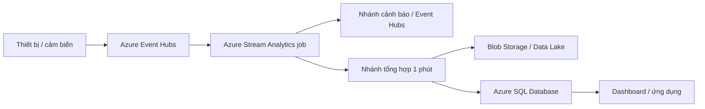
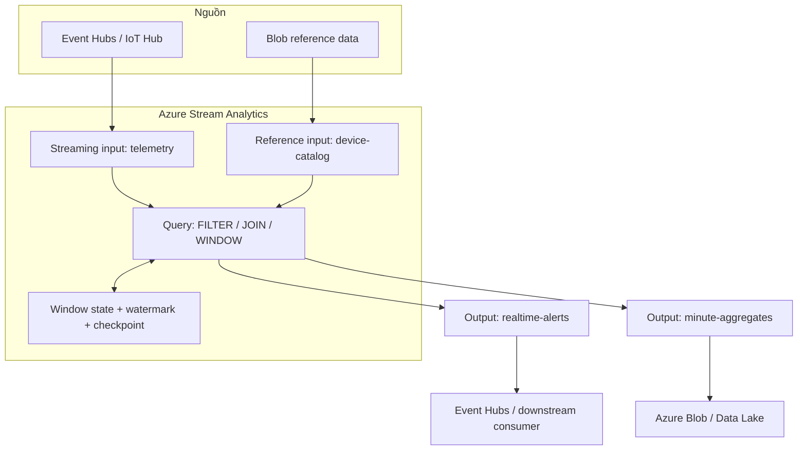
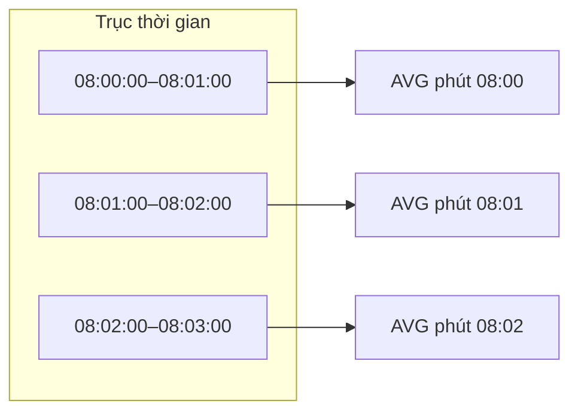
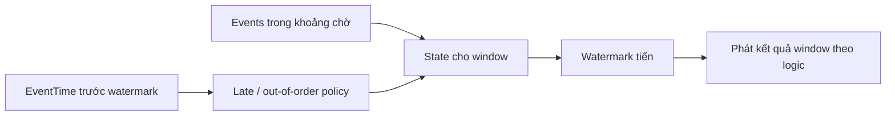
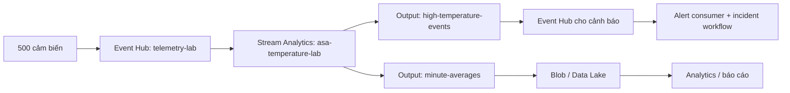
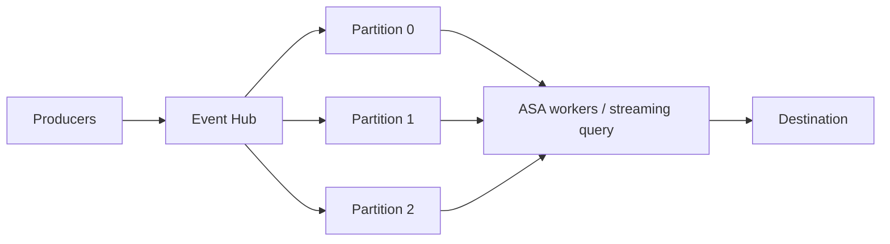
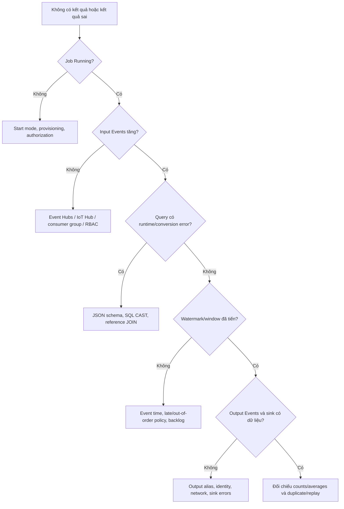
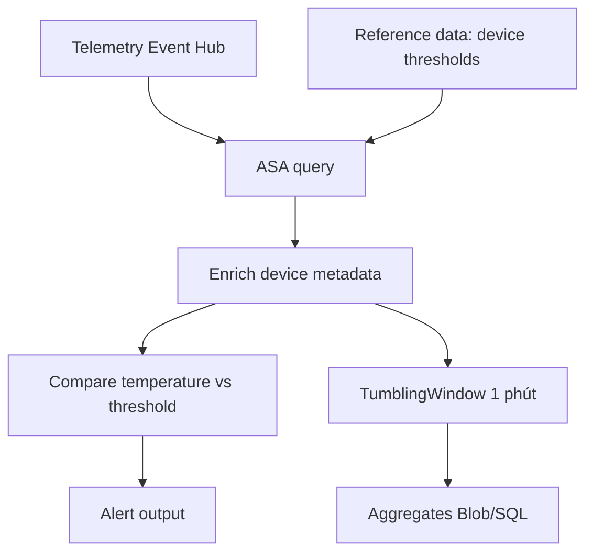

# Xử lý luồng với Azure Stream Analytics

Giả sử một nhà máy có hàng nghìn cảm biến nhiệt độ. Mỗi cảm biến gửi sự kiện vài giây một lần; bộ phận vận hành muốn **cảnh báo khi nhiệt độ vượt ngưỡng**, xem **nhiệt độ trung bình mỗi phút**, và lưu các bản tổng hợp để phân tích dài hạn. Nếu cứ tải toàn bộ dữ liệu về rồi chạy một tác vụ batch mỗi giờ, hệ thống sẽ phát hiện sự cố quá chậm. Ngược lại, nếu xây một dịch vụ tự nhận, lưu trạng thái, tính cửa sổ thời gian, xử lý sự kiện đến muộn và chịu lỗi, đội phát triển phải vận hành nhiều thành phần phức tạp.

**Azure Stream Analytics (ASA)** là dịch vụ xử lý luồng sự kiện được quản lý trên Microsoft Azure. Một **Stream Analytics job** có thể đọc sự kiện từ đầu vào như **Azure Event Hubs** hoặc **Azure IoT Hub**, dùng ngôn ngữ truy vấn kiểu SQL để lọc, chuyển đổi, kết hợp và tổng hợp theo cửa sổ thời gian, rồi đưa kết quả tới các đầu ra được hỗ trợ như **Azure Blob Storage/Data Lake**, **Azure SQL Database**, **Event Hubs** hoặc đích phân tích/hiển thị phù hợp.

Bài học thuộc chương **Sự kiện và dữ liệu streaming** của module `CLOUD_PROVIDERS_AZURE`. Trong lộ trình khám phá hệ sinh thái Azure từ subscription, resource group, Microsoft Entra ID tới mạng ảo, tính toán, lưu trữ và dữ liệu, nội dung này hướng dẫn **thiết kế, triển khai, giám sát, bảo vệ và kiểm soát chi phí một pipeline xử lý dữ liệu thời gian gần thực trên Azure**.

> **Phạm vi:** Các lệnh, tên resources, bản ghi JSON và truy vấn dưới đây phục vụ học tập. Tính khả dụng của input/output connectors, managed identity, private networking, số Streaming Units và giao diện Portal phụ thuộc region, SKU và phiên bản dịch vụ. Chỉ tạo tài nguyên có tính phí trong subscription sandbox được cấp phép; bài này không yêu cầu chạy job thật để hiểu toàn bộ khái niệm.

## Mục tiêu học tập

Sau bài học, bạn có thể:

1. Phân biệt xử lý streaming với xử lý batch, và xác định khi nào nên dùng Stream Analytics.
2. Giải thích ba thành phần của một ASA job: **input → query → output**; phân biệt **streaming input** với **reference data input**.
3. Viết Stream Analytics Query Language để lọc sự kiện, tính toán chỉ số, nhóm theo thiết bị và xuất kết quả.
4. Phân biệt **event time**, **arrival/enqueued time** và **processing time**; dùng `TIMESTAMP BY` khi cần xử lý theo thời gian nghiệp vụ.
5. Hiểu và lựa chọn **Tumbling, Hopping, Sliding và Session windows**.
6. Thiết kế chính sách **late arrival/out-of-order**, watermark, xử lý dữ liệu bẩn và hệ quả đối với kết quả.
7. Lập pipeline từ Event Hubs đến Blob/SQL, dùng bộ dữ liệu mẫu để thử query trên Portal.
8. Nhận diện duplicate, replay, checkpoint và phân biệt kết quả **at-least-once** với bảo đảm exactly-once end-to-end.
9. Đánh giá consumer group, partitioning, Streaming Units (SU), khả năng scale, bảo mật và mạng riêng.
10. Theo dõi input/output events, watermark delay, backlog, runtime errors và chi phí để vận hành ổn định.

## 1. Xử lý luồng khác xử lý theo lô thế nào?

| Tiêu chí | Batch processing | Stream processing |
|---|---|---|
| Dữ liệu đầu vào | Một tập dữ liệu đã tích lũy | Chuỗi sự kiện liên tục hoặc gần liên tục |
| Thời điểm xử lý | Theo lịch hoặc thao tác | Khi sự kiện đến, theo chính sách xử lý |
| Kết quả | Báo cáo một lần cho một tập | Kết quả liên tục, theo sự kiện hoặc cửa sổ |
| Trạng thái | Thường tổng hợp trên tập dữ liệu đóng | Duy trì trạng thái giữa nhiều sự kiện/window |
| Độ trễ | Phút, giờ hoặc ngày theo kiến trúc | Thường mục tiêu thấp hơn, nhưng không cam kết tức thời |
| Độ phức tạp | Lưu trữ dữ liệu và lịch batch | Event time, late events, watermark, state, delivery semantics |
| Ví dụ | Chốt doanh thu cuối ngày | Phát hiện nhiệt độ vượt ngưỡng theo phút |

Một pipeline streaming không có nghĩa **mọi sự kiện luôn được xử lý ngay lập tức**. Độ trễ phụ thuộc tốc độ nguồn, thời điểm sự kiện, cấu hình watermark, trạng thái job, mức tải, kích thước cửa sổ và khả năng của output sink.

### Ví dụ nhà máy



**Event Hubs là tầng tiếp nhận/buffer**, ASA là tầng tính toán và SQL/Blob là tầng lưu trữ kết quả. Các thành phần có nhiệm vụ riêng; đừng coi ASA tự thay thế nguồn sự kiện hoặc kho dữ liệu dài hạn.

## 2. Kiến trúc của một Azure Stream Analytics job

Một job gồm ba thành phần cốt lõi:

- **Input:** định nghĩa nguồn dữ liệu, kết nối, định dạng và cách đọc.
- **Query:** các câu lệnh SQL dành cho luồng, biến đổi và định tuyến dữ liệu.
- **Output:** đích lưu hoặc phát kết quả, cùng ánh xạ schema, quyền và các lựa chọn ghi.



### Input là cấu hình, không phải một bảng SQL lưu vĩnh viễn

Trong query, `[telemetry]` giống tên bảng, nhưng thực chất tham chiếu một **nguồn sự kiện**. ASA nhận các bản ghi và xử lý theo thời gian; job không mặc định giữ một bản sao vĩnh viễn của toàn bộ sự kiện để cho phép truy vấn lịch sử tùy ý.

### Query là luồng xử lý, không phải script chạy một lần

Job được chạy liên tục. Query mô tả các quy tắc cần áp dụng khi dữ liệu đi qua:

```sql
SELECT
    deviceId,
    temperature,
    eventTime
INTO
    [raw-events-output]
FROM
    [telemetry]
```

Khi job hoạt động, mỗi sự kiện hợp lệ được đưa qua query và ghi tới output theo khả năng connector. Không có `INSERT INTO` trong cú pháp truyền thống ở đây: ASA dùng `SELECT ... INTO [output-alias] FROM [input-alias]` để nối query với output đã khai báo.

### Một job có thể có nhiều output

Ví dụ một input được dùng trong hai câu truy vấn:

```sql
SELECT deviceId, temperature, eventTime
INTO [raw-events-output]
FROM [telemetry];

SELECT
    deviceId,
    COUNT(*) AS sampleCount,
    AVG(CAST(temperature AS float)) AS averageTemperature
INTO [minute-averages]
FROM [telemetry] TIMESTAMP BY eventTime
GROUP BY deviceId, TumblingWindow(minute, 1);
```

Các output aliases phải tồn tại và được cấu hình đúng trong job. Hai output có thể khác định dạng, hiệu năng, độ trễ và lỗi ghi. Query thành công **không tự chứng minh** dữ liệu đã bền vững trong mọi sink.

## 3. Chọn streaming input và reference input

### Streaming inputs

**Azure Event Hubs** phù hợp telemetry, logs và luồng sự kiện khối lượng lớn. Producer gửi messages vào Event Hub; ASA đọc theo consumer group được cấu hình.

**Azure IoT Hub** phục vụ kết nối thiết bị, xác thực thiết bị và telemetry trong hệ sinh thái IoT. ASA có thể sử dụng endpoint sự kiện tương thích được hỗ trợ làm input.

Các nguồn khác có thể đi qua một bước tiền xử lý trước khi tới Event Hubs hoặc connector được ASA hỗ trợ. Không mặc định bất kỳ Kafka/HTTP endpoint nào cũng có thể được chọn trực tiếp làm ASA input.

### Reference inputs

Reference data là tập dữ liệu tương đối tĩnh, ví dụ:

```json
[
  {
    "deviceId": "sensor-01",
    "site": "Factory-A",
    "maxSafeTemperature": 75.0
  },
  {
    "deviceId": "sensor-02",
    "site": "Factory-B",
    "maxSafeTemperature": 80.0
  }
]
```

ASA có thể dùng **reference data input** theo các loại nguồn được hỗ trợ, chẳng hạn Blob Storage hoặc Azure SQL, để bổ sung metadata cho streaming events. Reference data có cách snapshot/refresh riêng; **không nên giả định chỉnh một dòng trong Blob lập tức được mọi partition cập nhật tức thời**.

### Chọn đúng loại input

| Bài toán | Loại dữ liệu | Vai trò ASA |
|---|---|---|
| Nhiệt độ mỗi giây | Streaming | Đọc/nhóm theo cửa sổ |
| Mapping deviceId → nhà máy | Reference | Enrich khi JOIN |
| Đơn hàng trong Event Hubs | Streaming | Tính số đơn/phút |
| Hạn mức an toàn theo thiết bị | Reference | Lọc vượt ngưỡng |
| Báo cáo cuối năm cần quét toàn bộ lịch sử | Batch/lake analytics | ASA không phải lựa chọn duy nhất hoặc mặc định |

## 4. Thiết kế dữ liệu sự kiện: event time và khóa thực thể

Một bản ghi IoT mẫu:

```json
{
  "eventId": "evt-10001",
  "deviceId": "sensor-01",
  "eventTime": "2026-11-20T08:00:10Z",
  "temperature": 72.4,
  "humidity": 55.0,
  "unit": "C"
}
```

Các trường có mục đích riêng:

| Trường | Vai trò | Lưu ý |
|---|---|---|
| `eventId` | Nhận diện sự kiện để trace/deduplicate downstream | Giữ ổn định qua retry cùng sự kiện |
| `deviceId` | Khóa nhóm thiết bị | Thiết kế cardinality/partitioning hợp lý |
| `eventTime` | Thời điểm sự kiện thực sự diễn ra | Nên dùng UTC ISO 8601 và xác thực nguồn |
| `temperature` | Đại lượng cần tính toán | Bảo đảm dạng số, đơn vị đo |
| `humidity` | Metric bổ sung | Dữ liệu có thể thiếu |
| `unit` | Đơn vị | Không AVG các nhiệt độ khác đơn vị |

### Sự kiện được truyền qua nhiều lớp thời gian

Một event có thể:

```text
08:00:10Z   Thiết bị đo (event time)
08:00:12Z   Event Hubs nhận (enqueued/arrival time)
08:00:15Z   ASA đọc và xử lý (processing time)
08:00:21Z   Output có kết quả nhìn thấy được
```

Ba thời điểm này **không đồng nhất**. Một thiết bị mất mạng có thể gửi sự kiện đo lúc 08:00 đến Event Hubs lúc 08:12. Nếu thống kê theo arrival time, sự kiện sẽ thuộc cửa sổ 08:12, không phải 08:00. Khi báo cáo dựa trên thời điểm đo, phải xem xét **event-time processing**.

### Chuẩn hóa schema ngay từ producer

Khuyến nghị:

1. Gửi `eventTime` bằng UTC, có timezone rõ.
2. Dùng tên trường/casing nhất quán với query.
3. Đưa giá trị số dưới dạng JSON number, không trộn chuỗi `"72.4"` và number `72.4`.
4. Có `eventId` ổn định để truy vết và giảm rủi ro trùng dữ liệu.
5. Không đưa password/SAS/token hoặc PII không cần thiết vào telemetry.
6. Công bố schema version nếu format thay đổi theo thời gian.
7. Nếu dữ liệu từ nhiều thiết bị, xem xét partition key phù hợp, nhưng không giả định partition key tự bảo đảm thứ tự nghiệp vụ end-to-end.

## 5. Chọn event time bằng `TIMESTAMP BY`

Với ASA Query Language, bạn có thể chỉ rõ trường thời gian sự kiện:

```sql
SELECT
    deviceId,
    temperature,
    eventTime
INTO [raw-events-output]
FROM [telemetry] TIMESTAMP BY eventTime
```

`TIMESTAMP BY eventTime` hướng ASA lấy **thời gian logic của sự kiện** thay vì chỉ dựa vào thời điểm đến của message cho các phép xử lý thời gian. Trường `eventTime` phải có giá trị/tài liệu kiểu thời gian hợp lệ theo schema parser/ASA SQL. Nếu producer gửi chuỗi sai định dạng hoặc thiếu timezone, cần thiết kế cast/validation hay nhánh xử lý lỗi thích hợp trước khi đưa vào aggregation.

Không coi `TIMESTAMP BY` là câu lệnh chỉnh đồng hồ hoặc sửa mọi sự kiện sai thời gian. Nó chỉ xác định cách các timestamp được sử dụng trong query.

### Nếu không dùng `TIMESTAMP BY`

Job có thể sử dụng mốc thời gian liên quan tới arrival theo mô hình runtime/nguồn được hỗ trợ. Điều này có thể phù hợp khi bạn thực sự quan tâm **lưu lượng vào Event Hubs mỗi phút**, chứ không phải lúc thiết bị đo.

| Câu hỏi nghiệp vụ | Mốc thời gian nên cân nhắc |
|---|---|
| Một cảm biến nóng bao lâu vào lúc 08:00 thực tế? | **Event time** của cảm biến nếu đáng tin cậy |
| Hệ thống đã tiếp nhận bao nhiêu message ở 08:00? | Enqueued/arrival time |
| Tại sao dashboard cập nhật chậm? | Processing/output time, watermark, backlog |
| Cần audit nguồn sự kiện sai đồng hồ? | Đối chiếu event time với arrival time |

### Tên trường là hợp đồng dữ liệu

`TIMESTAMP BY eventTime` sẽ không hoạt động như kỳ vọng nếu nguồn gửi `event_time` hoặc `EventTimestamp` mà query không xử lý. Trước khi bật job, nên kiểm tra dữ liệu mẫu đúng với serializer, định dạng, encoding và casing được dùng thực tế.

## 6. Windowing: gom sự kiện thành những khoảng thời gian

Streaming không có “cuối bảng” để biết khi nào nên kết thúc phép `AVG` hay `COUNT`. **Window** định nghĩa phạm vi thời gian cho aggregation.

### Bốn loại window quan trọng

| Window | Cách gom dữ liệu | Khi nào dùng |
|---|---|---|
| **Tumbling** | Cửa sổ liền nhau, không chồng lấp | Báo cáo mỗi phút, mỗi giờ |
| **Hopping** | Cửa sổ cố định có bước nhảy nhỏ hơn độ dài, có chồng lấp | Trung bình 5 phút cập nhật mỗi phút |
| **Sliding** | Cửa sổ trượt theo sự kiện, phát kết quả khi tập kết quả thay đổi theo ngữ nghĩa operator | Cảnh báo theo lịch sử gần nhất |
| **Session** | Cửa sổ nhóm sự kiện gần nhau, tách khi có khoảng không hoạt động | Gom một phiên tương tác hoặc phiên kết nối |

### Tumbling window: mỗi sự kiện thuộc một cửa sổ



Truy vấn:

```sql
SELECT
    deviceId,
    COUNT(*) AS sampleCount,
    AVG(CAST(temperature AS float)) AS avgTemperature,
    MIN(CAST(temperature AS float)) AS minTemperature,
    MAX(CAST(temperature AS float)) AS maxTemperature,
    System.Timestamp() AS windowEndUtc
INTO [minute-averages]
FROM [telemetry] TIMESTAMP BY eventTime
GROUP BY
    deviceId,
    TumblingWindow(minute, 1)
```

Ý nghĩa:

- `TumblingWindow(minute, 1)` tạo cửa sổ một phút không chồng lấp.
- `GROUP BY deviceId` cho một kết quả theo thiết bị trong mỗi cửa sổ có dữ liệu.
- `COUNT(*)` đếm số bản ghi hợp lệ đi vào phép nhóm (không nhất thiết bằng số lần thiết bị đo thật nếu thiếu/trùng messages).
- `System.Timestamp()` trong window aggregation thường biểu diễn **logical window end timestamp** của kết quả, không phải thời gian người dùng mở dashboard.

Nếu chỉ có một bản ghi của `sensor-01` trong cửa sổ, output của cửa sổ có thể vẫn được tạo khi watermark cho phép. Nếu không có event nào cho một `deviceId` trong cửa sổ, ASA không mặc định phát một hàng có `sampleCount=0` cho mọi thiết bị; yêu cầu “zero-filled windows” cần thiết kế riêng.

### Hopping window: cửa sổ chồng lấp

Ví dụ tổng hợp năm phút, cập nhật mỗi phút:

```sql
SELECT
    deviceId,
    COUNT(*) AS sampleCount,
    AVG(CAST(temperature AS float)) AS movingAverage,
    System.Timestamp() AS windowEndUtc
INTO [rolling-averages]
FROM [telemetry] TIMESTAMP BY eventTime
GROUP BY
    deviceId,
    HoppingWindow(minute, 5, 1)
```

`HoppingWindow(minute, 5, 1)` có **window size 5 phút**, **hop size 1 phút**. Một event có thể góp vào nhiều cửa sổ chồng lấp, vì vậy nếu bạn cộng `sampleCount` của mọi cửa sổ hopping, kết quả có thể lớn hơn số events gốc.

### Sliding window: nhạy với sự thay đổi

```sql
SELECT
    deviceId,
    COUNT(*) AS eventsInWindow,
    System.Timestamp() AS windowTimestamp
INTO [sliding-activity]
FROM [telemetry] TIMESTAMP BY eventTime
GROUP BY
    deviceId,
    SlidingWindow(minute, 5)
```

Sliding window phản ánh sự kiện trong khoảng trượt năm phút theo ngữ nghĩa của ASA. Nó **không tương đương** với việc phát kết quả vào đúng từng mốc phút như HoppingWindow. Khi cần output theo cadence cố định, HoppingWindow hoặc TumblingWindow thường dễ kiểm soát hơn.

### Session window: gom theo thời gian không hoạt động

Ví dụ gom các event của một thiết bị thành một session khi các sự kiện không cách nhau quá khoảng timeout:

```sql
SELECT
    deviceId,
    COUNT(*) AS eventCount,
    MIN(CAST(temperature AS float)) AS minTemperature,
    MAX(CAST(temperature AS float)) AS maxTemperature,
    System.Timestamp() AS sessionEnd
INTO [device-sessions]
FROM [telemetry] TIMESTAMP BY eventTime
GROUP BY
    deviceId,
    SessionWindow(minute, 5, 30)
```

Trong cú pháp mẫu, timeout là **5 phút**, giới hạn độ dài session là **30 phút** theo tham số của SessionWindow được hỗ trợ. Trước khi dùng cho nghiệp vụ quan trọng, cần kiểm tra cú pháp/chế độ và cách kết thúc session ở phiên bản dịch vụ hiện tại.

### Chọn window bằng câu hỏi nghiệp vụ

| Yêu cầu | Lựa chọn xuất phát |
|---|---|
| Doanh thu từng phút | Tumbling 1 phút |
| Trung bình 5 phút, làm mới mỗi phút | Hopping 5 phút/1 phút |
| Phát hiện bất thường trong 30 giây gần nhất | Sliding hoặc Hopping tùy cadence |
| Một phiên sử dụng thiết bị, tách khi im lặng 5 phút | Session |
| Tổng cuối ngày | Tumbling theo lịch/ngữ nghĩa timezone hoặc batch, tùy yêu cầu |

**Không có window “tốt nhất” cho mọi workload.** Hopping quá dày làm tăng số kết quả và workload; Session Window giữ state theo khóa khi phiên kéo dài; Tumbling có độ trễ tự nhiên tới lúc cửa sổ được đóng theo watermark.

## 7. Bộ dữ liệu mẫu để tính kết quả

Giả sử ASA nhận các events cho cùng cảm biến:

| Event ID | Event time (UTC) | Device | Temperature |
|---|---|---|---:|
| E1 | 08:00:10 | sensor-01 | 70 |
| E2 | 08:00:25 | sensor-01 | 74 |
| E3 | 08:00:55 | sensor-01 | 76 |
| E4 | 08:01:05 | sensor-01 | 80 |
| E5 | 08:01:50 | sensor-01 | 82 |
| E6 | 08:00:30 | sensor-02 | 65 |

Nếu tất cả events đều được chấp nhận đúng event time và không bị late/out-of-order policy điều chỉnh/bỏ qua, câu truy vấn **TumblingWindow(minute, 1)** tạo các tổng hợp mong đợi:

| Window UTC | Device | Count | Average |
|---|---|---:|---:|
| [08:00, 08:01) | sensor-01 | 3 | 73,33 |
| [08:00, 08:01) | sensor-02 | 1 | 65,00 |
| [08:01, 08:02) | sensor-01 | 2 | 81,00 |

Tính với `sensor-01` ở phút 08:00:

\[
\frac{70+74+76}{3}=73{,}33.
\]

**Không tự gộp E4 vào phút 08:00** chỉ vì nó được ghi vào cùng một batch gửi: thời gian cửa sổ ở đây dựa trên `eventTime`.

### Trường hợp sai đơn vị

Nếu E3 gửi nhiệt độ `168.8 F` thay vì `76 C`, phép AVG trực tiếp là sai. Cần chuyển về cùng đơn vị trước khi windowing, hoặc loại/gắn cờ những bản ghi không hợp lệ. Truy vấn tổng hợp không thể tự suy ra ý nghĩa vật lý của các giá trị.

## 8. Stream Analytics SQL: lọc, biến đổi và định tuyến

ASA SQL tương tự T-SQL ở nhiều biểu thức nhưng **không phải SQL Server đầy đủ**. Query dùng các toán tử thời gian và stream-specific functions; không thể sao chép toàn bộ stored procedure, SQL Server index hint hay SQL transaction script vào ASA.

### A. Lọc dữ liệu nhiệt độ vượt ngưỡng

```sql
SELECT
    deviceId,
    eventTime,
    temperature,
    eventId
INTO [high-temperature-events]
FROM [telemetry] TIMESTAMP BY eventTime
WHERE CAST(temperature AS float) >= 80
```

Câu lệnh này không tổng hợp window; các event đáp ứng điều kiện được đưa sang output. Nếu có yêu cầu kiểm soát các cảnh báo quá dày, nên thiết kế suppression/window/state ở bước sau, không giả định filter tự de-duplicate.

### B. Chuẩn hóa và tạo nhãn severity

```sql
SELECT
    eventId,
    deviceId,
    eventTime,
    CAST(temperature AS float) AS temperatureC,
    CASE
        WHEN CAST(temperature AS float) >= 90 THEN 'critical'
        WHEN CAST(temperature AS float) >= 80 THEN 'warning'
        ELSE 'normal'
    END AS severity
INTO [classified-events]
FROM [telemetry] TIMESTAMP BY eventTime
```

Nếu `temperature` không thể chuyển sang số, `CAST` có thể tạo **conversion error**. Trong môi trường thật cần validation/`TRY_CAST` nếu được ASA SQL phiên bản hiện hành hỗ trợ, hoặc đặt một tầng chuẩn hóa/schema validation trước Event Hubs. Việc bổ sung `CASE` chỉ phân loại bản ghi **đã parse được**.

### C. Nhiều output từ một query job

```sql
SELECT
    deviceId,
    eventTime,
    temperature
INTO [raw-events-output]
FROM [telemetry];

SELECT
    deviceId,
    COUNT(*) AS readingCount,
    AVG(CAST(temperature AS float)) AS averageTemperature,
    System.Timestamp() AS windowEndUtc
INTO [minute-averages]
FROM [telemetry] TIMESTAMP BY eventTime
GROUP BY deviceId, TumblingWindow(minute, 1);
```

Khi muốn ghi nhiều output từ cùng một sự kiện, phải nhớ **failure của một output có thể ảnh hưởng trạng thái/job**; không mặc định rằng hai nhánh đã commit atomically. Nếu yêu cầu đúng một lần giữa hai sinks, cần giao thức ứng dụng hoặc lưu kết quả chuẩn vào một sink có thể replay/idempotent.

### D. Common Table Expression (CTE)

CTE giúp tránh lặp logic trong một query:

```sql
WITH CleanTelemetry AS
(
    SELECT
        deviceId,
        CAST(temperature AS float) AS temperatureC,
        eventTime
    FROM [telemetry] TIMESTAMP BY eventTime
    WHERE unit = 'C'
)
SELECT
    deviceId,
    AVG(temperatureC) AS avgTemp,
    System.Timestamp() AS windowEndUtc
INTO [minute-averages]
FROM CleanTelemetry
GROUP BY deviceId, TumblingWindow(minute, 1);
```

Đây là cách tổ chức query dễ bảo trì hơn khi có nhiều bước biến đổi. CTE **không phải bảng lưu vĩnh viễn**; stateful operators vẫn phụ thuộc thời gian, window và checkpoint của job.

## 9. Enrichment: JOIN streaming input với reference data

Nhiệt độ 80°C là bình thường đối với một thiết bị nhưng nguy hiểm đối với thiết bị khác. Hãy dùng reference data:

```json
{
  "deviceId": "sensor-01",
  "site": "Factory-A",
  "maxSafeTemperature": 75.0
}
```

Nếu đã khai báo streaming input `[telemetry]` và reference input `[device-catalog]`, một query minh họa:

```sql
SELECT
    t.deviceId AS deviceId,
    r.site AS site,
    t.eventTime AS eventTime,
    t.temperature AS temperature,
    r.maxSafeTemperature AS threshold
INTO [enriched-events]
FROM [telemetry] t TIMESTAMP BY t.eventTime
JOIN [device-catalog] r
    ON t.deviceId = r.deviceId
```

Các trường hợp cần xử lý:

- Thiết bị chưa có trong reference data: **inner JOIN** có thể không tạo output cho nó. Nếu cần giữ event để kiểm tra, xem xét OUTER JOIN hoặc nhánh riêng theo khả năng hỗ trợ.
- Có hai dòng reference cùng `deviceId`: có thể tạo nhiều matches, làm sai số lượng.
- Reference snapshot chưa được cập nhật: output có thể dùng ngưỡng cũ.
- Schema `maxSafeTemperature` sai kiểu: phải chuẩn hóa trước khi so sánh.

### JOIN không phải phép gọi API từ xa cho từng event

Reference input được ASA quản lý theo cơ chế snapshot/refresh, không giống một lệnh HTTP gọi database mỗi khi cảm biến phát event. Khi ngưỡng thay đổi thường xuyên, xem xét tính nhất quán/reference refresh cadence, hoặc chuyển ngưỡng thành một luồng control-event có quản lý phiên bản theo thiết kế.

### JOIN hai streaming inputs

ASA hỗ trợ stream-to-stream JOIN theo **ràng buộc thời gian** phù hợp để tránh ghép vô hạn. Ví dụ muốn ghép event `payment` với `order` xảy ra gần nhau, phải xác định khóa tương quan và phạm vi thời gian; không dùng JOIN SQL thông thường chỉ theo `orderId` rồi giả định engine sẽ giữ toàn bộ lịch sử không giới hạn.

Khi nghiệp vụ cần transaction, ordering và exactly-once state mutation của một đơn hàng, Azure Service Bus Sessions, stateful application code hoặc cơ chế lưu trữ nghiệp vụ có thể phù hợp hơn ASA aggregation. Mỗi dịch vụ có ranh giới trách nhiệm khác nhau.

## 10. Late arrival, out-of-order và watermark

Streaming thực tế không nhận mọi event đúng thứ tự thời gian. Hai nguồn sai lệch chính:

1. **Late arrival:** event có `eventTime` cũ đáng kể so với khi nó đến nguồn/ASA.
2. **Out-of-order arrival:** event có timestamp nhỏ hơn một số event đã được nhìn thấy trước đó trong luồng/partition.

Ví dụ:

| Thứ tự nhận | Event time | Ý nghĩa |
|---|---|---|
| 1 | 10:00:10 | Bình thường |
| 2 | 10:00:40 | Bình thường |
| 3 | 10:00:25 | Đến sai thứ tự |
| 4 | 09:52:00 | Đến rất muộn |

ASA cần biết **bao lâu có thể chờ dữ liệu muộn** trước khi phát kết quả cửa sổ. Một job không thể chờ mãi vì một cảm biến mất mạng.

### Watermark là gì?

**Watermark** là mốc thời gian logic cho biết stream processor đã tiến xa tới đâu trong event time và có thể xem những cửa sổ nào đủ điều kiện để phát kết quả theo chính sách. Watermark phụ thuộc các chính sách delay/late arrival và tình trạng tiến triển của stream; không phải lúc nào cũng bằng timestamp của event mới nhất.



### Cấu hình chính sách trên job

Trong Azure Portal, phần **Event ordering** hoặc cấu hình job tương đương có thể có:

- **Out-of-order tolerance:** thời gian cho phép các sự kiện có timestamp đến không theo thứ tự.
- **Out-of-order action:** **Adjust** hoặc **Drop**, tùy dịch vụ/cấu hình.
- **Late arrival tolerance:** ngưỡng cho event được nhận quá muộn so với thời gian đến; cách điều chỉnh/loại bỏ các event muộn tuân theo chính sách được dịch vụ hỗ trợ.

Không hiểu hai tolerance là một giá trị duy nhất. Chúng đo những loại sai lệch thời gian khác nhau. **Không tự đặt tolerance thật lớn** để “không bỏ dữ liệu”: window có thể bị giữ state lâu hơn, tăng độ trễ, memory pressure và chi phí.

### Adjust và Drop có đánh đổi

| Policy | Ý nghĩa | Rủi ro |
|---|---|---|
| **Drop** các event ngoài tolerance | Bỏ các event vi phạm theo policy | Có thể mất dữ liệu cho báo cáo nếu không có đường giữ lại raw events |
| **Adjust** timestamp theo policy được hỗ trợ | Dùng timestamp điều chỉnh để tiếp tục xử lý | Kết quả có thể thuộc cửa sổ thời gian khác với eventTime gốc |

Nếu cần báo cáo kiểm toán phải giữ **eventTime nguyên thủy**, nên lưu raw events riêng trong Event Hubs Capture/Blob/Data Lake hoặc pipeline ingestion thích hợp, đồng thời ghi metadata thời gian điều chỉnh để trace. **Không dùng output aggregate đã điều chỉnh làm nguồn dữ liệu pháp lý duy nhất**.

### Watermark delay không phải chỉ số duy nhất về latency

Một output muộn có thể do:

- Nguồn đầu vào bị chậm hoặc consumer group checkpoint.
- Event time bị lệch lớn.
- Tolerance quá rộng hoặc partitions im lặng/không tiến triển theo cơ chế.
- Query/window phức tạp và thiếu SU.
- Output sink bị throttle hoặc tạm ngưng.

Để chẩn đoán, cần so sánh **Input Events, Backlogged Input Events, Watermark Delay, Output Events và runtime/output errors** theo timeline, không chỉ xem HTTP/CPU của ứng dụng downstream.

## 11. Chất lượng dữ liệu: duplicate và missing events

Một producer có thể retry khi không rõ Event Hubs đã nhận message chưa, khiến một sự kiện xuất hiện lại. ASA `COUNT(*)` thường đếm **bản ghi nhận được**, không tự hiểu hai messages có cùng `eventId` là một nghiệp vụ.

### Ví dụ sai tổng hợp

```json
{"eventId":"evt-77","deviceId":"sensor-01","eventTime":"2026-11-20T08:00:10Z","temperature":70}
{"eventId":"evt-77","deviceId":"sensor-01","eventTime":"2026-11-20T08:00:10Z","temperature":70}
```

Nếu cả hai vào window và không có deduplication, `COUNT(*)` tăng 2 dù thiết bị chỉ tạo một sự kiện logic.

### Chiến lược

- Producer dùng **eventId ổn định**, tránh tạo ID mới cho retry cùng event.
- Lưu raw stream đủ lâu để audit/replay và phát hiện message trùng theo quy trình dữ liệu.
- Xem xét deduplication bằng window/logic query nếu thời hạn, khóa và ngữ nghĩa phù hợp; không giả định `DISTINCT` hay `GROUP BY` đơn giản giải quyết duplicate qua mọi lần replay.
- Với kết quả lưu DB, dùng **idempotent upsert/unique constraint** theo khóa `deviceId + windowEnd + metricVersion` thay vì insert không kiểm soát.
- Phân biệt duplicate event với duplicate output do replay sau crash.

### Missing events

Nếu cảm biến mất kết nối 10 phút, không thấy event không đồng nghĩa nhiệt độ bằng 0°C. **“Missing” và “zero” khác nhau.** Hệ thống giám sát nên có cảnh báo “device silent” theo last-seen timestamp và quy tắc expected heartbeat; không tự điền 0 vào phép AVG rồi làm sai cảnh báo.

## 12. Đầu ra của ASA: chọn theo cách sử dụng kết quả

Output cần trả lời hai câu hỏi: **ai tiêu thụ** và **trạng thái kết quả có cần lưu bền vững**?

| Nhóm output | Ví dụ đích | Phù hợp | Lưu ý vận hành |
|---|---|---|---|
| **Object storage** | Azure Blob Storage, Azure Data Lake Storage Gen2 theo connector hỗ trợ | Lưu dữ liệu tổng hợp, lưu lịch sử, xây data lake | Định dạng, partition path, file size, output latency |
| **Relational data** | Azure SQL Database | Dashboard, báo cáo vận hành theo cửa sổ | Schema, throughput, khóa duy nhất, upsert/idempotency |
| **Event distribution** | Azure Event Hubs | Chuyển tiếp/điều phối các sự kiện đã lọc cho consumer khác | Retention, consumer groups, downstream retries |
| **Analytical stores** | Azure Data Explorer hoặc đích phân tích được hỗ trợ | Time-series analytics, tìm kiếm và dashboard | Connector, ingestion latency, ingestion mapping |
| **Visualization connectors** | Một số connector/reporting integration được hỗ trợ | Dashboard thời gian gần thực | API quota, schema, identity và giới hạn service |

Không phải mọi output/authorization mode có mặt ở mọi region hoặc hosting option; kiểm tra tính tương thích trong **Outputs** của job trước khi chốt kiến trúc.

### Blob output không phải database row-by-row

Khi ASA ghi kết quả vào Blob/Data Lake, output có thể được **gom/buffer thành file** theo định dạng và thiết lập. Do đó, một event được xử lý không nhất thiết xuất hiện ngay lập tức dưới dạng một blob riêng để client đọc. Kiểm tra output latency và file naming/partition path trước khi dùng nó như kênh cảnh báo tức thời.

### SQL output không tự upsert an toàn theo business key

Nếu kết quả từng window được ghi vào SQL:

```text
deviceId    windowEndUtc          avgTemperature
sensor-01   2026-11-20T08:01Z     73.33
sensor-01   2026-11-20T08:02Z     81.00
```

Muốn giữ đúng một dòng theo `deviceId + windowEndUtc + queryVersion`, hệ thống phải thiết kế **unique key, mapping, idempotent write/upsert hoặc staging + merge** theo khả năng output connector và mô hình dữ liệu. Không mặc định ASA transaction của một sink sẽ bao gồm việc gửi sang sink khác.

### Event Hubs output dùng khi nào?

Nếu ASA phát hiện event vượt ngưỡng, có thể chuyển tiếp sang **Event Hubs output** để một worker/app/service tiếp nhận và tạo cảnh báo có quy trình retry, throttling và phân quyền riêng. Event Hubs thiên về **luồng telemetry**, không có cùng cơ chế message session/settlement như Azure Service Bus.

**Không xem output Event Hubs là thông báo đã được người vận hành đọc**. Nếu yêu cầu xác nhận nhận cảnh báo, audit và escalation, cần thêm hệ thống consumer/notification có business state.

## 13. Pipeline tham chiếu: Event Hubs → ASA → Blob + dashboard

### Yêu cầu kiến trúc

Một hệ thống theo dõi 500 cảm biến:

- Mỗi cảm biến gửi JSON telemetry đến Event Hubs.
- Có thể có một số events đến trễ hoặc sai thứ tự.
- Phát hiện event nhiệt độ trên 80°C để tạo cảnh báo.
- Tính **trung bình, min, max và số mẫu theo từng thiết bị/phút**.
- Lưu bản tổng hợp trong Storage để phân tích.
- Giám sát backlog, window latency, errors và chi phí.



### Thiết kế resource minh họa

| Resource | Tên mẫu | Vai trò |
|---|---|---|
| Resource group | `rg-stream-lab` | Phạm vi chi phí/tags và dọn dẹp |
| Event Hubs namespace | `ehns-stream-lab-<unique>` | Ingestion namespace |
| Event Hub | `telemetry-lab` | Nhận JSON telemetry |
| Consumer group | `cg-asa-temperature` | Điểm đọc riêng của ASA job |
| Stream Analytics job | `asa-temperature-lab` | Query liên tục |
| Streaming input alias | `telemetry` | Input từ Event Hubs |
| Raw output alias | `raw-events-output` | Dữ liệu đầu ra nếu cần |
| Window output alias | `minute-averages` | Blob/SQL |
| Alert output alias | `high-temperature-events` | Event Hubs hoặc đích cảnh báo |
| Storage account/container | `ststreamlab<unique>` / `aggregates` | Lưu kết quả |

**Một ASA job có thể đọc cùng Event Hub với những consumers khác**, nhưng nên dùng **consumer group riêng** để độc lập checkpoint và tránh tranh chấp tài nguyên đọc. Event Hub throughput, retention, partitions và namespace tier phải được xét riêng với ASA job.

## 14. Tạo Stream Analytics job bằng Azure Portal

Các bước sau áp dụng về mặt quy trình. Tên menu có thể thay đổi theo phiên bản Portal, region và features.

### Bước 1 — Xác nhận subscription và ngân sách

1. Chọn subscription sandbox được cấp phép.
2. Tạo hoặc chọn resource group dành riêng cho lab.
3. Xác nhận region của Event Hubs, Stream Analytics và Storage đáp ứng yêu cầu latency/chi phí/data residency.
4. Đảm bảo tài khoản có Azure RBAC để tạo và quản lý các resources, cấu hình data-plane permissions thích hợp.
5. Ghi lại chi phí dự kiến khi job ở trạng thái **Running**, không nhầm stop job với xóa tất cả tài nguyên phụ trợ.

### Bước 2 — Tạo Event Hubs input

Trong Azure Portal:

1. Tạo hoặc chọn Event Hubs namespace phù hợp.
2. Tạo Event Hub `telemetry-lab` với partition/retention theo mục tiêu test.
3. Tạo consumer group `cg-asa-temperature` dành cho ASA.
4. Đặt sender identity hoặc policy được phép gửi dữ liệu.
5. Kiểm tra ingestion metrics sau khi gửi event; message gửi thành công không có nghĩa ASA đã đọc.

**Partition count và consumer group phải được chọn có chủ đích.** Nếu đầu vào có 8 partitions, job query và output cần thiết kế parallelization tương thích; tăng partitions không tự khiến từng aggregate theo `deviceId` có kết quả chính xác trong mọi kiểu JOIN/window.

### Bước 3 — Tạo ASA job

1. Tìm **Stream Analytics jobs → Create**.
2. Chọn subscription/resource group, tên `asa-temperature-lab` và region.
3. Chọn hosting/cloud configuration, số **Streaming Units (SUs)** hoặc mức năng lực theo lựa chọn đang được hỗ trợ.
4. Chọn identity và thiết lập mạng theo chính sách.
5. Xem tags, budget và tổng quan; tạo job.

Sau bước này, job có thể ở trạng thái **Created/Stopped**. **Tạo job không có nghĩa job đã bắt đầu đọc Event Hubs**.

### Bước 4 — Định nghĩa streaming input

Trong job → **Inputs → Add stream input → Event Hub**:

- Input alias: `telemetry`.
- Chọn namespace `ehns-stream-lab-...`.
- Chọn Event Hub `telemetry-lab`.
- Chọn consumer group `cg-asa-temperature`.
- Chọn authentication mode được connector hỗ trợ, ưu tiên managed identity khi cấu hình đầy đủ.
- Serialization: **JSON**, encoding UTF-8 theo format producer.
- Event compression/format khác nếu nguồn thật có yêu cầu.

Lưu và dùng chức năng **Test connection** khi Portal hỗ trợ. Một kết nối test thành công vẫn cần thử đọc event thực, vì consumer group, permissions và message schema có thể gây lỗi trong lúc chạy.

### Bước 5 — Tạo outputs

Ví dụ một output đầu tiên cho lab:

- Output alias: `minute-averages`.
- Destination: Blob Storage hoặc Data Lake được hỗ trợ.
- Storage account/container: `ststreamlab...` / `aggregates`.
- Serialization: JSON hoặc định dạng connector hỗ trợ theo nhu cầu downstream.
- Path/file format và output partitioning: chọn phù hợp, tránh tạo quá nhiều files nhỏ.
- Authentication: key/managed identity theo khả năng hỗ trợ và policy.

Nếu dùng output `high-temperature-events` tới Event Hubs, tạo Event Hub đích riêng hoặc dùng luồng khác có quy trình nhận và xử lý downstream. Đừng cùng lúc đưa cảnh báo vào Event Hub đầu vào của ASA mà không có điều kiện ngăn **feedback loop**.

### Bước 6 — Viết query

Để chạy trước **chỉ một output** và giảm khả năng lỗi cấu hình, bắt đầu với phép nhóm:

```sql
SELECT
    deviceId,
    COUNT(*) AS sampleCount,
    AVG(CAST(temperature AS float)) AS averageTemperature,
    MAX(CAST(temperature AS float)) AS maximumTemperature,
    System.Timestamp() AS windowEndUtc
INTO [minute-averages]
FROM [telemetry] TIMESTAMP BY eventTime
WHERE unit = 'C'
GROUP BY
    deviceId,
    TumblingWindow(minute, 1)
```

Sau khi xác minh query này, mới thêm output/nhánh cảnh báo.

### Bước 7 — Cấu hình event ordering

Chọn hợp lý:

- Có tin tưởng `eventTime` của thiết bị không?
- Độ trễ mạng bình thường và trường hợp xấu nhất là bao nhiêu?
- Kết quả cần xuất nhanh hay đủ dữ liệu hơn?
- Với event đến quá muộn, hệ thống **drop** hay **adjust** theo policy?
- Có lưu raw events để replay/reconciliation không?

Ghi các giá trị tolerance và hành động vào runbook; các con số minh họa **không thay thế** kết quả đo thực tế.

### Bước 8 — Test query trước khi Start

Trong Portal, dùng chức năng **Test query** với sample input dữ liệu thực tế được làm sạch hoặc test data được upload. Kiểm tra output mẫu và các lỗi:

- JSON serialization.
- Không tìm thấy field `eventTime`/`deviceId`.
- `temperature` không convert được.
- Output alias chưa tồn tại.
- Reference input/format sai.
- Window output không giống expectation do timestamp và watermark.

**Test query với tệp mẫu khác với job Running**: nó chưa chứng minh consumer group, live input lag hoặc output sink kết nối ổn định. Phải thực hiện cả thử nghiệm end-to-end.

### Bước 9 — Start job có kiểm soát

Trên job **Overview → Start** hoặc chức năng tương đương, chọn vị trí bắt đầu đọc luồng theo những lựa chọn được Portal hỗ trợ:

- Bắt đầu từ hiện tại (`Now`/job start time).
- Từ một timestamp tùy chọn trong retention của nguồn.
- Từ vị trí tiếp tục/recovery theo lựa chọn của service.

**Start position có ảnh hưởng lớn:** bắt đầu từ “Now” có thể không đọc những messages bạn gửi khi job chưa chạy; bắt đầu từ mốc cũ có thể đọc lại sự kiện và tạo output trùng. Ghi lại start mode và expected replay policy trước khi chạy.

### Bước 10 — Kiểm chứng end-to-end

1. Gửi telemetry có timestamp phù hợp vào Event Hubs.
2. Quan sát **Input Events** tăng.
3. Theo dõi **Output Events**, **Watermark Delay**, **Backlogged Input Events** và lỗi.
4. Kiểm tra Blob/SQL/Event Hubs output thật.
5. Đối chiếu count và average với bản ghi đầu vào cho một cửa sổ test.
6. Dừng job sau khi hoàn thành lab để tránh compute charges, rồi dọn dẹp resources nếu chỉ dùng một lần.

## 15. Thử query với JSON sự kiện mẫu

### Bộ dữ liệu ba thiết bị

Tạo sample events (mỗi dòng là một bản ghi JSON độc lập, khi test Portal phải dùng định dạng sample import được công cụ hỗ trợ):

```json
{"eventId":"t-01","deviceId":"sensor-01","eventTime":"2026-11-20T08:00:10Z","temperature":70,"unit":"C"}
{"eventId":"t-02","deviceId":"sensor-01","eventTime":"2026-11-20T08:00:20Z","temperature":74,"unit":"C"}
{"eventId":"t-03","deviceId":"sensor-01","eventTime":"2026-11-20T08:00:55Z","temperature":76,"unit":"C"}
{"eventId":"t-04","deviceId":"sensor-01","eventTime":"2026-11-20T08:01:10Z","temperature":80,"unit":"C"}
{"eventId":"t-05","deviceId":"sensor-02","eventTime":"2026-11-20T08:00:30Z","temperature":65,"unit":"C"}
```

**Quan trọng:** block phía trên dùng kiểu **JSON Lines** cho dễ đọc, chứ không phải một JSON document duy nhất. Khi dùng tính năng **Upload sample data** hoặc SDK cụ thể, phải đóng gói thành format mà tool chấp nhận. Không copy nguyên 5 dòng vào một API chỉ hỗ trợ một JSON object.

Truy vấn kiểm tra:

```sql
SELECT
    deviceId,
    COUNT(*) AS sampleCount,
    AVG(CAST(temperature AS float)) AS averageTemperature,
    System.Timestamp() AS windowEndUtc
INTO [minute-averages]
FROM [telemetry] TIMESTAMP BY eventTime
GROUP BY deviceId, TumblingWindow(minute, 1)
```

Nếu mọi event được nhận và chấp nhận theo event time, dự kiến:

| Device | Window end (UTC) | Count | Average |
|---|---|---:|---:|
| sensor-01 | 08:01:00 | 3 | 73,33 |
| sensor-01 | 08:02:00 | 1 | 80,00 |
| sensor-02 | 08:01:00 | 1 | 65,00 |

Khi chạy thực tế, **watermark và cách đóng cửa sổ** có thể khiến bạn phải đưa thêm bản ghi timestamp muộn hơn hoặc chờ một khoảng trước khi output hiển thị. Nếu dùng dữ liệu **eventTime cố định trong quá khứ** để gửi vào **job đang chạy ngày khác**, late-arrival policy có thể drop/adjust chúng, làm output không khớp bảng trên. Với live test, hãy tạo timestamps gần **UTC hiện tại** và vẫn giữ nguyên quan hệ giữa các events.

### Kết quả thử cần ghi lại

```text
Job: asa-temperature-lab
Input alias: telemetry
Input format: JSON / UTF-8
Output alias: minute-averages
Query version: 1
Event time field: eventTime
Watermark/out-of-order setting: <đã cấu hình>
Sample events input: <số>
Expected windows: <danh sách>
Actual windows: <danh sách>
Input Events: <metric theo thời gian>
Output Events: <metric theo thời gian>
Watermark Delay: <metric>
Backlogged Input Events: <metric>
Exceptions / Conversion Errors: <số>
Comparison result: PASS / cần điều tra
```

## 16. Gửi dữ liệu live tới Event Hubs bằng Python

Người học có thể dùng Python SDK trong **môi trường sandbox riêng** để tạo dữ liệu gần thời điểm hiện tại. Đây không phải mã chạy bên trong ASA job; ASA chỉ nhận từ Event Hubs và xử lý query.

### Chuẩn bị

Giả sử:

- Event Hubs namespace FQDN `<namespace>.servicebus.windows.net`.
- Event Hub `telemetry-lab` đã có thật.
- Identity đang chạy script có **Azure Event Hubs Data Sender** ở scope thích hợp.
- Máy chạy script có route/DNS tới namespace Event Hubs.

Cài thư viện:

```bash
python -m pip install azure-eventhub azure-identity
```

### Producer mẫu

```python
import datetime
import json
import os
import uuid

from azure.eventhub import EventData, EventHubProducerClient
from azure.identity import DefaultAzureCredential


namespace = os.environ["EVENTHUB_FQDN"]
eventhub_name = os.environ["EVENTHUB_NAME"]

with DefaultAzureCredential() as credential:
    with EventHubProducerClient(
        fully_qualified_namespace=namespace,
        eventhub_name=eventhub_name,
        credential=credential
    ) as producer:
        batch = producer.create_batch()
        now = datetime.datetime.now(datetime.timezone.utc)

        samples = [
            ("sensor-01", 70.0, 0),
            ("sensor-01", 74.0, 10),
            ("sensor-02", 65.0, 20),
            ("sensor-01", 81.0, 35),
        ]

        for device_id, temperature, offset_seconds in samples:
            timestamp = now + datetime.timedelta(
                seconds=offset_seconds
            )
            payload = {
                "eventId": str(uuid.uuid4()),
                "deviceId": device_id,
                "eventTime": timestamp.isoformat().replace(
                    "+00:00", "Z"
                ),
                "temperature": temperature,
                "unit": "C"
            }
            batch.add(EventData(json.dumps(payload)))

        producer.send_batch(batch)
        print("Đã gửi", len(samples), "sự kiện lab")
```

### Hai điểm cần sửa khi đưa vào live lab

1. **Timestamp tương lai:** ví dụ tạo các event với offset `+35 seconds` kể từ thời điểm script chạy. Một số event có timestamp tương lai so với thời gian tới broker, có thể gây hành vi event ordering không mong muốn. Để kiểm thử event-time đơn giản hơn, có thể dùng mốc đã xảy ra gần đây và offset trong khoảng quá khứ ngắn, chẳng hạn chọn `now - 60 seconds` rồi cộng offset `0, 10, 20, 35`.
2. **Batch size:** số sự kiện demo nhỏ. Trong ứng dụng thật cần xử lý trường hợp event/batch vượt kích thước cho phép, gửi nhiều batch, retry có backoff và giữ `eventId` ổn định khi retry.

Đoạn code dùng `uuid.uuid4()` cho **những sự kiện test mới**. Nếu mô phỏng retry của **cùng một sự kiện nghiệp vụ**, phải giữ lại `eventId` gốc thay vì sinh ID mới mỗi lần.

**Không chạy script này với endpoint production** hoặc trong vòng lặp vô hạn chỉ để quan sát autoscaling. Event Hubs và ASA có chi phí theo mức tải/tài nguyên.

## 17. Partitioning: mở rộng đúng nhưng không làm sai kết quả

Event Hubs chia luồng thành **partitions** để tăng khả năng đọc/ghi song song. ASA có thể khai thác parallel processing theo input partitions, query structure và output partitioning khi được hỗ trợ.



### Ba giới hạn không nên nhầm

1. **Số partitions của Event Hub:** giới hạn parallel reads và tổ chức event stream theo partition.
2. **Streaming Units/năng lực ASA:** CPU, memory, processing throughput và khả năng quản lý state.
3. **Khả năng output:** tốc độ Blob/SQL/Event Hubs đích tiếp nhận dữ liệu và ghi bền vững.

Nếu input chỉ có **một partition**, tăng nhiều SU có thể không tận dụng được đầy đủ parallelism. Nếu SQL output đã đạt write throughput giới hạn, tăng SU cũng không tự tăng tốc sink.

### Partition key và aggregation key

Nếu producer gửi cùng `deviceId` vào cùng partition, điều đó có thể hỗ trợ một số phép xử lý/truy vết theo thiết bị. Nhưng khi query nhóm `deviceId` và window:

- cần đảm bảo cấu trúc query cho phép parallelization theo khái niệm/semantics được dịch vụ hỗ trợ;
- không giả định dữ liệu của một thiết bị không bao giờ chuyển partition khi thay đổi publisher;
- cần hiểu state redistribution/recovery khi scale hoặc sửa job;
- nếu có cross-partition JOIN, aggregator có thể phải trao đổi dữ liệu hoặc giảm parallelism.

Để tối ưu high-volume workload, bắt đầu từ **đường dữ liệu thực** (partition count, key, query operators, sink throughput), rồi đo hiệu quả mỗi lần tăng SU.

### Reference data có thể trở thành bottleneck

Một bảng reference quá lớn hoặc cập nhật liên tục có thể ảnh hưởng state/memory và thời gian reload. Đừng gộp toàn bộ lịch sử thiết bị vào reference dataset nếu chỉ cần metadata hiện hành. Đo memory utilization và query latency khi JOIN, xác định rõ refresh strategy và giới hạn của connector.

## 18. Streaming Units (SUs), scale và backpressure

**Streaming Units** là đơn vị năng lực xử lý/billing của ASA job trong những mô hình định giá hỗ trợ. Một SU biểu diễn gói năng lực logic về tài nguyên xử lý; **không quy đổi đơn giản 1 SU = 1 vCPU cố định** cho mọi job.

### Khi nào tăng SU?

Xem xét tăng năng lực khi thấy đồng thời:

- **Backlogged Input Events** tăng dai dẳng.
- **Watermark Delay** và output latency cao.
- **SU/CPU/memory utilization** cao theo metrics khả dụng.
- Query stateful/window/JOIN phức tạp hơn trước.
- Input rate tăng, trong khi sink chưa bị throttle.

Tăng SU **không giải quyết** schema lỗi, quyền Storage thiếu, timestamp sai, Event Hub input bị tắc ở producer hoặc downstream SQL bị khóa.

### Ví dụ reasoning về throughput

Giả sử đầu vào:

```text
Số thiết bị:             2.000
Tần suất:               1 event / 5 giây / thiết bị
Tốc độ đầu vào:          khoảng 400 events/giây
Window:                  Tumbling 1 phút / deviceId
Số nhóm đang hoạt động:  khoảng 2.000 thiết bị
```

Số events/phút lý thuyết vào job là:

\[
400 \times 60 = 24\,000\ \text{events/phút}.
\]

Nếu mỗi thiết bị có dữ liệu trong phút và query tạo **một kết quả/device/window**, số bản ghi tổng hợp đầu ra có thể khoảng **2.000/phút**, thấp hơn input rate. Đây là **ước lượng không tính late events, missing devices, duplicate và window semantics**.

Không thể suy số SU cần thiết chỉ từ `400 events/s` mà không biết payload size, số fields, complexity of query, partitions, window state, reference JOIN, output connectors và SLA latency. Cần **load test thực tế trong sandbox**.

### Backpressure

Khi ASA xử lý chậm hơn input, Event Hubs có thể tiếp tục buffer theo retention và consumer group offsets; backlog tăng. Nhưng buffer **không vô hạn**: nếu lag vượt retention, dữ liệu có nguy cơ không còn ở nguồn khi job đọc lại.

Thiết kế:

1. Theo dõi input backlog và watermark lag.
2. Chọn Event Hubs retention đáp ứng thời gian sự cố dự kiến và khả năng replay.
3. Phân vùng/scale ASA và sink phù hợp.
4. Cấu hình alert trước khi lag chạm retention.
5. Có nguồn raw-data/capture hoặc kho dự phòng phục hồi nếu yêu cầu lịch sử đầy đủ.

## 19. Start, Stop, checkpoint và replay

### Start mode là quyết định dữ liệu

Khi start job, điểm bắt đầu đọc luồng quyết định **sự kiện nào sẽ được xử lý**. Các lựa chọn UI/API cụ thể phụ thuộc loại input và phiên bản dịch vụ, nhưng câu hỏi luôn là:

- Bắt đầu từ **bây giờ** và bỏ qua backlog cũ có chủ đích?
- Đọc lại từ **timestamp có trong nguồn retention**?
- Tiếp tục từ một **checkpoint/last output state** theo cơ chế job được hỗ trợ?

Không chọn “from now” trong một pipeline quan trọng khi chưa đối chiếu backlog và nghiệp vụ.

### Checkpoint không bảo đảm mọi downstream side effect exactly-once

ASA quản lý trạng thái/tiến độ xử lý để chịu lỗi theo khả năng của dịch vụ. Nhưng một chuỗi có thể xảy ra:

```text
ASA tính aggregate window xong
→ ghi output sang một sink
→ network lỗi / job restart trước khi trạng thái hoàn tất được xác nhận
→ xử lý lại cùng phạm vi sự kiện
→ output có thể được ghi lại tùy sink/connector semantics
```

Vì vậy:

- Đánh giá **delivery semantics cụ thể theo output connector**.
- Thiết kế **idempotency** tại nơi tiêu thụ kết quả.
- Dùng key như `jobVersion + deviceId + windowEndUtc` khi lưu aggregate.
- Giữ raw event source hoặc capture để có thể rebuild.
- Không ngầm tuyên bố output nhiều sinks được commit trong một giao dịch xuyên dịch vụ.

### Khi thay đổi query

Việc đổi `TumblingWindow(minute,1)` thành `HoppingWindow(minute,5,1)` làm thay đổi **ngữ nghĩa output schema và số dòng**. Nên:

1. Tạo query version và output destination mới hoặc có kế hoạch migrate.
2. Test query với sample cùng bộ dữ liệu chuẩn.
3. Đánh giá trạng thái window/checkpoint bị reset hay thay đổi.
4. Chọn start/replay policy.
5. So sánh kết quả giữa version cũ và mới trong giai đoạn kiểm thử.
6. Chỉ chuyển consumer sang output mới khi dữ liệu đã xác minh.

**Không sửa query production giữa ca vận hành rồi tự giả định windows đã đóng hoặc kết quả cũ sẽ được cập nhật lại chính xác.**

## 20. Azure CLI và Resource Manager để kiểm tra cấu hình

Azure Stream Analytics được quản lý như **Azure Resource Manager resource**. Các lệnh dưới đây chủ yếu **chỉ đọc**, thích hợp làm kiểm tra cấu hình trước và sau deployment.

```bash
az login --tenant "<tenant-id>"
az account set --subscription "<subscription-id>"
az account show \
  --query "{name:name,id:id,tenantId:tenantId}" \
  --output json

az resource show \
  --resource-group "rg-stream-lab" \
  --resource-type "Microsoft.StreamAnalytics/streamingjobs" \
  --name "asa-temperature-lab" \
  --query "{id:id,name:name,location:location,properties:properties}" \
  --output json
```

Tùy Azure CLI installation, có thể sử dụng nhóm lệnh `az stream-analytics` hoặc Azure Resource Manager/REST cho các thao tác quản lý job, input, output, functions và start/stop. Trước khi tự động hóa, cần xem `az stream-analytics -h`, phiên bản extension/API và quyền của identity, không giả định mọi lệnh tồn tại trên mọi máy.

### Vì sao phải có IaC?

Trong môi trường doanh nghiệp, hãy quản lý:

- Job identity, region, tags, capacity và input/output schemas.
- Consumer group, private connectivity và access roles.
- Query source có version control và review.
- Event ordering policies và start/stop procedures.
- Monitoring/alerts và budget.

Bicep/ARM/Terraform hoặc hệ thống IaC được tổ chức phê duyệt có thể tạo ra cấu hình tái lập. **Không đưa Event Hubs SAS policy key, Storage account key hoặc SQL password vào repository**; dùng secret references/managed identities khi được hỗ trợ.

## 21. Bảo mật và quyền truy cập

### Phân biệt control plane và data plane

| Lớp quyền | Mục đích | Ví dụ |
|---|---|---|
| **ARM control plane** | Tạo/sửa job, input, output, SU và cấu hình | Azure RBAC ở resource group/job |
| **Event Hubs data plane** | Nhận/gửi events | `Azure Event Hubs Data Receiver` / `Data Sender` |
| **Blob Storage data plane** | Ghi/đọc Blob | `Storage Blob Data Contributor` hoặc quyền tối thiểu |
| **SQL data access** | Ghi kết quả vào schema/bảng | Database principal/roles phù hợp |
| **Telemetry read access** | Đọc logs/metrics | Quyền giám sát/Log Analytics được cấp |

Một account có role `Reader` trên Event Hubs namespace không tự có quyền đọc events từ Event Hub. ASA input cần identity/SAS được connector chấp nhận và role data-plane đúng scope.

### Managed identity

Khi ASA connector hỗ trợ, **managed identity** giúp job truy cập Event Hubs, Storage hoặc sink được hỗ trợ mà không nhúng key lâu dài trong cấu hình.

Quy trình:

1. Bật system-assigned/user-assigned managed identity theo tính năng được job hỗ trợ.
2. Cấp role phù hợp trên **đúng input/sink**.
3. Cấu hình connector dùng identity mode và xác nhận runtime thực sự đang sử dụng nó.
4. Kiểm tra propagation delay, token/tenant và firewall/network rules.
5. Thu hồi các SAS secrets cũ **sau khi** đã xác minh migration thành công.

Không giả định một managed identity có cùng mức hỗ trợ cho **mọi output connector**. Nếu connector cần credential kiểu khác, quản lý secrets theo chính sách enterprise và kế hoạch rotation.

### Private networking

ASA là một dịch vụ được quản lý, không phải VM có NIC mà bạn tùy ý gắn vào mọi subnet. **Managed private endpoints** và mô hình kết nối private có những điều kiện cụ thể, thường liên quan khả năng và loại **Stream Analytics cluster/dedicated environment** được hỗ trợ. Không áp dụng máy móc cách cấu hình App Service VNet Integration cho mọi ASA job.

Khi Event Hubs/Storage chỉ cho phép private access:

- Xác minh mô hình ASA hosting hiện tại **có hỗ trợ private connectivity tới nguồn/đích cụ thể hay không**.
- Tạo/duyệt managed private endpoint nếu tính năng yêu cầu.
- Kiểm tra Private DNS resolution và firewall rules theo mô hình được hỗ trợ.
- Xác minh traffic/runtime từ job, không suy luận từ laptop có VPN.
- Cấp Azure RBAC data-plane ngay cả khi network path đã private.
- Nếu nhu cầu vượt khả năng của hosting plan, cân nhắc kiến trúc streaming khác có network ownership phù hợp.

**Không bật public access hoặc cấp policy `RootManageSharedAccessKey` quá rộng** chỉ để xử lý lỗi kết nối. Phải phân biệt lỗi auth, private DNS, networking, connector và quota.

### Phân loại dữ liệu

Nếu telemetry có vị trí thiết bị, mã khách hàng hoặc dữ liệu vận hành nhạy cảm:

- Chỉ đưa trường cần thiết vào output; tránh `SELECT *` trong production.
- Phân quyền Storage/SQL theo cấp dữ liệu, có encryption/retention.
- Sử dụng vùng lưu trữ đáp ứng data residency.
- Không ghi nguyên raw payload nhạy cảm vào logs hoặc dashboard công khai.
- Xác định retention/deletion policy cho raw và aggregate.
- Bảo vệ credentials của producer và automation.

## 22. Azure Monitor, diagnostics và cảnh báo

### Dashboard cơ bản

| Nhóm | Chỉ số cần xem | Điều có thể suy ra |
|---|---|---|
| **Input** | Input Events, Input Deserialization Errors | Có nhận được dữ liệu không, format có đúng không |
| **Delay** | Watermark Delay | Sự chậm trễ của thời gian logic |
| **Backlog** | Backlogged Input Events | Job có theo kịp nguồn không |
| **Output** | Output Events, output write failures | Kết quả có thoát ra không |
| **Runtime** | Runtime Errors, conversion errors | Query/connector/serializer gặp lỗi |
| **Capacity** | SU utilization / memory/CPU theo metric hỗ trợ | Có dấu hiệu cần tăng SU hay tối ưu query |
| **Source** | Event Hubs incoming messages/bytes, throttled requests | Producer có đưa được sự kiện vào nguồn không |
| **Sink** | Blob operations hoặc SQL ingestion/errors | Đích có xử lý được output không |
| **Cost** | SU running hours, Event Hubs, Blob, logs | Có vượt ngân sách không |

Tên metric và mức khả dụng cụ thể phụ thuộc ASA job/tier/Portal và thời điểm; không kết luận job không có lỗi chỉ vì **một** biểu đồ không xuất hiện.

### Watermark Delay cao: quy trình phân tích

1. Có **Input Events** trong cùng khoảng thời gian không?
2. Event Hubs có nhận events đều đặn, hay thiết bị mất mạng?
3. `eventTime` có lỗi đồng hồ/timezone hoặc dữ liệu quá cũ không?
4. Late/out-of-order tolerance có quá rộng không?
5. Query có nhiều stateful JOIN/window không?
6. SU utilization có cao và backlog tăng không?
7. Output sink có throttle hoặc mất quyền/network không?
8. Có partition ít traffic làm watermark tiến khác kỳ vọng không?

**Tăng SU chỉ nên thực hiện sau khi có bằng chứng capacity là điểm nghẽn.** Đổi tolerance quá nhỏ có thể làm kết quả sai do drop late events, còn tolerance quá lớn có thể làm dashboard trễ.

### Cảnh báo đề xuất

- Job không ở trạng thái Running trong thời gian cần xử lý.
- Input Events giảm đột ngột về 0 khi nguồn phải gửi liên tục.
- Backlogged Input Events tăng liên tục.
- Watermark Delay vượt SLO trong khoảng thời gian xác định.
- Output Events bằng 0 dù input đều đặn và window đáng lẽ đã đóng.
- Runtime/Deserialization/Conversion Errors tăng.
- Event Hubs retention sắp không đáp ứng backlog.
- Output SQL/Blob liên tục throttle hoặc fail.
- Chi phí SU/Storage/Log Analytics vượt dự toán.

Tạo alert với độ dài evaluation window phù hợp; **không dùng một mốc không có output của TumblingWindow như bằng chứng lỗi** nếu cửa sổ chưa đủ điều kiện kết thúc.

## 23. Kịch bản lỗi và cách xử lý đúng lớp

| Triệu chứng | Nguyên nhân có thể | Bước kiểm tra |
|---|---|---|
| Job tạo xong nhưng không có output | Job chưa Start, không có input hoặc query chưa tới window end | Job status, Input Events, watermark |
| Input Events bằng 0 | Sai Event Hub, consumer group, permission, producer chưa gửi | Event Hubs incoming metrics, ASA input connection |
| Input có event nhưng query test rỗng | Field name/schema sai hoặc filter không khớp | Sample JSON, query aliases, WHERE |
| Chỉ một số events bị bỏ qua | Late arrival/out-of-order Drop, lỗi serialization | Ordering policy, error metrics, timestamps |
| AVG ra giá trị vô lý | Đơn vị C/F lẫn lộn, strings, duplicate hoặc malformed input | Data quality validation, sample events |
| Output tới Blob chậm | Window chưa đóng, watermark delay, buffering, sink latency | Watermark, output diagnostics, path |
| EventTime trong output sai giờ | Nhầm UTC/giờ địa phương hoặc timezone trong producer | Kiểm tra ISO 8601 và `TIMESTAMP BY` |
| Không thấy window có COUNT=0 | Không có event thuộc group/window | Thiết kế heartbeat/zero-fill riêng |
| Reference JOIN làm mất event | Inner join không tìm được key hoặc reference stale | Reference schema, key uniqueness/refresh |
| Backlogged Input Events tăng | SU thiếu, query tốn tài nguyên, sink chậm | SU metrics, partitions, downstream throttling |
| Tăng SU nhưng tốc độ không tăng | Một partition/hot key hoặc output bottleneck | Input partitioning, query plan, output throughput |
| Job restart tạo output trùng | Replay/start mode/connector semantics | Window identity, sink idempotent upsert |
| ASA báo AccessDenied | Thiếu RBAC data-plane hoặc secret hết hạn | Identity, roles, token, SAS rotation |
| Connection timeout tới Event Hubs/Blob private | Mô hình networking/managed private endpoint/DNS chưa đúng | Private connectivity support và approvals |
| JSON parse/conversion errors | Producer gửi sai type hoặc format | Raw message, parser/encoding, CAST |
| Job chạy nhưng phí tăng | SU chạy suốt, output/logging/storage operations | Cost Management, start/stop, workload |
| Output nhánh A tốt, nhánh B lỗi | Sai connector B, permissions, schema, sink limit | Kiểm tra output B và runtime logs |
| Thiết bị im lặng nhưng dashboard không cảnh báo | Chỉ aggregate các event có mặt, thiếu heartbeat/watchdog | Last-seen logic và missing-data alert |

### Lưu đồ xử lý sự cố



## 24. Chi phí: tính cả nguồn, xử lý và kết quả

Các thành phần có thể tính phí:

| Thành phần | Những yếu tố ảnh hưởng |
|---|---|
| **Stream Analytics** | Năng lực xử lý/SUs, số giờ job Running hoặc mô hình billing được chọn |
| **Event Hubs / IoT Hub** | Namespace/SKU, throughput/capacity, operations, retention, Capture |
| **Storage / Data Lake** | Dung lượng, operations, tier, lifecycle, replication |
| **Azure SQL / analytical output** | Compute/database capacity, storage, IO, ingestion |
| **Network** | Egress, Private Link, inter-region transfer, các dịch vụ mạng nếu có |
| **Monitoring** | Log Analytics ingestion/retention, alerts, dashboards |
| **Compute downstream** | Consumers nhận kết quả và tác vụ tạo cảnh báo |

### Tối ưu chi phí đúng cách

1. **Đừng để job lab chạy vô hạn** khi không có nhu cầu; dừng job và xác nhận trạng thái.
2. Chọn window cadence phù hợp: Hopping 5 phút mỗi 5 giây có thể phát nhiều kết quả hơn rất nhiều so với mỗi phút.
3. Chỉ chọn các fields cần thiết và lọc dữ liệu sai từ sớm.
4. Dùng partitioning hợp lý thay vì tăng SU vô hạn.
5. Tối ưu output file sizes và lifecycle thay vì tạo một blob nhỏ cho từng event.
6. Đo SQL/Blob sink throughput trước khi mua thêm processing capacity.
7. Cấu hình retention của Event Hubs/Storage theo khả năng replay và nghĩa vụ lưu giữ.
8. Dùng Azure Cost Management budgets/alerts để cảnh báo vượt mức, không chỉ dựa vào `job.status`.

**Stop ASA job không có nghĩa mọi tài nguyên đều ngừng tính phí**. Event Hubs namespace, Storage, SQL và monitoring vẫn có vòng đời/billing riêng.

## 25. Bài thực hành: tổng hợp nhiệt độ mỗi phút

### Điều kiện ban đầu

- Subscription Azure sandbox và quyền tạo/đọc Event Hubs, Stream Analytics, Blob.
- Region phù hợp và quota/capacity được cấp.
- Không dùng dữ liệu khách hàng/thiết bị thật.
- Tổ chức cho phép sử dụng Portal và gửi test events.
- Đã kiểm tra cách tạo/thu hồi managed identity/role data-plane nếu chọn auth bằng identity.
- Có kế hoạch dừng job/xóa tài nguyên sau thử.

### Bước 1 — Thiết kế đầu vào

Chọn tên:

```text
Resource group: rg-stream-lab
Event Hubs namespace: ehns-stream-lab-<unique>
Event Hub: telemetry-lab
Consumer group: cg-asa-temperature
JSON encoding: UTF-8
Input alias: telemetry
Device field: deviceId
Time field: eventTime (UTC ISO 8601)
Numeric field: temperature (C)
```

Lý do tạo consumer group riêng: để ASA đọc độc lập với các công cụ khác, không làm lẫn tiến độ/checkpoint của một consumer khác.

### Bước 2 — Tạo output bền vững

Chọn Blob Storage container `aggregates`. Tạo output alias `minute-averages`. Với các mẫu không nhạy cảm, chọn JSON output hoặc định dạng được hỗ trợ và dễ kiểm tra bằng Storage Explorer.

### Bước 3 — Nhập query

```sql
SELECT
    deviceId,
    COUNT(*) AS sampleCount,
    AVG(CAST(temperature AS float)) AS avgTempC,
    MIN(CAST(temperature AS float)) AS minTempC,
    MAX(CAST(temperature AS float)) AS maxTempC,
    System.Timestamp() AS windowEndUtc
INTO [minute-averages]
FROM [telemetry] TIMESTAMP BY eventTime
WHERE unit = 'C'
GROUP BY
    deviceId,
    TumblingWindow(minute, 1)
```

Giải thích vì sao không dùng `GROUP BY deviceId` đơn thuần: với một stream vô hạn, cần **window** để có phạm vi aggregation và thời điểm phát kết quả.

### Bước 4 — Test offline bằng dữ liệu mẫu

Dùng bộ events ở mục 15, xác nhận output cho `sensor-01` phút 08:00 có `sampleCount=3` và `avgTempC≈73,33`. Phân tích kết quả nếu timestamp field không parse được hoặc event bị điều chỉnh/drop bởi ordering policy.

### Bước 5 — Test live

1. Start job theo start position đã ghi nhận.
2. Gửi bộ dữ liệu telemetry có timestamps gần UTC hiện tại (qua SDK/test producer được phép).
3. Quan sát input events và input errors.
4. Đợi cửa sổ đủ điều kiện đóng, kiểm tra watermark delay.
5. Đọc Blob output, đối chiếu `deviceId`, `sampleCount`, `avgTempC` và `windowEndUtc`.
6. Ghi nhận thời gian từ event enqueued đến output visible.

### Bước 6 — Thử dữ liệu đến muộn

Trong sandbox, tạo một event có `eventTime` cũ hơn một vài phút so với lúc gửi. Đo xem:

- Event bị drop hay timestamp được adjust theo policy.
- Window nào nhận event.
- Kết quả count/average thay đổi ra sao.
- Có warning/metric về out-of-order/late events không.

Không thử bằng cách tăng tolerance quá lớn trong production, vì có thể làm job watermark tụt và dữ liệu đến trễ lâu hơn mong đợi.

### Bước 7 — Thử duplicate và replay

Gửi cùng một `eventId` hai lần để quan sát `COUNT(*)`, sau đó thảo luận nơi nên đặt idempotency. Nếu yêu cầu lưu một bản tổng hợp duy nhất cho một window, đề xuất sink/transform có key `deviceId+windowEndUtc+queryVersion`.

### Bước 8 — Dừng và dọn dẹp

1. Dừng job, xác nhận không còn ở trạng thái Running.
2. Kiểm kê output trong Storage và những messages test còn trong Event Hubs retention.
3. Kiểm kê các resource tạo trong `rg-stream-lab`.
4. Chỉ xóa resource group **nếu đây thực sự là sandbox riêng của bạn và không chứa dữ liệu dùng chung**.
5. Xóa/thu hồi credentials test, role assignments tạm thời theo quy trình.
6. Kiểm tra Cost Management/metrics sau khi dừng; Event Hubs và Storage có thể còn tính phí.

### Phiếu nghiệm thu

```text
Job / Region: <...>
Input alias & resource: <...>
Consumer group: <...>
Event-time field: <...>
Late-arrival tolerance / action: <...>
Out-of-order tolerance / action: <...>
Window type & duration: <...>
Query source version: <...>
Output alias & resource: <...>
Expected sample windows: <...>
Actual sample windows: <...>
Watermark delay observed: <...>
Input backlog observed: <...>
Duplicate test result: <...>
Late event test result: <...>
Security/RBAC/network validation: <...>
SU allocation / hourly-cost estimate: <...>
Cleanup/owner: <...>
```

## 26. Bài toán mở rộng: cảnh báo nhà máy theo ngưỡng riêng

### Yêu cầu

Mỗi nhà máy có ngưỡng nhiệt độ an toàn khác nhau. Một cảm biến `sensor-01` ở Factory-A có ngưỡng 75°C; `sensor-02` ở Factory-B có ngưỡng 80°C. Hệ thống chỉ phát cảnh báo khi nhiệt độ vượt ngưỡng của thiết bị, đồng thời lưu tổng hợp phút.

### Thiết kế



Truy vấn minh họa cảnh báo:

```sql
WITH Enriched AS
(
    SELECT
        t.deviceId AS deviceId,
        t.eventId AS eventId,
        t.eventTime AS eventTime,
        CAST(t.temperature AS float) AS temperatureC,
        CAST(r.maxSafeTemperature AS float) AS limitC,
        r.site AS site
    FROM [telemetry] t TIMESTAMP BY t.eventTime
    JOIN [device-catalog] r
        ON t.deviceId = r.deviceId
)
SELECT
    eventId,
    deviceId,
    site,
    eventTime,
    temperatureC,
    limitC
INTO [high-temperature-events]
FROM Enriched
WHERE temperatureC > limitC;
```

**Đây là rule cảnh báo theo từng event**, không tự chống cảnh báo lặp, không tự điều phối escalation, và không đảm bảo mọi thiết bị không có metadata đều được báo lỗi. Nếu muốn tránh spam, cần thiết kế window/rate limit và state của hệ thống cảnh báo phù hợp.

### Trường hợp khó

- Reference data không có `deviceId`: cần nhánh kiểm tra/quality alert, tránh bỏ qua thiết bị không hợp lệ.
- Ngưỡng được cập nhật giữa phút: phải định nghĩa ngưỡng áp dụng theo event time hay thời gian snapshot.
- Một event nóng được retry: downstream phải deduplicate theo `eventId`.
- Event đến muộn: kết quả realtime alert có thể tới muộn; cần phân biệt incident thời điểm đo và thời điểm phát hiện.
- Cùng nguồn đã có IoT Hub: kiểm tra khả năng đọc, quyền và throughput trước khi thêm Event Hubs trung gian.

## 27. Khi nào dùng Stream Analytics và khi nào chọn công cụ khác?

| Nhu cầu | ASA phù hợp? | Công cụ khác cần cân nhắc |
|---|---|---|
| Lọc telemetry và AVG/COUNT theo window | **Rất phù hợp** | Nền tảng stream processing khác nếu cần control sâu |
| JOIN telemetry với reference data nhỏ/vừa | **Phù hợp khi connector/query đáp ứng** | Enrichment API hoặc stateful processor cho join phức tạp |
| Dashboard dữ liệu gần thời gian thực | **Phù hợp**, qua sink/integration | Data Explorer, Fabric, hệ thống dashboard theo mục tiêu |
| Workflow đơn hàng cần mutation tuần tự/transactions | **Không phải lựa chọn mặc định** | Service Bus Sessions, Functions, stateful worker và DB |
| ML inference/code phức tạp theo từng event | Có giới hạn theo UDF/extension được hỗ trợ | Azure Functions, AKS, Spark/Flink hoặc dịch vụ chuyên biệt |
| Xử lý dữ liệu hàng petabyte theo batch lịch sử | Không tối ưu làm công cụ duy nhất | Data Lake + batch engine/Spark/SQL analytics |
| Alert đơn giản không cần custom workflow | Có thể dùng query/filter | Event Grid/IoT rules/Monitor tùy nguồn và SLO |
| Đòi hỏi multi-step orchestration, long-running tasks | Không phải chức năng chính | Durable Functions, Logic Apps, workflow engines |

ASA mạnh khi cần **SQL-like stream transformations** được quản lý. Nếu yêu cầu giữ arbitrary state lớn, tích hợp custom libraries sâu hoặc tối ưu mạng/partitioning đặc biệt, cần so sánh với các nền tảng stream processing khác theo chi phí vận hành và kỹ năng đội ngũ.

## 28. Những hiểu nhầm thường gặp

**“Đã gửi Event Hubs là ASA tự chạy.”** Không. Job cần được tạo, kết nối input, có query/output và được **Start** đúng vị trí đọc.

**“ASA lưu toàn bộ dữ liệu lịch sử như database.”** Không mặc định. Nó xử lý stream và duy trì state cần thiết; cần Event Hubs retention/Capture/Blob/Data Lake để lưu raw history.

**“TIMESTAMP BY luôn chọn giờ máy chạy ASA.”** Sai. Nó chọn trường event time trong dữ liệu; phải kiểm tra chất lượng timestamp.

**“Cửa sổ một phút luôn trả kết quả ngay giây đầu của phút tiếp theo.”** Không chắc. Watermark, dữ liệu trễ và trạng thái job quyết định thời điểm kết quả được phát.

**“Tumbling và Hopping có cùng số bản ghi output.”** Không. Hopping windows chồng lấp có thể tạo nhiều output/đóng góp lặp của một event.

**“SlidingWindow chỉ là HoppingWindow với hop một giây.”** Không hoàn toàn; cơ chế phát kết quả theo sự kiện của sliding có semantics riêng.

**“COUNT(*) cho biết bao nhiêu sự kiện nghiệp vụ duy nhất.”** Không nếu có duplicates; cần eventId/idempotency strategy.

**“Sự kiện không xuất hiện nghĩa giá trị cảm biến bằng 0.”** Sai. Missing không phải zero.

**“Tăng SU luôn giảm latency.”** Không nếu bottleneck nằm ở Event Hub partition, event timestamps, output sink hoặc conversion errors.

**“Một consumer group dùng chung cho ASA và mọi dịch vụ khác là tiện nhất.”** Không nên. Consumer group riêng giúp quản lý tiến độ và tranh chấp hiệu quả hơn.

**“Test query trong Portal thành công là production sẵn sàng.”** Không. Test offline không chứng minh auth/network/live event throughput/output connector.

**“Replay luôn tái tạo đúng một bản output mà không phải xử lý duplicate.”** Không được giả định. Checkpoint/start mode và sink-specific delivery semantics quyết định; cần idempotency.

**“Managed identity làm Event Hubs private endpoint tự truy cập được.”** Không. Identity là quyền truy cập; private networking cần đường truyền/DNS/mô hình hosting hỗ trợ.

**“Có public AccessDenied thì bật toàn bộ public network access là cách sửa.”** Không. Phải xác minh identity, RBAC, connector và private endpoint trước khi thay đổi security posture.

**“Stop ASA job là toàn bộ pipeline ngừng tính phí.”** Sai. Event Hubs, Storage, SQL, Private Link và monitoring có billing riêng.

## 29. Câu hỏi tự kiểm tra

**Câu 1.** Ba thành phần cơ bản của một ASA job là gì?

**Đáp án:** Input, query và output; job đọc sự kiện, thực hiện truy vấn luồng rồi ghi kết quả sang sink đã cấu hình.

**Câu 2.** Vì sao cần Event Hubs trước ASA trong nhiều hệ thống telemetry?

**Đáp án:** Event Hubs tiếp nhận/buffer luồng sự kiện và hỗ trợ consumers đọc theo partition/consumer group; ASA xử lý dữ liệu từ nguồn đó.

**Câu 3.** Event time, enqueued time và processing time khác nhau thế nào?

**Đáp án:** Event time là lúc sự kiện diễn ra, enqueued time là lúc broker nhận, processing time là lúc processor xử lý; có thể cách nhau do mạng hoặc backlog.

**Câu 4.** `TIMESTAMP BY eventTime` có vai trò gì?

**Đáp án:** Cho phép xử lý thời gian logic theo trường eventTime hợp lệ của message, quan trọng với windowing và xử lý sự kiện đến muộn.

**Câu 5.** TumblingWindow và HoppingWindow khác gì?

**Đáp án:** Tumbling không chồng lấp; Hopping có kích thước window và bước hop, có thể chồng lấp và một event góp vào nhiều windows.

**Câu 6.** Muốn trung bình 5 phút cập nhật theo mốc mỗi phút nên dùng gì?

**Đáp án:** `HoppingWindow(minute, 5, 1)` theo cú pháp ASA được hỗ trợ.

**Câu 7.** Vì sao window aggregation cần watermark?

**Đáp án:** Watermark giúp xác định mức tiến triển của event time để quyết định khi nào đủ điều kiện phát kết quả của cửa sổ dù event có thể đến sai thứ tự.

**Câu 8.** Dữ liệu IoT gửi eventTime cũ hơn thời điểm nhận 10 phút có thể dẫn tới điều gì?

**Đáp án:** Có thể bị drop/adjust hoặc làm kết quả trễ tùy late arrival/out-of-order policy và watermark; phải kiểm tra cấu hình.

**Câu 9.** Nếu sensor không gửi event trong một phút, ASA mặc định tạo COUNT=0 cho sensor đó không?

**Đáp án:** Không mặc định. Nhóm window không có event thường không tạo một hàng zero cho mọi thiết bị; cần thiết kế missing-data detector riêng.

**Câu 10.** Hai messages có cùng eventId nhưng đều được ASA nhận, `COUNT(*)` có tự đếm là 1 không?

**Đáp án:** Không. Cần deduplication/idempotency được thiết kế rõ.

**Câu 11.** `System.Timestamp()` trong window aggregation thường có ý nghĩa gì?

**Đáp án:** Timestamp logic của kết quả, thường là mốc kết thúc window; không mặc định là giờ dashboard nhận được dữ liệu.

**Câu 12.** Reference data input dùng để làm gì?

**Đáp án:** Bổ sung dữ liệu tương đối tĩnh như site/threshold vào các streaming events qua JOIN theo khả năng connector.

**Câu 13.** Vì sao SQL output cần unique key/upsert strategy?

**Đáp án:** Replay, retries hoặc các tình huống recovery có thể tạo output trùng; cần bảo vệ đúng một bản business result cho một key/window/version.

**Câu 14.** Vì sao nên có consumer group riêng cho ASA?

**Đáp án:** Để tách trạng thái đọc/điều phối của ASA khỏi consumers khác và tránh tranh chấp tài nguyên/offset không mong muốn.

**Câu 15.** Một job có Input Events đều nhưng Output Events bằng 0. Phải kiểm tra những gì?

**Đáp án:** Query filters/schema, window chưa đóng, watermark, output alias/sink, quyền và runtime errors.

**Câu 16.** Tăng Streaming Units có sửa được dữ liệu eventTime sai timezone không?

**Đáp án:** Không. Đó là lỗi schema/producer/event time, cần chuẩn hóa dữ liệu hoặc cấu hình time policy đúng.

**Câu 17.** Managed identity có thay thế private DNS/network route tới Blob không?

**Đáp án:** Không. Identity giải quyết authentication/authorization, trong khi đường mạng private cần hỗ trợ kết nối và DNS hợp lệ.

**Câu 18.** Vì sao không thể tính giá ASA chỉ từ số events/giây?

**Đáp án:** Còn query complexity, window state, payload size, partitions, SU, thời gian job Running, source/sink, logging và network.

**Câu 19.** Start job từ “Now” có rủi ro gì?

**Đáp án:** Có thể bỏ qua backlog/sự kiện cũ nếu đó không phải chủ ý; cần ghi rõ điểm bắt đầu và điều kiện lưu giữ của input.

**Câu 20.** Ba chỉ số quan trọng để điều tra lag của ASA là gì?

**Đáp án:** Ví dụ **Backlogged Input Events**, **Watermark Delay** và **Input/Output Events** theo timeline; kết hợp runtime errors và sink metrics để xác định nguyên nhân.

## Tổng kết

**Azure Stream Analytics** giúp xây dựng pipeline xử lý streaming bằng mô hình **input → Stream Analytics SQL query → output**, phù hợp với các tác vụ lọc, enrich và tổng hợp dữ liệu sự kiện theo thời gian gần thực. Khi làm việc với telemetry, cần đặc biệt phân biệt **event time, arrival time và processing time**, hiểu `TIMESTAMP BY`, các cửa sổ **Tumbling/Hopping/Sliding/Session**, watermark và chính sách xử lý late/out-of-order events.

Một hệ thống streaming đáng tin cậy không chỉ có query chạy đúng: nó cần **nguồn dữ liệu có schema hợp lệ, consumer group/partitions phù hợp, idempotency cho replay/duplicate, quyền và private networking đúng, output sink đủ capacity, dashboard theo dõi lag/errors và ngân sách SU/Storage/Event Hubs**. Hãy bắt đầu bằng mẫu dữ liệu nhỏ, xác minh từng cửa sổ, kiểm tra failure scenarios và chỉ mở rộng sau khi đã đo được độ trễ, tính đúng đắn, bảo mật và chi phí của pipeline.
