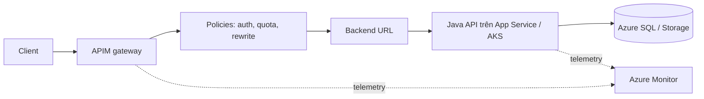
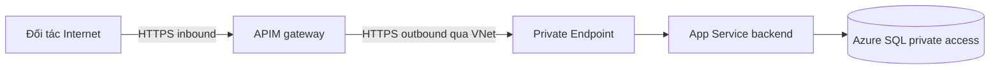
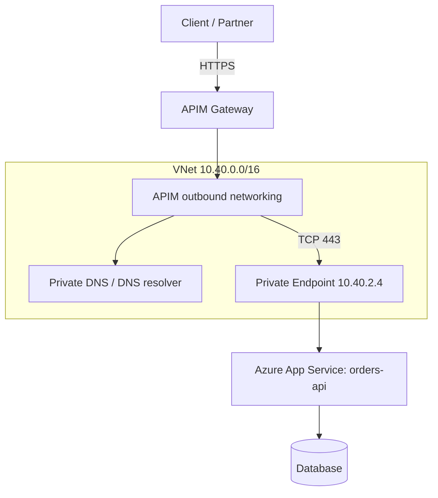
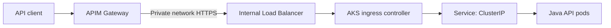
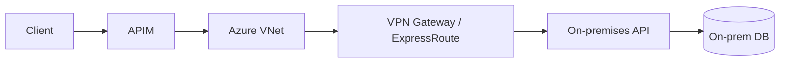
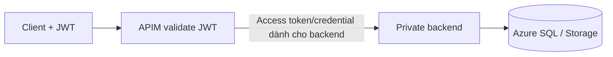
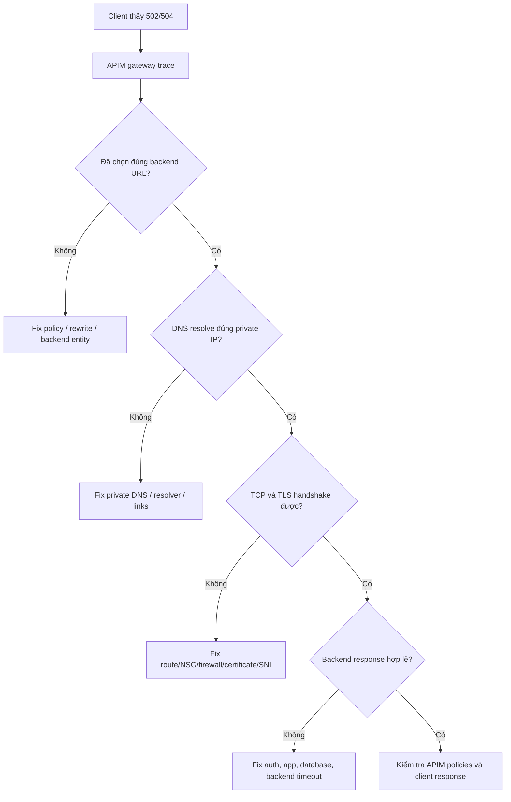

# Kết nối API Management với backend mạng riêng

Một tổ chức cung cấp API đặt hàng cho đối tác qua **Azure API Management (APIM)**. API gateway cần xác thực caller, giới hạn tần suất truy cập, chuẩn hóa URL, ghi telemetry và chuyển tiếp request tới ứng dụng Java chạy trên **Azure App Service**, **Azure Kubernetes Service (AKS)** hoặc máy ảo. Tuy nhiên, backend chứa logic nghiệp vụ và kết nối cơ sở dữ liệu không nên bị phơi trực tiếp ra Internet.

Giải pháp là cho phép **APIM làm điểm kiểm soát API**, còn **backend chỉ truy cập được qua địa chỉ/đường mạng riêng**, ví dụ App Service Private Endpoint, internal load balancer của AKS hoặc một địa chỉ trong VNet. Để thực hiện được, phải giải quyết **hai bài toán tách biệt**:

1. **Đường mạng outbound từ APIM tới backend:** APIM gateway có route, DNS, network permissions và TLS phù hợp để gọi endpoint riêng.
2. **Đường truy cập inbound từ client tới APIM:** xác định APIM gateway được công khai hay chỉ truy cập nội bộ, cùng chính sách xác thực, firewall hoặc private access.

Hai bài toán này **không tự giải quyết lẫn nhau**. Việc backend có Private Endpoint không làm APIM mặc nhiên có quyền truy cập vào backend; việc APIM có private gateway không chứng minh backend đã được bảo vệ.

Bài thuộc chương **API và tích hợp quy trình** của module **CLOUD_PROVIDERS_AZURE**. Kiến thức kết nối Azure subscription, resource group, Microsoft Entra ID, VNet, DNS, App Service/AKS, Storage, dữ liệu, giám sát, bảo mật và kiểm soát chi phí cho một kiến trúc ứng dụng trên Azure.

> **Phạm vi tính năng:** Các tier APIM cổ điển và các tier v2 có khả năng networking khác nhau. Không sao chép cấu hình VNet của Developer/Premium classic sang Standard v2/Premium v2 mà chưa kiểm tra tính năng, trạng thái phát hành, region và giới hạn của đúng tier. Bài trình bày nguyên lý và các bước kiểm chứng không phụ thuộc vào việc tự đoán chức năng của một SKU. Lệnh minh họa chỉ dùng trên môi trường lab được phê duyệt.

## Mục tiêu học tập

Sau bài học, bạn có thể:

1. Phân biệt **APIM gateway**, backend API, private endpoint, private DNS, VNet Integration và VNet injection.
2. Hiểu vì sao inbound private endpoint của APIM **khác** outbound connectivity từ APIM tới backend.
3. Lập sơ đồ request từ client qua APIM tới App Service Private Endpoint hoặc AKS internal ingress.
4. Chọn kiến trúc APIM theo networking capabilities của tier đang dùng.
5. Cấu hình backend entity và policy `set-backend-service` để định tuyến tới hostname riêng.
6. Thiết kế DNS, route, NSG, firewall, TLS certificate, SNI/Host header cho backend HTTPS.
7. Tích hợp xác thực client bằng Microsoft Entra ID và xác thực APIM tới backend bằng managed identity khi phù hợp.
8. Chẩn đoán các lỗi 401/403, 404, 500, 502, 503, 504, DNS và TLS handshake.
9. Dùng Azure Portal/CLI, APIM tracing, Azure Monitor và Application Insights để tìm nguyên nhân.
10. Lập runbook và checklist production về availability, bảo mật, vận hành và chi phí.

## 1. Vai trò của API Management trong hệ thống

**Azure API Management** là nền tảng quản lý vòng đời API với thành phần **gateway** xử lý request và các năng lực quản trị như products, subscriptions, APIs, policy, analytics và developer experience.

Trong một request thông thường:

1. Client gọi hostname của APIM gateway.
2. Gateway nhận diện API/operation theo URL và method.
3. Policy **inbound** xác thực hoặc kiểm tra điều kiện.
4. APIM chọn backend API và chuyển tiếp request qua **backend** stage.
5. Backend trả response, APIM áp **outbound** policies.
6. Gateway trả kết quả cho client và phát metrics/logs theo cấu hình.



**APIM không phải chính backend Java** và không tự tạo kết nối mạng riêng tới mọi hệ thống chỉ nhờ khai báo một URL trong API definition. Policy quyết định **gọi đi đâu**, còn VNet/DNS/route/firewall quyết định **có gọi tới được hay không**.

### Những phần khác với reverse proxy thông thường

| Năng lực | Vai trò |
|---|---|
| API/operation routing | Giữ public API ổn định dù backend thay đổi |
| Policy engine | Validate JWT, transform headers, rewrite URL, rate limit, cache |
| Backend entities | Quản lý địa chỉ backend, credentials và cấu hình định tuyến ở phạm vi phù hợp |
| Products/subscriptions | Tổ chức API và cách consumer đăng ký sử dụng |
| Observability | Metrics, logs/traces và correlation |
| Versioning/revisions | Quản trị thay đổi API contract |
| Developer portal/management | Hỗ trợ công bố và quản lý API |

Một backend có thể được gọi từ APIM qua public endpoint có kiểm soát hoặc private network. Bài này tập trung vào **private backend**.

## 2. “Backend mạng riêng” nghĩa là gì?

Backend mạng riêng là một API **không dựa vào inbound Internet công khai** cho đường truy cập từ gateway. Một số mô hình:

- **Azure App Service có Private Endpoint** cho inbound API từ VNet.
- **Azure Functions có Private Endpoint** nếu hosting plan/tính năng hỗ trợ.
- **AKS** có ingress/controller nằm sau **internal Azure Load Balancer (ILB)**, private IP và private DNS.
- **VM/VMSS** chạy Java API ở private IP, thường sau một internal load balancer.
- Một API chạy trên **mạng on-premises** và được kết nối với Azure qua VPN/ExpressRoute theo topology cho phép.
- Backend là **Azure Container Apps internal environment** hoặc dịch vụ managed khác với private ingress phù hợp.

Một private hostname chẳng hạn:

```text
orders-api.internal.example
orders-api.azurewebsites.net
orders.aks.corp.internal
```

Trong trường hợp App Service Private Endpoint, **hostname thông thường** như `orders-api.azurewebsites.net` vẫn có thể được sử dụng để giữ host header/SNI và kiểm tra certificate đúng, nhưng DNS từ mạng riêng phải phân giải theo đường Private Link. Không nên mặc định đổi URL backend sang IP riêng vì dễ phá TLS.

### Backend private không đồng nghĩa backend an toàn tuyệt đối

Nếu một workload nằm trên VNet mà vẫn bật public endpoint, nó có thể vẫn truy cập được từ Internet. Tách subnet, Private Endpoint và private DNS chỉ là một phần. Còn cần:

- Tắt/hạn chế public ingress theo phương thức backend hỗ trợ.
- AuthN/AuthZ ở API/backend.
- Network rules giới hạn đúng nguồn.
- Identity có quyền tối thiểu tới data plane.
- TLS và secrets được quản lý.
- Logging/monitoring và phản ứng khi có sự cố.

## 3. Inbound tới APIM và outbound từ APIM: hai chiều độc lập

Xét một client gọi APIM để lấy đơn hàng:



### Inbound — client tới APIM

Câu hỏi:

- APIM gateway có **public hostname/public IP** hay một **private entrypoint**?
- Có Microsoft Entra authentication, JWT validation, API Management subscription key, APIM policy và rate limiting không?
- Có WAF/Front Door/Application Gateway hoặc IP allowlist nếu kiến trúc yêu cầu?
- Cần client nội bộ hoặc đối tác bên ngoài truy cập theo cách nào?

### Outbound — APIM tới backend

Câu hỏi:

- APIM có thể **đi vào VNet** hoặc đến mạng kết nối với backend theo SKU không?
- Có route tới private IP/endpoint và cổng TCP 443 không?
- DNS của APIM có phân giải hostname backend thành đúng đích private không?
- Backend có cho phép kết nối từ đường mạng APIM dùng không?
- Backend TLS certificate, SNI và Host header có khớp không?
- Backend cần token, client certificate hoặc credential riêng không?

**Quy tắc quan trọng:** APIM inbound Private Endpoint (khi SKU hỗ trợ) phục vụ **client gọi gateway riêng tư**. Nó **không tự cấp** APIM quyền outbound tới private backend. Ngược lại, APIM có outbound VNet connectivity vẫn có thể là **public gateway** nếu inbound được thiết kế như vậy.

## 4. Các mô hình mạng của APIM theo nhóm tier

Khả năng kết nối private backend phụ thuộc tier, thế hệ sản phẩm, region và network mode. Trong thực tế thường gặp các nhóm sau.

| Mô hình | Ý tưởng | Điều cần kiểm tra |
|---|---|---|
| **Classic VNet injection — external mode** | APIM được triển khai vào VNet, gateway có thể được truy cập qua đường public theo mode/tier, vẫn gọi backend private qua VNet | Chỉ khả dụng ở các classic tier hỗ trợ, subnet dedicated, NSG/route/DNS và yêu cầu hạ tầng |
| **Classic VNet injection — internal mode** | APIM gateway/endpoints trong VNet theo private/internal mode | DNS private cho APIM, access từ client/VPN/ExpressRoute và phụ thuộc control plane |
| **VNet integration cho outbound (tier v2 hỗ trợ)** | Gateway giữ inbound mode riêng nhưng có thể đi outbound tới backend trong VNet tích hợp | Tier/region support, subnet integration, routes, limitations |
| **Private endpoint cho inbound APIM (tier hỗ trợ)** | Client truy cập APIM gateway qua Private Link | Inbound only; không thay thế outbound integration |
| **Self-hosted APIM gateway** | Gateway chạy tại nơi đặt backend như AKS/on-premises, cấu hình kết nối quản lý với APIM | Deployment/runtime/management connectivity khác managed gateway |

Không nên ghi nhớ rằng “**mọi APIM tier có VNet injection**”. Những tier cổ điển như Developer/Premium có mô hình injection khác các tier v2. Cụ thể Standard v2 thường được cân nhắc cho một số bài toán **outbound VNet integration**; Premium v2 có các tùy chọn mạng nâng cao theo khả năng hiện hành. Các lựa chọn inbound private endpoint, VNet injection và network isolation cần xác minh **đúng tier và ngày triển khai**, không dựa vào tên “Premium” đơn thuần.

### Quy trình chọn tier theo yêu cầu

1. Backend nằm trên **private IP, Private Endpoint hay network on-premises**?
2. Client cần truy cập APIM từ **Internet hay chỉ VNet/on-premises**?
3. APIM cần **inbound gateway private**, hay chỉ cần **outbound tới backend private**?
4. Cần scale/HA/zone/multi-region, SLA hoặc compliance nào?
5. Backend DNS có cần custom resolver/forwarder không?
6. Subnet, network policy và forced tunneling có được hỗ trợ ở mode/tier định dùng không?
7. Chênh lệch chi phí và quota của phương án nào chấp nhận được?

Nếu tier hiện tại **không hỗ trợ outbound private networking**, thêm private endpoint vào backend **không đủ để xử lý**. Cần chuyển tier, đổi topology gateway hoặc sử dụng mô hình được Azure hỗ trợ.

## 5. Kiến trúc mẫu 1: APIM → App Service Private Endpoint

Một Java Spring Boot API được triển khai lên App Service với hostname:

```text
orders-api.azurewebsites.net
```

Ứng dụng được cấu hình **Private Endpoint** cho inbound. APIM dùng network mode có outbound connectivity tới VNet chứa Private Endpoint hoặc tới VNet kết nối phù hợp.



### Điều kiện tối thiểu

- APIM tier/networking mode có **outbound route** tới VNet/private endpoint.
- Private Endpoint đã tạo cho **App Service inbound** và connection ở trạng thái được phê duyệt.
- DNS trong đường mạng APIM resolve hostname App Service theo **Private Link**.
- Network rules cho phép HTTPS từ APIM tới Private Endpoint.
- App Service được cấu hình ingress/public network access đúng theo mục tiêu không công khai backend.
- APIM backend URL dùng **HTTPS hostname hợp lệ**, không dùng IP trần trừ khi đã giải quyết rõ Host/SNI/certificate.
- Backend có cơ chế xác thực phù hợp nếu không muốn bất kỳ workload VNet nào gọi được API.

### Vì sao vẫn dùng hostname `azurewebsites.net`?

App Service TLS/certificate và virtual-host routing thường gắn với hostname. Gọi trực tiếp `https://10.40.2.4` có thể gây:

- **Certificate name mismatch**.
- TLS Server Name Indication (SNI) không khớp.
- Host header không phù hợp, trả 404 hoặc routing sai.
- Không kiểm chứng được hostname/backend đúng.

Vì vậy kiến trúc chuẩn ưu tiên **FQDN + private DNS resolution**, không sửa backend URL thành IP chỉ để “né DNS”.

## 6. App Service Private Endpoint và DNS chính xác

Khi truy cập App Service Private Endpoint, những tên thường liên quan:

```text
orders-api.azurewebsites.net
orders-api.privatelink.azurewebsites.net
privatelink.azurewebsites.net
```

Trong topology Private Link thông dụng, public hostname của App Service có liên hệ CNAME tới tên `privatelink`; từ mạng có private DNS cấu hình đúng, query được trả về **private IP** của Private Endpoint.

### Đừng nhầm DNS zone

| Dịch vụ | Private DNS zone thường gặp |
|---|---|
| App Service / Azure Functions Private Endpoint | `privatelink.azurewebsites.net` |
| Azure Blob Storage | `privatelink.blob.core.windows.net` |
| Azure Files | `privatelink.file.core.windows.net` |
| Azure SQL Database | `privatelink.database.windows.net` |
| Azure Key Vault | `privatelink.vaultcore.azure.net` |

APIM gọi một App Service backend thì cần phân giải **hostname của App Service**. Nếu backend lại gọi Blob/SQL bằng Private Endpoint, backend cần thêm DNS zones cho các **dependencies của nó**, không phải tự động do APIM dùng private DNS.

### Kiểm tra cấu hình DNS

1. Private Endpoint cho đúng backend resource và subresource.
2. Zone `privatelink.azurewebsites.net` được liên kết với **VNet có đường truy vấn DNS từ APIM**, hoặc custom DNS có forwarder phù hợp.
3. Record A tương ứng với tên backend trỏ tới private IP đúng.
4. Không có record cũ từ staging/region khác gây resolve sai.
5. Client/APIM còn dùng đúng FQDN và hostname được certificate bao phủ.
6. Khi dùng custom DNS server, có forwarding rules đúng cho Private Link zones.

**Peering VNet không tự làm private DNS zone link lan sang mọi VNet**. Nếu APIM nằm ở VNet khác backend, cần thiết kế name resolution từ đúng VNet của APIM; chỉ có route/peering chưa đủ.

### DNS cache và thay đổi backend

Sau khi đổi Private Endpoint, DNS có thể bị cache trong resolver hoặc gateway. Cần tính TTL và kiểm tra telemetry để biết APIM đã giải quyết hostname về đích mới; tránh thay đổi nhiều lớp DNS/route/policy cùng lúc.

## 7. Kiến trúc mẫu 2: APIM → AKS internal ingress

Một hệ thống chạy Java Spring Boot trên AKS thường dùng Kubernetes Service và ingress controller. Để giữ API nội bộ:

- Chạy ingress controller với **internal Azure Load Balancer** (ILB) theo cấu hình phù hợp.
- Tạo private IP và private DNS record cho backend.
- Cho APIM outbound networking tới VNet/subnet chứa ILB.
- Gateway APIM gọi **hostname của internal ingress** bằng HTTPS.



### Điều kiện triển khai

- Ingress controller đúng loại (NGINX, Application Gateway for Containers hoặc giải pháp tổ chức lựa chọn) và đã cấu hình **internal**.
- Internal load balancer frontend IP thuộc subnet/VNet thích hợp.
- DNS hostname `orders.aks.corp.internal` trỏ tới private IP nội bộ.
- NSG/UDR/firewall cho phép APIM tới ingress listener.
- TLS certificate của ingress có SAN khớp hostname APIM gọi.
- Kubernetes Service/Endpoints/Pods và readiness probes hoạt động.
- Không vô tình tạo thêm một **public ingress/load balancer** cho cùng backend.

### APIM không gọi ClusterIP trực tiếp từ VNet thông thường

Kubernetes `ClusterIP` thường chỉ có ý nghĩa trong mạng service của cluster, không phải IP đích mà một APIM managed gateway ngoài cluster gọi trực tiếp. Vì vậy nên dùng **internal ingress hoặc internal load balancer** làm điểm vào API từ VNet, rồi ingress route vào `ClusterIP` Service.

### Khi không cần ingress controller?

Có thể dùng internal `Service type=LoadBalancer` cho một backend cụ thể. Tuy nhiên nếu nhiều services cần hostname, TLS và routing L7, ingress/gateway nội bộ thường dễ quản trị hơn. Phải cân nhắc chi phí, hạn mức và controller lifecycle.

## 8. Kiến trúc mẫu 3: APIM → backend on-premises qua hybrid network

Một doanh nghiệp còn hệ thống API Java trong datacenter. APIM có thể gọi backend qua kết nối riêng nếu networking mode hỗ trợ và route đến on-premises qua **VPN Gateway hoặc ExpressRoute**.



Cần kiểm tra:

- IP ranges không chồng lấn.
- Network reachability hai chiều theo đường routing/firewall.
- Peering/UDR và gateway transit theo topology thực tế.
- DNS conditional forwarding cho tên nội bộ của datacenter.
- Certificate chain/PKI có được APIM tin cậy không.
- Latency, MTU, timeout và bandwidth đủ cho API.
- High availability của VPN/ExpressRoute và backend.

**VNet peering không tự transit giữa nhiều VNet**; cũng không phải mọi mô hình APIM đều hỗ trợ forced tunneling hoặc UDR giống nhau. Kiểm chứng route path trong kiến trúc cụ thể.

## 9. Lập kế hoạch VNet, subnet và địa chỉ

Ví dụ một kiến trúc lab:

| Thành phần | Không gian địa chỉ minh họa | Mục đích |
|---|---|---|
| VNet hub/spoke tổng | `10.40.0.0/16` | Mạng riêng Azure |
| Subnet dành cho mô hình APIM hỗ trợ | `10.40.1.0/24` | APIM injection/integration theo tier |
| Private Endpoints subnet | `10.40.2.0/24` | App Service/Storage/SQL Private Endpoints |
| AKS node subnet | `10.40.3.0/24` | Worker nodes |
| Internal ingress frontend | Private IP thuộc subnet phù hợp | Đích APIM gọi |
| DNS resolver/forwarder | IP trong VNet theo thiết kế | Phân giải private hostnames |

Đây là **sơ đồ địa chỉ minh họa**, không phải tuyên bố subnet APIM luôn phải là /24 hay có thể dùng chung giữa các mode. **Dedicated subnet, delegation, network policies và kích thước subnet tối thiểu** của APIM thay đổi theo tier/networking feature; xác nhận support matrix và tính số IP cho scale-out/upgrade trước khi tạo.

### Nguyên tắc địa chỉ

1. Không chồng CIDR với on-premises hoặc các VNets được peering.
2. Dự trữ đủ IP cho APIM, Private Endpoints, AKS nodes và scale/surge.
3. Đặt NSG/firewall theo **hướng lưu lượng thực tế**.
4. Không chặn DNS resolver hoặc control plane dependencies cần thiết.
5. Thiết kế route tables theo network mode/tier, tránh forced tunneling gây sự cố quản lý dịch vụ.
6. Gắn network ownership và change approval.

### Không tự ý thay đổi APIM subnet production

Đổi integration/injection subnet, NSG, DNS hoặc UDR có thể làm **gateway ngừng phục vụ**, **backend không được gọi** hoặc **management connectivity lỗi**. Luôn kiểm tra những rule bắt buộc theo tier trước khi áp dụng.

## 10. Network Security Group, route và firewall

Khi APIM gọi `https://orders-api.azurewebsites.net` qua Private Endpoint, một số điều kiện network thường là:

| Hướng | Cổng/giao thức | Điều kiện |
|---|---|---|
| APIM network → DNS resolver | UDP/TCP 53 hoặc DNS transport được kiến trúc sử dụng | Phân giải hostname backend |
| APIM gateway → Private Endpoint | TCP 443 | Kết nối HTTPS tới backend |
| APIM gateway → internal AKS ingress | TCP 443 hoặc listener port thực tế | HTTPS/API traffic |
| APIM → Azure services phục vụ APIM | Theo requirements của mode/tier | Control plane, telemetry, Storage/Key Vault nếu cần |
| Backend → Azure SQL/Storage | Cổng/protocol của backend dependencies | Luồng **backend**, khác đường APIM → backend |

**Không mở toàn bộ inbound VNet hoặc `0.0.0.0/0` chỉ để khắc phục lỗi tạm.** Network rules phải giới hạn đúng subnet/source, destination, port và luồng cần thiết.

### Private Endpoint có NSG rules không?

Khả năng áp dụng **network policies/NSG/UDR đối với Private Endpoint subnet** phụ thuộc cấu hình private endpoint network policies và sản phẩm. Không giả định mọi rule NSG trên subnet đều tự áp vào Private Endpoint theo cách giống VM NIC; hãy xác minh cơ chế được bật và kết quả truy cập thực tế.

### Routing từ APIM

Muốn kết nối thành công, phải có:

- Route tới private IP/backend từ **chính môi trường gateway APIM**.
- Route return phù hợp; không có asymmetric routing qua NVA làm rớt TCP.
- Firewall không chặn SNI/hostname hoặc TLS inspection ngoài ý muốn.
- DNS result dẫn tới IP reachable theo network mode.

Một VM trong VNet gọi được API là bằng chứng **đường mạng của VM** hoạt động; nó **không chứng minh** APIM gateway đang dùng đúng cùng DNS/route. Cần thêm APIM gateway trace/telemetry để xác nhận end-to-end.

## 11. Backend FQDN, Host header, SNI và TLS

Đây là nhóm lỗi phổ biến nhất khi “backend private có IP nhưng APIM vẫn 502”.

### Phân biệt ba tên liên quan

- **Backend URL hostname:** tên APIM sử dụng khi tạo HTTPS connection, ví dụ `orders-api.azurewebsites.net`.
- **HTTP Host header:** tên host mà backend/webserver dùng cho virtual-host routing.
- **TLS SNI / certificate hostname:** tên server dùng lúc TLS handshake và kiểm chứng SAN/CN của certificate.

Ba giá trị thường nên **nhất quán**.

```text
Client -> APIM: https://api.contoso.example/orders/123
APIM -> backend:
    URL:  https://orders-api.azurewebsites.net/api/orders/123
    DNS:  orders-api.azurewebsites.net -> 10.40.2.4
    SNI:  orders-api.azurewebsites.net
    Host: orders-api.azurewebsites.net
    TLS:  Certificate hợp lệ cho hostname backend
```

Tên `contoso.example` chỉ là ví dụ. Không tự động chuyển `Host: api.contoso.example` từ client sang App Service backend nếu App Service không có custom domain đó; có thể gây routing sai.

### Vì sao IP trần gây lỗi?

Nếu cấu hình backend là:

```text
https://10.40.2.4/
```

certificate nhiều khả năng không có IP này trong SAN, đồng thời SNI có thể sai. Cách sửa đúng là **sửa DNS hoặc backend FQDN và certificate**, không tắt validation TLS.

### Certificate tự ký hoặc private CA

Backend nội bộ có thể dùng certificate do CA riêng cấp. APIM cần **tin cậy certificate chain** theo khả năng cấu hình/tier và hostname phải khớp. Trong production, ưu tiên certificate được tin cậy hoặc triển khai CA/cert trust đúng cách; **không tắt kiểm tra certificate chain/name** để đưa một kết nối production vào hoạt động.

## 12. Khai báo backend entity trong APIM

Thay vì viết URL backend lặp lại ở mọi API/operation, có thể tạo một **backend entity**:

```text
Backend ID: orders-private-backend
Runtime URL: https://orders-api.azurewebsites.net
Description: Java Orders API via Private Endpoint
```

### Cấu hình qua Azure Portal

1. Chọn APIM instance đúng subscription/resource group.
2. Mở khu vực **Backends** (trong nhóm APIs hoặc API Management, tùy Portal).
3. Tạo backend với tên logic `orders-private-backend`.
4. Chọn **HTTP endpoint** và URL HTTPS đầy đủ **hostname**.
5. Chọn authentication phù hợp; không điền secret vào trường không được bảo vệ.
6. Cấu hình certificate trust/validation, client certificates hoặc identity khi được backend yêu cầu.
7. Lưu backend entity.
8. Trong một API/operation, tham chiếu backend này bằng policy.

**Tạo backend entity không cấp route/DNS.** Sau khi lưu, vẫn cần network connectivity từ APIM tới backend.

### Backend URL và path

Nếu API public ở `/orders` còn backend expose `/api/v1/orders`, phải thiết kế rewrite path hoặc chọn base URL cho đúng. Một URL sai path thường trả **404**, có thể bị nhầm với lỗi private network nếu chỉ nhìn response cuối.

Đừng sửa bằng cách thay hostname hoặc thêm `/` ngẫu nhiên. Hãy xác định public API suffix, operation path, backend base URL và URL cuối sau rewrite.

## 13. Policy `set-backend-service` trong APIM

API Management sử dụng **policy XML** để điều chỉnh request/response. Ví dụ dưới đây định tuyến API orders tới backend entity:

```xml
<policies>
  <inbound>
    <base />
    <set-backend-service backend-id="orders-private-backend" />
    <set-header name="x-correlation-id" exists-action="override">
      <value>@(context.RequestId.ToString())</value>
    </set-header>
  </inbound>
  <backend>
    <base />
  </backend>
  <outbound>
    <base />
  </outbound>
  <on-error>
    <base />
  </on-error>
</policies>
```

### Giải thích

- `<base />` kế thừa các policy ở scope ngoài theo inheritance model.
- `set-backend-service backend-id` chọn backend đã định nghĩa.
- `x-correlation-id` giúp liên hệ gateway request với log backend.
- Phần `backend` thường kế thừa chính sách chuyển tiếp `forward-request` đang có theo cấu hình chung; không tự xóa `<base />` khi chưa hiểu policy inheritance.
- `on-error` là nơi có thể ghi thêm dấu vết/sửa cách trả lỗi, nhưng không nên che nguyên nhân gốc.

### Policy có thể đặt ở nhiều scope

Global → product → API → operation (theo phạm vi thực tế và policy inheritance) là một cách tư duy phổ biến. Một operation có `set-backend-service` riêng có thể override backend ở API scope.

Khi debug:

1. Xác định **effective policy** ở operation được gọi.
2. Kiểm tra có rewrite-uri, set-header, backend entity, retry hoặc caching không.
3. Xác nhận hostname thực tế APIM forward.
4. Phân biệt lỗi APIM policy với lỗi mạng/backend.

**Không dùng backend entity chỉ để giấu một IP tĩnh không được quản lý**; nếu IP đổi, việc kết nối sẽ hỏng. FQDN private và DNS phù hợp thường dễ vận hành hơn.

## 14. Rewrite URL và headers: lỗi 404 dù mạng vẫn thông

Giả sử client gọi:

```text
GET https://api.contoso.example/orders/123
```

Backend thực sự expose:

```text
GET https://orders-api.azurewebsites.net/api/v1/orders/123
```

Nếu APIM route/rewrite sai, backend có thể trả 404 dù DNS, TLS và network đều đúng.

Ví dụ policy có thêm rewrite trong scope operation với route parameter `id`:

```xml
<policies>
  <inbound>
    <base />
    <set-backend-service backend-id="orders-private-backend" />
    <rewrite-uri template="/api/v1/orders/{id}" />
  </inbound>
  <backend>
    <base />
  </backend>
  <outbound>
    <base />
  </outbound>
  <on-error>
    <base />
  </on-error>
</policies>
```

Để rewrite `{id}` hoạt động, operation template thực tế phải khai báo parameter đó, ví dụ `/orders/{id}` theo API design. Nếu API suffix đã là `orders` và operation path được định nghĩa khác, URL sau rewrite cần được kiểm tra bằng **gateway trace**.

### Header nào đáng kiểm tra?

| Header | Lưu ý |
|---|---|
| `Host` | Phải khớp backend virtual host; APIM nên dùng backend hostname phù hợp |
| `Authorization` | Token client không nhất thiết dành cho backend |
| `x-correlation-id` | Giúp liên hệ gateway và backend logs |
| `x-forwarded-for` | Cần xử lý trust/proxy chain đúng, không tin mọi giá trị client gửi |
| `x-forwarded-proto` | Backend có thể cần biết client dùng HTTPS |
| API key / backend-specific header | Không log/tiết lộ secret; lưu ở cấu hình bảo vệ |

Một private backend chỉ nên tin các header đặc quyền khi request thực sự đi qua gateway đáng tin cậy hoặc có xác thực bổ sung.

## 15. Bảo vệ inbound API với Microsoft Entra ID

**Client → APIM** và **APIM → backend** là hai bước xác thực khác nhau.

Ví dụ, đối tác gửi JWT từ Microsoft Entra ID tới APIM. APIM policy có thể **validate-jwt** trước khi gọi backend.



### Policy validate-jwt minh họa

```xml
<policies>
  <inbound>
    <base />
    <validate-jwt header-name="Authorization"
                  failed-validation-httpcode="401"
                  failed-validation-error-message="Unauthorized">
      <openid-config url="https://login.microsoftonline.com/&lt;TENANT_ID&gt;/v2.0/.well-known/openid-configuration" />
      <audiences>
        <audience>api://orders-public-api</audience>
      </audiences>
    </validate-jwt>
    <set-backend-service backend-id="orders-private-backend" />
  </inbound>
  <backend><base /></backend>
  <outbound><base /></outbound>
  <on-error><base /></on-error>
</policies>
```

**Các giá trị TENANT_ID và audience là placeholder**. Trong một API có thật, phải dùng issuer/JWKS/audience/claims đúng với **ứng dụng đăng ký trong Entra ID**, tenant và OAuth flow. Không copy chuỗi `api://orders-public-api` mà chưa đăng ký resource tương ứng.

Nếu backend cần chính token của caller, có thể dùng kiến trúc pass-through/OBO được thiết kế riêng. Không tự giả định client JWT cho APIM cũng được backend chấp nhận: hai thành phần có thể kiểm tra **audience khác nhau**.

### Subscription key có phải cơ chế auth không?

APIM subscription key hỗ trợ quản lý việc sử dụng sản phẩm/API và có thể là một kiểm soát truy cập, nhưng **không thay thế** xác thực danh tính người dùng hoặc hệ thống, nhất là với nghiệp vụ nhạy cảm. Production nên cân nhắc Entra ID, mTLS hoặc giải pháp authentication phù hợp.

## 16. APIM xác thực tới backend bằng managed identity

APIM có thể sử dụng **managed identity** để lấy access token từ Microsoft Entra ID khi backend hỗ trợ JWT audience/authorization tương ứng. Đây là **backend authentication**, độc lập với client authentication.

### Luồng điển hình

1. Bật system-assigned hoặc user-assigned managed identity cho APIM.
2. Backend có ứng dụng/identity resource được đăng ký và thực thi token validation.
3. Cấp cho APIM identity quyền gọi API/backend phù hợp (app role hoặc cơ chế authorization tương ứng).
4. Trong APIM policy, yêu cầu token cho **đúng resource/audience** của backend.
5. Gateway gửi token tới backend.
6. Backend xác minh issuer, audience, signature, roles/claims.

### Policy minh họa

```xml
<policies>
  <inbound>
    <base />
    <set-backend-service backend-id="orders-private-backend" />
    <authentication-managed-identity
        resource="api://orders-private-api"
        output-token-variable-name="backendAccessToken"
        ignore-error="false" />
    <set-header name="Authorization" exists-action="override">
      <value>@("Bearer " + (string)context.Variables["backendAccessToken"])</value>
    </set-header>
  </inbound>
  <backend><base /></backend>
  <outbound><base /></outbound>
  <on-error><base /></on-error>
</policies>
```

**Đây là ví dụ về policy shape**, không phải một token có thể dùng ngay. `api://orders-private-api` phải là resource identifier thực tế và backend phải cho phép APIM identity. Nhiều cấu hình có thể để `authentication-managed-identity` tự đặt Authorization header, không cần tự `set-header`; nếu dùng `output-token-variable-name` như ví dụ, phải hiểu rõ việc xử lý token/biến. Cần kiểm chứng API và policy theo phiên bản APIM hỗ trợ.

### Không nhầm quyền APIM với quyền backend data

- APIM identity gọi API Java: backend cần kiểm tra app role/permission.
- Java backend đọc Azure SQL/Blob: **identity của backend** cần role/quyền data plane tương ứng.
- Cấp APIM quyền Storage Blob Data Contributor không làm Java backend đọc Blob được nếu Java dùng identity khác.
- Private route không cấp access token; access token không tạo private route.

## 17. Backend dùng API key, client certificate hoặc mTLS

Không phải backend nào cũng tích hợp Entra ID. Một số cần:

- **Backend API key**.
- **HTTP Basic auth** trong các môi trường legacy có kiểm soát.
- **Client certificate (mTLS)**.
- **OAuth 2.0** với flow thích hợp.
- Identity từ một gateway nội bộ hoặc service mesh.

### Quản lý secrets

- Dùng APIM **named values** có chế độ bảo vệ hoặc **Key Vault reference** theo tính năng hỗ trợ.
- Không hardcode API key trong policy XML public/repo.
- Cần có rotation, expiry, access logging và phân quyền tối thiểu.
- Với client certificate, kiểm tra chain, validity, key protection và cách upload/rotate cert trong APIM.
- Với mTLS, kiểm tra cả **server certificate** và **client certificate**; đó là hai phía xác thực khác nhau.

### Cẩn trọng với TLS bypass

APIM có tùy chọn liên quan kiểm tra certificate backend trong một số trường hợp. **Không tắt server certificate validation** để khắc phục lỗi production; sửa DNS/FQDN/SAN/chain hoặc CA trust mới là hướng đúng.

## 18. Backend App Service và quyền truy cập public

Một App Service có Private Endpoint **không mặc nhiên là private-only** nếu còn public ingress phù hợp. Thiết kế an toàn thường gồm:

1. Private Endpoint kết nối vào app đúng subresource.
2. Private DNS trả về IP riêng từ đường mạng APIM.
3. APIM có outbound connectivity tới VNet đó.
4. App Service public network access được kiểm soát/tắt theo tính năng và yêu cầu.
5. Backend xác thực request hoặc giới hạn nguồn, không chỉ dựa vào Private Endpoint.
6. Có đường quản trị/triển khai qua SCM/Kudu nếu môi trường cần, cùng DNS/Private Endpoint tương ứng khi private access được yêu cầu.
7. Kiểm tra staging slots: endpoint, hostname, DNS và slot settings có thể khác production.

### Đường public bị tắt có ảnh hưởng deployment?

Có. Deployment pipeline cần truy cập endpoint quản trị/SCM hoặc dùng phương thức triển khai thích hợp. Nếu vô hiệu hóa public access quá sớm mà chưa chuẩn bị đường private cho build agent/SCM, có thể làm deployment thất bại dù API gateway vẫn gọi được ứng dụng.

**Production cutover:** kiểm thử đường APIM → backend qua Private Endpoint trước, rồi mới siết public ingress theo change window. Đừng đảo thứ tự khiến backend ngừng phục vụ mà không có rollback.

## 19. Backend AKS và tính sẵn sàng của ingress

Trong AKS, request có thể đi qua nhiều lớp:

```text
APIM
  -> internal Load Balancer IP
    -> ingress controller
      -> Kubernetes Service
        -> Spring Boot pod
```

Nếu APIM trả 502/503, cần phân biệt:

- APIM không resolve được hostname ingress.
- APIM không kết nối được tới private ILB.
- TLS/SNI tới ingress không hợp lệ.
- Ingress route không khớp `Host` hoặc path.
- Kubernetes Service không có ready endpoints.
- Pods CrashLoopBackOff/OOM/NotReady.
- Spring Boot API lỗi database hoặc timeout.

### Kiểm tra trong AKS

```bash
kubectl config current-context

kubectl get svc -A -o wide
kubectl get ingress -A

kubectl get pods -A -o wide

kubectl get endpoints -A
```

Các lệnh mang tính read-only; không thực hiện `kubectl delete` hoặc restart controller khi chưa biết sự cố ở tầng nào.

### Health check

- APIM có thể có các khả năng quản lý backend health/circuit breaker theo tier/tính năng/policy; không giả định tất cả được bật mặc định.
- Ingress/ILB cần health probes phù hợp.
- Spring Boot có thể cung cấp readiness như `/actuator/health/readiness`.
- Pod readiness phải phản ánh khả năng nhận request, không chỉ Java process tồn tại.
- Backend có thể Running nhưng không phục vụ được do DB kết nối lỗi; cần Application Insights/traces.

## 20. Azure CLI: kiểm tra APIM và tài nguyên mạng

Trong Bash/Cloud Shell được phép xem tài nguyên:

```bash
az account show --output table
az account set --subscription "<SUBSCRIPTION_ID>"

RG="<APIM_RESOURCE_GROUP>"
APIM="<APIM_INSTANCE_NAME>"

az apim show \
  --resource-group "$RG" \
  --name "$APIM" \
  --query "{id:id,name:name,location:location,sku:sku,virtualNetworkType:virtualNetworkType,gatewayUrl:gatewayUrl}" \
  --output json
```

Các trường trả về và tên thuộc tính mạng phụ thuộc API/schema phiên bản được dùng. Nếu `virtualNetworkType` vắng hoặc null trên tier v2, **không tự kết luận không có VNet integration**; xem thêm thông tin networking của tài nguyên bằng Azure Portal hoặc API phù hợp.

### Kiểm tra backend App Service

```bash
az webapp show \
  --resource-group "<APP_RESOURCE_GROUP>" \
  --name "<APP_NAME>" \
  --query "{name:name,state:state,defaultHostName:defaultHostName,httpsOnly:httpsOnly,publicNetworkAccess:publicNetworkAccess}" \
  --output json
```

### Liệt kê Private Endpoints

```bash
az network private-endpoint list \
  --resource-group "<NETWORK_RESOURCE_GROUP>" \
  --output table
```

Resource group mạng có thể khác resource group APIM hoặc backend. Không suy đoán Private Endpoint nằm trong cùng resource group; phải đối chiếu với tài nguyên đã được tổ chức quản lý.

### Liệt kê Private DNS zones

```bash
az network private-dns zone list \
  --resource-group "<DNS_RESOURCE_GROUP>" \
  --output table

az network private-dns link vnet list \
  --resource-group "<DNS_RESOURCE_GROUP>" \
  --zone-name "privatelink.azurewebsites.net" \
  --output table
```

Những lệnh này chỉ giúp xem **quản trị cấu hình**. Để chứng minh DNS thực tế từ APIM, cần kết hợp kiểm tra DNS của mạng tương ứng và APIM gateway trace.

## 21. Chẩn đoán DNS/TCP/TLS từ một môi trường gần backend

Nếu tổ chức có VM hoặc container kiểm tra trong **VNet cùng đường mạng** với APIM, có thể dùng công cụ mạng thông thường.

### DNS

```bash
nslookup orders-api.azurewebsites.net
```

Kỳ vọng resolver trả về đường phân giải private liên quan và cuối cùng là private IP đúng. Không chỉ nhìn CNAME; cần xem A record cuối cùng, resolver đang sử dụng và TTL.

### HTTPS

```bash
curl -v \
  --connect-timeout 10 \
  --max-time 30 \
  https://orders-api.azurewebsites.net/health
```

HTTP status 401/403 có thể chứng minh đã tới một endpoint nhưng **chưa được phép truy cập**, thay vì lỗi TCP. Tuy nhiên phải xác minh header/body và endpoint thực sự là backend dự kiến, không một proxy sai.

### Kiểm tra TLS certificate theo hostname

```bash
openssl s_client \
  -connect orders-api.azurewebsites.net:443 \
  -servername orders-api.azurewebsites.net
```

Kiểm tra certificate subject/SAN, issuer, chain và các lỗi verify. Không đưa private key hoặc secret ra command line.

### Hạn chế của cách thử

Một VM test có thể dùng DNS/route khác với managed APIM gateway. Các lệnh `nslookup`/`curl` từ VM chỉ là **bằng chứng từng phần**. Khi VM thành công nhưng APIM thất bại, ưu tiên kiểm tra:

- APIM networking mode, subnet/route/NSG.
- DNS thực tế APIM sử dụng.
- Backend entity hostname và TLS validation.
- Effective policy và APIM tracing.

Đừng khẳng định “network hoàn toàn tốt” chỉ vì test từ Cloud Shell hoặc laptop thành công.

## 22. APIM gateway tracing và Application Insights

Để chẩn đoán request end-to-end, cần phân biệt:

- **APIM gateway telemetry:** gateway nhận request, policy chạy, backend request/response, lỗi forwarding.
- **Backend telemetry:** Java API nhận request, exception, dependency, database.
- **Network/Private Endpoint logs:** sự kiện kết nối/DNS/firewall theo các dịch vụ có hỗ trợ.

### Tracing trên APIM

API Management có khả năng trace/debug request theo **cơ chế được hỗ trợ hiện hành**, có thể yêu cầu token/quyền debug và công cụ phù hợp. Không mặc định cách cũ `Ocp-Apim-Trace: true` hoạt động hoặc được phép trên mọi môi trường.

Quy trình:

1. Xác định đúng APIM instance, API, operation và request ID.
2. Bật/thu trace ngắn hạn bằng chức năng được cấp quyền.
3. Xem inbound policy, rewrite và URL/backend đã chọn.
4. Quan sát giai đoạn backend: DNS/connect/TLS/timeout/status.
5. So với App Insights của backend theo correlation ID.
6. Tắt thu thập trace chi tiết sau khi điều tra và bảo vệ thông tin nhạy cảm.

### Policy correlation

Ví dụ ở phần 13 thêm `x-correlation-id` có thể giúp backend log cùng ID. Hãy chỉ sử dụng header được gateway quản lý; nếu client đã gửi `x-correlation-id`, bạn có thể chọn override theo policy để tránh giả mạo hoặc chuẩn hóa.

### Không log secrets trong trace

APIM trace có thể hiển thị policy values, headers hoặc backend request details theo tính năng; phải hạn chế quyền truy cập và mask Authorization, API key hoặc thông tin nhạy cảm.

## 23. Azure Monitor metrics và diagnostic logs

Azure Monitor có thể cung cấp metrics về **request volume, response status, gateway latency, backend duration/capacity** theo APIM resource/SKU và cấu hình. Tên metric và dimensions cần kiểm chứng bằng danh sách của đúng resource.

### Tra danh sách metric bằng CLI

```bash
APIM_ID=$(az apim show \
  --resource-group "$RG" \
  --name "$APIM" \
  --query id --output tsv)

az monitor metrics list-definitions \
  --resource "$APIM_ID" \
  --output table
```

Chọn tên metric thật từ kết quả và so sánh trong cùng khoảng UTC. Đừng tự suy một request 502 luôn là TLS lỗi: có thể do timeout, DNS, backend connectivity hoặc một policy khác.

### Diagnostic settings

Có thể cấu hình gateway logs của APIM tới **Log Analytics workspace**, Storage hoặc Event Hubs theo category và khả năng dịch vụ. Khi có resource-specific table như `ApiManagementGatewayLogs`, truy vấn KQL tối thiểu:

```kusto
ApiManagementGatewayLogs
| where TimeGenerated > ago(1h)
| summarize Requests = count() by bin(TimeGenerated, 5m)
| order by TimeGenerated asc
```

Để xem schema đang có:

```kusto
ApiManagementGatewayLogs
| getschema
```

Một số cấu hình legacy có thể lưu ở `AzureDiagnostics`, với tên cột khác. **Không dùng một cột đoán như `BackendStatusCode` hay `ResponseCode` mà chưa kiểm tra schema**; sau khi xem `getschema`, mới viết query tỷ lệ backend errors theo cột thật.

### Application Insights phía Java backend

Nếu App Service/Spring Boot đã instrument, có thể tra requests/exception/dependencies theo schema thực tế, ví dụ workspace-based:

```kusto
AppRequests
| where TimeGenerated > ago(1h)
| summarize Requests=count(),
            Failed=countif(Success == false)
  by bin(TimeGenerated, 5m), Name
| order by TimeGenerated asc
```

Không thấy backend request trong App Insights **chưa chắc** APIM chưa gọi backend: instrumentation, sampling, resource association hoặc pipeline có thể sai. Nhưng nếu APIM trace cho thấy DNS/connect fail, backend đúng là chưa có cơ hội xử lý request.

## 24. Sự khác biệt giữa lỗi APIM và lỗi backend

| Triệu chứng | Nguồn lỗi thường gặp | Bước kiểm tra |
|---|---|---|
| Client nhận **401 từ APIM** | JWT/subscription key/policy authorization | Inbound policy và APIM logs |
| Client nhận **403 từ APIM** | Policy/IP restrictions hoặc subscription access | Effective policy, caller identity |
| Client nhận **401/403 từ backend** | Backend token audience/roles, App Service auth hoặc firewall | Backend response, APIM auth policy, identity |
| **404** | API suffix/operation path/rewrite, Host header hoặc backend route | URL cuối và host trong APIM trace |
| **500** | Policy exception hoặc Java backend exception | APIM trace + App Insights |
| **502** | Backend connection failure, DNS/TLS/connection reset hoặc gateway/backend error | DNS, cert, route, backend status |
| **503** | Backend/ingress không sẵn sàng, dependency hoặc gateway overload | Health, metrics, scaling |
| **504** | Gateway/backend request timeout | Backend latency, network, policy timeout |
| **TLS handshake error** | Certificate chain, SNI, hostname, CA hoặc protocol | openssl với FQDN, APIM logs |
| **NameResolutionFailure** | Private DNS link/forwarder/hostname sai | DNS trong APIM network path |
| **Connection refused/timeout** | NSG/UDR/firewall/ILB listener hoặc endpoint offline | Reachability TCP, backend listener |
| **Chỉ lỗi một backend** | Backend-specific DNS, route, cert hoặc policy | So sánh backend entity/config |

HTTP status có thể do **APIM tạo ra**, backend trả lại hoặc gateway phía trước APIM sinh ra. Phải xác định **tầng sinh status** từ request trace; không đánh đồng mọi 403 với Azure RBAC.

## 25. Runbook lỗi “APIM 502 khi gọi App Service Private Endpoint”

Giả sử API ở `https://api.contoso.example/orders/123` trả 502.

### Bước 1: ghi phạm vi và thời gian

- Subscription/resource group/APIM instance, tier/mode.
- API/operation, hostname của client, thời điểm UTC.
- Correlation ID và request ID.
- Backend entity ID và hostname.
- Deployment/Private Endpoint/DNS/NSG changes gần nhất.

### Bước 2: xác nhận backend đang chạy

Xem App Service Overview, health endpoint, metrics, Log stream/Application Insights. Nếu ứng dụng không khởi động hoặc backend Java lỗi, sửa ở backend trước.

### Bước 3: xác nhận private endpoint

- Đúng App Service resource và private endpoint connection approved.
- Đúng private IP và subnet.
- Backend public network access được cấu hình phù hợp.
- Nếu có slot, đúng slot hostname/endpoint.

### Bước 4: kiểm tra DNS theo mạng APIM

- `orders-api.azurewebsites.net` có resolve đúng private IP?
- `privatelink.azurewebsites.net` linked/forwarded đúng chưa?
- APIM dùng custom DNS hay Azure-provided DNS?
- VNet peering không làm DNS tự truyền giữa mạng.

### Bước 5: kiểm tra TCP và routing

- APIM outbound networking đã bật cho đúng tier/mode chưa?
- Có route tới private IP và TCP 443 được phép không?
- NSG/UDR/NVA có đổi gần đây không?
- Có backend firewall/access restrictions chặn không?

### Bước 6: kiểm tra TLS/Host

- Backend URL là FQDN HTTPS, không phải IP trần?
- SNI/Host khớp certificate và App Service hostname?
- Có CA chain không được tin cậy không?
- APIM có vô tình override `Host` bằng custom domain client không?

### Bước 7: kiểm tra policy và authorization

- `set-backend-service` trỏ backend đúng?
- `rewrite-uri` có làm sai path?
- `authentication-managed-identity` có đúng audience không?
- Backend App Service Auth có từ chối request vì thiếu token/role không?

### Bước 8: khôi phục có kiểm soát

Sửa một nguyên nhân đã chứng minh, kiểm thử qua APIM, quan sát 2xx/4xx/5xx, latency và logs. Không tắt TLS validation, publicNetworkAccess hoặc access restrictions để “thử xong” mà không có change plan.

### Bước 9: xác minh nghiệp vụ

Kiểm tra request thật đã đọc/ghi đúng đơn hàng trong backend (theo quyền và dữ liệu test) chứ không chỉ thấy HTTP 200 từ health endpoint.



## 26. Sự cố khi chỉ một môi trường chạy được

### Staging thành công, production lỗi

Những khác biệt có thể có:

- Production APIM khác tier/mode hoặc network integration.
- Private Endpoint của production chưa approved.
- DNS zone link có ở staging VNet nhưng thiếu ở production.
- Backend hostname/certificate khác.
- Entra audience/client identity chỉ được cấp quyền cho staging.
- NSG/UDR hoặc Azure Firewall rules khác.
- App Service publicNetworkAccess hoặc access restrictions khác.
- App settings/Key Vault references khác.

**Không copy production connection string/key vào staging** để xác minh nhanh. Ghi rõ cấu hình khác nhau và so sánh bằng IaC/Portal với quyền truy cập thích hợp.

### Gọi được từ VM, APIM không gọi được

Đây là dấu hiệu thường gặp của **APIM network mode/DNS/route/Host/TLS**. VM thành công không chứng minh gateway đang cùng network context. Xem APIM trace và cấu hình networking thực tế.

### APIM gọi được backend nhưng frontend Internet bị lỗi

Đó là **inbound client → APIM**. Kiểm tra custom domain, public DNS, WAF/Front Door, certificate của gateway, Azure API Management subscription/Entra auth, client IP rules. Không thay Private Endpoint backend khi đường APIM → backend vẫn tốt.

## 27. Bảo mật theo mô hình zero trust

Một private network không tự tạo identity và authorization. Áp mô hình “xác minh rõ ràng, quyền tối thiểu, coi mọi vùng đều có thể bị xâm nhập”.

### Lớp bảo vệ

| Lớp | Biện pháp |
|---|---|
| **Client → APIM** | TLS, JWT/OAuth, rate limit, product/subscription policy, WAF khi cần |
| **APIM resource management** | Azure RBAC, PIM, audit changes, IaC |
| **APIM → backend network** | VNet integration/injection, Private Endpoint/ILB, DNS, route, firewall |
| **APIM → backend identity** | Managed identity + OAuth token, mTLS hoặc secret được quản lý |
| **Backend authorization** | Validate issuer/audience/roles, không chỉ tin network |
| **Backend → data** | Workload managed identity, Azure RBAC/data roles, Private Endpoints |
| **Secrets** | Key Vault, certificate rotation, secure named values |
| **Observability** | Sanitized traces, audit logs, alerts, correlation |
| **Resilience** | Health, retry budget, timeout, circuit breaker theo khả năng và thiết kế |

### Không cho phép bypass APIM

Nếu backend có public endpoint không được khóa, client có thể gọi trực tiếp backend và **bỏ qua APIM policies**. Khi cần APIM là entry point bắt buộc:

- Hạn chế/tắt public ingress backend theo cơ chế hỗ trợ.
- Cho backend chỉ nhận nguồn mạng mong muốn.
- Bắt buộc backend authorization (ví dụ chấp nhận token của APIM identity).
- Không dựa vào một header tùy ý như `x-from-apim: true` làm bằng chứng an toàn.

### Bảo vệ API nội bộ nhạy cảm

Một endpoint quản trị nội bộ có thể cần:

- APIM gateway private inbound hoặc private access từ VPN/ExpressRoute.
- Entra ID auth với roles và Conditional Access phù hợp.
- Network segmentation theo trust boundary.
- PIM/least privilege cho policy/backend config.
- Separate environments/subscriptions khi dữ liệu hoặc quyền yêu cầu cách ly mạnh.

## 28. Availability, scale và resilience của private backend

Ngay cả khi APIM và backend đều private, ứng dụng vẫn có thể dừng do:

- Một node/instance backend lỗi.
- AKS ingress hoặc App Service có vấn đề.
- DNS resolver không sẵn sàng.
- Private Endpoint/route thay đổi.
- Database SQL hoặc Storage outage.
- APIM tier bị giới hạn capacity.
- Certificate hết hạn hoặc secret/key rotation thất bại.

### Các biện pháp

1. Nhiều backend instances/replicas và health checks.
2. App Service scale/AKS HPA+cluster autoscaler phù hợp workload.
3. Gateway/APIM capacity và availability zones theo tier/region.
4. DNS và networking có kế hoạch redundancy/monitoring.
5. Backend timeouts và bounded retries có **idempotency**, tránh retry storm.
6. Circuit breaker/backend pools/failover khi tier/APIM feature hỗ trợ.
7. Xác định xử lý transaction khi client retry hoặc gateway timeout.
8. Availability tests theo **đường client → APIM → private backend**.

### Tại sao retry cần thận trọng?

Nếu client gửi `POST /orders`, APIM timeout nhưng Java backend đã ghi đơn hàng, retry có thể tạo **đơn thứ hai**. Vì vậy:

- Dùng idempotency key theo request/order.
- Trả kết quả nhất quán khi cùng idempotency key được gửi lại.
- Với tác vụ dài, cân nhắc `202 Accepted + queue/Durable Functions`.
- Giới hạn retries, áp exponential backoff phù hợp.
- Không mặc định retry mọi POST không idempotent.

### Health check đúng lớp

- APIM gateway availability không chứng minh backend sẵn sàng.
- Backend `/health/ready` không chứng minh mọi API nghiệp vụ đúng.
- Ingress health không chứng minh database tốt.
- Synthetic transaction/endpoint từ vị trí client phù hợp giúp đánh giá end-to-end.

## 29. Chi phí và quyết định kiến trúc

Private APIM có thể tăng chi phí do:

- **APIM tier** có tính năng network và capacity đáp ứng.
- APIM units/scale, zones/multi-region nếu được dùng.
- **Private Endpoints** theo thời gian và lưu lượng theo biểu giá.
- VPN Gateway/ExpressRoute, Azure Firewall, NAT Gateway hoặc network appliances.
- DNS Private Resolver/custom DNS infrastructure nếu cần.
- Application Gateway/Front Door/WAF khi dùng làm lớp inbound.
- Azure Monitor/Application Insights/Log Analytics ingestion và retention.
- App Service/AKS compute, egress/inter-zone traffic và database.
- Certificate, Key Vault, incident response và operations.

### Trade-off

| Lựa chọn | Ưu điểm | Chi phí/rủi ro |
|---|---|---|
| Public backend + HTTPS/auth | Ít phức tạp network | Backend vẫn có bề mặt public ingress |
| Private backend + APIM outbound VNet | Giảm public exposure, gateway kiểm soát truy cập | Cần tier/mode support, DNS/route/PE |
| APIM gateway private inbound và backend private | Phù hợp API nội bộ/hybrid | Client access, DNS, peering/VPN và chi phí |
| APIM public + WAF/Front Door + private backend | Trải nghiệm client công khai với backend riêng | Nhiều lớp routing/cert/identity/monitoring |
| Self-hosted gateway gần backend | Gần workload/on-premises | Tăng trách nhiệm lifecycle/operations |

Không có một “tier tốt nhất” cho mọi hệ thống. Lựa chọn dựa trên traffic, compliance, private connectivity requirements, SLA và ngân sách thật.

## 30. Bài thực hành tổng hợp: APIM → App Service Private Endpoint

**Mục tiêu:** xác minh request từ client qua APIM tới một Java backend App Service có Private Endpoint; khi gặp lỗi, xác định được lỗi do DNS/network, TLS, policy hay identity.

### Điều kiện lab

- Azure subscription và resource groups được tổ chức cấp quyền.
- Một APIM instance có networking mode **được xác minh hỗ trợ outbound tới private backend**.
- Một App Service Java/Spring Boot lab có endpoint `/health` và `/api/v1/orders/{id}`.
- App Service Private Endpoint đã được tạo/approved.
- DNS Private Link cho App Service đã cấu hình theo topology.
- Có quyền xem APIM/networking, Private DNS và backend logs.
- Có một client được phép gọi APIM gateway.

Bài lab tận dụng tài nguyên đã có; **không tự tạo APIM SKU đắt tiền hoặc thay đổi network mode của instance production** chỉ để thực hành.

### Bước 1: vẽ lại đường request

```text
Client
  -> APIM gateway hostname (public/private theo thiết kế)
  -> APIM outbound network
  -> DNS: orders-api.azurewebsites.net -> private IP
  -> Private Endpoint TCP 443
  -> App Service Java API
  -> Azure SQL/Storage nếu API có dependency
```

Ghi lại APIM tier, mode, VNet/subnet, private endpoint IP, backend FQDN, DNS zone/links và TLS certificate source.

### Bước 2: kiểm tra APIM và backend

```bash
az apim show \
  --resource-group "<APIM_RESOURCE_GROUP>" \
  --name "<APIM_NAME>" \
  --query "{name:name,sku:sku,gatewayUrl:gatewayUrl}" \
  --output json

az webapp show \
  --resource-group "<APP_RESOURCE_GROUP>" \
  --name "<APP_NAME>" \
  --query "{name:name,state:state,defaultHostName:defaultHostName}" \
  --output json
```

Kết quả giúp xác nhận tên/plan/state; phải xem thêm networking properties của đúng tier.

### Bước 3: xác minh Private Endpoint và DNS

- Kiểm tra Private Endpoint connection approved.
- Kiểm tra record `orders-api` trong zone `privatelink.azurewebsites.net`.
- Kiểm tra zone link/forwarding phục vụ VNet của APIM.
- Kiểm tra NSG/UDR/firewall cho TCP 443.

Không đổi DNS A record production nếu chỉ cần xác minh; tham khảo người quản trị mạng khi cần.

### Bước 4: tạo backend entity

Trong APIM Portal:

```text
Backend ID: orders-private-backend
URL: https://orders-api.azurewebsites.net
```

Ghi nhận TLS/certificate validation và authentication. Không gắn backend với `http://10.40.2.4` chỉ để né một lỗi DNS chưa rõ.

### Bước 5: cấu hình API/operation policy

Áp policy `set-backend-service` phần 13, thêm `rewrite-uri` khi backend path khác client path. Không áp policy thay đổi auth toàn cục trên production ngoài quy trình change control.

### Bước 6: kiểm thử từ APIM

```bash
curl -i \
  -H "Authorization: Bearer <VALID_CLIENT_ACCESS_TOKEN>" \
  -H "x-correlation-id: lab-order-001" \
  "https://<APIM_GATEWAY_HOST>/orders/123"
```

Đây là lệnh **minh họa**: caller phải có token hợp lệ theo inbound auth policy. Không chép token thật vào shell history hoặc gửi transcript có Authorization header cho người không có quyền.

Nếu APIM có subscription-key requirement, cung cấp key qua phương thức bảo mật được tổ chức chấp thuận; không hardcode key trong file bài học.

### Bước 7: quan sát trace/metrics

Từ APIM, kiểm tra:

- Inbound policy kết luận thế nào?
- Backend entity/URL cuối là gì?
- DNS/backend connection có lỗi không?
- TLS handshake/certificate status?
- Backend trả mã gì và latency bao nhiêu?

Từ App Service, kiểm tra Java logs, correlation ID, HTTP status, readiness và database dependency.

### Bước 8: mô phỏng lỗi an toàn trên staging

Có thể thử **một trong những tình huống** trong môi trường lab có rollback:

- Backend path sai: kỳ vọng 404 từ backend.
- Audience token backend sai: kỳ vọng 401/403 sau khi mạng hoạt động.
- Private DNS link không đúng (chỉ trong mạng lab): có thể gây name resolution/connection failure.
- Backend App Service tạm dừng (lab only): APIM có thể nhận timeout/502/503 tùy điều kiện.

Không cố tình phá Private DNS/NSG của mạng dùng chung hoặc disable public network access trên production.

### Bước 9: ghi báo cáo và dọn lab

Báo cáo cần:

| Bằng chứng | Cần ghi |
|---|---|
| APIM tier/networking mode | Tên tier, private outbound/inbound capability thực tế |
| Backend entity | ID, FQDN và API path |
| Private Endpoint | Resource, IP, connection state |
| DNS | Hostname, private zone, resolver, IP đã resolve |
| Network | Port, source/destination, NSG/route |
| TLS | Certificate hostname/chain/SNI |
| Identity | Client auth và backend auth model |
| Telemetry | APIM request ID/correlation, backend invocation, latency |
| Output | HTTP response và kiểm chứng nghiệp vụ |
| Rollback | Cấu hình ban đầu, thay đổi lab đã hoàn nguyên |

Chỉ dọn các tài nguyên lab thuộc quyền quản trị; không xóa APIM instance/Private Endpoint dùng chung.

## 31. Checklist trước khi triển khai production

- [ ] Đã phân biệt rõ **APIM inbound** với **APIM outbound**.
- [ ] APIM tier/region/network mode hỗ trợ gọi backend private theo thiết kế.
- [ ] Có sơ đồ client → APIM → DNS/route → backend → data.
- [ ] Backend không phơi public ingress ngoài ý muốn.
- [ ] App Service Private Endpoint hoặc AKS internal ingress đã kiểm tra đúng resource.
- [ ] Private Endpoint connection approved; ILB ingress chỉ có private IP theo yêu cầu.
- [ ] Backend FQDN phân giải đúng IP từ đường DNS của APIM.
- [ ] Đã kiểm tra Private DNS zone links và custom DNS forwarding.
- [ ] VNet peering, NSG, UDR, firewall và routing return path phù hợp.
- [ ] Có đủ subnet IP cho scale/upgrade và tuân thủ ràng buộc APIM tier.
- [ ] Dùng HTTPS hostname với TLS chain, SAN và SNI hợp lệ.
- [ ] Không tắt certificate validation để chạy production.
- [ ] Backend entity, API suffix, rewrite-uri và effective policies chính xác.
- [ ] Inbound JWT/OAuth/subscription/rate limits theo threat model.
- [ ] Backend xác thực APIM bằng managed identity/mTLS/credential phù hợp.
- [ ] Không hardcode secrets; named values/Key Vault/rotation được quản lý.
- [ ] Backend identity có RBAC/data-plane roles tới SQL/Storage đúng phạm vi.
- [ ] Có health checks, availability tests, timeout/retry budget và idempotency.
- [ ] Có APIM gateway logs, Application Insights backend và correlation ID.
- [ ] Có alert cho 401/403 bất thường, 5xx, DNS/TLS/backend timeout và latency.
- [ ] Có staging/canary, IaC, change approval và rollback rõ.
- [ ] Có runbook phân lớp lỗi và người chịu trách nhiệm network/APIM/backend.
- [ ] Đã tính APIM tier, Private Endpoint, DNS, firewall, compute và telemetry costs.
- [ ] Đã kiểm thử kịch bản backend/Private Endpoint/DNS outage theo phạm vi được phép.

## 32. Câu hỏi tự kiểm tra

1. APIM gateway đóng vai trò gì nếu backend vẫn là Java API?
2. Vì sao inbound private endpoint của APIM không tự tạo outbound access tới backend private?
3. VNet injection và outbound VNet integration khác nhau ở điểm nào?
4. Vì sao không nên mặc định mọi APIM tier đều hỗ trợ giống nhau?
5. App Service Private Endpoint và AKS internal load balancer giúp đạt mục tiêu gì?
6. Tại sao APIM nên gọi App Service qua FQDN thay vì `https://10.x.x.x`?
7. Private DNS zone nào thường dùng cho App Service Private Endpoint?
8. VNet peering có tự chia sẻ private DNS zone links không?
9. Vì sao `kubectl get pods` cho thấy Running chưa chứng minh backend hoạt động?
10. APIM backend entity khác policy `set-backend-service` ở vai trò nào?
11. Khi API public path khác backend path, phải kiểm tra điều gì?
12. `Host` header, TLS SNI và certificate SAN có liên quan gì?
13. Vì sao dùng token của client cho APIM chưa chắc backend chấp nhận?
14. Managed identity của APIM giúp làm gì? Nó có tự cấp quyền Azure SQL cho backend không?
15. Vì sao không nên coi APIM subscription key là thay thế cho xác thực người dùng?
16. Khi APIM trả 502 mà VM trong VNet gọi backend được, có thể lỗi nằm ở đâu?
17. 401/403 do APIM policy khác với 401/403 từ backend như thế nào?
18. Khi Private Endpoint mới tạo, cần xác minh những thành phần DNS/network nào?
19. Vì sao tắt TLS certificate validation là biện pháp khắc phục nguy hiểm?
20. Khi backend có public endpoint, client có thể bypass APIM policies bằng cách nào?
21. Trước khi mở lại public ingress để debug, cần cân nhắc rủi ro gì?
22. APIM gateway trace và Application Insights backend bổ sung cho nhau ra sao?
23. Vì sao retry POST tạo đơn hàng có thể gây duplicate?
24. Những khoản chi phí nào cần tính trong một giải pháp APIM private backend?
25. Làm sao xác nhận API đã khôi phục ở mức nghiệp vụ, không chỉ trả health 200?

## Kết luận

Kết nối **Azure API Management với backend mạng riêng** là bài toán phối hợp **gateway, network, DNS, TLS, policy và identity**, không chỉ khai báo một địa chỉ backend. Cần phân biệt **inbound tới APIM** với **outbound từ APIM tới backend**; chọn tier/networking mode có năng lực phù hợp; dùng **App Service Private Endpoint**, **AKS internal ingress** hoặc hybrid connection đúng kiến trúc; giữ FQDN/Host/SNI/certificate nhất quán để HTTPS hoạt động.

Giải pháp production đáng tin cậy còn phải bảo vệ backend khỏi bypass, kiểm tra JWT/managed identity, áp quyền tối thiểu, thiết kế health/retry/idempotency và quan sát theo toàn bộ đường request. Một lỗi `502` không tự có nghĩa “Private Endpoint hỏng”: cần lần lượt kiểm tra **API policy → backend URL → DNS → route/firewall → TLS → auth → backend dependencies**. Khi có telemetry, runbook và quy trình thay đổi rõ ràng, APIM sẽ trở thành điểm kiểm soát API hữu ích mà vẫn giữ các ứng dụng nội bộ an toàn và vận hành được trên Azure.
