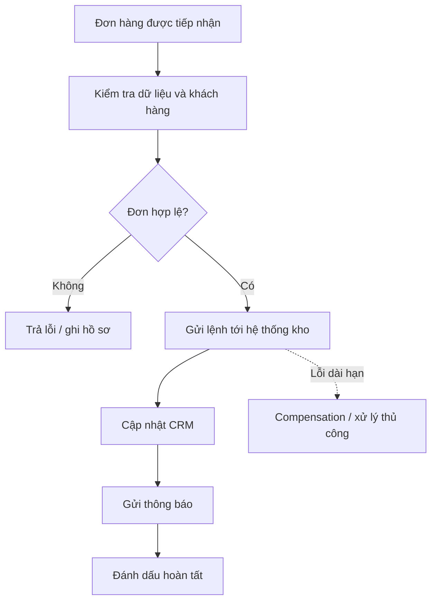
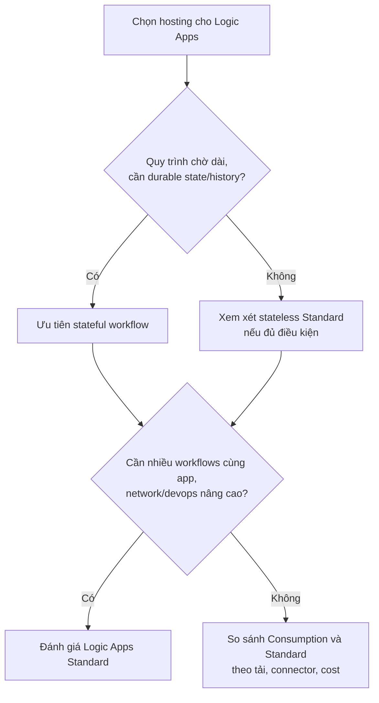
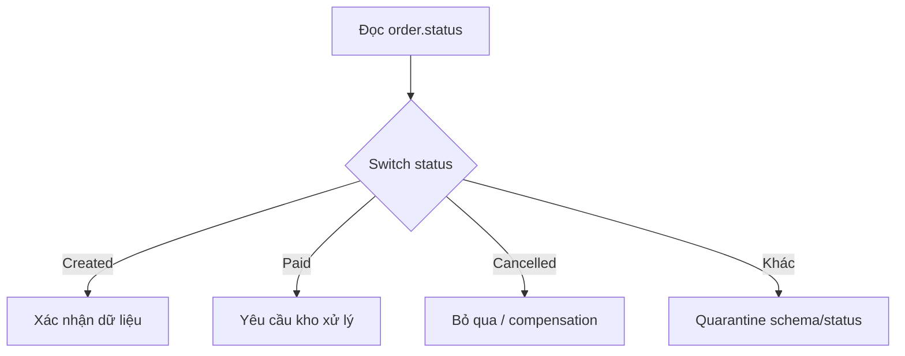
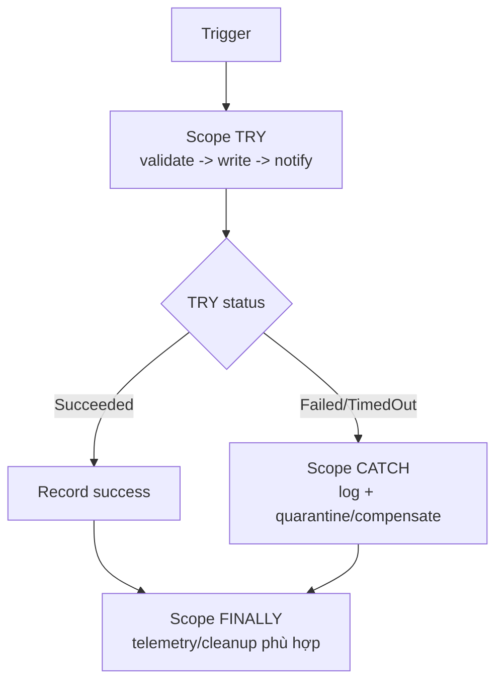
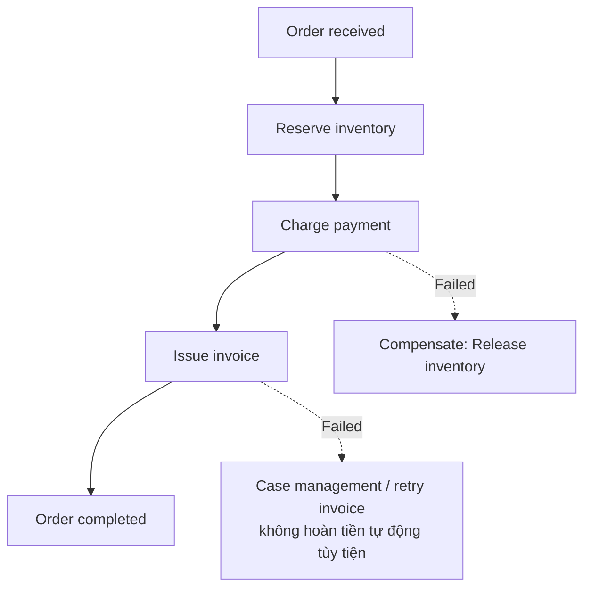
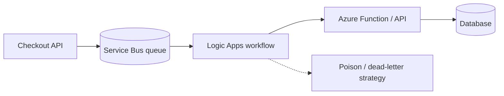
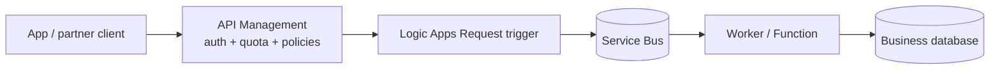
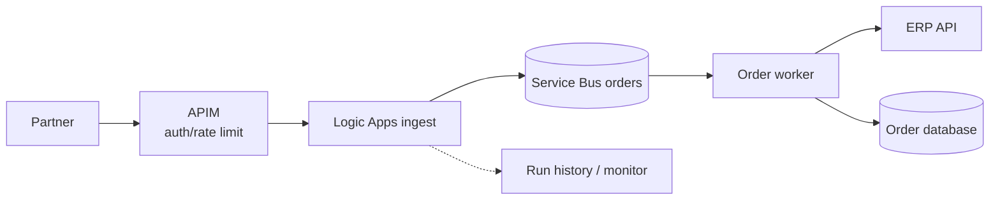
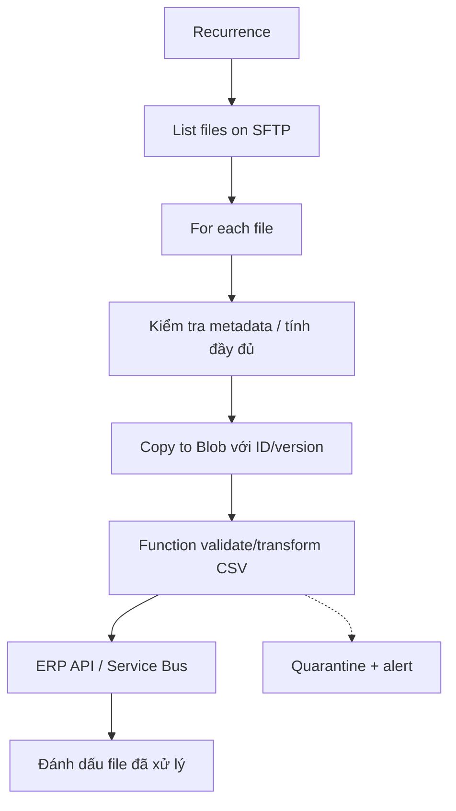

# Logic Apps và mô hình workflow tích hợp

Một doanh nghiệp có hệ thống bán hàng, kế toán, kho, email và CRM. Sau khi khách đặt hàng, hệ thống phải xác thực yêu cầu, lưu đơn vào cơ sở dữ liệu, gửi lệnh tới bộ phận kho, thông báo khách hàng và cập nhật CRM. Một số bước cần chạy ngay, một số phải chờ đối tác phản hồi; khi bước sau thất bại, tổ chức không thể đơn giản “chạy lại toàn bộ” vì có nguy cơ tạo hóa đơn hoặc gửi email trùng.

**Azure Logic Apps** là dịch vụ của Microsoft Azure để **thiết kế, chạy và giám sát quy trình tích hợp theo workflow**, kết nối hệ thống thông qua các **triggers**, **actions** và **connectors**. Thay vì chỉ viết các cuộc gọi API nối tiếp trong một web request, bạn có thể biểu diễn từng bước nghiệp vụ, nhánh điều kiện, chờ đợi, thử lại, quản lý trạng thái và xử lý lỗi thành một luồng có thể quan sát.

Bài học thuộc chương **API và tích hợp quy trình** của module **CLOUD_PROVIDERS_AZURE**. Module khám phá Azure từ subscription, resource group và Microsoft Entra ID đến mạng, tính toán, lưu trữ, dữ liệu; đồng thời học cách triển khai, giám sát, bảo vệ và kiểm soát chi phí một kiến trúc ứng dụng trên Azure. Trong bức tranh đó, Logic Apps nằm ở **lớp orchestration và integration**, phối hợp API Management, Azure Functions, Service Bus, Event Grid, Storage, SQL và các hệ thống SaaS/on-premises.

**Sau bài học, bạn có thể:**

- Phân biệt **workflow orchestration** với API, queue, event routing và mã xử lý nghiệp vụ.
- Giải thích **trigger, action, connector, control action, run, run history** và Workflow Definition Language.
- So sánh **Logic Apps Consumption** với **Logic Apps Standard**, đặc biệt **stateful/stateless**.
- Thiết kế workflow HTTP, theo lịch hoặc dựa trên sự kiện; sử dụng condition, switch, foreach, scope và run-after.
- Quản lý **retry, timeout, idempotency, dead-letter/quarantine, compensation** và tính nhất quán giữa các hệ thống.
- Kết nối an toàn bằng Microsoft Entra ID, managed identity, API connections, Private Endpoint/VNet khi được hỗ trợ.
- Thiết lập monitoring, alert, kiểm soát concurrency, triển khai bằng IaC/CI-CD và tối ưu chi phí.

## 1. Khi nào cần một workflow tích hợp?

Một workflow là chuỗi hoạt động có điểm bắt đầu, điều kiện rẽ nhánh, trạng thái, kết quả và quy tắc xử lý sự cố.

Ví dụ:



Logic Apps phù hợp khi giá trị chính nằm ở **việc điều phối các hệ thống**, ví dụ:

- Đồng bộ thông tin khách hàng giữa CRM và ERP.
- Nhận HTTP/webhook rồi ghi sự kiện vào Service Bus.
- Định kỳ lấy tệp từ SFTP, kiểm tra dữ liệu và lưu Azure Blob Storage.
- Nhận sự kiện từ Event Grid và gọi Azure Function xử lý.
- Điều phối quy trình phê duyệt có trạng thái và thời gian chờ.
- Kết nối hệ thống SaaS/on-premises bằng connectors phù hợp.

Logic Apps **không thay thế toàn bộ code**. Logic phức tạp về tính toán, mô hình dữ liệu chuyên sâu, xử lý CPU lớn hoặc thuật toán cần test tự động chi tiết thường nên ở Azure Functions, API hoặc ứng dụng riêng; Logic Apps gọi chúng và điều phối kết quả.

### 1.1. Orchestration khác choreography

| Mô hình | Cách phối hợp | Ưu điểm | Đổi lại |
|---|---|---|---|
| **Orchestration** | Một workflow chủ động gọi/điều phối các bước | Luồng nghiệp vụ rõ, dễ nhìn thứ tự và lỗi | Orchestrator có thể phụ thuộc nhiều hệ thống |
| **Choreography** | Các dịch vụ tự phản ứng với event, không có bộ điều phối duy nhất | Giảm coupling trực tiếp, mở rộng theo event | Khó theo dõi toàn bộ tiến trình nếu thiếu correlation |
| **Kết hợp** | Event Grid/Service Bus kích hoạt workflow, workflow gọi API/Function và phát event tiếp | Vừa tách hệ thống vừa giữ tiến trình quan trọng | Cần quản trị hai mô hình retry và trace |

Chọn orchestration khi quy trình có các bước bắt buộc, nhánh và kết quả cần giám sát tập trung. Chọn choreography khi nhiều dịch vụ phản ứng độc lập với một sự kiện. Không phải mọi microservice interaction đều cần Logic Apps.

## 2. Các thành phần cơ bản của Logic Apps

| Thành phần | Định nghĩa | Ví dụ |
|---|---|---|
| **Logic app resource** | Tài nguyên chứa workflow hoặc host của nhiều workflows tùy hosting model | `la-orders-prod` |
| **Workflow** | Định nghĩa quy trình và trạng thái thực thi | `ProcessOrder` |
| **Trigger** | Điều kiện/sự kiện bắt đầu một workflow run | Request, Recurrence, Service Bus message |
| **Action** | Bước xử lý sau khi trigger kích hoạt | HTTP call, SQL insert, Compose, Condition |
| **Connector** | Tích hợp có sẵn với dịch vụ Azure, SaaS hay hệ ngoài | Service Bus, SQL, Outlook, SFTP |
| **Control action** | Điều kiện, lặp, chia nhánh, gom lỗi | Condition, Switch, For each, Until, Scope |
| **Run** | Một lần workflow được thực thi từ trigger | Run của `order-42` |
| **Run history** | Bản ghi trạng thái/đầu vào/đầu ra, thời gian chạy tùy loại workflow | Thấy action nào Failed/Skipped |
| **Workflow Definition Language (WDL)** | Biểu diễn workflow và expressions dưới dạng JSON | `@triggerBody()?['orderId']` |

Trong giao diện Designer, người dùng kéo thả các khối. Nhưng workflow thực chất vẫn là **định nghĩa có cấu trúc**; cần review JSON/IaC khi thay đổi phức tạp để tránh logic bị ẩn sau giao diện.

### 2.1. Trigger khác action

Một workflow có điểm khởi động do **trigger** xác định; sau đó thực hiện **actions** theo quan hệ phụ thuộc. Ví dụ:

```text
Trigger: When an HTTP request is received
  -> Action: Parse JSON / Validate input
  -> Action: Get customer
  -> Action: Condition
      -> true: Send message to Service Bus
      -> false: Write rejection record
  -> Action: Response
```

Một workflow run có thể gồm nhiều actions, và các actions có thể thực thi tuần tự hoặc song song tùy cấu hình. **Action Succeeded** nghĩa action đó hoàn tất theo hợp đồng của nó, **không** có nghĩa toàn bộ giao dịch nghiệp vụ đã được commit chính xác một lần.

### 2.2. Runtime và quản lý trạng thái

Logic Apps runtime chịu trách nhiệm kích hoạt workflow, chạy các bước, xử lý input/output, lỗi và theo dõi trạng thái theo hosting model. Với các quy trình kéo dài, stateful execution giúp bền vững hóa tiến độ; với luồng ngắn, stateless có thể giảm overhead trong môi trường hỗ trợ.

Không giả định mọi workflow chạy cùng timeout, retention hoặc hành vi lưu history: các giới hạn phụ thuộc **Consumption/Standard, stateful/stateless, connector và cấu hình dịch vụ**.

## 3. Consumption và Standard: chọn hosting model

Azure Logic Apps có hai mô hình triển khai quan trọng: **Consumption** và **Standard**.

| Tiêu chí | **Consumption** | **Standard** |
|---|---|---|
| Mô hình tài nguyên | Một workflow thường gắn với một Logic App Consumption resource | Một Logic App Standard resource có thể chứa nhiều workflows |
| Cách chạy | Multi-tenant runtime theo mô hình consumption | Single-tenant runtime theo mô hình Standard/Workflow Standard hosting |
| Thanh toán chính | Thường dựa trên trigger/action executions và connector usage theo pricing model | Capacity/compute của hosting plan, cộng các khoản connector/Storage/network tùy tính năng |
| Workflow state | Workflow chạy có quản lý state theo mô hình Consumption | Có **stateful** và **stateless** workflows |
| Tích hợp mạng | Khả năng networking phụ thuộc connector/service và môi trường | Có các lựa chọn VNet integration, private networking theo plan/tính năng |
| Triển khai | Resource và workflow definition theo ARM/IaC | Application project nhiều workflows, settings, artifacts, deployment pipeline |
| Mục tiêu | Automation/integration theo nhu cầu, ít quản trị host | Nhiều workflow cùng app, kiểm soát runtime/mạng và quy trình DevOps |

**Standard không đồng nghĩa chạy trên máy chủ do bạn tự quản**, và **Consumption không đồng nghĩa không có chi phí cố định nào khác**: API connection, Storage, network và các dịch vụ liên quan có thể phát sinh phí riêng. Cần xem biểu giá và giới hạn thực tế ở region/SKU/connector đang dùng.

### 3.1. Stateful workflow trong Standard

Phù hợp cho:

- Quy trình dài, có chờ phản hồi/approval.
- Luồng nhiều bước có yêu cầu xem run history và trạng thái chi tiết.
- Workflow cần phục hồi sau gián đoạn host theo cơ chế runtime.
- Tích hợp có thời gian chờ không ngắn và nhiều dependencies.

Trạng thái được lưu trữ để hỗ trợ khôi phục/quan sát theo cấu hình; điều đó không tự tạo **distributed transaction** giữa Azure SQL, SAP và API đối tác.

### 3.2. Stateless workflow trong Standard

Phù hợp cho một số luồng ngắn, latency-sensitive, ít bước, trong giới hạn tính năng và thời lượng thực thi được hỗ trợ:

- Chuyển đổi request/response đơn giản.
- Kiểm tra input rồi gọi một API nội bộ.
- Middleware integration ngắn, không cần ghi từng bước vào persistent run history như stateful.

**Rủi ro:** stateless không có cùng bảo đảm checkpoint/history với stateful, và có giới hạn thời gian/chức năng riêng. Không chọn stateless chỉ để giảm latency cho quy trình chờ phê duyệt nhiều ngày hoặc nghiệp vụ không được mất dữ liệu.

### 3.3. Cây quyết định đơn giản



Kết luận cuối cần dựa trên **khả năng vùng triển khai, loại connector, số actions/run, yêu cầu latency, networking, resilience và TCO**. Đừng chọn SKU chỉ vì một mẫu trên Portal đã được bật sẵn.

## 4. Trigger: Workflow bắt đầu từ đâu?

Logic Apps hỗ trợ những loại trigger phù hợp với từng hình thức tích hợp.

| Loại trigger | Đặc điểm | Trường hợp dùng |
|---|---|---|
| **Request / HTTP** | Workflow được gọi bằng HTTP request khi endpoint được cấu hình | API gateway gọi workflow |
| **Recurrence** | Chạy theo lịch/chu kỳ | Đồng bộ dữ liệu hàng giờ |
| **Polling connector trigger** | Định kỳ kiểm tra có thay đổi/message mới | Kiểm tra nguồn không hỗ trợ push |
| **Webhook / push trigger** | Nguồn gửi thông báo tới endpoint/callback | Event-driven integration |
| **Service Bus trigger** | Kích hoạt khi có message ở queue/subscription theo hỗ trợ | Workflow xử lý command |
| **Event Grid trigger** | Nhận sự kiện từ Event Grid theo connector/tính năng | Workflow phản ứng BlobCreated |

### 4.1. Polling vs push

**Polling** có thể tăng số lần kiểm tra không có dữ liệu, tạo độ trễ phụ thuộc khoảng poll và tính phí cho các lần kiểm tra theo model. **Push/webhook** phản ứng nhanh khi nguồn hỗ trợ, nhưng cần quản lý endpoint, authentication, retry và validation.

Không giả định mọi connector dùng push; tên “When a record is added” vẫn có thể được triển khai bằng polling. Hãy xem connector reference và throughput/rate limits trước khi quyết định.

### 4.2. Recurrence và múi giờ

Workflow chạy theo lịch cần xác định:

- Frequency và interval (phút/giờ/ngày/tuần).
- Time zone/UTC offset và các thay đổi giờ mùa hè nếu liên quan.
- Trường hợp lịch chạy trùng với lần trước chưa hoàn tất.
- Concurrency giữa nhiều runs của cùng workflow.
- Missed schedule, retry và cách chạy bù có kiểm soát.

Ví dụ xử lý đơn hằng ngày vào đầu giờ làm việc tại Việt Nam cần định nghĩa **múi giờ và ngày kinh doanh** chứ không chỉ cố định một chuỗi giờ UTC không được kiểm chứng.

### 4.3. Khi Request trigger tạo callback URL

HTTP Request trigger có thể cung cấp callback URL để gọi workflow. Tùy mô hình, URL có thể chứa **SAS signature hoặc thông tin truy cập nhạy cảm**. Đừng dán URL thật vào tài liệu, ticket công khai, log hoặc source code.

Nếu workflow được dùng như public API, nên xem xét **API Management (APIM)** ở phía trước để xử lý authentication, rate limiting, policy, versioning và logging. Trong mọi trường hợp phải xác minh các chế độ authorization thực tế mà hosting model/trigger hỗ trợ.

## 5. Actions và connectors: nối các hệ thống

Logic Apps cung cấp nhiều **built-in actions** và **connectors**.

### 5.1. Built-in actions

Nhóm này phục vụ điều phối và xử lý ngay trong workflow runtime, ví dụ:

- **Compose:** tạo/biến đổi một giá trị từ biểu thức và input.
- **Condition / Switch:** chọn nhánh theo giá trị.
- **For each / Until:** lặp qua collection hoặc cho tới khi có điều kiện.
- **Scope:** gom các actions để quản lý lỗi/run-after.
- **Terminate:** kết thúc run theo trạng thái được chọn.
- **Delay / Delay until:** tạm dừng theo cơ chế được hỗ trợ.
- **Parse JSON:** đọc cấu trúc dữ liệu để dùng field thuận tiện.

Đây là các action logic; một số thao tác HTTP, Service Bus hay Storage cũng có **built-in connector** trong Standard theo khả năng hỗ trợ. Đừng dùng từ “built-in” như thể tất cả actions đều miễn phí hoặc không có latency.

### 5.2. Managed connectors và API connections

**Managed connectors** kết nối tới SaaS, hệ thống doanh nghiệp hoặc dịch vụ Azure và thường có **API connection resources** để lưu metadata/authorization theo thiết kế. Ví dụ:

- Azure SQL, Service Bus, Storage.
- Office 365 Outlook, SharePoint, Teams.
- Salesforce, SFTP và những hệ thống được connector catalog hỗ trợ.

Mỗi connector có:

1. **Operations và trigger types** cụ thể.
2. Cơ chế authentication (OAuth, managed identity nếu hỗ trợ, API key, v.v.).
3. Service/connector limits, throttling và pagination.
4. Network options riêng, không giống mọi connector khác.
5. Khả năng hỗ trợ theo plan/region và pricing riêng.

**Không suy rằng mọi connector đều hỗ trợ managed identity hoặc Private Endpoint.** Cần xác minh ở chính operation/connection type; không gán một identity rồi giả định connector đã dùng nó.

### 5.3. Custom connectors và HTTP actions

Nếu hệ thống chưa có connector sẵn, có thể:

- Dùng **HTTP action** với authentication được hỗ trợ để gọi API.
- Đưa API nội bộ qua **Azure API Management** rồi gọi từ workflow.
- Xây **custom connector** khi phù hợp với quyền phát hành/duy trì và môi trường hỗ trợ.
- Đưa nghiệp vụ phức tạp vào **Azure Functions** hoặc API service, để Logic Apps chỉ điều phối.

Không đưa secret vào trực tiếp URI/query string của HTTP action hoặc output logs. Dùng managed identity, Key Vault, connector configuration và `secure inputs/outputs` khi phù hợp.

## 6. Workflow Definition Language (WDL) và JSON

Logic Apps workflow có cấu trúc **JSON definition** mô tả triggers, actions, dependencies, parameters và expressions. Designer là cách tạo/sửa trực quan; JSON/code view và IaC cho phép review, kiểm thử và lưu version.

Ví dụ minh họa tối giản **Request → Compose → Response**:

```json
{
  "$schema": "https://schema.management.azure.com/providers/Microsoft.Logic/schemas/2016-06-01/workflowdefinition.json#",
  "contentVersion": "1.0.0.0",
  "parameters": {},
  "triggers": {
    "When_HTTP_request_received": {
      "type": "Request",
      "kind": "Http",
      "inputs": {
        "schema": {
          "type": "object",
          "properties": {
            "orderId": {
              "type": "string"
            }
          },
          "required": ["orderId"]
        }
      }
    }
  },
  "actions": {
    "Compose_order_id": {
      "type": "Compose",
      "inputs": "@triggerBody()?['orderId']",
      "runAfter": {}
    },
    "Respond_to_caller": {
      "type": "Response",
      "kind": "Http",
      "inputs": {
        "statusCode": 200,
        "body": {
          "status": "validated-example",
          "orderId": "@outputs('Compose_order_id')"
        }
      },
      "runAfter": {
        "Compose_order_id": ["Succeeded"]
      }
    }
  },
  "outputs": {}
}
```

**Ý nghĩa:**

- Trigger nhận JSON có trường `orderId`.
- `Compose_order_id` đọc `orderId` từ trigger body.
- `Respond_to_caller` chỉ chạy khi Compose **Succeeded**.
- Ví dụ trả HTTP 200 với trạng thái **validated-example**; **chưa ghi đơn hàng, chưa có xử lý nghiệp vụ hoặc durable handoff**.

Đây là **workflow definition minh họa**, không phải một ARM/Bicep resource hoàn chỉnh. Khi triển khai vào Consumption/Standard phải tuân theo cấu trúc resource/project, authentication, runtime/plan và các cài đặt tương ứng. **Không được đổi status ví dụ thành “order accepted/processed” khi chưa thực sự ghi bền vững**.

### 6.1. HTTP request kiểm thử

Với một callback URL **đã được cung cấp trong môi trường lab và được phép sử dụng**:

```bash
curl -X POST "<LOGIC_APP_CALLBACK_URL>" \
  -H "Content-Type: application/json" \
  -d '{"orderId":"order-42"}'
```

Không dán callback URL thật chứa signature vào ví dụ public. Nếu workflow có authentication khác, phải gửi token/header theo policy được phê duyệt. Request trên **sẽ khởi chạy workflow** nếu URL thật hợp lệ — không phải lệnh chỉ đọc.

## 7. Expressions, dynamic content và biến

Logic Apps dùng **WDL expressions** để đọc input/output và biến đổi giá trị.

| Expression | Ý nghĩa |
|---|---|
| `@triggerBody()?['orderId']` | Đọc trường `orderId` từ trigger body một cách null-safe ở mức property |
| `@outputs('Compose_order_id')` | Lấy output của action `Compose_order_id` |
| `@coalesce(triggerBody()?['customerId'], 'unknown')` | Dùng fallback khi giá trị đầu tiên null |
| `@concat('orders/', triggerBody()?['orderId'])` | Ghép chuỗi làm key/tên logic |
| `@utcNow()` | Lấy timestamp UTC tại thời điểm expression chạy |
| `@variables('attemptCount')` | Đọc giá trị biến đã khai báo |
| `@items('For_each_order')?['id']` | Đọc item của vòng lặp tên `For_each_order` |

Expressions có giới hạn type, escaping và null handling. Ví dụ, `@coalesce(...)` không tự biến một chuỗi rỗng thành giá trị khác trong mọi trường hợp; cần kiểm tra điều kiện thực tế. Dynamic content được lấy từ một connector không phải dữ liệu mặc định đáng tin: vẫn phải kiểm tra schema, length, giá trị và authorization trước khi gọi hệ thống đích.

### 7.1. Parse JSON và schema evolution

Nếu action HTTP trả dữ liệu thay đổi theo version, Parse JSON cứng nhắc có thể thất bại khi nhà cung cấp bổ sung/bỏ field. Nên:

- Khai báo field bắt buộc và tùy chọn có chủ đích.
- Version hóa schema khi payload thuộc quyền kiểm soát tổ chức.
- Dùng fallback có kiểm soát cho optional fields.
- Phân biệt dữ liệu hỏng vĩnh viễn với lỗi connector tạm thời.
- Không cố parse cả HTML error page như JSON thành công.

Khi dùng **Apply to each**, không phải mọi output action là array. Kiểm tra kiểu dữ liệu trước khi chọn loop để tránh lỗi runtime.

## 8. Control flow: Condition, Switch, For each, Until

### 8.1. Condition và Switch

**Condition** dùng cho phép kiểm tra đúng/sai, ví dụ tổng tiền vượt ngưỡng thì cần phê duyệt. **Switch** phù hợp khi xử lý nhiều trạng thái rõ ràng như `Created`, `Paid`, `Cancelled`.



Không nên đặt nhiều điều kiện chồng chéo khiến hai nhánh cùng tạo một side effect. Kiểm tra giá trị rỗng, trạng thái chưa biết và case mặc định.

### 8.2. For each và concurrency

`For each` xử lý collection. Một số môi trường/actions cho phép tăng **concurrency** để chạy nhiều iterations song song. Điều này tăng throughput nhưng có rủi ro:

- Kết quả không theo thứ tự input.
- Shared variables bị thay đổi đồng thời và gây race condition.
- Connector/SaaS bị throttling.
- Một API idempotent chưa được thiết kế cho nhiều lần gọi song song.

Ví dụ phải phát hành số thứ tự hóa đơn tăng dần không nên dựa vào việc mọi iteration trong `For each` hoàn tất theo thứ tự của array. Nên chuyển sequencing vào database hoặc một consumer theo khóa nghiệp vụ.

### 8.3. Until và giới hạn vòng lặp

`Until` lặp đến khi điều kiện thành công hoặc đạt giới hạn lần lặp/thời gian theo cấu hình. Dùng khi cần kiểm tra trạng thái job của đối tác:

```text
POST /export-jobs -> jobId
Until status in [Completed, Failed]:
    GET /export-jobs/{jobId}
    Delay theo policy
Khi Completed: tải kết quả
Khi Failed/timeout: báo lỗi và xử lý
```

Không poll API đối tác mỗi 10 ms trong 20 phút nếu họ có rate limit. Chọn khoảng delay, timeouts và condition fail-fast phù hợp; tốt hơn có thể dùng callback/webhook nếu đối tác hỗ trợ.

### 8.4. Parallel branches

Sau khi ghi đơn hàng, gửi email và cập nhật CRM có thể chạy song song **nếu hai tác vụ độc lập**. Nếu tạo hóa đơn phụ thuộc kết quả thanh toán, không chạy song song để tiết kiệm vài giây mà làm sai thứ tự nghiệp vụ.

## 9. Run-after và mô hình Try/Catch/Finally

Mỗi action có trạng thái, chẳng hạn:

- `Succeeded`: action hoàn tất theo contract.
- `Failed`: action báo lỗi.
- `TimedOut`: action vượt điều kiện timeout.
- `Skipped`: action không được chạy do dependencies/nhánh.

**Configure run after** định nghĩa action tiếp theo chạy khi action trước nằm trong những trạng thái nào.

### 9.1. Scope để nhóm actions

Một mô hình dễ vận hành:



Ở Designer, tạo `Scope_Try` với các actions nghiệp vụ, rồi:

1. Cấu hình `Scope_Catch` chạy sau `Scope_Try` khi **Failed** hoặc **TimedOut**.
2. Cấu hình bước cleanup/telemetry chạy sau các nhánh thành công/lỗi thích hợp.
3. Đặt trạng thái cuối workflow rõ ràng nếu lỗi cần được phản ánh cho người gọi.
4. Không để Catch vô tình **nuốt** lỗi rồi coi toàn bộ quy trình là thành công.

### 9.2. Trích đoạn runAfter

```json
{
  "Scope_Catch": {
    "type": "Scope",
    "actions": {},
    "runAfter": {
      "Scope_Try": [
        "Failed",
        "TimedOut"
      ]
    }
  }
}
```

Đây là **trích đoạn cấu trúc action** để minh họa mối quan hệ phụ thuộc, không phải workflow hoàn chỉnh. Khi TRY có nhiều nhánh và outcomes hỗn hợp, status tổng của scope và cách propagation có thể cần kiểm tra trên run history thực tế.

### 9.3. Catch không phải rollback tự động

Logic Apps **không tự đảo ngược** một HTTP POST, một hàng SQL đã commit hoặc email đã gửi khi một bước sau thất bại. Cần định nghĩa hành động compensation và ý nghĩa nghiệp vụ của việc đảo ngược.

Ví dụ: đã giữ chỗ hàng trong kho nhưng thanh toán thất bại; compensation có thể là **ReleaseReservation**, không phải “undo tất cả SQL write” bằng một thao tác chung.

## 10. Retry, timeout và throttling ở các actions

Connector/HTTP actions có thể có retry policy theo loại action/runtime, trong đó thường gặp **fixed, exponential hoặc none** theo khả năng hỗ trợ.

### 10.1. Retry đúng trường hợp

| Lỗi | Có nên retry? | Lưu ý |
|---|---|---|
| HTTP 429 hoặc throttling | Thường có, với backoff và server guidance nếu hỗ trợ | Tôn trọng rate limit |
| HTTP 502/503/504 tạm thời | Thường có | Kiểm soát attempt count và deadline |
| Network timeout sau gửi POST | Có thể nhưng **kết quả không chắc** | Cần idempotency key |
| HTTP 400 do payload sai | Thường không | Sửa schema/contract |
| HTTP 401/403 do thiếu quyền | Không retry vô hạn | Kiểm tra auth, identity, policy |
| API trả 409 conflict | Tùy ngữ nghĩa | Có thể là duplicate đã xử lý hoặc conflict thật |

**Không coi retry là transaction safety.** Ví dụ Logic Apps gọi API tạo hóa đơn, API đã commit rồi response bị timeout. Retry tạo hóa đơn thứ hai nếu API không có idempotency.

### 10.2. Exponential backoff và tổng deadline

Một dạng chờ thường gặp:

\[
d_n = \min(d_{\max}, d_0 \cdot 2^n)
\]

Kết hợp **jitter** giúp nhiều workflow runs không cùng retry một lúc. Trong Logic Apps, runtime/connector có retry policy và giới hạn riêng: không tự giả định tất cả connectors cho phép tùy chỉnh mọi tham số hoặc tự chèn jitter theo đúng thuật toán bạn mong muốn.

Nên tính:

1. Timeout cho mỗi HTTP/connector action.
2. Số lần retry và thời gian chờ.
3. Overall deadline của workflow/caller.
4. Khả năng connector đã retry nội bộ trước khi action báo lỗi.
5. Retry ở broker/trigger nếu workflow được kích hoạt qua message.

Nếu caller HTTP chờ 5 giây nhưng workflow có ba action mỗi action retry tới hàng phút, cần thiết kế **asynchronous acknowledgement** thay vì giữ client connection mãi.

### 10.3. Retry storm và connector limits

Giả sử 500 Logic Apps runs cùng gọi một SaaS CRM, mỗi run retry 5 lần khi CRM bị throttled. Tổng số attempts có thể tăng mạnh. Giải pháp:

- Giới hạn **trigger concurrency** và loop concurrency.
- Batching hoặc queue trung gian.
- Rate limiting ở APIM/producer theo nhu cầu.
- Exponential retry và cooldown/circuit-breaker ở lớp ứng dụng nếu cần.
- Cảnh báo rate limit, tăng capacity hoặc đàm phán quota đối tác.

Không cố giải quyết lỗi 429 bằng cách tạo thêm workflows song song vô điều kiện.

## 11. Idempotency và chống xử lý trùng

Một request, event hay message có thể được gửi lại vì:

- Trigger/connector retry khi response bị mất.
- Hệ thống nguồn phát lại cùng event.
- User nhấn nút hai lần.
- Một workflow run được **resubmit** thủ công.
- Workflow có một nhánh thất bại rồi operator chạy lại toàn bộ.

**Mỗi workflow run ID khác nhau không có nghĩa đó là nghiệp vụ khác nhau.** Cần khóa idempotency do business quyết định.

### 11.1. Khóa nghiệp vụ

Ví dụ:

```json
{
  "schemaVersion": 1,
  "orderId": "order-42",
  "commandId": "issue-invoice-order-42-v1",
  "source": "checkout-api"
}
```

Nếu hai runs cùng xử lý `commandId` này, hệ thống ghi hóa đơn chỉ nên thực hiện một lần. Khóa có thể là `commandId` hoặc `orderId + action` theo contract.

### 11.2. Inbox pattern

Một API/Function do Logic Apps gọi có thể thực hiện:

```text
BEGIN DATABASE TRANSACTION
  INSERT Inbox(consumer, commandId)
      với UNIQUE(consumer, commandId)
  IF duplicate:
      RETURN "already_processed"
  ELSE:
      INSERT Invoice(...)
      UPDATE OrderStatus(...)
COMMIT
```

Đây là pseudocode, **không phải SQL hoàn chỉnh**. Quan trọng là **dấu inbox và business write phải cùng transaction** hoặc dùng conditional writes tương đương. Nếu chỉ ghi “đã xử lý” trước rồi sau đó business write thất bại, lần retry có thể bị bỏ qua và mất nghiệp vụ.

### 11.3. Chuyển giao bền vững trước HTTP 202

Một Logic Apps workflow nhận HTTP request có thể:

1. Validate dữ liệu đầu vào.
2. Ghi command vào Service Bus hoặc durable inbox.
3. Nhận ACK rằng dữ liệu đã được accepted bởi nơi lưu.
4. Trả HTTP `202 Accepted` cùng correlation ID.
5. Một worker xử lý nghiệp vụ dài, có retry/DLQ riêng.

**HTTP 202 là accepted, không phải completed.** Client cần endpoint tra cứu trạng thái hoặc callback để biết kết quả cuối cùng. Nếu gửi Service Bus thất bại, không được trả 202 rồi bỏ qua lỗi.

## 12. Saga và compensation cho giao dịch nhiều hệ

Ví dụ đặt hàng:



Mỗi bước có **side effect** và cần quyết định:

- Có retry được an toàn không?
- API đích có idempotency key không?
- Khi thành công một phần, bước compensation là gì?
- Compensation có thể thất bại không? Ai trực incident?
- Trạng thái workflow nào đại diện `PendingManualReview`?

Logic Apps có thể điều phối saga, nhưng **không có distributed ACID transaction mặc định** giữa kho, cổng thanh toán và CRM. Một số hành động có thể không đảo ngược được hoàn toàn (email đã gửi, tiền đã chuyển). Compensation thường là **một nghiệp vụ ngược có audit**, không phải xóa lịch sử.

## 13. Message-driven workflow với Service Bus

Tích hợp Service Bus phù hợp để tách producer khỏi workflow xử lý:



### 13.1. Cần hiểu cơ chế connector

Tùy connector/trigger operation, workflow có thể nhận message theo **polling**, trigger callback hoặc cơ chế riêng. Việc **complete/abandon/dead-letter** có thể tự động hoặc cần action riêng nếu operation hỗ trợ. Không giả định mọi Service Bus connector trong Consumption/Standard có cùng hành vi settlement.

Khi thiết kế:

1. Chọn queue hay topic/subscription.
2. Xác định timeout, lock duration, delivery count và MaxDeliveryCount.
3. Đảm bảo message handler **idempotent** vì redelivery có thể xảy ra.
4. Xác nhận khi nào message được complete; có phụ thuộc toàn bộ workflow hay action riêng không.
5. Có DLQ/quarantine và quy trình replay.
6. Theo dõi queue depth, oldest message age và consumer processing SLO.

**Điểm cần tránh:** workflow trả thành công sau khi gửi một email nhưng **trước** khi ghi database, khiến message bị complete dù nghiệp vụ chưa hoàn thành. Thiết kế settlement phải khớp trạng thái **durable business outcome**.

## 14. Event-driven workflow với Event Grid và Event Hubs

### 14.1. Event Grid

Event Grid thường phù hợp để thông báo rằng một tài nguyên đã thay đổi (BlobCreated, resource event, custom event). Logic Apps có thể nhận event qua connector/trigger hoặc một endpoint tích hợp được hỗ trợ.

Với mô hình Event Grid push, cần:

- Hiểu delivery retry, TTL và khả năng duplicate.
- Dùng **event ID/source** và business key để idempotent.
- Không giả định thứ tự giao event.
- Có dead-letter destination/monitoring nếu loại subscription hỗ trợ.
- Nếu xử lý dài, bàn giao bền vững sang queue/worker.

### 14.2. Event Hubs

Event Hubs phù hợp dòng dữ liệu streaming theo partitions/consumer groups, không giống queue giao nhiệm vụ theo message settlement. Nếu muốn mỗi event kích hoạt xử lý chuyên sâu, cần tính throughput, batching, checkpoint và replay. Với stream rất lớn, **Azure Functions Event Hubs trigger hoặc dịch vụ stream processing** có thể phù hợp hơn Logic Apps làm từng action cho mỗi event.

### 14.3. Không tạo vô số workflows cho telemetry

Một luồng telemetry 100.000 events/giây không nên tự động biến thành 100.000 workflow runs với nhiều API calls nếu chi phí, concurrency, connector quotas và nhu cầu xử lý không cho phép. Đôi khi nên dùng Event Hubs + Functions/Stream Analytics để gom/tổng hợp, rồi **chỉ gọi Logic Apps cho những trường hợp nghiệp vụ cần orchestration**.

## 15. API Management và Logic Apps

**Azure API Management (APIM)** có thể là cổng vào cho một workflow HTTP:



APIM thường đảm nhiệm:

- Xác thực client theo OAuth 2.0/JWT hoặc phương thức được duyệt.
- Rate limit/quota, kiểm tra headers, versioning, transformation khi phù hợp.
- Che giấu callback URL backend khỏi client và kiểm soát routing.
- Theo dõi API analytics, correlation và policy.

Logic Apps đảm nhiệm **workflow orchestration**. Service Bus đảm nhiệm **durable message buffer/decoupling**. Worker/API đảm nhiệm **business logic và transaction**. Tách trách nhiệm giúp tránh đặt toàn bộ logic phức tạp vào APIM policies hoặc một luồng Logic Apps khó kiểm thử.

**Lưu ý:** APIM trước Logic Apps không tự bảo vệ backend nếu Logic Apps Request URL vẫn có thể được gọi trực tiếp. Cần thiết kế authentication/authorization và network restrictions tại backend theo tính năng được hỗ trợ.

## 16. Kết nối an toàn: Microsoft Entra ID và managed identity

### 16.1. Danh tính workflow

Một Logic App có thể sử dụng **system-assigned** hoặc **user-assigned managed identity** theo hosting model và connector/action hỗ trợ để lấy token khi truy cập Azure resources.

Ví dụ workflow ghi Blob hoặc gửi Service Bus:

| Hoạt động | Quyền data plane cần xem xét |
|---|---|
| Đọc Blob | `Storage Blob Data Reader` trên scope phù hợp |
| Ghi Blob | `Storage Blob Data Contributor` hoặc role tối thiểu tương đương |
| Gửi Service Bus message | `Azure Service Bus Data Sender` |
| Nhận Service Bus message | `Azure Service Bus Data Receiver` |
| Gọi API yêu cầu Entra token | App role/scope API đích hoặc RBAC phù hợp với principal |

**Azure Contributor trên resource group không phải mặc định là quyền đọc/ghi data plane.** Ngược lại, có data-plane role không có nghĩa identity được phép sửa Logic App resource hoặc đổi workflow definition.

### 16.2. API connection authorization

Một số managed connectors lưu cấu hình kết nối qua API connection resource, có thể yêu cầu:

- Consent OAuth của tài khoản cá nhân/dịch vụ.
- App registration hoặc service principal khi hỗ trợ.
- Connection string/API key theo phương thức riêng.
- Managed identity nếu connector operation hỗ trợ.

Quyền và token có thể hết hiệu lực, bị thu hồi khi nhân viên rời công ty hoặc cần refresh. Đừng gắn mọi production connector vào **tài khoản cá nhân của người phát triển** mà không có owner và runbook rotation/re-authorization.

### 16.3. Secrets, Key Vault và logs

Đối với thông tin bí mật:

1. Ưu tiên managed identity/OAuth có kiểm soát hơn secret tĩnh nếu dịch vụ hỗ trợ.
2. Nếu cần secret, dùng **Azure Key Vault**, app settings hoặc connection configuration theo mô hình hỗ trợ.
3. Bật **secure inputs/outputs** ở những actions xử lý dữ liệu nhạy cảm khi được hỗ trợ, hiểu rằng cấu hình này ảnh hưởng run history/debugging.
4. Bảo vệ callback URL, API connection details, deployment pipelines và diagnostics.
5. Giới hạn người đọc run history vì payload có thể chứa PII, access token hoặc nội dung chứng từ.

**Secure inputs/outputs không biến logging tự viết thành an toàn** nếu workflow hoặc downstream vẫn ghi token ra hệ thống khác. Cần review toàn bộ đường đi dữ liệu.

## 17. Networking: public/private, VNet và hybrid

Đường kết nối có thể gồm:

```text
Client/Partner -> APIM -> Logic Apps endpoint
Logic Apps -> Azure SQL Private Endpoint
Logic Apps -> Service Bus / Key Vault / SaaS
Logic Apps -> On-premises API qua đường kết nối được hỗ trợ
```

### 17.1. Outbound và inbound là hai chiều độc lập

- **Outbound VNet integration** của Logic Apps Standard theo cấu hình hỗ trợ giúp workflow truy cập dependency trong VNet/Private Endpoint.
- **Inbound private access** cần thiết kế riêng, chẳng hạn private endpoint/access restrictions hoặc gateway tương ứng theo hosting model/tính năng.
- **Một app có VNet integration không đồng nghĩa Request trigger đã đóng public Internet**.
- Consumption có các giới hạn và phương án mạng khác Standard; không áp dụng nguyên sơ một sơ đồ VNet của Standard cho Consumption.

### 17.2. Private DNS và firewalls

Nếu workflow gọi Azure SQL, Storage, Key Vault hoặc Service Bus qua Private Link:

1. Đảm bảo đúng **private endpoint/subresource** ở hệ đích.
2. DNS trong môi trường chạy Logic Apps phải phân giải FQDN chuẩn của dịch vụ sang private IP thích hợp.
3. Routing, NSG/firewall/UDR phải cho phép luồng outbound và đường về.
4. Managed identity/connector phải có quyền data plane.
5. Các dependencies của Logic Apps runtime (Storage, connectors và endpoint platform khi cần) không được chặn.

**Private Endpoint Approved không chứng minh DNS đã đúng.** Việc HTTP action trả 403 sau khi TCP/TLS thành công thường cần điều tra auth/policy; timeout có thể do network/DNS; phân biệt trước khi sửa.

### 17.3. Kết nối hệ thống on-premises

Tùy connector, môi trường và yêu cầu, có thể dùng **on-premises data gateway**, API trung gian, VPN/ExpressRoute, Azure Relay hoặc các phương thức khác được dịch vụ hỗ trợ. Không coi gateway như một VPN tổng quát tự làm mọi protocol đi qua; nó có phạm vi connector và giới hạn riêng.

Với SAP/SQL/SFTP/ERP, phải xác định:

- Ai sở hữu credential và quyền đọc/ghi?
- Kết nối dùng IP/port/protocol nào?
- DNS và certificate validation ra sao?
- Có proxy, firewall hoặc data residency requirements không?
- Khi gateway hoặc endpoint offline, workflow retry/delay và alert thế nào?

## 18. Quan sát, run history và troubleshooting

### 18.1. Bốn tầng quan sát

| Tầng | Cần theo dõi | Câu hỏi |
|---|---|---|
| Trigger | Trigger fired, skipped, failed, polling delay | Workflow có bắt đầu đúng lúc? |
| Action | Succeeded/Failed/TimedOut/Skipped, duration, retries | Bước nào gây lỗi? |
| Workflow run | Run status, total duration, concurrency, correlation | Quy trình hoàn tất hay chỉ đang chờ? |
| Business outcome | DB commit, invoice ID, notification delivered, compensation | Nghiệp vụ đã đúng hay chưa? |

Logic Apps hỗ trợ **run history và diagnostic logs** theo hosting model. Có thể kết hợp **Azure Monitor, Log Analytics và Application Insights** tùy loại Logic App, cấu hình diagnostics và khả năng hỗ trợ.

### 18.2. Correlation ID và structured logging

Mỗi request/event nên mang ID bền vững như `commandId`/`correlationId` để liên hệ:

```json
{
  "workflow": "ProcessOrder",
  "correlationId": "order-42",
  "commandId": "issue-invoice-order-42-v1",
  "action": "Send_to_ServiceBus",
  "outcome": "Succeeded",
  "businessStatus": "Queued",
  "occurredAtUtc": "2026-11-20T03:30:00Z"
}
```

Chỉ log thông tin cần cho điều tra. Không log raw authorization headers, callback SAS URL, connection strings hoặc toàn bộ thông tin thanh toán.

### 18.3. Run history không phải business audit bất biến

Run history có retention/giới hạn tùy plan và được quản trị theo dịch vụ. Nếu doanh nghiệp yêu cầu chứng từ/bản ghi xử lý nhiều năm, cần lưu **audit trail nghiệp vụ riêng** với retention, immutability và quyền truy cập phù hợp; không dùng duy nhất run history làm sổ cái.

### 18.4. Cẩn thận khi resubmit

Resubmit một run có thể kích hoạt lại actions và tạo **side effects lần hai**. Trước khi resubmit:

1. Xác nhận event/command ID.
2. Đối soát hệ thống đích đã hoàn thành bước nào.
3. Kiểm tra idempotency ledger.
4. Chọn replay toàn workflow hay một processor khôi phục riêng.
5. Có approval và audit trail.

## 19. Deployment, versioning và cấu hình môi trường

Workflow có thể thay đổi qua Azure Portal Designer, VS Code/projects và các công cụ IaC/CI-CD được hỗ trợ. Với production:

- Lưu definition, connection references và cấu hình **trong version control**.
- Tách **dev, staging, production** theo quy định công ty.
- Dùng **parameters/app settings** cho tên endpoint, subscription, resource IDs và config không nhạy cảm.
- Không nhúng credential thật trong JSON/Bicep/Terraform hoặc pipeline log.
- Kiểm tra API connections và managed identities khi chuyển môi trường.
- Gắn nhãn version cho workflow contract/payload và tích hợp liên quan.
- Triển khai có review, rollback plan và tiêu chí xác minh sau release.

### 19.1. Consumption vs Standard deployment

Trong Consumption, workflow thường là resource `Microsoft.Logic/workflows` với definition và parameters; API connections có thể là resources riêng.

Trong Standard, workflow nằm trong dự án/app host được triển khai như Logic App Standard, thường có các file definition và configuration của nhiều workflows, cùng các artifacts/connection references theo model hỗ trợ. Đừng sao chép template Consumption sang Standard bằng cách đổi một tham số SKU; cấu trúc resource và cách deployment khác nhau.

### 19.2. Kiểm thử định nghĩa và hành vi

Nên test:

1. **Schema/input:** field thiếu, null, list trống, dữ liệu quá lớn.
2. **Routing:** đúng nhánh Condition/Switch.
3. **Connector failure:** 429, 5xx, 401/403, timeout, DNS lỗi.
4. **Duplicate delivery:** cùng event/command được gửi hai lần.
5. **Out-of-order:** event mới đến trước event cũ.
6. **Concurrency:** hai runs cùng cập nhật một business entity.
7. **Compensation:** bước sau fail, hành động rollback nghiệp vụ có hợp lệ?
8. **Cost/load:** tốc độ runs/actions và connector rate limits.
9. **Security:** run history không lộ secret, endpoint bảo vệ đúng.
10. **Recovery:** resubmit, durable queue và idempotency có kết quả đúng.

## 20. Azure CLI: kiểm tra tài nguyên mà không sửa workflow

Các lệnh dưới đây mang tính **read-only**. Chúng giúp kiểm kê resource và diagnostic settings; quyền truy cập phụ thuộc Azure RBAC. Vì Consumption và Standard có resource types khác nhau, trước tiên hãy xác định đúng loại.

### 20.1. Xem subscription và workflow Consumption

```bash
RG="rg-integration-prod"

az account show \
  --query "{subscription:name,id:id,tenantId:tenantId}" \
  -o table

az resource list \
  --resource-group "$RG" \
  --resource-type "Microsoft.Logic/workflows" \
  --query "[].{name:name,location:location,id:id}" \
  -o table
```

### 20.2. Xem Logic App Standard resource

```bash
# Logic App Standard host là một Microsoft.Web/sites resource
# có kind phù hợp với workflowapp; kiểm tra đầu ra thực tế.
az resource list \
  --resource-group "$RG" \
  --resource-type "Microsoft.Web/sites" \
  --query "[].{name:name,kind:kind,location:location,id:id}" \
  -o table
```

Không phải mọi `Microsoft.Web/sites` đều là Logic App Standard. Đối chiếu `kind`, hosting plan và Portal trước khi xác định resource. Danh sách resource cha cũng **không thay thế** việc kiểm tra từng workflow bên trong Standard.

### 20.3. Xem resource và diagnostics

```bash
# Thay bằng ID thật lấy từ lệnh resource list.
LOGIC_APP_RESOURCE_ID="<LOGIC_APP_RESOURCE_ID>"

az resource show \
  --ids "$LOGIC_APP_RESOURCE_ID" \
  --query "{id:id,name:name,type:type,location:location,kind:kind}" \
  -o json

az monitor diagnostic-settings list \
  --resource "$LOGIC_APP_RESOURCE_ID" \
  -o json
```

**Không đưa toàn bộ resource config hoặc app settings vào nhật ký công khai** nếu có callback URLs, authorization details hoặc secret references cần bảo vệ. Những lệnh kiểm kê này không đưa ra kết luận đầy đủ về runtime health; cần xem run history và monitoring của workflow tương ứng.

## 21. Case study A: Đặt hàng qua APIM, Logic Apps và Service Bus

**Yêu cầu:** đối tác gửi đơn hàng qua HTTPS API; hệ thống cần trả phản hồi nhanh, không làm mất đơn khi ERP lỗi và không tạo hai đơn khi client retry.



**Thiết kế luồng:**

1. APIM xác thực partner và áp quota.
2. Request trigger nhận JSON có `orderId` và `requestId`.
3. Logic Apps validate required fields/contract; trả lỗi rõ khi sai.
4. Logic Apps gửi message vào Service Bus với **stable command ID**.
5. Chỉ sau ACK broker, workflow trả HTTP `202` kèm correlation ID.
6. Worker có retry/DLQ và idempotent DB update; trạng thái cuối được lưu bền vững.
7. Client tra cứu order status qua API khác hoặc nhận callback, không mặc định 202 là hoàn tất.

**Lỗi phải thử:** HTTP response cho client bị timeout sau khi Service Bus accepted. Client retry cùng request ID → hệ thống không tạo hai đơn.

## 22. Case study B: Đồng bộ tệp SFTP sang Azure Storage và ERP

**Yêu cầu:** mỗi sáng kiểm tra thư mục SFTP của đối tác, chuyển CSV sang Blob, kiểm tra schema và cập nhật ERP. Đối tác đôi khi đăng hai tệp cùng tên hoặc tệp chưa upload xong.



**Quy tắc cần thiết:**

- Chỉ xử lý file khi đối tác có cơ chế hoàn tất upload (rename/manifest/marker) hoặc kiểm tra stability được duyệt.
- Khóa dedup có thể gồm partner ID + file ID/version/hash, không chỉ tên tệp.
- Giới hạn `For each` concurrency để không vượt quota SFTP hoặc ERP.
- Dùng transformation Function khi CSV mapping phức tạp.
- Dùng quarantine/alert nếu dữ liệu sai, không chỉ retry vô hạn.
- Cấu hình credential/connector owner và network/hybrid gateway theo khả năng dịch vụ.

## 23. Case study C: Phê duyệt thủ công và timeout

**Yêu cầu:** một yêu cầu mua hàng vượt ngưỡng phải được manager phê duyệt trước khi phát lệnh tới ERP; thời gian chờ có thể kéo dài vài ngày.

**Thiết kế:**

1. Workflow **stateful** tiếp nhận request và tạo approval ID.
2. Gửi thông báo qua connector được hỗ trợ.
3. Chờ một response/callback/approval action theo mô hình phù hợp.
4. Khi Approve: kiểm tra quyền người duyệt, ghi kết quả và phát lệnh ERP idempotently.
5. Khi Reject: cập nhật trạng thái, thông báo người yêu cầu.
6. Khi timeout: chuyển `Expired` hoặc `Escalated`, không chờ vô hạn.
7. Có audit gồm ai duyệt, khi nào, quyết định gì và version chính sách.

Không sử dụng Stateless Standard cho quy trình chờ nhiều ngày. Không tự kết luận approval action bất kỳ đều có retention vô hạn; kiểm tra giới hạn workflow và connector, cùng kế hoạch chuyển trạng thái khi quá hạn.

## 24. Troubleshooting: xử lý lỗi theo tầng

| Triệu chứng | Nguyên nhân cần xem | Hướng điều tra |
|---|---|---|
| Workflow không bắt đầu | Trigger disabled, filter sai, polling chưa đến lượt, callback không tới | Kiểm tra trigger history/config và source |
| Request trigger báo 401/403 | Authentication/authorization hoặc policy network | Kiểm tra Entra token/SAS/access restrictions |
| Action HTTP trả 429 | Connector/SaaS throttling | Giảm concurrency, backoff, quan sát quota |
| Action báo 401/403 | Managed identity/API connection thiếu quyền, consent hết hiệu lực | Kiểm tra principal, scope, token và owner |
| Action HTTP timeout nhưng API tạo bản ghi | Kết quả không chắc, retry tạo side effect trùng | Idempotency key và đối soát |
| Workflow “Succeeded” nhưng nghiệp vụ chưa xong | Chỉ queue accepted hoặc Catch nuốt lỗi | Tách business state và điều kiện success |
| Logic Apps đọc sai field | Schema đổi, null/array, expression sai | Kiểm tra inputs/outputs được phép xem, schema version |
| `For each` tạo bản ghi sai thứ tự | Parallel loops và shared variable | Hạn chế concurrency hoặc sequencing ở DB |
| Workflow chạy quá lâu | Polling/Until/Delay, connector retry, downstream chậm | Kiểm tra action durations và deadline |
| Stateless workflow mất trạng thái sau restart | Chọn mô hình không phù hợp cho chạy dài | Chuyển stateful/durable handoff theo thiết kế |
| Standard không gọi được SQL private | VNet, DNS/route, connector type hoặc identity sai | Kiểm tra outbound VNet integration, private DNS, IAM |
| Run history lộ dữ liệu nhạy cảm | Secure inputs/outputs/logging chưa được cấu hình | Giảm log, RBAC và bảo vệ run details |
| Connector hoạt động dev nhưng fail prod | API connection/consent/config khác môi trường | Review connection references và settings |
| Resubmit tạo email/hóa đơn trùng | Thiếu business idempotency | Inbox/outbox và API idempotency |
| Chi phí tăng nhanh | Polling ngắn, nhiều actions/runs, retries, connector calls | Giảm triggers/actions, batching, so sánh plans |

### 24.1. Trình tự debug gợi ý

1. **Đúng workflow/region/resource?** Xác định run ID, trigger ID, thời điểm.
2. **Trigger:** có được kích hoạt, có input đúng, có bị filter/concurrency chặn?
3. **Action:** bước nào Failed/Skipped/TimedOut? `runAfter` có xử lý đúng?
4. **Identity:** connector nào, principal nào, token/scope thế nào?
5. **Network:** DNS, TLS, outbound VNet, Private Endpoint và firewall?
6. **Data:** field null, array, schema version, payload quá lớn?
7. **Consistency:** downstream đã commit chưa; retry/resubmit có gây duplicate không?
8. **Capacity/cost:** connector quotas, concurrent runs, queue backlog và SLO?
9. **Recovery:** sửa nguyên nhân, chạy lại có idempotency và đối soát kết quả.

## 25. Chi phí, performance và giới hạn

### 25.1. Các thành phần chi phí

| Thành phần | Cần tính |
|---|---|
| Logic Apps Consumption | Trigger/action executions và connector usage theo model giá |
| Logic Apps Standard | Hosting plan capacity, storage và các connector/operations phát sinh theo model |
| API Management | Tier/capacity và request volume |
| Service Bus / Event Grid / Functions | Message operations, capacity, executions, retry/DLQ |
| Database / Storage | Transaction, retained data, backups |
| Networking | VNet/Private Endpoint, NAT, gateways hoặc egress nếu có |
| Observability | Log Analytics, Application Insights, retention và alerts |

Một workflow với 20 actions chạy 100.000 lần/tháng có số executions khác hẳn workflow với 4 actions chạy cùng số lần; nhưng **không thể tính chính xác giá bằng số action nhân một đơn giá giả định** vì trigger types, connector classification, hosting model và retry có ảnh hưởng khác nhau.

### 25.2. Performance không chỉ là chạy song song

Các điểm nghẽn:

- API đối tác chỉ chịu 100 requests/giây.
- Connector bị giới hạn số kết nối hoặc quota.
- SQL transaction chậm.
- Service Bus queue backlog lớn.
- Workflow action chạy theo polling/delay.
- `For each` concurrency đẩy tổng số HTTP calls vượt ngưỡng.

**Tăng concurrency có thể làm throughput giảm** nếu downstream bị throttling và mỗi request phải retry nhiều lần. Cần load test, đo p95/p99 latency, lỗi và chi phí theo từng loại workload.

### 25.3. Giảm chi phí mà vẫn giữ tính đúng

- Filter event ở nguồn trước khi tạo workflow runs.
- Dùng batching và bulk APIs khi nghiệp vụ cho phép.
- Dùng Functions/code transformation cho đoạn xử lý nặng/lặp nhiều.
- Giảm polling không cần thiết, dùng push trigger khi phù hợp.
- Tách workflow dài/rủi ro cao khỏi request-response ngắn.
- Giới hạn retries và concurrency; chống duplicate side effects.
- Bảo vệ logs khỏi thông tin bí mật, đồng thời điều chỉnh retention.

## 26. Runbook triển khai production

### Trước triển khai

1. Vẽ sơ đồ luồng dữ liệu, xác định source/trigger, các actions và business completion.
2. Chọn Consumption/Standard, stateful/stateless theo giới hạn và TCO.
3. Kiểm kê connectors, quyền OAuth/managed identity và khả năng private networking.
4. Đặt retry/timeout/deadline, `runAfter`, scope lỗi và compensation.
5. Thiết kế stable business IDs, idempotency ở downstream và durable handoff.
6. Định nghĩa input schema, API version, contract và dữ liệu nhạy cảm.
7. Viết IaC, tách environments/parameters, chuẩn bị rollback.
8. Test duplicate, transient failure, invalid payload, timeout, concurrent runs.
9. Chuẩn bị dashboards, alerts, runbook và người trực.

### Trong triển khai

1. Xác nhận đúng Azure subscription/resource group/resource.
2. Deploy workflow definition và connections theo pipeline đã duyệt.
3. Kiểm tra principal/roles, secrets và network.
4. Chạy synthetic request/event có ID riêng.
5. Xác minh run history **và** kết quả database/queue/CRM thực tế.
6. Theo dõi 401/403, 429, 5xx, timeout, latency và cost anomaly.

### Sau triển khai

1. Đối chiếu version workflow, connections và business IDs.
2. Đánh giá các runs Failed/Cancelled/TimedOut/Resubmitted.
3. Kiểm tra retry volume, duplication và outbox/queue backlog.
4. Xác minh security controls, log redaction và retention.
5. Ghi change record, kiểm tra release/rollback và bàn giao vận hành.

## 27. Checklist production

- [ ] Đã chọn orchestration/choreography theo mục tiêu thay vì lạm dụng Logic Apps.
- [ ] Hosting Consumption/Standard và stateful/stateless được chọn có lý do.
- [ ] Trigger, destination và connector được hỗ trợ ở plan/region thực tế.
- [ ] Polling interval/concurrency và push/webhook validation được xác minh.
- [ ] Workflow definition, parameters, API connections được version-control.
- [ ] Input schema và expressions xử lý null/array/type sai có kiểm soát.
- [ ] Condition/Switch/For each/Until có nhánh lỗi và giới hạn vòng lặp.
- [ ] `runAfter`, Scopes và Terminate phản ánh đúng trạng thái nghiệp vụ.
- [ ] Retry policy chỉ áp dụng transient, có timeout/deadline và không retry vô hạn.
- [ ] Có stable idempotency key, inbox/outbox/durable handoff khi cần.
- [ ] Có compensation/reconciliation cho giao dịch nhiều hệ thống.
- [ ] HTTP 202 chỉ trả sau durable accept, không coi là business completed.
- [ ] Microsoft Entra/managed identity và connector authorization đúng scope.
- [ ] Callback URL và secrets được bảo vệ; secure inputs/outputs áp dụng phù hợp.
- [ ] VNet, Private DNS, firewall và network restrictions đúng inbound/outbound.
- [ ] Run history, diagnostic logs, business KPIs và alerts có owner.
- [ ] Resubmit/replay được review và không gây side effect trùng.
- [ ] Có load testing, cost estimates, quotas và kế hoạch rollback.

## 28. Câu hỏi tự kiểm tra

1. Logic Apps khác Azure Functions, API Management và Service Bus ở trách nhiệm nào?
2. Trigger và action khác nhau như thế nào? Hãy nêu ví dụ workflow nhận HTTP rồi gửi Service Bus.
3. Khi nào chọn orchestration thay vì choreography?
4. So sánh Consumption với Standard về resource model, hosting, stateful/stateless và chi phí.
5. Vì sao không nên chọn stateless cho workflow chờ approval nhiều ngày?
6. Polling trigger có những rủi ro nào về latency, requests và chi phí?
7. Tại sao callback URL của Request trigger phải được bảo vệ như secret trong những cấu hình có SAS?
8. `@triggerBody()?['orderId']` và `@outputs('Compose_order_id')` khác nhau thế nào?
9. Điều gì xảy ra nếu `For each` chạy song song nhưng logic dựa vào thứ tự array?
10. `runAfter` với trạng thái `Failed`/`TimedOut` giúp xây Try/Catch như thế nào?
11. Vì sao Catch thành công không có nghĩa bước đã commit trong hệ thống ERP được rollback?
12. API đích đã tạo hóa đơn nhưng HTTP action timeout. Vì sao retry có thể tạo hóa đơn trùng?
13. HTTP 202 Accepted chứng minh điều gì, và chưa chứng minh điều gì?
14. Business command ID khác workflow run ID như thế nào?
15. Vì sao Azure Contributor role không tự cho phép workflow đọc mọi Blob/Service Bus message?
16. Một Standard Logic App có VNet integration thì Request trigger đã private chưa? Giải thích.
17. Nếu Logic Apps ingest thành công rồi worker thất bại sau ACK, cần xem hệ thống retry/DLQ nào?
18. Tại sao run history không nên là nguồn audit duy nhất của một hóa đơn?
19. Resubmit một run production cần kiểm tra những gì trước?
20. Làm cách nào phát hiện connector/SaaS throttling khi tăng `For each` concurrency?
21. Trong tình huống SFTP đồng bộ tệp, dùng khóa nào để tránh xử lý cùng file hai lần?
22. Kể các chỉ số xác minh workflow **đúng về nghiệp vụ**, không chỉ có trạng thái Succeeded.

## Kết luận

**Azure Logic Apps** là công cụ **điều phối workflow tích hợp**: trigger bắt đầu quy trình, actions/connectors gọi các hệ thống, control actions biểu diễn điều kiện và vòng lặp, còn WDL giúp mô tả logic có thể triển khai và review. **Consumption** thích hợp với nhiều kịch bản automation theo nhu cầu; **Standard** cung cấp mô hình nhiều workflows và lựa chọn stateful/stateless cùng năng lực hosting/network phù hợp. Tuy nhiên, workflow chạy xong không tự chứng minh mọi nghiệp vụ chính xác một lần: cần **idempotency, durable handoff, retry có giới hạn, run-after/catch, compensation và business audit**. Khi kết hợp Logic Apps với **API Management, Service Bus, Azure Functions, Microsoft Entra ID và Private Link** theo đúng vai trò, doanh nghiệp có thể tích hợp API, SaaS và hệ thống nội bộ một cách an toàn, dễ quan sát và có thể kiểm soát chi phí khi mở rộng.
