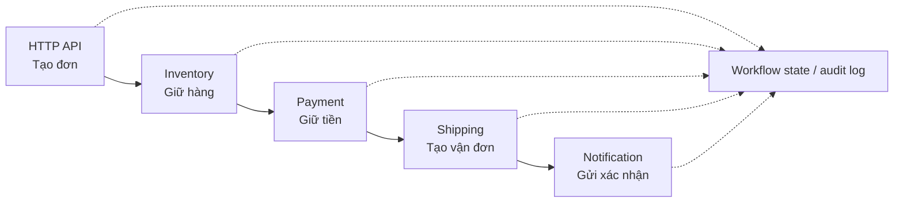
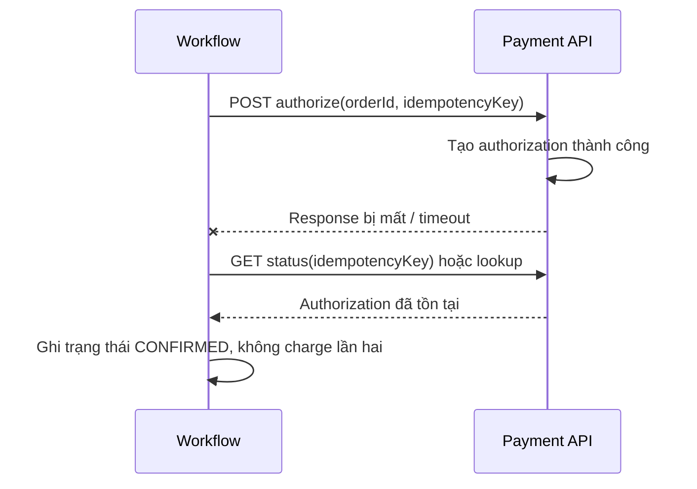
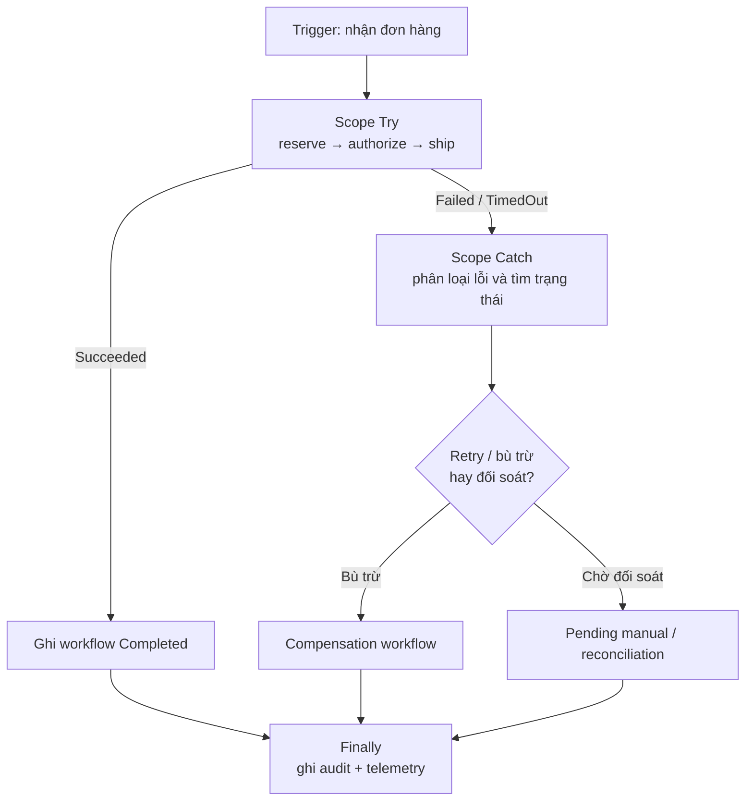
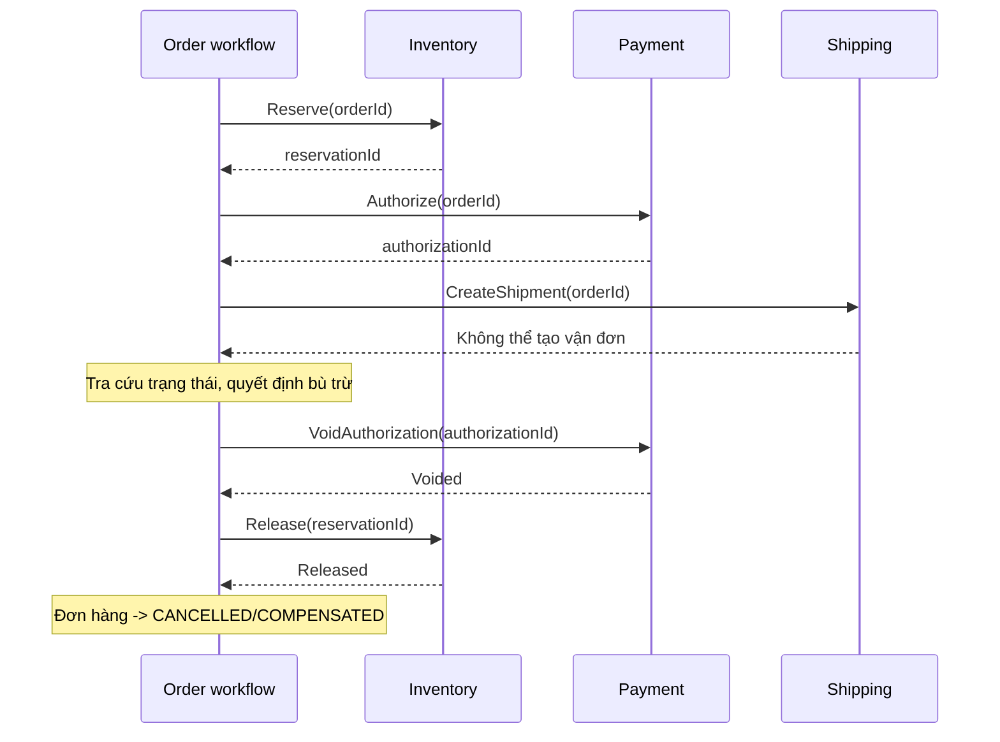
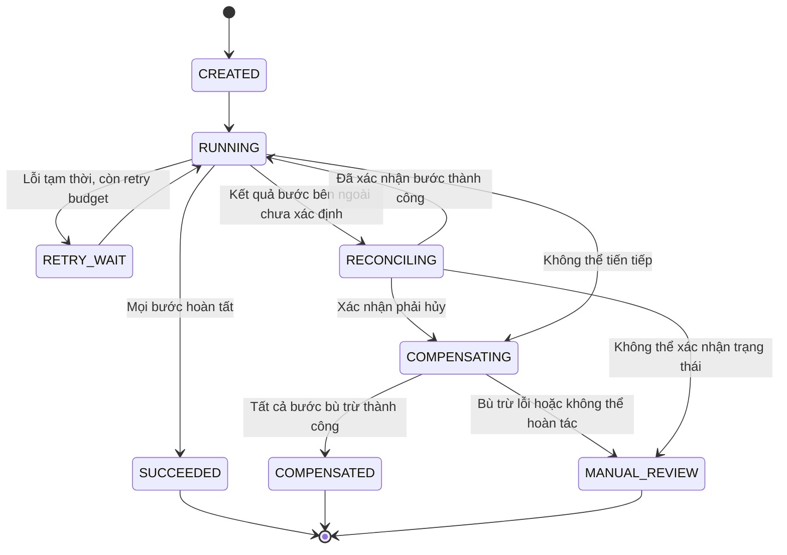
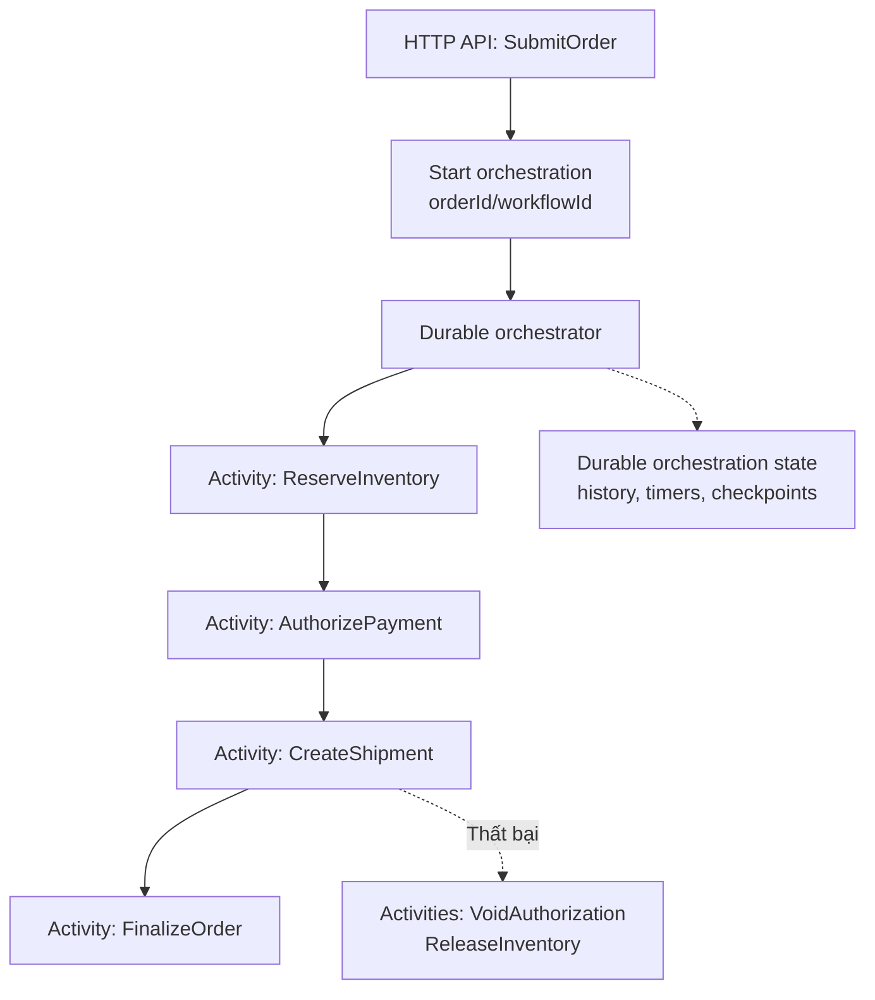
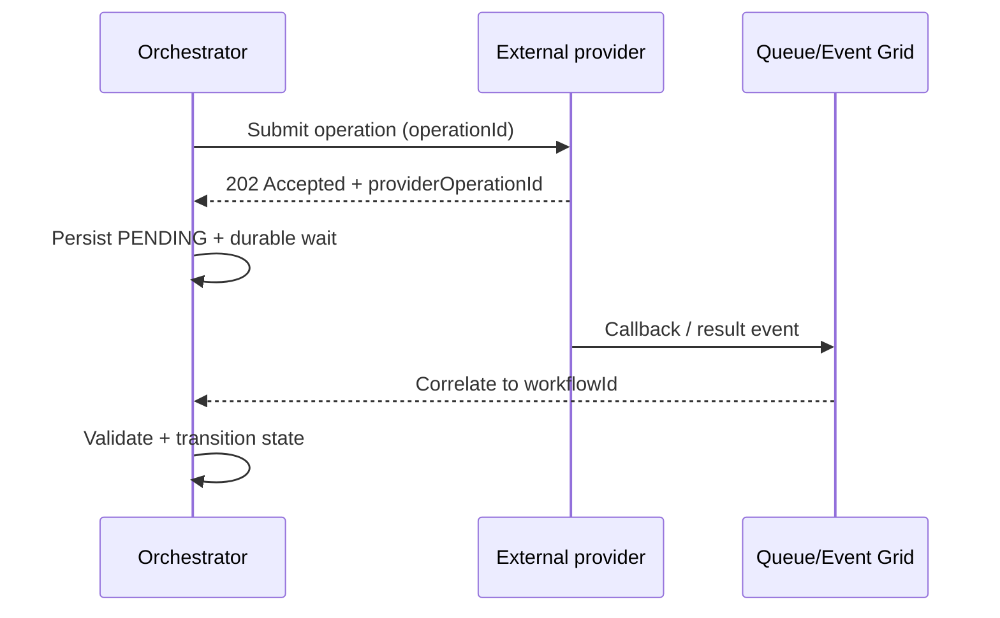
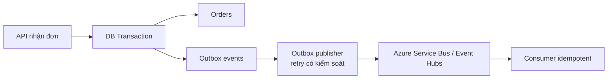
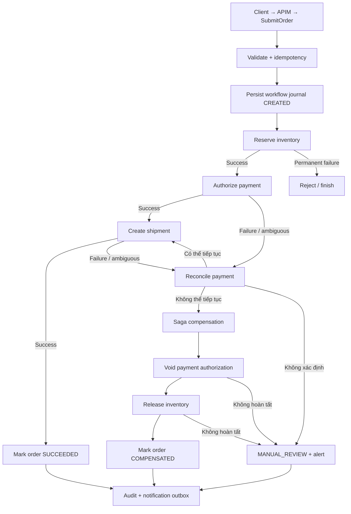

# Quản lý lỗi, retry và bù trừ workflow

Một khách hàng đặt hàng trên website. Hệ thống phải kiểm tra tồn kho, giữ hàng, xác thực thanh toán, tạo yêu cầu giao vận và gửi email. Khi dịch vụ giao vận không phản hồi sau khi tiền đã được giữ và hàng đã được đặt trước, câu hỏi quan trọng không chỉ là **“thử gọi API thêm lần nữa?”**, mà là **“những bước đã hoàn thành sẽ được xử lý ra sao để trạng thái toàn hệ thống vẫn đúng?”**.

Trong các hệ thống tích hợp, một workflow trải qua nhiều API, hàng đợi, cơ sở dữ liệu và nhà cung cấp bên ngoài. Không thể coi tất cả bước đó là một giao dịch database duy nhất. Hệ thống cần phân biệt **lỗi tạm thời**, **lỗi vĩnh viễn**, **kết quả chưa xác định**, và có chiến lược **retry, timeout, idempotency, bù trừ (compensation)** hoặc **chuyển xử lý thủ công** tùy mức độ rủi ro.

Trong module **CLOUD_PROVIDERS_AZURE**, bạn học hệ sinh thái Azure từ subscription, resource group, Microsoft Entra ID đến mạng ảo, compute, lưu trữ, dữ liệu và cách triển khai, giám sát, bảo vệ, kiểm soát chi phí một ứng dụng. Bài thuộc chương **API và tích hợp quy trình**, tập trung vào cách thiết kế và vận hành workflow đáng tin cậy với **Azure Logic Apps**, **Azure Functions / Durable Functions**, API, Azure Service Bus và các dịch vụ phụ thuộc.

## 1. Mục tiêu học tập

Sau bài học, bạn có thể:

- Nhận diện lỗi **transient**, lỗi **permanent** và trạng thái **unknown outcome** khi gọi API hoặc xử lý message.
- Lựa chọn **retry policy**, backoff, jitter, timeout, retry budget và giới hạn tổng thời gian.
- Dùng **Scope**, **Configure run after** và các nhánh xử lý lỗi trong Logic Apps; hiểu tác động của trạng thái `Succeeded`, `Failed`, `TimedOut` và `Skipped`.
- Giải thích vì sao retry cần đi kèm **idempotency key**, deduplication và khả năng quan sát.
- Phân biệt **rollback transaction** trong cùng database với **compensating action** trong workflow phân tán.
- Thiết kế một **Saga** có trạng thái bền vững và các bước bù trừ theo thứ tự phù hợp.
- Biết cách áp dụng **Durable Functions** cho orchestration, retry và compensation, đồng thời tránh side effect trong orchestrator code bị replay.
- Kết hợp Azure Service Bus retry/dead-letter, cảnh báo, quyền truy cập và runbook để xử lý workflow lỗi an toàn.

## 2. Một workflow phân tán gồm những gì?

Xét một quy trình thương mại điện tử:



Mỗi bước có thể có dữ liệu, transaction, identity, quota và timeout riêng. Ngay cả khi tất cả chạy trên Azure, **không mặc định có một giao dịch ACID bao phủ nhiều API, broker và dịch vụ bên ngoài**.

Ví dụ: giữ hàng đã commit trong database A, thanh toán đã được PSP chấp nhận, nhưng API giao hàng trả `503`. Việc rollback transaction của database A **không tự hoàn tác** hoạt động của PSP. Bạn cần một thao tác nghiệp vụ tương ứng, ví dụ **hủy khoản ủy quyền thanh toán** và **giải phóng tồn kho**.

### Ba câu hỏi trước khi thêm retry

1. **Thao tác có an toàn khi gọi lại?** `GET` thuần đọc thường khác `POST /charge` tạo giao dịch tiền.
2. **Lần gọi trước đã thực sự thất bại chưa?** Timeout có thể xảy ra sau khi server đã commit nhưng response bị mất.
3. **Nếu workflow dừng vĩnh viễn, hệ thống phải làm gì với các bước đã hoàn tất?** Tiếp tục từ checkpoint, bù trừ hay cần người duyệt?

Retry chỉ là **một cơ chế** trong bài toán độ tin cậy; không thay thế thiết kế trạng thái và tính đúng đắn nghiệp vụ.

## 3. Phân loại lỗi trước khi xử lý

| Loại lỗi | Ví dụ | Hướng xử lý ban đầu |
|---|---|---|
| **Tạm thời (transient)** | `429 Too Many Requests`, `503 Service Unavailable`, mất kết nối ngắn | Retry có giới hạn, backoff/jitter, tôn trọng tín hiệu từ server |
| **Lỗi hạ tầng hoặc dependency kéo dài** | Broker ngừng hoạt động, DNS hoặc Private Endpoint cấu hình sai | Circuit breaker, alert, chuyển queue/chờ; không retry vô hạn |
| **Lỗi nghiệp vụ vĩnh viễn** | Hết hàng, tài khoản không hợp lệ, địa chỉ thiếu dữ liệu | Không retry mù; trả lỗi, yêu cầu sửa dữ liệu hoặc bù trừ |
| **Lỗi quyền/cấu hình** | `401`, `403`, thiếu role hoặc expired credential | Kiểm tra identity, scope, token, network; không tự tăng retry count |
| **Kết quả chưa biết (ambiguous)** | Client timeout sau khi gửi `POST /authorize-payment` | Tra cứu kết quả theo idempotency key/operation ID trước khi lặp lại |
| **Partial success** | Giữ hàng và giữ tiền thành công, tạo vận đơn lỗi | Chọn forward recovery hoặc bù trừ theo trạng thái đã ghi |
| **Poison message** | Event JSON không parse được hoặc vi phạm schema | Quarantine/dead-letter và sửa dữ liệu; tránh vòng lặp vô hạn |
| **Lỗi trong bù trừ** | API hoàn tiền tạm ngưng hoạt động | Retry riêng, ghi pending compensation, cảnh báo và can thiệp thủ công |

### Một số mã HTTP hay gặp

| HTTP status | Cách diễn giải thực tế |
|---|---|
| `200`, `201`, `202`, `204` | Cần kiểm tra ý nghĩa nghiệp vụ; `202` thường là đã chấp nhận xử lý, chưa chứng minh tác vụ cuối cùng thành công |
| `400`, `422` | Thường là input sai/không hợp lệ; yêu cầu sửa, không retry cùng payload |
| `401`, `403` | Xác thực hoặc phân quyền không hợp lệ; xử lý căn nguyên |
| `404` | Có thể là đối tượng không tồn tại; đôi khi là độ trễ eventual consistency, phải xét hợp đồng API |
| `408`, `429` | Có thể retry với điều kiện idempotent và deadline còn đủ |
| `409` | Xung đột; tùy API có thể là yêu cầu đang xử lý, khóa optimistic hoặc trùng idempotency key |
| `500`, `502`, `503`, `504` | Thường đáng xem xét retry, nhưng kết quả thao tác có side effect vẫn có thể chưa xác định |

**Không có bảng mã HTTP nào áp dụng máy móc cho mọi API**. Hợp đồng của provider quyết định status nào cần tra cứu, status nào được retry và response nào báo giao dịch hoàn tất.

## 4. Retry đúng cách: giới hạn, backoff, jitter và deadline

### Cấu trúc một retry policy

Một chính sách retry tốt gồm:

- **Điều kiện retry:** chỉ những lỗi/mã phản hồi được coi là tạm thời theo hợp đồng API.
- **Số lần tối đa:** ví dụ tối đa 3 lần thử thêm sau lần đầu; luôn làm rõ “attempts” hay “retries”.
- **Backoff:** tăng thời gian chờ giữa các lần thử, ví dụ exponential backoff.
- **Jitter:** ngẫu nhiên hóa khoảng chờ để tránh nhiều client đồng loạt gọi lại.
- **Timeout mỗi lần gọi:** một attempt không thể chờ vô hạn.
- **Retry budget/deadline tổng:** dừng khi hết thời gian xử lý nghiệp vụ, kể cả chưa dùng hết retry count.
- **Idempotency:** nếu thao tác có side effect, server phải có cách nhận diện request bị lặp.
- **Telemetry:** lưu attempt number, failure class, correlation ID, latency; không log credential.

Một công thức tham khảo cho **full jitter**:

\[
d_k \sim U\left(0,\,\min(d_{\max}, d_0\cdot 2^{k-1})\right)
\]

Trong đó `d0` là khoảng chờ ban đầu, `dmax` là trần backoff, `k` là số lần retry. Đây là công thức mô hình; **Logic Apps hoặc các SDK Azure có thuật toán và giới hạn cấu hình cụ thể riêng**. Không giả định mọi connector dùng công thức này.

Ví dụ retry 3 lần với backoff trần lần lượt 1, 2, 4 giây tạo thời gian chờ **không cố định** vì có jitter. Khi tổng deadline là 10 giây, một request đã mất 8 giây không nên bắt đầu attempt mới tốn thêm nhiều chục giây.

### Tôn trọng Retry-After và throttling

Với `429` hoặc `503`, server có thể trả header `Retry-After`, biểu thị khoảng thời gian chờ theo **số giây** hoặc **HTTP date**. Nếu client/connector hỗ trợ, nên tôn trọng hướng dẫn đó đồng thời áp dụng deadline toàn workflow.

Tuy nhiên, `Retry-After` không phải quyền được retry vô hạn. Nếu provider đang bị quá tải, retry lặp lại ở mọi tầng (client → API Management → workflow → SDK) có thể gây **retry amplification**: một yêu cầu người dùng phát sinh hàng chục request xuống backend.

**Nguyên tắc:** xác định tầng chịu trách nhiệm retry, giới hạn tổng số attempt xuyên các tầng, và dùng **circuit breaker** để ngừng gửi request khi dependency liên tục lỗi.

### Timeout và kết quả chưa xác định



Nếu API không có endpoint tra cứu theo operation ID và không hỗ trợ idempotency key, **không thể khẳng định thao tác đã thất bại chỉ vì client timeout**. Khi liên quan tài chính, ưu tiên trạng thái **PENDING_RECONCILIATION** và quy trình đối soát trước khi gửi lại.

## 5. Idempotency là điều kiện nền tảng của workflow tin cậy

Một thao tác **idempotent** khi thực hiện lại với cùng định danh yêu cầu không tạo thêm tác động nghiệp vụ ngoài kết quả được định nghĩa. Ví dụ, yêu cầu “giữ tồn kho 2 sản phẩm cho đơn ORD-1001” gọi hai lần phải giữ **một reservation**, không giữ 4 sản phẩm.

### Thiết kế idempotency key

Một idempotency key nên:

1. Đại diện **một ý định nghiệp vụ cụ thể**, ví dụ `orderId + operationType + version`.
2. Được gửi ổn định qua các lần retry cùng ý định; **không sinh UUID mới mỗi attempt**.
3. Được backend lưu cùng trạng thái và kết quả theo một ràng buộc duy nhất/transaction thích hợp.
4. Có quy tắc xử lý khi **cùng key nhưng payload khác**: thường trả conflict/validation error, không âm thầm chấp nhận thay đổi.
5. Có retention lớn hơn khoảng retry/replay mà hệ thống cho phép, với chính sách dọn dẹp rõ ràng.

| Thao tác | Khóa idempotency minh họa | Cần lưu kết quả gì |
|---|---|---|
| Giữ tồn kho | `ORD-1001:reserve:1` | Reservation ID, trạng thái, số lượng |
| Ủy quyền thanh toán | `ORD-1001:authorize:1` | PSP operation ID và trạng thái |
| Tạo yêu cầu giao hàng | `ORD-1001:shipment:1` | Shipment ID, trạng thái |
| Gửi email xác nhận | `ORD-1001:email-confirm:1` | Thời điểm, provider message ID |
| Hủy reservation | `ORD-1001:release:1` | Trạng thái released, lý do |

Với database, **check-then-insert** đơn thuần không đủ khi hai worker chạy đồng thời: cả hai có thể đọc “chưa tồn tại” rồi tạo hai hiệu ứng. Cần unique constraint, transaction/conditional write hoặc API provider có bảo đảm idempotency.

**Không phải mọi API hỗ trợ header `Idempotency-Key`.** Đây là một quy ước phổ biến nhưng cần kiểm tra hợp đồng cụ thể; với provider không hỗ trợ, ứng dụng phải có lớp đối soát/deduplication phù hợp.

## 6. Azure Logic Apps: quản lý lỗi theo hành động và scope

**Azure Logic Apps** hỗ trợ thiết kế workflow bằng các triggers và actions. Mỗi action có trạng thái thực thi; bạn có thể nhóm actions trong **Scope** và dùng **Configure run after** để định nghĩa nhánh thực hiện khi action trước thành công, thất bại, timeout hoặc bị bỏ qua.

Các trạng thái quan trọng:

| Trạng thái | Ý nghĩa thực hành |
|---|---|
| `Succeeded` | Action báo thành công theo connector, **không bảo đảm mọi hậu quả nghiệp vụ ngoài hệ thống đã hoàn tất** |
| `Failed` | Action thất bại và không hoàn tất theo định nghĩa action |
| `TimedOut` | Không nhận kết quả đúng hạn; trạng thái nghiệp vụ bên ngoài **có thể đã thay đổi** |
| `Skipped` | Action không chạy do điều kiện hoặc phụ thuộc run-after; không mặc định là lỗi nghiệp vụ |

### Mẫu Try / Catch / Finally



Trong Logic Apps designer, thường có thể:

1. Tạo **Scope Try** chứa các action chính.
2. Tạo **Scope Catch** đặt **Run after** của Try là `Failed` và `TimedOut` (bổ sung `Skipped` nếu workflow cần giải nghĩa).
3. Tạo các action log/đối soát trong Catch và đánh dấu trạng thái nghiệp vụ phù hợp.
4. Cấu hình nhánh **Finally/Logging** chạy sau các trạng thái liên quan của nhánh trước, hoặc tổ chức cấu trúc scope bảo đảm đường đi mong muốn.

**Chú ý:** không phải “Catch thành công” sẽ tự biến trạng thái nghiệp vụ thành công. Một workflow xử lý lỗi thành công ở mặt kỹ thuật có thể vẫn cần trả về **FAILED / COMPENSATED / MANUAL_REVIEW** cho hệ thống gọi.

## 7. Cấu hình retry và run-after trong Logic Apps

### 7.1. Trong Azure portal / Workflow designer

Giả sử có Logic App được phép chỉnh sửa, thực hiện trên bản **dev/test**:

1. Mở Logic App và workflow trong **Designer**.
2. Thêm action **HTTP** hoặc connector action để gọi dịch vụ quản lý tồn kho.
3. Mở **Settings** của action và tìm **Retry policy** nếu action/connector hỗ trợ.
4. Chọn chính sách `None`, `Fixed` hoặc `Exponential` tùy loại action và phiên bản thiết kế. Điều chỉnh số lần thử và khoảng chờ trong giới hạn được hỗ trợ.
5. Đặt timeout/action settings khi khả năng của action cho phép; phối hợp với deadline toàn workflow.
6. Thêm **Scope Try** chứa action chính; tạo **Scope Catch** và dùng **Configure run after** để chạy sau `Failed` / `TimedOut`.
7. Trong Catch, đọc mã lỗi và trạng thái thực thi, gọi API tra cứu trạng thái nghiệp vụ rồi quyết định retry thủ công, bù trừ hoặc đối soát.
8. Thêm logging và audit thích hợp, chạy thử với HTTP `200`, `429`, `503`, `400` và tình huống timeout giả lập.

**Lưu ý:** không phải mọi connector/action đều cho cấu hình retry giống nhau. Một số trigger hoặc kết nối do dịch vụ quản lý có retry/timeout đặc thù; với action dùng Managed Connector, tham khảo chính khả năng của connector trong loại Logic App **Consumption** hoặc **Standard** đang sử dụng.

### 7.2. Fragment định nghĩa workflow (minh họa)

Ví dụ rút gọn sau mô tả phần `actions` của một workflow definition. Nó **không phải file Logic App đầy đủ**: cần trigger, API thật, response handling, authentication và thông tin triển khai riêng.

```json
{
  "actions": {
    "Try": {
      "type": "Scope",
      "actions": {
        "Reserve_inventory": {
          "type": "Http",
          "inputs": {
            "method": "POST",
            "uri": "https://inventory.example.invalid/reservations",
            "headers": {
              "Idempotency-Key": "@{triggerBody()?['orderId']}"
            },
            "body": {
              "orderId": "@triggerBody()?['orderId']"
            }
          },
          "retryPolicy": {
            "type": "exponential",
            "count": 3,
            "interval": "PT5S",
            "minimumInterval": "PT5S",
            "maximumInterval": "PT1M"
          },
          "runAfter": {}
        }
      },
      "runAfter": {}
    },
    "Catch": {
      "type": "Scope",
      "actions": {
        "Inspect_try_results": {
          "type": "Compose",
          "inputs": "@result('Try')"
        }
      },
      "runAfter": {
        "Try": ["Failed", "TimedOut"]
      }
    },
    "Finally": {
      "type": "Scope",
      "actions": {
        "Audit": {
          "type": "Compose",
          "inputs": "Record workflow state in a durable store"
        }
      },
      "runAfter": {
        "Catch": ["Succeeded", "Failed", "TimedOut", "Skipped"]
      }
    }
  }
}
```

**Điểm cần hiểu:**

- `runAfter` mô tả các trạng thái action tiền nhiệm cho phép action kế tiếp chạy.
- Hàm expression `result('Try')` có thể giúp truy cập kết quả các action thuộc Scope theo khả năng Logic Apps expression; dữ liệu lỗi cần được trích lọc cẩn thận trước khi log.
- `PT5S` và `PT1M` là chuỗi duration kiểu ISO 8601.
- `Idempotency-Key` chỉ có tác dụng nếu API tồn kho **triển khai** semantics tương ứng.
- Ví dụ `Audit` chỉ là một action `Compose` giả lập, **không ghi dữ liệu bền vững**. Trong production, thay bằng Storage/SQL/monitoring sink và kiểm tra lỗi ghi audit.
- Trong workflow có nhiều scope/nhánh song song, cần kiểm tra chính xác **đường đi khi Catch bị Skipped**, tránh vô tình bỏ qua bước cuối.

### 7.3. Retry policy mặc định có đủ không?

Không nhất thiết. Một số HTTP/connector actions có retry cho response lỗi tạm thời, nhưng nếu workflow cần:

- Tra cứu `operationId` trước khi retry một giao dịch có side effect;
- Chờ cho đến khi trạng thái nghiệp vụ chuyển từ `PENDING` thành `CONFIRMED`;
- Điều chỉnh số attempt theo loại lỗi/business deadline;
- Kết hợp circuit breaker hoặc ghi sự kiện lỗi vào hàng đợi;

thì cần **một nhánh nghiệp vụ rõ ràng** thay vì chỉ dựa vào retry mặc định của connector.

### 7.4. Run-after không đồng nghĩa rollback

Một Scope Catch chạy sau Scope Try thất bại chỉ có nghĩa **đường xử lý lỗi đã bắt đầu**. Logic Apps không tự hoàn tác các HTTP calls trước đó. Trong Catch, phải xác định action nào đã commit, trạng thái bên ngoài ra sao và compensator nào có thể thực hiện an toàn.

## 8. Một ví dụ Java: HTTP retry có giới hạn

Không phải workflow nào cũng gọi API trực tiếp từ Logic Apps. Có thể có Azure Function hoặc Java service nằm giữa để gọi backend theo hợp đồng riêng. Ví dụ Java 17 sau chỉ minh họa **retry 429/502/503/504 và lỗi I/O** cho endpoint **đã hỗ trợ idempotency key**.

```java
import java.io.IOException;
import java.net.URI;
import java.net.http.HttpClient;
import java.net.http.HttpRequest;
import java.net.http.HttpResponse;
import java.time.Duration;
import java.util.concurrent.ThreadLocalRandom;
import java.util.concurrent.TimeUnit;

public final class RetryableWorkflowClient {
    private static final int MAX_ATTEMPTS = 4; // 1 lần đầu + tối đa 3 retry.
    private final HttpClient client = HttpClient.newBuilder()
            .connectTimeout(Duration.ofSeconds(2))
            .build();

    public String reserve(URI uri, String orderId, String json)
            throws IOException, InterruptedException {
        String idempotencyKey = orderId + ":reserve:v1";
        long deadline = System.nanoTime() + Duration.ofSeconds(20).toNanos();
        IOException lastIOException = null;

        for (int attempt = 1; attempt <= MAX_ATTEMPTS; attempt++) {
            if (System.nanoTime() >= deadline) {
                throw new IOException("Workflow deadline exceeded");
            }

            HttpRequest request = HttpRequest.newBuilder(uri)
                    .timeout(Duration.ofSeconds(4))
                    .header("Content-Type", "application/json")
                    .header("Idempotency-Key", idempotencyKey)
                    .POST(HttpRequest.BodyPublishers.ofString(json))
                    .build();

            try {
                HttpResponse<String> response = client.send(
                        request, HttpResponse.BodyHandlers.ofString());
                int status = response.statusCode();
                if (status >= 200 && status < 300) {
                    return response.body();
                }
                if (!isRetryable(status)) {
                    throw new IllegalStateException("Non-retryable response HTTP " + status);
                }
                lastIOException = new IOException("Retryable HTTP " + status);
            } catch (IOException ex) {
                // Chỉ retry vì endpoint có hợp đồng idempotent.
                lastIOException = ex;
            }

            if (attempt == MAX_ATTEMPTS) {
                break;
            }
            long maxBackoffMs = Math.min(4000L, 500L << (attempt - 1));
            long jitterMs = ThreadLocalRandom.current().nextLong(maxBackoffMs + 1);
            long remainingMs = TimeUnit.NANOSECONDS.toMillis(
                    deadline - System.nanoTime());
            if (remainingMs <= 0) {
                break;
            }
            Thread.sleep(Math.min(jitterMs, remainingMs));
        }
        throw new IOException("Reservation not confirmed; reconcile by key",
                lastIOException);
    }

    private static boolean isRetryable(int code) {
        return code == 429 || code == 502 || code == 503 || code == 504;
    }
}
```

Mẫu này có **giới hạn attempt, timeout và deadline**, đồng thời tái sử dụng **cùng idempotency key**. Tuy nhiên, để production cần bổ sung:

- Xử lý `Retry-After` khi provider hỗ trợ và còn thời gian trong deadline.
- Phân biệt lỗi `IOException` do kết nối và lỗi do dữ liệu/cấu hình trong API thực.
- Khi tất cả lần thử không xác nhận kết quả, **tra cứu trạng thái** theo key thay vì tự động coi reservation đã thất bại.
- Ghi metrics, trace ID và attempt count; không log request chứa PII hoặc secret.
- Cân nhắc circuit breaker và retry budget xuyên các tầng (Logic Apps, SDK, API gateway).

**Không dùng mẫu retry này để gọi một endpoint charge/transfer không có idempotency contract.** Chỉ retry HTTP `POST` “an toàn” nếu backend bảo đảm deduplication/transaction phù hợp hoặc đã có cơ chế đối soát.

## 9. Bù trừ (compensation) khác rollback ra sao?

### Rollback trong một database

Nếu hai bản ghi được cập nhật trong **cùng một transaction ACID**, database có thể rollback toàn bộ khi transaction chưa commit. Đây là cơ chế nguyên tử của một hệ thống quản lý dữ liệu cụ thể.

### Compensating transaction trong workflow

Khi đã commit những hành động tại **nhiều dịch vụ độc lập**, việc bù trừ thường là **một tác vụ nghiệp vụ mới** nhằm đảo hoặc giảm ảnh hưởng của tác vụ trước:

| Hành động tiến (forward) | Hành động bù trừ (compensation) | Giới hạn |
|---|---|---|
| Giữ hàng | Giải phóng reservation | Chỉ giải phóng reservation đúng order |
| Ủy quyền thanh toán | Hủy authorization chưa capture | Không giống hoàn tiền sau khi đã capture |
| Capture thanh toán | Refund theo chính sách và PSP | Có thể không tức thời, chịu phí hoặc cần phê duyệt |
| Tạo nhãn giao hàng | Hủy nhãn/yêu cầu vận chuyển | Có thể không hủy được nếu kiện hàng đã giao cho hãng |
| Tạo bản ghi pending | Đánh dấu `CANCELLED` và lưu lý do | Cần giữ audit, không xóa lịch sử |
| Gửi email | Gửi thông báo điều chỉnh | **Không thể “thu hồi” email đã nhận** một cách đảm bảo |

**Compensation không phải phép đảo ngược toán học luôn thành công.** Có những thao tác **không thể hoàn tác** hoặc chỉ hoàn tác bằng cách tạo một sự kiện mới. Hệ thống phải định nghĩa trạng thái kết thúc chấp nhận được, đối soát và trách nhiệm xử lý thủ công.

### Forward recovery hay compensation?

Sau lỗi tạo vận đơn, hệ thống có thể:

- **Forward recovery:** giữ reservation và payment authorization, tiếp tục thử tạo vận đơn khi hãng vận chuyển hồi phục, miễn còn hạn giữ hàng/tiền.
- **Compensation:** nếu hết deadline hoặc không thể giao hàng, hủy payment authorization và giải phóng tồn kho.
- **Manual review:** nếu không biết payment đã capture chưa hoặc kiện hàng đã bàn giao, khoanh vùng giao dịch chờ đối soát.

Quyết định dựa trên **trạng thái nghiệp vụ, deadline và khả năng hoàn tác**, không chỉ dựa trên HTTP status cuối cùng.

## 10. Saga pattern cho giao dịch phân tán

**Saga** là cách tổ chức một chuỗi các giao dịch cục bộ; mỗi bước thành công có thể có **compensating action** tương ứng nếu chuỗi không thể hoàn tất.

Hai hướng phổ biến:

- **Orchestration:** một workflow coordinator quyết định gọi bước nào, kiểm tra trạng thái và kích hoạt compensation. Azure Logic Apps hoặc Durable Functions phù hợp để xem xét.
- **Choreography:** các dịch vụ phản ứng theo event, phát event thành công/thất bại/bù trừ; có thể dùng Service Bus hoặc Event Grid theo tính năng, nhưng cần kiểm soát thứ tự và khả năng quan sát tổng thể.

### Orchestrated Saga minh họa



Bù trừ thường thực hiện **theo thứ tự ngược các bước đã commit** để giảm phụ thuộc, nhưng không phải quy tắc cứng cho mọi hệ thống. Nếu có sự kiện song song hoặc tài nguyên phụ thuộc lẫn nhau, bạn cần dựng **đồ thị phụ thuộc bù trừ** và xác định thứ tự an toàn.

### Tại sao cần state journal bền vững?

Nếu orchestrator crash sau khi thanh toán đã thành công nhưng trước khi ghi `authorizationId`, nó có thể không biết phải hủy authorization nào. Vì vậy, cần ghi trạng thái/operation ID theo mô hình tin cậy, có idempotency key để tra cứu lại khi kết quả mơ hồ.

Một bản ghi workflow tối thiểu:

```json
{
  "workflowId": "wf-ord-1001",
  "orderId": "ORD-1001",
  "state": "COMPENSATING",
  "steps": [
    {
      "name": "reserveInventory",
      "status": "SUCCEEDED",
      "externalOperationId": "res-789"
    },
    {
      "name": "authorizePayment",
      "status": "SUCCEEDED",
      "externalOperationId": "auth-456"
    },
    {
      "name": "createShipment",
      "status": "FAILED",
      "externalOperationId": null
    }
  ],
  "compensations": [
    {"name": "voidAuthorization", "status": "PENDING"},
    {"name": "releaseInventory", "status": "PENDING"}
  ]
}
```

Trong production, journal phải có concurrency control, lịch sử trạng thái, timestamp UTC, actor/trace ID và cách chống hai orchestrators cùng điều khiển một workflow. Nếu một step “timeout”, không tự ghi `FAILED` rồi kích hoạt compensation trái với giao dịch bên ngoài chưa xác định; đánh dấu `UNKNOWN` hoặc `RECONCILIATION_REQUIRED` trước.

## 11. Mô hình trạng thái cho workflow và bù trừ

Thay vì một cờ `success = true/false`, hãy định nghĩa **state machine** để thấy rõ việc gì đã hoàn thành và việc gì còn treo.



Trạng thái nghiệp vụ nên diễn giải rõ:

| State | Ý nghĩa | Hành động có thể cho phép |
|---|---|---|
| `CREATED` | Đã nhận yêu cầu, chưa khởi chạy các bước | Xác thực, lên lịch |
| `RUNNING` | Một hoặc nhiều bước forward đang chạy | Tiếp tục theo step journal |
| `RETRY_WAIT` | Đang chờ thực hiện lại bước tạm lỗi | Dùng timer/delay bền vững |
| `RECONCILING` | Không biết chắc bên ngoài đã commit chưa | Tra cứu operation ID, chống gửi lại mù quáng |
| `COMPENSATING` | Bắt đầu các bước bù trừ hợp lệ | Thực hiện từng compensator có checkpoint |
| `COMPENSATED` | Các hiệu ứng có thể bù trừ đã được xử lý | Kết thúc với kết quả đã hủy |
| `SUCCEEDED` | Các bước bắt buộc đã hoàn tất | Phát sự kiện kết quả và audit |
| `MANUAL_REVIEW` | Còn bất nhất/không thể tự quyết định | Handoff SRE/finance/operations |

Hệ thống phải quy định **transition nào hợp lệ**. Ví dụ, không cho một consumer nhận lại event `ShipmentFailed` làm workflow từ `SUCCEEDED` nhảy thẳng sang `COMPENSATING` nếu kiện hàng đã giao; cần một quy trình nghiệp vụ mới, có audit.

### Compensation cũng cần idempotency

Khi `voidAuthorization(auth-456)` timeout, có thể PSP đã hủy thành công. Retry phải dùng **cùng operation/idempotency key**; trước khi hủy lần nữa, tra cứu PSP hoặc dùng API idempotent có hợp đồng rõ. Với `releaseInventory(res-789)`, lần gọi lặp phải trả trạng thái “đã giải phóng” chứ không được tăng tồn kho vô hạn.

Nên lưu `compensationAttemptCount`, `lastError`, `nextRetryAt` và `externalOperationId` trong journal. Nếu quá số lần/đến deadline, chuyển `MANUAL_REVIEW` và gửi cảnh báo có thể hành động được.

## 12. Kỹ thuật xử lý compensation thất bại

Nhiều thiết kế chỉ mô tả đường “bù trừ thành công”. Trong thực tế, **API bù trừ cũng có thể lỗi** do hệ thống thanh toán offline, hàng đã xuất kho hoặc token hết hạn.

| Tình huống | Cách xử lý được đề xuất |
|---|---|
| API bù trừ trả `503` | Retry có giới hạn/bền vững, theo backoff và deadline |
| API bù trừ timeout | Tra cứu trạng thái theo operation ID trước khi lặp lại |
| PSP trả “already voided” | Coi như hoàn thành nếu khớp operation/correlation và hợp đồng provider |
| Giao hàng đã được hãng nhận | Chuyển quy trình hoàn hàng/đền bù, không gọi hủy nhãn vô hạn |
| Token/role bị thu hồi | Alert quyền/cấu hình; không thử vô hạn và không nâng quyền tự động |
| Hai compensators phụ thuộc nhau | Xác định thứ tự hoặc graph, checkpoint từng bước |
| Compensation tạo dữ liệu không hoàn nguyên | Ghi audit, trạng thái cuối có điều kiện và chuyển người xử lý |

### Tránh compensation quá sớm

Nếu `createShipment` timeout, việc đầu tiên thường là hỏi hãng vận chuyển:

- Có shipment ID nào đã được tạo theo `orderId`/idempotency key chưa?
- Shipment đó đã ở trạng thái nào?
- Nếu có, có thể tiếp tục workflow thay vì bù trừ không?

Nếu hủy payment ngay nhưng shipment thật đã được tạo, hệ thống có thể phát sinh **giao hàng không thanh toán**. Vì vậy, phân biệt **lỗi đã xác nhận** với **kết quả chưa xác định** là điều kiện tiên quyết cho compensation.

### Tránh “compensation of compensation” không có giới hạn

Một Saga phức tạp có thể cần phục hồi khi compensator thất bại. Không nên tạo một chuỗi vô hạn “hủy việc hủy” mà không có người sở hữu. Thay vào đó, định nghĩa:

1. Số attempt và deadline cho từng compensator.
2. Ràng buộc trạng thái: `PENDING` → `RUNNING` → `DONE` hoặc `FAILED_RETRYABLE` / `MANUAL_REQUIRED`.
3. Cơ chế retry bền vững tách khỏi vòng lặp HTTP đang mở.
4. Alert và đường can thiệp có phân quyền.
5. Báo cáo đối soát kết quả cuối với tài nguyên thực (PSP, kho, đơn vận).

## 13. Durable Functions: orchestrator, activity và replay

**Azure Durable Functions** là một lựa chọn để điều phối workflow dài hạn, thực thi activities và lưu trạng thái orchestration thông qua durable backend theo cấu hình. Mô hình này phù hợp khi workflow cần đợi nhiều phút/giờ/ngày mà không giữ một HTTP request mở liên tục.

Một kiến trúc thông thường:



### Orchestrator khác activity như thế nào?

- **Orchestrator function:** mô tả thứ tự thực hiện, branch/try-catch, durable timers, chờ events và bù trừ. Runtime có thể **replay** orchestrator từ history để khôi phục tiến độ.
- **Activity function:** thực hiện I/O thật như gọi PSP, ghi database, gửi message, tương tác hệ thống ngoài.
- **Starter/client:** khởi chạy orchestration và nhận instance ID để theo dõi.
- **Durable backend:** lưu history/state theo provider và phiên bản ứng dụng; cần cấu hình storage/network/quyền thích hợp.

**Quy tắc rất quan trọng:** không đặt network call trực tiếp, random number không ổn định, truy cập thời gian hệ thống tùy ý hoặc side effects trong orchestrator code mà runtime có thể replay. Gọi I/O thông qua **activities**; dùng API deterministic/durable timers được runtime hỗ trợ.

### Pseudocode Saga trong Durable Functions

Đoạn sau là **pseudocode kiến trúc**, không phải API Java/JavaScript cụ thể để copy-paste. API của Durable Functions khác theo ngôn ngữ và programming model.

```text
orchestrate(order):
    reservationId = null
    authorizationId = null
    shipmentId = null

    try:
        reservationId = callActivity("ReserveInventory", order)
        authorizationId = callActivity("AuthorizePayment",
                                       order, reservationId)
        shipmentId = callActivity("CreateShipment",
                                  order, authorizationId)
        callActivity("MarkOrderCompleted",
                     order, reservationId, authorizationId, shipmentId)
        return SUCCEEDED

    catch error:
        # Tra cứu mọi bước có kết quả ambiguous trước khi bù trừ.
        state = callActivity("ReconcileExternalOperations", order)
        if state.requiresManualReview:
            return MANUAL_REVIEW

        if state.shipmentCanBeCancelled:
            callActivity("CancelShipmentIdempotently", state.shipmentId)
        if state.authorizationCanBeVoided:
            callActivity("VoidAuthorizationIdempotently",
                         state.authorizationId)
        if state.reservationCanBeReleased:
            callActivity("ReleaseReservationIdempotently",
                         state.reservationId)

        callActivity("MarkOrderCompensated", order)
        return COMPENSATED
```

**Cảnh báo:** pseudocode đơn giản này chưa xử lý đủ failure của từng compensator, phân tách tiến độ bền vững và quy tắc với side effect không thể đảo. Trong hệ thống thật, cần try/catch riêng cho compensation, trạng thái `PENDING_RECONCILIATION`/`MANUAL_REVIEW` và retry/timer bền vững cho từng activity.

### Durable timers và retry

Với lỗi tạm thời, orchestrator có thể dùng **durable timer** để đợi trước khi thử lại, hoặc **retry options** của activity theo SDK được hỗ trợ. Điều này khác với `Thread.sleep` trong một HTTP-triggered Function: durable wait có thể cho phép runtime checkpoint trạng thái, không giữ một thread hoạt động trong suốt thời gian chờ theo mô hình phù hợp.

Tuy nhiên:

- Activity vẫn có thể được gọi lại sau lỗi/crash; **phải idempotent**.
- Timeout/cancel của orchestration **không tự hoàn tác** một PSP operation đã commit.
- Không xóa execution history hoặc purge instance khi còn nghĩa vụ đối soát/compensation.
- Durable state backend và network/security là dependency quan trọng, không nên xem là “không cần database”.

## 14. Thiết kế flow Logic Apps cho Saga đơn hàng

Một bản thiết kế thực hành có thể dùng **Logic Apps** làm orchestrator và các HTTP/Service Bus actions làm bước điều phối:

| Bước | Action minh họa | Kết quả bền vững cần ghi | Nhánh lỗi |
|---|---|---|---|
| 1 | Nhận `orderId` và payload | `CREATED`, correlation ID | Trả `400` nếu input sai |
| 2 | Gọi Inventory Reserve | `reservationId`, `SUCCEEDED` | Retry nếu transient; đối soát nếu timeout |
| 3 | Gọi Payment Authorize | `authorizationId`, `SUCCEEDED` | Retry idempotent/đối soát theo PSP |
| 4 | Gọi Shipping Create | `shipmentId`, `SUCCEEDED` | Retry hoặc bù trừ theo deadline |
| 5 | Cập nhật Order completed | `SUCCEEDED` | Khôi phục forward step / alert nếu DB lỗi |
| 6 | Gửi notification | Outbox/event status | Retry riêng; tránh đảo đơn vì email tạm lỗi |

Một mô hình Logic Apps có thể tổ chức:

```text
Trigger: HTTP / Service Bus
  |
  v
Validate + create workflow journal
  |
  v
Scope Try
  Reserve inventory  --> Store reservation ID
  Authorize payment  --> Store authorization ID
  Create shipment    --> Store shipment ID
  Confirm order
  |
  +-- Succeeded --> Commit final workflow state
  |
  +-- Failed/TimedOut --> Scope Catch
                          Read step journal
                          Reconcile unknown outcomes
                          Choose retry / compensation / manual review
                          Persist final or pending state
  |
  v
Audit + metrics + respond status/operationId
```

### Khi nào dùng Logic Apps, khi nào dùng Durable Functions?

| Tiêu chí | Logic Apps | Durable Functions |
|---|---|---|
| Xây workflow | Designer, connectors, cấu hình actions | Code theo programming model |
| Tích hợp SaaS/enterprise | Nhiều connector được quản lý, tùy loại/tier | Thường tự dùng SDK/HTTP hoặc dịch vụ trung gian |
| State và retry | Runtime quản lý run history/retry theo tính năng | Orchestration history, durable timers, activity retries |
| Workflow phức tạp có quy tắc code | Có thể khó duy trì nếu branch rất nhiều | Thường thuận tiện hơn cho logic phức tạp, test bằng code |
| Compensation | Tự cấu hình actions/scopes/state | Tự viết orchestrator/activities idempotent |
| Quản trị | Workflow runs, connector auth, integration account khi cần | Function host, durable backend, versions, execution history |

**Cả hai đều không tự động bảo đảm Saga đúng.** Chúng cung cấp hạ tầng điều phối; logic nghiệp vụ, cách xác minh tác vụ ngoài, trạng thái bù trừ và quyền truy cập vẫn cần được thiết kế rõ.

## 15. Azure Service Bus: retry, settlement và dead-letter

Trong workflow bất đồng bộ, **Azure Service Bus** thường làm vùng đệm bền vững giữa bước trước và bước sau. Chẳng hạn `OrderCreated` được gửi vào queue; một Azure Function hoặc Logic App trigger nhận message, gọi hệ thống giao hàng, ghi kết quả rồi xác nhận message.

### Peek-Lock và việc giao message lại

Với chế độ **Peek-Lock**:

1. Consumer nhận message và giữ **lock** trong một khoảng thời gian.
2. Consumer xử lý; nếu thành công, gọi **complete** hoặc để connector/trigger settlement thành công theo semantics của nó.
3. Nếu không complete, lock hết hạn hoặc process crash, message có thể được giao lại.
4. Khi quá giới hạn delivery hoặc điều kiện lỗi khác, message có thể được chuyển vào **dead-letter subqueue** theo chính sách của Service Bus.

**At-least-once delivery** là giả định thực dụng cho nhiều luồng. Một consumer nhận lại cùng `MessageId` phải không tạo thêm đơn hàng/tiền/chứng từ ngoài ý muốn.

### MaxDeliveryCount và dead-letter

**MaxDeliveryCount** là một giới hạn liên quan đến số lần message được giao trong các tình huống có thể bị trả lại; khi vượt giới hạn, Service Bus có thể đưa message sang dead-letter queue. Nhưng **không phải mọi lỗi nghiệp vụ sẽ tự động được phân loại đúng**: ứng dụng vẫn cần:

- Phân biệt lỗi tạm thời và poison message không thể xử lý.
- Ghi `DeadLetterReason` và mô tả lỗi đã được làm sạch dữ liệu nhạy cảm khi chủ động dead-letter.
- Có dashboard số message chết, oldest message age và người chịu trách nhiệm.
- Có công cụ **đọc/xem/sửa/phát lại có kiểm soát**, tránh phát lại hàng nghìn thông điệp sai cùng một lúc.
- Xác định khi nào message bị lỗi vĩnh viễn phải chuyển **manual review** thay vì retry.

### Retry của trigger khác retry của HTTP action

Một workflow có thể có:

```text
Service Bus trigger
    |
    +-- message được giao lại sau lock expiry / delivery failure
    |
    v
Logic Apps / Azure Function
    |
    +-- HTTP action retry 3 lần
    |
    v
Backend SDK
    |
    +-- tự retry thêm 3 lần
```

Nếu ba tầng cùng retry mà không có kế hoạch, **một message** có thể sinh nhiều cuộc gọi đến backend. Hãy ghi lại retry budget của **toàn chuỗi**, chọn tầng chịu trách nhiệm và đảm bảo backend dùng cùng idempotency key.

### Duplicate detection không thay idempotency nghiệp vụ

Service Bus có tính năng **duplicate detection** trong những tier/entity và cấu hình hỗ trợ, dựa vào `MessageId` trong một **detection window**. Đây là hàng rào hữu ích tại broker, nhưng:

- Không áp dụng vô hạn thời gian.
- Không ngăn producer gửi lại cùng nghiệp vụ với `MessageId` khác.
- Không giải quyết trường hợp consumer đã thực hiện nghiệp vụ rồi crash trước khi complete.
- Không bảo đảm side effect bên ngoài được thực thi đúng một lần.

Do đó, **idempotency tại business service** vẫn cần thiết, ngay cả khi đã bật duplicate detection ở broker.

## 16. Workflow dài và các sự kiện đến không đồng bộ

Không phải mọi bước đều kết thúc trong một HTTP call. Hệ thống thanh toán có thể trả `202 Accepted` và gửi webhook xác nhận sau vài phút. Hãng vận chuyển có thể gửi event `ShipmentCreated` hoặc `ShipmentRejected` vào một topic.

### Mô hình request → acknowledgement → callback



**Không ghi `SUCCEEDED` chỉ vì provider trả `202`.** Cần chờ callback hoặc truy vấn trạng thái theo hợp đồng, và xác định deadline cho bước đó.

### Correlation và callback security

Một callback phải được liên kết đúng workflow bằng `workflowId`/`operationId` và phải được xác thực bằng cơ chế provider hỗ trợ (signature, OAuth, mTLS, gateway hoặc security scheme phù hợp). Không tin giá trị `status=SUCCESS` trong body chỉ vì request chứa order ID.

Thiết kế cần:

- Bỏ qua hoặc xử lý idempotently callback lặp lại.
- Không cho callback từ workflow A thay đổi trạng thái workflow B.
- Xử lý callback đến **trước hoặc sau** lúc orchestration chuyển sang trạng thái chờ.
- Xác định policy cho callback đến muộn sau khi workflow đã `COMPENSATED`.
- Có polling fallback nếu callback mất, trong giới hạn rate limit của provider.

Với Durable Functions, dùng **external events** và **durable timers** theo programming model hỗ trợ để chờ callback có timeout. Với Logic Apps, có thể dùng **webhook actions**, HTTP request-response pattern hoặc workflow tách riêng nhận event và cập nhật state store theo khả năng connector.

## 17. API Management và retry ở tầng gateway

**Azure API Management (APIM)** có thể đặt trước API backend để áp policies về xác thực, rate limiting, caching, routing và trong những cấu hình được hỗ trợ, thực hiện retry policy ở gateway. Tuy nhiên, **retry ở gateway không tự phân biệt thao tác có side effect an toàn hay không**.

### Khi nào nên retry ở đâu?

| Tầng | Nên chịu trách nhiệm gì? | Cảnh báo |
|---|---|---|
| APIM/gateway | Kết nối tạm lỗi trước khi backend xử lý, giới hạn request và resilience đơn giản có điều kiện | Không retry bừa mọi `POST`, tránh retry amplification |
| Logic Apps | Retry của action/connector theo contract, run-after và nhánh lỗi workflow | Phải lưu trạng thái nghiệp vụ và kiểm tra unknown outcomes |
| Durable Functions | Activity retries, durable timers, orchestration state | Replay và activity duplication đòi hỏi idempotency |
| Backend SDK | Lỗi mạng/timeout và throttling theo SDK/service policy | Không nhân thêm retry ngoài budget toàn chuỗi |
| Service Bus | Phân phối lại message khi chưa hoàn tất, dead-letter | Không tự hoàn tác transaction database/PSP |

**Một ranh giới retry rõ ràng** dễ kiểm soát hơn ba tầng cùng đoán lỗi. Với action thanh toán, gateway thường nên truyền idempotency key và correlation ID, giới hạn thời gian và để application/workflow chịu trách nhiệm đối soát nghiệp vụ.

### Circuit breaker và bulkhead

- **Circuit breaker:** khi một dependency liên tục thất bại, tạm dừng gọi trực tiếp để giảm tải, thực hiện probe sau thời gian chờ và báo trạng thái degraded.
- **Bulkhead:** giới hạn số workflow/call đồng thời dành cho một dependency, tránh lỗi của PSP kéo sập cả inventory hoặc API frontend.
- **Rate limit và queue:** làm mượt burst thay vì để tất cả HTTP requests đồng thời cố gọi một dịch vụ đã quá tải.

Các pattern này không tự giải quyết tính đúng đắn giao dịch; cần phối hợp idempotency, Saga state và thời hạn nghiệp vụ.

## 18. Độ tin cậy của state store và transactional outbox

Một lỗi khó xử lý nằm **giữa** thao tác ghi business database và phát event tiếp theo:

```text
1. INSERT order ORD-1001 thành công
2. Process crash trước khi gửi OrderCreated
3. Worker downstream không biết order đã tồn tại
```

**Transactional outbox** giảm rủi ro này khi dữ liệu nghiệp vụ và outbox record được ghi trong **cùng một transaction database**:



Sau commit, publisher đọc outbox, gửi event, rồi đánh dấu đã gửi. Nếu process crash sau khi broker nhận event nhưng trước khi cập nhật outbox, event có thể **được phát lại**; consumer phải xử lý trùng.

### Outbox và compensation

Outbox hữu ích không chỉ cho event forward mà còn cho **yêu cầu compensation**:

1. Workflow quyết định chuyển sang `COMPENSATING`.
2. Ghi trạng thái và một lệnh `VoidAuthorizationRequested` trong transaction local.
3. Publisher gửi lệnh đến worker có quyền gọi PSP.
4. Worker trả kết quả/ack và cập nhật trạng thái compensation.
5. Nếu gặp lỗi tạm, vẫn còn lệnh bền vững để retry hoặc chuyển DLQ.

Tách này giúp tránh phụ thuộc vào một HTTP request đang mở suốt quá trình rollback nghiệp vụ. Tuy nhiên, phải kiểm soát **thứ tự**, duplicate event và quyền tạo lệnh bù trừ để không bị lợi dụng hủy giao dịch trái phép.

## 19. Bảo mật workflow, quyền và dữ liệu nhạy cảm

Trong mô hình Azure, một Logic App hoặc Durable Function thường gọi nhiều service khác nhau. **Chạy workflow thành công về mặt kỹ thuật không cho phép bỏ qua phân quyền ở các service đích**.

### Nguyên tắc least privilege

| Thành phần | Quyền cần thiết | Không nên cấp mặc định |
|---|---|---|
| Logic App/Function gọi Inventory API | Quyền tạo/tra cứu/hủy reservation theo hợp đồng API | Role quản trị toàn subscription |
| Payment activity | Permission hẹp để authorize/void/refund theo quy trình | Cho mọi component quyền refund trực tiếp |
| Service Bus producer | **Azure Service Bus Data Sender** ở queue/topic phù hợp | Data Owner cho mọi producer |
| Service Bus consumer | **Azure Service Bus Data Receiver** để nhận/settle | Owner toàn namespace khi chỉ cần nhận |
| State journal / Blob / database | Role dữ liệu đọc/ghi ở scope cần dùng | Chia sẻ account key cho tất cả workflow |
| SRE/manual compensation | Quyền tạm thời có phê duyệt, audit và xác thực mạnh | Credential cố định không theo dõi |

**Managed identity + Microsoft Entra ID** nên được ưu tiên khi connector/SDK và backend hỗ trợ. Với Logic Apps Consumption và Standard, cách cấu hình managed identity, connections và quyền của từng connector có thể khác; kiểm tra principal thực tế được action sử dụng.

### Network và secrets

- Dùng HTTPS/TLS; private endpoint/VNet integration khi yêu cầu tuân thủ, đồng thời kiểm tra DNS và outbound routes.
- Không gửi API keys/PSP credentials qua query string nếu provider có cách an toàn hơn.
- Lưu secrets trong dịch vụ quản lý bí mật thích hợp, có rotation và phân quyền; không commit vào workflow definition.
- Trong Logic Apps, dùng các khả năng **Secure Inputs / Secure Outputs** khi action chứa token, số thẻ, thông tin cá nhân hoặc dữ liệu nhạy cảm, theo phạm vi được hỗ trợ.
- Hạn chế ai được xem **run history**, vì dữ liệu trigger/action inputs/outputs có thể chứa payload nhạy cảm.
- Ghi audit của manual action nhưng không lưu plaintext credentials.

### Không để nhánh lỗi “fail open”

Khi kiểm tra quyền thất bại hoặc dịch vụ chống gian lận không hoạt động, workflow cần xác định rõ **fail closed**, **degraded mode** hay **manual review** tùy nghiệp vụ. Không tự coi `403` là lỗi tạm để bypass validation, và không cho gọi compensation chỉ dựa vào untrusted callback.

## 20. Observability: biết lỗi ở bước nào, đã retry bao nhiêu và đã bù trừ chưa

Workflow tích hợp nhiều dịch vụ thường khó chẩn đoán khi chỉ nhìn một HTTP `500` ở API đầu vào. Cần theo dõi **trạng thái workflow**, **mỗi step**, **external operation ID** và **hành động phục hồi**.

### Những trường dữ liệu nên ghi

| Trường | Ý nghĩa | Ví dụ |
|---|---|---|
| `workflowId` | Định danh ổn định của lần điều phối | `wf-ord-1001` |
| `correlationId` / trace ID | Liên kết logs/traces xuyên dịch vụ | `trace-abc123` |
| `orderId` / business key | Liên hệ đối tượng nghiệp vụ | `ORD-1001` |
| `stepName` | Bước thực thi | `AuthorizePayment` |
| `attemptNumber` | Số lần thử hiện tại | `3` |
| `errorCategory` | Transient, permanent, unknown, authorization... | `UNKNOWN_OUTCOME` |
| `dependencyStatus` | HTTP status/SDK error code khi có | `504` |
| `externalOperationId` | ID dùng tra cứu hoặc bù trừ | `auth-456` |
| `workflowState` | Trạng thái Saga hiện tại | `COMPENSATING` |
| `nextRetryAt` | Mốc được phép thử lại | UTC timestamp |
| `compensationState` | Tiến độ hoàn tác các bước | `VOID_PENDING` |

**Không log token, connection string, số thẻ, CVV hoặc payload nhạy cảm**. Với `orderId` có liên kết PII, áp chính sách dữ liệu và retention phù hợp.

### Logic Apps Run history

Trong Azure portal, vào Logic App → **Runs history** (tên mục có thể thay đổi theo loại Logic Apps). Khi điều tra:

1. Xác định đúng workflow run theo thời điểm UTC/correlation ID.
2. Mở Scope Try và xác định action đầu tiên `Failed` hoặc `TimedOut`.
3. Xem số lần action đã retry và lỗi cuối cùng; kiểm tra `outputs` nếu được phép truy cập.
4. Kiểm tra Scope Catch có chạy, đã ghi trạng thái hay chỉ ghi log.
5. Đối chiếu kết quả thực ở dịch vụ bên ngoài với journal, tránh tin duy nhất vào màu status của designer.
6. Nếu action chứa sensitive inputs/outputs, dùng quy trình truy cập an toàn; không tắt Secure Inputs chỉ để tiện debug production.

### Durable Functions history

Với Durable Functions, theo dõi **instance ID**, runtime status (ví dụ running/completed/failed theo programming model), activity failures, durable timers và backend health. **Orchestrator replay** có thể khiến log thuần trong orchestrator xuất hiện nhiều lần; dùng khả năng **replay-safe logging** theo SDK/runtime để tránh hiểu lầm đó là activity thực thi nhiều lần.

### Metrics và alerts theo mục tiêu nghiệp vụ

| Metric / alert | Tại sao cần? |
|---|---|
| Tỷ lệ workflow `SUCCEEDED` / `COMPENSATED` / `MANUAL_REVIEW` | Thấy chất lượng quy trình, không chỉ uptime |
| Tuổi của workflow ở `RETRY_WAIT`/`RECONCILING` | Phát hiện workflow bị treo quá deadline |
| Thời gian end-to-end p95/p99 | SLO hoàn tất nghiệp vụ |
| Số retry theo dependency và status code | Phát hiện throttling, retry storm |
| Queue backlog / oldest message age / DLQ count | Phát hiện tích tụ công việc |
| Số compensation thất bại và thời gian xử lý | Rủi ro tài chính/tồn kho chưa được giải quyết |
| Provider API 429/5xx, connection failures | Phân biệt sự cố bên ngoài và lỗi code |
| Chi phí connector/action/compute và logging | Tác động của retry đến ngân sách |

Tích hợp Azure Monitor, Application Insights, Log Analytics, diagnostic settings, broker metrics và application-level telemetry theo khả năng từng dịch vụ. Một workflow có run status `Succeeded` nhưng không ghi nhận kết quả nghiệp vụ là tín hiệu quan sát chưa đầy đủ.

## 21. Kiểm thử fault injection trước production

Workflow không thể được đánh giá chỉ bằng happy path. Một bài kiểm thử tốt cần **chủ động gây lỗi đúng điểm**, kiểm tra journal và hiệu ứng bên ngoài.

### Ma trận kiểm thử tối thiểu

| Kịch bản | Hành vi mô phỏng | Kết quả mong muốn |
|---|---|---|
| Inventory trả `429` | Rate limit trong 30 giây | Retry có backoff, không giữ hàng trùng |
| Payment trả `400` | Dữ liệu nghiệp vụ không hợp lệ | Không retry mù, bù trừ reservation |
| Payment đã authorize nhưng client timeout | Response bị drop | Tra cứu operation theo idempotency key, không authorize hai lần |
| Shipping trả `503` tạm thời | 2 lỗi rồi phục hồi | Forward retry nếu còn deadline |
| Shipping từ chối vĩnh viễn | Không thể tạo vận đơn | Hủy auth và release reservation đúng thứ tự |
| Void authorization cũng timeout | PSP đã void nhưng response mất | Reconcile, tránh void/refund nhầm |
| Workflow engine restart giữa các bước | Dừng sau khi ghi journal | Resume đúng bước, không mất state |
| Service Bus giao lại message | Lock timeout / worker crash | Không tạo hai order hoặc hai refund |
| Một callback đến hai lần | Duplicate webhook | Chỉ một state transition hợp lệ |
| Callback đến sau khi workflow `COMPENSATED` | Late event | Không thay trạng thái terminal trái quy tắc |
| Secret/role bị thu hồi | `401`/`403` | Alert cấu hình, không retry vô hạn |
| State journal unavailable | DB/Storage down | Tạm dừng thay đổi nguy hiểm, không đoán trạng thái |

### Xác minh bằng ba nguồn

Khi một test báo “compensation successful”, kiểm tra:

1. **Workflow journal** đã ghi `COMPENSATED` và các compensating steps `DONE`.
2. **Hệ thống bên ngoài** (PSP, inventory, shipping) thật sự ở trạng thái mong muốn.
3. **Event/audit/metrics** đầy đủ để truy vết sự cố và tổng thời gian xử lý.

Một bản ghi “void requested” không chứng minh PSP đã hủy tiền. Một lời gọi HTTP `200` từ mock không chứng minh quy trình production có cùng semantics.

### Giới hạn phạm vi fault injection

Chỉ thử trên **môi trường lab/staging có dữ liệu giả và quyền được phê duyệt**. Không dùng số thẻ, đơn hàng hay khách hàng thật; không chủ động cắt đường private endpoint/Service Bus dùng chung. Khi cần chaos test production, phải có change plan, giám sát và rollback đã được duyệt.

## 22. Runbook ứng cứu một workflow bị kẹt

Giả sử dashboard có workflow `wf-ord-1001` ở trạng thái `RECONCILING` quá 30 phút.

### Bước 1. Ngăn duplicate actions

- Xác minh workflow ID, order ID, environment, phiên bản code và correlation ID.
- Đánh dấu workflow là **đang được điều tra** trong hệ thống quản lý phù hợp; tránh nhiều nhân sự cùng nhấn “Resubmit”.
- Nếu có khóa xử lý hoặc cơ chế claim workflow, sử dụng cách được hệ thống hỗ trợ.
- Chỉ dừng producer/consumer diện rộng nếu đã được phê duyệt; ưu tiên cô lập đúng workflow.

### Bước 2. Xem journal và hệ thống bên ngoài

| Nguồn | Dữ liệu cần kiểm tra |
|---|---|
| Logic Apps / Durable run history | Action status, retries, runtime status, timeout |
| Workflow journal | Step đã commit, unknown outcome, compensation progress |
| Payment provider | Authorization/capture/refund/void ID và trạng thái thật |
| Inventory | Reservation ID đã giữ hay giải phóng |
| Shipping | Shipment ID có tồn tại, đã bàn giao chưa |
| Service Bus | Message deliveries, DLQ, lock/replay history |
| Audit/metrics | Ai thay đổi quyền, secret, deployment, lỗi dependency |

### Bước 3. Chọn đường phục hồi

**Không luôn chọn “retry”**. Cần quyết định một trong các hướng:

1. **Resume forward:** nếu bước trước đã thành công và workflow còn deadline.
2. **Reconcile unknown:** tra cứu provider bằng operation ID rồi mới quyết định.
3. **Run compensation:** khi chắc chắn không thể/không nên tiếp tục, và compensator còn hợp lệ.
4. **Manual review:** nếu có tiền, giao hàng hoặc trạng thái không chắc/không thể đảo.

### Bước 4. Hành động có kiểm soát

Đối với thao tác bù trừ thủ công, cần người có quyền nghiệp vụ, lý do, ID cụ thể, phê duyệt thích hợp và audit trail. Không chạy một script “refund tất cả order lỗi” dựa vào HTTP status mà chưa đối soát. Khi phát lại Service Bus message, dùng idempotency key cũ và kiểm tra thay đổi version/schema.

### Bước 5. Khóa trạng thái cuối và rút kinh nghiệm

- Ghi `SUCCEEDED`, `COMPENSATED` hoặc `MANUAL_REVIEW` theo bằng chứng.
- Đối chiếu danh sách external operation IDs và kết quả cuối.
- Lưu post-incident report: nguyên nhân, ảnh hưởng, thời gian phát hiện/khôi phục, thay đổi cần làm.
- Điều chỉnh timeout, retry budget, alert, outbox và fault-injection tests nếu cần.

## 23. Chi phí, hiệu năng và quyền ưu tiên khi thiết kế workflow

Retry làm tăng **số action executions**, thời gian chạy, số message, network requests và chi phí backend. Một policy “retry 10 lần để tăng reliability” có thể khiến toàn hệ thống chậm hơn hoặc phát sinh phí không cần thiết.

### Những thành phần chi phí

- **Logic Apps:** action executions, connectors, trigger/runs và loại hosting/tier áp dụng.
- **Azure Functions/Durable Functions:** compute, trạng thái lưu trữ, executions và khả năng provisioned/warm capacity theo hosting plan.
- **Azure Service Bus:** tier/capacity, message operations, storage/retention và diagnostics.
- **Database/Blob state store:** transactions, storage, backups, log/audit retention.
- **Azure Monitor/Application Insights:** telemetry ingestion, retention và truy vấn.
- **Network/API provider:** Private Link, egress, API quotas hoặc phí từ bên thứ ba.
- **Compensation:** refund costs, số lần gọi PSP, handling/support time.

Một phép đo hữu ích:

\[
\text{Chi phí / workflow hợp lệ} =
\frac{\text{Tổng compute + connector + broker + storage + mạng + giám sát}}
{\text{Số workflow kết thúc hợp lệ}}
\]

Với luồng phải bù trừ, nên tách chi phí **SUCCEEDED**, **COMPENSATED** và **MANUAL_REVIEW** để nhìn ra một dependency lỗi có thể tăng mạnh chi phí xử lý.

### Tối ưu theo thứ tự

1. Loại bỏ retry không an toàn hoặc không hiệu quả (401/403, lỗi validation).
2. Đặt timeout/deadline hợp lý, tránh giữ HTTP request mở không cần thiết.
3. Giới hạn concurrency và dùng queue/bulkhead cho backend có quota.
4. Giảm retry amplification giữa connector, SDK và gateway.
5. Dùng idempotency/outbox để tránh chi phí xử lý trùng và sai lệch dữ liệu.
6. Chọn retention audit/checkpoint phù hợp pháp lý và SLO, không lưu payload nhạy cảm vô hạn.
7. Đo thời gian hoàn tất end-to-end, không chỉ latency một action.

**Không tối ưu bằng cách giảm số log đến mức không còn bằng chứng bù trừ.** Một lần refund sai có thể tốn kém hơn rất nhiều chi phí telemetry cần thiết.

## 24. Case study: quy trình đặt hàng, thanh toán và vận chuyển

Một nền tảng thương mại điện tử dùng **Azure API Management** để bảo vệ HTTP API, **Logic Apps** điều phối workflow, **Azure Functions** thực thi những bước nghiệp vụ riêng và **Azure Service Bus** cho thông điệp bất đồng bộ. Hệ thống phải hoàn tất hoặc bù trừ đơn hàng trong một khoảng thời gian được doanh nghiệp chấp nhận.

### Yêu cầu nghiệp vụ

- Một order ID chỉ được tạo **một reservation và một authorization còn hiệu lực**.
- Nếu hãng vận chuyển không tạo được vận đơn trước deadline, hệ thống phải hủy authorization và giải phóng tồn kho trong điều kiện hợp lệ.
- Nếu PSP có kết quả chưa xác định, không tự refund/void hoặc charge lần hai trước khi đối soát.
- Không mất workflow state khi Logic Apps/Function worker bị restart.
- Mọi thay đổi tiền và tồn kho đều có audit, correlation ID và người chịu trách nhiệm.

### Sơ đồ quy trình đề xuất



### Bảng quyết định theo lỗi

| Điểm thất bại | Những gì đã commit | Xử lý được đề xuất |
|---|---|---|
| Validate fail | Chưa có side effect | Trả lỗi, không retry cùng payload |
| Inventory hết hàng | Không có reservation | Kết thúc hợp lệ, báo hết hàng |
| Inventory timeout | Chưa biết đã reserve chưa | Tra cứu theo `orderId:reserve:v1` |
| Payment bị từ chối rõ ràng | Inventory đã giữ | Release inventory, ghi `COMPENSATED` |
| Payment timeout | Inventory đã giữ, payment chưa rõ | Reconcile payment; giữ trạng thái `RECONCILING` |
| Shipping `503` trong vài phút | Inventory + payment đã xác nhận | Retry nếu deadline còn đủ; ưu tiên forward recovery |
| Shipping từ chối vĩnh viễn | Inventory + authorization đã xác nhận | Void authorization → release inventory |
| Payment void thành công nhưng inventory release lỗi | Tiền đã hủy, stock vẫn bị giữ | Retry release riêng; alert nếu quá deadline |
| Email xác nhận lỗi | Order đã hoàn tất | Retry notification qua outbox; không hủy đơn vì email tạm thời lỗi |

### Lợi ích của thiết kế

- Người dùng được trả **operation ID** sớm, không phải chờ nhiều phút trong HTTP request.
- Logic Apps/Durable backend giữ tiến độ và có nhánh xử lý lỗi.
- Azure Service Bus làm bộ đệm để công việc có thể được xử lý lại an toàn.
- Nhóm vận hành có dashboard `RECONCILING`, `COMPENSATING` và `MANUAL_REVIEW`.
- Ranh giới quyền và idempotency của từng service rõ ràng, hạn chế tác động dây chuyền.

### Những giới hạn vẫn phải chấp nhận

Không thể cam kết “mọi thất bại sẽ tự bù trừ trong 1 giây” khi provider bên ngoài ngừng hoạt động. Quy trình phải quy định **thời hạn xử lý, chính sách thông báo khách hàng, đối soát kế toán và con người chịu trách nhiệm**. Trạng thái cuối của Saga là kết quả nghiệp vụ được xác nhận, không phải kết quả của một thuật toán retry lý tưởng.

## 25. Bài tập và câu hỏi tự kiểm tra

### Bài tập A. Chọn lỗi nào nên retry

Một action HTTP nhận lần lượt: `400` vì thiếu field, `429` có `Retry-After`, `503` từ dịch vụ đối tác, và `403` vì managed identity thiếu quyền. Với từng trường hợp, có nên tự động retry không?

**Gợi ý:** `400`/`403` cần sửa dữ liệu hoặc quyền, không retry mù; `429` và `503` có thể retry có backoff/deadline với điều kiện thao tác an toàn hoặc có idempotency.

### Bài tập B. Timeout sau khi gửi tiền

Workflow gửi `POST /payments/authorize` với `idempotencyKey=ORD-1001:authorize:v1`. Client timeout, nhưng PSP có thể đã ủy quyền tiền. Bước tiếp theo tốt nhất là gì?

**Gợi ý:** ghi trạng thái `RECONCILING`, tra cứu PSP theo key/operation ID rồi quyết định tiếp tục hoặc bù trừ; không tự charge thêm với key mới.

### Bài tập C. Bù trừ theo bước đã commit

Workflow đã `ReserveInventory` và `AuthorizePayment` thành công, nhưng `CreateShipment` lỗi vĩnh viễn. Hãy liệt kê các thao tác bù trừ.

**Gợi ý:** xác minh shipment chưa được tạo; void authorization nếu chưa capture (hoặc phương án refund phù hợp), rồi release reservation; ghi trạng thái và xử lý từng compensator idempotently.

### Bài tập D. Lỗi trong compensation

`VoidAuthorization` trả `503` ba lần; `ReleaseInventory` chưa chạy. Có thể ghi `COMPENSATED` ngay không?

**Gợi ý:** không. Workflow còn `COMPENSATING` hoặc `MANUAL_REVIEW`. Cần retry/đối soát payment với deadline và quyết định thứ tự bù trừ còn lại, không đánh dấu hoàn tất giả.

### Bài tập E. Logic Apps runAfter

Bạn muốn một Scope Catch chạy khi Scope Try **Failed** hoặc **TimedOut**, còn nhánh audit vẫn chạy khi Try thành công và Catch bị **Skipped**. Cần kiểm tra gì?

**Gợi ý:** cấu hình `runAfter` của Catch cho Failed/TimedOut; cấu hình đường audit/finally chấp nhận các trạng thái phù hợp của nhánh trước, rồi thử tất cả path trong run history.

### Bài tập F. Service Bus message redelivery

Consumer cập nhật database thành công nhưng crash trước khi complete Service Bus message. Message được giao lại sau khi lock hết hạn. Làm sao tránh tạo đơn trùng?

**Gợi ý:** unique/idempotency key theo business operation và transaction, chỉ complete sau khi commit; duplicate detection ở broker không đủ để bảo vệ consumer side effect.

### Bài tập G. Tính retry amplification

APIM retry tối đa 2 lần **bổ sung**, Logic Apps HTTP action retry 3 lần **bổ sung**, SDK backend cũng retry 2 lần **bổ sung**. Trong tình huống xấu nhất, một request nghiệp vụ có thể sinh bao nhiêu request xuống một dependency nếu các tầng lồng nhau và đều thực hiện đủ số attempt?

**Gợi ý:** mỗi tầng có tối đa 3, 4 và 3 attempts, tức có thể lên tới **3 × 4 × 3 = 36 attempts**. Đây là ví dụ cảnh báo khuếch đại retry, không có nghĩa mọi Azure connector luôn thực hiện đúng số lần như vậy.

### Bài tập H. Fault injection lab

Trên một workflow thử nghiệm có dữ liệu giả:

1. Tạo ba mock endpoints: `reserve`, `authorize`, `ship`, hỗ trợ idempotency key và status lookup.
2. Dựng Logic Apps Scope Try/Catch/Finally hoặc Durable Function orchestration.
3. Tạo state journal lưu `workflowId`, `stepName`, `externalOperationId` và `state`.
4. Cho endpoint `ship` trả `503` hai lần rồi `200`, xác minh workflow forward recovery.
5. Cho `ship` trả permanent failure, xác minh void/release đúng thứ tự.
6. Giả lập payment đã commit nhưng response bị drop; xác minh không tạo hai authorization.
7. Giả lập `void` timeout và workflow restart; xác minh có reconcile và không chuyển `COMPENSATED` sai.
8. Xem run history, correlation IDs, retry counts, DLQ (nếu dùng) và alert.
9. Thu dọn **chỉ tài nguyên lab do mình tạo**, không thay đổi workflow/queue dùng chung.

## 26. Checklist trước khi đưa workflow vào production

### Thiết kế nghiệp vụ

- [ ] Mỗi step forward có hợp đồng input, output, side effect và business deadline rõ ràng.
- [ ] Phân loại transient, permanent và unknown outcome; không dùng HTTP status làm kết luận duy nhất.
- [ ] Mỗi thao tác có side effect được bảo vệ bằng idempotency key hoặc cơ chế tương đương.
- [ ] Workflow state journal bền vững, có concurrency control và audit/correlation ID.
- [ ] Đã định nghĩa các trạng thái `SUCCEEDED`, `COMPENSATING`, `COMPENSATED`, `RECONCILING`, `MANUAL_REVIEW`.
- [ ] Với mỗi step có thể bù trừ, biết compensator, giới hạn của nó, thứ tự và external operation ID cần dùng.
- [ ] Bước không thể hoàn tác có chính sách forward recovery/đối soát/người duyệt.

### Retry và timeout

- [ ] Retry chỉ áp dụng lỗi phù hợp, có backoff/jitter, retry budget và deadline tổng.
- [ ] Có chiến lược tôn trọng `Retry-After`/rate limits khi backend hỗ trợ.
- [ ] Không có retry amplification vô hạn giữa APIM, Logic Apps, Functions, SDK và broker.
- [ ] Timeout của network/action khác biệt rõ với business deadline.
- [ ] Một thao tác timeout có kết quả chưa biết được **reconcile trước khi bù trừ hoặc gửi lại**.
- [ ] Circuit breaker và concurrency limits bảo vệ dependencies quan trọng.

### Logic Apps / Durable Functions

- [ ] Scope Try/Catch/Finally và `runAfter` đã kiểm thử các trạng thái Succeeded/Failed/TimedOut/Skipped.
- [ ] Retry policy của từng connector/action được xác minh theo loại plan và khả năng hỗ trợ.
- [ ] Catch xử lý lỗi kỹ thuật nhưng không tự đánh dấu workflow thành công nghiệp vụ.
- [ ] Với Durable Functions, orchestrator giữ tính deterministic và side effects nằm trong activities.
- [ ] Retry/compensation có trạng thái bền vững, resume được sau restart.
- [ ] Callback/webhook được xác thực, correlate đúng instance và xử lý duplicate/late events.

### Messaging, bảo mật và vận hành

- [ ] Service Bus message settlement, MaxDeliveryCount, DLQ và replay runbook được thiết kế.
- [ ] Không giả định duplicate detection ở broker thay thế idempotency ứng dụng.
- [ ] Managed identities/service principals và RBAC được cấp đúng scope, không thừa quyền.
- [ ] Secrets, PII, credentials và payment data được bảo vệ trong run history/logs.
- [ ] Mạng tới APIs, Storage, broker, private endpoints và identity services thông suốt.
- [ ] Có alert cho workflow kẹt, lỗi bù trừ, queue backlog, DLQ và dependency throttling.
- [ ] Đã test fault injection, restart/replay, ambiguous payment outcome và manual compensation.
- [ ] Có owner, on-call, incident runbook, budget và chỉ số chi phí mỗi workflow hợp lệ.

## Kết luận

**Quản lý lỗi, retry và bù trừ workflow** là bài toán về **tính đúng đắn của trạng thái nghiệp vụ** chứ không chỉ số lần gọi lại HTTP. Retry có hiệu quả khi phân loại đúng lỗi, giới hạn backoff/deadline và có idempotency; timeout phải được xem là **kết quả chưa xác định** cho tới khi có bằng chứng. Với workflow nhiều dịch vụ, **Saga/compensating actions** giúp đưa hệ thống về trạng thái nghiệp vụ chấp nhận được khi không thể hoàn tất chuỗi forward steps; tuy nhiên, compensation cũng có thể lỗi hoặc không thể hoàn tác mọi tác động. Azure Logic Apps, Durable Functions, Service Bus và API Management cung cấp công cụ điều phối, nhưng kiến trúc vẫn cần **state journal bền vững, đối soát, audit, bảo mật, giám sát và quy trình can thiệp**. Đó là nền tảng để một workflow Azure phục hồi có kiểm soát, tránh giao dịch trùng và đáp ứng yêu cầu nghiệp vụ ngay cả khi các hệ thống bên ngoài thất bại.
