# Tích hợp hệ thống doanh nghiệp và B2B bằng Logic Apps

Một doanh nghiệp phân phối có hệ thống thương mại điện tử, ERP quản lý tồn kho, phần mềm kế toán, đối tác logistics và hàng trăm nhà cung cấp. Mỗi đối tác có cách trao đổi dữ liệu khác nhau: API REST trả JSON, SFTP nhận CSV, nhà cung cấp lớn gửi **EDI X12**, một đối tác quốc tế sử dụng **EDIFACT** qua **AS2**, còn ERP nội bộ chỉ truy cập được qua mạng riêng. Nếu viết một ứng dụng tích hợp riêng cho từng cặp hệ thống, doanh nghiệp nhanh chóng rơi vào tình trạng kết nối điểm-điểm khó bảo trì và khó kiểm soát.

**Azure Logic Apps** là dịch vụ xây dựng workflow tích hợp trên Microsoft Azure, cho phép dùng **trigger**, **action**, **connector**, điều kiện, vòng lặp và xử lý lỗi để kết nối ứng dụng, dữ liệu và dịch vụ. Các tính năng **Enterprise Integration/B2B** giúp trao đổi chứng từ có cấu trúc theo những chuẩn như **EDI X12, EDIFACT và AS2**, tùy hosting model, bộ connector và cấu hình artifacts được hỗ trợ.

Bài học thuộc chương **API và tích hợp quy trình** của module `CLOUD_PROVIDERS_AZURE`. Trong hành trình khám phá Azure từ subscription, resource group, Microsoft Entra ID đến mạng ảo, tính toán, lưu trữ, dữ liệu, triển khai, giám sát, bảo mật và kiểm soát chi phí, bài này tập trung vào **thiết kế một giải pháp kết nối hệ thống doanh nghiệp và đối tác B2B** có thể vận hành, khôi phục và kiểm toán.

> **Phạm vi thực hành:** Tên đối tác, địa chỉ, endpoint, chứng từ và mã đơn hàng trong bài đều là dữ liệu giả. Tính năng B2B, connector, managed identity, private networking, SLA và chi phí phụ thuộc loại Logic App, plan, region và phiên bản dịch vụ. Chỉ sử dụng sandbox được phê duyệt; không gửi EDI thật hoặc cấp quyền sản xuất khi chưa có thỏa thuận đối tác.

## Mục tiêu học tập

Sau bài học, bạn có thể:

1. Giải thích vai trò của Logic Apps trong **enterprise application integration (EAI)** và **business-to-business integration (B2B)**.
2. Phân biệt Logic Apps **Consumption** và **Standard** về hosting, quản lý workflows, connectors, networking và chi phí.
3. Mô tả workflow gồm **trigger → actions → branches → connectors → state/output**, cùng run history, retries và xử lý exceptions.
4. Thiết kế luồng **HTTP/API, Service Bus, SAP, SQL, SFTP và Storage** mà không biến workflow thành một chuỗi bí mật khó kiểm toán.
5. Phân biệt **EDI X12**, **EDIFACT**, **AS2**, xác định vai trò của interchange, message, acknowledgment và chứng chỉ.
6. Hiểu **trading partners, agreements, schemas, maps, certificates** và vị trí lưu artifacts trong mô hình B2B được hỗ trợ.
7. Thiết kế chuyển đổi chứng từ EDI ↔ XML/JSON canonical ↔ ERP, cùng validation, routing, idempotency và correlation.
8. Áp dụng Microsoft Entra ID, managed identity, Key Vault, API Management, private connectivity và các cơ chế bảo mật dữ liệu.
9. Xây dựng runbook xử lý lỗi: failed runs, retry, dead-letter, duplicate, reprocessing, ACK/MDN, downstream outage.
10. Lập kế hoạch giám sát, chi phí, CI/CD, quản trị thay đổi đối tác và kiểm thử end-to-end.

## 1. Vì sao doanh nghiệp cần một lớp tích hợp?

Các hệ thống doanh nghiệp có sự khác biệt về **giao thức, dữ liệu, cơ chế xác thực, thời gian đáp ứng và cách xử lý lỗi**.

| Hệ thống | Cách giao tiếp thường gặp | Vấn đề khi tích hợp |
|---|---|---|
| Website bán hàng | HTTP/REST + JSON | API timeout, rate limit, auth, phiên bản hợp đồng |
| ERP như SAP | Connector/API, RFC/BAPI, OData hoặc giao thức được ERP hỗ trợ | Network nội bộ, mapping phức tạp, transaction nghiệp vụ |
| CRM | API/SaaS connector | Field mapping, quota và lifecycle credential |
| Kho dữ liệu | Azure SQL, Blob, Data Lake | Schema, batch/stream, quyền và retention |
| Nhà cung cấp B2B | EDI X12/EDIFACT, AS2, SFTP | Agreement, chứng chỉ, envelope, ACK, reconciliation |
| Hệ thống kế thừa | File share, SFTP, database nội bộ | Firewall, adapter, định dạng cũ, thiếu idempotency |
| Hệ thống thông điệp | Service Bus, Event Grid, Event Hubs | Delivery semantics, ordering, retry, DLQ |

Giải pháp tích hợp giúp tách bốn trách nhiệm:

- **Connectivity:** kết nối vào đúng nguồn/đích qua connector và danh tính được quản lý.
- **Transformation:** chuyển đổi schema và quy tắc dữ liệu giữa các hệ thống.
- **Orchestration:** điều phối thứ tự các bước, điều kiện, timeout, retry và bù trừ.
- **Operations:** quan sát end-to-end, quản trị đối tác, phục hồi và kiểm toán.

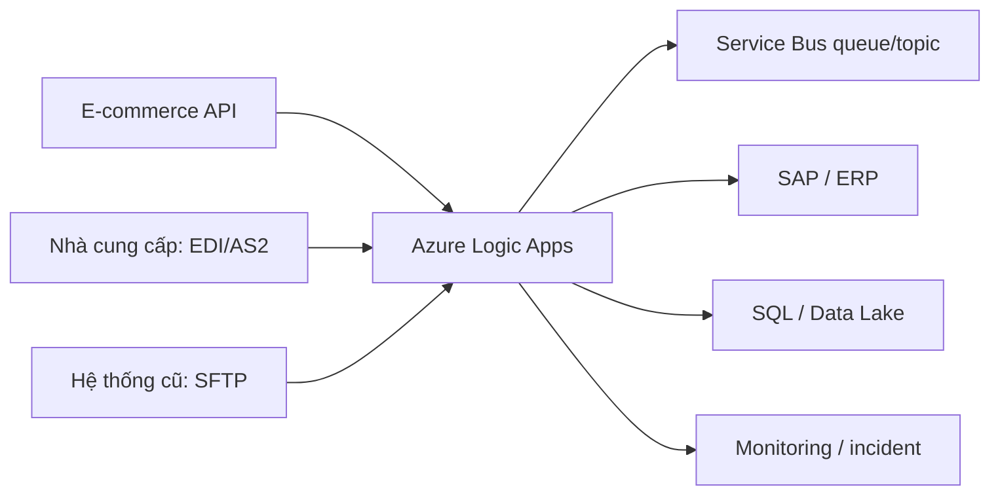

**Logic Apps không tự trở thành hệ thống nguồn dữ liệu chuẩn**. ERP vẫn quản lý trạng thái đơn hàng/tồn kho, hệ thống thanh toán vẫn quyết định thanh toán thành công, và broker vẫn chịu trách nhiệm lưu/đưa messages theo đặc tính của nó. Workflow là **lớp điều phối và tích hợp**, không phải nơi thay thế mọi transaction business.

## 2. EAI, B2B và API integration khác nhau ra sao?

### Enterprise Application Integration (EAI)

EAI tập trung kết nối hệ thống **trong cùng tổ chức** hoặc cùng miền kiểm soát, ví dụ website → CRM → ERP → kho. Doanh nghiệp có thể quản lý toàn bộ schema và quyền, nhưng vẫn gặp khác biệt về đội chủ quản, vòng đời và downtime.

### Business-to-Business Integration (B2B)

B2B kết nối **giữa các tổ chức**: nhà sản xuất gửi purchase order cho nhà cung cấp, nhà cung cấp trả invoice/dispatch advice, đối tác logistics cập nhật vận đơn. Hai phía phải thống nhất **trading partner IDs, agreement, message format, transport, chứng chỉ, acknowledgment, SLA và quy trình xử lý lỗi**.

### API integration

API integration thường dùng HTTP/REST, OAuth hoặc API key để kết nối synchronous request/response. Đây là một **cách giao tiếp**, không thay thế B2B: đối tác vẫn có thể ký hợp đồng dữ liệu, có idempotency, audit và acknowledgment trên API.

| Tiêu chí | EAI | B2B | API |
|---|---|---|---|
| Phạm vi | Nội bộ doanh nghiệp | Nhiều tổ chức độc lập | Giao diện dịch vụ |
| Hợp đồng dữ liệu | Canonical JSON/XML, ERP entities | EDI, AS2, XML, CSV, API tùy partner | OpenAPI/JSON/XML |
| Identity | Entra ID, managed identity, network policy | Trading partner IDs, certificates, credentials | OAuth2, mTLS, subscription key |
| Truy vết | Correlation trong hệ thống | Interchange/control IDs, business document IDs | Request ID/correlation |
| Kết quả | Đồng bộ trạng thái hệ thống | Giao chứng từ và nhận xác nhận theo agreement | HTTP result hoặc job ID |
| Điểm cần tránh | Kết nối điểm-điểm quá nhiều | Mất ACK, duplicate, sai schema/version | Lạm dụng synchronous timeout |

Trong thực tế một workflow có thể vừa là EAI, vừa là B2B: nhận EDI từ đối tác rồi cập nhật SAP nội bộ chính là hai lớp này gặp nhau.

## 3. Logic Apps Consumption và Standard

Azure Logic Apps có những mô hình hosting phổ biến; phải phân biệt trước khi thiết kế networking, artifacts, deployment và chi phí.

| Thuộc tính | Logic Apps **Consumption** | Logic Apps **Standard** |
|---|---|---|
| Kiểu hosting | Mô hình đa tenant, workflow resource theo kiểu Consumption | Mô hình single-tenant runtime, ứng dụng chứa một hay nhiều workflows |
| Cách tổ chức | Thường một Logic App resource đại diện một workflow | Một Logic App Standard resource có thể chứa nhiều workflows |
| Trạng thái workflow | Stateful theo cách thức hỗ trợ của hosting | Hỗ trợ **stateful** và **stateless** workflows với giới hạn khác nhau |
| Connectors | Chủ yếu managed connectors và built-in triggers/actions được hỗ trợ | Built-in/in-app connectors cùng managed connectors theo cấu hình |
| B2B artifacts | Thường kết hợp **Integration Account** theo connector/plan hỗ trợ | Có thể dùng **in-app B2B artifacts** trong mô hình Standard được hỗ trợ, hoặc integration model phù hợp |
| Networking | Các giới hạn/cơ chế mạng riêng của Consumption | Có mô hình VNet integration/private access được hỗ trợ ở Standard theo plan |
| Giá | Tính theo executions/actions/connectors và các thành phần liên quan | Năng lực/hosting plan, managed connector usage, storage/network/monitoring |
| CI/CD | Quản lý workflow JSON/ARM/Bicep cùng connections | Project artifacts, workflows, connections, runtime config và deploy pipeline |
| Phù hợp | Workflows đơn giản, sự kiện và lưu lượng dao động | Nhiều workflows, tích hợp doanh nghiệp, networking/control/runtime rõ ràng |

**Không có đáp án “Standard luôn tốt hơn”.** Một workflow HTTP nhỏ chạy không thường xuyên có thể phù hợp Consumption; một giải pháp B2B nhiều artifacts, private SAP và các flows nhiều bước thường cần đánh giá kỹ Standard. Tính năng/giới hạn và giá phải xác nhận theo **region/plan/connector thực tế** trước khi mua.

### Stateful so với stateless

**Stateful workflow** lưu được trạng thái/history theo khả năng runtime, thuận tiện cho orchestration nhiều bước, retry, human approval và vận hành kiểm toán. **Stateless workflow** được tối ưu cho xử lý ngắn và ít overhead hơn trong điều kiện hỗ trợ, nhưng có giới hạn về thời lượng, lưu history và hành động được phép.

Với luồng **EDI purchase order cần ACK/replay/audit**, hãy đánh giá stateful, history retention và nguồn business audit bền vững. Không kỳ vọng stateless workflow tự giữ đầy đủ chứng từ và dấu vết sau thời gian dài.

### Standard có hai họ connector

- **Built-in / in-app connectors:** chạy tích hợp gần runtime với hành vi triển khai, networking, authentication và throughput theo khả năng từng connector.
- **Managed connectors:** dịch vụ connector dùng chung do Azure quản lý, thông qua API connections và quyền cấu hình tương ứng.

Việc một connector tồn tại ở cả hai kiểu **không có nghĩa tất cả triggers/actions, auth modes, private networking và billing giống nhau**. Chọn đúng connector thực sự hỗ trợ giao thức/ERP cần tích hợp.

## 4. Anatomy của một Logic App workflow

Một workflow được khởi phát bằng **trigger** rồi thực hiện một hoặc nhiều **actions**.

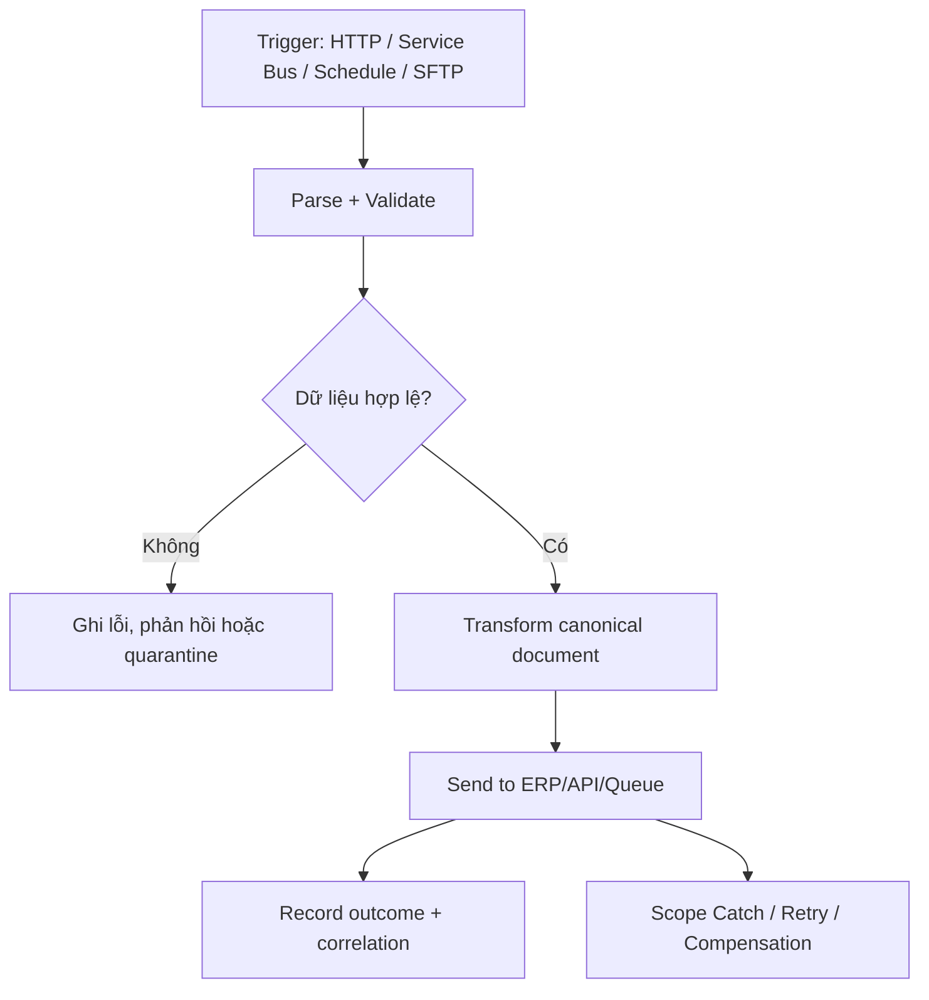

| Khái niệm | Cách hiểu | Ví dụ |
|---|---|---|
| **Trigger** | Bắt đầu một lần chạy workflow | HTTP request, recurrence, new Service Bus message |
| **Action** | Một thao tác trong workflow | HTTP call, Compose, Parse JSON, SQL insert |
| **Connector** | Cầu nối tới hệ thống/định dạng/giao thức | SAP, SFTP, Service Bus, SQL |
| **Connection** | Cấu hình endpoint và authentication | Managed identity, OAuth, service principal |
| **Scope** | Nhóm actions để kiểm soát luồng lỗi | `Try`, `Catch`, `Finally` |
| **Condition/Switch** | Rẽ nhánh theo dữ liệu | Document type = 850/810 |
| **For each** | Lặp qua danh sách items | Các dòng order |
| **Until** | Lặp cho tới điều kiện/khi chạm giới hạn | Poll trạng thái job |
| **Run after** | Quy định bước nào chạy sau trạng thái nào | `Succeeded`, `Failed`, `TimedOut`, `Skipped` |
| **Expression** | Truy xuất/biến đổi dữ liệu trong action | `triggerBody()?['orderId']` |
| **Run history** | Theo dõi thực thi theo runtime/config | Input/output, thời gian, lỗi |

### Synchronous và asynchronous

**Synchronous**:

```text
Client POST /orders
→ Request trigger
→ Kiểm tra dữ liệu
→ Gọi ERP
→ Response 200/4xx/5xx
```

Nhược điểm: nếu ERP trả chậm, client hoặc gateway có thể timeout, và retry của client có thể gây tạo đơn trùng.

**Asynchronous**:

```text
Client POST /orders
→ Kiểm tra yêu cầu
→ Ghi message vào Service Bus hoặc durable work store
→ Response 202 + correlationId

Worker workflow:
Service Bus trigger
→ Transform/validate
→ Gọi ERP
→ Lưu business status
→ Complete message
```

Mô hình async giúp tách **thời gian đáp ứng API** khỏi xử lý ERP nhưng phải có **job status, idempotency, retry/poison handling**. Không trả `202 Accepted` khi chưa có bằng chứng message đã được ghi vào kho hàng đợi theo cơ chế connector và chính sách nghiệp vụ.

## 5. Điều phối workflow có trạng thái và cơ chế lỗi

Một workflow dài có thể:

1. Nhận chứng từ.
2. Validate envelope/schema.
3. Gọi hệ thống ERP.
4. Chờ kiểm tra tín dụng.
5. Gửi xác nhận cho đối tác.
6. Ghi audit và hoàn tất.

Những bước này không phải một database transaction duy nhất. Nếu ERP commit thành công nhưng bước gửi ACK thất bại, workflow **không thể chỉ rollback toàn bộ ERP và giả định đối tác chưa nhận**.

### Scope Try/Catch/Finally

Một mẫu điều phối:

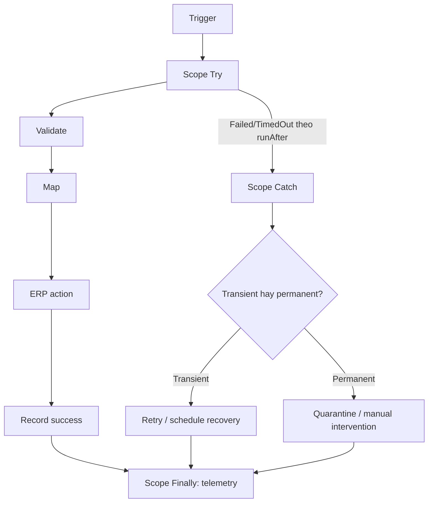

**Quan trọng:** `runAfter` điều khiển thứ tự actions **bên trong workflow**; không phải hệ thống exception handling tự động cho mọi external side effect. Cần cấu hình từng nhánh dựa trên trạng thái `Succeeded/Failed/Skipped/TimedOut` và kiểm tra thực tế.

### Retry policy

Nhiều connector/actions có retry policy được hỗ trợ, thường là fixed/exponential/none tùy action. **Đừng retry vô hạn** khi ERP trả lỗi schema hoặc đối tác gửi chứng từ không hợp lệ. Có ba loại lỗi:

- **Transient:** 429, 503, timeout ngắn; retry có giới hạn/backoff.
- **Permanent:** thiếu field bắt buộc, sai EDI envelope, agreement không khớp; quarantine hoặc reject theo contract.
- **Ambiguous:** external API timeout sau khi phía ERP có thể đã commit; phải tra cứu theo idempotency/business key trước khi retry tạo mới.

### Compensation thay cho rollback phân tán

Nếu workflow đã tạo đơn ERP nhưng không thể reserve shipping, cần một **compensating action** như hủy giữ hàng hoặc chuyển đơn sang trạng thái chờ xử lý, không cố làm transaction ACID xuyên nhiều SaaS/API/EDI. Đây là tư duy **Saga/process orchestration** khi nghiệp vụ đa hệ thống.

## 6. Các connector doanh nghiệp thường dùng

| Connector/đường tích hợp | Dữ liệu | Lưu ý |
|---|---|---|
| **HTTP/HTTPS** | REST/JSON/XML, webhook | OAuth/mTLS, timeout, API Management, rate limit |
| **SAP** | BAPI/RFC/IDoc hoặc các thao tác được connector hỗ trợ | SAP connector version, SAP components/gateway/network, license |
| **Azure SQL / SQL Server** | Dữ liệu quan hệ | DB authentication, network, transactional behavior |
| **SFTP / SSH** | File EDI/CSV/XML | SSH host key verification, credential, file size, polling |
| **Azure Service Bus** | Commands/events | Message delivery, sessions, TTL/DLQ, idempotency |
| **Event Grid** | Sự kiện thay đổi tài nguyên | Delivery retry, event filtering, event ID |
| **Azure Blob Storage** | Raw/processed documents | Identity/RBAC, versioning, lifecycle |
| **Dynamics 365 / Dataverse** | CRM/ERP entities | OAuth, API limits, field mapping |
| **Office 365 / Teams** | Approval/notifications | User consent, delegated permissions, message privacy |
| **Key Vault** | Secret/certificate references | Managed identity, RBAC và rotation |
| **Custom connector** | API nội bộ hoặc đối tác chưa có connector | OpenAPI definition, auth, gateway, throttling |

Connector là một **tích hợp chức năng**, không bảo đảm mọi service/business API có sẵn operations mong muốn. Ví dụ SAP có nhiều cơ chế IDoc/BAPI/OData; phải chọn adapter hợp đồng thật, chứ không ghi “SAP connector” rồi coi mọi thao tác ERP đều được hỗ trợ.

### Kết nối ERP/SAP on-premises

Một ERP trong datacenter có thể nằm sau firewall, không có public endpoint. Lựa chọn cần đánh giá:

- **On-premises data gateway** cho connector/hosting hỗ trợ loại gateway này.
- **VNet/private connectivity** qua VPN/ExpressRoute và DNS/network rule cho mô hình được hỗ trợ.
- **SAP connector / adapter** tương ứng, cùng dependency/connector-specific requirements.
- **API proxy** do doanh nghiệp sở hữu (ví dụ qua API Management hoặc reverse proxy bảo mật) nếu muốn chuẩn hóa giao thức.
- Hàng đợi trung gian nếu ERP thường downtime hoặc có giới hạn nhập đơn.

**Đừng mở port ERP/SAP công khai lên Internet chỉ để designer Logic Apps thử kết nối.** Managed connector có thể sử dụng đường mạng khác với Logic Apps Standard built-in connector; phải xác minh network path **từ nơi connector thực thi**, không chỉ từ laptop có VPN.

## 7. B2B exchange: một chứng từ đi qua nhiều lớp

Tài liệu trao đổi B2B thường có bốn lớp:

1. **Business document:** purchase order, invoice, dispatch advice.
2. **Syntax/format:** X12, EDIFACT, XML, CSV hoặc schema riêng.
3. **Transport/security:** AS2 qua HTTP(S), SFTP, API, messaging.
4. **Agreement/acknowledgment:** danh tính đối tác, mã định danh, control numbers, kiểm tra chứng từ và xác nhận giao nhận.

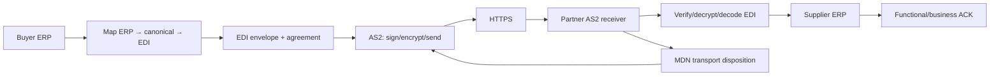

**MDN của AS2, functional acknowledgment của EDI và business acceptance là ba mức xác nhận khác nhau.** Một MDN thành công không có nghĩa đơn hàng đã được ERP chấp nhận về giá, tồn kho hay điều khoản thanh toán.

## 8. EDI X12: cấu trúc của một interchange

**ANSI ASC X12** là họ chuẩn trao đổi chứng từ EDI thường gặp ở Bắc Mỹ. Ví dụ transaction sets:

| Mã X12 | Chứng từ thường gặp |
|---|---|
| **850** | Purchase Order |
| **855** | Purchase Order Acknowledgment |
| **856** | Advance Ship Notice |
| **810** | Invoice |
| **997/999** | Functional/implementation acknowledgment theo chuẩn và version |

Một interchange X12 có nhiều cấp envelope:

```text
ISA ...                  # Interchange header
  GS ...                 # Functional group header
    ST*850 ...           # Transaction set bắt đầu
      BEG ...            # Purchase order content
      PO1 ...            # Order line
    SE ...               # Transaction set trailer
  GE ...                 # Functional group trailer
IEA ...                  # Interchange trailer
```

Sơ đồ trên **chỉ biểu diễn cấu trúc**. Nó không phải chứng từ EDI hợp lệ để gửi production: X12 có quy tắc delimiter, vị trí field, control numbers, counts, version và partner agreement rất chặt chẽ.

### Envelope quan trọng thế nào?

- `ISA/IEA` chứa thông tin interchange, sender/receiver IDs, control number theo version/format.
- `GS/GE` bao một nhóm chức năng.
- `ST/SE` bao một transaction set, có transaction control number và segment count.
- Agreement/schema quyết định các segments/fields nào bắt buộc, giá trị nào hợp lệ.

Ví dụ nếu `SE` khai sai số segment, message có thể bị từ chối **dù phần nghiệp vụ có đủ thông tin đơn hàng**. Vì vậy phải phân biệt **syntax validation** với **business validation**.

## 9. UN/EDIFACT: cùng mục tiêu nhưng cú pháp khác

**UN/EDIFACT** là chuẩn EDI phổ biến trong thương mại quốc tế. Một số message types:

| Mã EDIFACT | Ý nghĩa thường gặp |
|---|---|
| **ORDERS** | Purchase order |
| **ORDRSP** | Order response |
| **DESADV** | Despatch advice |
| **INVOIC** | Invoice |
| **CONTRL** | Syntax/service acknowledgment |

Sơ đồ envelope:

```text
UNA ...                # Tùy chọn: service string advice
UNB ...                # Interchange header
  UNH ...              # Message header
    BGM ...            # Business message beginning
    ...                # Segments nghiệp vụ
  UNT ...              # Message trailer
UNZ ...                # Interchange trailer
```

X12 và EDIFACT **không chỉ khác tên field**. Version/release, segment structures, qualifier, composite data elements và quy tắc envelope khác nhau. Đừng thay `ST` bằng `UNH` rồi coi đã “chuyển đổi EDIFACT”; cần schema/map/validation theo chuẩn và agreement.

### Control number và version

Mỗi đối tác có thể yêu cầu:

- X12 version/release khác nhau (ví dụ 004010, 005010 tùy agreement).
- EDIFACT directory/release cụ thể.
- Delimiters đặc thù, character set/encoding.
- Sender/receiver IDs và qualifiers thống nhất.
- Control number không trùng trong kỳ/đối tác theo quy tắc.
- Quy định bắt buộc ACK trong thời gian SLA.

**Không tạo control numbers ngẫu nhiên không lưu state** khi partner yêu cầu tăng tuần tự hoặc tránh trùng. Thành phần B2B runtime và agreement cần được cấu hình phù hợp cho generation/validation/duplicate detection.

## 10. AS2: bảo mật và giao nhận EDI qua HTTP(S)

**Applicability Statement 2 (AS2)** là giao thức trao đổi thông điệp B2B qua HTTP(S), hỗ trợ ký số, mã hóa và **Message Disposition Notification (MDN)** theo cấu hình.

### Bốn thành phần cần tách biệt

| Thành phần | Vai trò |
|---|---|
| **AS2 From / To** | Danh tính đối tác trong thông điệp AS2 |
| **Signing certificate/private key** | Ký thông điệp để bên nhận xác minh nguồn và tính toàn vẹn |
| **Encryption certificate/public key** | Mã hóa cho bên nhận; họ dùng private key tương ứng để giải mã |
| **MDN** | Thông báo kết quả xử lý/nhận ở tầng AS2, có thể được ký |

Giao thức có các chế độ MDN **synchronous** hoặc **asynchronous** theo agreement. Bên gửi cần đối chiếu message ID, disposition và trạng thái ký/verify; với MDN async, một HTTP response ban đầu không nhất thiết là MDN cuối cùng.

### Ba xác nhận không được đồng nhất

| Mức xác nhận | Câu hỏi được trả lời | Không chứng minh |
|---|---|---|
| **HTTP/AS2 MDN** | Bên nhận/gateway đã xử lý thông điệp ở mức AS2 ra sao? | ERP đã tạo đơn hợp lệ |
| **EDI functional ACK** như 997/999/CONTRL | Cú pháp/implementation của transaction được chấp nhận ra sao? | Giá/tồn kho/credit đã được phê duyệt |
| **Business response** như X12 855/EDIFACT ORDRSP | Đối tác xác nhận nội dung đơn hàng theo hợp đồng | Mọi dòng hàng đã được giao/thanh toán |

**Không đóng trạng thái business order là “Accepted” chỉ vì MDN có disposition thành công.** Dùng trạng thái riêng như `TransportDelivered`, `SyntaxAccepted`, `BusinessAcknowledged` và `Fulfilled`.

### Chứng chỉ B2B

Một đối tác có thể dùng **nhiều chứng chỉ với mục đích khác nhau**: ký, mã hóa, xác minh MDN, TLS tại endpoint. Không nhầm:

- **TLS certificate** bảo vệ kết nối HTTPS.
- **AS2 signing certificate** liên quan chữ ký thông điệp.
- **AS2 encryption certificate** liên quan mã hóa payload.

Lịch rotate, hiệu lực, trust chain, đối tác giữ private key nào và cách lưu cert phải được hai bên thống nhất. Một cert đã hết hạn có thể gây gián đoạn giao dịch dù API và Logic App vẫn Running.

## 11. Trading partner, agreement, schema, map và certificate

Các thành phần Enterprise Integration/B2B là nền tảng của pipeline.

| Artifact | Chức năng | Ví dụ |
|---|---|---|
| **Trading partner** | Hồ sơ một tổ chức B2B, có identifiers/qualifiers phù hợp | Buyer-A, Supplier-B |
| **Agreement** | Hợp đồng kỹ thuật giữa host partner và guest partner | X12 850 + 997, AS2 signed/encrypted |
| **Schema** | Định nghĩa cấu trúc EDI/XML để validate/decode/encode | X12 850 version được hỗ trợ |
| **Map** | Biến đổi cấu trúc dữ liệu | PurchaseOrder EDI XML → ERP canonical XML |
| **Certificate** | Khóa/chứng chỉ phục vụ ký, giải mã, xác minh | AS2 encryption/signing |
| **Integration Account** | Tài nguyên hỗ trợ lưu/điều phối một số B2B artifacts theo hosting được hỗ trợ | Artifacts dùng trong Consumption workflows |
| **In-app artifacts** | Lưu/quản lý B2B artifacts trong mô hình Logic Apps Standard hỗ trợ | Schemas/maps/agreements theo runtime |

### Lựa chọn vị trí artifacts

Trong **Consumption**, các kịch bản dùng Enterprise Integration connectors thường liên kết với **Integration Account**. Trong **Standard**, các B2B operations và artifact management có thể hỗ trợ cách **in-app**; một số thiết kế hoặc connector vẫn có các cách liên kết Integration Account khác. Cần tra yêu cầu chính xác của **hosting, connector và operations bạn chọn**.

**Không tự tạo Integration Account chỉ vì có một Logic App**: nó chỉ cần khi tính năng hoặc kiến trúc B2B yêu cầu, và có chi phí/giới hạn riêng. Ngược lại, đừng xóa Integration Account đang giữ artifacts của nhiều workflows khi chuyển một workflow sang Standard.

### Partner ID và agreement resolution

Một document incoming có thể mang:

```text
AS2-From: SUPPLIER-B
AS2-To: BUYER-A
X12 ISA sender/receiver identifiers: giá trị trong agreement
Transaction type: 850
Version: theo partner contract
```

Đội platform phải bảo đảm danh tính **ở transport và envelope** được map đúng tới trading partner, tránh nhận tài liệu của đối tác A rồi xử lý bằng agreement của B. Nếu có nhiều agreements/versions, cần routing theo partner ID, message type và version — không chỉ dựa vào tên file `order.edi`.

### Data mapping

Schema xác định dữ liệu nào được phép; **map** biến đổi dữ liệu từ format nguồn sang đích. Có thể xây:

```text
Partner X12 850
→ Decode to canonical XML/schema
→ Validate semantic fields
→ Map to canonical PurchaseOrder
→ Map to SAP/ERP request
```

Map không nên chứa hardcoded partner secrets, environment endpoints hoặc giả định tên partner không thay đổi. Dùng parameters/configuration theo môi trường khi có thể.

## 12. Thiết kế canonical data model trước khi viết hàng chục maps

Nếu có 8 đối tác và 3 ERP/ứng dụng nội bộ, xây map riêng cho mọi cặp có thể tạo:

\[
8\times3=24\ \text{ánh xạ điểm-điểm}.
\]

Một **canonical model** giảm phụ thuộc giữa đối tác và ERP:

```text
X12 850 ─┐
EDIFACT ─┼─> Canonical PurchaseOrder ─┬─> SAP
REST JSON ┘                           ├─> Microsoft Dynamics
                                      └─> Warehouse API
```

Đây là cách giảm số lượng mapping logic trong một tổ chức, **không phải công thức số lượng maps luôn tối thiểu**: có thể vẫn cần partner-specific extensions, validation hoặc các biến thể schema.

### Canonical Purchase Order mẫu

```json
{
  "schemaVersion": "1.0",
  "documentType": "PurchaseOrder",
  "documentId": "PO-2026-00127",
  "buyerId": "BUYER-A",
  "supplierId": "SUPPLIER-B",
  "currency": "USD",
  "orderDate": "2026-11-20",
  "lines": [
    {
      "lineNumber": 1,
      "sku": "SKU-1001",
      "quantity": 25,
      "unit": "EA",
      "unitPrice": 12.5
    },
    {
      "lineNumber": 2,
      "sku": "SKU-2002",
      "quantity": 10,
      "unit": "EA",
      "unitPrice": 45.0
    }
  ],
  "source": {
    "partner": "SUPPLIER-B",
    "format": "X12",
    "transactionType": "850",
    "interchangeControlNumber": "000000127",
    "eventId": "lab-event-127"
  }
}
```

Đây là **hợp đồng JSON nội bộ minh họa**, không phải X12 segment map hoàn chỉnh. Ví dụ cũng **chưa** mô tả thuế, discount, tổng tiền, địa chỉ giao nhận, timezone hoặc quy tắc làm tròn; các trường đó cần có trong phiên bản canonical schema nếu hệ thống nghiệp vụ yêu cầu.

### Mapping table cụ thể

| Canonical field | Nguồn X12 850 có thể tương ứng | Nguồn EDIFACT ORDERS có thể tương ứng | Đích ERP |
|---|---|---|---|
| `documentId` | Purchase order number trong `BEG` | Order reference trong `BGM` | External document/reference ID |
| `orderDate` | Date element theo version `BEG/DTM` | Date/time trong `DTM` | Order date |
| `buyerId` | Trading partner identifiers trong `N1`/envelope | Party trong `NAD` | Buyer/business partner |
| `lines[].sku` | Product IDs của `PO1` | Item identification trong `LIN` | Material/product code |
| `lines[].quantity` | Quantity trong `PO1` | Quantity trong `QTY` | Ordered quantity |
| `currency` | Currency segment/qualifier theo implementation | Currency thông tin trong `CUX` | Currency code |

Tên segment/field trong bảng chỉ là **định hướng mapping**. X12 và EDIFACT có qualifiers, phiên bản và nhiều cách biểu diễn; việc field nằm đúng ở segment nào phải lấy từ **implementation guide của đối tác** và schema đã ký duyệt.

### Validate theo ba tầng

1. **Transport/envelope:** đúng sender/receiver, ký/chứng chỉ, thông tin interchange, control numbers?
2. **Syntax/schema:** chứng từ đúng version, segment structure, data element types, mandatory fields?
3. **Business semantics:** buyer/supplier có hợp đồng, SKU có tồn tại, currency hợp lệ, số lượng dương, ngày giao hàng thỏa thuận?

**Không đưa tất cả lỗi vào một nhãn “Invalid EDI”.** Đối tác cần biết bị từ chối ở tầng nào để sửa đúng vấn đề, trong khi nhóm vận hành cần quyết định có thể retry hay phải yêu cầu thay chứng từ.

## 13. Kiến trúc B2B inbound: từ AS2/X12 tới ERP

Tình huống: Supplier-B gửi purchase order X12 850 qua AS2 đến doanh nghiệp. Workflow phải xác minh transport, decode EDI, xác thực dữ liệu, đẩy lệnh cho ERP và tạo business acknowledgment riêng.

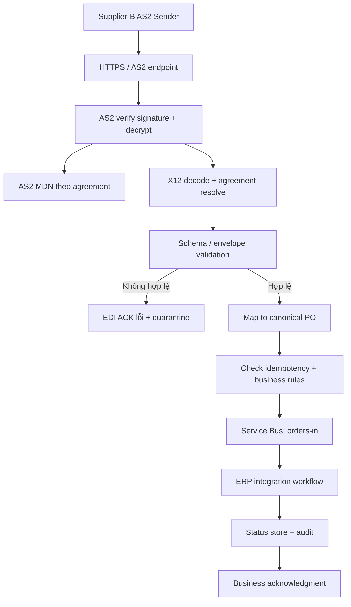

### Vì sao tách thành hai workflows?

Một cách thiết kế thực tế:

**Workflow A — B2B Gateway**

- Nhận AS2 message.
- Kiểm tra signature/decrypt, khớp partner agreement.
- Gửi MDN đúng giao thức và thời hạn.
- Decode/validate EDI, lưu raw encrypted/secure archive theo chính sách.
- Ghi một work item bền vững vào Service Bus/DB.
- Lưu correlation giữa AS2 Message-ID, EDI control number và work item ID.

**Workflow B — ERP Processor**

- Nhận work item.
- Kiểm tra business idempotency.
- Map canonical document sang ERP request.
- Gọi SAP/ERP với timeout/retry/transaction boundary hợp lý.
- Lưu trạng thái nghiệp vụ sau commit.
- Phát functional/business ACK hoặc response phù hợp thỏa thuận.

**Lợi ích:** AS2 transport không phải chờ một ERP có thể mất vài phút. Khi ERP tạm ngưng, Message/Queue layer vẫn giữ công việc và cho phép xử lý lại có kiểm soát.

### Trật tự ACK và xử lý

Đối tác có thể yêu cầu MDN synchronous trong một thời hạn ngắn. Nếu bạn đợi ERP xử lý xong rồi mới gửi MDN, yêu cầu có thể timeout, đối tác gửi lại cùng interchange và tạo duplicate. MDN đúng vai trò phải gắn với **transport/disposition** theo AS2 agreement; **business acceptance** là luồng xác nhận khác.

**Không phản hồi MDN thành công** nếu tầng AS2 buộc phải reject vì signature/decryption invalid. Cũng **không dùng functional ACK 997/999** để giả vờ xác nhận ERP đã duyệt tín dụng: bản chất của ACK đó khác.

### Lưu chứng từ gốc

Một bản raw document lưu trong Blob/Data Lake được bảo vệ giúp:

- điều tra schema/version;
- đối chiếu chữ ký/envelope;
- replay sau sửa lỗi mapping;
- cung cấp audit trail;
- kiểm tra duplicate theo control numbers.

Raw EDI có thể chứa PII/giá bán/địa chỉ; cần **encrypt, private access, data retention, audit quyền đọc và xóa theo chính sách**. Không đưa raw documents vào workflow run history/logs vô hạn mà không có kiểm soát.

## 14. Kiến trúc B2B outbound: ERP invoice tới partner

Một đơn hàng đã xuất hóa đơn cần tạo X12 810 và gửi Supplier-B qua AS2.

```mermaid
flowchart LR
    ERP["ERP invoice committed"] --> OUTBOX["Outbox / Service Bus"]
    OUTBOX --> WF["Logic App outbound"]
    WF --> CANON["Map ERP → canonical Invoice"]
    CANON --> EDI["Encode X12 810 / validate"]
    EDI --> AS2["Sign + encrypt via agreement"]
    AS2 --> SEND["HTTPS send partner"]
    SEND --> MDN["Receive / correlate MDN"]
    MDN --> TRACK["Update transmission state"]
    TRACK --> BIZ["Wait for 997/999 / business response"]
```

### Các trạng thái cần tách

```text
InvoiceCreatedInERP
→ QueuedForB2B
→ EncodedValidated
→ Sent
→ TransportAcknowledged (MDN)
→ SyntaxAcknowledged (EDI ACK)
→ BusinessAccepted / BusinessRejected
```

Không được chuyển thẳng `Sent → BusinessAccepted` chỉ vì HTTP trả `200`. Với MDN asynchronous, HTTP response ban đầu có thể chỉ xác nhận transport request được nhận; cần theo dõi MDN đến sau và xử lý timeout một cách riêng.

### Nếu gửi thành công nhưng workflow timeout?

Ví dụ:

1. AS2 receiver đã nhận và xử lý.
2. Network ngắt trước khi sender nhận MDN.
3. Logic App thấy timeout.
4. Retry không có idempotency có thể gửi lại cùng invoice.

Thiết kế:

- Dùng **stable documentId, interchange control number và AS2 Message-ID** theo thỏa thuận, không tự tạo mới cho từng retry nếu hệ thống cần nhận diện duplicate.
- Theo dõi gửi/MDN/functional ACK bằng correlation.
- Xác minh partner có policy resend và duplicate control rõ ràng.
- Nếu trạng thái không chắc chắn, tra cứu transmission state trước khi retry.
- Tách lỗi **transport uncertain** khỏi lỗi **document rejected**.

## 15. Integration Account và B2B artifacts: quy trình quản lý

Một project B2B không chỉ có workflow JSON; còn có hàng loạt artifacts mang tính hợp đồng giữa doanh nghiệp và đối tác.

### Bộ artifacts của một partner

```text
Trading Partner: BUYER-A
Trading Partner: SUPPLIER-B
Agreement: BUYER-A <-> SUPPLIER-B
  ├── Transport: AS2 IDs, endpoint, signed/encrypted, MDN behavior
  ├── Message format: X12 850 inbound / 810 outbound
  ├── Syntax: version, delimiters, qualifiers, control numbers
  ├── Certificates: signing, encrypting, verification, expiry
  ├── Schemas: 850 / 810 versions
  └── Maps: EDI ↔ canonical ↔ ERP
```

Lưu ý: cách trình bày một agreement trong Portal/Integration Account không nhất thiết đúng như tree trên; đây là **bảng kiểm các nhóm cấu hình phải làm chủ**.

### Quy trình đưa artifacts vào production

1. **Nhận trading partner implementation guide** và AS2 profile chính thức.
2. Chốt sender/receiver identifiers và qualifiers.
3. Chốt certificate owner, public/private key exchange, expiry, trust chain và rotation.
4. Lấy schema đúng version và extension/transformer hỗ trợ.
5. Viết map + validation; có test cases cho optional/mandatory segments.
6. Cấu hình agreements và các kiểm tra duplicate/control numbers theo khả năng.
7. Chạy partner interoperability test: signed/encrypted AS2, MDN, 997/999 hoặc CONTRL, business ACK.
8. Ghi lại endpoint, IP/network requirements, SLA, contact và escalation path.
9. Chuyển cấu hình qua CI/CD/approval, không sửa production bằng thao tác tay không lưu lịch sử.
10. Theo dõi errors/ACK latency sau go-live.

### Chứng chỉ không nên quản lý bằng “file đính kèm trong email”

Đối tác có thể trao đổi **public certificate** qua kênh thỏa thuận, nhưng **private key** phải được bảo vệ trong Key Vault hoặc hệ thống quản lý khóa/chứng chỉ được phê duyệt theo khả năng connector và hosting. Không gửi private key/PFX/password trong chat hoặc ticket.

Khi rotate, cần giai đoạn chuyển tiếp:

- thống nhất thời điểm hiệu lực và chứng chỉ mới;
- xác minh workflow/connector hỗ trợ cấu hình song song theo yêu cầu;
- kiểm thử MDN/signature/decryption đầu vào và đầu ra;
- có rollback nếu phía đối tác chưa cập nhật;
- thu hồi/hủy key cũ khi an toàn.

Một chứng chỉ B2B không nên được rotate tự động mà không có thông báo partner, vì hai đầu phải thống nhất khóa public/private tương ứng.

## 16. JSON/XML mapping: biến đổi và canonical hóa dữ liệu

Trong Logic Apps, bạn có thể sử dụng:

- **Parse JSON** với schema để truy xuất properties sau khi nhận API payload.
- **Compose** và expressions cho các biến đổi đơn giản.
- **Data Operations** như Select, Filter array, Join khi phù hợp.
- **XML Transform/Map** theo B2B artifact/connector hỗ trợ cho chuyển đổi cấu trúc.
- **Azure Functions** hoặc service riêng cho thuật toán chuyển đổi phức tạp.

### Ví dụ một incoming order JSON

```json
{
  "partnerId": "SUPPLIER-B",
  "poNumber": "PO-127",
  "orderDate": "2026-11-20",
  "items": [
    {"code": "SKU-1001", "qty": 25},
    {"code": "SKU-2002", "qty": 10}
  ]
}
```

### Canonical output sau map

```json
{
  "documentType": "PurchaseOrder",
  "documentId": "PO-127",
  "supplierId": "SUPPLIER-B",
  "orderDate": "2026-11-20",
  "lines": [
    {"lineNumber": 1, "sku": "SKU-1001", "quantity": 25},
    {"lineNumber": 2, "sku": "SKU-2002", "quantity": 10}
  ]
}
```

Trong designer có thể dùng expression để lấy một thuộc tính:

```text
triggerBody()?['poNumber']
```

Hay lấy trạng thái của một action theo tên:

```text
outputs('Parse_Order')?['body']?['poNumber']
```

Tên `Parse_Order` là tên action **do người thiết kế đặt**, không phải action luôn có trong mọi workflow. Expression không tự validate đầy đủ JSON schema: phải xử lý missing/null, kiểu dữ liệu và giá trị không hợp lệ.

### Điều kiện nghiệp vụ phải kiểm tra sau mapping

- `documentId` không rỗng và đúng scope của partner.
- `orderDate` là ngày hợp lệ, timezone/định dạng rõ.
- `quantity` là số dương, decimal/unit có quy tắc.
- SKU được map sang mã vật tư ERP đúng version.
- Không có dòng trùng `lineNumber`.
- Currency và tổng tiền được đối chiếu theo hợp đồng.
- Tenant/partner không truy xuất dữ liệu của đối tác khác.

Nếu lỗi thuộc **schema**, trả reject/functional acknowledgment theo hợp đồng; nếu lỗi thuộc **business**, gửi trạng thái từ chối nghiệp vụ hoặc yêu cầu sửa chứng từ qua kênh phù hợp.

## 17. Service Bus làm lớp đệm giữa B2B và ERP

ERP nội bộ có thể bảo trì hoặc bị giới hạn tốc độ. Đưa chứng từ đã validate vào **Azure Service Bus** giúp:

- Tách AS2/HTTP inbound khỏi thời gian xử lý ERP.
- Lưu work items bền vững theo messaging semantics.
- Scale consumers theo queue backlog và quota.
- Có retry, DLQ, TTL và duplicate detection theo entity/SDK cấu hình.
- Giữ correlation, kiểm soát thứ tự qua sessions nếu cần theo PurchaseOrderId.

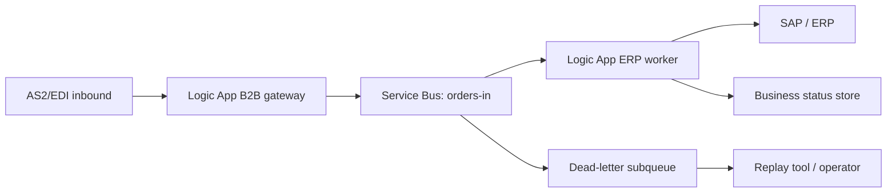

### Queue delivery không phải exactly-once

Message có thể được giao lại do lock expiry, retry hoặc host crash. Vì vậy nên có:

```text
Business key:
partnerId + documentType + documentId + revision

Technical correlation:
AS2 Message-ID + EDI interchange/group/transaction control numbers
  + Service Bus MessageId + Logic App runId
```

Business key dùng chống tạo lại cùng order; technical correlation dùng tra vết. Hai loại không nên trộn thành một key duy nhất mà bỏ qua logic sửa đơn/revision.

### Idempotency trong ERP

Khi nhận một purchase order:

1. Tra business key trong **ProcessedDocuments** hoặc trạng thái ERP.
2. Nếu đã commit thành công đúng revision, không tạo order mới.
3. Nếu chưa xử lý, đặt trạng thái `Processing` bằng thao tác atomic/conditional.
4. Gọi ERP và lưu external ERP order ID.
5. Commit trạng thái `Completed`; sau đó settle message.
6. Nếu connector timeout sau commit có khả năng xảy ra, kiểm tra ERP bằng external reference trước khi retry.

Một **Compose** ghi `status="Completed"` trong workflow không phải bằng chứng ERP đã commit. Cần phản hồi nghiệp vụ/transaction ID hợp lệ từ ERP.

### Sessions cho thứ tự sửa đơn hàng

Nếu một đối tác gửi `CreatePO`, `ChangePO`, `CancelPO`, có thể dùng Service Bus `SessionId=documentId` để giảm rủi ro xử lý thay đổi trước khi tạo. Tuy nhiên **session ordering theo thứ tự broker nhận không tự sửa** việc producer gửi revision 3 trước revision 2. Cần business revision guard hoặc outbox ở nguồn.

## 18. API Management làm lớp bảo vệ Logic Apps HTTP endpoint

Logic Apps có thể được kích hoạt qua **HTTP Request trigger**. Để làm API cho đối tác hoặc hệ thống nội bộ, thường cần thêm lớp quản trị:

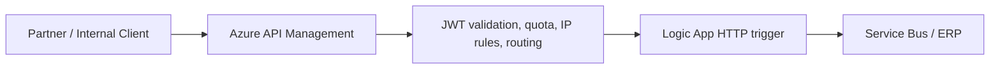

API Management có thể:

- Xác thực JWT/OAuth hoặc các cơ chế được hỗ trợ.
- Áp dụng rate limit, quota, request/response policies.
- Cung cấp gateway URL/version và developer onboarding.
- Thêm correlation headers và quản lý client API contracts.
- Chặn các request không đạt schema/kích thước chính sách.

**APIM không tự tạo business authorization**. Nếu một token hợp lệ được cấp cho Partner-A, workflow vẫn phải đảm bảo Partner-A chỉ thao tác trên documents của họ.

### Logic Apps Request URL không phải mật khẩu để chia sẻ công khai

Một Request trigger URL có thể có **signed query token/SAS** theo cách cấu hình. Đây là credential nhạy cảm:

- Không commit URL đầy đủ vào Git.
- Không đưa URL chứa token vào run logs/public documentation.
- Không dùng token đó thay thế user-level authentication.
- Rotate/revoke theo quy trình được hỗ trợ.
- Khi dùng APIM/private networking, xác minh con đường truy cập và cơ chế auth thực tế ở từng lớp.

Nếu endpoint B2B cần mTLS, signed webhooks hoặc signature validation, phải làm theo thỏa thuận; không mặc định cứ HTTPS là đủ danh tính đối tác.

## 19. Ví dụ Workflow Definition Language (WDL)

Logic Apps workflows được mô tả bằng **Workflow Definition Language**, phổ biến dưới dạng JSON cùng cấu trúc `triggers` và `actions`.

Ví dụ tối giản một HTTP workflow chỉ xác thực hình dạng JSON và trả thông tin nhận yêu cầu — **không ghi message vào queue**:

```json
{
  "$schema": "https://schema.management.azure.com/providers/Microsoft.Logic/schemas/2016-06-01/workflowdefinition.json#",
  "contentVersion": "1.0.0.0",
  "parameters": {},
  "triggers": {
    "Receive_Order": {
      "type": "Request",
      "kind": "Http",
      "inputs": {
        "schema": {
          "type": "object",
          "properties": {
            "orderId": {"type": "string"},
            "partnerId": {"type": "string"}
          },
          "required": ["orderId", "partnerId"]
        }
      }
    }
  },
  "actions": {
    "Compose_Receipt": {
      "type": "Compose",
      "inputs": {
        "orderId": "@triggerBody()?['orderId']",
        "partnerId": "@triggerBody()?['partnerId']",
        "receiptStatus": "received"
      },
      "runAfter": {}
    },
    "Return_Receipt": {
      "type": "Response",
      "inputs": {
        "statusCode": 200,
        "body": "@outputs('Compose_Receipt')"
      },
      "runAfter": {
        "Compose_Receipt": ["Succeeded"]
      }
    }
  },
  "outputs": {}
}
```

Ví dụ minh họa cấu trúc chung của workflow. Khi triển khai Consumption hoặc Standard, resource packaging, app settings/connections và schema/connector runtime có thể khác; hãy để **Logic Apps designer** sinh và kiểm tra file workflow thay vì dán JSON này vào mọi mô hình deployment và coi như ứng dụng hoàn chỉnh.

### Bài học từ JSON

- `Receive_Order` là trigger, kích hoạt workflow qua HTTP Request.
- `Compose_Receipt` lấy dữ liệu từ `triggerBody()`.
- `Return_Receipt` chỉ chạy khi `Compose_Receipt` thành công.
- `Response` trả HTTP 200 cùng dữ liệu.

**HTTP 200 ở ví dụ trên chỉ xác nhận workflow nhận và parse dữ liệu**, không nói ERP đã xử lý. Nếu cần cam kết công việc đã được xếp hàng an toàn, thêm action ghi Service Bus **trước** action Response, xử lý lỗi ghi và chỉ trả `202` sau khi xác nhận bước ghi thành công.

### Expressions hữu ích

| Expression minh họa | Ý nghĩa |
|---|---|
| `triggerBody()?['orderId']` | Truy cập property từ trigger body |
| `outputs('Compose_Receipt')` | Lấy output của action theo tên |
| `body('Parse_Order')?['lines']` | Lấy mảng dòng từ action Parse_Order |
| `coalesce(triggerBody()?['currency'], 'USD')` | Dùng default khi null |
| `empty(triggerBody()?['orderId'])` | Kiểm tra rỗng theo ngữ nghĩa expression |
| `workflow()?['run']?['name']` | Tên run để hỗ trợ correlation theo ngữ cảnh WDL |
| `utcNow()` | Thời điểm UTC hiện tại, không phải business event time |

Không tự động sử dụng `utcNow()` thay cho thời điểm phát hành chứng từ trong EDI: khi retry sau nhiều giờ, business date không được tự thay đổi nếu đối tác yêu cầu giữ original issuance date.

## 20. Concurrency, sequential processing và ordering

Một workflow nhận được hai sự kiện cùng đơn hàng:

```text
Message A: Create PurchaseOrder 127
Message B: Cancel PurchaseOrder 127
```

Nếu mỗi message khởi tạo một workflow run chạy song song, request Cancel có thể tới ERP trước Create. **Logic Apps connector và workflow engine không tự đảm bảo business ordering theo document ID**.

### Những cách xử lý

| Cơ chế | Khi nào dùng | Giới hạn |
|---|---|---|
| Trigger concurrency limit | Giới hạn số workflow runs song song | Giảm throughput toàn workflow, không phân khóa động cho từng order |
| Sequential `For each` | Phải cập nhật các dòng theo thứ tự cụ thể | Chỉ áp dụng trong phạm vi một run/array |
| Service Bus Sessions | Cần thứ tự theo `documentId` | Receiver/session semantics, lock, version guard |
| Optimistic concurrency trong ERP/DB | Bảo vệ trạng thái khi có hai writers | Cần xử lý version conflicts |
| Outbox/inbox | Không mất event, tránh duplicate khi retry | Cần kho trạng thái và quy trình reconciliation |
| Durable workflow/state machine | Business process nhiều bước, chờ lâu | Nhiều trạng thái và failure modes cần quản trị |

### Vòng lặp For each

Trong designer, `For each` có thể chạy các iterations song song theo concurrency settings. Khi thứ tự xử lý của từng dòng hàng thực sự quan trọng, cần cấu hình **sequential** theo tính năng được hỗ trợ. Tuy nhiên, nhiều hệ thống ERP thích nhận **một order với toàn bộ lines** trong một transaction; gửi từng dòng riêng lẻ có thể tạo order không nhất quán.

**Không bật sequential cho toàn bộ các đơn hàng chỉ vì vài document IDs cần ordering**: làm giảm throughput không cần thiết. Thiết kế partition theo aggregate key khi thích hợp.

## 21. Xác thực và bảo mật: ai được truy cập dữ liệu gì?

### Microsoft Entra ID và managed identity

Một Logic App có thể dùng **managed identity** để truy cập tài nguyên Azure qua connectors hỗ trợ, ví dụ Blob Storage, Service Bus hoặc Key Vault.

Quy trình:

1. Bật system-assigned hoặc user-assigned identity theo hosting/connector.
2. Xác định principal và tenant chính xác.
3. Cấp Azure RBAC **data-plane** ở phạm vi tối thiểu.
4. Cấu hình connector chọn phương thức identity, thay vì copy account key.
5. Test truy cập từ đúng môi trường workflow.
6. Ghi lại chính sách rotate/change management.

| Tài nguyên | Role cần xem xét theo hành động |
|---|---|
| Service Bus gửi message | `Azure Service Bus Data Sender` |
| Service Bus nhận/settle | `Azure Service Bus Data Receiver` |
| Blob đọc chứng từ | `Storage Blob Data Reader` |
| Blob ghi chứng từ | `Storage Blob Data Contributor` |
| Key Vault truy cập bí mật | Role/permission có quyền đọc bí mật cụ thể |
| SQL | Database principal/permissions tương ứng, không tự suy từ Azure Reader |

**Azure Contributor trên một resource group không đồng nghĩa đủ quyền dữ liệu trong mọi connector**. Nhiều dịch vụ phân tách control-plane RBAC và data-plane RBAC.

### Phân tách đối tác và môi trường

Thiết kế cho 20 trading partners:

- Partner A không được đọc chứng từ Partner B.
- Production và sandbox có credentials, certificates và agreements khác nhau.
- Trading partner IDs có quy tắc naming và audit.
- Một người làm vận hành không có mặc định quyền xuất private keys.
- Các partner-specific secrets nên có phạm vi và rotation riêng.
- Mọi reprocess tác động ERP production cần được audit và có approval phù hợp.

### Secure inputs/outputs

Logic Apps run history có thể chứa payload, headers và outputs của actions. Với dữ liệu nhạy cảm, dùng **Secure Inputs/Secure Outputs** theo khả năng của designer/actions để hạn chế việc hiển thị trong diagnostics. Tuy nhiên:

- Các cài đặt secure data có phạm vi/hành vi riêng; cần kiểm tra tính lan truyền tới các actions tiếp theo.
- Secure run history **không tự xóa dữ liệu khỏi downstream service**, API hoặc log ứng dụng.
- Đừng log connection strings, token, EDI raw payload hoặc certificate passwords.
- Có thể cần lưu **audit metadata** riêng để vẫn theo dõi được giao dịch khi payload đã bị ẩn.

## 22. Networking: private ERP, SFTP, API và B2B endpoint

Một workflow tích hợp có thể cần cả **outbound** đến ERP nội bộ và **inbound** từ đối tác Internet.

### Outbound tới mạng nội bộ

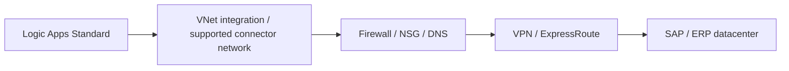

Hãy kiểm tra từng chặng:

1. Workflow runtime hoặc connector nào thực hiện kết nối?
2. Hosting plan đó có hỗ trợ VNet integration hay gateway không?
3. DNS có phân giải hostname ERP tới IP riêng đúng không?
4. NSG, route và firewall có cho phép đúng port?
5. Connector có hỗ trợ auth theo SAP credential/Entra/Windows phù hợp không?
6. ERP có whitelist, mTLS hoặc chính sách client identity không?
7. Khi kết nối thất bại, timeout do route hay 401/403 do auth?

### Inbound cho đối tác B2B

Đối tác gửi AS2/HTTP hoặc SFTP tới đâu?

- **AS2/HTTPS:** cần endpoint được bảo vệ và agreement xác định AS2 identities, certificate, MDN.
- **SFTP:** có thể do dịch vụ SFTP được quản lý hoặc một server/connector khác sở hữu. Polling SFTP bằng Logic Apps không đồng nghĩa Logic App tự là SFTP server.
- **API:** có thể qua API Management, WAF/reverse proxy và Entra/OAuth/mTLS.

**Không mở ERP/SQL trực tiếp ra Internet để nhận file B2B.** Đối tác giao tiếp với lớp gateway/B2B integration; workflow chuyển qua mạng nội bộ bằng connector phù hợp.

### Private endpoints không tự giải quyết mọi vấn đề

Logic Apps Standard và các dịch vụ liên quan có cơ chế private endpoint/VNet theo plan. Nhưng một **managed connector** có thể chạy trong hạ tầng connector riêng và cần đường kết nối/gateway hỗ trợ, không nhất thiết sử dụng mọi route của workflow runtime. Kiểm tra **thực thi của từng connector** trước khi thiết kế mô hình “private end-to-end”.

## 23. Quản lý lỗi: đừng chỉ nhìn màu đỏ/xanh của workflow run

Khi B2B gateway báo run `Succeeded`, có ít nhất bốn khả năng:

1. Workflow đã nhận và archive EDI nhưng ERP chưa xử lý.
2. Workflow đã gửi message vào Service Bus thành công và xử lý sẽ diễn ra sau.
3. Workflow đã hoàn thành cả một số business actions nhưng partner ACK còn chờ.
4. Workflow xử lý nhánh reject một cách có kiểm soát và vẫn trả một **technical success**.

Do đó phải có **business status store** không phụ thuộc hoàn toàn vào run history.

### State machine đề xuất

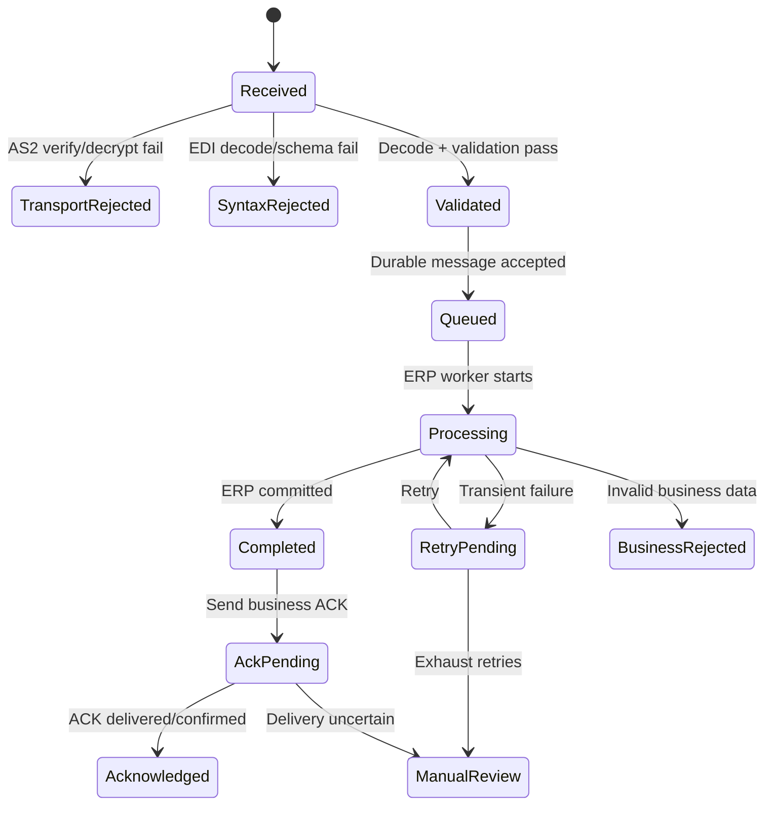

Đây là state machine minh họa cho một luồng đơn; **không phải tất cả các giai đoạn đều tuần tự trong mọi agreement**. MDN transport có thể được gửi trước ERP processing, và syntax acknowledgment có thể có SLA/trigger riêng.

### Tối thiểu phải lưu

| Trường trạng thái | Vì sao cần |
|---|---|
| `businessDocumentId` | Nhận diện tài liệu nghiệp vụ |
| `partnerId` | Tách phạm vi đối tác |
| `documentType/version` | Xác định hợp đồng schema |
| `interchangeControlNumber` | Đối chiếu EDI envelope |
| `as2MessageId` | Đối chiếu AS2/MDN |
| `workflowRunId` | Điều tra kỹ thuật |
| `messageId/correlationId` | Tra vết qua queue/API |
| `currentStatus` | Hiển thị tiến độ nghiệp vụ |
| `erpReference` | Chứng minh đã tạo object trong ERP |
| `retryCount/lastErrorCategory` | Vận hành, cảnh báo |
| `receivedAt/processedAt/ackAt` | Đo SLA end-to-end |
| `payloadArchiveReference` | Lấy raw chứng từ theo quyền |

**Không dùng riêng runId làm khóa idempotency:** cùng một chứng từ có thể tạo nhiều run khác nhau khi retry hoặc partner gửi lại.

## 24. Retry, DLQ, replay và hành động thủ công

### Khi ERP trả 503

Đây có thể là lỗi tạm thời. Logic Apps hoặc Service Bus worker nên:

1. Giới hạn retry với backoff.
2. Tôn trọng server-side rate limit/Retry-After khi connector hỗ trợ.
3. Không tạo lại order nếu request trước có thể đã commit.
4. Chuyển work item sang retry queue/delay hoặc cho broker redeliver theo cơ chế.
5. Cảnh báo khi số lần retry/độ tuổi queue vượt SLA.

### Khi EDI sai schema

Không nên thử lại y nguyên 100 lần. Quy trình:

- Ghi `SyntaxRejected`.
- Lưu bản gốc an toàn để phân tích.
- Gửi EDI functional acknowledgment/reject theo agreement khi yêu cầu.
- Tạo ticket cho partner với mã lỗi, vị trí segment/element (đã lọc dữ liệu nhạy cảm).
- Chờ chứng từ mới hoặc quy trình resubmit có idempotency.

### Khi partner không gửi MDN

Không kết luận “chưa nhận” hoặc “đã nhận” nếu chưa có bằng chứng. Dùng trạng thái **TransportUnknown/MDNTimeout** và quy trình:

- đối chiếu Message-ID đã gửi;
- kiểm tra đường callback asynchronous MDN và certificate;
- kiểm tra response logs trên gateway;
- liên hệ partner nếu không chắc;
- resend có kiểm soát, giữ business identity và policy duplicate.

### Dead-letter queue (DLQ)

DLQ của Service Bus giúp giữ những messages không thể xử lý theo policy/MaxDeliveryCount. **Nó không tự sửa lỗi**. Một runbook replay an toàn cần:

```text
1. Tìm documentId + partnerId + eventId.
2. Đọc DeadLetterReason và exception đã loại bỏ secrets.
3. Kiểm tra ERP/business status hiện tại.
4. Xác định lỗi đã được sửa hay chưa.
5. Xem liệu bản gốc đã có side effect thành công không.
6. Phê duyệt replay đúng revision và target.
7. Đưa message trở lại tuyến xử lý được kiểm soát.
8. Ghi audit: ai replay, khi nào, lý do, kết quả.
```

**Không có chức năng “replay all” không điều kiện cho 10.000 invoices**. Có thể gửi hóa đơn trùng, đảo thứ tự điều chỉnh hoặc làm ERP cạn capacity.

## 25. Monitoring và distributed tracing của Logic Apps B2B

### Technical telemetry

Trong Azure Portal và Azure Monitor, theo khả năng từng loại Logic App:

- **Runs/Triggers:** số lần chạy, thành công, thất bại, bị bỏ qua, bị throttled.
- **Action duration:** ERP connector, AS2/EDI decode, mapping, Service Bus send.
- **Run history/diagnostics:** input/output đã bảo vệ, errors, retries và correlation.
- **API connections:** connection auth failures, expired credentials, gateway connectivity.
- **Managed identity/RBAC:** data-plane authorization failures.
- **Compute/hosting:** Standard capacity, memory, scaling, runtime issues.

### Business telemetry

| Metric | Ý nghĩa |
|---|---|
| Received documents/minute | Tốc độ inbound theo partner/document type |
| Syntax reject rate | Tỷ lệ chứng từ EDI sai schema/envelope |
| AS2 MDN latency | Độ trễ transport acknowledgment |
| Functional ACK pending | Tài liệu chưa có ACK cú pháp theo SLA |
| Business acceptance latency | Từ nhận đến ERP commit/chấp nhận |
| Duplicate detected | Chứng từ trùng theo business/control key |
| Queue oldest message age | Workload ERP đang bị chậm bao lâu |
| DLQ depth/age | Tài liệu cần can thiệp |
| Mapping errors by version | Sự cố release schema/partner |
| Certificate expiration days | Rủi ro ngừng trao đổi B2B |
| Partner-specific SLA compliance | Tuân thủ thời hạn theo agreement |

Một workflow `Succeeded` vẫn có thể phát sinh **business rejection hợp lệ**. Dashboard phải tách **technical failure rate** và **business outcome rate**, tránh báo cáo sai số liệu.

### Correlation xuyên hệ thống

```text
Partner          AS2 Message-ID: as2-msg-127
EDI envelope     ISA control number: 000000127
Business         PO number: PO-2026-00127
Logic App        Run ID: run-abc123
Service Bus      MessageId: partnerB-PO-127-v1
ERP              SalesOrderId: ERP-73511
ACK              Functional ACK reference: ack-127
```

Ghi một **trace/correlation record** có liên kết các identifiers. Không dựa vào việc các ID “trông giống nhau” nếu hệ thống nguồn tự tạo control numbers độc lập.

### Log bảo mật và audit

Trong production:

- Chỉ lưu metadata cần thiết trong logs.
- Dùng `secure inputs/outputs` cho actions chứa payload nhạy cảm theo khả năng.
- Lưu raw EDI ở kho chứng từ mã hóa có retention/policy rõ ràng.
- Có audit log riêng cho thao tác replay, thay đổi agreement và certificate rotation.
- Không tự bật debug logging toàn bộ payload khi đang xử lý đơn hàng tài chính.

## 26. Chi phí: xem toàn bộ chuỗi tích hợp, không chỉ Logic App

| Thành phần | Yếu tố chi phí |
|---|---|
| Logic Apps Consumption | Triggers/actions/connectors theo mô hình giá |
| Logic Apps Standard | Hosting plan/capacity, managed connector calls và tài nguyên liên quan |
| Integration Account | Tier/giá theo khả năng và cách gắn artifacts |
| Service Bus | Namespace tier, operations, capacity/retention, DLQ |
| Storage | Raw archive, Blob transactions, replication, backup, lifecycle |
| Key Vault | Secret/certificate operations và service configuration |
| API Management | Gateway tier/capacity/policies/network |
| Gateway/VNet/Private Link | Network infrastructure, egress, private endpoints |
| SAP/ERP/database | API licenses, compute, gateway, connections, DB throughput |
| Azure Monitor/Log Analytics | Ingestion, retention, query/alerts |

### Dự toán theo transaction

Một chứng từ có thể đi qua:

```text
1 inbound trigger
4 validation/transformation actions
2 B2B decode/map actions
1 Blob archive
1 Service Bus send
1 ERP worker trigger
5 ERP/status actions
2 acknowledgment actions
N retry attempts nếu có sự cố
```

**Không thể tính chi phí chỉ bằng “100.000 chứng từ/tháng”** nếu chưa biết workflow Standard/Consumption, số connector actions, runtime, payload size, retry rate, Integration Account SKU và storage/logging. Một biến thể sai schema gây retry hàng loạt có thể làm chi phí tăng và backlog lớn.

### Các biện pháp kiểm soát

1. Chọn hosting phù hợp profile tải và network.
2. Không poll SFTP/API mỗi vài giây khi không có SLA yêu cầu.
3. Giới hạn retry, tránh vòng lặp/quarantine không kết thúc.
4. Chuẩn hóa mapping và dùng canonical document để giảm maintenance.
5. Tách raw archive khỏi logs có giá ingest cao.
6. Chọn thời gian lưu run history/logs theo audit và ngân sách.
7. Dùng budget/alert riêng cho integration workloads.
8. Đo throughput và connector API quota trước khi tăng concurrency.

### Throughput và “hot partner”

Một đối tác gửi 50.000 orders trong một giờ có thể vượt hạn mức SAP API. Tăng Logic Apps concurrency không giúp nếu ERP chỉ nhận 100 transactions/phút. Nên:

- dùng Service Bus làm buffer;
- giới hạn concurrent ERP calls;
- dùng partner-priority khi có SLA;
- theo dõi oldest message age và backlog;
- phối hợp capacity theo lịch chiến dịch;
- tránh để một đối tác làm nghẽn các đối tác khác.

## 27. CI/CD, IaC và quản trị thay đổi B2B

Một lỗi mapping có thể làm **hàng chục nghìn chứng từ** bị sai. Phát hành workflow cần mức kiểm soát tương tự phát hành ứng dụng nghiệp vụ.

### Version control gồm những gì?

```text
integration-solution/
  workflows/
    inbound-orders/
    outbound-invoices/
    erp-processor/
  schemas/
    x12-850-version-A/
    x12-810-version-A/
  maps/
    x12-850-to-canonical/
    canonical-to-erp/
  infrastructure/
    logic-app/
    service-bus/
    storage/
    monitoring/
  tests/
    golden-documents/
    invalid-documents/
  documentation/
    partner-agreements/
    runbooks/
```

Cấu trúc này là **mẫu tổ chức source code**, không phải cấu trúc bắt buộc của một Logic Apps Standard project. Các tài nguyên B2B artifacts và workflow packaging phải theo mô hình deployment được dịch vụ hỗ trợ.

### Phân biệt code và secrets

**Trong Git:** schema có bản quyền/được phép lưu, maps, query/workflow definitions, test payload đã ẩn thông tin, IaC templates, alerts, runbooks.

**Không trong Git:** signing private key/PFX, AS2 passwords, ERP credentials, connection strings, SAS URLs, chứng từ khách hàng thật, raw EDI chứa dữ liệu nhạy cảm.

### Pipeline triển khai đề xuất

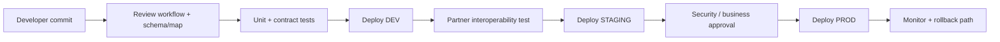

### Kiểm thử hợp đồng (contract test)

Cho mỗi partner/document type/version:

- Một **golden valid EDI** đáp ứng hợp đồng.
- Mẫu thiếu field/segment bắt buộc.
- Mẫu sai qualifier, control number hoặc version.
- Mẫu duplicate interchange/message.
- Mẫu sai certificate/signature hoặc MDN behavior.
- Mẫu ERP validation reject.
- Mẫu timeout sau ERP commit.
- Mẫu thay đổi đơn hàng/cancel trước Create.

**Không chỉ test happy path**. Với EDI/B2B, số lỗi định dạng theo đối tác là nguồn sự cố vận hành lớn.

### Backward compatibility và migration

Nếu một đối tác nâng X12 version:

1. Thêm/kiểm thử schema mới.
2. Duy trì nhận version cũ trong cửa sổ chuyển tiếp theo agreement.
3. Chọn map theo partner/version thực tế.
4. Di chuyển endpoint/certificates có thông báo.
5. Theo dõi tỉ lệ tài liệu vào phiên bản mới.
6. Chỉ ngừng version cũ khi partner đã xác nhận và backlog đã xử lý.

Không sửa schema duy nhất “in place” khi còn chứng từ chưa xử lý có thể phải replay theo version cũ.

## 28. Onboarding một trading partner mới

Doanh nghiệp có thể chuẩn hóa một biểu mẫu onboarding để không bỏ sót những ràng buộc giao nhận.

| Nhóm thông tin | Cần hỏi / xác minh |
|---|---|
| Legal/Business | Đơn vị, owner, contact support, trading relationship |
| Document types | 850/810/855, ORDERS/INVOIC, XML/CSV/API, versions |
| Partner identifiers | AS2-From/To, ISA/GS sender/receiver, UNB IDs |
| Transport | AS2 HTTPS endpoint, synchronous/asynchronous MDN, SFTP/API |
| Certificates | Signing/encryption/public key, thumbprint, expiry, rotation window |
| Message envelope | Control numbers, delimiters, duplicate rules, compression |
| Validation | Mandatory segments, qualifiers, business rules |
| Acknowledgment | MDN, 997/999, CONTRL, order response, deadline |
| Security | TLS/mTLS, OAuth, IP restrictions, PII classification, retention |
| Reliability | Retry policy, outages, SLA, escalation path, replay agreement |
| Testing | Valid/invalid/duplicate samples, negative tests, go-live criteria |
| Operations | Dashboard, contact, certificates/calendar, audit requirements |

### Onboarding không xong khi “Test connection PASS”

Một AS2 test kết nối thành công chưa chứng minh EDI schema được đối tác chấp nhận. Go-live phải có:

- Acknowledgment thực tế đã được partner xác minh.
- Cặp chứng từ inbound/outbound khớp dữ liệu ERP.
- Idempotency và duplicate detection được thử.
- Kịch bản retry/MDN timeout được hai bên thống nhất.
- Chứng chỉ production đã được nhập và lưu an toàn.
- Hotline/escalation và lịch bảo trì đã được cung cấp.

## 29. Bài lab: API đơn hàng → Logic Apps → Service Bus → ERP giả lập

### Mục đích

Bài lab đầu tiên **không gửi EDI thật**. Nó chứng minh mô hình orchestration, validation, durable queue và trace; sau đó có thể mở rộng bằng B2B decoder/maps với tài liệu thử hợp lệ. Điều này tránh rủi ro tự tạo chứng từ EDI “giống thật” nhưng sai chuẩn khiến đối tác thực nhận nhầm.

### Tài nguyên giả định

```text
Subscription: Azure sandbox được cấp phép
Resource group: rg-logic-b2b-lab
Logic App: la-orders-lab
Hosting: Standard hoặc Consumption theo yêu cầu lab
Service Bus namespace: sb-logic-b2b-lab-<unique>
Queue: incoming-purchase-orders
Storage account: stlogicb2blab<unique>
Input sample: JSON purchase order giả
Output: Service Bus work item
ERP target: mock HTTP endpoint hoặc hệ thống test
Partner: SUPPLIER-B (fictitious)
```

Tài nguyên Azure tạo thật sẽ có thể phát sinh phí. Không dùng tên resource group đã có tài nguyên chung; kiểm tra budget, tags và ownership trước khi tạo.

### Bước 1 — Chuẩn bị Service Bus

Tạo namespace/queue trong sandbox theo Azure Portal hoặc IaC được tổ chức phê duyệt. Xác nhận:

- Queue thực sự tồn tại.
- Có quyền `Azure Service Bus Data Sender` cho identity dùng bởi Logic App.
- Nếu dùng workflow nhận queue, identity consumer có `Azure Service Bus Data Receiver`.
- TTL, MaxDeliveryCount, DLQ và duplicate detection theo nhu cầu lab.
- Có monitoring queue depth/oldest message age.

**Không dùng Shared Access Policy `RootManageSharedAccessKey` cho mọi workflow.** Trong trường hợp connector hỗ trợ managed identity, dùng RBAC data-plane với quyền tối thiểu.

### Bước 2 — Tạo Logic App

Trong Portal:

1. Chọn subscription và `rg-logic-b2b-lab`.
2. Tạo Logic App Consumption hoặc Standard theo tiêu chí ở mục 3.
3. Tạo workflow stateful nếu cần run history và retry dễ quan sát.
4. Thêm **Request trigger** với JSON schema.
5. Thêm action **Parse JSON** và validation business đơn giản.
6. Thêm action **Service Bus — Send message** (connector đúng hosting).
7. Chỉ trả HTTP `202 Accepted` sau khi bước ghi work item thành công.
8. Cấu hình branch lỗi và phản hồi phù hợp (400/503) khi validate/send thất bại.
9. Bật managed identity và gán role theo scope thích hợp.
10. Bật monitoring/correlation và secure inputs/outputs nếu payload yêu cầu.

### Bước 3 — JSON schema cho Request trigger

```json
{
  "type": "object",
  "properties": {
    "partnerId": {"type": "string"},
    "poNumber": {"type": "string"},
    "orderDate": {"type": "string"},
    "items": {
      "type": "array",
      "items": {
        "type": "object",
        "properties": {
          "code": {"type": "string"},
          "qty": {"type": "number"}
        },
        "required": ["code", "qty"]
      }
    }
  },
  "required": ["partnerId", "poNumber", "items"]
}
```

**Schema trên mới kiểm tra hình dạng cơ bản.** Nó chưa chặn số lượng âm, tên đối tác chưa được cấp phép, duplicate SKU, payload quá lớn hoặc orderDate sai chuẩn; cần bổ sung validation theo business contract.

### Bước 4 — Thông điệp gửi vào Queue

Tạo work item chứa metadata, không cần copy toàn bộ bí mật:

```json
{
  "eventType": "PurchaseOrderReceived",
  "schemaVersion": "1.0",
  "partnerId": "SUPPLIER-B",
  "documentId": "PO-127",
  "correlationId": "trace-lab-127",
  "payload": {
    "orderDate": "2026-11-20",
    "lines": [
      {"sku": "SKU-1001", "quantity": 25}
    ]
  }
}
```

Nếu raw document quá lớn hoặc nhạy cảm, lưu ở Blob có phân quyền/retention rồi chỉ gửi **document reference** và metadata qua Service Bus. Không gửi SAS URL không giới hạn thời gian trong queue.

### Bước 5 — Test HTTP

Nếu workflow cung cấp endpoint HTTP test an toàn, dùng client như Postman/curl với URL/credential được quản lý riêng:

```bash
# Thay endpoint thật đã được cấp phép.
# Không paste signed URL có SAS/query secret vào log hoặc source code.
curl -X POST "$LOGIC_APP_TEST_URL" \
  -H "Content-Type: application/json" \
  -d '{
        "partnerId": "SUPPLIER-B",
        "poNumber": "PO-127",
        "orderDate": "2026-11-20",
        "items": [{"code": "SKU-1001", "qty": 25}]
      }'
```

**Chú ý:** biến `LOGIC_APP_TEST_URL` phải được thiết lập an toàn tại client, có thể chứa credential nhạy cảm. Lệnh chỉ là mô phỏng luồng thao tác; nếu endpoint yêu cầu Entra/OAuth/mTLS, cần thêm authentication mechanism theo chính sách, không chỉ một URL.

### Bước 6 — Quan sát Queue

Kiểm tra:

1. Workflow run trạng thái thành công sau action Send.
2. Queue có work item mới; nếu consumer chạy đồng thời, message có thể đã được lấy ngay.
3. `partnerId`, `documentId`, `correlationId` và payload đúng.
4. Gửi lại cùng document có bị phát hiện duplicate qua business idempotency policy không.
5. Nếu Service Bus không truy cập được, workflow đi đúng nhánh lỗi thay vì vẫn trả `202` sai.

### Bước 7 — ERP worker giả lập

Tạo workflow riêng trigger từ Service Bus queue:

```text
Service Bus trigger
→ Parse work item
→ Check IdempotencyStore(partnerId+documentId+revision)
→ Call mock ERP API
→ Save ERP reference/status
→ Complete message theo connector/runtime semantics
```

Để học đúng, mô phỏng:

- ERP trả `201 Created`.
- ERP trả `400 BusinessValidationError`.
- ERP trả `503 ServiceUnavailable`.
- ERP timeout **sau khi có thể đã tạo order**.

Kịch bản cuối giúp phân biệt **retry an toàn** với **tạo order trùng do kết quả không chắc chắn**.

### Bước 8 — Thu dọn

Khi kết thúc:

- Dừng/deactivate workflows lab theo hosting hỗ trợ, tránh trigger tiếp tục poll.
- Kiểm kê messages trong queue và DLQ, lưu kết quả test cần thiết.
- Đối chiếu resource group có chỉ thuộc lab không.
- Chỉ xóa các tài nguyên do lab sở hữu; không xóa shared Service Bus/Key Vault/APIM/Integration Account.
- Kiểm tra Cost Management và chứng thực đã thu hồi secret/role tạm.

## 30. Lab B2B nâng cao: tiếp nhận EDI test theo agreement

### Điều kiện

Lab này **chỉ dùng chứng từ mẫu được sinh từ schema/implementation guide đã xác minh**. Không tự viết chuỗi X12/EDIFACT giả rồi gửi vào endpoint partner thật. Cần:

- B2B runtime/connector hỗ trợ X12 hoặc EDIFACT.
- Artifact store/integration account phù hợp.
- Trading partners và agreement test.
- Schema và map đã được phê duyệt cho version test.
- Certificate test và AS2 endpoints nếu kiểm thử transport.
- Queue/ERP mock và business status store.

### Trình tự lab

1. Tạo trading partners `BUYER-A` và `SUPPLIER-B` với identifiers test.
2. Tạo agreement test với các trường và ACK requirements đúng version.
3. Thêm schema EDI test, map từ EDI-decoded data tới canonical model.
4. Đặt trigger nhận file/message theo transport lab (SFTP/Blob/AS2 test).
5. Chạy decode + validate, ghi metadata/correlation.
6. Map ra canonical order, so với expected JSON.
7. Ghi work item vào queue và xác minh ERP mock nhận đúng.
8. Đối chiếu ACK test, tránh nhầm MDN với functional/business ACK.
9. Test hai tình huống lỗi: chứng từ sai syntax và chứng từ đúng syntax nhưng thiếu SKU nghiệp vụ.
10. Đo lỗi, thời gian xử lý, trạng thái và chi phí.

### Expected output

| Case | Kết quả mong đợi |
|---|---|
| Valid X12/EDIFACT purchase order | Decode/schema PASS, canonical map đúng |
| Sai control numbers/trailer count | Syntax reject có thông tin rõ |
| Đúng schema nhưng SKU không tồn tại | Business reject riêng |
| Chứng từ duplicate | Không tạo thêm ERP order trùng |
| AS2 signature sai | Transport verification fail, không nhập ERP |
| ERP tạm ngưng | Work item giữ trạng thái retry/backlog |
| Retry sau ERP commit | Phát hiện đã commit, không tạo order lần hai |
| ACK/MDN trễ | Correlation và cảnh báo SLA chính xác |

## 31. Các tình huống chẩn đoán

| Triệu chứng | Nguyên nhân có thể | Hướng kiểm tra |
|---|---|---|
| HTTP trigger 401/403 | Auth gateway, Entra, SAS/signature, APIM policy | Request metadata, identity, endpoint và scope |
| Logic Apps run Succeeded nhưng ERP chưa có order | Workflow chỉ enqueue hoặc trả ACK transport | Business status store, Queue, ERP reference |
| Connector không kết nối SAP | Gateway/VNet/DNS/firewall, SAP components hoặc credential | Network path từ connector, logs và auth |
| AS2 signature verification failed | Wrong/expired certificate, signer ID, content changed | Trust chain, cert thumbprint, partner agreement |
| AS2 decryption failed | Wrong private key/cipher settings | Certificate purpose và phiên bản khóa |
| Không nhận MDN | Async callback lỗi, timeout, AS2 agreement mismatch | Message-ID, endpoint, callback logs |
| MDN tốt nhưng EDI reject | Transport thành công, schema/control numbers sai | B2B decode và EDI ACK |
| X12 850 không map được | Version, qualifiers, schema mismatch | Implementation guide, segment-level error |
| EDIFACT ORDERS sai | Directory/version hoặc service string/segments sai | UNB/UNH/UNT/UNZ, schema |
| Mapping trả null fields | Source path khác version hoặc optional fields | Sample payload, map input/output, schema |
| EDI bị xử lý hai lần | Resend/timeout/retry; thiếu idempotency | Control numbers, documentId và status store |
| Service Bus DLQ tăng | ERP lỗi liên tục, schema sai hoặc queue auth | DeadLetterReason, delivery count, worker |
| Workflow chạy lâu | ERP throttle, retry loop, waiting action | Action duration, retryCount, downstream SLA |
| Secret hết hạn | OAuth/certificate/SAS rotation thiếu | Expiry alerts, identity settings, Key Vault |
| Logic Apps Standard outbound timeout | VNet/NSG/route/DNS hoặc managed connector path | Connector-specific networking, diagnostics |
| Chỉ partner A lỗi | Agreement/map/certificate/ID khác partner B | Partner-specific metadata và logs |
| Chi phí tăng | Polling quá dày, retries, Standard plan hoặc logging | Cost Management và execution metrics |
| Functional ACK đã gửi nhưng partner báo không nhận | Transport ACK delivery failure/correlation wrong | ACK message ID, partner endpoint, resend policy |
| Reprocess gây sai thứ tự | Chạy event revision cũ sau revision mới | Business version guard, operator approval |

### Lưu đồ runbook

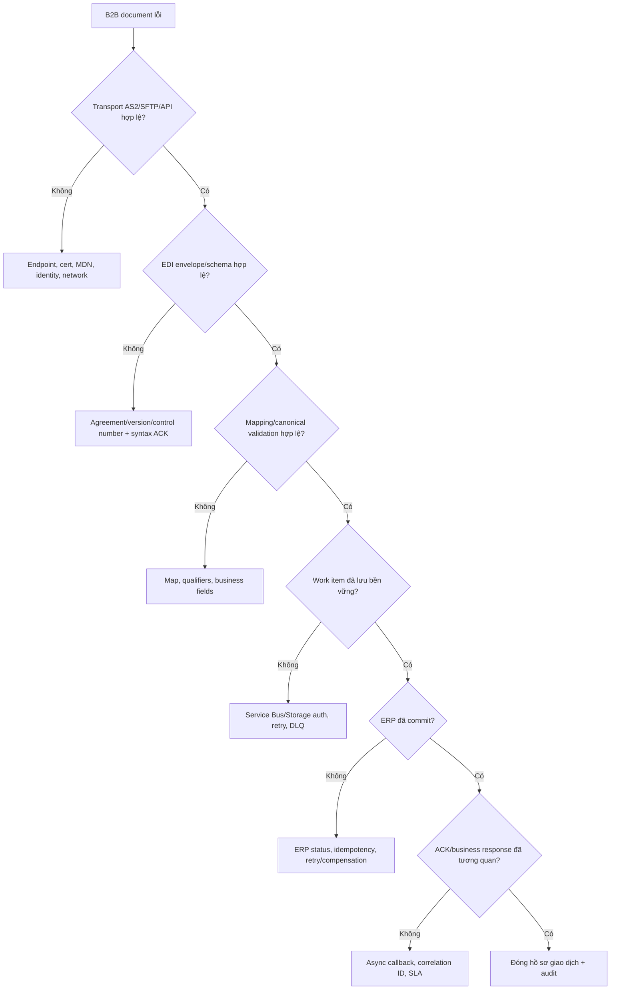

## 32. Kiến trúc tham chiếu: chuỗi cung ứng nhiều đối tác

Một doanh nghiệp sản xuất có:

- 30 nhà cung cấp gửi X12 850 hoặc EDIFACT ORDERS.
- 5 đối tác logistics nhận advance ship notice và trả status.
- SAP ERP tại datacenter, chỉ truy cập qua private networking.
- Yêu cầu lưu chứng từ 7 năm theo chính sách công ty (đây chỉ là **ví dụ nội bộ**, không phải khẳng định pháp luật yêu cầu).
- SLA: 95% orders hợp lệ được tạo trong ERP trong 10 phút.
- AS2 partner agreements có chứng chỉ thay đổi theo thời hạn.

### Đề xuất thành phần

| Lớp | Dịch vụ/cơ chế | Trách nhiệm |
|---|---|---|
| Entry/transport | AS2 gateway, SFTP ingress, API Management | Bảo vệ endpoint, nhận dữ liệu |
| B2B syntax | Logic Apps B2B connectors/artifacts | Decode/encode, agreement, validate, ACK |
| Canonical | Maps + JSON/XML schema | Chuẩn hóa nghiệp vụ |
| Buffer | Azure Service Bus | Durable work items, retries, DLQ, sessions nếu cần |
| ERP integration | Logic Apps Standard + SAP connector/private path | Tạo/cập nhật đơn ERP |
| Archive | Blob/Data Lake encrypted + policy | Raw/processed documents, audit |
| Status | SQL/Cosmos DB/ERP status | Source-of-truth của business process |
| Secrets | Key Vault/managed identity | Credentials, certificates theo hỗ trợ |
| Observability | Azure Monitor/Log Analytics + business dashboard | Latency, errors, SLA, certificate expiry |
| Governance | IaC/CI/CD + runbooks | Phát hành, partner onboarding, rollback |

### Quy trình đánh giá phương án

1. Xác định **business source of truth** là ERP hay integration status DB.
2. Xác định mốc “Accepted”: MDN, functional ACK hay ERP response.
3. Chọn hosting Standard/Consumption theo network, connector, volume và vận hành.
4. Đặt partner boundary, agreements và certificate lifecycle rõ.
5. Thiết kế canonical model, mapping versioning và idempotency.
6. Cân throughput API/Service Bus/ERP, không chỉ năng lực workflow.
7. Thiết kế DLQ/replay/compensation và bảo vệ dữ liệu.
8. Ước lượng costs của hosting, connector, integration account, network, storage/logs.
9. Test với ít nhất một đối tác trước khi mở rộng số lượng partners.

### Tình huống failure cần diễn tập

**Partner gửi trùng chứng từ:** Nhận diện theo business document key và envelope/control identifiers; không tạo ERP order trùng.

**SAP tạm ngưng 30 phút:** Queue giữ công việc, retry có backoff, theo dõi SLA và oldest message; khi SAP phục hồi, worker xử lý không vượt quota.

**Chứng chỉ AS2 hết hạn:** Alert trước expiry, rotation phối hợp với partner, không nhận tài liệu không xác thực.

**Mapping version lỗi:** Dừng rollout, giữ raw messages để replay với map đúng version; không tự hồi tố ERP record đã commit mà không có quyết định nghiệp vụ.

**MDN async bị mất:** Dùng transmission state `Unknown`, đối chiếu partner và resend policy; không lặng lẽ giả định thất bại hoặc thành công.

**Rollback workflow:** Đảm bảo schema/agreement version cũ còn đọc được backlog, không rollback code mà làm hỏng tài liệu đang chờ ở queue.

## 33. Checklist kiến trúc trước khi triển khai production

### Hợp đồng với đối tác

- [ ] Trading partner identifiers/qualifiers đã thống nhất và được xác minh.
- [ ] Danh sách document types (X12/EDIFACT/API) cùng **version** đã phê duyệt.
- [ ] Transport AS2/SFTP/API và yêu cầu signed/encrypted/mTLS đã thống nhất.
- [ ] Public certificates, thumbprints, hết hạn, rotation owners đầy đủ.
- [ ] AS2 MDN sync/async, functional ACK, business ACK và SLA riêng biệt.
- [ ] Duplicate control number/message ID policies rõ ràng.
- [ ] Contacts/support hours, escalation/replay agreements được ghi nhận.

### Thiết kế workflow và dữ liệu

- [ ] Standard hay Consumption được chọn dựa trên **connector/network/cost**, không vì mặc định.
- [ ] Một trigger, các actions và `runAfter`/scopes có error flow rõ.
- [ ] Raw EDI, canonical model và ERP requests có schema/version quản lý.
- [ ] Mapping đúng qualifiers, đơn vị đo, currency, decimal, timezone.
- [ ] Có business idempotency key và source-of-truth state.
- [ ] Có quy trình outbox/inbox/replay nếu workflow xuyên nhiều hệ thống.
- [ ] HTTP/API workflow không giữ kết nối quá lâu khi ERP slow.
- [ ] Service Bus capacity, retry, DLQ, sessions theo nhu cầu được cấu hình.
- [ ] Không làm mất thứ tự Create/Change/Cancel của cùng aggregate.

### Bảo mật và vận hành

- [ ] Managed identity/RBAC tối thiểu hoặc secret store được phê duyệt.
- [ ] SAP/SQL/SFTP/AS2 networking được kiểm chứng **từ connector runtime**.
- [ ] B2B payload nhạy cảm không hiển thị trong run history/logs ngoài policy.
- [ ] Certificates/credentials có expiry alerts và rotation drills.
- [ ] Monitoring cả technical runs lẫn **business document state**.
- [ ] Có owner cho DLQ và runbook replay có approval/audit.
- [ ] Có retention/archive/deletion policy cho chứng từ.
- [ ] Có ngân sách và cảnh báo chi phí theo Logic Apps, connectors, Service Bus, Storage.
- [ ] CI/CD có positive/negative contract tests và rollback.

## 34. Những hiểu nhầm phổ biến

**“Logic Apps chỉ là công cụ gửi email tự động.”** Không. Nó có thể điều phối APIs, ERP, messaging, data transformation và B2B khi được cấu hình đúng.

**“Standard và Consumption khác nhau mỗi mức giá.”** Không. Hosting, lifecycle, stateful/stateless, connectors, deployment, networking và B2B artifact model có thể khác.

**“Mọi connector đều dùng managed identity và VNet giống nhau.”** Không. Hỗ trợ tùy connector, trigger/action, hosting, runtime và network topology.

**“Chỉ cần Logic App run Succeeded là đơn hàng đã được chấp nhận.”** Không. Có thể chỉ nhận/validate/enqueue, trong khi ERP hoặc business ACK chưa xong.

**“X12 và EDIFACT chỉ là hai tên gọi của cùng file.”** Không. Chúng có envelope, segment, qualifier, version và rules riêng.

**“AS2 là một loại file EDI.”** Không. AS2 là giao thức vận chuyển và bảo vệ message; payload có thể là EDI hoặc định dạng khác theo agreement.

**“MDN thành công nghĩa ERP đã tạo đơn.”** Không. MDN là disposition ở tầng AS2, không thay business acknowledgment.

**“Functional acknowledgment 997/999 là hóa đơn đã được thanh toán.”** Không. Nó phản ánh acknowledgment cú pháp/implementation theo chuẩn và agreement.

**“Một HTTPS TLS certificate là đủ cho mọi chức năng AS2.”** Không. Signing/encryption/MDN certificates có mục đích và vòng đời riêng.

**“Schema validation đủ để bảo đảm giá và tồn kho đúng.”** Không. Business rules phải được xác thực ở ERP/validation layer.

**“Map X12 850 sang JSON chỉ cần thay BEG thành orderId.”** Không. Cần qualifiers, loop structures, version, mandatory fields và chuẩn hóa nghiệp vụ.

**“API Management tự bảo đảm user Partner-A không đọc được dữ liệu Partner-B.”** Không hoàn toàn. Gateway xác thực và chính sách có vai trò riêng; resource-level authorization phải có ở ứng dụng.

**“Service Bus gửi/nhận chỉ một lần nên không cần idempotency.”** Không. Duplicate delivery/retry/lock expiry có thể xảy ra; business state phải chịu được.

**“Lưu run history là đã có backup raw EDI.”** Không. Run history có retention/secure input constraints và không thay kho chứng từ bền vững.

**“Thêm retry vô hạn sẽ giảm số tài liệu lỗi.”** Không. Nó có thể làm duplicate, tăng phí và làm ERP quá tải nếu lỗi vĩnh viễn.

**“Kết nối SAP từ laptop được nghĩa Logic Apps cũng kết nối được.”** Không. Connector runtime/gateway có network path, DNS và danh tính khác.

**“Mọi partner dùng cùng một agreement để giảm cấu hình.”** Sai nếu IDs, message types, certificate, ACK và validation khác nhau.

**“Xóa DLQ để số lỗi về 0 là đã sửa xong.”** Không. Mất chứng từ chưa xử lý, phá audit và gây sai trạng thái.

**“Tăng concurrency sẽ làm SAP xử lý mọi đơn nhanh hơn.”** Không nếu SAP chỉ có quota/connection pool hạn chế và thứ tự nghiệp vụ cần giữ.

**“Đổi schema production không cần lưu bản cũ.”** Không. Chứng từ đang chờ hoặc phải replay có thể dùng version cũ.

## 35. Câu hỏi tự kiểm tra

**Câu 1.** Logic Apps đóng vai trò gì giữa ecommerce, ERP và nhà cung cấp B2B?

**Đáp án:** Là lớp workflow integration: nhận sự kiện/chứng từ, kết nối hệ thống, validate, transform, route, retry và quan sát tiến trình; không thay ERP làm business source-of-truth.

**Câu 2.** Hai loại Logic Apps hosting phổ biến là gì và điểm khác biệt cần xem?

**Đáp án:** Consumption và Standard; đánh giá hosting, workflows/resources, stateful/stateless, connectors, networking, B2B artifacts, deployment và chi phí.

**Câu 3.** Trigger và action trong workflow khác nhau ra sao?

**Đáp án:** Trigger khởi phát một run, action thực hiện các bước sau trigger như Parse JSON, Compose, gọi ERP hoặc gửi Service Bus.

**Câu 4.** Sự khác biệt giữa EAI và B2B là gì?

**Đáp án:** EAI tích hợp các ứng dụng thường trong một tổ chức; B2B trao đổi giữa các tổ chức với partner identity, agreement, transport và ACK rõ ràng.

**Câu 5.** AS2 có phải một chuẩn cú pháp chứng từ tương đương X12/EDIFACT không?

**Đáp án:** Không. AS2 là giao thức trao đổi thông điệp qua HTTP(S) có signing/encryption/MDN; X12/EDIFACT là các chuẩn cú pháp chứng từ EDI.

**Câu 6.** Những envelope chính trong X12 là gì?

**Đáp án:** ISA/IEA cho interchange, GS/GE cho functional group, ST/SE cho transaction set theo version và agreement.

**Câu 7.** EDIFACT có các envelope segment nào?

**Đáp án:** UNB/UNZ cho interchange, UNH/UNT cho message, UNA tùy chọn để chỉ service string; các segments nghiệp vụ ở giữa.

**Câu 8.** MDN, 997/999 hoặc CONTRL và business response có ý nghĩa khác nhau thế nào?

**Đáp án:** MDN là disposition giao nhận AS2; EDI acknowledgment phản ánh cú pháp/implementation; business response phản ánh việc đối tác chấp nhận nội dung nghiệp vụ theo contract.

**Câu 9.** Partner Agreement được dùng để làm gì?

**Đáp án:** Định nghĩa quy tắc trao đổi với đối tác: IDs, message types/versions, envelope, transport, signing/encryption, ACK và các kiểm tra theo khả năng.

**Câu 10.** Vì sao cần canonical data model?

**Đáp án:** Giảm kết nối và mappings điểm-điểm, tách schema của đối tác khỏi ERP và tạo hợp đồng nội bộ có thể version.

**Câu 11.** Chứng từ đúng syntax EDI nhưng ERP từ chối SKU không tồn tại thì thuộc loại lỗi nào?

**Đáp án:** Lỗi business validation, không phải transport hoặc EDI syntax. Phản hồi nghiệp vụ cần đi theo agreement, không chỉ gửi syntax ACK lỗi.

**Câu 12.** Vì sao nên dùng Service Bus giữa AS2 inbound và SAP?

**Đáp án:** Để tách thời hạn transport/ACK khỏi thời gian xử lý ERP, giữ work items bền vững, retry/DLQ theo cơ chế và kiểm soát throughput.

**Câu 13.** Một ERP request timeout nhưng có thể đã commit. Có an toàn khi retry tạo order ngay không?

**Đáp án:** Không. Cần tra business key/external reference và idempotency store để xác định side effect đã xảy ra chưa.

**Câu 14.** Nên dùng runId hay documentId làm business idempotency key?

**Đáp án:** Dùng khóa theo nghiệp vụ như partnerId+documentType+documentId+revision; runId chỉ định danh một lần chạy kỹ thuật.

**Câu 15.** Khi nào nên dùng Logic Apps Standard và cân nhắc private networking?

**Đáp án:** Khi các yêu cầu connector, nhiều workflows, runtime và truy cập hệ thống nội bộ cần mô hình hosting/network được Standard hỗ trợ; luôn kiểm chứng connector cụ thể.

**Câu 16.** Managed identity có làm SAP/Blob private endpoint tự truy cập được không?

**Đáp án:** Không. Identity giải quyết xác thực/quyền, còn private path cần DNS, route, firewall, gateway hoặc VNet theo hosting/connector.

**Câu 17.** B2B agreement và certificates cần được quản lý ngoài Git như thế nào?

**Đáp án:** Version/cấu hình theo IaC nếu được phép, còn private keys/passwords giữ trong Key Vault/secret store; có expiry alerts, owner và rotation phối hợp partner.

**Câu 18.** Vì sao run history không đủ làm kho audit chứng từ?

**Đáp án:** Retention, secure input/output và quyền logs có giới hạn; cần archive mã hóa và business status store với correlation có kiểm soát.

**Câu 19.** Khi một message trong DLQ được replay, hai bước cần làm trước là gì?

**Đáp án:** Xác định root cause đã sửa và kiểm tra ERP/business status để tránh tạo side effect trùng; sau đó replay theo approval/audit.

**Câu 20.** Các lớp xác minh end-to-end cho một đơn hàng B2B là gì?

**Đáp án:** Transport/AS2 → EDI envelope/schema → canonical/business validation → durable queue → ERP commit → acknowledgments → business status/audit.

**Câu 21.** Một partner gửi 100.000 invoices trong giờ cao điểm. Tăng Logic Apps concurrency tối đa có phải giải pháp duy nhất?

**Đáp án:** Không. Cần Service Bus buffer, ERP capacity/quota, partitioning, retry/backpressure, monitoring lag và có thể phân nhóm SLA theo partner.

**Câu 22.** Vì sao phải giữ schema/map version cũ khi triển khai version mới?

**Đáp án:** Các chứng từ còn chờ hoặc cần replay có thể được gửi bằng agreement cũ; xóa hỗ trợ version cũ có thể làm mất khả năng xử lý/khôi phục.

## Tổng kết

**Azure Logic Apps** giúp xây dựng quy trình tích hợp bằng **triggers, actions, connectors, expressions, scopes và workflow state**, kết nối HTTP/API, SAP/ERP, SQL, SFTP, Service Bus và Storage. Khi mở rộng sang **B2B**, giải pháp còn cần hiểu **X12, EDIFACT, AS2, trading partners, agreements, schemas, maps, certificates và acknowledgments**. Chọn đúng mô hình Consumption/Standard và B2B artifact management là bước nền tảng để triển khai hiệu quả.

Một pipeline doanh nghiệp đáng tin cậy phải phân biệt **giao nhận transport**, **hợp lệ cú pháp** và **chấp nhận nghiệp vụ**; dùng **canonical data model**, lưu trữ chứng từ có bảo vệ, **idempotency/queue/retry/DLQ**, business status store và correlation IDs để xử lý an toàn khi đối tác hoặc ERP gặp sự cố. Kết hợp **managed identity, private networking theo connector, certificate lifecycle, CI/CD, monitoring, SLA và ngân sách**, Logic Apps trở thành lớp tích hợp có thể kiểm toán, phục hồi và mở rộng thay vì một chuỗi kết nối điểm-điểm mong manh.
