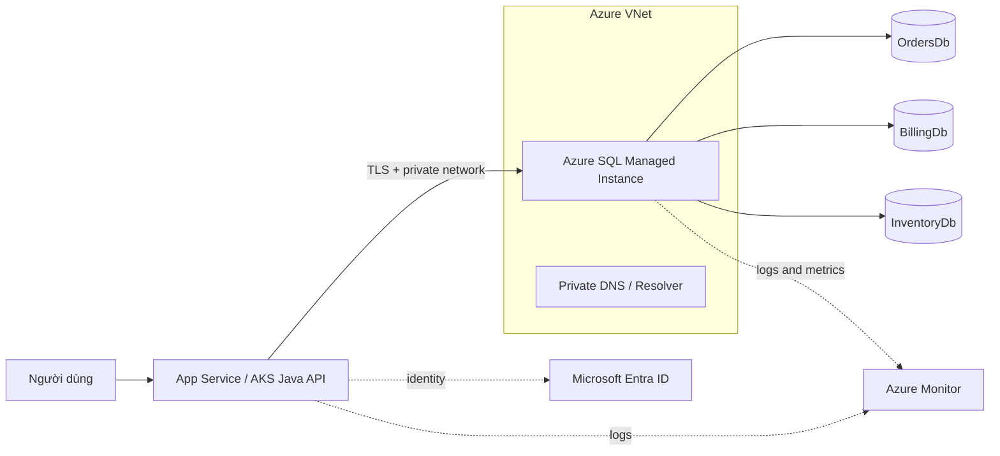
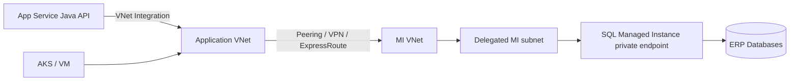
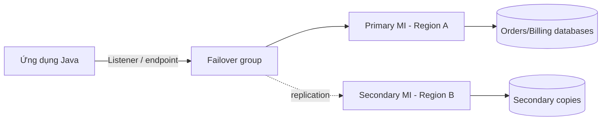
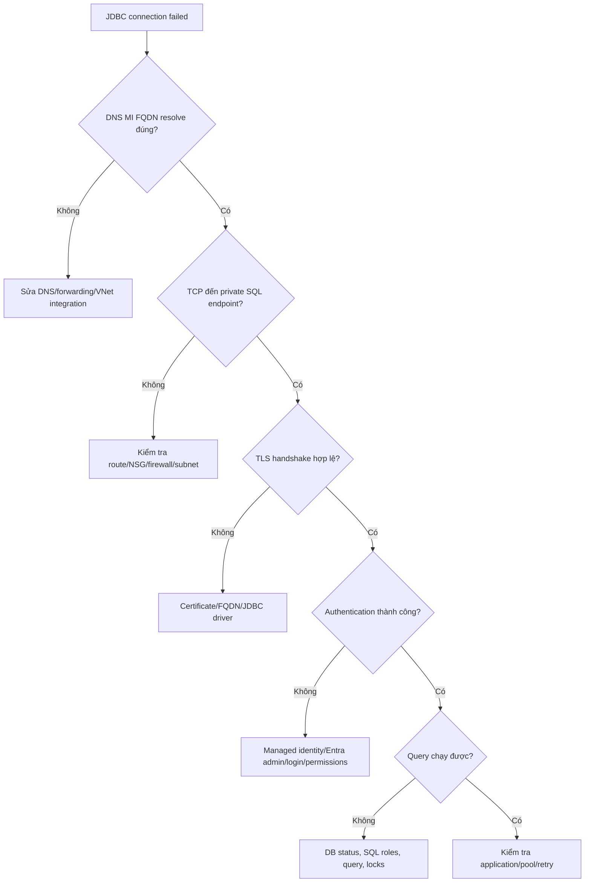
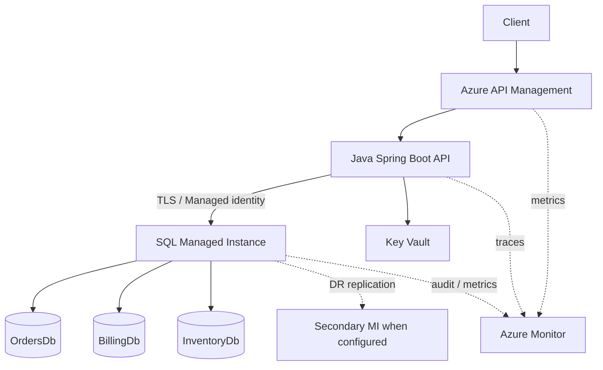

# Azure SQL Managed Instance cho tương thích SQL Server

Một doanh nghiệp vận hành hệ thống ERP trên **Microsoft SQL Server** trong trung tâm dữ liệu riêng. Ứng dụng Java kết nối bằng JDBC, nhiều cơ sở dữ liệu trao đổi dữ liệu qua truy vấn ba phần (`Database.Schema.Table`), bộ phận vận hành sử dụng **SQL Server Agent** để chạy tác vụ ban đêm, còn nhóm DBA quản lý backup, quyền truy cập, chỉ mục và hiệu năng. Khi chuyển lên Azure, doanh nghiệp muốn giảm công việc quản trị hệ điều hành và SQL Server engine nhưng không muốn viết lại toàn bộ ứng dụng.

**Azure SQL Managed Instance (SQL MI)** là lựa chọn Platform as a Service (PaaS) hướng tới **mức tương thích cao với SQL Server ở cấp instance**, đồng thời Azure quản lý nhiều phần như provisioning, patching, backup tự động và cơ chế sẵn sàng cao. Nó nằm giữa **Azure SQL Database** (mô hình database-first, ít phụ thuộc tính năng instance hơn) và **SQL Server trên Azure Virtual Machines** (linh hoạt với OS/instance nhưng phải tự vận hành nhiều hơn).

Tuy nhiên, **tương thích cao không có nghĩa giống SQL Server tự quản lý 100%**. Một số tính năng server-level, linked server, Windows authentication, hệ thống file, SQL Agent job, replication, extension, tích hợp SSIS/SSRS, phiên bản engine hoặc kết nối mạng có ràng buộc riêng. Kiến trúc phù hợp phải được chọn sau khi **inventory, assessment và thử nghiệm workload thật**.

Bài học thuộc chương **Cơ sở dữ liệu quan hệ** của module **CLOUD_PROVIDERS_AZURE**. Nội dung gắn với subscription, resource group, Microsoft Entra ID, VNet/subnet, compute, storage, database, giám sát, bảo mật, kiểm soát chi phí và quy trình triển khai ứng dụng Java trên Microsoft Azure.

> **Phạm vi:** Ví dụ sử dụng những khả năng phổ biến của Azure SQL Managed Instance. Các giới hạn về SKU, vCore, bộ nhớ, storage, region, zone, public/private endpoint, chính sách backup, migration và Microsoft Entra authentication có thể thay đổi theo thời điểm/tier. Hãy xác minh tài liệu hỗ trợ và cấu hình thật của subscription trước khi triển khai. Lệnh bên dưới chỉ dành cho lab được phê duyệt; bài học không thực hiện provisioning trên Azure.

## Mục tiêu học tập

Sau bài học, bạn có thể:

1. Phân biệt SQL Server trên VM, Azure SQL Database và Azure SQL Managed Instance.
2. Giải thích mức tương thích T-SQL, SQL Server Agent, cross-database query và những khoảng trống cần assessment.
3. Chọn service tier **General Purpose** hay **Business Critical** theo workload, hiệu năng, RTO và chi phí.
4. Hiểu SQL MI được triển khai trong **subnet được ủy quyền** (*delegated subnet*) và yêu cầu DNS, NSG, route, peering/VPN/ExpressRoute.
5. Phân biệt **private VNet endpoint**, **Private Endpoint/Private Link** và **public endpoint** của Managed Instance.
6. Kết nối từ ứng dụng Java/Spring Boot qua JDBC có TLS và Microsoft Entra managed identity khi được hỗ trợ.
7. Lập kế hoạch di chuyển từ SQL Server với assessment, Azure Database Migration Service, native backup/restore hoặc các lựa chọn replication phù hợp.
8. Xác định chiến lược backup/point-in-time restore, availability, disaster recovery và failover groups.
9. Quản trị quyền bằng SQL logins/Microsoft Entra ID, TDE, auditing, Defender for SQL và kiểm soát network.
10. Quan sát workload, tối ưu truy vấn, quản trị chi phí và xử lý các sự cố kết nối/migration thường gặp.

## 1. SQL Managed Instance nằm ở đâu trong hệ sinh thái SQL trên Azure?

Azure cung cấp nhiều hình thức chạy SQL Server engine hoặc những dịch vụ SQL tương thích. Chọn sai mô hình có thể khiến ứng dụng phải sửa quá nhiều, hoặc khiến chi phí vận hành cao hơn nhu cầu.

| Tiêu chí | Azure SQL Database | Azure SQL Managed Instance | SQL Server trên Azure VM |
|---|---|---|---|
| Đơn vị quản trị chính | Database hoặc elastic pool | Managed SQL instance chứa nhiều databases | VM và SQL Server instance tự quản lý |
| OS access | Không | Không | Có, theo quyền VM/OS |
| Mức hỗ trợ SQL Server instance features | Tập trung database, có giới hạn | **Tương thích cao hơn ở cấp instance** | Gần với SQL Server tự quản lý trên VM |
| SQL Server Agent | Không theo mô hình Agent truyền thống | **Có**, theo ràng buộc dịch vụ | Có |
| Cross-database queries | Có giới hạn và phương án riêng | Hỗ trợ tốt cho nhiều kịch bản cùng instance | Có |
| Patch SQL engine/OS | Azure quản lý | Azure quản lý | Khách hàng chủ động/phối hợp quản lý |
| Backup tự động | Azure cung cấp | Azure cung cấp | Khách hàng thiết kế và quản lý theo dịch vụ đã chọn |
| Kết nối mạng | Public/private endpoints tùy cấu hình | **VNet-native**, private connectivity là trọng tâm | Private IP, VNet và firewall do khách hàng thiết kế |
| Tùy biến server/OS | Thấp | Trung bình, có hạn chế instance-level | Cao |
| Trường hợp phù hợp | Cloud-native database, ứng dụng ít phụ thuộc server-level | **Lift-and-modernize SQL Server** cần tương thích cao | Cần OS/engine control hoặc tính năng không hỗ trợ trên PaaS |

### Quy tắc lựa chọn

- **Azure SQL Database:** ứng dụng mới chỉ cần một database, dễ tách logic, không cần SQL Agent/cross-database features đặc biệt.
- **SQL MI:** ứng dụng hiện hữu cần nhiều tính năng quen thuộc của SQL Server, nhưng doanh nghiệp muốn Azure phụ trách patching, backup, availability và không cần quyền OS.
- **SQL Server trên Azure VM:** ứng dụng cần cài đặt phần mềm/agent ở Windows/Linux OS, truy cập hệ thống file/phần cứng hoặc instance features SQL MI không hỗ trợ.

**Không chọn Managed Instance chỉ vì tên có chữ SQL Server.** Nếu ứng dụng đã cloud-native và không cần instance compatibility, Azure SQL Database có thể đơn giản và tối ưu hơn. Nếu cần SSRS chạy cùng host OS, SQL MI không thay thế máy chủ cài SSRS.

## 2. Tình huống thực tế: chuyển ERP từ SQL Server lên Azure

Một hệ thống ERP gồm:

- `OrdersDb`: đơn hàng, giao dịch, thông tin giao nhận.
- `BillingDb`: hóa đơn và thanh toán.
- `InventoryDb`: tồn kho.
- Một ứng dụng Java Spring Boot gọi JDBC.
- SQL Server Agent job mỗi đêm tổng hợp doanh thu.
- Stored procedures, views, triggers và một số truy vấn cross-database.
- Ứng dụng nội bộ truy cập SQL Server qua VPN.
- Yêu cầu bảo vệ dữ liệu, phục hồi và kiểm soát chi phí.

### Kiến trúc mục tiêu



Ứng dụng dùng **FQDN của Managed Instance**, không nối vào địa chỉ IP đoán sẵn. Networking được thiết kế trước: App Service dùng VNet Integration phù hợp, AKS/VM ở VNet liên thông hoặc kết nối qua VPN/ExpressRoute, DNS và routing phải đến được endpoint private.

Mục tiêu là **giữ phần lớn logic T-SQL hiện hữu**, nhưng chủ động đánh giá SQL Agent, linked servers, authentication, SQL Server version và những bước vận hành không thể bê nguyên từ máy chủ cũ.

## 3. Managed Instance quản lý những gì, khách hàng vẫn quản lý gì?

Mô hình **shared responsibility**:

| Azure quản lý nhiều phần | Đội ứng dụng/DBA vẫn phải quản lý |
|---|---|
| Nền tảng managed SQL engine và hạ tầng hosting | Database schema, indexes, stored procedures, transaction logic |
| OS/engine patching theo dịch vụ | Query tuning, hiệu năng và kiểm soát resource |
| Automatic backups và HA nền tảng | RPO/RTO, restore drill và chiến lược DR |
| Provisioning/replacement hạ tầng theo service tier | Chọn vCore/storage/tier, quota và ngân sách |
| Nhiều phần monitoring và maintenance | Alerts, incident response, audit review |
| Các tính năng encryption ở dịch vụ | Quyền truy cập dữ liệu, credentials, private networking và compliance |
| Duy trì khả năng dịch vụ theo SLA | Thiết kế retry/idempotency khi failover/connection reset |

**PaaS không xóa trách nhiệm DBA.** Một transaction kéo dài, index thiếu, query đọc toàn bảng hoặc connection pool quá lớn vẫn có thể làm SQL MI chậm. Azure tự động backup không bảo vệ khỏi việc chọn sai retention, cấu hình quyền quá rộng hoặc chưa từng kiểm thử restore.

## 4. Tương thích cao với SQL Server nghĩa là gì?

SQL MI sử dụng SQL Server database engine theo mô hình dịch vụ được quản lý, hỗ trợ phần lớn tập tính năng T-SQL và SQL Server programming model quen thuộc, đặc biệt phù hợp workload phụ thuộc **nhiều databases trong cùng instance**.

### Những năng lực thường quan trọng

- **T-SQL:** stored procedures, functions, triggers, views, transactions, indexes và query optimizer.
- **SQL Server Agent:** hỗ trợ các công việc định kỳ theo khả năng Managed Instance, với giới hạn tùy job subsystem và external dependencies.
- **Cross-database query:** tham chiếu object qua tên ba phần trong cùng instance, ví dụ `BillingDb.dbo.Invoices`.
- **Backup/restore:** automatic backups và khả năng backup/restore bản SQL Server theo các đường migration được hỗ trợ.
- **Instance-level logins:** các kiểu SQL/Entra authentication và permission phù hợp, có khác biệt với VM.
- **Service Broker**, linked servers và những SQL Server features khác theo **support matrix**; không coi mọi kịch bản trên máy chủ tự quản lý đều được bảo đảm.
- **SQL Server drivers:** ứng dụng Java có thể dùng Microsoft JDBC Driver for SQL Server và kết nối TDS/TLS.

### Tương thích không bao gồm mọi thứ

- Không có quyền **RDP/SSH** vào host chạy SQL MI để cài service hoặc chạy script OS.
- Không cài đặt **SQL Server Reporting Services (SSRS)** hoặc bất kỳ Windows service nào “bên trong” Managed Instance như trên VM.
- Các gói **SSIS** có thể cần Azure Data Factory/Azure-SSIS Integration Runtime hoặc mô hình vận hành riêng.
- SQL Agent jobs dùng `CmdExec`, PowerShell, file shares, proxies hoặc chương trình cài trên OS phải được đánh giá/thiết kế lại.
- Linked servers chỉ hỗ trợ những loại nguồn/provider và cơ chế authentication nhất định; không giả định mọi OLE DB provider dùng được.
- Tính năng liên quan registry, file system, OS, một số server-level options, distributed transactions hoặc replication có thể có giới hạn.
- Các cơ chế SQL authentication/Windows domain/Entra integration không tương đương 1-1 ở mọi version.
- SQL MI không phải máy chủ SQL có thể giữ nguyên phiên bản engine vô thời hạn: Azure cập nhật engine/maintenance theo chính sách dịch vụ.

**Nguyên tắc migration:** rà soát từng **dependency kỹ thuật và vận hành**, không chỉ chạy một truy vấn SELECT mẫu rồi kết luận 100% compatible.

## 5. Cross-database query: lý do phổ biến chọn MI

Giả sử một stored procedure trong `OrdersDb` phải truy vấn hóa đơn trong `BillingDb`:

```sql
USE OrdersDb;
GO

SELECT o.OrderId, o.CreatedAt, i.TotalAmount
FROM dbo.Orders AS o
JOIN BillingDb.dbo.Invoices AS i
  ON i.OrderId = o.OrderId
WHERE o.CreatedAt >= DATEADD(day, -7, SYSUTCDATETIME());
```

Đây là **ví dụ logic T-SQL**: các bảng phải thật sự tồn tại và quyền đối tượng cho principal đang chạy phải hợp lệ.

SQL MI có thể cung cấp mức hỗ trợ cross-database queries/transactions gần với SQL Server khi **các databases nằm trong cùng instance**, nhưng vẫn cần:

1. Kiểm tra tên schema và database thực tế.
2. Xác định collation của mỗi database, nhất là join trên cột chuỗi.
3. Xác minh authentication, ownership chaining và quyền cross-database đúng.
4. Kiểm tra transaction isolation, locking và throughput.
5. Không giả định cross-database truy vấn được tự động giữa **hai Managed Instances khác nhau** theo cú pháp ba phần như cùng instance.

### Vì sao SQL Database có thể phức tạp hơn?

Azure SQL Database định hướng phạm vi database; các kịch bản truy vấn chéo có cơ chế/giới hạn riêng. Với ERP có nhiều stored procedures tham chiếu database khác, SQL MI có thể giảm số phần phải viết lại. Nhưng nếu hệ thống có thể tách service boundaries và giao tiếp qua API/event, chuyển sang SQL Database vẫn đáng đánh giá.

## 6. SQL Server Agent trên Managed Instance

SQL Server Agent quen thuộc với nhiều DBA để:

- Chạy stored procedure định kỳ.
- Cập nhật bảng tổng hợp và kiểm tra dữ liệu.
- Thực hiện housekeeping được phép.
- Chạy các job với lịch, bước và trạng thái theo subsystem được hỗ trợ.

Ví dụ truy vấn danh sách job nếu account có quyền:

```sql
USE msdb;
GO

SELECT TOP (20)
    name,
    enabled,
    date_created
FROM dbo.sysjobs
ORDER BY date_created DESC;
```

### Điều gì cần kiểm tra khi migration job?

| Loại job | Vấn đề cần xem |
|---|---|
| T-SQL step | Procedure, database context, security và performance |
| Backup bằng script cũ | Có thể cần thay bằng automatic backup/retention theo MI |
| PowerShell/CmdExec | Không giả định chạy được trên OS host của MI |
| Job đọc file share Windows | Không có cùng OS/file share access như server cũ |
| Job gửi email | Database Mail/đường gửi mail và policy tương ứng |
| Job gọi linked server | Provider/auth/endpoint support |
| Job cập nhật dữ liệu lớn | Resource contention, maintenance window và log growth |
| Job chạy theo giờ địa phương | Timezone/UTC, DST và lịch kinh doanh |

**Không phải mọi SQL Agent job import thành công thì đã vận hành đúng.** Cần chạy thử trong staging, kiểm tra job step output, agent permissions, thời điểm chạy và side effects.

Nếu job chủ yếu là data movement hoặc orchestration nhiều hệ thống, cân nhắc chuyển sang **Azure Data Factory, Logic Apps, Azure Functions hoặc Azure Batch** thay vì cố giữ mọi job trong SQL MI.

## 7. Lựa chọn service tier: General Purpose và Business Critical

SQL MI cung cấp các service tiers phục vụ đặc tính workload khác nhau. Hai nhóm quan trọng là **General Purpose (GP)** và **Business Critical (BC)**.

| Khía cạnh | General Purpose | Business Critical |
|---|---|---|
| Mục tiêu | Workload doanh nghiệp phổ biến, chi phí hợp lý | Workload có yêu cầu I/O/latency cao hơn |
| Storage engine | Mô hình compute và storage tách rời theo tier | Kiến trúc storage/replicas tối ưu latency và HA theo tier |
| Giá tương đối | Thường thấp hơn với cấu hình tương đương | Thường cao hơn |
| Performance | Phù hợp workload transactional phổ thông | Hữu ích khi latency/IOPS/throughput là yếu tố quyết định |
| Readable replicas | Không mặc định có cùng cơ chế read scale như BC | Có thể có khả năng đọc secondary theo tính năng/điều kiện |
| HA | Managed HA của dịch vụ | HA theo kiến trúc tier và replicas |
| Lựa chọn | ERP/reporting/API với SLO phù hợp | OLTP nhạy latency hoặc throughput cao |

Một số biến thể **next-generation General Purpose** hoặc khả năng scaling mới có thể được cung cấp theo region, subscription và thời điểm. Không so sánh bằng một bảng throughput cố định; hãy đo latency, CPU, I/O, tempdb và chi phí dựa trên cấu hình thực.

### Chọn theo số liệu, không theo cảm giác

Nếu ứng dụng Java thấy p95 latency cao, trước tiên hỏi:

- Query plan có scan lớn hoặc thiếu index?
- CPU/vCore sử dụng liên tục ở ngưỡng nào?
- Data I/O latency, throughput và log write latency?
- Có transaction/locking hoặc deadlock?
- Connection pool có bị cạn?
- Có retry storm từ backend?
- Có thay đổi statistics/parameter sensitivity?

**Nâng từ GP lên BC không sửa được một câu SQL thiếu WHERE hoặc một deadlock logic.**

## 8. vCore, RAM, storage và tính toán capacity

SQL MI có tài nguyên compute và storage được cấu hình theo tier, hardware generation/family và giới hạn vùng. Cần xem:

- **vCores:** khả năng xử lý SQL queries, concurrency và mức tính phí compute.
- **Memory:** phụ thuộc gói compute; ảnh hưởng buffer pool, sorts, hashes và execution plans.
- **Data storage:** dung lượng cấp phát/giới hạn cho database, tempdb/log theo kiến trúc tier.
- **IOPS/throughput/latency:** chịu ảnh hưởng của service tier và cấu hình storage.
- **Max databases:** giới hạn cấp instance theo cấu hình.
- **Network throughput:** ảnh hưởng ứng dụng gọi nhiều queries hoặc tải batch dữ liệu.
- **Resource governance:** tránh workload reporting chiếm toàn bộ khả năng OLTP.

### Ví dụ sizing sơ bộ

Một ERP có 600 GiB dữ liệu, tăng 20 GiB/tháng, 400 kết nối ứng dụng logic, peak 1.500 transactions/second. Không thể chọn tier chỉ từ **database size** hoặc **số connections**.

Quy trình đúng:

1. Đo CPU, memory, disk latency, log throughput và query runtime ở SQL Server hiện tại.
2. Tách peak thực tế khỏi trung bình.
3. Đo data growth, transaction log, tempdb, index maintenance và backup window.
4. Kiểm tra số lượng databases và tính tương tác cross-database.
5. Chọn một baseline vCore/storage có headroom cho failover/maintenance.
6. Benchmark workload quan trọng trong staging.
7. Kiểm tra chi phí ở region/tier đã chọn, rồi right-size.

**Không sử dụng tỷ lệ “1 CPU on-premises = 1 vCore MI” như một quy tắc chính xác.** Hardware, architecture, storage và workload thay đổi.

## 9. SQL MI được triển khai vào mạng như thế nào?

Azure SQL Managed Instance được thiết kế với **VNet-native networking**. Instance có endpoint riêng trong topology mạng Azure của khách hàng, khác hình thức chỉ public endpoint mặc định.



Đây là sơ đồ khái niệm. Một MI có **VNet-local endpoint** trong delegated subnet; tùy kiến trúc và tính năng có thể có Private Endpoint riêng để đơn giản hóa truy cập từ mạng khác. Không đánh đồng endpoint nội tại của MI với một Azure Private Endpoint resource do bạn tự tạo.

### Định nghĩa quan trọng

- **VNet:** không gian địa chỉ mạng riêng Azure.
- **Subnet:** dải IP trong VNet dùng cho tài nguyên hoặc tính năng.
- **Delegated subnet:** subnet được ủy quyền cho `Microsoft.Sql/managedInstances` theo yêu cầu dịch vụ, do MI sử dụng riêng theo các điều kiện tương ứng.
- **NSG:** bộ quy tắc mạng áp cho subnet/NIC theo khả năng nền tảng.
- **UDR/route table:** định tuyến traffic có thể đi qua firewall/NVA/VPN.
- **Private DNS:** phân giải FQDN tới địa chỉ phù hợp từ client network.
- **Peering/VPN/ExpressRoute:** tạo đường kết nối từ ứng dụng ở mạng khác tới MI.

**Không tự tạo một VM hoặc tài nguyên không được hỗ trợ trong delegated subnet chỉ vì IP còn trống.** Subnet MI cần đáp ứng requirements riêng của dịch vụ.

## 10. Thiết kế delegated subnet cho Managed Instance

SQL MI yêu cầu subnet đáp ứng điều kiện về:

- **Delegation** phù hợp `Microsoft.Sql/managedInstances`.
- Số IP đủ cho MI, maintenance, upgrade và scale, không chỉ IP của endpoint.
- NSG/route table theo **service-aided subnet configuration** và những quy tắc quản lý dịch vụ yêu cầu.
- Network address space không chồng lấn với app VNet/on-premises.
- Những giới hạn DNS, endpoint policies, peering và số lượng instance theo hướng dẫn của phiên bản dịch vụ.
- Phạm vi subnet dành riêng theo cách Azure SQL MI yêu cầu.

### Ví dụ quy hoạch địa chỉ (minh họa)

| Thành phần | Dải địa chỉ ví dụ |
|---|---|
| VNet ứng dụng | `10.20.0.0/16` |
| App Service VNet integration subnet | `10.20.1.0/24` |
| AKS worker subnet | `10.20.2.0/24` |
| VNet SQL MI | `10.30.0.0/16` |
| SQL MI delegated subnet | `10.30.1.0/26` |
| DNS resolver/private endpoints cho hệ thống phụ trợ | Các subnet riêng theo thiết kế |

**`/26` ở đây là ví dụ sizing, không phải minimum bắt buộc cho mọi MI**. Số IP cần dựa trên instance count, vCores, maintenance, service tier và các giới hạn hiện hành. Trước provisioning, dùng capacity/subnet sizing guidance của Azure.

### Không tùy tiện siết NSG/UDR

SQL MI cần những kết nối platform để quản trị, backup, availability và monitoring. Thay NSG/UDR quá mạnh có thể làm **MI không provision được, không scale hoặc không hoạt động đúng**, ngay cả khi TCP 1433 từ ứng dụng vẫn thông. Kiểm tra service-aided configuration/rules bắt buộc và chính sách security trước mọi thay đổi mạng.

## 11. VNet-local endpoint, Private Endpoint và public endpoint

Ba kiểu đường truy cập dễ bị nhầm:

| Kiểu endpoint | Mục đích | Điều cần nhớ |
|---|---|---|
| **VNet-local endpoint** | Đường private mặc định để client đến MI trong topology VNet có thể route | Dùng **FQDN MI thực tế**, DNS và kết nối tới network private |
| **Private Endpoint/Private Link** (theo khả năng MI) | Tạo thêm một private IP/đường private access từ network tiêu thụ dịch vụ | Có requirements/ràng buộc DNS và networking riêng; không tự thay delegated subnet |
| **Public endpoint** | Cho phép client kết nối qua public data endpoint khi bật và policy cho phép | Mở thêm bề mặt truy cập, cần kiểm soát chặt NSG/authorization/firewall/network |

Với nhiều kiến trúc, **VNet peering hoặc VPN/ExpressRoute + VNet-local endpoint** đủ để ứng dụng gọi MI. Private Endpoint không phải bước bắt buộc trong mọi hệ thống SQL MI; nó là lựa chọn tùy mô hình network, khả năng sản phẩm và yêu cầu truy cập.

### Port và DNS

- SQL MI private connectivity phổ biến sử dụng **TCP 1433** tới FQDN MI trong mạng được phép.
- SQL MI **public data endpoint**, nếu bật, thường sử dụng **TCP 3342** theo cơ chế sản phẩm, không nên mở nếu không cần.
- Một số client/connection policies hoặc network features có yêu cầu ports/rules bổ sung. Phải kiểm tra đúng mode/tier và không khẳng định 1433 là mọi cổng SQL MI ever needs.

**Không đoán FQDN chỉ từ tên instance.** DNS zone thực tế có thể nằm trong fully qualified domain name được Azure cung cấp, ví dụ ở dạng tổng quát `<mi-name>.<dns-zone>.database.windows.net`. Lấy đúng FQDN từ Azure Portal/CLI hoặc connection string do dịch vụ cung cấp.

### Public endpoint có làm mất bảo mật không?

Bật public endpoint không tự mở database cho mọi người vì vẫn cần authentication/network rules. Nhưng nó **tăng bề mặt tấn công và trách nhiệm kiểm soát truy cập**. Với ứng dụng thuần Azure, ưu tiên private connectivity và hạn chế public data endpoint khi không cần.

## 12. DNS: điểm thường gây lỗi khi kết nối từ App Service/AKS

Ứng dụng Java kết nối MI bằng **FQDN**, và DNS phải trả về endpoint có đường route phù hợp.

Giả sử:

```text
MI_FQDN = sql-erp.<AZURE_ASSIGNED_DNS_ZONE>.database.windows.net
```

App Service VNet Integration cần DNS resolver có thể phân giải tên MI đó; AKS/VM trong VNet khác cần DNS và peering/hybrid routing đúng. Nếu dùng custom DNS/forwarding, cần cấu hình resolver theo hướng dẫn của MI.

### Những việc cần kiểm tra

1. FQDN đã lấy từ tài nguyên MI, không gõ theo mẫu tùy ý.
2. DNS resolver mà **runtime ứng dụng** dùng là gì?
3. FQDN trả về IP và CNAME phù hợp với endpoint đang dùng không?
4. Client network có route tới IP đó qua VNet peering/VPN/ExpressRoute không?
5. NSG/Firewall có cho phép TCP SQL và return traffic không?
6. DNS forwarding có xử lý vùng DNS Azure/MI theo cách hỗ trợ không?
7. Khi dùng Private Endpoint riêng, private DNS configuration đã được link đúng network chưa?
8. Có record thủ công cũ hoặc split-horizon DNS gây truy vấn sai không?

### VM kết nối được nhưng App Service không kết nối được

Đây không đủ để kết luận MI lỗi. VM và App Service có thể dùng **DNS, route và network integration khác nhau**. App Service cần outbound VNet Integration phù hợp; một private endpoint được tạo cho **App Service inbound** không làm App Service tự truy cập được SQL MI outbound.

Tương tự, từ Cloud Shell truy cập MI thất bại không chứng minh MI down: Cloud Shell chưa chắc nằm trong đường mạng riêng cho phép.

## 13. Network Security Group, route và kết nối hybrid

### Ma trận kết nối tối giản

| Nguồn | Đích | Mục đích |
|---|---|---|
| App Service integrated subnet | MI private FQDN/IP | JDBC TDS/TLS theo port/mode hỗ trợ |
| AKS worker/egress network | MI private FQDN/IP | Java API/worker truy cập SQL |
| VM jumpbox quản trị | MI private endpoint | DBA dùng SSMS/SQL tools qua mạng được phép |
| On-premises datacenter | MI qua VPN/ExpressRoute | Ứng dụng legacy, tools/ETL khi route cho phép |
| MI subnet ↔ Azure platform services | Theo requirements Managed Instance | Provision, HA, backup và quản trị dịch vụ |

### Những lỗi thiết kế phổ biến

- VNet CIDR chồng lấn giữa Azure và on-premises.
- Quên thiết lập peering hoặc peering route settings.
- Có route một chiều qua firewall/NVA làm TCP handshake thất bại.
- NSG chặn outbound/inbound SQL hoặc platform-required traffic.
- Custom DNS không thể resolve MI FQDN.
- Chọn sai FQDN hoặc đang dùng public port cho private endpoint.
- Cho rằng mở port 1433 từ laptop ngoài Internet đủ để truy cập MI private.
- Sử dụng delegated subnet SQL MI để đặt tài nguyên khác, vi phạm yêu cầu dịch vụ.

**Không tắt toàn bộ NSG rules, firewall hoặc mở `0.0.0.0/0` để “debug nhanh”.** Hãy kiểm tra path, endpoint và port thực tế, rồi sửa rule nhỏ nhất trong khuôn khổ thay đổi được phê duyệt.

## 14. Bảo mật: SQL logins và Microsoft Entra ID

Azure SQL Managed Instance hỗ trợ những hình thức xác thực có tính tương thích với SQL Server, đồng thời tích hợp **Microsoft Entra ID** theo mô hình/tính năng được hỗ trợ.

### SQL authentication

Một ứng dụng legacy có thể dùng username/password SQL login. Khi dùng:

- Đặt secret trong Key Vault/secret manager.
- Không hardcode vào code, Docker image hoặc connection string trong Git.
- Dùng TLS encryption và validate certificate.
- Giới hạn SQL roles/permissions đúng database.
- Có chính sách xoay vòng và kiểm toán.

### Microsoft Entra authentication

Khi ứng dụng chạy trên Azure App Service, Azure Functions, AKS hoặc VM có managed identity, có thể cân nhắc xác thực tới SQL MI bằng **Microsoft Entra token**, giảm nhu cầu lưu SQL password.

Cần:

1. Cấu hình **Microsoft Entra administrator** phù hợp cho SQL MI.
2. Tạo SQL login/user hoặc database principal từ Entra theo quyền và cách thiết lập của MI.
3. Gán permission/role tối thiểu ở database.
4. Bật managed identity cho workload và có đường mạng tới SQL MI.
5. Dùng JDBC/driver với phương thức authentication được hỗ trợ bởi phiên bản driver.
6. Kiểm tra token audience, tenant, principal mapping và retry khi token/connection hết hạn.

### Các tầng khác nhau

| Tầng | Kiểm soát |
|---|---|
| Azure control plane | Azure RBAC để tạo/sửa MI, network, backup settings |
| SQL data plane | SQL logins, Entra principals, database roles, GRANT/DENY |
| Network | VNet, DNS, NSG, private endpoint, public endpoint policy |
| Encryption | TDE at rest, TLS in transit, keys nếu cần CMK |
| Audit | SQL auditing, Azure Monitor, Defender for SQL |
| Workload | Managed identity, Key Vault, secret rotation |

**Azure RBAC Contributor trên resource group không tự cho phép SELECT trên mọi bảng SQL.** Azure control plane và SQL data plane có permission model riêng.

## 15. SQL permissions, roles và least privilege

Một ứng dụng đọc/ghi đơn hàng không cần `sysadmin` hoặc `db_owner`. Tạo principal phù hợp, cấp quyền vào những schema/procedure cần thiết.

Ví dụ **T-SQL minh họa** nếu database đã có user `orders_app`:

```sql
USE OrdersDb;
GO

GRANT SELECT, INSERT, UPDATE
ON SCHEMA::sales
TO [orders_app];

GRANT EXECUTE
ON SCHEMA::api
TO [orders_app];
```

Đây là ví dụ quyền, không phải script provision identity đầy đủ. Phải có schema `sales`, `api` và user `orders_app` tương ứng.

### Tại sao quyền schema có thể quá rộng?

GRANT trên cả schema áp cho nhiều objects hiện tại/tương lai; chỉ dùng nếu nhóm application thật sự được phép thao tác tất cả. Nếu cần ít hơn, GRANT ở từng stored procedure hoặc table.

### Hạn chế quyền truy cập dữ liệu nhạy cảm

- Phân principal của application, analyst và DBA.
- Không dùng chung một SQL login cho tất cả microservices.
- Kiểm tra Row-Level Security, Dynamic Data Masking hoặc Always Encrypted khi yêu cầu và khả năng hỗ trợ phù hợp.
- Sử dụng SQL auditing và Defender for SQL theo chính sách.
- Kiểm soát break-glass accounts và lưu dấu truy cập đặc quyền.
- Tránh ghi PII/password vào query logs hoặc Application Insights telemetry.

## 16. Encryption at rest, in transit và keys

**Transparent Data Encryption (TDE)** hỗ trợ encryption at rest theo cơ chế Azure SQL. SQL MI có những tùy chọn key management như service-managed key hoặc customer-managed key tùy sản phẩm/cấu hình.

### TLS ở kết nối

Ứng dụng Java nên cấu hình:

```text
encrypt=true
trustServerCertificate=false
```

Điều đó yêu cầu JDBC driver dùng TLS và kiểm tra certificate chain/hostname phù hợp. Không chọn `trustServerCertificate=true` trên production chỉ vì FQDN hoặc CA chain bị sai.

### Key management

- Nếu dùng customer-managed key, lập kế hoạch Key Vault/Managed HSM theo tính năng hỗ trợ.
- Cấp quyền cho identity cần truy cập key.
- Thiết kế rotation, expiry, monitoring, availability và phương án phục hồi.
- Key Vault network restriction và MI identity có thể ảnh hưởng database accessibility nếu thiết kế sai.
- Test khôi phục từ backup và DR với yêu cầu truy cập keys.

**Encryption không thay authorization:** database được mã hóa vẫn có thể bị rò rỉ nếu application principal có `SELECT` quá rộng.

## 17. Kết nối Java JDBC an toàn với SQL Managed Instance

Microsoft JDBC Driver for SQL Server có thể kết nối SQL MI bằng **TDS trên TLS**. URL cơ bản:

```text
jdbc:sqlserver://<MI_FQDN>:1433;
    databaseName=OrdersDb;
    encrypt=true;
    trustServerCertificate=false;
    loginTimeout=15;
```

Cú pháp được xuống dòng chỉ để dễ đọc. Trong application properties/JDBC URL thực tế thường dùng **một dòng** và hostname phải là FQDN lấy từ MI; private endpoint/mode có thể yêu cầu endpoint/port khác theo cấu hình sản phẩm.

### JDBC dependency Maven (minh họa)

```xml
<dependency>
    <groupId>com.microsoft.sqlserver</groupId>
    <artifactId>mssql-jdbc</artifactId>
    <version><!-- Pin phiên bản ổn định tương thích JDK/runtime --></version>
</dependency>
```

Không sao chép placeholder như một `pom.xml` sẵn chạy; phải chọn driver version tương thích với JDK, Azure Identity và Microsoft Entra auth mode.

### Kết nối dùng system-assigned managed identity

Khi app chạy trong môi trường Azure có **system-assigned managed identity**, driver/version hỗ trợ cơ chế `ActiveDirectoryManagedIdentity` có thể dùng:

```java
package vn.example.azure.sql;

import java.sql.Connection;
import java.sql.DriverManager;
import java.sql.PreparedStatement;
import java.sql.ResultSet;
import java.sql.SQLException;

public final class ManagedInstanceDemo {

    private ManagedInstanceDemo() {
    }

    public static void main(String[] args) throws SQLException {
        String host = System.getenv("SQL_MI_FQDN");
        if (host == null || host.isBlank()) {
            throw new IllegalStateException(
                "Missing SQL_MI_FQDN environment variable");
        }

        String url = "jdbc:sqlserver://" + host + ":1433;"
                + "databaseName=OrdersDb;"
                + "encrypt=true;"
                + "trustServerCertificate=false;"
                + "loginTimeout=15;"
                + "authentication=ActiveDirectoryManagedIdentity;";

        String sql = "SELECT TOP (10) OrderId, CreatedAt "
                   + "FROM sales.Orders ORDER BY CreatedAt DESC";

        try (Connection conn = DriverManager.getConnection(url);
             PreparedStatement statement = conn.prepareStatement(sql);
             ResultSet rows = statement.executeQuery()) {

            while (rows.next()) {
                System.out.println(
                    "OrderId=" + rows.getString("OrderId"));
            }
        }
    }
}
```

**Điều kiện để ví dụ chạy:**

- Azure workload có managed identity thực và đã được cấu hình.
- SQL MI được cấu hình Microsoft Entra administrator, principal mapping và quyền đọc tương ứng.
- JDBC driver đã chọn hỗ trợ `ActiveDirectoryManagedIdentity` trong runtime/JDK.
- Nếu là **user-assigned managed identity**, cần truyền client ID theo cách phiên bản JDBC hỗ trợ; không tự dùng y nguyên system-assigned example.
- Mạng ứng dụng có thể resolve/reach MI private FQDN.
- Bảng `OrdersDb.sales.Orders` tồn tại và identity có `SELECT`.

Nếu chạy local trên laptop, không có managed identity endpoint như Azure workload. Khi đó có thể dùng phương thức `ActiveDirectoryDefault`/interactive auth phù hợp với driver và development identity, hoặc secret lab được lưu an toàn; không nhúng SQL password vào code.

### Không mở một Connection mới cho mỗi request production

Ứng dụng Spring Boot nên dùng **connection pooling** (ví dụ HikariCP) và cấu hình max pool size/connection lifetime/timeout theo workload. Pool quá lớn có thể làm MI quá tải và gây connection storms trong thời điểm failover.

## 18. JDBC với Spring Boot và connection pooling

Cấu hình ứng dụng nên tách secret, FQDN và pool settings ra môi trường. Ví dụ conceptual `application.yml`:

```yaml
spring:
  datasource:
    url: "jdbc:sqlserver://<MI_FQDN>:1433;databaseName=OrdersDb;encrypt=true;trustServerCertificate=false;authentication=ActiveDirectoryManagedIdentity;"
    driver-class-name: com.microsoft.sqlserver.jdbc.SQLServerDriver
    hikari:
      maximum-pool-size: 10
      minimum-idle: 2
      connection-timeout: 30000
      max-lifetime: 1500000
```

Các số **10, 2, 30000, 1500000** chỉ là baseline minh họa cho lab, không phải giá trị được khuyến nghị cho mọi SQL MI. Với deployment có 20 replica × 10 connections, tổng **200 connections** có thể tạo áp lực khác hẳn một pod duy nhất. Cần tính tổng pool size theo số replicas, các ứng dụng khác và database workload.

### Hiện tượng phổ biến

- **Connection acquisition timeout:** pool hết connections hoặc backend chậm.
- **Login failed:** identity/permission/audience không hợp lệ.
- **Socket timeout:** network/DNS, long-running query hoặc failover.
- **TLS handshake failure:** certificate/FQDN/driver/trust configuration.
- **Transient SQL error:** maintenance/failover/throttling cần retry đúng loại.
- **Deadlock:** lỗi transaction concurrency, không nhất thiết do thiếu vCore.

### Retry đúng chỗ

Đối với lỗi transient, client có thể dùng bounded retry/backoff trên **đơn vị nghiệp vụ idempotent**. Không lặp một transaction tạo hóa đơn mà không biết giao dịch trước đã commit chưa. Dùng idempotency key hoặc trạng thái giao dịch bền vững.

## 19. Thử kết nối từ một máy nằm trong mạng private

Để phân biệt lỗi mạng với lỗi SQL authentication, dùng một VM quản trị hoặc môi trường kiểm tra **được phép** trong đúng VNet/peered network.

### Xem DNS resolution

```bash
nslookup "<MI_FQDN>"
```

### Kiểm tra TCP tới private endpoint

Trên Linux với netcat hỗ trợ:

```bash
nc -vz "<MI_FQDN>" 1433
```

Trên Windows PowerShell:

```powershell
Test-NetConnection -ComputerName "<MI_FQDN>" -Port 1433
```

Các lệnh này chỉ kiểm tra **DNS và transport reachability**, không chứng minh SQL login có quyền hay database hoạt động đúng. Nếu VM thành công nhưng App Service/AKS thất bại, cần kiểm tra network context, route, DNS và identity của **app thật**.

### Kiểm tra SQL bằng sqlcmd

Một môi trường quản trị có `sqlcmd` và auth Microsoft Entra phù hợp có thể thực hiện:

```bash
sqlcmd \
  -S "tcp:<MI_FQDN>,1433" \
  -d master \
  -G \
  -Q "SELECT @@SERVERNAME AS server_name, DB_NAME() AS database_name;"
```

`-G` và các lựa chọn TLS/auth có thể khác nhau giữa các phiên bản **ODBC sqlcmd** và **go-sqlcmd**; cần xác minh phiên bản client đã cài, loại identity và lệnh authentication hỗ trợ. Không dùng `-P <password>` chứa secret trên command line được log hoặc lưu history.

## 20. Kiểm tra SQL MI bằng Azure CLI (read-only)

Trước tiên kiểm tra đúng subscription và resource group:

```bash
az account show --output table

az account set --subscription "<SUBSCRIPTION_ID>"

RG="<MI_RESOURCE_GROUP>"
MI="<MI_NAME>"

az sql mi show \
  --resource-group "$RG" \
  --name "$MI" \
  --query "{name:name,location:location,sku:sku,subnetId:subnetId,fqdn:fullyQualifiedDomainName,publicDataEndpointEnabled:publicDataEndpointEnabled,provisioningState:provisioningState}" \
  --output json
```

**Một số property có thể null/được biểu diễn khác theo API/CLI version.** Xem output/schema của môi trường thật; không đoán resource bị lỗi chỉ vì một field không có.

### Liệt kê managed databases

```bash
az sql midb list \
  --resource-group "$RG" \
  --managed-instance "$MI" \
  --output table
```

Kiểm tra syntax hiện hành bằng `az sql midb list --help` nếu CLI version khác; không cần chạy build/scripts ngoài phạm vi bài học.

### Kiểm tra delegated subnet

```bash
az network vnet subnet show \
  --resource-group "<NETWORK_RESOURCE_GROUP>" \
  --vnet-name "<MI_VNET_NAME>" \
  --name "<MI_SUBNET_NAME>" \
  --query "{id:id,addressPrefix:addressPrefix,delegations:delegations,networkSecurityGroup:networkSecurityGroup,routeTable:routeTable}" \
  --output json
```

Chú ý subnet delegation, NSG/route references và địa chỉ; chỉ thay đổi sau khi có change plan và kiểm tra service-aided network requirements.

## 21. Native backup/restore và di chuyển database

Một phương pháp di chuyển từ SQL Server sang SQL MI là sử dụng **native backup/restore** qua Azure Blob Storage theo tính năng/điều kiện hỗ trợ.

### Quy trình khái niệm

1. Backup database trên SQL Server nguồn theo chế độ tương thích.
2. Đưa file backup vào Azure Blob Storage theo đường an toàn.
3. Đảm bảo Managed Instance có khả năng truy cập storage và credential phù hợp.
4. Thực hiện restore lên SQL MI theo syntax/support matrix.
5. Kiểm tra schema, users, jobs, data, integrity và performance.
6. Đồng bộ phần dữ liệu thay đổi sau backup nếu cần giảm downtime, hoặc lập maintenance window.
7. Chuyển ứng dụng sang FQDN MI và kiểm tra kết quả nghiệp vụ.
8. Có rollback khi kết quả không đạt tiêu chí chấp nhận.

### Điều kiện cần đánh giá

- SQL Server version/backup format được SQL MI hỗ trợ.
- Database compatibility level, collation, SQL logins và users.
- Các loại backup, encryption/keys và cách xác thực Blob.
- Database size, network throughput và thời gian copy/restore.
- File groups, features không hỗ trợ và những ràng buộc restore.
- Khả năng giữ hệ thống cũ online trong lúc migration.
- Backup chain, final log backup hoặc đồng bộ liên tục khi cần downtime ngắn.

**Không giả định có thể restore ngược database từ SQL MI về bất kỳ SQL Server version cũ nào.** Đường rollback dữ liệu cần được thiết kế trước, có thể phải giữ nguồn chạy song song hoặc áp data export/synchronization riêng.

### Ví dụ T-SQL minh họa cú pháp

```sql
-- Chỉ là khung khái niệm. Cần chuẩn bị credential,
-- URL thực và quyền tương ứng trước khi thực hiện.
RESTORE DATABASE [OrdersDb]
FROM URL = 'https://<STORAGE_ACCOUNT>.blob.core.windows.net/<CONTAINER>/<BACKUP_FILE>.bak';
```

Không chạy lệnh với database production khi chưa có backup/rollback, không ghi SAS token trực tiếp vào câu SQL được lưu trong repository. Chọn credential mechanism được SQL MI hỗ trợ theo chính sách tổ chức.

## 22. Azure Database Migration Service và phương án downtime thấp

**Azure Database Migration Service (Azure DMS)** cùng những trải nghiệm **Azure SQL migration** được hỗ trợ có thể giúp assessment và chuyển dữ liệu từ SQL Server sang SQL MI, với phương thức offline/online tùy nguồn, tính năng và điều kiện hiện hành.

| Phương án | Điểm mạnh | Trade-off |
|---|---|---|
| **Backup/restore offline** | Quy trình quen DBA, đơn giản hơn khi chấp nhận downtime | Phụ thuộc thời gian copy/restore và freeze writes |
| **Azure DMS offline** | Hỗ trợ quy trình di chuyển có hướng dẫn/tích hợp | Cần kết nối nguồn/đích, quyền và thời gian downtime |
| **Azure DMS online** (khi hỗ trợ) | Có thể giảm downtime bằng đồng bộ thay đổi | Phức tạp hơn, cần kiểm tra prerequisites, latency và cutover |
| **Log Replay Service** (khi hỗ trợ) | Nạp backup/log liên tục để giảm cutover window | Yêu cầu backup chain, storage và các giới hạn tương ứng |
| **Managed Instance link** (khi hỗ trợ) | Một số kịch bản replication/migration gần real-time | Phụ thuộc SQL Server version/edition, feature và operational constraints |

Không hứa **zero downtime**. Ngay cả với phương pháp online, cần một thời điểm chuyển đổi connection, ngừng/điều phối writes, đồng bộ cuối và xác minh state.

### Không bỏ qua assessment

Trước khi chọn công cụ, hãy chạy assessment/compatibility evaluation được Azure hỗ trợ cho:

- SQL Server version/edition và database features.
- Stored procedures, CLR, linked servers, SQL Agent jobs.
- Logins, server roles, credentials, endpoints.
- Cross-database queries và collation.
- Encryption/backup/replication prerequisites.
- Latency tới nguồn và destination.
- Những blockers không thể khắc phục tự động.

Một migration tool chuyển dữ liệu thành công **không xác nhận application compatibility** hoặc performance.

## 23. Checklist di chuyển theo pha

### Pha 1 — Discovery

- Inventory mọi SQL instances, databases, sizes và growth.
- Thu thập SQL Agent jobs, linked servers, logins, SSIS/SSRS/ETL.
- Liệt kê ứng dụng/client versions, JDBC/ODBC, connection strings.
- Đo peak CPU, RAM, I/O, query durations, deadlocks và backup windows.
- Xác định business SLA, RPO, RTO, downtime được phép.

### Pha 2 — Assessment

- Kiểm tra blockers, unsupported features và collation.
- Phân loại phần giữ nguyên, cần cấu hình lại, cần refactor.
- Xác định security principal, Entra ID/SQL login và network.
- Chọn service tier, vCores, storage, region và budget baseline.
- Chọn offline/online migration phù hợp.

### Pha 3 — Foundation

- Thiết kế Azure subscription/resource groups và tags.
- Chuẩn bị MI delegated subnet, NSG/UDR và DNS.
- Thiết lập VPN/ExpressRoute/peering hoặc Private Endpoint nếu phù hợp.
- Provision MI qua quy trình IaC/chính sách được duyệt.
- Bật identity, auditing, monitoring, Defender for SQL theo nhu cầu.

### Pha 4 — Migration rehearsal

- Chuyển bản dữ liệu thử, restore và validate.
- Tạo SQL logins/Entra principals và map users.
- Chuyển SQL Agent jobs/linked servers đã được đánh giá.
- Chạy ứng dụng Java staging và workload benchmark.
- Kiểm tra rollback, RPO/RTO và bất đồng bộ dữ liệu.

### Pha 5 — Cutover

- Xác định freeze window và mục tiêu dữ liệu cuối.
- Hoàn thành đồng bộ/restore cuối.
- Chuyển connection strings/FQDN hoặc configuration reference.
- Chạy smoke tests, so sánh row counts/checksum/transactions.
- Bật traffic theo kế hoạch canary nếu kiến trúc cho phép.
- Theo dõi performance, exception, lock và business metrics.

### Pha 6 — Stabilization

- Đối soát nghiệp vụ.
- Chạy full workload test và daily jobs.
- Ghi nhận chi phí thực tế, sửa indexes/queries.
- Chỉ tắt nguồn cũ sau khi có xác nhận, backup/retention và rollback policy phù hợp.

## 24. Backup tự động, PITR và long-term retention

SQL MI cung cấp **automatic backup** và những khả năng phục hồi theo dịch vụ. Cần hiểu:

- **Point-in-time restore (PITR):** khôi phục database về thời điểm hỗ trợ trong retention window.
- **Backup retention:** số ngày lưu backup phục vụ khôi phục, có giá trị mặc định/giới hạn tùy dịch vụ và cấu hình.
- **Long-term retention (LTR):** khả năng giữ bản backup trong thời gian dài khi được SKU/service hỗ trợ và cấu hình tương ứng.
- **Geo-restore/geo-redundant backup:** phụ thuộc backup storage redundancy, region và capabilities đã cấu hình.
- **Database restore target:** có thể tạo database mới hoặc thực hiện quy trình khôi phục theo API hỗ trợ; không coi restore là thao tác “undo” ngay lập tức trên database production.

### Tại sao backup tự động vẫn cần kiểm thử?

Một tổ chức cần RPO 15 phút và RTO 1 giờ. Có automatic backup **không chứng minh** có thể khôi phục 1 TiB database và chuyển kết nối ứng dụng trong 1 giờ. Cần đo:

- Recovery time với kích thước database thật.
- Thời gian khôi phục logins/permissions/jobs/dependencies.
- Mức mất dữ liệu cho từng loại sự cố.
- Thời gian DNS/connection strings cutover.
- Quy trình đối soát dữ liệu và approval.

### Backup consistency và business continuity

PITR bảo vệ khỏi một số lỗi logic/xóa nhầm trong retention, nhưng nếu nhiều database phải **khôi phục nhất quán cùng một transaction boundary**, cần hiểu khả năng recovery và thiết kế ứng dụng. Đừng tự khôi phục `OrdersDb` về 09:00 và `BillingDb` về 10:00 rồi giả định hệ thống ERP vẫn nhất quán.

## 25. High availability và planned failover

SQL MI có managed availability architecture. Trong các service tiers, Azure quản lý nhiều phần của việc bảo vệ compute/storage và failover.

### Điều xảy ra khi failover

- Existing TCP/TDS connections có thể bị **đóng/reset**.
- Một số transactions đang chạy bị rollback hoặc client không biết kết quả commit đã xảy ra hay chưa.
- JDBC connection pool phải tạo lại connections sau khi instance sẵn sàng.
- DNS/endpoint behavior và downtime phụ thuộc service tier, maintenance/failover type.
- Client/worker nên có **retry policy phù hợp**, nhưng chỉ retry logic transaction idempotent.

### Ứng dụng Java cần chuẩn bị

1. Connection acquisition timeout giới hạn.
2. Không dùng connection JDBC cũ sau lỗi mạng/failover.
3. Retry transient connection/statement errors có phân loại.
4. Idempotency key cho nghiệp vụ có side effects.
5. Health check phù hợp, tránh làm mọi replica restart liên tục khi DB failover.
6. Alert khi số connections, errors và p95 latency tăng.
7. Test failover có kiểm soát ở staging nếu được phép.

Không chỉ vì SQL MI có managed HA mà ứng dụng tự động đạt high availability end-to-end. App Service/AKS, network, Key Vault và các API khác vẫn là dependencies.

## 26. Disaster recovery và failover groups

**Disaster Recovery (DR)** giải quyết tình huống mất vùng hoặc sự cố dài hạn mà HA trong một region không đủ đáp ứng. Azure SQL MI có những cơ chế **failover groups** hoặc khả năng geo-replication/failover theo sản phẩm hỗ trợ để tạo instance/replica ở region khác.



### Những câu hỏi cần quyết định

- Region thứ hai được phép lưu dữ liệu theo compliance?
- Service tier/compute/storage phải giống hoặc tương thích ra sao?
- RPO/RTO có đáp ứng nghiệp vụ không?
- Có **failover group listener endpoint** và cách client kết nối khi đổi primary không?
- Các SQL logins, jobs, linked servers và server-level objects có cần đồng bộ riêng không?
- Networking/NSG/DNS/VNet của region B đã chuẩn bị chưa?
- Ứng dụng/API có thể chuyển sang region B hay vẫn phụ thuộc region A?
- Failover tự động/manual theo điều kiện và policy nào?
- Chi phí secondary MI, storage, monitoring và data transfer?

**Không coi replication bất đồng bộ là không thể mất dữ liệu.** Khi forced failover, có thể có mất dữ liệu trong phạm vi RPO của giải pháp. Cần test DR với tải và dữ liệu giả lập phù hợp.

### Test DR

Một bài kiểm thử có kiểm soát cần ghi thời gian bắt đầu, endpoint/listener chuyển hướng, số connections bị reset, thời gian khôi phục API, data consistency, job status, secrets/identity ở region B và cách failback.

## 27. Theo dõi workload bằng Azure Monitor

Azure SQL MI có metrics và diagnostic capabilities phù hợp với dịch vụ. Những tín hiệu quan trọng:

- CPU utilization, memory-related pressure nếu metric có sẵn.
- Data I/O và log I/O utilization/latency theo nguồn telemetry.
- Storage usage, growth và free space.
- Số kết nối/session active, login failures.
- Query duration, request throughput, deadlocks, waits.
- Failed operations, failover/maintenance events.
- Backup/restore và DR health.
- Chi phí vCore, storage, secondary, log ingestion.

### Kiểm tra metric definitions thay vì đoán tên

```bash
MI_ID=$(az sql mi show \
  --resource-group "$RG" \
  --name "$MI" \
  --query id --output tsv)

az monitor metrics list-definitions \
  --resource "$MI_ID" \
  --output table
```

Sau đó tra metric có thật của instance, định nghĩa aggregation và dimensions. Không đoán tên metric khi xây alert production.

### Diagnostic settings

Theo capability, có thể gửi audit/resource logs tới **Log Analytics, Storage hoặc Event Hubs**. Các bảng KQL/schema phụ thuộc category và destination. Kiểm tra bảng có thật bằng **Log Analytics schema explorer** trước khi sử dụng query cố định.

Ví dụ nếu workspace có bảng `AzureDiagnostics` và log của SQL MI, một mẫu tìm hiểu đầu tiên là:

```kusto
AzureDiagnostics
| where TimeGenerated > ago(1h)
| summarize Records = count() by ResourceProvider
| order by Records desc
```

Truy vấn này chỉ giúp xem nguồn logs có mặt; **không chứng minh mọi audit action của SQL MI đã được bật**. Khi dùng resource-specific tables, tên bảng/cột sẽ khác.

## 28. Query Store và tối ưu hiệu năng sau migration

Một hệ thống hoạt động tốt trên SQL Server on-premises vẫn có thể chậm trên SQL MI do khác hardware, memory, database compatibility level, cardinality estimator, indexes, concurrency hoặc network latency.

### Query Store

**Query Store** hỗ trợ lưu lịch sử query plans và runtime stats theo database khi được bật/cấu hình phù hợp. Dùng để:

- Tìm query có tổng CPU/duration cao.
- Phát hiện regression sau migration hoặc upgrade.
- So sánh plan cũ/mới.
- Đánh giá việc force plan theo quy trình DBAs được phê duyệt.
- Nhận diện query gây I/O/log pressure.

### DMVs minh họa

```sql
SELECT TOP (20)
    r.session_id,
    r.status,
    r.command,
    r.cpu_time,
    r.total_elapsed_time,
    r.wait_type,
    r.blocking_session_id
FROM sys.dm_exec_requests AS r
WHERE r.session_id <> @@SPID
ORDER BY r.total_elapsed_time DESC;
```

Kết quả chỉ thể hiện requests đang chạy, không phải toàn bộ lịch sử query. Cần database/server permissions phù hợp; trên một số SQL engine versions, DMV permissions hoặc views có thể khác.

### Những nguyên nhân chậm thường gặp

| Triệu chứng | Khả năng nguyên nhân |
|---|---|
| CPU cao | Query scan, missing index, parameter sensitivity |
| I/O latency cao | Service tier/IOPS hoặc query plan chưa tối ưu |
| Log write bottleneck | Transaction quá lớn, bulk updates, ghi tuần tự nhiều |
| Blocking/deadlock | Transaction dài, isolation level, lock order |
| Connection timeout | Pool quá lớn, DNS/network/failover, overloaded instance |
| Tempdb pressure | Sort/hash, spill, query plan |
| ETL job chậm | Network source, batch size, parallelism, linked server |
| App latency tăng nhưng CPU MI thấp | Nhiều round trips, DNS, TLS, network hoặc backend retries |

**Right-size dựa trên truy vấn thật.** Không nâng số vCore khi bottleneck thực tế là blocking hoặc thiết kế gọi DB nhiều lần trên một HTTP request.

## 29. Những khác biệt vận hành SQL MI so với máy chủ tự quản lý

Một DBA quen SQL Server on-premises cần điều chỉnh một số quy trình:

- Không có quyền cài Windows updates, thay ổ đĩa vật lý hoặc chỉnh OS registry.
- Backup scheduling tự động không giống backup script của SQL Server VM.
- SQL Agent có hỗ trợ nhưng job subsystem/external commands cần đánh giá.
- Maintenance windows/engine updates được Azure quản lý theo lựa chọn dịch vụ.
- Instance/storage scaling là các thao tác control plane có thể mất thời gian và có khả năng gây gián đoạn/failover; cần change window.
- Một số server-level settings/features không tùy biến như SQL Server trên VM.
- Audit, security center/Defender và Azure Monitor thay thế/bổ sung monitoring truyền thống.
- Networking và delegated subnet trở thành phần thiết yếu của DBA runbook.
- Chi phí tính theo tài nguyên cấp phát và tính năng sử dụng, không chỉ giấy phép SQL Server.

### SQL Agent có nên dùng cho backup nữa không?

Không tự sao chép các SQL Agent jobs backup database cũ vào SQL MI. Dịch vụ đã có automatic backups và retention theo policy; SQL Agent job backup có thể xung đột với thiết kế vận hành, hoặc sử dụng lệnh không hỗ trợ. Hãy rà soát mục đích mỗi job: phục hồi, xuất dữ liệu, kiểm toán hay cung cấp file cho hệ thống khác.

## 30. Bảo mật mạng và không cho truy cập DB trực tiếp từ Internet

Các biện pháp production đáng cân nhắc:

1. Mặc định chọn **private connectivity** đến SQL MI.
2. Không bật public data endpoint nếu ứng dụng không yêu cầu.
3. Xác định delegated subnet được bảo vệ và không cho phép tài nguyên không phù hợp.
4. Tách network plane của application, management và database theo mức tin cậy.
5. Dùng NSG/UDR/firewall theo network requirements MI.
6. Dùng private DNS và route từ App Service/AKS/on-premises hợp lệ.
7. Hạn chế management access; không tạo jumpbox public chỉ để chạy SSMS.
8. Bắt buộc TLS trong JDBC; không tin certificate giả.
9. Ưu tiên Microsoft Entra managed identity cho workload khi hỗ trợ.
10. Áp least privilege SQL roles và tách account.
11. Bật auditing/threat detection theo chính sách và kiểm tra logs.
12. Quản lý secrets, rotations, keys và quyền backup/restore.
13. Bảo vệ production data trước ứng dụng staging và tài khoản test.
14. Kiểm tra logs không chứa connection strings/password/token.

**Private IP không đồng nghĩa chỉ ứng dụng hợp lệ đọc được database.** Nếu một VM khác cùng VNet có đường mạng, nó vẫn có thể thử kết nối; database phải luôn có authN/authZ riêng.

## 31. Quản lý chi phí của Managed Instance

Chi phí SQL MI thường phụ thuộc:

- **Service tier** General Purpose/Business Critical và các biến thể được cung cấp.
- **vCore compute** và hardware family.
- **Storage** đã cấu hình/cấp phát và mức sử dụng/backup storage theo chính sách.
- Licensing như **Azure Hybrid Benefit** nếu đủ điều kiện, hoặc license included.
- **Reserved capacity** hoặc lựa chọn giá/commitment được hỗ trợ.
- Secondary instance/DR/failover group ở region khác.
- Network VPN/ExpressRoute, Private Endpoint nếu dùng, firewall, resolver.
- Monitoring: Log Analytics ingestion/retention, Defender for SQL, alerts.
- Các service liên quan: App Service/AKS, Storage/Key Vault, data migration.
- Data transfer/inter-region egress theo biểu giá cụ thể.

### Minh họa quyết định

Giả sử ERP chỉ tải cao 8 giờ/ngày nhưng cần database online mọi lúc cho báo cáo đêm. SQL MI vẫn cần capacity thường trực; không nên giả định có mô hình serverless scale-to-zero giống một số Azure SQL Database offerings.

### Quy trình tối ưu

1. Đo thực tế CPU, I/O, memory pressure, query cost và capacity peak.
2. Chọn tier/vCores/storage theo performance SLO.
3. Kiểm tra unsupported jobs, bỏ workload không cần chạy tại MI.
4. Tune indexes/query plans/connection pooling trước khi tăng compute.
5. Gộp/tách databases theo isolation và business ownership phù hợp.
6. Dùng Savings/Hybrid Benefit nếu đủ điều kiện, được phê duyệt.
7. Theo dõi backup/storage growth và audit retention.
8. Cài Azure Cost Management budget/alerts theo resource group/tags.
9. Đánh giá định kỳ sau migration và khi tải tăng.

**Budget alert không tự ngừng chi tiêu.** Không dừng hoặc xóa MI production vì vượt budget nếu chưa đánh giá data retention/availability và có quyết định nghiệp vụ.

## 32. Runbook chẩn đoán lỗi kết nối JDBC

Một ứng dụng Java trên App Service không thể kết nối SQL MI.



### Bước 1: ghi phạm vi

- MI name, resource ID, FQDN, region/tier.
- Ứng dụng Java host/slot/namespace và managed identity.
- Thời điểm UTC, exception class, SQLState/error code.
- Những deploy, config/network changes gần đây.
- Database name và driver version.

### Bước 2: DNS

Kiểm tra FQDN tại **môi trường mạng application thực tế**. Nếu VM trong một VNet kết nối được còn App Service không, đừng kết luận network tốt toàn hệ thống.

### Bước 3: Transport

Kiểm tra TCP tới private port phù hợp, route/NSG/firewall, peering, gateway/VPN và return path.

### Bước 4: TLS

Nếu báo `certificate path building failed`, `hostname mismatch` hoặc SSL handshake error, kiểm tra trust store, DNS hostname, certificate chain và JDBC driver. **Không đổi `trustServerCertificate=true` trong production** để bỏ qua lỗi.

### Bước 5: Authentication

Nếu báo login failed:

- Managed identity đã được bật trên workload chưa?
- JDBC authentication mode tương thích driver không?
- SQL MI đã cấu hình Entra admin/principal và grants chưa?
- User-assigned identity có truyền đúng client ID?
- Token audience/tenant có phù hợp?
- Nếu SQL login, credential/key rotation có vấn đề không?

### Bước 6: Query/database

Nếu kết nối thành công nhưng query không chạy:

- Database có tồn tại/Online không?
- User có SELECT/EXECUTE đúng object?
- Default schema/database, collation và query syntax?
- Có blocking/deadlocks/resource limits?

### Bước 7: Xác minh phục hồi

Chạy một query read-only và một transaction lab có thể rollback; kiểm tra p95 latency, error rate và business output thay vì chỉ test TCP port.

## 33. Runbook performance giảm sau migration

Giả sử transaction checkout mất 200 ms trước migration, nay tăng thành 1,5 s.

### Phân lớp nguyên nhân

| Nhóm | Câu hỏi |
|---|---|
| Network | App và MI có ở cùng region hoặc kết nối độ trễ thấp? Có quá nhiều round trips? |
| Query plan | Statistics, compatibility level, cardinality estimator và indexes thay đổi? |
| Compute | CPU/vCore hoặc concurrency có chạm ngưỡng? |
| Storage | Data/log I/O latency và throughput bottleneck? |
| Transaction | Long locks, deadlock, isolation mismatch? |
| Java | Connection pool, GC, thread starvation, ORM N+1 queries? |
| External jobs | SQL Agent/ETL chạy cùng giờ và tranh tài nguyên? |
| Failover/maintenance | Có đổi node hoặc reset connections gần đây? |

### Phương pháp

1. Thu thập cùng transaction, input, thời điểm và volume đủ đại diện.
2. Tách **APM time** (Java) với **query execution time** (SQL).
3. Dùng Query Store để so plan/runtime stats nếu có.
4. Kiểm tra query waits, locks, I/O và CPU.
5. Đo số round trips JDBC; tránh query N+1.
6. Thử index/query tuning với deployment staging.
7. Benchmark trước/sau và ghi evidence.
8. Chỉ nâng service tier/vCores khi đã chứng minh cần capacity.

**Không xử lý bằng cách tắt audit, giảm TLS hoặc cho SQL login quyền sysadmin**. Những việc này không giải quyết root cause và tạo rủi ro bảo mật.

## 34. Bài thực hành: inventory, kết nối và chạy query trên MI lab

Bài thực hành ưu tiên **read-only Azure CLI** và chỉ tạo dữ liệu khi có quyền trên **database lab**. SQL Managed Instance có thể phát sinh chi phí đáng kể và provisioning không tức thời; không tự tạo một instance mới bằng mật khẩu hardcoded chỉ để làm bài.

### Điều kiện lab

- Một MI đã được provision theo IaC/chính sách tổ chức, thuộc resource group được phép.
- Một VM/App Service/AKS client có route và DNS tới MI private FQDN.
- SQL principal (Entra hoặc SQL login) có quyền thích hợp; không dùng `sysadmin` không cần thiết.
- Công cụ query như SSMS/Azure Data Studio/sqlcmd hoặc Microsoft JDBC Driver.
- Azure Monitor/Activity Log access để xem metrics và logs.
- Có approval tạo/xóa database test nếu thực hiện DDL.

### Bước 1: thu thập thông tin MI

```bash
az account show --output table

az sql mi show \
  --resource-group "<MI_RESOURCE_GROUP>" \
  --name "<MI_NAME>" \
  --query "{name:name,location:location,sku:sku,subnetId:subnetId,fullyQualifiedDomainName:fullyQualifiedDomainName}" \
  --output json
```

Ghi FQDN thật, tier, subnet, region. Không đoán DNS suffix hoặc hostname.

### Bước 2: xác minh network

Từ máy nằm trong network đã được phép:

```bash
nslookup "<MI_FQDN>"
nc -vz "<MI_FQDN>" 1433
```

Nếu công cụ `nc` không cài, dùng TCP test khác theo OS. Nếu có public/private endpoint mode khác, xác định đúng port bằng cấu hình MI trước khi test.

### Bước 3: kết nối và đọc metadata

Trong SQL client đã xác thực:

```sql
SELECT
    @@SERVERNAME AS server_name,
    DB_NAME() AS current_database,
    SERVERPROPERTY('EngineEdition') AS engine_edition,
    SERVERPROPERTY('ProductVersion') AS engine_version;

SELECT name, compatibility_level, state_desc
FROM sys.databases
ORDER BY name;
```

Kết quả giúp xác minh đã kết nối SQL engine và xem databases/compatibility levels trong phạm vi quyền cho phép.

### Bước 4: tạo dữ liệu lab khi được phép

Chỉ khi DBA đã phê duyệt tạo database/tables:

```sql
IF DB_ID(N'OrdersLab') IS NULL
    CREATE DATABASE OrdersLab;
GO

USE OrdersLab;
GO

IF OBJECT_ID(N'dbo.OrderEvents', N'U') IS NULL
BEGIN
    CREATE TABLE dbo.OrderEvents
    (
        EventId nvarchar(80) NOT NULL PRIMARY KEY,
        OrderId nvarchar(40) NOT NULL,
        CreatedAt datetime2(3) NOT NULL
            CONSTRAINT DF_OrderEvents_CreatedAt
            DEFAULT SYSUTCDATETIME()
    );
END;
GO

INSERT INTO dbo.OrderEvents (EventId, OrderId)
VALUES (N'evt-lab-001', N'ORD-1001');
GO

SELECT EventId, OrderId, CreatedAt
FROM dbo.OrderEvents
ORDER BY CreatedAt DESC;
```

Nếu chạy lại, `INSERT` với cùng EventId sẽ vi phạm PRIMARY KEY. Đây là cơ hội thảo luận **idempotency**: trong production, xử lý sự kiện lặp phải được thiết kế dùng unique constraints/transactions, không xóa khóa để làm insert lặp cho qua.

### Bước 5: kiểm tra ứng dụng Java

Sử dụng một project Java với dependency Microsoft JDBC Driver for SQL Server đã cấu hình, đặt `SQL_MI_FQDN`, bật managed identity (nếu chạy trên Azure) và cấp quyền SQL cần thiết.

Kỳ vọng:

- DNS resolution đúng.
- TCP/TLS handshake hợp lệ.
- Authentication thành công.
- Query read-only hoàn tất.
- Không có token/password trong logs.
- Có correlation/latency metrics khi instrument.

### Bước 6: đo hiệu năng

Ghi query duration, CPU/data I/O/log I/O theo metric đang có. Chạy thử với dữ liệu lab, không tăng concurrency tới mức ảnh hưởng MI production dùng chung.

### Bước 7: thử tình huống lỗi trong staging

Một số bài kiểm tra an toàn:

- Cố ý dùng database name không tồn tại để phân biệt lỗi database context.
- Dùng principal thiếu `SELECT` (lab only) để nhận SQL permission error.
- Dùng hostname test sai/không tồn tại để phân biệt DNS failure.
- Kiểm tra retry policy khi một query trả lỗi không transient.

**Không sửa NSG/route của delegated subnet production để tạo lỗi**. Không chủ động failover instance production khi chưa có change window.

### Bước 8: ghi báo cáo và dọn dẹp

Báo cáo gồm:

| Mục | Bằng chứng |
|---|---|
| Tài nguyên | MI name, resource ID, region, tier |
| Mạng | VNet/subnet, FQDN, DNS result và route |
| Xác thực | Entra managed identity/SQL login model, quyền tối thiểu |
| Tương thích | T-SQL/Agent/cross-DB dependencies, assessment blockers |
| JDBC | Driver/JDK version, TLS, connection latency |
| Dữ liệu | Query metadata, rows test, idempotency behavior |
| Hiệu năng | CPU/I/O/latency và các waits quan trọng |
| Backup/DR | Policy, restore drill và failover plan |
| Chi phí | Compute/storage/licensing/monitoring baseline |
| Trạng thái | Những gì đã kiểm chứng, chưa kiểm chứng và blockers |

Chỉ xóa `OrdersLab` nếu chắc chắn là database test **do lab tạo** và DBA phê duyệt. Không xóa Managed Instance hay resource group dùng chung.

## 35. Kiến trúc production cho ERP và Spring Boot

Một kiến trúc production có thể kết hợp:

- **API Management** ở biên để validate client JWT và rate limit.
- **App Service/AKS Java backend** với managed identity và VNet connectivity.
- **Azure SQL Managed Instance** với nhiều databases ERP cần compatibility.
- **Private networking**, DNS và NSG/UDR theo chính sách.
- **Azure Key Vault** cho secrets/keys và lifecycle management.
- **Azure Monitor/Application Insights** cho request traces, dependency latency và SQL metrics.
- **Automatic backup**, restore drill và failover group nếu RPO/RTO yêu cầu.
- **Cost Management** cho compute, storage và secondary.



### Vì sao đây không phải “lift and shift” thuần túy?

Dù giữ T-SQL khá nhiều, vẫn thay đổi những ranh giới quan trọng:

- Connectivity chuyển sang private VNet topology.
- Application identity chuyển từ password/Windows Integrated Auth sang Entra/managed identity khi phù hợp.
- Backup/HA được Azure quản lý theo PaaS.
- SQL Agent jobs có thể cần chỉnh sửa.
- Query performance có thể khác, cần đo và tune.
- Monitoring chuyển sang Azure-native telemetry.
- Chi phí trở thành tài nguyên cấp phát và SLA/DR choices.

## 36. Checklist triển khai production

- [ ] Đã so sánh SQL Database, SQL MI và SQL Server trên Azure VM theo yêu cầu thực.
- [ ] Đã inventory databases, SQL Server versions, sizes, growth và dependencies.
- [ ] Đã assessment SQL Agent, cross-database queries, linked servers, CLR, SSIS/SSRS, logins và unsupported features.
- [ ] Đã thử workload Java/T-SQL thật trên MI staging, không chỉ chạy `SELECT 1`.
- [ ] Đã chọn GP/BC, vCores, storage, region và availability phù hợp.
- [ ] Delegated subnet của SQL MI có đủ IP và đáp ứng service requirements.
- [ ] NSG/UDR/DNS/peering/VPN/ExpressRoute được thiết kế để hỗ trợ cả SQL traffic và MI management.
- [ ] Đã phân biệt VNet-local endpoint, Private Endpoint và public endpoint.
- [ ] Public data endpoint được tắt/hạn chế khi không cần thiết.
- [ ] App Service/AKS/VM client có DNS và route tới FQDN/port chính xác.
- [ ] JDBC có TLS, xác thực certificate và driver version phù hợp.
- [ ] Managed identity/Entra principal/SQL roles cấp quyền tối thiểu, không hardcode secrets.
- [ ] Database auditing/Defender for SQL/TDE/Key Vault đáp ứng chính sách.
- [ ] Có migration strategy, rehearsal, data validation, cutover và rollback.
- [ ] Có phương án SQL Agent job migration hoặc thay bằng Azure integration services.
- [ ] Đã thử PITR/restore và xác minh RPO/RTO.
- [ ] Đã lập DR/failover group plan nếu business SLA yêu cầu.
- [ ] Java connection pool, retry/backoff/idempotency đã được kiểm thử với failover.
- [ ] Đã bật SQL metrics, Query Store khi phù hợp, alert và runbook.
- [ ] Đã đánh giá chi phí vCore/storage/license/secondary/network/logs.
- [ ] Có change approval cho scale, DNS, subnet NSG/route và key rotation.
- [ ] Có owner DBA, app, network, security và quy trình incident response.

## 37. Câu hỏi tự kiểm tra

1. SQL MI khác Azure SQL Database và SQL Server trên Azure VM ở những điểm chính nào?
2. Vì sao một ERP nhiều cross-database stored procedures có thể phù hợp với SQL MI?
3. Tương thích cao với SQL Server có nghĩa mọi SQL Agent job đều chạy mà không sửa không?
4. Vì sao SSRS và các chương trình cần Windows host có thể là blocker cho SQL MI?
5. Khi nào chọn General Purpose và khi nào cân nhắc Business Critical?
6. Vì sao không thể sizing vCores dựa duy nhất vào số CPU của SQL Server on-premises?
7. Delegated subnet của SQL MI có nhiệm vụ gì?
8. Vì sao không nên đặt VM khác trong MI delegated subnet?
9. VNet-local endpoint và Private Endpoint riêng của MI khác nhau ở đâu?
10. Khi nào cần public data endpoint và nó làm tăng rủi ro gì?
11. Vì sao FQDN phải lấy từ resource thay vì tự ghép theo tên instance?
12. Vì sao một VM có thể truy cập MI còn App Service không truy cập được?
13. NSG/UDR sai có thể ảnh hưởng MI provisioning/maintenance như thế nào?
14. Azure RBAC Contributor có tự cho quyền SELECT mọi bảng SQL không?
15. Managed identity cần cấu hình những gì ở Java workload và SQL MI?
16. Tại sao `trustServerCertificate=false` quan trọng với JDBC?
17. Vì sao connection pooling quá lớn làm SQL MI quá tải dù ứng dụng scale tốt?
18. Native backup/restore và Azure DMS khác nhau ở những trường hợp nào?
19. Vì sao migrate database thành công chưa chứng minh app đã tương thích?
20. Offline và online cutover có bảo đảm zero downtime không?
21. Automatic backup có tự đáp ứng mọi RPO/RTO không?
22. Khi SQL MI failover và JDBC connection reset, ứng dụng cần làm gì?
23. Vì sao retry POST tạo hóa đơn không có idempotency có thể tạo đơn trùng?
24. DR failover group có đồng nghĩa không thể mất dữ liệu không?
25. Query Store giúp phát hiện regression sau migration thế nào?
26. Nếu app báo TLS handshake error, cần kiểm tra những yếu tố nào?
27. Lỗi `Login failed` khác lỗi DNS/port bị chặn thế nào?
28. Khi performance giảm, tại sao phải phân biệt SQL query time với network round trips?
29. Vì sao chi phí Managed Instance không giống một dịch vụ scale-to-zero?
30. Dữ liệu nào cần được ghi trong báo cáo migration rehearsal để ra quyết định cutover?

## Kết luận

**Azure SQL Managed Instance** là lựa chọn PaaS phù hợp khi muốn chuyển nhiều workload **SQL Server hiện hữu** lên Azure và giữ mức tương thích cao với T-SQL, SQL Server Agent và các tính năng instance-level quan trọng. So với SQL Server trên VM, MI giảm đáng kể công việc vận hành hạ tầng và cung cấp cơ chế managed backup/availability; so với Azure SQL Database, MI thường phù hợp hơn với hệ thống phụ thuộc nhiều khả năng SQL Server truyền thống.

Để sử dụng hiệu quả, cần thực hiện **compatibility assessment**, chọn service tier theo hiệu năng thật, thiết kế **delegated subnet và private connectivity**, cấu hình **Microsoft Entra identity/TLS/SQL permissions**, kiểm thử **migration, backup/restore, failover và Java JDBC retries**, sau đó theo dõi Query Store/Azure Monitor và chi phí. Một hệ thống chỉ được xem là di chuyển thành công khi **ứng dụng vận hành đúng nghiệp vụ, dữ liệu nhất quán, khả năng phục hồi đạt SLO và các bước quản trị đã được kiểm chứng**, không chỉ khi Managed Instance đã ở trạng thái provisioned.
