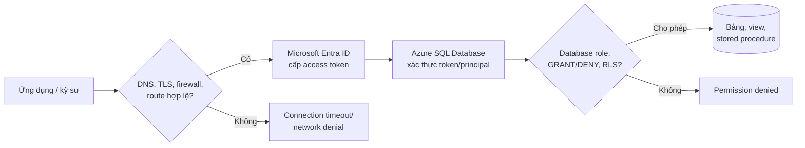
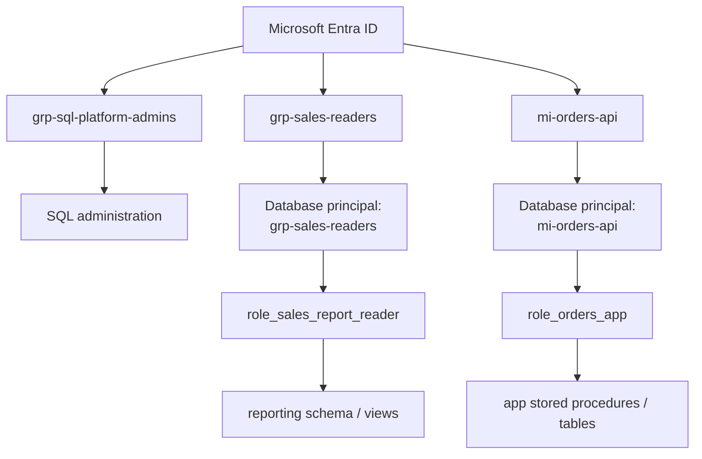
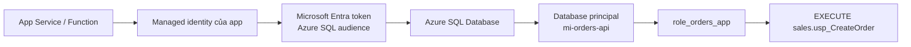
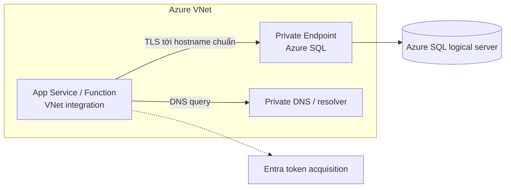
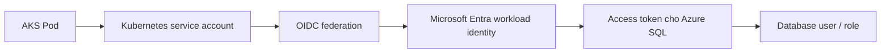
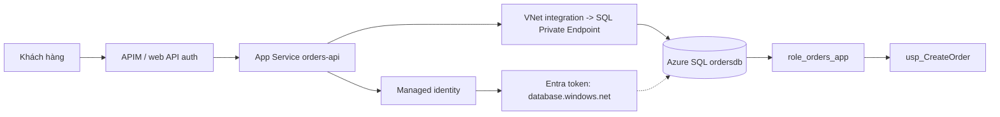

# Microsoft Entra authentication và quyền truy cập cơ sở dữ liệu

Một công ty chạy API xử lý đơn hàng trên Azure App Service và lưu dữ liệu khách hàng trong **Azure SQL Database**. Ban đầu API dùng một tài khoản SQL với mật khẩu lưu trong app settings; nhóm phát triển, vận hành và báo cáo cũng dùng chung tài khoản này. Sau một lần lộ connection string, rất khó biết ai đã truy cập bảng nào và cần đổi mật khẩu ở bao nhiêu ứng dụng. Hệ thống có thể cải thiện bằng cách sử dụng **Microsoft Entra ID** để xác thực con người và workload, kết hợp **quyền tối thiểu trong cơ sở dữ liệu** thay cho tài khoản có quyền quá rộng.

Nhưng chỉ bật Microsoft Entra authentication **không đồng nghĩa người dùng tự được phép SELECT, UPDATE hay DELETE mọi bảng**. Muốn một ứng dụng đọc `sales.Orders`, phải giải quyết đồng thời ba câu hỏi:

1. **Kết nối mạng:** client có thể truy cập đúng database endpoint qua DNS, TLS, firewall hoặc Private Endpoint không?
2. **Xác thực (authentication):** database có chấp nhận Microsoft Entra token và nhận diện được principal không?
3. **Phân quyền (authorization):** principal đó được ánh xạ thành đối tượng bảo mật của database và có những quyền SQL nào?

Bài thuộc chương **Cơ sở dữ liệu quan hệ** của module **CLOUD_PROVIDERS_AZURE**. Module khám phá Azure từ subscription, resource group, Microsoft Entra ID đến mạng ảo, tính toán, lưu trữ và dữ liệu, cùng các nguyên tắc triển khai, giám sát, bảo vệ và kiểm soát chi phí kiến trúc ứng dụng. Bài lấy **Azure SQL Database** làm ví dụ T-SQL chính, đồng thời phân biệt **Azure SQL Managed Instance**, **Azure Database for PostgreSQL Flexible Server** và **Azure Database for MySQL Flexible Server** ở những điểm cú pháp và cơ chế danh tính khác nhau.

**Sau bài học, bạn có thể:**

- Phân biệt **Microsoft Entra authentication, Azure RBAC quản trị tài nguyên, quyền trong database và kiểm soát mạng**.
- Giải thích vai trò của **Microsoft Entra administrator**, database principal, group, service principal và managed identity.
- Cấp quyền tối thiểu bằng `CREATE USER ... FROM EXTERNAL PROVIDER`, database roles và `GRANT` trong Azure SQL.
- Kết nối Azure SQL bằng token của **managed identity** hoặc đăng nhập Entra của người dùng, không lưu SQL password.
- Hiểu sự khác biệt giữa mô hình Entra của Azure SQL, PostgreSQL Flexible Server và MySQL Flexible Server.
- Thiết kế truy cập private, kiểm toán, vòng đời quyền, break-glass và xử lý lỗi đăng nhập.

## 1. Sơ đồ ba lớp: mạng, danh tính và quyền SQL



Sơ đồ thể hiện ý nghĩa logic, không phải thứ tự tuyệt đối từng gói tin: ứng dụng có thể lấy token Entra trước khi mở socket SQL. **Thiếu đường mạng**, **token không hợp lệ** và **thiếu quyền SQL** dẫn tới các triệu chứng khác nhau, cần chẩn đoán ở đúng lớp.

| Câu hỏi | Cơ chế Azure/SQL | Ví dụ |
|---|---|---|
| Ai được tạo hoặc đổi cấu hình Azure SQL server? | **Azure RBAC** qua Azure Resource Manager | Owner/Contributor/SQL Server Contributor theo scope |
| Ai được đăng nhập bằng token? | **Microsoft Entra authentication** và principal được database/server nhận diện | Nhân viên, nhóm Entra, managed identity |
| Ai được đọc bảng? | **Database authorization**: roles, GRANT/DENY, schema/object permissions | `GRANT SELECT ON SCHEMA::reporting` |
| Ai được kết nối từ mạng công ty? | **Firewall/VNet/Private Endpoint/DNS** | Chỉ client từ mạng riêng được định tuyến |
| Ai được xem audit và dữ liệu nhạy cảm? | Azure RBAC để quản lý, quyền trên log sink và quyền DB phù hợp | Nhóm SOC xem audit, không cần đọc dữ liệu hóa đơn |

**Lỗi thường gặp:** người dùng có `Contributor` trên resource group nghĩ rằng có thể chạy `SELECT * FROM dbo.Customers`. Azure RBAC điều khiển **control plane** của tài nguyên; nó **không tự tạo database user hoặc tự cấp quyền SELECT** trong Azure SQL Database.

## 2. Authentication khác authorization như thế nào?

### 2.1. Authentication

**Authentication** trả lời: “Người đang yêu cầu kết nối là ai?”. Với Microsoft Entra, client nhận **OAuth 2.0 access token** cho audience/resource của dịch vụ database và trình token khi kết nối bằng driver được hỗ trợ.

Principal có thể là:

- **Entra user:** kỹ sư hoặc nhân viên đăng nhập tương tác, có thể chịu MFA/Conditional Access.
- **Entra group:** nhóm chứa các users hoặc principal theo quy tắc được hỗ trợ; giúp cấp quyền theo chức năng.
- **Service principal:** danh tính ứng dụng Entra, có thể dùng cơ chế credentials/federation phù hợp.
- **Managed identity:** danh tính được Azure quản lý cho resource/workload, tránh lưu client secret trong code.

Token chỉ chứng minh danh tính trong phạm vi claims và điều kiện xác thực. Token **không thay thế** quyền SQL cụ thể.

### 2.2. Authorization

**Authorization** trả lời: “Principal đã xác thực được phép làm gì?”. Với Azure SQL, các đối tượng và quyền thường gồm:

- **Database user** được ánh xạ tới principal Entra.
- **Database role** dùng gom quyền.
- **GRANT/DENY/REVOKE** trên database, schema, table, view hoặc stored procedure theo khả năng engine.
- **Row-Level Security (RLS)** và các chính sách ứng dụng khi cần hạn chế theo dòng/tenant.
- **Separation of duties:** người đọc báo cáo không có quyền thay schema, người triển khai không tự động là database administrator.

Ở Azure SQL Database, cú pháp T-SQL là một phần của cơ chế quyền. Với PostgreSQL/MySQL, **cú pháp user/role và cách ánh xạ Entra khác nhau**, không dùng `CREATE USER ... FROM EXTERNAL PROVIDER` của SQL Server cho mọi hệ quản trị.

### 2.3. Các kiểu lỗi cần phân biệt

| Triệu chứng | Lớp nghi vấn đầu tiên |
|---|---|
| DNS không phân giải / TCP timeout | Mạng, DNS, Private Endpoint, firewall, port |
| TLS certificate chain/hostname error | Driver, trust chain, SNI, hostname, proxy |
| Token acquisition error | Entra sign-in, managed identity, tenant, audience, Conditional Access |
| Login failed / principal không tồn tại | Entra authentication và mapping user/login ở database |
| Login thành công nhưng `SELECT permission denied` | Roles/GRANT/DENY và object ownership |
| Một nhân viên thấy dữ liệu của tenant khác | Phân quyền mức dòng/ứng dụng, không chỉ khả năng đăng nhập |

## 3. Azure SQL Database, SQL Managed Instance và Flexible Server khác nhau

| Dịch vụ | SQL dialect | Microsoft Entra integration | Quyền dữ liệu |
|---|---|---|---|
| **Azure SQL Database** | T-SQL | Entra admin trên logical server; database principals Entra theo cơ chế hỗ trợ | Database users, roles, object/schema GRANT |
| **Azure SQL Managed Instance** | T-SQL | Entra integration trên managed instance, có thêm khả năng server/login phù hợp với MI | Server/database principals, roles và permissions |
| **Azure Database for PostgreSQL Flexible Server** | PostgreSQL SQL | Entra authentication được cấu hình ở server, mapping principal qua cơ chế PostgreSQL/Azure hỗ trợ | PostgreSQL roles, GRANT và privileges |
| **Azure Database for MySQL Flexible Server** | MySQL SQL | Entra authentication tùy tính năng/server mode hỗ trợ, user mapping của MySQL Flexible Server | MySQL accounts, roles/GRANT theo bản engine |

**Không copy SQL script cấp quyền từ Azure SQL sang PostgreSQL hay MySQL.** Khả năng Entra-only, nhóm Entra, managed identity, mặc định admin, server parameters và token-based connection có giới hạn theo **dịch vụ, phiên bản và region**. Khi triển khai production phải kiểm tra chính sách hỗ trợ hiện hành của từng engine.

### 3.1. Trọng tâm ví dụ

Từ mục 4 đến mục 14, câu lệnh `CREATE USER ... FROM EXTERNAL PROVIDER` và các `sys.database_principals` đều dành cho **Azure SQL Database** (và các khả năng T-SQL tương ứng khi engine hỗ trợ), **không phải PostgreSQL/MySQL**. Mục riêng cuối bài trình bày sự khác biệt với Flexible Server.

## 4. Microsoft Entra administrator trong Azure SQL

Một **Microsoft Entra administrator** được cấu hình cho Azure SQL logical server hoặc Managed Instance theo cách phù hợp với từng dịch vụ. Principal này giúp khởi tạo và quản lý quyền truy cập Entra trong SQL.

Ví dụ mô hình:

```text
Microsoft Entra tenant
  |
  +-- Group: grp-sql-platform-admins
  |      (được chỉ định làm Entra admin theo policy)
  |
  +-- Group: grp-sales-readers
  |      -> Database user -> role báo cáo
  |
  +-- Managed identity: mi-orders-api
         -> Database user -> role ứng dụng
```

**Khuyến nghị:** dùng nhóm quản trị được kiểm soát và review thường xuyên thay vì phụ thuộc một cá nhân. Tuy vậy, cần xác nhận loại group/principal được tính năng Entra administrator hỗ trợ và tổ chức có quy trình khi thành viên quản trị thay đổi.

### 4.1. Entra admin không phải Azure subscription Owner

Các vai trò khác nhau:

- **Azure Owner/Contributor**: điều khiển tài nguyên Azure theo role definition, có thể thay một số cài đặt server.
- **Microsoft Entra administrator của SQL**: có quyền quản trị đăng nhập/permission ở SQL theo mô hình Entra.
- **SQL database role**: quyết định khả năng truy vấn và sửa dữ liệu.

Chủ thể quản lý Azure SQL resource có thể ảnh hưởng cấu hình bảo mật, vì thế control-plane RBAC vẫn cần least privilege. Nhưng **không mặc định** mọi người có quyền ARM cũng nhận quyền `db_owner` trong database.

### 4.2. Entra administrator và quyền resolve principal

Khi tạo contained database user từ Entra group/managed identity, SQL có thể cần tra cứu danh tính từ Microsoft Entra. Tùy cách kết nối, principal thực thi, kiểu server và tính năng, có thể cần quyền đọc danh bạ hoặc quyền Microsoft Graph thích hợp cho **managed identity của server**.

Một thông báo kiểu “principal not found” khi `CREATE USER ... FROM EXTERNAL PROVIDER` có thể do **directory resolution hoặc quyền đọc Microsoft Entra**, không phải vì lệnh `GRANT SELECT` sai. Không cấp Directory Readers hoặc quyền Graph trên toàn tenant mà không đánh giá mức tối thiểu và duyệt của đội IAM.

## 5. Cấu hình Entra authentication cho Azure SQL Database

Quy trình khái quát:

1. Xác định **Microsoft Entra tenant**, subscription, logical server và database đích.
2. Chỉ định **Entra administrator** trên logical server theo chính sách doanh nghiệp.
3. Đăng nhập SQL bằng Entra principal có quyền tạo database principals.
4. Tạo **contained database user** cho nhóm hoặc managed identity cần truy cập.
5. Tạo **custom database role** và cấp quyền tối thiểu.
6. Thêm user/group vào role, kiểm thử bằng đúng principal thực tế.
7. Bảo vệ network, giám sát audit và định kỳ review membership/permissions.

### 5.1. Cách đọc trạng thái bằng Azure CLI

Các lệnh sau **chỉ đọc** tài nguyên Azure SQL và cấu hình Entra administrator:

```bash
RG="rg-data-prod"
SERVER="sql-orders-prod"
DB="ordersdb"

az account show \
  --query "{subscription:name,id:id,tenant:tenantId}" \
  -o table

az sql server show \
  --resource-group "$RG" \
  --name "$SERVER" \
  --query "{name:name,location:location,fullyQualifiedDomainName:fullyQualifiedDomainName,publicNetworkAccess:publicNetworkAccess,identity:identity}" \
  -o json

az sql server ad-admin list \
  --resource-group "$RG" \
  --server "$SERVER" \
  -o json

az sql db show \
  --resource-group "$RG" \
  --server "$SERVER" \
  --name "$DB" \
  --query "{name:name,status:status,edition:edition,serviceObjective:currentServiceObjectiveName}" \
  -o json
```

Kết quả cho biết trạng thái ở **Azure Resource Manager**, chưa cho biết mọi quyền trong database. Nếu field vắng mặt, đọc kết quả JSON đầy đủ và đối chiếu phiên bản CLI/API thay vì suy đoán.

### 5.2. Ví dụ thiết lập Entra admin — lệnh ghi

Trong môi trường thử nghiệm **đã được phê duyệt**, Azure CLI có thao tác cấu hình admin tương tự:

```bash
# LỆNH GHI — chỉ áp dụng nếu có quyền và kế hoạch thay đổi được duyệt.
az sql server ad-admin create \
  --resource-group "$RG" \
  --server "$SERVER" \
  --display-name "<ENTRA_ADMIN_GROUP_NAME>" \
  --object-id "<ENTRA_ADMIN_GROUP_OBJECT_ID>"
```

**Không thực thi trong bài học.** Việc thay Entra administrator có thể ảnh hưởng những ứng dụng và tài khoản hiện tại; hãy xác minh Object ID, tenant, nhóm, khả năng truy cập hiện hữu và đường khôi phục quản trị hợp lệ trước khi đổi.

## 6. Chọn group-based access thay vì gán quyền từng cá nhân

Một sơ đồ cấp quyền đề xuất:



### 6.1. Vì sao nhóm hữu ích?

- Khi nhân viên vào/ra đội, IAM đổi **group membership** thay vì sửa SQL role cho từng người.
- Access review có một owner và lý do rõ ràng.
- Có thể kết hợp PIM/Conditional Access theo cơ chế hỗ trợ.
- Giảm nguy cơ còn user database của một nhân viên đã rời công ty.

Nhưng nhóm cũng có rủi ro:

- **Lồng nhiều nhóm** và dynamic membership có thể làm khó phân tích quyền hiệu lực.
- Token/claims và thời gian đồng bộ group membership có thể khiến thay đổi quyền không có hiệu lực tức thì.
- Một user có thể thuộc **nhiều nhóm** và nhận hợp quyền rộng hơn dự tính.
- Group display name có thể đổi hoặc trùng; phải giữ **Object ID ổn định** trong inventory và kiểm tra mapping thực.

### 6.2. Cấp quyền trên database nào?

Với contained database user của Azure SQL Database, principal được tạo **trong database đích**. Có user trong `ordersdb` không tự cấp quyền đọc một database khác như `hrdb`. Cần khai báo scope thực và tránh cấp quyền cross-database khi không cần.

## 7. T-SQL: tạo Entra user và role chỉ đọc

Giả sử một nhóm Entra tên hiển thị `grp-sales-readers` cần đọc dữ liệu ở schema `reporting` của database `ordersdb`. Đăng nhập bằng Entra admin hoặc principal có quyền cấp phép đúng, chọn đúng database rồi thực hiện:

```sql
-- Chạy trong database ordersdb, không phải mặc định master.
-- LỆNH GHI: phải kiểm tra tên nhóm thực, tenant và approval.

CREATE USER [grp-sales-readers] FROM EXTERNAL PROVIDER;

CREATE ROLE role_sales_report_reader;

GRANT SELECT ON SCHEMA::reporting
    TO role_sales_report_reader;

ALTER ROLE role_sales_report_reader
    ADD MEMBER [grp-sales-readers];
```

**Điều kiện trước khi chạy:**

1. Schema `reporting` đã tồn tại.
2. Nhóm Entra đúng tenant đã được xác nhận; tên trong T-SQL phải ánh xạ tới principal bạn muốn.
3. Tài khoản thực thi có quyền `CREATE USER`, `CREATE ROLE`, `GRANT` và thay đổi role membership tương ứng.
4. Principal có thể cần directory resolution từ Entra; nếu trùng display name, phải dùng **cách xác định object identity được bản Azure SQL hỗ trợ**, không chọn đại một tên.
5. Đã kiểm tra role không có quyền rộng khác hoặc quyền kế thừa không mong muốn.

### 7.1. Vì sao nên dùng custom role?

Thay vì cấp `db_datareader` cho toàn database, role `role_sales_report_reader` chỉ được `SELECT` trong schema `reporting`. Khi bảng mới xuất hiện trong schema đó, schema-level grant có thể áp dụng cho bảng mới theo cơ chế SQL. Đây là lựa chọn dễ quản trị, nhưng cần review vì **quyền cấp trên cả schema** có thể rộng hơn dự kiến khi schema phát triển.

Nếu chỉ cần một view, có thể cấp cụ thể hơn:

```sql
-- Ví dụ khi view đã tồn tại.
CREATE ROLE role_sales_summary_reader;

GRANT SELECT ON OBJECT::reporting.MonthlySales
    TO role_sales_summary_reader;

ALTER ROLE role_sales_summary_reader
    ADD MEMBER [grp-sales-readers];
```

Đừng tạo hai role chồng chéo vô tình làm quyền cuối rộng hơn yêu cầu. Dùng một access matrix và quản lý thay đổi role qua IaC/migration scripts có review.

### 7.2. Vai trò built-in

| Database role | Khả năng điển hình | Rủi ro |
|---|---|---|
| `db_datareader` | Đọc dữ liệu của nhiều user tables/views trong database theo scope role | Có thể rộng hơn rất nhiều so với một báo cáo |
| `db_datawriter` | Thay đổi dữ liệu trong nhiều user tables | Không phù hợp tài khoản chỉ đọc |
| `db_ddladmin` | Thực hiện nhiều DDL operations | Có thể làm đổi schema/bề mặt bảo mật |
| `db_owner` | Quyền rất rộng trong database | Chỉ dành cho principal thực sự cần quản trị |
| **Custom role** | Các quyền GRANT cụ thể | Cần bảo trì definition và review |

Không cấp `db_owner` cho managed identity của API chỉ để kết nối thành công. Lệnh `SELECT 1` thành công **chưa chứng minh** các quyền đọc/ghi cần thiết đã được cấp, và việc cấp toàn quyền có thể che giấu lỗi thiết kế.

## 8. Cấp quyền theo thao tác: SELECT, EXECUTE, UPDATE

Một API đặt hàng có thể cần:

| Đối tượng | Thao tác hợp lệ | Không cần |
|---|---|---|
| `sales.Orders` | `SELECT`, `INSERT`, `UPDATE` trong luồng được duyệt | `ALTER` bảng, `DROP` bảng |
| `sales.OrderLines` | `SELECT`, `INSERT` theo nghiệp vụ | Thay đổi bảng bảo mật ngoài scope |
| `sales.usp_CreateOrder` | `EXECUTE` | Trực tiếp sửa tất cả bảng của database |
| `reporting.MonthlySales` | `SELECT` | Thêm/sửa/xóa dữ liệu nguồn |

### 8.1. Stored procedure boundary

Trong những kiến trúc phù hợp, cấp **EXECUTE trên một nhóm stored procedures** thay vì cho ứng dụng quyền DML trực tiếp trên toàn bộ tables:

```sql
-- Ví dụ cho role ứng dụng khi schema và procedures đã tồn tại.
CREATE ROLE role_orders_app;

GRANT EXECUTE ON OBJECT::sales.usp_CreateOrder
    TO role_orders_app;

GRANT EXECUTE ON OBJECT::sales.usp_GetOrder
    TO role_orders_app;
```

Quyền thực tế phụ thuộc ownership chaining, execution context, permissions của stored procedures và các đối tượng chúng gọi. **Không coi EXECUTE là ranh giới an toàn tuyệt đối**: procedure phải validate input, authorization và tránh dynamic SQL injection.

### 8.2. GRANT, REVOKE và DENY

- **GRANT:** cấp quyền.
- **REVOKE:** bỏ quyền grant/deny đã được thiết lập ở phạm vi tương ứng, không nhất thiết tạo “phủ định” cho quyền khác.
- **DENY:** từ chối một quyền trong phạm vi áp dụng, có quy tắc tương tác với GRANT/ownership/role đặc biệt.

Nếu một user là thành viên của nhiều roles, cần xem quyền hiệu lực chứ không chỉ một bản ghi GRANT. Không dùng DENY hàng loạt để “vá” một role `db_owner` đã cấp nhầm; tốt hơn thu hồi quyền rộng và tái cấp role tối thiểu.

## 9. T-SQL: tạo user cho managed identity của ứng dụng

Một App Service có **system-assigned managed identity** hoặc **user-assigned managed identity**. Nếu API sử dụng principal tên hiển thị `mi-orders-api` đã được xác định đúng trong Entra, có thể tạo user ở database:

```sql
-- Đăng nhập bằng Entra principal có đủ quyền quản trị database.
-- LỆNH GHI: chạy trong database cần cấp quyền.

CREATE USER [mi-orders-api] FROM EXTERNAL PROVIDER;

ALTER ROLE role_orders_app
    ADD MEMBER [mi-orders-api];
```

Điểm phải kiểm tra:

1. `mi-orders-api` chính xác là principal/managed identity cần cấp quyền, **không phải tên app service bất kỳ**.
2. Entra Object ID, application/client ID và Azure resource ID là những định danh **khác nhau**.
3. Với **system-assigned identity**, principal có vòng đời gắn với resource; nếu resource bị xóa/tạo lại thì principal Object ID có thể thay đổi.
4. **User-assigned identity** có vòng đời riêng và có thể được gắn với nhiều Azure resources trong phạm vi hỗ trợ.
5. Cần quyền directory resolution để tạo user. Trường hợp tên trùng, xác minh cú pháp nhận diện bằng Object ID ở bản SQL đang dùng thay vì cấp nhầm principal.

### 9.1. Quyền tạo user khác quyền truy cập dữ liệu

Người triển khai migration có thể có quyền tạo users/roles, còn runtime managed identity của API chỉ nên có quyền thực thi procedures. Không gán quyền `ALTER ANY USER` hoặc quản trị roles cho API runtime trừ khi có nhu cầu được phân tích và duyệt.

### 9.2. App identity không phải server identity

Azure SQL **logical server managed identity** (nếu có) phục vụ các khả năng riêng của server như directory lookup hoặc tích hợp khác, **không tự động là danh tính của App Service**. Phải xác định rõ principal đang lấy token ở phía client.



## 10. Kết nối Azure SQL bằng Microsoft Entra token

### 10.1. Token audience đúng là điều kiện bắt buộc

Với **Azure SQL**, một client dùng Azure Identity SDK có thể yêu cầu scope:

```text
https://database.windows.net/.default
```

Trong token-based authentication, đây là resource/scope dành cho SQL, **không phải** `https://management.azure.com/.default` của Azure Resource Manager và **không phải** scope dành cho PostgreSQL/MySQL Flexible Server.

Azure SQL driver sẽ dùng access token để chứng minh danh tính. Database vẫn phải có principal/permissions tương ứng.

### 10.2. Azure SQL bằng Python, Azure Identity và ODBC

Ví dụ dưới đây dùng `azure-identity`, `pyodbc` và **ODBC Driver 18 for SQL Server**:

```python
import os
import struct

import pyodbc
from azure.identity import DefaultAzureCredential

server = os.environ["AZURE_SQL_SERVER_FQDN"]
database = os.environ["AZURE_SQL_DATABASE"]

# DefaultAzureCredential:
# - Trong Azure: managed identity nếu được cấu hình đúng.
# - Local: Azure CLI/IDE credential theo chuỗi credential được hỗ trợ.
credential = DefaultAzureCredential()
access_token = credential.get_token(
    "https://database.windows.net/.default"
).token

# ODBC SQL_COPT_SS_ACCESS_TOKEN = 1256.
# Token truyền tới ODBC phải dùng UTF-16-LE với length prefix 4 byte.
token_bytes = access_token.encode("utf-16-le")
token_struct = struct.pack("<I", len(token_bytes)) + token_bytes

conn_str = (
    "DRIVER={ODBC Driver 18 for SQL Server};"
    f"SERVER=tcp:{server},1433;"
    f"DATABASE={database};"
    "Encrypt=yes;"
    "TrustServerCertificate=no;"
    "Connection Timeout=15;"
)

with pyodbc.connect(
    conn_str,
    attrs_before={1256: token_struct},
    timeout=15,
) as conn:
    row = conn.cursor().execute(
        "SELECT DB_NAME() AS database_name, USER_NAME() AS database_user"
    ).fetchone()
    print("Connected to database:", row.database_name)
    print("Resolved database user:", row.database_user)
```

**Điều kiện và lưu ý:**

- Máy cần đúng driver ODBC và Python packages tương thích.
- Biến `AZURE_SQL_SERVER_FQDN` phải là hostname thực của Azure SQL, ví dụ `sql-orders-prod.database.windows.net`.
- **Không** đặt `UID`, `PWD` hoặc một `Authentication` mode khác trong cùng connection string khi đang tự truyền access token qua `attrs_before`, trừ khi driver/tính năng cụ thể hỗ trợ sự kết hợp đó.
- Token có thời hạn. Với connection pooling/long-running services, cần thiết kế cách lấy token mới **trước khi mở kết nối mới** và quản lý vòng đời pool theo khả năng driver. Không giữ một token string trong memory và mặc định nó hợp lệ nhiều ngày.
- Code chỉ chạy một câu `SELECT` kiểm tra identity; không có thao tác ghi dữ liệu.
- `DefaultAzureCredential` ở môi trường local có thể chọn principal **khác** managed identity production; kiểm tra tenant, Object ID và quyền trước khi khẳng định “local chạy được thì production cũng chạy được”.

### 10.3. User-assigned managed identity

Nếu App Service có nhiều managed identities, Azure Identity SDK có thể cần chỉ định **client ID** của user-assigned identity, ví dụ:

```python
import os
from azure.identity import ManagedIdentityCredential

client_id = os.environ["AZURE_CLIENT_ID"]
credential = ManagedIdentityCredential(client_id=client_id)
token = credential.get_token(
    "https://database.windows.net/.default"
)
```

`AZURE_CLIENT_ID` ở đây là **client/application ID**, không phải Entra Object ID. Cấu hình này chỉ hoạt động khi user-assigned managed identity thực sự được gắn vào tài nguyên hỗ trợ và có quyền trong database.

### 10.4. SDK/driver-native Entra authentication

Trong .NET, các bản `Microsoft.Data.SqlClient` hỗ trợ nhiều chế độ Entra authentication (tùy version), như `Active Directory Default` hoặc `Active Directory Managed Identity`. Một connection string minh họa:

```text
Server=tcp:sql-orders-prod.database.windows.net,1433;
Database=ordersdb;
Authentication=Active Directory Managed Identity;
Encrypt=True;
TrustServerCertificate=False;
```

Không nhầm **driver-managed identity auth** với kết nối SQL username/password. Với user-assigned identity, thuộc tính chỉ định identity cần đúng cú pháp/ý nghĩa của driver version đang dùng (client ID hoặc identifier được driver hỗ trợ). Không copy tùy ý `User ID` giữa các driver rồi suy ra nó luôn là SQL username.

## 11. Dùng nhóm Entra để người dùng truy cập SQL

Giả sử đội phân tích có nhóm `grp-sales-readers`:

1. IAM thêm analyst vào nhóm, sau khi phê duyệt.
2. Azure SQL database có user ánh xạ tới nhóm.
3. User thuộc nhóm đăng nhập bằng Entra token.
4. SQL đánh giá group membership/claims và quyền role để cho phép `SELECT` phù hợp.

### 11.1. Đăng nhập tương tác và Conditional Access

Người vận hành có thể dùng:

- Azure Data Studio hoặc SQL client hỗ trợ Entra authentication (theo version).
- SSMS với chế độ Microsoft Entra được hỗ trợ.
- `sqlcmd` phiên bản hỗ trợ Entra login, với cú pháp cụ thể của bản công cụ.
- Driver/SDK dùng InteractiveBrowserCredential hoặc Azure CLI credentials trong bối cảnh phát triển.

MFA và Conditional Access bảo vệ **quá trình cấp token**, nhưng hiệu lực với ứng dụng/driver/service principal phụ thuộc chính sách Entra. Không ép một non-interactive workload “bấm MFA” trong production. Với ứng dụng, dùng managed identity/workload federation theo khả năng hỗ trợ.

### 11.2. Token cache và thay đổi nhóm

Nếu analyst bị loại khỏi nhóm, phiên/token đang được cache có thể chưa phản ánh membership mới ngay lập tức. Hãy:

- Kiểm tra Entra membership/claims và thời điểm token được cấp.
- Áp dụng chính sách session/token và các biện pháp thu hồi được hỗ trợ.
- Review quyền database tồn tại từ **các nhóm khác hoặc direct user grants**.
- Khi cần cắt quyền khẩn cấp, phối hợp cả IAM, database, network và phiên kết nối theo runbook.

**Không khẳng định “xóa khỏi group thì tất cả SQL sessions bị ngắt ngay tức thì”** nếu chưa có bằng chứng từ engine và cơ chế token/session.

## 12. Các quyền SQL hiệu lực: nhiều role, nhiều con đường

Một principal có thể có:

- Quyền trực tiếp trên user.
- Quyền từ nhiều database roles.
- Quyền từ nhóm Entra đã ánh xạ vào database.
- Quyền cố định từ built-in roles.
- Quyền rộng được thiết lập trong stored procedures hoặc ownership/security context.

Ví dụ một analyst thuộc đồng thời nhóm `grp-sales-readers` và `grp-finance-operators`, trong đó nhóm finance có quyền UPDATE, thì việc `grp-sales-readers` chỉ có SELECT **không làm analyst trở thành chỉ đọc**.

### 12.1. Kiểm tra principals (read-only T-SQL)

Khi kết nối đúng database:

```sql
SELECT
    DB_NAME() AS current_database,
    USER_NAME() AS current_user;

SELECT
    name,
    type_desc,
    authentication_type_desc
FROM sys.database_principals
WHERE type IN ('E', 'X')
ORDER BY name;
```

`E` và `X` biểu diễn những loại external principals trong các phiên bản Azure SQL phù hợp. Câu lệnh này liệt kê **database principals**, không thể hiện toàn bộ effective permissions của người đăng nhập hay mọi nhóm Entra từ tenant.

### 12.2. Kiểm tra membership và role grants

```sql
SELECT
    role_principal.name AS role_name,
    member_principal.name AS member_name
FROM sys.database_role_members AS drm
JOIN sys.database_principals AS role_principal
    ON drm.role_principal_id = role_principal.principal_id
JOIN sys.database_principals AS member_principal
    ON drm.member_principal_id = member_principal.principal_id
ORDER BY role_name, member_name;

SELECT
    dp.state_desc,
    dp.permission_name,
    dp.class_desc,
    USER_NAME(dp.grantee_principal_id) AS grantee
FROM sys.database_permissions AS dp
ORDER BY grantee, dp.permission_name;
```

Phần lớn metadata chỉ hiển thị theo **quyền xem metadata** của người gọi. Một tài khoản quyền thấp có thể không thấy mọi principal hoặc grant; không kết luận “không có quyền” khi query không trả đủ hàng.

### 12.3. Kiểm tra quyền với principal thật

Thử ít nhất:

```sql
SELECT DB_NAME() AS database_name;
SELECT HAS_PERMS_BY_NAME('reporting.MonthlySales', 'OBJECT', 'SELECT')
    AS can_select_report;
```

Kết quả `1`/`0`/`NULL` cần được diễn giải theo quyền, metadata và tên object thực tế; không dùng một phép kiểm tra này làm **bằng chứng an toàn tuyệt đối** cho tất cả operations. Kiểm thử tích cực và tiêu cực bằng đúng Entra user/managed identity thật trong môi trường lab/staging.

## 13. Row-Level Security, views và bảo vệ dữ liệu nhạy cảm

Database role `db_datareader` có thể đọc quá nhiều dữ liệu trong mô hình đa khách hàng (*multi-tenant*). Khi một bảng chứa orders của nhiều tenant, chỉ quyền `SELECT` lên bảng **không phân biệt tenant**.

Các lớp kiểm soát bổ sung:

| Cơ chế | Mục tiêu | Lưu ý |
|---|---|---|
| **Views** | Giới hạn cột/hàng cho nhóm dùng | Đánh giá quyền bảng gốc, ownership chain và filter |
| **Row-Level Security (RLS)** | Lọc/kiểm soát hàng dữ liệu theo predicate/security context | Test bypass, context spoofing, performance |
| **Stored procedures** | Cho phép thao tác nghiệp vụ xác định | Validate input, execution context, SQL injection |
| **Dynamic Data Masking** | Che một phần giá trị với một số principal | **Không** phải thay thế RLS/encryption hay ranh giới dữ liệu tuyệt đối |
| **Always Encrypted / encryption** | Bảo vệ thông tin nhạy cảm theo kiến trúc | Quản lý khóa và giới hạn query |
| **Application authorization** | Kiểm tra người gọi được xem order nào | Không tin input `tenantId` của client nếu chưa xác thực |

### 13.1. RLS có thể gắn với session context

Nếu một API dùng **một managed identity chung** cho mọi khách hàng, Entra chỉ nhận diện **API workload**, không tự biết request HTTP thuộc customer A hay B. Muốn RLS theo tenant, ứng dụng phải truyền thông tin tenant **đã được xác thực/ủy quyền** tới SQL bằng cơ chế session context và security predicate phù hợp.

Rủi ro cần xử lý:

- Client giả mạo `tenantId` trong JSON.
- Connection pooling giữ lại session context cũ.
- Một code path quên đặt context trước khi query.
- API runtime có quyền thay đổi security policy hoặc xem bảng gốc.

RLS mạnh khi được thiết kế/kiểm thử cẩn thận; không dùng nó thay cho authentication hoặc validation ở API.

## 14. Quyền DDL, migration và quản trị database

Ứng dụng runtime cần **data access**, còn pipeline migration cần quyền **đổi schema**. Nên tách:

```text
Managed identity: mi-orders-api
  -> role_orders_app
  -> EXECUTE procedures / SELECT limited

Principal: sp-orders-schema-migration
  -> role/schema permissions để chạy migrations
  -> chạy qua CI/CD, có approval

Group: grp-sql-platform-admins
  -> Entra admin / quản trị theo chính sách
  -> access review + audit
```

Nếu API runtime có quyền `ALTER` mọi bảng, một lỗi injection hoặc lộ token có thể thay schema hay xoá dữ liệu. Không dùng chính principal production runtime để chạy các script migration cần quyền cao trừ khi có phân tích rủi ro và kiểm soát bổ sung.

### 14.1. Vòng đời thay đổi quyền

Mỗi thay đổi grant nên có:

1. Lý do nghiệp vụ và chủ sở hữu.
2. Principal/group Object ID và đúng tenant.
3. Database, schema, object, verb cụ thể.
4. Review của người quản trị dữ liệu/bảo mật.
5. Kiểm thử `allow` và `deny` dự kiến.
6. Audit/ticket, ngày review/thu hồi.
7. Kế hoạch rollback nếu ứng dụng lỗi sau thay đổi.

Không tạo user/group trong SQL mà không có inventory: những principals mồ côi sau khi identity bị xóa dễ làm quyền truy cập khó kiểm toán.

## 15. Entra-only authentication và tài khoản SQL truyền thống

Azure SQL hỗ trợ cách kiểm soát **Microsoft Entra-only authentication** ở những loại tài nguyên/tính năng tương ứng. Khi bật, các phương thức đăng nhập SQL authentication thuộc phạm vi bị vô hiệu hóa theo cơ chế dịch vụ, nhằm giảm phụ thuộc mật khẩu SQL.

**Nhưng:** đây là thay đổi bảo mật có thể làm ứng dụng cũ ngừng kết nối nếu chúng vẫn dùng `User ID=...;Password=...`. Cần kiểm kê:

- Ứng dụng, report tools, ETL jobs, backup/DR scripts.
- Tài khoản technical dùng SQL authentication.
- Sự phụ thuộc vào principal hoặc database link có giới hạn Entra.
- Phương án break-glass theo mô hình identity được hỗ trợ.

Không bật Entra-only theo cảm tính sau khi mới xác minh một tài khoản quản trị Entra chạy được; phải kiểm thử **mọi workload** và có kế hoạch cutover theo giai đoạn.

### 15.1. Quy trình migration cơ bản

1. Kiểm kê mọi SQL logins/users và connection strings.
2. Thiết kế Entra groups/managed identities cho từng ứng dụng.
3. Tạo database principals và roles tương đương **theo least privilege**.
4. Chuyển client drivers sang chế độ Entra auth và thử nghiệm staging.
5. Rollout theo nhóm, giám sát sign-in failures và permission denied.
6. Thu hồi/seal SQL password cũ theo change window.
7. Chỉ sau khi đáp ứng readiness, xem xét bật Entra-only nếu chính sách yêu cầu và dịch vụ hỗ trợ.
8. Kiểm tra audit, break-glass và chính sách phục hồi.

## 16. Private Endpoint, firewall và DNS cho database

Microsoft Entra token hợp lệ **không tự mở đường mạng** từ App Service đến Azure SQL.



### 16.1. Public network và private network

- **Public endpoint:** có thể dùng firewall rules/authorized paths theo cấu hình và chính sách.
- **Private Endpoint:** cấp đường truy cập riêng từ VNet tới Azure SQL qua Private Link.
- **Private DNS:** FQDN SQL chuẩn cần phân giải tới private IP ở ngữ cảnh client.
- **Public network access setting:** kiểm soát đường public theo khả năng tài nguyên, là một quyết định **riêng** với việc tạo Private Endpoint.

**Tạo Private Endpoint không nhất thiết tự đóng public network access.** Kiểm tra cả public network access và firewall rules, không dựa chỉ vào trạng thái `Approved` của private endpoint.

### 16.2. Tên miền SQL

Ứng dụng nên kết nối bằng hostname chuẩn, ví dụ:

```text
sql-orders-prod.database.windows.net
```

Với Private Link, DNS có thể dùng zone:

```text
privatelink.database.windows.net
```

Hệ thống resolver cần trả **private IP** thích hợp cho hostname chuẩn theo cấu hình. Tránh đổi connection string thành raw private IP: TLS hostname validation và routing theo host có thể lỗi. Trong hub-spoke/hybrid, phải cấu hình zone links và DNS forwarding/Private Resolver đúng; VNet peering không tự chia sẻ mọi DNS private zone.

### 16.3. Ba chiều chẩn đoán

1. **DNS/TCP/TLS:** resolve hostname, port 1433 và certificate có đúng không?
2. **Entra:** token audience, tenant, principal ID và token acquisition có đúng không?
3. **SQL:** database user/role, GRANT, DENY, Row-Level Security có cho phép query không?

Không tăng SQL database role lên `db_owner` để “chữa” lỗi kết nối timeout. Ngược lại, không mở public network chỉ vì query trả `SELECT permission denied`.

## 17. PostgreSQL Flexible Server: khác biệt cần nhớ

**Azure Database for PostgreSQL Flexible Server** có khả năng tích hợp Microsoft Entra authentication theo cấu hình server và engine version được hỗ trợ. Tuy nhiên, **PostgreSQL không hiểu T-SQL** và không có `CREATE USER [name] FROM EXTERNAL PROVIDER`.

Các điểm cần kiểm tra khi triển khai:

- Entra authentication đã được bật trên Flexible Server chưa? Có chế độ PostgreSQL password và/hoặc Entra tùy chính sách?
- Microsoft Entra admin được cấu hình đúng tenant/principal chưa?
- Principal Entra được **ánh xạ thành PostgreSQL role** bằng cơ chế/hàm quản trị được dịch vụ hỗ trợ chưa?
- Role có quyền `CONNECT` vào database, `USAGE` trên schema, `SELECT/INSERT/UPDATE` trên tables hoặc `EXECUTE` trên functions tương ứng chưa?
- Connection driver hỗ trợ token và TLS, username mapping theo quy định của dịch vụ chưa?
- Network public/private DNS, firewall, authentication token audience có phù hợp không?

### 17.1. Token audience khác Azure SQL

Đối với Entra authentication của các Azure OSS relational databases được hỗ trợ, scope thường thuộc nhóm:

```text
https://ossrdbms-aad.database.windows.net/.default
```

**Không dùng SQL scope `https://database.windows.net/.default` thay thế** trong driver PostgreSQL Flexible Server rồi cho rằng cùng là “Azure database”. Trước khi lập trình, xác minh audience và driver authentication của **dịch vụ/phiên bản thực tế**.

### 17.2. PostgreSQL GRANT sau khi principal đã ánh xạ

Ví dụ PostgreSQL SQL **chỉ áp dụng sau khi role `report_reader` đã được tạo hợp lệ** bằng cơ chế server hỗ trợ:

```sql
-- PostgreSQL syntax, không phải T-SQL.
-- Chạy trong database đích bằng quản trị viên có quyền phù hợp.

GRANT CONNECT ON DATABASE salesdb TO report_reader;
GRANT USAGE ON SCHEMA reporting TO report_reader;
GRANT SELECT ON ALL TABLES IN SCHEMA reporting TO report_reader;
```

Lưu ý: quyền trên **các bảng hiện tại** không tự cấp mọi bảng tạo về sau. Với PostgreSQL, có thể cần `ALTER DEFAULT PRIVILEGES` cho đúng role tạo bảng/schema theo thiết kế. Không cấp `CREATEDB`, `CREATEROLE` hoặc quyền quản trị cao cho ứng dụng chỉ cần SELECT.

### 17.3. Mapping principal có cú pháp riêng

Azure PostgreSQL Flexible Server có những chức năng/roles hỗ trợ Entra principal mapping theo phiên bản. **Không tự phát minh câu lệnh quản trị** dựa trên SQL Server; phải dùng đúng thủ tục/extension/hướng dẫn của Flexible Server khi tạo principal, nhất là với group và managed identity. Sau khi mapping, quyền PostgreSQL thông thường vẫn được đánh giá.

## 18. MySQL Flexible Server: nhận diện user và quyền theo MySQL

Azure Database for MySQL Flexible Server cũng cần phân biệt **xác thực Entra** và **MySQL privileges** theo tính năng/phiên bản được hỗ trợ.

Điểm cần nhớ:

1. Bật/cấu hình Entra authentication và administrator theo server type hỗ trợ.
2. Ánh xạ principal Entra thành database user/role bằng cách của **MySQL Flexible Server**, không dùng T-SQL.
3. Cấp quyền với MySQL `GRANT` theo database/table.
4. Dùng driver hỗ trợ token/password field hoặc authentication plugin tương ứng theo cơ chế dịch vụ.
5. Bảo vệ TLS, private network và định kỳ review user privileges.

Ví dụ **MySQL SQL** sau khi principal `app_reader` đã được tạo/ánh xạ hợp lệ:

```sql
-- MySQL syntax, minh họa GRANT trên database cụ thể.
GRANT SELECT ON salesdb.* TO 'app_reader'@'%';
```

Trong MySQL, account bao gồm thành phần user/host; **`'app_reader'@'%'` chỉ là ví dụ** và không nên chạy nếu principal thực tế có host pattern hoặc mapping khác. Cần kiểm tra user được tạo bằng cơ chế Entra của Flexible Server và giới hạn quyền/host chính xác trước khi áp dụng GRANT.

Không mặc định cú pháp authentication của Azure SQL, PostgreSQL và MySQL có thể hoán đổi chỉ vì dùng cùng một tenant Entra.

## 19. Ứng dụng chạy ở Azure: lựa chọn loại danh tính

| Môi trường chạy | Lựa chọn thường phù hợp | Điều cần kiểm tra |
|---|---|---|
| App Service/Functions | System-assigned hoặc user-assigned managed identity | Identity đã bật/gắn resource, DB user và role |
| Azure Container Apps | Managed identity theo cơ chế nền tảng | Runtime SDK, token, network outbound |
| Azure Kubernetes Service | Microsoft Entra Workload ID với service account federation, hoặc cơ chế được hỗ trợ | OIDC issuer, federated credential, Azure identity và DB mapping |
| Azure VM | Managed identity của VM | Role, network, SQL principal và token |
| CI/CD ngoài Azure | Federated workload identity/service principal theo hỗ trợ | Tránh secret dài hạn, giới hạn principal cho migration |
| Kỹ sư làm việc local | Entra interactive/Azure CLI/IDE credentials | Tenant, MFA, role DB thực, không dùng tài khoản chia sẻ |

### 19.1. Workload identity trong AKS

Ứng dụng ở pod không nên dùng kubeconfig cluster-admin để kết nối SQL. Với Microsoft Entra Workload ID, Kubernetes service account được **federate** với một danh tính Entra để lấy token Azure SQL, sau đó database map danh tính đó tới quyền SQL cụ thể.



**Kubernetes RBAC không phải SQL GRANT.** Pod có quyền đọc ConfigMap trong AKS không tự có quyền SELECT bảng Azure SQL. Và Azure SQL managed identity không tự được quản trị Kubernetes API.

### 19.2. Quyền truy cập data plane không phải subscription-level role

Với Azure SQL, principal cần database user/permissions. Không dùng một Azure subscription-wide Owner role để cấp phép `SELECT`. Với một số dịch vụ quản lý dữ liệu Azure khác, data-plane authorization có thể dùng Azure RBAC; phải xác định đúng **loại database engine** thay vì áp một quy tắc chung.

## 20. Quản lý danh tính và quyền theo vòng đời

Một hệ thống production cần có:

- **Inventory:** tên principal, Entra Object ID/client ID, tenant, loại identity, database, role, owner.
- **Access request:** nêu lý do, phạm vi object/verb, thời hạn và phê duyệt.
- **Grant workflow:** script SQL có review, chạy bởi principal được ủy quyền.
- **Verification:** kiểm thử được phép và bị từ chối ở staging, rồi kiểm chứng production an toàn.
- **Periodic access review:** kiểm tra group membership, roles, service principals mồ côi.
- **Revocation:** thu hồi quyền, thay đổi nhóm, disable identity hoặc thay đổi resource access theo runbook.
- **Break-glass:** đường quản trị khẩn cấp có giám sát, không phải một password chia sẻ không kiểm soát.

### 20.1. PIM và group admin

Nếu tổ chức dùng **Microsoft Entra Privileged Identity Management (PIM)**, có thể cấp quyền quản trị qua nhóm/role eligible, kích hoạt trong thời hạn và ghi audit. Nhưng phải phân biệt:

- PIM kích hoạt Azure RBAC quyền sửa resource.
- PIM kích hoạt membership trong nhóm Entra làm SQL administrator.
- Database role membership tồn tại trong SQL và có thể không phụ thuộc Azure role assignment.

Không suy rằng bật PIM trên một Azure resource tự động giới hạn mọi thành viên `db_owner` hiện hữu. Cần review từng lớp.

### 20.2. Thu hồi quyền không đơn giản chỉ xóa user

Khi nhân viên nghỉ việc:

1. Disable user theo chính sách Entra.
2. Thu hồi khỏi groups và direct grants có liên quan.
3. Kiểm tra token/sessions và biện pháp thu hồi theo khả năng engine.
4. Thu hồi quyền truy cập các report tools, BI gateways, notebooks và service accounts.
5. Giữ audit records phục vụ tuân thủ.

Nếu xóa database user trong khi ứng dụng vẫn tham chiếu principal đó, có thể gây outage. Phải lập kế hoạch thay thế identity/role trước khi thu hồi tài khoản ứng dụng.

## 21. Auditing và giám sát

### 21.1. Tín hiệu cần thu thập

| Nguồn | Giám sát điều gì? | Giới hạn |
|---|---|---|
| Microsoft Entra sign-in logs | Token issuance, sign-in policies, authentication failures theo nguồn có thể xem | Không tự chứa mọi câu SQL đã chạy |
| Azure Activity Log | Thay đổi Azure SQL resource, network, admin, policy | Không thay thế DB query audit |
| Azure SQL auditing | Database actions/events theo policy audit được bật | Cần chọn audit categories và bảo vệ nơi lưu |
| Defender for SQL / security signals | Hoạt động bất thường và cảnh báo theo tính năng | Alert cần triage, không phải phán quyết tự động |
| App telemetry | Token errors, pool failures, SQL latency, query outcomes | Không log token/password/PII |
| Private networking | DNS, firewall/NSG, private endpoint trạng thái | Network success không chứng minh SQL authorization |

Azure SQL auditing có thể gửi audit tới Azure Storage, Log Analytics hoặc Event Hubs theo khả năng cấu hình. Cần thiết kế **retention, cost, access control và protection khỏi chỉnh sửa**. Không bật logging cực chi tiết trong production rồi vô tình lưu mọi truy vấn và dữ liệu nhạy cảm mà không kiểm soát.

### 21.2. Correlation từ API tới SQL

Một request hợp lệ nên mang `correlationId` qua API, log ứng dụng và audit:

```json
{
  "correlationId": "req-order-42",
  "component": "orders-api",
  "identityType": "managed-identity",
  "database": "ordersdb",
  "operation": "CreateOrder",
  "result": "permission_denied",
  "durationMs": 31
}
```

Đây là **log minh họa**, không phải định dạng mặc định của Azure SQL. Không log access token, connection string hoặc payload chứa PII. Với ứng dụng dùng cùng một managed identity cho nhiều người dùng, database audit chủ yếu thấy **principal của ứng dụng**; cần có **application-level user audit** nếu phải truy vết người dùng cuối.

## 22. Xử lý sự cố: đăng nhập Entra hoặc SQL permission lỗi

| Triệu chứng | Khả năng nguyên nhân | Kiểm tra |
|---|---|---|
| Managed identity không lấy được token | Identity chưa bật/gắn resource, client ID sai, endpoint credential lỗi | Azure identity config, SDK logs không lộ token |
| Token có nhưng SQL từ chối login | Sai audience/tenant, database principal chưa tạo, token expired | Scope Azure SQL, Entra principal, CREATE USER mapping |
| `CREATE USER ... EXTERNAL PROVIDER` thất bại | Entra directory lookup/Graph permission, principal name trùng/không tồn tại | Entra Object ID, SQL server identity/permission |
| Người dùng có Contributor nhưng `SELECT` bị từ chối | Azure RBAC không phải SQL permission | Database user, role, GRANT |
| Login được nhưng không query được bảng | Chưa cấp SELECT/EXECUTE, DENY hoặc object scope sai | Database name, roles, permission grants |
| Local chạy được nhưng production lỗi | Local Azure CLI user khác managed identity | Token principal, tenant, object mapping |
| Ứng dụng chỉ lỗi sau thời gian dài | Token hết hạn/pooling/credential refresh | Pool management và token lifetime |
| Private Endpoint Approved nhưng không kết nối | DNS vẫn trả public IP, route/NSG/firewall chặn | DNS từ client đúng VNet, TCP 1433, public access |
| SQL ODBC báo TLS certificate error | Hostname/IP sai, trust chain hoặc driver setting | FQDN chuẩn, Encrypt, TrustServerCertificate |
| Người dùng bị bỏ khỏi group vẫn query được | Token/session cache, direct grant/nhóm khác | Membership, token/session và effective permissions |
| RLS trả kết quả của tenant khác | Context không đặt đúng, logic filter/bypass | Tenant auth, session context, predicate |
| Migration thất bại với quyền thấp | Runtime identity bị dùng để thay schema | Tách migration principal và runtime principal |
| PostgreSQL role có quyền nhưng token fail | Server Entra auth/mapping, audience hoặc driver sai | Flexible Server auth config và principal mapping |
| MySQL `GRANT` không áp dụng như dự kiến | Sai user@host hoặc mapping Entra | MySQL principal thực và scope grant |
| Audit không thấy truy vấn | Auditing policy/permission/log sink sai | Azure SQL auditing và diagnostic settings |

### 22.1. Quy trình debug theo lớp

1. **Xác định engine:** Azure SQL Database/MI hay PostgreSQL/MySQL Flexible Server?
2. **Đúng tài nguyên:** tenant, subscription, server, database, region, principal?
3. **Network:** DNS, private IP/public IP, routing, TLS và port.
4. **Token:** identity, tenant, audience, expiration, driver config.
5. **Database mapping:** Entra principal đã được tạo đúng trong database/server chưa?
6. **Permissions:** roles, GRANT/DENY, schema/object, RLS và stored procedures.
7. **Token/group cache:** role membership thay đổi gần đây có được áp dụng chưa?
8. **Audit:** truy vết thất bại và thay đổi gần nhất, có evidence timestamp.
9. **Sửa đúng nguyên nhân:** kiểm thử bằng principal quyền thấp; không cấp `db_owner` vô điều kiện.

## 23. Case study A: API đặt hàng với managed identity

**Yêu cầu:**

- API chạy trong Azure App Service, có kết nối tới `ordersdb`.
- Không lưu password SQL trong code hoặc app settings.
- API chỉ được gọi stored procedures đặt hàng, không được thay schema.
- Database chỉ nhận kết nối từ mạng ứng dụng được duyệt.



**Các bước:**

1. Bật managed identity trên App Service; ghi nhận chính xác principal ID/client ID.
2. Chỉ định Entra admin cho SQL server nếu chưa có, theo approval.
3. Tạo database user của identity và thêm vào `role_orders_app`.
4. Cấp `EXECUTE` cho procedures nghiệp vụ, tránh `db_owner`.
5. Dùng driver token-based/Active Directory Managed Identity.
6. Tạo Private Endpoint/DNS và kiểm tra public network access theo chính sách.
7. Thử lệnh hợp lệ, lệnh không được cấp quyền và timeout/token refresh.
8. Bật audit, monitor login failures và access-denied events.

**Tiêu chí thành công:** API tạo được đơn hàng bằng managed identity, không có credential SQL tĩnh, không thể `DROP TABLE` và không thể đọc schema ngoài phạm vi; client Internet không kết nối trực tiếp tới database theo thiết kế.

## 24. Case study B: Nhóm BI chỉ đọc báo cáo doanh thu

**Yêu cầu:** nhóm phân tích truy cập bảng/view báo cáo, không thấy dữ liệu nhạy cảm của khách hàng và không thể thay đổi dữ liệu.

**Thiết kế:**

1. Tạo nhóm Entra `grp-sales-readers`, IAM review membership.
2. Tạo Azure SQL user ánh xạ nhóm.
3. Tạo custom role chỉ có `SELECT` trên những views `reporting` được phê duyệt.
4. Nếu cần bảo vệ row/column, dùng views/RLS hoặc biện pháp tương đương, không coi `db_datareader` là an toàn mặc định.
5. Cho analyst đăng nhập bằng công cụ hỗ trợ Entra authentication/MFA.
6. Kiểm thử: đọc view được, UPDATE bị từ chối, SELECT bảng gốc không được cấp phải fail.
7. Audit truy cập dữ liệu và review khi nhân viên chuyển phòng ban.

**Điểm khó:** một analyst còn thuộc nhóm `grp-finance-operators` có quyền rộng hơn. Phải xem **quyền hiệu lực qua tất cả roles/groups**, không chỉ role báo cáo.

## 25. Case study C: AKS đa tenant dùng một identity kết nối SQL

**Bối cảnh:** nhiều HTTP clients đi qua một API chạy trên AKS. Pod có Microsoft Entra Workload ID để kết nối Azure SQL, nhưng mọi request chia sẻ cùng Entra principal của API.

**Rủi ro:** SQL biết “orders-api workload” chứ không tự phân biệt khách hàng A/B; nếu code dùng `WHERE tenantId = @tenantId` từ input không được kiểm chứng, client có thể yêu cầu xem dữ liệu tenant khác.

**Giải pháp phân lớp:**

- API xác thực JWT/Entra identity của người dùng cuối và **xác định tenant được ủy quyền**.
- Pod dùng workload identity để lấy token Azure SQL riêng cho service.
- SQL chỉ cấp quyền cần thiết cho API principal.
- Database RLS hoặc stored procedures có kiểm soát áp quy tắc tenant, ứng dụng chuyển tenant context đã xác thực đúng.
- Test connection pooling/session context, bypass paths, batch jobs và audit.
- Với tenant có yêu cầu isolation cao, cân nhắc **database-per-tenant** hoặc ranh giới mạnh hơn thay vì chỉ dựa vào một filter logic.

**Bài học:** Microsoft Entra authentication của workload giải quyết **danh tính ứng dụng tới SQL**; authorization của **người dùng cuối** vẫn cần được thực thi ở API và/hoặc database bằng logic đúng.

## 26. Checklist triển khai production

- [ ] Đã xác định engine và xác minh tính năng Microsoft Entra authentication hỗ trợ cho server/region/version.
- [ ] Đã phân biệt Azure RBAC control plane, Entra login, database authorization và network.
- [ ] Entra administrator được chỉ định đúng principal/group, có approval và đường khôi phục.
- [ ] Đã ghi inventory Object ID/client ID/tenant cho users, groups và identities.
- [ ] Tất cả database users cần thiết được ánh xạ đúng principal; không dựa vào tên hiển thị khi mơ hồ.
- [ ] App dùng managed identity/workload federation thay cho SQL password nếu phù hợp.
- [ ] Token audience/scope đúng với Azure SQL hoặc OSS Flexible Server.
- [ ] Database roles chỉ cấp SELECT/EXECUTE/DML cần thiết ở scope nhỏ nhất.
- [ ] Không dùng `db_owner`/admin privileges cho runtime app mặc định.
- [ ] Migration identity tách khỏi runtime identity.
- [ ] Group memberships, direct grants và inherited roles đã được kiểm tra.
- [ ] Views/RLS/tenant authorization bảo vệ dữ liệu nhạy cảm khi cần.
- [ ] Private Endpoint, DNS, TLS, firewall và public access đúng kiến trúc.
- [ ] Connection pooling có chiến lược token refresh và retry lỗi tạm thời phù hợp.
- [ ] Kế hoạch Entra-only auth đã kiểm kê ứng dụng SQL authentication cũ.
- [ ] Có audit, alert, access review, retention và kế hoạch thu hồi/rotation.
- [ ] Có kiểm thử thành công **và** kiểm thử bị từ chối với principal thật.
- [ ] Có runbook khi token/login/permission/network lỗi và không dùng cấp toàn quyền làm phương án chữa nhanh.

## 27. Câu hỏi tự kiểm tra

1. Vì sao quyền Azure Contributor trên resource group không tự cho phép SELECT bảng Azure SQL?
2. Microsoft Entra authentication khác quyền database role/GRANT ở chỗ nào?
3. Entra administrator của Azure SQL khác Azure Owner/Contributor như thế nào?
4. Vì sao nên dùng Entra group làm database principal cho đội phân tích?
5. Trong Azure SQL Database, `CREATE USER ... FROM EXTERNAL PROVIDER` thực hiện mục đích gì?
6. Khi nào nên dùng custom role thay vì `db_datareader`?
7. Vì sao app runtime không nên có quyền `db_owner` hoặc DDL migration?
8. Object ID, client ID và resource ID của managed identity khác nhau như thế nào?
9. Token scope của Azure SQL là gì, và vì sao không dùng scope ARM?
10. Nếu ứng dụng Python lấy token thành công nhưng SQL báo login failed, cần kiểm tra những gì?
11. Vì sao managed identity của App Service khác managed identity của Azure SQL logical server?
12. Một user bị xóa khỏi Entra group nhưng vẫn còn kết nối SQL hoạt động: cần kiểm tra các lớp nào?
13. Trong PostgreSQL Flexible Server, có dùng `CREATE USER [name] FROM EXTERNAL PROVIDER` như T-SQL được không?
14. Vì sao user trong PostgreSQL có `SELECT` trên tables nhưng vẫn cần kiểm tra `CONNECT` và `USAGE`?
15. SQL Server Private Endpoint đã Approved nhưng client resolve về public IP. Bước nào cần sửa?
16. Entra-only authentication có thể làm những ứng dụng dùng SQL password gặp vấn đề nào?
17. Vì sao RLS hoặc application authorization vẫn cần khi mọi người dùng cuối chia sẻ một API managed identity?
18. Chạy `SELECT DB_NAME(), USER_NAME()` chứng minh điều gì và chưa chứng minh điều gì?
19. Nếu phải thu hồi quyền truy cập một nhân viên khẩn cấp, vì sao chỉ xóa database user chưa chắc đủ?
20. Hãy thiết kế vai trò cho app runtime, BI reader, migration pipeline và DBA trong một Azure SQL Database.

## Kết luận

**Microsoft Entra authentication** giúp cơ sở dữ liệu Azure xác thực danh tính người dùng và workload mà không phải phụ thuộc tài khoản/mật khẩu SQL dùng chung. Nhưng tính an toàn không đến từ token đơn lẻ: phải kết hợp **Entra administrator đúng phạm vi**, **database principals và roles**, **GRANT theo nguyên tắc least privilege**, **Private Endpoint/DNS/firewall**, quản lý token và audit. Với **Azure SQL Database**, có thể ánh xạ Entra group/managed identity thành database user bằng T-SQL rồi cấp quyền trên schema, view hoặc stored procedure; với **PostgreSQL/MySQL Flexible Server**, cần áp dụng cơ chế mapping và SQL privileges của từng engine. Tách danh tính ứng dụng khỏi danh tính người dùng cuối, tách migration khỏi runtime và kiểm thử cả đường được phép lẫn đường bị từ chối sẽ giúp kiến trúc dữ liệu quan hệ trên Azure vừa vận hành được, vừa có thể truy vết và thu hồi quyền khi cần.
